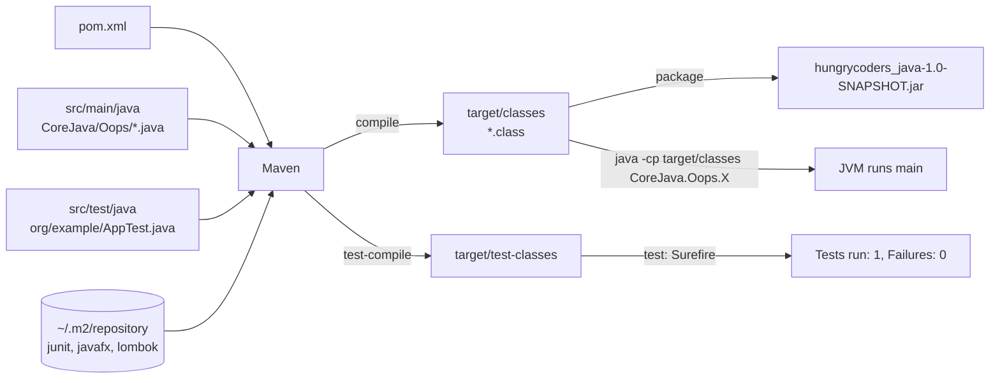
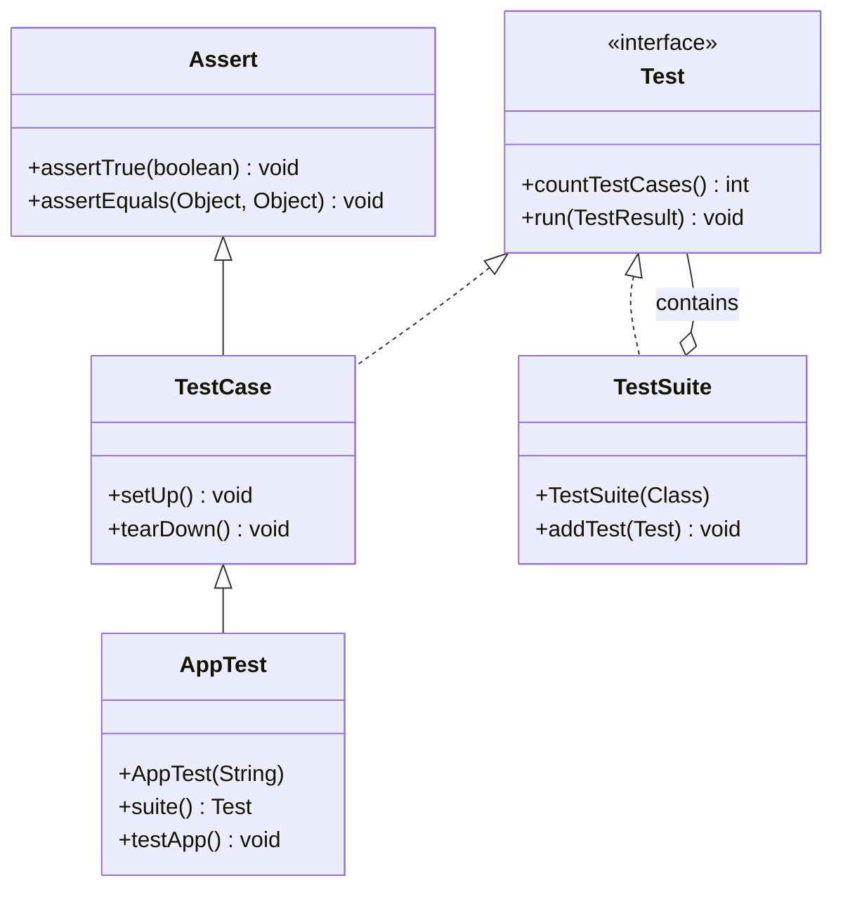

## In One Line
The whole course is **one Maven project**: every example is a `.java` file under `src/main/java` in a folder that matches its `package`, `pom.xml` tells Maven how to build it (Java 18, JUnit 3 for tests, JavaFX and Lombok for two examples), and you can run any example from the IDE, with `javac` + `java`, with `java File.java`, or through Maven.

## Mental Model
Think of a **restaurant kitchen**.

- **`pom.xml` is the kitchen's order sheet.** It names the restaurant (`groupId`, `artifactId`, `version`), the house rules ("cook for Java 18", "read recipes as UTF-8") and the list of ingredients to buy (the `<dependencies>`).
- **Maven is the head chef.** You never tell it *how* to cook; you say *how far* to go ("compile", "test", "package") and it runs every standard step up to that point, in order.
- **Maven Central is the supermarket, `~/.m2/repository` is your fridge.** The first build downloads each ingredient (a `.jar`) once; later builds take it from the fridge.
- **`src/main/java` is the recipe shelf**, divided into labelled sections — `CoreJava/Oops`, `Collections/Lists` — and each label is a **package**. A recipe filed in the wrong section cannot be found.
- **`src/test/java` is the tasting station** where the food is checked (`AppTest`). What happens there never goes out to the customer.
- **`target/` is the serving counter.** Everything on it (`.class` files, the jar, test reports) is produced by the kitchen and can be thrown away and remade at any time (`mvn clean`). You never cook *on* the counter — you never edit files in `target/`.

## Concept
### How the course project is organised
The course is a standard Maven project. The `WatchServiceExample` still contains its author's own path, `C:\Users\hsahu\Desktop\hungrycoder\hungrycoder\src\main\java\NIO`, which shows the layout the examples came from:

```text
hungrycoders_java/                      <- project root (the folder you open in the IDE)
├── pom.xml                             <- build description (this lesson)
├── src/
│   ├── main/java/                      <- production code: the 140 examples
│   │   ├── CoreJava/Oops/InnerClassExample.java      package CoreJava.Oops;
│   │   ├── CoreJava/JavaFeatures/WrapperClassExample.java
│   │   ├── Collections/Lists/ArrayListExample.java   package Collections.Lists;
│   │   └── ... (Generics, IO, NIO, Java8Features, Multithreading, ...)
│   └── test/java/
│       └── org/example/AppTest.java    <- the only test (this lesson)
└── target/                             <- created by the build; never edit, never commit
    ├── classes/CoreJava/Oops/InnerClassExample.class
    ├── test-classes/org/example/AppTest.class
    ├── surefire-reports/               <- test results
    └── hungrycoders_java-1.0-SNAPSHOT.jar
```

| Folder | Holds | Compiled into | In the jar? |
|---|---|---|---|
| `src/main/java` | Your application code | `target/classes` | Yes |
| `src/main/resources` (optional) | Config files, images, `.properties` | copied to `target/classes` | Yes |
| `src/test/java` | Test classes | `target/test-classes` | **No** |
| `src/test/resources` (optional) | Test data | copied to `target/test-classes` | No |
| `target/` | Build output | — | It *is* the output |

Maven calls this **convention over configuration**: because every Maven project uses the same folders, the `pom.xml` does not have to say where the sources are. Gradle uses the same layout.

### Packages are folders
Every course file starts with a `package` line, for example `package CoreJava.Oops;`. Four rules follow from it:

1. **The fully qualified name** of the class becomes `CoreJava.Oops.InnerClassExample`. That full name — not just `InnerClassExample` — is what you pass to `java`.
2. **The folder must match the package.** The compiled class must sit at `CoreJava/Oops/InnerClassExample.class` below a *classpath root* (`target/classes`, or `out/` in the commands below). By convention the source file sits in the matching folder under `src/main/java` too; Maven and every IDE rely on that.
3. **One `public` top-level class per file, and the file is named after it.** Other top-level classes in the same file must be package-private. The course uses this a lot: `PolymorphismExample.java` also declares `Car` and `Maruti`.
4. **A package is one namespace across all its files.** `InheritanceExample.java` declares `Animal` and `Dog` in `CoreJava.Oops`, so `AbstractVsInterfaceExample.java` in the same package has to call its classes `Animal1` and `Dog1` — a second `Animal` would be a *duplicate class* error. Classes in the same package also see each other's package-private members without imports: `DeserializationExample` uses the `Student` class that is declared in `SerializationExample.java`.

The `package` statement must be the first statement in the file (only comments and blank lines may come before it). A file with no `package` line is in the **default package**, which cannot be imported from any named package — fine for a scratch file, never for real code.

> [!NOTE] Java's naming convention is **all-lowercase** packages built from a reversed domain name: `com.hungrycoders.oops`. The course's `CoreJava.Oops` and `Collections.Lists` compile fine but break the convention and look like class names. Keep them while studying; use lowercase in your own projects.

### `pom.xml` — the Project Object Model
A POM describes **what** the project is and **what it needs**; Maven knows **how** to build it.

| Element | In the course pom | Meaning |
|---|---|---|
| `modelVersion` | `4.0.0` | Version of the POM format itself. The only one Maven 2 and 3 understand. |
| `groupId` | `org.example` | Who owns the project, usually a reversed domain. `org.example` is the IDE/template placeholder. |
| `artifactId` | `hungrycoders_java` | The project's name; also the jar's file name. |
| `version` | `1.0-SNAPSHOT` | `-SNAPSHOT` = "work in progress, may change". A release version (`1.0`) must never change once published. |
| `packaging` | `jar` | What `mvn package` produces. `jar` is the default, so this line is optional. |
| `name`, `url` | `Hungry Coders Java Repo`, `http://maven.apache.org` | Display name and home page — documentation only. The URL is a template leftover. |
| `properties` | encoding + compiler level | Key/value settings that plugins read. |
| `dependencies` | 4 libraries | Jars to download and put on the classpath. |

`groupId:artifactId:version` (**GAV**) is a project's unique address in any Maven repository, for example `org.projectlombok:lombok:1.18.32`.

### The three properties
- `project.build.sourceEncoding = UTF-8` — the compiler and resource plugins read files as UTF-8. Without it, Maven warns that the build depends on the platform's default encoding (a real problem on Windows before Java 18; JEP 400 made UTF-8 the default in Java 18, but the explicit setting is still best practice).
- `maven.compiler.source = 18` — the compiler plugin passes `-source 18` to `javac`: accept only Java 18 syntax.
- `maven.compiler.target = 18` — passes `-target 18`: write class files with **major version 62** (Java version + 44). A JVM older than 18 refuses to load them.

On JDK 21 the build compiles, but `javac` warns `system modules path not set in conjunction with -source 18`. The warning means: "you are still compiling against the **JDK 21** class library". Code that calls a Java 21 method compiles for target 18 and then fails with `NoSuchMethodError` on a real Java 18 runtime. The modern fix is one property, `maven.compiler.release`, which maps to `javac --release` (JDK 9+, JEP 247) and checks the API as well:

```java
import java.util.List;
public class UsesNewApi {
    public static void main(String[] args) {
        System.out.println(List.of(1, 2, 3).getFirst());   // added in Java 21
    }
}
```
```output
$ javac -source 18 -target 18 -d a UsesNewApi.java
warning: [options] system modules path not set in conjunction with -source 18
1 warning
$ javac --release 18 -d b UsesNewApi.java
UsesNewApi.java:4: error: cannot find symbol
        System.out.println(List.of(1, 2, 3).getFirst());   // added in Java 21
                                           ^
  symbol:   method getFirst()
  location: interface List<Integer>
1 error
```

> [!NOTE] Java 18 (March 2022) was a short-lived **non-LTS** release, replaced by Java 19 six months later. Target an LTS version — 17, 21 or 25 — so the build matches a JDK that still gets updates. This app's lessons target Java 17/21 behaviour.

### The four dependencies and their scopes
| Dependency | Scope | Used by | Why this scope |
|---|---|---|---|
| `junit:junit:3.8.1` | `test` | `AppTest` | Only tests need it; it must not leak into the application. |
| `org.openjfx:javafx-controls:17` | `compile` (default) | **No example** | Buttons, tables and other UI controls. Nothing in the course uses them. |
| `org.projectlombok:lombok:1.18.32` | `provided` | `DAOExample` (`@Getter`, `@Setter`) | Lombok generates code **while compiling**; nothing of it is needed at runtime. |
| `org.openjfx:javafx-base:17` | `compile` (default) | `MVVMExample` (`StringProperty`, bindings) | Needed to compile *and* to run. |

JavaFX used to ship inside Oracle JDK 8, but since JDK 11 it is a separate project (OpenJFX) that you add as a dependency. The comment `<!-- Adjust version as needed -->` means: pick a JavaFX version that runs on your JDK (JavaFX 17 needs JDK 11+, JavaFX 21 needs JDK 17+).

Scopes decide **which classpath** a dependency lands on:

| Scope | Compile `src/main` | Compile + run tests | Run the app | Passed on to projects that depend on you |
|---|---|---|---|---|
| `compile` (default) | Yes | Yes | Yes | Yes |
| `provided` | Yes | Yes | **No** — the runtime/server must supply it | No |
| `runtime` | **No** | Yes | Yes | Yes |
| `test` | **No** | Yes | No | No |
| `system` | like `provided`, but from a local file path (deprecated) | | | |
| `import` | only inside `<dependencyManagement>`, to import a BOM | | | |

Typical examples: `compile` — Guava, Jackson; `provided` — Lombok, the Servlet API (Tomcat provides it); `runtime` — a JDBC driver (you code against `java.sql`, the driver is loaded at runtime); `test` — JUnit, Mockito.

Test scope is enforced. A class in `src/main/java` that imports JUnit does not compile:
```output
[ERROR] .../src/main/java/Demo/MainUsesJunit.java:[3,23] package junit.framework does not exist
```

### Transitive dependencies
You declared four artifacts, but Maven downloads more: a dependency's own dependencies come along automatically. `mvn dependency:tree` shows the real graph of the course project:
```output
[INFO] org.example:hungrycoders_java:jar:1.0-SNAPSHOT
[INFO] +- junit:junit:jar:3.8.1:test
[INFO] +- org.openjfx:javafx-controls:jar:17:compile
[INFO] |  +- org.openjfx:javafx-controls:jar:linux:17:compile
[INFO] |  \- org.openjfx:javafx-graphics:jar:17:compile
[INFO] |     \- org.openjfx:javafx-graphics:jar:linux:17:compile
[INFO] +- org.projectlombok:lombok:jar:1.18.32:provided
[INFO] \- org.openjfx:javafx-base:jar:17:compile
```
- `javafx-controls` pulls in `javafx-graphics`, which needs `javafx-base` — so `javafx-base` would arrive even if you had not declared it. You declared it directly, so it appears at the top level and only once.
- The `linux` entries are **classifiers**: JavaFX publishes a separate native jar per operating system, and the JavaFX parent POM picks the right one for the machine running the build (`win`, `mac`, `linux`...).
- If two paths bring **different versions** of the same library, Maven's rule is **nearest wins** (the shortest path from your project), and on a tie the first one declared wins. You can override it with `<dependencyManagement>` or remove one with `<exclusions>`.

### The build: lifecycle, phases, goals, plugins
Maven's default lifecycle is an ordered list of **phases**. Asking for a phase runs **every phase before it** too.

| Command | What runs | Result |
|---|---|---|
| `mvn compile` | validate → compile | `target/classes` |
| `mvn test` | ... → compile → test-compile → test | runs `AppTest` with the Surefire plugin |
| `mvn package` | ... → test → package | `target/hungrycoders_java-1.0-SNAPSHOT.jar` |
| `mvn install` | ... → package → verify → install | copies the jar into `~/.m2/repository/org/example/...` so other local projects can depend on it |
| `mvn clean` | the separate *clean* lifecycle | deletes `target/` |
| `mvn clean install` | both, left to right | a fresh, full build |

Phases do nothing on their own; **plugin goals** are bound to them. The course pom declares no plugins, so Maven uses its built-in defaults. With Maven 3.9.11 they were `compiler:3.13.0`, `resources:3.3.1`, `surefire:3.2.5` and `jar:3.4.1` — they change with the Maven version, which is why real projects pin plugin versions. You can also call a goal directly: `mvn dependency:tree`, `mvn exec:java`.

The jar that `mvn package` builds contains only your classes — no dependencies and no `Main-Class` entry in its manifest — so `java -jar` cannot start it:
```output
$ java -jar target/hungrycoders_java-1.0-SNAPSHOT.jar
no main manifest attribute, in target/hungrycoders_java-1.0-SNAPSHOT.jar
```
That is normal for a course repository with 140 separate `main` methods. An application would configure the jar plugin's `mainClass` (and the Shade or Assembly plugin for a "fat jar" that bundles dependencies).

### `AppTest` and JUnit 3
`AppTest.java` was generated by Maven's classic `maven-archetype-quickstart` template, which also created a `Hello World!` `App.java` (not in your material) and the `junit 3.8.1` dependency. JUnit 3 finds tests **by naming convention and reflection** instead of annotations:

- The test class **extends `junit.framework.TestCase`** and is `public`.
- Each test is a method that is **`public`, returns `void`, takes no parameters, and whose name starts with `test`** (lower-case).
- Assertions (`assertTrue`, `assertEquals`, `fail`...) are **inherited** from `junit.framework.Assert`, the superclass of `TestCase`.
- `setUp()` / `tearDown()` run before / after **each** test; the framework creates a **new instance of the class for every test method**, so tests cannot share state through fields.
- A `TestSuite` groups tests; `new TestSuite(AppTest.class)` builds one from every `test...` method in the class.

Watch the rules decide what runs:
```java
import junit.framework.TestCase;

public class CalculatorTest extends TestCase {
    public void testAdd()      { assertEquals(5, 2 + 3); }
    public void testDivide()   { assertEquals(3, 10 / 3); }
    public void checkSubtract(){ assertEquals(1, 3 - 2); }   // no "test" prefix
    private void testHidden()  { assertTrue(true); }          // not public
    public void testWrong()    { assertEquals("sum", 6, 2 + 3); }
}
```
```output
$ java -cp junit-3.8.1.jar:. junit.textui.TestRunner CalculatorTest
..F.F.
Time: 0.006
There were 2 failures:
1) warning(junit.framework.TestSuite$1)junit.framework.AssertionFailedError: Test method isn't public: testHidden
2) testWrong(CalculatorTest)junit.framework.AssertionFailedError: sum expected:<6> but was:<5>
	at CalculatorTest.testWrong(CalculatorTest.java:8)
	at java.base/jdk.internal.reflect.DirectMethodHandleAccessor.invoke(DirectMethodHandleAccessor.java:103)

FAILURES!!!
Tests run: 4,  Failures: 2,  Errors: 0
```
Each `.` is a test starting and each `F` a failure; the time differs on every run. `checkSubtract` is silently ignored, the private `testHidden` becomes a warning "test" that fails, and `10 / 3` is integer division (`3`), so `testDivide` passes. `CalculatorTest` has no constructor and no `suite()` method — JUnit 3.8 builds the suite by reflection anyway, so both are optional in `AppTest` too.

| | JUnit 3 (3.8.1, 2002) | JUnit 4 (2006) | JUnit 5 "Jupiter" (2017) |
|---|---|---|---|
| Marks a test | name starts with `test` | `@org.junit.Test` | `@org.junit.jupiter.api.Test` |
| Test class | `extends TestCase`, `public` | any public class | any class, may be package-private |
| Before/after each test | override `setUp()` / `tearDown()` | `@Before` / `@After` | `@BeforeEach` / `@AfterEach` |
| Once per class | via `TestSetup` decorator | `@BeforeClass` (static) | `@BeforeAll` |
| Assertions | inherited: `assertEquals("msg", exp, act)` | `org.junit.Assert` (message first) | `org.junit.jupiter.api.Assertions` (message **last**), `assertThrows`, `assertAll` |
| Expect an exception | `try { ...; fail(); } catch (...) {}` | `@Test(expected = X.class)` | `assertThrows(X.class, () -> ...)` |

JUnit 6 (2025) keeps the Jupiter API of JUnit 5 and requires Java 17+. New projects should use JUnit 5/6 — see the modern pom below.

### Four ways to run an example
| Way | Command / action | Good for | Limits |
|---|---|---|---|
| IDE (IntelliJ, Eclipse, VS Code) | Open the folder that contains `pom.xml`; click the green arrow next to `main` | Daily study, debugging | Set the project JDK to 18 or newer |
| `javac` + `java` | `javac -d out <file>` then `java -cp out <full.class.Name>` | Understanding what the IDE does | You manage the classpath yourself |
| Single-file launch (JDK 11+, JEP 330) | `java path/to/Example.java` | Quick one-off runs | Runs the **first** class in the file; only that one file; no Lombok/JavaFX |
| Maven | `mvn -q compile exec:java -Dexec.mainClass=<full.class.Name>` | Examples that need dependencies (MVVM, DAO) | Slower start |

From the project root, with the real outputs:
```output
$ javac -d out src/main/java/CoreJava/Oops/InnerClassExample.java
$ find out -type f
out/CoreJava/Oops/InnerClassExample$Inner.class
out/CoreJava/Oops/InnerClassExample$StaticInner.class
out/CoreJava/Oops/InnerClassExample.class
$ java -cp out CoreJava.Oops.InnerClassExample
Inner class accessing: Outer field
Static inner class method.
$ java src/main/java/CoreJava/Oops/InnerClassExample.java
Inner class accessing: Outer field
Static inner class method.
$ mvn -q compile exec:java -Dexec.mainClass=CoreJava.Oops.InnerClassExample
Inner class accessing: Outer field
Static inner class method.
```
`javac -d out` creates the package folders (`out/CoreJava/Oops/`) for you, and every nested class gets its own `Outer$Inner.class` file (see [Inner Classes](lesson:a01-oop/09-inner-classes)).

**Single-file launch compiles the file in memory and, on JDK 21, runs the first top-level class it declares.** In 53 of the 140 examples the first class is a helper, so the launch fails even though the program is correct:
```output
$ java src/main/java/CoreJava/Oops/PolymorphismExample.java
error: can't find main(String[]) method in class: CoreJava.Oops.Car
$ javac -d out src/main/java/CoreJava/Oops/PolymorphismExample.java
$ java -cp out CoreJava.Oops.PolymorphismExample
Maruti makes sound
```
Six more fail for other reasons: `DeserializationExample` needs `Student` from another file; `DAOExample` needs Lombok; `MVVMExample` needs JavaFX and has a stray `;;` that source level 21 rejects; `BufferedReaderExample` reads a file an earlier example writes; `NashornJavaScriptExample` needs an engine removed in JDK 15; `WatchServiceExample` watches a Windows path. The recorded outputs in this app were produced by compiling everything together and running each class by name (JDK 21).

### A modernised pom
The course pom works, but for your own projects this version fixes every issue above (verified with `mvn test` on JDK 21):
```xml
<project xmlns="http://maven.apache.org/POM/4.0.0"
         xmlns:xsi="http://www.w3.org/2001/XMLSchema-instance"
         xsi:schemaLocation="http://maven.apache.org/POM/4.0.0 https://maven.apache.org/xsd/maven-4.0.0.xsd">
  <modelVersion>4.0.0</modelVersion>

  <groupId>com.hungrycoders</groupId>
  <artifactId>java-course</artifactId>
  <version>1.0-SNAPSHOT</version>

  <properties>
    <project.build.sourceEncoding>UTF-8</project.build.sourceEncoding>
    <maven.compiler.release>21</maven.compiler.release>
    <lombok.version>1.18.38</lombok.version>
  </properties>

  <dependencies>
    <dependency>
      <groupId>org.openjfx</groupId>
      <artifactId>javafx-base</artifactId>
      <version>21.0.5</version>
    </dependency>
    <dependency>
      <groupId>org.projectlombok</groupId>
      <artifactId>lombok</artifactId>
      <version>${lombok.version}</version>
      <scope>provided</scope>
    </dependency>
    <dependency>
      <groupId>org.junit.jupiter</groupId>
      <artifactId>junit-jupiter</artifactId>
      <version>5.11.4</version>
      <scope>test</scope>
    </dependency>
  </dependencies>

  <build>
    <plugins>
      <plugin>
        <groupId>org.apache.maven.plugins</groupId>
        <artifactId>maven-compiler-plugin</artifactId>
        <version>3.13.0</version>
        <configuration>
          <annotationProcessorPaths>
            <path>
              <groupId>org.projectlombok</groupId>
              <artifactId>lombok</artifactId>
              <version>${lombok.version}</version>
            </path>
          </annotationProcessorPaths>
        </configuration>
      </plugin>
      <plugin>
        <groupId>org.apache.maven.plugins</groupId>
        <artifactId>maven-surefire-plugin</artifactId>
        <version>3.5.2</version>
      </plugin>
    </plugins>
  </build>
</project>
```
What changed and why:
- `maven.compiler.release` 21 (an LTS) instead of `source`/`target` 18 — also checks the API.
- Only `javafx-base` — the one JavaFX module an example uses. `javafx-controls` added about 7 MB of unused UI jars (controls + graphics).
- Lombok is registered in `annotationProcessorPaths`. JDK 21 still runs annotation processors it finds on the classpath, but prints *"A future release of javac may disable annotation processing unless at least one processor is specified by name..."* — and JDK 23 did disable that implicit discovery. Lombok also hooks into `javac` internals, so upgrade it whenever you upgrade the JDK.
- JUnit 5 instead of JUnit 3, and pinned plugin versions so the build is the same on every machine.

The matching JUnit 5 test:
```java
package org.example;

import org.junit.jupiter.api.Test;
import static org.junit.jupiter.api.Assertions.assertEquals;

class CalculatorTest {
    @Test
    void addsTwoNumbers() {
        Calculator calc = new Calculator();
        assertEquals(5, calc.add(2, 3));
        assertEquals(5, calc.getLastResult());   // getter generated by Lombok
    }
}
```
```output
[INFO] Using auto detected provider org.apache.maven.surefire.junitplatform.JUnitPlatformProvider
[INFO] Running org.example.CalculatorTest
[INFO] Tests run: 1, Failures: 0, Errors: 0, Skipped: 0, Time elapsed: 0.163 s -- in org.example.CalculatorTest
```

## Diagram

Maven reads the pom and the two source trees, fetches the jars from the local repository, and writes everything it produces into `target/`.


Asking for any phase runs every phase to its left: `mvn package` compiles and tests before it builds the jar.


JUnit 3 is a Composite: a `TestSuite` is a `Test` that holds other `Test`s, and `AppTest` gets its assertions by inheriting from `TestCase`.

## Code
@example _project/pom.xml

@example _project/AppTest.java

Neither file prints anything by itself. Running the test produces:
```output
$ mvn test
[INFO] --- surefire:3.2.5:test (default-test) @ hungrycoders_java ---
[INFO] Using auto detected provider org.apache.maven.surefire.junit.JUnit3Provider
[INFO] 
[INFO] -------------------------------------------------------
[INFO]  T E S T S
[INFO] -------------------------------------------------------
[INFO] Running org.example.AppTest
[INFO] Tests run: 1, Failures: 0, Errors: 0, Skipped: 0, Time elapsed: 0.042 s -- in org.example.AppTest
[INFO] 
[INFO] Results:
[INFO] 
[INFO] Tests run: 1, Failures: 0, Errors: 0, Skipped: 0
[INFO] 
[INFO] BUILD SUCCESS
```
Or, without Maven, with JUnit 3's own text runner:
```output
$ java -cp junit-3.8.1.jar:target/test-classes junit.textui.TestRunner org.example.AppTest
.
Time: 0.004

OK (1 test)
```

## Walkthrough
**pom.xml**
- `<project xmlns=... xsi:schemaLocation=...>` — the root element. The namespace and schema location let IDEs validate the file and auto-complete element names against the Maven 4.0.0 XSD. (The file has Windows CRLF line endings, a sign it was written on Windows; Maven does not care.)
- `<modelVersion>4.0.0</modelVersion>` — the POM format version; always `4.0.0` for Maven 2 and 3.
- `<groupId>org.example</groupId>` — the owner namespace. `org.example` is the default the IDE wizard or archetype fills in.
- `<artifactId>hungrycoders_java</artifactId>` — the project's id; the jar becomes `hungrycoders_java-1.0-SNAPSHOT.jar`.
- `<version>1.0-SNAPSHOT</version>` — an in-development version. Maven re-checks remote repositories for newer snapshot builds; release versions are immutable.
- `<packaging>jar</packaging>` — `mvn package` builds a jar (the default; `war` and `pom` are other common values).
- `<name>Hungry Coders Java Repo</name>` / `<url>http://maven.apache.org</url>` — human-readable metadata used in reports. The name was customised; the URL is the template's placeholder.
- `<properties>` — three settings: `project.build.sourceEncoding` UTF-8 (read sources as UTF-8), `maven.compiler.source` 18 (language level) and `maven.compiler.target` 18 (class file version 62). The compiler plugin reads these property names automatically.
- `<dependencies>` — the list of libraries. Each `<dependency>` is a GAV coordinate plus an optional `<scope>`:
  - `junit:junit:3.8.1`, scope `test` — the JUnit 3 library for `AppTest`; invisible to `src/main/java`.
  - `org.openjfx:javafx-controls:17` with the comment `<!-- Adjust version as needed -->` — JavaFX UI controls, default `compile` scope. It brings `javafx-graphics` and `javafx-base` transitively. No example uses the controls.
  - `<!-- https://mvnrepository.com/artifact/org.projectlombok/lombok -->` — the page the snippet was copied from (mvnrepository.com shows a ready-made `<dependency>` block for every artifact).
  - `org.projectlombok:lombok:1.18.32`, scope `provided` — the annotation processor behind `@Getter`/`@Setter` in `DAOExample`. Needed by `javac`, not by the running program.
  - `org.openjfx:javafx-base:17` — JavaFX properties and bindings (`javafx.beans.*`), used by `MVVMExample`. Declaring it directly documents that the code uses it, even though `javafx-controls` would bring it anyway.
- There is **no `<build>` section**, so every plugin runs with Maven's default version and settings.

**AppTest.java**
- `package org.example;` — the test lives in `src/test/java/org/example/`. The template derives the package from the `groupId`.
- `import junit.framework.Test; ... TestCase; ... TestSuite;` — the three core JUnit 3 types: `Test` is the interface for anything runnable, `TestCase` is one test fixture, `TestSuite` is a collection of tests.
- `/** Unit test for simple App. */` — Javadoc. "Simple App" is the template's `App.java` Hello World, which is not part of your material.
- `public class AppTest extends TestCase` — JUnit 3 requires a public class that extends `TestCase`; that inheritance also gives it `assertTrue`, `assertEquals` and friends.
- `public AppTest(String testName) { super(testName); }` — JUnit 3 creates **one `AppTest` object per test method** and passes the method's name, so `TestCase.runTest()` knows which method to call by reflection. The Javadoc `@param testName` documents the parameter. Since JUnit 3.8 a no-argument constructor works too, so this constructor is optional.
- `public static Test suite() { return new TestSuite(AppTest.class); }` — a static factory that runners call if it exists. `new TestSuite(AppTest.class)` scans the class for public, `void`, no-argument methods whose names start with `test`. The declared return type is the interface `Test` — the suite *is a* `Test` (Composite pattern). Optional: without it, runners build the same suite automatically.
- `/** Rigourous Test :-) */` + `public void testApp() { assertTrue(true); }` — the template's placeholder test. `assertTrue(true)` can never fail, so it proves only that the build and test runner work. The Javadoc is a joke from the template (and "Rigourous" is misspelled).
- Maven's Surefire plugin finds the class because its name matches the default pattern `**/*Test.java` (the other defaults are `**/Test*.java`, `**/*Tests.java`, `**/*TestCase.java`), detects JUnit 3 on the test classpath (`JUnit3Provider`), and runs it: `Tests run: 1, Failures: 0`.

## Traps
> [!ERRATA] `maven.compiler.source`/`target` **18** pins the course to a non-LTS Java version that stopped receiving updates in September 2022, and `source`/`target` without `release` produces the warning `system modules path not set in conjunction with -source 18` on newer JDKs and does not stop you from calling newer APIs. Use `<maven.compiler.release>17</maven.compiler.release>` or `21` instead.

> [!ERRATA] `junit 3.8.1` is a 2002-era version generated by the old quickstart template, and `AppTest.testApp()` asserts `assertTrue(true)`, which tests nothing. The Javadoc "Unit test for simple App" refers to an `App` class that is not in the material, and "Rigourous" is a typo for "Rigorous". Use JUnit 5 (`org.junit.jupiter:junit-jupiter`, `@Test`) and write tests that call real code.

> [!ERRATA] `javafx-controls` is declared but no example uses a single UI control; only `MVVMExample` needs JavaFX, and it needs just `javafx-base`. The extra dependency downloads about 7 MB of platform-specific jars (`javafx-controls` and `javafx-graphics`) and triggers a harmless Maven warning, *"6 problems were encountered while building the effective model for org.openjfx:javafx-controls:jar:17"* (duplicate OS profiles in JavaFX 17's own parent POM).

> [!ERRATA] `<url>http://maven.apache.org</url>` and `<groupId>org.example</groupId>` are template placeholders, not real project data. A real project uses its own reversed domain (`com.hungrycoders`) and home page.

- **Running from the wrong folder.** A class in a package must be started by its full name from the classpath root. Inside `CoreJava/Oops` this fails:
  ```output
  $ java InnerClassExample
  Error: Could not find or load main class InnerClassExample
  Caused by: java.lang.NoClassDefFoundError: InnerClassExample (wrong name: CoreJava/Oops/InnerClassExample)
  ```
  Go to the root (`target/classes` or `out`) and run `java CoreJava.Oops.InnerClassExample`, or pass `-cp`.
- **Single-file launch picks the first class.** `java PolymorphismExample.java` fails with `can't find main(String[]) method in class: CoreJava.Oops.Car` because `Car` comes first in the file. The code is fine — compile it and run the right class by name.
- **Same source, different verdicts.** `MVVMExample` has `import ...SimpleStringProperty;;`. With the pom's source level 18, Maven only warns (`extraneous semicolon`); `java MVVMExample.java` on JDK 21 compiles at level 21 and stops with `error: extraneous semicolon`. The rule became an error in Java 21.
- **Too-new class files.** Classes compiled for a newer Java refuse to load on an older JVM. Running a class with version 66 (Java 22) on JDK 21 prints:
  ```output
  Error: LinkageError occurred while loading main class Hello
  	java.lang.UnsupportedClassVersionError: Hello has been compiled by a more recent version of the Java Runtime (class file version 66.0), this version of the Java Runtime only recognizes class file versions up to 65.0
  ```
  The course's target 18 produces version 62.0, so it needs Java 18+. Building on a JDK older than the target fails earlier, in `javac`: `invalid target release`.
- **Editing the pom without reloading.** IDEs cache the dependency list. After changing `pom.xml`, reload the Maven project (IntelliJ: the floating "Load Maven Changes" button or *Maven → Reload All Maven Projects*).
- **JUnit 3 test names are case-sensitive and strict.** `TestDiscount()`, `testTax(int)`, `int testCount()` and `checkSubtract()` are all silently skipped; a non-public `test...` method shows up as the failure `Test method isn't public`.
- **Lombok on a newer JDK.** A build that works on JDK 21 can fail on JDK 23+ with "cannot find symbol" for every generated getter, because implicit annotation processing is off. Register Lombok in `annotationProcessorPaths` and keep its version current.
- **Never edit or commit `target/`.** It is regenerated on every build; add it to `.gitignore`.

## Tips & Tricks
- **"GAV is the address, scope is the room."** `groupId:artifactId:version` says *which* jar; the scope says *where* it may be used (main code, tests, runtime).
- **Scope ladder:** `compile` — everywhere; `provided` — compile but someone else ships it; `runtime` — ship but do not compile against; `test` — tests only.
- **"Asking for a phase runs everything before it."** `mvn test` always compiles first; `mvn install` always tests first (add `-DskipTests` only when you know why).
- **Package = path, dots = slashes.** `CoreJava.Oops.InnerClassExample` ↔ `CoreJava/Oops/InnerClassExample.class`. Run from the folder that *contains* `CoreJava`.
- **Class file major version = Java version + 44** (52 = Java 8, 61 = 17, 62 = 18, 65 = 21). Seen in `javap -v` and in `UnsupportedClassVersionError` messages.
- **Useful commands:** `mvn dependency:tree` (who brought this jar?), `mvn -q compile exec:java -Dexec.mainClass=...` (run an example that needs dependencies), `mvn -o` (offline, use the local repository only), `javap -c -p SomeClass` (see the bytecode the compiler wrote).
- **Prefer `maven.compiler.release`** over `source` + `target` on JDK 9+.
- **Quick experiments:** `jshell` or `java Snippet.java` for small files; the IDE or `javac` + `java` for course files with helper classes first.

## Interview Q&A
### [Basic] What is Maven, and what is the role of pom.xml?
Maven is a build and dependency-management tool for Java. The `pom.xml` (Project Object Model) declares **what** the project is — its coordinates (`groupId`, `artifactId`, `version`), packaging, properties such as the Java level — and **what it needs** — its dependencies and plugins. Maven supplies the **how**: a standard directory layout (`src/main/java`, `src/test/java`, `target/`), a fixed lifecycle (compile, test, package, install, deploy) and plugins bound to each phase. It downloads dependencies, including transitive ones, from a remote repository like Maven Central into the local repository `~/.m2/repository`.

**Follow-up:** *How does Gradle differ?* — Gradle uses the same layout and repositories but a Groovy/Kotlin build script instead of XML, a task graph instead of a fixed lifecycle, and incremental builds with a build cache. It is more flexible and usually faster; Maven is more declarative and uniform.

### [Basic] What are GAV coordinates, and what does SNAPSHOT mean?
Every Maven artifact is identified by `groupId:artifactId:version` — for example `org.projectlombok:lombok:1.18.32`. The `groupId` is the organisation (a reversed domain), the `artifactId` the project, the `version` the release. A version ending in `-SNAPSHOT` (`1.0-SNAPSHOT`) marks work in progress: it can be republished with new content, and Maven checks for updated snapshots. A release version is immutable once published — you publish a new version instead.

**Follow-up:** *What else can identify an artifact?* — A `classifier` (for example `javafx-base:17:linux`, or `sources`/`javadoc` jars) and the `type`/packaging (`jar`, `war`, `pom`).

### [Basic] Explain Maven dependency scopes.
- **compile** (default): on every classpath and passed on transitively — e.g. Jackson.
- **provided**: needed to compile, but the runtime environment supplies it, so it is not packaged or passed on — the Servlet API, Lombok.
- **runtime**: not needed to compile, needed to run — a JDBC driver.
- **test**: only for compiling and running tests — JUnit, Mockito.
- **system**: like provided but from a local path (deprecated); **import**: only for importing a BOM in `<dependencyManagement>`.

In the course pom, JUnit is `test`, Lombok is `provided` (it generates getters at compile time, nothing is needed at runtime), and JavaFX is `compile`.

**Follow-up:** *What happens if main code imports a test-scoped class?* — Compilation fails: `package junit.framework does not exist`, because test dependencies are not on the main compile classpath.

### [Intermediate] What is the Maven build lifecycle? What does `mvn clean install` do?
Maven has three lifecycles: **clean**, **default** and **site**. The default lifecycle's main phases are validate → compile → test-compile → test → package → verify → install → deploy. Invoking a phase runs all earlier phases. Phases themselves are empty; plugin **goals** are bound to them (`compiler:compile` to compile, `surefire:test` to test, `jar:jar` to package). `mvn clean install` first runs the clean lifecycle (deletes `target/`), then the default lifecycle up to `install`: compile, run tests, build the jar, and copy it to `~/.m2/repository` so other local projects can use it.

**Follow-up:** *Difference between `install` and `deploy`?* — `install` copies to your local repository; `deploy` uploads to a remote repository (Nexus, Artifactory, Maven Central) for others.

### [Intermediate] What is the difference between `maven.compiler.source`/`target` and `maven.compiler.release`?
`source` tells `javac` which language syntax to accept; `target` which class-file version to emit. But the code is still compiled against the class library of the JDK running the build, so you can accidentally call an API that does not exist on the target version — it compiles, then fails with `NoSuchMethodError` at runtime. `release` (`javac --release N`, JDK 9+) sets source and target **and** compiles against the exact API of Java N, so such calls are compile errors. On JDK 21, `-source 18` alone even warns: `system modules path not set in conjunction with -source 18`.

**Follow-up:** *What happens if you build with target 21 and run on Java 17?* — `UnsupportedClassVersionError`: class file version 65.0, but the runtime only recognises up to 61.0.

### [Intermediate] How does Maven handle transitive dependencies and version conflicts?
A dependency's own dependencies are added automatically (`javafx-controls` → `javafx-graphics` → `javafx-base`). When two paths bring different versions of the same artifact, Maven picks the **nearest** one in the dependency tree; at equal depth, the first declared wins. You inspect it with `mvn dependency:tree`, force a version with `<dependencyManagement>` (or by declaring it directly), remove one with `<exclusions>`, and align families of libraries by importing a BOM (`<scope>import</scope>`, e.g. Spring Boot or JUnit BOMs).

**Follow-up:** *Why can "nearest wins" cause runtime errors?* — It may choose an older version than another library needs, giving `NoSuchMethodError` or `ClassNotFoundException` at runtime even though compilation succeeded.

### [Intermediate] Why does `java InnerClassExample` fail with "Could not find or load main class" even though the .class file is right there?
The class is declared in `package CoreJava.Oops`, so its real name is `CoreJava.Oops.InnerClassExample`, and the class loader expects to find it at `CoreJava/Oops/InnerClassExample.class` relative to a classpath root. Running from inside `CoreJava/Oops` asks for a class named `InnerClassExample` in the default package; the loader finds the file, reads the name inside it, and reports `wrong name: CoreJava/Oops/InnerClassExample`. Fix: run `java -cp <root> CoreJava.Oops.InnerClassExample` from the directory that contains `CoreJava`.

**Follow-up:** *What is the classpath?* — The list of directories and jars where the JVM and `javac` look for classes, set with `-cp`/`-classpath` or the `CLASSPATH` variable (default: the current directory).

### [Advanced] How did JUnit 3 discover tests, and how does that compare with JUnit 4 and 5?
JUnit 3 used inheritance and naming: a test class extends `TestCase`, and `TestSuite` uses reflection to collect every `public void` no-arg method whose name starts with `test`. Each test method runs on a fresh instance (created with the method name), between `setUp()` and `tearDown()`; assertions are inherited from `Assert`. JUnit 4 (2006) replaced this with annotations (`@Test`, `@Before`, `@After`) on any public class. JUnit 5 (2017) split into the JUnit Platform (launcher used by IDEs and Maven Surefire) and the Jupiter API: `@Test`, `@BeforeEach`, `@DisplayName`, `@ParameterizedTest`, `assertThrows`, and test classes/methods may be package-private. JUnit 6 (2025) keeps Jupiter and requires Java 17.

**Follow-up:** *Why a new instance per test method?* — Isolation: no test can see field values left behind by another test, so tests can run in any order.

### [Advanced] How does Lombok work, and why is it `provided`?
Lombok is an **annotation processor**. During compilation `javac` hands it the syntax tree; Lombok modifies the tree (using internal compiler APIs) to add methods such as getters, setters, constructors and `equals`/`hashCode`. The generated methods end up in the `.class` file, so the running program never needs the Lombok jar — hence `provided` scope. Two consequences: each new JDK can break Lombok until a compatible release appears, and since JDK 23 `javac` no longer runs processors found implicitly on the classpath, so the processor should be declared in the compiler plugin's `annotationProcessorPaths`.

**Follow-up:** *Alternatives to Lombok for data classes?* — Java records (Java 16+) for immutable data carriers, and IDE-generated code otherwise.

### [Advanced] What happens between `java path/File.java` and the program's first line of output?
Since JDK 11 (JEP 330), the `java` launcher has a **source-file mode**: it compiles the file in memory (no `.class` files written), loads the compiled classes into a special class loader, and invokes `main` of the **first top-level class** declared in the file (JDK 21). Only that one file is compiled, the source level is the JDK's own version, and dependencies must be supplied with `--class-path`. That is why course files whose first class is a helper (`Car` in `PolymorphismExample.java`) fail with `can't find main(String[]) method`. JDK 22 (JEP 458) extended the mode to programs made of several source files.

**Follow-up:** *Can you make a Java file executable like a script?* — Yes, with a shebang line `#!/usr/bin/java --source 21` in a file without the `.java` extension.

## Quiz
### Which scope is correct for Lombok in the course pom, and why?
- [ ] `compile` — the program calls the generated getters at runtime
- [x] `provided` — Lombok works during compilation; the generated methods are already in the `.class` files
- [ ] `runtime` — annotations are read at runtime
- [ ] `test` — Lombok is only used in tests
> Lombok is an annotation processor: it writes the getters into the compiled classes, so nothing from Lombok is needed when the program runs. `compile` would work but needlessly ships Lombok to every consumer; `runtime` is wrong because the code must be compiled against it.

### Which phases does `mvn test` run?
- [ ] Only `test`
- [ ] `test` and `package`
- [x] validate, compile, test-compile and test (and the small phases in between)
- [ ] compile and test, but not test-compile
> Invoking a phase runs every earlier phase of the lifecycle. Tests cannot run until both the main code and the test code are compiled. `package` comes *after* `test`, so it is not run.

### Where must the class file be for `java -cp target/classes CoreJava.Oops.InnerClassExample` to work?
- [ ] `target/classes/InnerClassExample.class`
- [x] `target/classes/CoreJava/Oops/InnerClassExample.class`
- [ ] `src/main/java/CoreJava/Oops/InnerClassExample.class`
- [ ] Anywhere, as long as `package CoreJava.Oops;` is in the file
> Package names map to folders below a classpath root: dots become slashes. The classpath root here is `target/classes`, so the loader looks in `target/classes/CoreJava/Oops/`. Source folders are not on the runtime classpath.

### How many tests does JUnit 3 report?
```java
public class ShopTest extends TestCase {
    public void testTotal()       { assertEquals(30, 10 + 20); }
    public void TestDiscount()    { assertEquals(9, 10 - 1); }
    public void testTax(int rate) { assertEquals(2, rate); }
    public int  testCount()       { return 1; }
    public void testRefund()      { assertTrue(true); }
}
```
- [ ] 5
- [ ] 4
- [ ] 3
- [x] 2
> The runner prints `OK (2 tests)`. A JUnit 3 test must be public, return `void`, take no parameters and start with lower-case `test`. `TestDiscount` (capital T), `testTax(int)` (parameter) and `testCount()` (returns `int`) are ignored, leaving `testTotal` and `testRefund`. "5" is tempting if you count every method that looks like a test.

### Why does `java PolymorphismExample.java` fail on JDK 21 when the program itself is correct?
- [ ] Single-file launch does not support `package` declarations
- [ ] The file contains more than one class, which single-file launch forbids
- [x] Single-file launch runs the first top-level class, `Car`, which has no `main`
- [ ] `@Override` is not allowed in single-file programs
> The launcher reports `can't find main(String[]) method in class: CoreJava.Oops.Car`. Several classes and a `package` line are fine — `InnerClassExample.java` runs this way. Compiling with `javac` and running `CoreJava.Oops.PolymorphismExample` by name works.

### The course pom sets `maven.compiler.target` to 18. What happens when the resulting classes run on a Java 17 JVM?
- [ ] They run normally; Java is backward compatible
- [ ] They run, but Java 18 features are skipped
- [x] `UnsupportedClassVersionError`: class file version 62.0, runtime recognises only up to 61.0
- [ ] `NoSuchMethodError` on the first method call
> Target 18 writes class files with major version 62 (18 + 44). A JVM refuses class files newer than itself. Backward compatibility works the other way: old class files run on new JVMs. `NoSuchMethodError` is the symptom of calling a missing *API*, which `--release` prevents.

### Spot the bug: this test class is in `src/main/java`. Why does `mvn compile` fail?
```java
package Demo;

import junit.framework.TestCase;

public class MainUsesJunit extends TestCase { }
```
- [ ] JUnit 3 test classes must have a constructor taking a `String`
- [x] JUnit has `test` scope, so it is not on the classpath used to compile `src/main/java`
- [ ] The package name `Demo` must be lower-case
- [ ] Test classes must end in `Test`
> Maven reports `package junit.framework does not exist`. Test-scoped dependencies exist only for `src/test/java`; move test code there. The constructor is optional since JUnit 3.8, and upper-case packages are unconventional but legal.

## Takeaways
- The course is a standard Maven project: examples in `src/main/java/<package folders>`, the test in `src/test/java`, and all build output in the disposable `target/` folder.
- A class's full name includes its package (`CoreJava.Oops.InnerClassExample`); its class file must sit in the matching folder under a classpath root, and you run it by full name from that root.
- `pom.xml` gives the project's GAV coordinates, the Java level (`source`/`target` 18 → class file version 62; prefer `maven.compiler.release` with an LTS version) and the dependencies.
- Scopes decide where a jar is visible: JUnit `test` (tests only), Lombok `provided` (compile-time only), JavaFX `compile` (everywhere); dependencies of dependencies arrive transitively, nearest version wins.
- Invoking a Maven phase runs all earlier phases: `mvn compile`, `mvn test`, `mvn package`, `mvn clean install`; `mvn -q compile exec:java -Dexec.mainClass=...` runs one example with its dependencies.
- `AppTest` is the quickstart template's JUnit 3 placeholder: extends `TestCase`, tests are public void no-arg `test...` methods found by reflection, and `assertTrue(true)` tests nothing — use JUnit 5 `@Test` for real tests.
- `java File.java` (JDK 11+) runs the first class in the file; 53 course examples start with a helper class, so compile with `javac -d out` and run the main class by name, or use the IDE.
