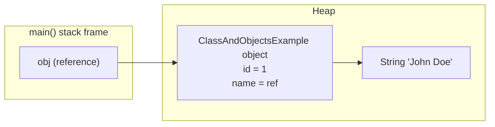
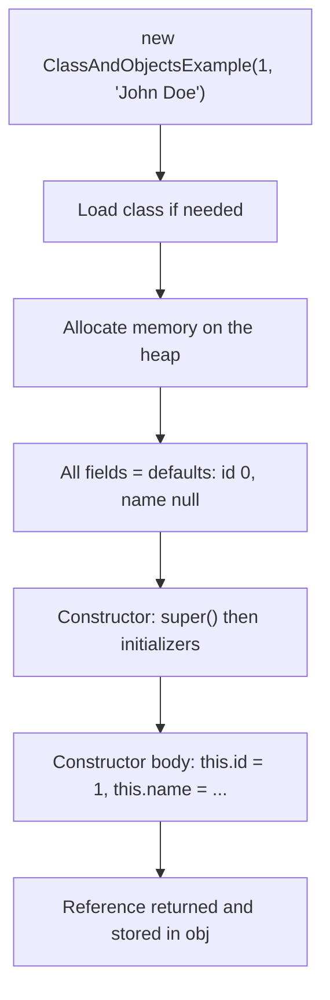
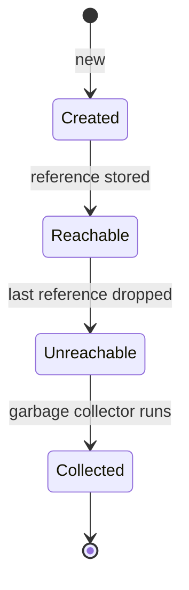

## In One Line
A **class** is a blueprint that declares what data (fields) and behaviour (methods) a kind of thing has; an **object** is one concrete instance of that blueprint, created with `new`, living on the heap with its own copy of the fields.

## Mental Model
Think of an **architect's house plan** and the **houses built from it**.

- The plan (the **class** `ClassAndObjectsExample`) says every house has an `id` (house number) and a `name` (owner). The plan itself has no house number — it is only a description.
- A builder (**`new`** plus the **constructor**) takes the plan and builds a real house on a plot of land (**the heap**), writing the house number `1` and owner `"John Doe"` on it.
- The address written on a piece of paper (**the reference variable** `obj`) is not the house. Copying the paper gives you two addresses of the *same* house; building from the plan again gives you a *different* house.
- Asking the house to "describe yourself" (**calling a method**, `obj.display()`) uses the data of *that* particular house.

One plan, many houses; one house, possibly many addresses pointing at it.

## Concept
### Class vs object
| | Class | Object |
|---|---|---|
| What it is | A type / blueprint written in source code | A runtime instance of that type |
| Exists | Once per class loader (loaded into the JVM's metaspace) | As many times as you call `new` |
| Holds | Declarations of fields, methods, constructors | Actual field **values** (its *state*) |
| Created by | Writing and compiling a `.java` file | `new`, reflection, `clone()`, deserialization |
| Memory | Class metadata in **metaspace** | Instance data on the **heap** |

Every object has three properties interviewers like to hear: **state** (field values), **behaviour** (methods) and **identity** (it is a distinct object even if another one has identical state).

### What a class can contain
- **Fields** — *instance* fields (one copy per object, like `id`, `name`) or `static` fields (one copy per class).
- **Methods** — instance methods (need an object, like `display()`) or `static` methods (belong to the class, like `main`).
- **Constructors** — special blocks that initialise a new object. Same name as the class, **no return type**.
- **Initializer blocks** — `{ ... }` (instance) and `static { ... }` (class-level), run automatically.
- **Nested types** — classes, interfaces, enums and records declared inside (see [Nested and Inner Classes](lesson:a01-oop/09-inner-classes)).

### What `new` really does
`new ClassAndObjectsExample(1, "John Doe")` compiles to this bytecode (from `javap -c`):
```text
0: new           #8   // class CoreJava/Oops/ClassAndObjectsExample
3: dup
4: iconst_1
5: ldc           #33  // String John Doe
7: invokespecial #35  // Method "<init>":(ILjava/lang/String;)V
10: astore_1
```
Step by step:
1. **Load the class** if it is not loaded yet (and run its static initialisation once).
2. **Allocate** memory on the heap for the object (instruction `new`).
3. **Zero the fields** — every field gets its default value (`0`, `null`, `false`, `0.0`) *before* any of your code runs.
4. **Run the constructor** `<init>`: it first calls the parent constructor (`super()` → `Object()`), then runs field initialisers and instance initializer blocks in source order, then the rest of the constructor body (`this.id = id; this.name = name;`).
5. **Return the reference**, which `astore_1` stores in the local variable `obj`.

So the object already exists when the constructor starts; the constructor's job is to put it into a valid state.

### Default values (fields only)
| Field type | Default |
|---|---|
| `byte`, `short`, `int`, `long` | `0` / `0L` |
| `float`, `double` | `0.0f` / `0.0` |
| `char` | `'\u0000'` |
| `boolean` | `false` |
| Any reference (`String`, arrays, objects) | `null` |

**Local variables get no default.** Reading one before assigning it is a compile error (`variable count might not have been initialized`). The compiler can prove a local is assigned because it lives in one method; it cannot do that for fields, so the JVM zeroes them instead.

### Reference vs object
A variable of a class type holds a **reference** (a pointer-like handle), never the object itself.
- `Student c = a;` copies the reference: `a` and `c` now point to the same object (aliasing). Changing `c.id` changes what `a.id` shows.
- `a == c` compares references (same object?). `equals()` inherited from `Object` also compares identity until you override it — see [equals and hashCode](lesson:b01-fundamentals/06-object-class-equals-hashcode).
- A reference can be `null` (points to nothing). Calling a method on it throws `NullPointerException`.
- Java passes the **reference by value** into methods — see [Pass by Value](lesson:b01-fundamentals/04-pass-by-value).

### Where things live
| Thing | Memory area |
|---|---|
| The object and its fields (`id`, `name` reference) | Heap |
| The `String` object `"John Doe"` (a literal) | Heap (interned in the string pool) |
| Local variable `obj` (the reference) | The current thread's stack frame for `main` |
| Class metadata, method bytecode | Metaspace |

On a 64-bit HotSpot JVM with compressed pointers (the default for heaps under 32 GB) an object with one `int` and one reference is **24 bytes**: 12-byte header (8-byte mark word + 4-byte class pointer) + 4 (`int`) + 4 (reference) = 20, padded to a multiple of 8 (measured with JOL). The JIT's *escape analysis* may even avoid heap allocation for objects that never leave a method. More in [Memory Areas](lesson:b02-jvm/02-memory-areas).

### Instance members vs static members
`main` is `static`: it runs without any object. It therefore cannot touch `id`, `name` or `display()` directly — there is no "current object" (`this`) in a static method. That is why `main` first creates `obj` and then calls `obj.display()`. See [static keyword](lesson:a02-core/07-static-keyword).

### Five ways to get an object
| Way | Example | Constructor runs? |
|---|---|---|
| `new` | `new Employee(1, "John")` | Yes |
| Reflection | `Employee.class.getDeclaredConstructor(int.class, String.class).newInstance(3, "Asha")` | Yes |
| `clone()` | `copy = original.clone()` (class implements `Cloneable`) | **No** |
| Deserialization | `objectInputStream.readObject()` | **No** (for the `Serializable` class itself) |
| Factory / builder methods | `List.of(...)`, `LocalDate.now()` | Yes, inside the factory |

(`Class.newInstance()` is deprecated since Java 9 — use `getDeclaredConstructor().newInstance()`.)

### Object lifecycle
An object is **created** by `new`, stays **reachable** while some live reference chain leads to it from a GC root (stack variables, static fields...), becomes **unreachable** when the last reference is dropped (`obj = null`, variable goes out of scope), and is later **reclaimed** by the garbage collector at a time you do not control. There is no destructor in Java; `finalize()` is deprecated for removal (JEP 421, Java 18). See [Garbage Collection](lesson:b02-jvm/03-garbage-collection).

### Naming and style conventions
- Classes: `PascalCase` nouns (`BankAccount`). Methods: `camelCase` verbs (`display`, `getName`). Fields/locals: `camelCase`. Constants: `UPPER_SNAKE_CASE`.
- One `public` top-level class per file, and the file name must match it (`ClassAndObjectsExample.java`).

### Modern Java notes
- **Records (Java 16)** are compact classes for pure data: `record Student(int id, String name) {}` gives a constructor, accessors, `equals`, `hashCode` and `toString` for free. See [Records](lesson:b05-modern-java/03-records).
- **Instance main methods** — previewed in Java 21 (JEP 445) and final in Java 25 (JEP 512): a source file can be just `void main() { System.out.println("Hi"); }`. In Java 17/21 without preview flags you still need `public static void main(String[] args)`.
- Java is **not purely object-oriented**: primitives (`int`, `boolean`...) are not objects, and `static` members live outside objects.

## Diagram

The variable `obj` is only an arrow on the stack; the object and its `name` string both live on the heap.


Fields are zeroed before your constructor runs; the constructor turns a blank object into a valid one.


Objects have no explicit delete; they become garbage when nothing can reach them.

## Code
@example CoreJava/Oops/ClassAndObjectsExample.java

Two objects have separate state; two references can share one object:
```java
class Student {
    int id;
    String name;
    boolean active;
    double gpa;
}

Student a = new Student();
System.out.println(a.id + " " + a.name + " " + a.active + " " + a.gpa);

Student b = new Student();
b.id = 2;
Student c = a;        // copies the reference, not the object
c.id = 99;

System.out.println(a.id + " " + b.id + " " + c.id);
System.out.println(a == c);
System.out.println(a == b);
```
```output
0 null false 0.0
99 2 99
true
false
```

The order of events inside `new`, and identity versus equality:
```java
class Employee {
    int id;
    String name;
    { System.out.println("initializer: id=" + id + ", name=" + name); }
    Employee(int id, String name) {
        System.out.println("constructor body");
        this.id = id;
        this.name = name;
    }
}

Employee e = new Employee(7, "Asha");
System.out.println(e.id + " " + e.name);

Employee x = new Employee(1, "John");
Employee y = new Employee(1, "John");
System.out.println(x == y);
System.out.println(x.equals(y));
```
```output
initializer: id=0, name=null
constructor body
7 Asha
initializer: id=0, name=null
constructor body
initializer: id=0, name=null
constructor body
false
false
```
The initializer sees the default values, proving the fields were zeroed first. `x` and `y` have identical data but are two objects, and `Object.equals()` compares identity until you override it.

## Walkthrough
- `package CoreJava.Oops;` — the class's full name is `CoreJava.Oops.ClassAndObjectsExample`, and the file must sit in the folder `CoreJava/Oops/` (see [Course Project Setup](lesson:a01-oop/00-course-project-setup)).
- `public class ClassAndObjectsExample {` — declares the blueprint. It is `public`, so the file must be named `ClassAndObjectsExample.java`. This one class plays two roles: it is the data type *and* it holds the program's `main` method. Real projects usually separate those.
- `// Fields of the class` / `int id; String name;` — two **instance fields**: every object gets its own `id` and `name`. They have no access modifier, so they are **package-private** (visible to every class in `CoreJava.Oops`). Their defaults are `0` and `null` until the constructor sets them.
- `// Constructor to initialize the object` / `public ClassAndObjectsExample(int id, String name)` — a **constructor**: same name as the class, no return type. Its parameters are also called `id` and `name`, so inside the constructor the plain names mean the *parameters* (they shadow the fields). `this.id = id;` means "the field `id` of the object being built = the parameter `id`". Without `this.`, `id = id;` would assign the parameter to itself and the field would stay `0`. More in [this keyword](lesson:a02-core/05-this-keyword).
- Because this class declares a constructor, the compiler does **not** add a no-argument default constructor, so `new ClassAndObjectsExample()` would not compile here.
- `// Method to display the details` / `public void display()` — an **instance method**: it reads the fields of whichever object it is called on. `"ID: " + id + ", Name: " + name` is string concatenation (since Java 9 the compiler turns it into an efficient `invokedynamic` call, JEP 280).
- `public static void main(String[] args)` — the JVM's entry point: `public` so the launcher can call it, `static` so no object is needed, `void` because it returns nothing, `String[] args` for command-line arguments.
- `// Creating an object of the class` / `ClassAndObjectsExample obj = new ClassAndObjectsExample(1, "John Doe");` — the left side declares a reference variable `obj`; the right side allocates the object, zeroes its fields, runs the constructor with `1` and `"John Doe"`, and returns the reference that is stored in `obj`. This line prints nothing.
- `// Calling the method to display the details` / `obj.display();` — calls `display()` on the object `obj` points to. Inside `display()`, `id` means `this.id` = `1` and `name` means `this.name` = `"John Doe"`, so the program prints `ID: 1, Name: John Doe` — its only line of output.

## Traps
> [!ERRATA] The comment `// ID: 1, Name: John Doe` sits on the line that **creates** the object, but that line prints nothing. The output comes from the next line, `obj.display();`. Put output comments on the line that actually prints.

> [!NOTE] The fields `id` and `name` have no access modifier, so any class in the same package can read and overwrite them (`obj.id = -7;`). That is fine for a first demo, but real classes make fields `private` — that is the next lesson, [Encapsulation](lesson:a01-oop/02-encapsulation).

- **Forgetting `this.`** — `id = id;` in the constructor compiles, assigns the parameter to itself and leaves the field `0`. Some IDEs warn; the compiler does not.
- **Expecting a free no-arg constructor** — once you write any constructor, the default one disappears:
  ```text
  error: constructor NoArg in class NoArg cannot be applied to given types;
    required: int,String
    found:    no arguments
  ```
- **Using instance members from `main`** — `System.out.println(id);` inside `static main` gives `non-static variable id cannot be referenced from a static context`. Create an object first.
- **Uninitialised local variables** — fields get defaults, locals do not: `int count; System.out.println(count);` → `variable count might not have been initialized`.
- **Confusing the reference with the object** — `Student c = a;` does not copy the student. Both names now edit the same object.
- **`==` on objects** — compares identity, not content. Two objects with the same data are `!=`.
- **Calling a method on `null`** — `Employee nobody = null; nobody.display();` throws `NullPointerException`. Since Java 14 (on by default since 15) the message says exactly what was null: `Cannot invoke "Employee.display()" because "nobody" is null` (local names appear only when compiled with `-g`; otherwise you see `<local5>`).
- **A constructor with a return type is not a constructor** — `public void ClassAndObjectsExample() {}` is an ordinary method that happens to share the class name.

## Tips & Tricks
- **"Class = cookie cutter, object = cookie."** One cutter, many cookies, each can get its own icing (state).
- **"The variable is the address, not the house."** Whenever you see `=` between two object variables, say out loud "copy the address".
- **SBI — State, Behaviour, Identity**: the three things every object has. Handy one-liner in interviews.
- **Fields zero, locals none**: fields always start at `0/null/false`; locals must be assigned before use.
- **Write the constructor with `this.x = x`** and let your IDE generate it (IntelliJ: Alt+Insert / Cmd+N → Constructor).
- Override `toString()` in your own classes. Printing an object without it shows `ClassName@1b6d3586`-style text (class name + hex hash code) that changes between runs.
- If a class only carries data, consider a `record` (Java 16+).

## Interview Q&A
### [Basic] What is the difference between a class and an object?
A class is a **blueprint or type** — it declares fields, methods and constructors but holds no per-instance data. An object is a **runtime instance** of that class, created with `new`, stored on the heap, with its own values for the instance fields. One class can have any number of objects. Every object has **state** (field values), **behaviour** (methods defined by its class) and **identity** (it is distinct from every other object even with equal state).
```java
ClassAndObjectsExample a = new ClassAndObjectsExample(1, "John");
ClassAndObjectsExample b = new ClassAndObjectsExample(2, "Jane");  // same class, different state
```
**Follow-up:** *Is a class loaded into memory too?* — Yes. When first used, the class loader loads its bytecode and the JVM keeps its metadata in metaspace, once per class loader, no matter how many objects exist.

### [Basic] What happens step by step when you write `new ClassAndObjectsExample(1, "John Doe")`?
The JVM loads and initialises the class if needed, allocates heap memory for the object, sets every field to its default (`id = 0`, `name = null`), then runs the constructor: first the superclass constructor chain up to `Object()`, then field initialisers and instance initializer blocks, then the constructor body (`this.id = 1; this.name = "John Doe";`). Finally `new` evaluates to a reference to the new object, which is stored in the variable. In bytecode that is `new`, `dup`, push arguments, `invokespecial <init>`, `astore`.

**Follow-up:** *Does the constructor create the object?* — No. `new` allocates it; the constructor only initialises the already-allocated object. That is why the constructor has no return type.

### [Basic] What are the default values of instance variables, and why don't local variables have them?
Numeric fields default to `0` (`0L`, `0.0f`, `0.0`), `char` to `'\u0000'`, `boolean` to `false`, and references to `null`. The JVM zeroes the memory when it allocates the object. Local variables get no default: the compiler's *definite assignment* analysis rejects any read before a write (`variable x might not have been initialized`). This catches bugs early, and it is possible for locals because their whole life is inside one method, whereas a field can be read by any method at any time.

**Follow-up:** *What about array elements?* — Arrays are objects, so their elements also get default values: `new int[3]` is `[0, 0, 0]`, `new String[2]` is `[null, null]`.

### [Basic] What is the difference between a reference and an object?
The object is the actual data on the heap. A reference is a value that points to an object (or is `null`). Variables, fields and array slots of class types hold references. Assigning one reference variable to another copies the pointer, so both refer to the same object; `==` on references checks whether they point to the same object.
```java
Student a = new Student();
Student c = a;   // one object, two references
c.id = 99;       // a.id is now 99 too
```
**Follow-up:** *How many objects are created by `Box a = new Box(); Box b = a; Box c = new Box();`?* — Two. Only `new` creates objects; `b = a` copies a reference.

### [Intermediate] What are the different ways to create an object in Java?
1. `new` keyword — the normal way.
2. Reflection — `Clazz.class.getDeclaredConstructor(...).newInstance(...)` (frameworks like Spring and Hibernate use this).
3. `clone()` — copies an existing object; the constructor is **not** called.
4. Deserialization — `ObjectInputStream.readObject()` rebuilds an object from bytes without calling its constructor.
5. Factory methods and builders — `List.of()`, `Integer.valueOf()`, `LocalDate.now()`; they call `new` internally but can cache or choose the concrete class.

**Follow-up:** *Why prefer a static factory method over a public constructor sometimes?* — It can have a descriptive name, return a cached instance (`Integer.valueOf(127)`), or return a subtype (`List.of` returns a hidden implementation class).

### [Intermediate] Why can't `main` use `id` or call `display()` directly?
`main` is `static`, so it runs without any instance — there is no `this`. `id`, `name` and `display()` are instance members: they only exist in the context of a specific object. The compiler reports `non-static variable id cannot be referenced from a static context`. The fix is what the example does: create an object and use it (`obj.display()`). Static members, by contrast, can be used from instance methods, because the class always exists.

**Follow-up:** *Can a static method create an object of its own class?* — Yes, that is exactly what `main` does; factory methods like `Integer.valueOf` do the same.

### [Intermediate] Where are objects and their references stored?
Objects (including arrays and strings) are allocated on the **heap**, which is shared by all threads and managed by the garbage collector. A local reference variable such as `obj` lives in the current method's **stack frame**, which belongs to one thread and disappears when the method returns. Fields of an object (including reference fields) live inside the object on the heap. Class metadata lives in **metaspace** (since Java 8; before that, PermGen). The JIT can use escape analysis to replace an object that never escapes a method with plain local values (scalar replacement), so "always on the heap" is the language model, not a strict guarantee.

**Follow-up:** *When is the object eligible for garbage collection?* — When it is no longer reachable from any GC root (live stack variables, static fields, JNI references, etc.). Setting the only reference to `null` or leaving its scope makes it eligible.

### [Intermediate] If a class declares only `Foo(int x)`, can you call `new Foo()`?
No. The compiler adds the default no-argument constructor **only when the class declares no constructor at all**. Once you declare any constructor, you must also declare a no-arg one explicitly if you want it. This matters for frameworks (JPA entities, Jackson, some serialization) that need a no-arg constructor.

**Follow-up:** *What does the compiler-generated default constructor contain?* — Just a call to `super()`, and it has the same access modifier as the class.

### [Advanced] How big is an object in memory?
On 64-bit HotSpot with compressed oops and compressed class pointers (defaults for heaps under 32 GB), every object has a 12-byte header: an 8-byte **mark word** (hash code, lock state, GC age) and a 4-byte **class pointer**. Fields follow, and the total is padded to a multiple of 8 bytes. `ClassAndObjectsExample` (one `int`, one reference) is 12 + 4 + 4 = 20 → **24 bytes** (verified with the JOL tool). Arrays add a 4-byte length. The `String` it points to is a separate object. Java 24 introduced experimental *compact object headers* (JEP 450, a product option in Java 25) that shrink the header to 8 bytes.

**Follow-up:** *Why does this matter?* — Millions of small objects (e.g. boxed `Integer`s in a `List`) cost far more memory than the raw data, which is why primitive arrays and primitive streams exist.

### [Advanced] Is Java a pure object-oriented language?
No. Primitives (`int`, `double`, `boolean`...) are not objects, and `static` fields and methods belong to classes rather than objects. A purely object-oriented language (Smalltalk, for example) makes everything an object. Java made this trade-off for performance. Wrapper classes (`Integer`) and autoboxing bridge the gap, and Project Valhalla aims to give primitive-like performance to user-defined value classes.

**Follow-up:** *Does every class extend something?* — Yes, every class except `Object` itself has exactly one direct superclass; if you write no `extends`, it is `java.lang.Object`.

## Quiz
### What does this print?
```java
class Student { int id; }

Student a = new Student();
Student b = new Student();
b.id = 2;
Student c = a;
c.id = 99;
System.out.println(a.id + " " + b.id + " " + c.id);
```
- [ ] 0 2 99
- [x] 99 2 99
- [ ] 99 99 99
- [ ] 0 2 0
> `c = a` copies the reference, so `a` and `c` are the same object; setting `c.id = 99` is visible through `a`. `b` is a separate object with `id = 2`. "0 2 99" is tempting if you think `c = a` copied the object.

### How many objects are created?
```java
Box a = new Box();
Box b = a;
Box c = new Box();
b = c;
a = null;
```
- [ ] 1
- [x] 2
- [ ] 3
- [ ] 4
> Only `new` creates objects, and it appears twice. `b = a`, `b = c` and `a = null` only move references around (a static counter in the constructor prints `2`). After the last line the first box has no references left, so it becomes eligible for garbage collection.

### Which line does NOT compile, given the original `ClassAndObjectsExample`?
- [ ] `ClassAndObjectsExample o = new ClassAndObjectsExample(5, "Ann");`
- [x] `ClassAndObjectsExample o = new ClassAndObjectsExample();`
- [ ] `ClassAndObjectsExample o = null;`
- [ ] `new ClassAndObjectsExample(5, null).display();`
> The class declares a constructor, so the compiler does not add a no-arg default constructor; `new ClassAndObjectsExample()` fails with "cannot be applied to given types". Passing `null` for the `String` is legal (it would print `Name: null`), and a `null` reference is also legal until you call a method on it.

### What does this print?
```java
class Student { int id; String name; boolean active; double gpa; }

Student s = new Student();
System.out.println(s.id + " " + s.name + " " + s.active + " " + s.gpa);
```
- [x] 0 null false 0.0
- [ ] 0  false 0
- [ ] Compile error: fields not initialized
- [ ] NullPointerException
> Fields always receive defaults: `0`, `null`, `false`, `0.0`. Concatenating `null` into a string prints the text `null`, it does not throw. The "not initialized" compile error only applies to **local** variables.

### Spot the bug: why does this print `ID: 0`?
```java
class Item {
    int id;
    Item(int id) {
        id = id;
    }
    void show() { System.out.println("ID: " + id); }
}
new Item(5).show();
```
- [ ] Constructors cannot assign fields
- [x] `id = id` assigns the parameter to itself; it should be `this.id = id`
- [ ] `show()` must be static
- [ ] Fields must be private to be assigned
> Inside the constructor the parameter `id` shadows the field `id`, so both sides of `id = id` mean the parameter. The field keeps its default `0`. `this.id` names the field of the object being built.

### What does this print?
```java
Employee x = new Employee(1, "John");   // no equals() override
Employee y = new Employee(1, "John");
System.out.println((x == y) + " " + x.equals(y));
```
- [ ] true true
- [ ] false true
- [x] false false
- [ ] true false
> Two `new` calls make two distinct objects, so `==` is `false`. `equals()` inherited from `Object` is just `this == obj`, so it is also `false`. "false true" would only be right if `Employee` overrode `equals()` to compare fields.

### Where does the local variable `obj` in `main` live?
- [ ] On the heap, inside the object
- [x] In `main`'s stack frame, holding a reference to the heap object
- [ ] In metaspace with the class
- [ ] In the string pool
> Local variables live in the thread's stack frame. `obj` holds a reference; the object it points to (with `id` and the `name` reference) lives on the heap. Metaspace stores class metadata, not variables.

## Takeaways
- A class is a blueprint (fields + methods + constructors); an object is a heap instance with its own state, behaviour and identity.
- `new` allocates memory, zeroes all fields, runs the constructor chain (`super()` first, then initializers, then the body) and returns a reference.
- Fields get default values (`0`, `null`, `false`); local variables must be assigned before use.
- Object variables hold references: assigning one to another creates an alias, and `==` compares identity, not content.
- Declaring any constructor removes the compiler's default no-arg constructor.
- Static code (like `main`) has no `this`, so it must create an object to use instance fields and methods.
- Use `this.field = param` when parameters shadow fields; put output comments on the line that prints.
