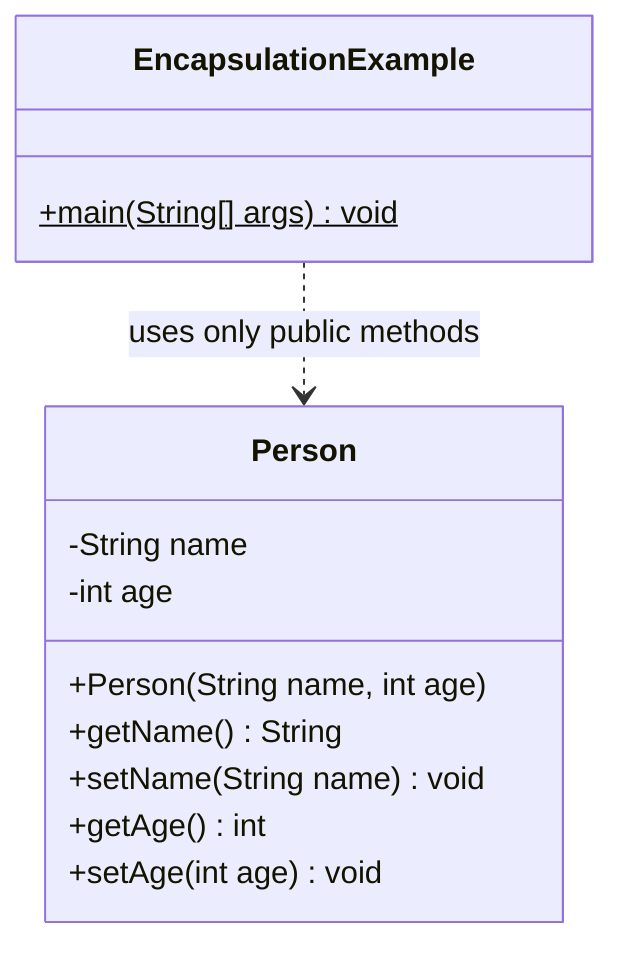
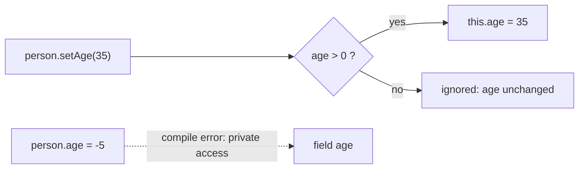

## In One Line
Encapsulation means **bundling data with the methods that work on it and hiding that data** behind `private`, so the outside world can only change an object through methods that keep it valid — `person.setAge(35)` instead of `person.age = -5`.

## Mental Model
Think of a **bank account at a branch counter**. You cannot walk into the vault and rewrite your balance. You hand a request to the cashier ("deposit 500", "what is my balance?"), and the cashier checks the rules (valid amount? enough funds?) before touching the vault.

In the code:
- The **vault** is the `private` fields: `name`, `age`.
- The **cashier window** is the `public` methods: `getAge()`, `setAge(int)`.
- The **cashier's rule check** is the validation inside the setter: `if (age > 0)`.
- The **bank building** (walls + vault + cashier together) is the class `Person` — the capsule.

Because every change goes through the window, the bank can change how the vault works internally (new software, new storage) without customers noticing.

## Concept
### What encapsulation gives you
Encapsulation has two halves:
1. **Bundling** — data (fields) and the behaviour that uses it (methods) live in one unit, the class.
2. **Information hiding** — the internal representation is `private`; only a chosen public surface is exposed.

Why it matters:
| Benefit | How |
|---|---|
| **Invariants** stay true | Only the class's own methods can modify fields, and they validate input (age never negative). |
| **Freedom to change internals** | You can rename a field, store `birthDate` instead of `age`, add caching — callers only see the methods. |
| **One place to debug** | Put a breakpoint or log in the setter to see every change. |
| **Read-only or write-only access** | Provide only a getter (read-only) or omit both. |
| **Thread safety and immutability** | Hidden state can be guarded by locks or made `final`; exposed fields cannot. |

### Access modifiers — the tool Java gives you
| Modifier | Same class | Same package | Subclass in another package | Anywhere |
|---|---|---|---|---|
| `private` | Yes | No | No | No |
| *(none)* package-private | Yes | Yes | No | No |
| `protected` | Yes | Yes | Yes (through inheritance) | No |
| `public` | Yes | Yes | Yes | Yes |

- Top-level classes can only be `public` or package-private (like `Person` here). Members (fields, methods, constructors, nested classes) can use all four.
- **Rule of thumb:** make every field `private`, and make each method as private as possible. Widen only when you need to.
- `private` is **per class, not per object**: code inside `Person` may read `other.age` of *another* `Person`. That is how `equals()` and `compareTo()` work.
- Details on packages and `protected` in [Access Modifiers and Packages](lesson:b01-fundamentals/05-access-modifiers-and-packages).

### Getters and setters (JavaBeans conventions)
- Getter: `getName()`; for `boolean` fields `isActive()`. Setter: `setName(String name)`, returns `void`.
- Frameworks (Spring, Jackson, JPA, JSP/EL) find properties by these names via reflection.
- A full *JavaBean* also has a public no-arg constructor and is often `Serializable`. `Person` is not a full JavaBean — it has only the two-argument constructor.
- **Lombok** (in the course's `pom.xml`) generates them from annotations: `@Getter @Setter private int age;`. See it used in [DAO](lesson:a10-patterns/26-dao).

### Getters and setters are not the goal
A class with private fields and a public getter + setter for each one is barely more encapsulated than public fields. Real encapsulation exposes **behaviour and rules**, not raw data:
```java
// Weak: caller computes and sets the new state
account.setBalance(account.getBalance() - amount);

// Strong: "tell, don't ask" — the object enforces its own rules
account.withdraw(amount);   // checks amount > 0 and balance >= amount inside
```
Ask for each field: does the outside world need to *read* it? to *write* it? Often the answer is "only through a meaningful operation".

### Validation belongs everywhere state is set
If a rule matters, enforce it in **every** entry point: constructor(s) and setters. Share the check in a `private` (or `static`) helper and **fail loudly** with an exception instead of silently ignoring bad input. Do not call an overridable setter from the constructor — a subclass could override it (see [Polymorphism](lesson:a01-oop/04-polymorphism)); a `private static` validator or a `final` class avoids that.

### Leaking internals: the mutable-field trap
Private fields are not enough when a field refers to a **mutable object** (a `List`, a `Date`, an array). If the constructor stores the caller's list and the getter returns it, both the caller and anyone who calls the getter can change your "private" state. The fixes:
- **Copy in**: `this.members = List.copyOf(members);` (or `new ArrayList<>(members)`).
- **Copy or wrap out**: return `List.copyOf(members)` or `Collections.unmodifiableList(members)`.
- Prefer immutable types (`String`, `LocalDate`, records, `List.of`) so there is nothing to leak.

### Encapsulation vs abstraction vs data hiding
| | Encapsulation | Abstraction | Data hiding |
|---|---|---|---|
| Focus | *How* the object protects its state | *What* the object offers (the essential interface) | Making fields inaccessible |
| Level | Implementation | Design | A technique used by encapsulation |
| Java tools | `private` fields + public methods | Abstract classes, interfaces | `private` |
| Example | `setAge` validates before writing | An `ATM` type with `withdrawMoney()` | `private int age` |

They work together: abstraction decides the public face, encapsulation implements and protects what is behind it. See [Abstraction](lesson:a01-oop/05-abstraction).

### The strongest form: immutability
An immutable class has `private final` fields, no setters, is `final` (or has private constructors), and makes defensive copies of mutable inputs. Nothing can break its invariants after construction, and it is automatically thread-safe. `String`, `Integer`, `LocalDate` and every `record` work this way. See [Immutable Classes](lesson:b01-fundamentals/08-immutable-classes).

### Can encapsulation be broken?
- **Reflection** — `field.setAccessible(true)` can read and write `private` fields of your own classes (in the classpath / unnamed module).
- **Modules (Java 9+)** — JDK internals are *strongly encapsulated*. Since Java 16 (JEP 396) deep reflection into them is denied by default, and Java 17 (JEP 403) removed the `--illegal-access` escape hatch, so `String.class.getDeclaredField("value").setAccessible(true)` throws `InaccessibleObjectException` unless the module is explicitly opened (`--add-opens`).
- **Serialization** writes and restores private fields directly.

Encapsulation protects against accidental misuse by normal code; it is not a security boundary against code that uses reflection.

## Diagram

`-` means private, `+` means public: the outside class can only reach the fields through the public methods.


The only road to `age` goes through the setter's check; direct access is stopped by the compiler.

## Code
@example CoreJava/Oops/EncapsulationExample.java

The holes in the original, demonstrated:
```java
Person p = new Person("John", -5);   // constructor skips the check
System.out.println(p.getAge());

p.setAge(35);
p.setAge(-1);                        // silently ignored
System.out.println(p.getAge());

p.setName(null);                     // nothing stops this
System.out.println(p.getName().length());
```
```output
-5
35
Exception in thread "main" java.lang.NullPointerException: Cannot invoke "String.length()" because the return value of "Person.getName()" is null
	at Bypass.main(Bypass.java:11)
```

A stricter `Person`: every entry point validates, and bad input fails loudly:
```java
import java.util.Objects;

final class Person {
    private String name;
    private int age;

    public Person(String name, int age) {
        this.name = requireName(name);
        this.age = requireValidAge(age);
    }

    public String getName() { return name; }
    public void setName(String name) { this.name = requireName(name); }

    public int getAge() { return age; }
    public void setAge(int age) { this.age = requireValidAge(age); }

    private static String requireName(String name) {
        Objects.requireNonNull(name, "name must not be null");
        if (name.isBlank()) throw new IllegalArgumentException("name must not be blank");
        return name;
    }

    private static int requireValidAge(int age) {
        if (age < 0 || age > 150) throw new IllegalArgumentException("age out of range: " + age);
        return age;
    }
}

// in main:
Person p = new Person("John", 30);
p.setAge(35);
System.out.println(p.getName() + " " + p.getAge());
try {
    p.setAge(-1);
} catch (IllegalArgumentException e) {
    System.out.println("Rejected: " + e.getMessage());
}
try {
    new Person("Ghost", -5);
} catch (IllegalArgumentException e) {
    System.out.println("Rejected: " + e.getMessage());
}
System.out.println(p.getAge());
```
```output
John 35
Rejected: age out of range: -1
Rejected: age out of range: -5
35
```

Private fields can still leak through a mutable object:
```java
class Team {
    private final List<String> members;
    Team(List<String> members) { this.members = members; }        // stores caller's list
    List<String> getMembers() { return members; }                  // hands out the internals
}

class SafeTeam {
    private final List<String> members;
    SafeTeam(List<String> members) { this.members = List.copyOf(members); } // defensive copy in
    List<String> getMembers() { return members; }                            // already unmodifiable
}

// in main:
List<String> start = new ArrayList<>(List.of("chess"));
Team leaky = new Team(start);
leaky.getMembers().add("intruder");   // modifies the private list!
start.add("sneaky");                   // so does the caller's original list
System.out.println(leaky.getMembers());

SafeTeam safe = new SafeTeam(start);
start.add("late");
System.out.println(safe.getMembers());
try {
    safe.getMembers().add("intruder");
} catch (UnsupportedOperationException e) {
    System.out.println("blocked: " + e);
}
```
```output
[chess, intruder, sneaky]
[chess, intruder, sneaky]
blocked: java.lang.UnsupportedOperationException
```
`SafeTeam` took a snapshot, so the later `start.add("late")` does not reach it, and its list cannot be modified from outside.

## Walkthrough
- `class Person {` — a package-private top-level class in the same file as the public `EncapsulationExample`. A file may hold many top-level classes, but only one `public` one, named after the file. Each still compiles to its own `.class` file (`Person.class`).
- `// Private data members` / `private String name; private int age;` — the hidden state. No code outside `Person` can read or write these; `person.age = -5` in `main` would fail with `age has private access in Person`.
- `// Constructor` / `public Person(String name, int age)` — sets the initial state with `this.name = name; this.age = age;`. It copies `age` straight into the field **without the check the setter has** (see Traps).
- `// Public method to access private data` / `getName()` and `getAge()` — **getters**: read-only access to the hidden fields. The comment applies to all four methods below it.
- `setName(String name)` — a **setter** with no validation; any value (even `null`) is accepted.
- `setAge(int age)` with `if (age > 0) { this.age = age; }` — a setter with a **guard**: only positive ages are stored; anything else is ignored.
- `public class EncapsulationExample` with `main` — the "outside world". The comments describe the capsule idea: a person's details are private and can only be read or updated through methods.
- `Person person = new Person("John", 30);` — creates a valid person.
- `System.out.println("Name: " + person.getName());` → `Name: John`, and `"Age: " + person.getAge()` → `Age: 30`: reading through getters.
- `person.setAge(35); // updating age` — passes the `age > 0` check, so the field becomes 35, and the last line prints `Updated Age: 35`.

> [!NOTE] Because `Person` is the **first** class in the file and has no `main`, `java EncapsulationExample.java` (single-file launch) fails on JDK 21 with `can't find main(String[]) method in class: CoreJava.Oops.Person`. Compile the file with `javac` and run the class by name, or run it from the IDE — see [Course Project Setup](lesson:a01-oop/00-course-project-setup).

## Traps
> [!ERRATA] The constructor bypasses the validation. `setAge` refuses non-positive ages, but `new Person("John", -5)` stores `-5` because the constructor assigns the field directly (verified above: it prints `-5`). An invariant is only real if **every** path that sets the field enforces it — validate in the constructor too, through a shared `private static` check.

> [!ERRATA] `setAge` fails **silently**: `setAge(-1)` does nothing and the caller never learns its value was rejected. The usual Java practice is to throw `IllegalArgumentException` with a clear message. The rule `age > 0` also rejects `0` (a newborn) and has no upper bound (`setAge(10_000)` is accepted) — decide the real valid range and document it.

> [!ERRATA] `setName` accepts `null` (and blank names), so the object can reach a state that crashes later, far from the cause: `getName().length()` throws `NullPointerException`. Reject `null` with `Objects.requireNonNull` at the entry point.

- **Returning a mutable internal object** (a `List`, array or `Date`) from a getter lets callers change private state. Copy it or return an unmodifiable view.
- **Storing a caller's mutable object** in the constructor has the same problem in reverse — the caller keeps a handle to your internals. Copy on the way in.
- **A getter + setter for every field** is not automatically good design; expose operations that keep the object valid.
- **Calling an overridable setter from a constructor** — a subclass override would run before the subclass is initialised. Use `private`/`static` helpers or make the class `final`.
- **`protected` is wider than package-private**, not narrower: it adds subclass access *on top of* package access.
- **`private` is class-level**: `other.age` inside `Person` compiles. People often expect it to be object-level.

## Tips & Tricks
- **Mnemonic — "Fields private, behaviour public, validate at every door."**
- **Access modifiers from tightest to widest: "Please Don't Pet Pythons"** → `private` < *default* < `protected` < `public`.
- Start every field as `private final`; remove `final` only when the value must change, and add a setter only when an outside caller really needs one.
- **Fail fast**: throw `IllegalArgumentException` / `NullPointerException` (via `Objects.requireNonNull`) at the setter, not three layers later.
- **Copy in, copy out** for mutable collections and arrays: `List.copyOf(...)`.
- In IntelliJ, *Refactor → Encapsulate Fields* turns public fields into private fields with accessors and updates every caller.
- Name getters after the property, not the field: if you later compute `age` from `birthDate`, `getAge()` keeps working.

## Interview Q&A
### [Basic] What is encapsulation?
Encapsulation is bundling an object's data with the methods that operate on it, and restricting direct access to the data. In Java you make fields `private` and expose `public` methods (getters, setters, or better, meaningful operations) that validate input and keep the object in a valid state. The class can then change its internal representation without breaking callers.
```java
class Person {
    private int age;
    public void setAge(int age) {
        if (age < 0) throw new IllegalArgumentException("age < 0");
        this.age = age;
    }
    public int getAge() { return age; }
}
```
**Follow-up:** *Is a class with private fields and public getters/setters for everything well encapsulated?* — Only partly. If every field can be freely set, the class enforces no rules. Good encapsulation exposes behaviour (`withdraw(amount)`) and hides or validates state.

### [Basic] What are the access modifiers in Java and what does each allow?
`private` — only inside the declaring class. Package-private (no keyword) — any class in the same package. `protected` — same package plus subclasses in other packages (through inheritance). `public` — everywhere. Top-level classes can only be `public` or package-private. Encapsulation uses `private` for state and exposes a small `public` surface.

**Follow-up:** *Can a subclass in another package access a `protected` field through a parent-type reference?* — No. It can use it through `this` or a reference of its own type (or a subtype), not through an arbitrary `Parent` reference.

### [Basic] Why not just make fields public?
Public fields let any code put the object into an invalid state (`person.age = -5`), make it impossible to add validation, logging, lazy loading or thread safety later without breaking every caller, and freeze your internal representation into the public API forever. With methods, the class is the only code that changes its fields, so its invariants hold and its internals can evolve.

**Follow-up:** *Are public fields ever acceptable?* — `public static final` constants (`Integer.MAX_VALUE`) are fine, and records expose their components through accessor methods rather than public fields.

### [Intermediate] What is the difference between encapsulation and abstraction?
Abstraction is a **design** idea: show only the essential operations of a thing and hide complexity (an `ATM` interface with `withdraw`). Encapsulation is an **implementation** technique: bundle the data with its methods and hide the data behind access control so it is only changed in controlled ways. Abstraction answers "what does this object do?"; encapsulation answers "how does it protect what it knows?". Interfaces and abstract classes are the tools for abstraction; `private` fields plus accessor methods are the tools for encapsulation.

**Follow-up:** *Can you have encapsulation without abstraction?* — Yes: a concrete class with private fields and validated setters is encapsulated even if no interface abstracts it.

### [Intermediate] Can an object access the private fields of another object of the same class?
Yes. Java's access control is **per class**, not per object. Any code inside `Person` may access `private` members of any `Person` instance:
```java
boolean isOlderThan(Person other) {
    return this.age > other.age;   // legal
}
```
This is what makes `equals`, `compareTo` and copy constructors possible without getters.

**Follow-up:** *And a nested class?* — Nested and inner classes can also access the private members of their enclosing class (and vice versa); since Java 11 the JVM supports this directly through *nestmates*.

### [Intermediate] How do you stop a getter from breaking encapsulation for a collection field?
Never return the internal mutable collection itself. Options: return an unmodifiable copy (`List.copyOf(list)`), an unmodifiable view (`Collections.unmodifiableList(list)` — read-only but reflects later internal changes), or keep the field immutable from the start by copying on input (`this.items = List.copyOf(items)`). The same applies to arrays (`items.clone()`) and mutable types like `java.util.Date` (prefer `java.time` types, which are immutable).

**Follow-up:** *Is `Collections.unmodifiableList` a copy?* — No, it is a read-only **view**; changes to the backing list are visible through it. `List.copyOf` is a real snapshot (and rejects `null` elements).

### [Intermediate] Where should validation go: constructor, setter, or both?
Both — every path that sets the field must enforce the invariant, otherwise an object can be *born* invalid. The original example shows the bug: `setAge` checks `age > 0` but the constructor does not, so `new Person("John", -5)` holds `-5`. Put the rule in one `private static` method and call it from the constructor and the setter. Avoid calling an overridable setter from the constructor, because a subclass override would run before the subclass fields are initialised.

**Follow-up:** *Silently ignore or throw?* — Throw `IllegalArgumentException` (or `NullPointerException` for nulls). Silent ignoring hides bugs.

### [Advanced] Can reflection break encapsulation? What changed with Java modules?
Yes. `Field.setAccessible(true)` lets code read and write private fields of classes in the classpath (the unnamed module), which frameworks like Hibernate and Jackson use. Since Java 9, modules add **strong encapsulation**: a module's non-exported packages are inaccessible, and deep reflection needs the package to be `opens`-ed. JDK 16 (JEP 396) made this the default for JDK internals, and JDK 17 (JEP 403) removed `--illegal-access`, so `String.class.getDeclaredField("value").setAccessible(true)` throws `InaccessibleObjectException` unless you pass `--add-opens java.base/java.lang=ALL-UNNAMED`.

**Follow-up:** *Can a SecurityManager block reflection?* — It could, but the SecurityManager was deprecated for removal in Java 17 (JEP 411) and permanently disabled in Java 24 (JEP 486). Modules are now the mechanism.

### [Advanced] How is immutability related to encapsulation?
Immutability is the strongest encapsulation: after construction, the state can never change, so there are no setters to validate and no way to break invariants later. Recipe: `final` class (or private constructor + factories), `private final` fields, validation in the constructor, no setters, defensive copies of mutable inputs and outputs. Benefits: thread-safe without locks, safe as `HashMap` keys, easy to reason about and cache. Records (Java 16) give you most of this with one line, though you still need defensive copies for mutable components.

**Follow-up:** *Is a record automatically deeply immutable?* — No. Its fields are `final`, but if a component is a mutable `List`, the list's contents can still change; copy it in a compact constructor (`items = List.copyOf(items);`).

## Quiz
### What does this print, using the original `Person`?
```java
Person p = new Person("John", 30);
p.setAge(-5);
p.setAge(0);
System.out.println(p.getAge());
```
- [ ] -5
- [ ] 0
- [x] 30
- [ ] IllegalArgumentException
> `setAge` only assigns when `age > 0`. Both `-5` and `0` fail the check and are silently ignored, so the age stays `30`. Nothing throws, because the original setter has no exception — which is exactly its weakness.

### What does this print, using the original `Person`?
```java
Person q = new Person("Ann", -5);
System.out.println(q.getAge());
```
- [x] -5
- [ ] 0
- [ ] Compile error
- [ ] IllegalArgumentException
> The constructor assigns `this.age = age` directly, without the setter's check, so the invalid value is stored. This is the main flaw of the example: validation has to be in the constructor too.

### Which access modifier allows access from the same package **and** from subclasses in other packages, but not from everywhere?
- [ ] private
- [ ] package-private (no modifier)
- [x] protected
- [ ] public
> `protected` = package access + subclass access. Package-private is tempting, but it gives no access to subclasses outside the package.

### Does this method inside `Person` compile?
```java
boolean isOlderThan(Person other) {
    return this.age > other.age;   // age is private
}
```
- [x] Yes — private access is checked per class, not per object
- [ ] No — `other.age` is private to the `other` object
- [ ] Only if `age` is `protected`
- [ ] Only with a getter
> Java's `private` means "accessible anywhere inside the class `Person`", for any instance. Running it with ages 30 and 25 returns `true`.

### What does this print?
```java
class Team {
    private final List<String> members = new ArrayList<>(List.of("Ann", "Bob"));
    public List<String> getMembers() { return members; }
}

Team t = new Team();
t.getMembers().add("Eve");
System.out.println(t.getMembers().size());
```
- [ ] 2
- [x] 3
- [ ] UnsupportedOperationException
- [ ] Compile error, because `members` is final
> `final` only stops the *reference* from being reassigned; the list itself is mutable, and the getter hands it out. The caller adds "Eve" to the private list. Return `List.copyOf(members)` to prevent this.

### Spot the design problem in the original example.
- [ ] Getters should be `private`
- [x] The constructor stores `age` without the setter's validation, and the setter ignores bad values silently
- [ ] `Person` must be `public` for encapsulation to work
- [ ] Fields must be `static`
> Encapsulation requires every entry point to protect the invariant and to report violations. Class visibility (`public` or not) is unrelated to encapsulation, and private getters would make the data unreachable.

## Takeaways
- Encapsulation = bundle data with its methods and hide the data (`private`), exposing only controlled operations.
- Access modifiers from tightest to widest: `private` < package-private < `protected` < `public`; make fields `private` by default.
- Enforce each invariant at **every** entry point (constructors and setters) and fail loudly with `IllegalArgumentException`; the original constructor skips the check.
- Getters/setters are a tool, not the goal — prefer meaningful operations ("tell, don't ask").
- Private is per class, not per object: a `Person` method can read another `Person`'s private fields.
- Mutable fields leak through getters and constructor arguments; copy in and copy out (`List.copyOf`).
- Immutable classes are the strongest encapsulation; reflection can break `private` in your own code, but JDK internals are strongly encapsulated since Java 16/17.
