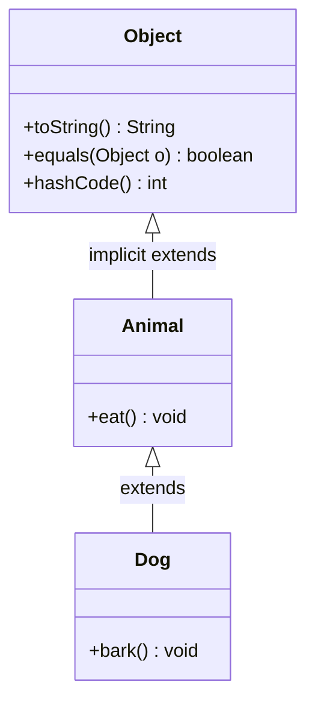
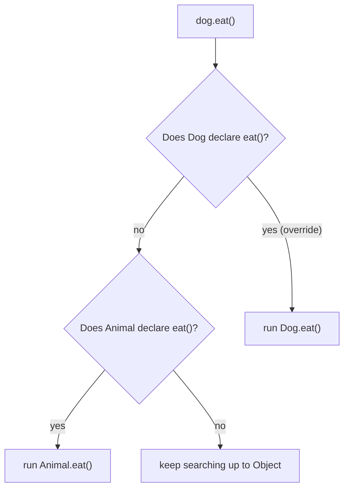
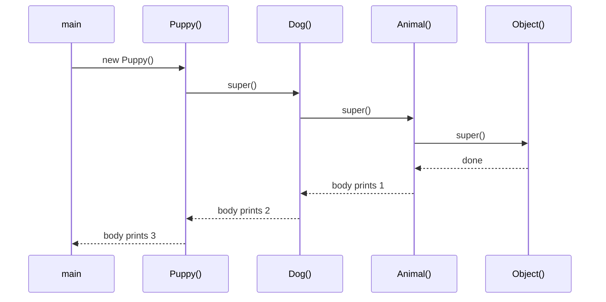

## In One Line
Inheritance lets a class (`Dog`) **reuse and extend** another class (`Animal`) with `extends`, creating an **IS-A** relationship: a `Dog` automatically has `eat()` from `Animal` and adds its own `bark()`.

## Mental Model
Think of a **family recipe book passed down the generations**.

- Grandma's book (**`Animal`**) has the basic recipes: "how to eat".
- Your parent (**`Dog`**) gets a copy of the whole book for free (**inherits**), adds new recipes of their own (**`bark()`**), and may rewrite one of grandma's recipes their own way (**overriding**).
- The private notes in grandma's diary (**`private` members**) are not in the copy you can read — they exist, but only grandma's own recipes can use them.
- You cannot have two biological mothers giving you two conflicting copies of the same recipe (**no multiple inheritance of classes**), but you can take extra cooking classes that each teach a skill (**interfaces**).

In the code: `Dog extends Animal`, so `dog.eat()` runs grandma's recipe and `dog.bark()` runs the new one.

## Concept
### What inheritance is for
- **Code reuse** — common state and behaviour are written once in the parent (superclass) and shared by every child (subclass).
- **Specialisation** — a child adds new members (`bark()`) or overrides inherited ones.
- **Polymorphism** — because a `Dog` *is an* `Animal`, a `Dog` can be used wherever an `Animal` is expected (`Animal a = new Dog();`). See [Polymorphism](lesson:a01-oop/04-polymorphism).

Syntax: `class Dog extends Animal { ... }`. A class can extend **exactly one** class. If you write no `extends`, the class extends `java.lang.Object`.

### What a subclass inherits
| Member of `Animal` | Inherited by `Dog`? |
|---|---|
| `public` and `protected` fields and methods | Yes |
| Package-private members | Only if `Dog` is in the **same package** (true in this example) |
| `private` fields and methods | **No** — not accessible in `Dog`. The field still exists inside every `Dog` object and is used through `Animal`'s own methods. |
| Constructors | **No** — never inherited, but always *called* through chaining |
| `static` methods and fields | Accessible through the subclass (`Dog.kingdom()` works), but static methods are **hidden**, not overridden |
| Initializer blocks | No — they run as part of the parent's construction |

### Types of inheritance
| Type | Shape | Java classes? |
|---|---|---|
| Single | `Dog extends Animal` | Yes |
| Multilevel | `Puppy extends Dog extends Animal` | Yes |
| Hierarchical | `Dog extends Animal`, `Cat extends Animal` | Yes |
| Multiple | `C extends A, B` | **No** (compile error) — only through interfaces: `class C implements I, J` |
| Hybrid | A mix of the above | Only through interfaces |

**Why no multiple inheritance of classes?** The *diamond problem*: if `B` and `C` both extend `A` and both override `m()`, and `D extends B, C`, which `m()` does `D` get, and does `D` hold one or two copies of `A`'s fields? Java avoids the ambiguity for **state** entirely. For **behaviour** from interfaces (default methods), it has explicit resolution rules — see [Abstract Class vs Interface](lesson:a01-oop/06-abstract-vs-interface).

### The root: `java.lang.Object`
Every class ultimately extends `Object`, so every object has: `toString()`, `equals(Object)`, `hashCode()`, `getClass()`, `clone()` (protected), `wait()`/`notify()`/`notifyAll()` and the deprecated `finalize()`. That is why you can call `dog.toString()` although neither `Dog` nor `Animal` declares it. See [Object class, equals and hashCode](lesson:b01-fundamentals/06-object-class-equals-hashcode).

### Constructor chaining
Creating a `Dog` builds **one object** that contains the `Animal` part and the `Dog` part. The parent part must be initialised first, so **every constructor starts by calling a parent constructor**:
- If you do not write `super(...)`, the compiler inserts `super();` as the first statement.
- If the parent has **no no-arg constructor**, that implicit `super()` fails to compile — you must call `super(args)` explicitly.
- `super(...)` (or `this(...)`) must be the **first statement** in Java 17/21. Java 25 (JEP 513, *flexible constructor bodies*) allows statements before it, as long as they do not use `this`.
- Execution order is top-down: `Object()` → `Animal()` → `Dog()` → `Puppy()`.

More in [super keyword](lesson:a02-core/06-super-keyword) and [Initialization Order](lesson:b01-fundamentals/12-initialization-order).

### `super` — talking to the parent
| Form | Meaning |
|---|---|
| `super(args)` | Call a parent constructor (first line of a constructor) |
| `super.method()` | Call the parent's version of an overridden method |
| `super.field` | Access a parent field hidden by a same-named child field |

### Inheriting vs overriding vs adding
- **Inherit** — do nothing: `Dog` uses `Animal.eat()` as-is (the original example).
- **Override** — redeclare the same signature in the child (`@Override public void eat()`), optionally calling `super.eat()` to extend rather than replace it.
- **Add** — declare new members (`bark()`). They are only visible through a `Dog`-typed reference: `Animal a = new Dog(); a.bark();` does not compile.

### Stopping or limiting inheritance
- `final class` — cannot be extended (`String`, `Integer`, `LocalDate`): `cannot inherit from final String`.
- `final` method — can be inherited but not overridden.
- Only `private` constructors — no subclass can call `super(...)` (utility classes, singletons).
- `sealed class Shape permits Circle, Square` (Java 17) — only the listed classes may extend it. See [Sealed Classes](lesson:b05-modern-java/04-sealed-classes).
- Cyclic inheritance (`A extends B`, `B extends A`) is a compile error.

### Inheritance vs composition
| | Inheritance (IS-A) | Composition (HAS-A) |
|---|---|---|
| Relationship | `Dog` **is an** `Animal` | `Car` **has an** `Engine` |
| Coupling | Tight — child depends on parent's implementation details | Loose — uses only the other object's public API |
| Flexibility | Fixed at compile time, one parent only | Can swap the part at runtime, many parts |
| Risk | *Fragile base class*: a parent change can silently break children | Minimal |

*Effective Java* (Item 18): **favour composition over inheritance**. Use inheritance when there is a true, permanent IS-A relationship and the parent was designed for extension. The classic trap is shown in the Code section: a subclass of `HashSet` that counts additions gets **6** instead of 3, because `HashSet.addAll()` internally calls the overridden `add()`. The JDK itself has regrettable examples: `Stack extends Vector` (so a `Stack` exposes `insertElementAt` and breaks LIFO) and `Properties extends Hashtable`.

### The Liskov Substitution Principle
A subclass must be usable anywhere its parent is expected **without breaking expectations**. If `Square extends Rectangle` and `setWidth()` on a square also changes the height, code that sets width 5 and height 4 and expects area 20 breaks. An IS-A relationship in English is not enough — behaviour must be substitutable. More in [SOLID Principles](lesson:b01-fundamentals/13-solid-principles).

## Diagram

`Animal` silently extends `Object`; `Dog` extends `Animal`, so a `Dog` has `bark()`, `eat()` and all of `Object`'s methods.


Method lookup starts at the object's own class and walks up the hierarchy until it finds an implementation.


Calls go down the chain first, but constructor bodies finish from the top: parent before child.

## Code
@example CoreJava/Oops/InheritanceExample.java

Multilevel inheritance and constructor chaining (each constructor prints a line):
```java
class Animal {
    Animal() { System.out.println("1. Animal constructor"); }
    public void eat() { System.out.println("This animal eats food."); }
}
class Dog extends Animal {
    Dog() { System.out.println("2. Dog constructor"); }
    public void bark() { System.out.println("The dog barks."); }
}
class Puppy extends Dog {
    Puppy() { System.out.println("3. Puppy constructor"); }
    public void wagTail() { System.out.println("The puppy wags its tail."); }
}

Puppy p = new Puppy();
p.eat();
p.bark();
p.wagTail();
System.out.println(p instanceof Dog);
System.out.println(p instanceof Animal);
System.out.println(p instanceof Object);
System.out.println(Puppy.class.getSuperclass().getSimpleName());
System.out.println(Animal.class.getSuperclass().getName());
```
```output
1. Animal constructor
2. Dog constructor
3. Puppy constructor
This animal eats food.
The dog barks.
The puppy wags its tail.
true
true
true
Dog
java.lang.Object
```

Hierarchical inheritance — the `Cat` the original comment talks about:
```java
class Cat extends Animal { public void meow() { System.out.println("The cat meows."); } }

Animal[] zoo = { new Dog(), new Cat() };
for (Animal a : zoo) {
    a.eat();          // inherited by both
}
Cat c = new Cat();
c.meow();
// c.bark();   // does not compile: Cat is not a Dog
```
```output
This animal eats food.
This animal eats food.
The cat meows.
```

`super(...)` and `super.method()` — extending the parent instead of replacing it:
```java
class Animal {
    protected String name;
    Animal(String name) { this.name = name; }
    public void eat() { System.out.println(name + " eats food."); }
    public String describe() { return "Animal " + name; }
}
class Dog extends Animal {
    Dog(String name) {
        super(name);                       // must be the first statement
    }
    @Override
    public void eat() {
        super.eat();                       // reuse the parent's version
        System.out.println(name + " also chews a bone.");
    }
    @Override
    public String describe() { return "Dog, which is an " + super.describe(); }
}

Dog d = new Dog("Rex");
d.eat();
System.out.println(d.describe());
```
```output
Rex eats food.
Rex also chews a bone.
Dog, which is an Animal Rex
```

Why "favour composition": a subclass depends on its parent's hidden implementation.
```java
class CountingSet extends HashSet<String> {
    int addCount = 0;
    @Override public boolean add(String e) { addCount++; return super.add(e); }
    @Override public boolean addAll(Collection<? extends String> c) {
        addCount += c.size();
        return super.addAll(c);   // HashSet's addAll calls add() for each element
    }
}

class CountingSet2 {                // composition: wraps a Set and forwards calls
    private final Set<String> inner;
    int addCount = 0;
    CountingSet2(Set<String> inner) { this.inner = inner; }
    boolean add(String e) { addCount++; return inner.add(e); }
    boolean addAll(Collection<? extends String> c) { addCount += c.size(); return inner.addAll(c); }
}

CountingSet s = new CountingSet();
s.addAll(List.of("a", "b", "c"));
System.out.println(s.addCount);

CountingSet2 s2 = new CountingSet2(new HashSet<>());
s2.addAll(List.of("a", "b", "c"));
System.out.println(s2.addCount);
```
```output
6
3
```
The subclass counts every element twice: once in its `addAll`, and again because the inherited `addAll` (from `AbstractCollection`) calls the overridden `add`. The wrapper does not care how `HashSet` works inside.

## Walkthrough
- `//Think of an animal family. ...` — the comment gives the idea: dogs and cats share general animal behaviour and add their own. Only `Dog` is actually written (see Traps).
- `class Animal { public void eat() {...} }` — the **superclass**. It has no `extends`, so it extends `Object`. It is package-private (no `public`), so it can share the file with the public class.
- `class Dog extends Animal` — the **subclass**. `extends` creates the IS-A relationship: every `Dog` is an `Animal`. `Dog` has no constructor, so the compiler gives it a default one that just calls `super()` → `Animal()` → `Object()`.
- `public void bark()` — a method that exists only in `Dog`: specialisation.
- `public class InheritanceExample` / `main` — the driver.
- `Dog dog = new Dog();` — one object is created; it contains everything `Animal` defines plus what `Dog` adds.
- `dog.eat(); // inherited method` — `Dog` does not declare `eat()`, so the lookup walks up to `Animal` and runs `Animal.eat()` → `This animal eats food.`
- `dog.bark(); // specific to Dog class` — found directly in `Dog` → `The dog barks.`
- Nothing is overridden in this example; it shows pure reuse plus extension. Overriding is the topic of [Polymorphism](lesson:a01-oop/04-polymorphism).

## Traps
> [!ERRATA] The header comment says "Dogs and cats both inherit general animal characteristics", but the file has no `Cat` class. The hierarchical case (two children of one parent) is shown in the Code section above with `Cat extends Animal`.

> [!NOTE] `Animal` and `Dog` are package-private top-level classes in the package `CoreJava.Oops`, so those names are now taken for the **whole package**. That is why the later example `AbstractVsInterfaceExample` has to call its classes `Animal1` and `Dog1` — a second `class Animal` in the same package would be a `duplicate class` compile error. Also, because `Animal` comes first in the file, `java InheritanceExample.java` fails on JDK 21; see [Course Project Setup](lesson:a01-oop/00-course-project-setup).

- **Calling a child-only method through a parent reference** — `Animal a = new Dog(); a.bark();` → `cannot find symbol ... location: variable a of type Animal`. The reference type decides what you may call.
- **Parent without a no-arg constructor** — if `Animal` only has `Animal(String name)`, then `Dog() { }` fails: `constructor Animal in class Animal cannot be applied to given types`. Call `super(name)` explicitly.
- **Expecting private members to be usable** — `System.out.println(name)` in `Dog` fails with `name has private access in Animal`, even though every `Dog` object physically contains that field. Use a `protected`/public getter.
- **Multiple class inheritance** — `class C extends A, B {}` is a syntax error (`'{' expected`). Use interfaces.
- **Extending a `final` class** — `class MyString extends String {}` → `cannot inherit from final String`.
- **Overriding a method the parent calls internally** — changes parent behaviour in ways you cannot see (the `CountingSet` double count). Prefer composition unless the parent documents how its methods use each other.
- **Using inheritance only to reuse code** — if the child is not truly substitutable for the parent (LSP), use composition.
- **Assuming two objects are created** — `new Dog()` creates one object; the `Animal` constructor only initialises the `Animal` part of it.

## Tips & Tricks
- **IS-A test:** say "a Dog *is an* Animal" out loud. If it sounds wrong ("a Car is an Engine"), use composition: "a Car *has an* Engine".
- **"Parents are built first"** — constructors complete top-down: `Object` → `Animal` → `Dog`.
- **"Extends one, implements many."** One parent class, any number of interfaces.
- **"Private is inherited in memory, not in access."** The child object holds the parent's private fields but cannot name them.
- Put shared state and behaviour in the parent, and keep the hierarchy **shallow** (2–3 levels). Deep hierarchies are hard to change.
- Design for inheritance or forbid it: document overridable methods, or mark the class `final`.
- Always use `@Override` when redefining an inherited method.

## Interview Q&A
### [Basic] What is inheritance and why is it used?
Inheritance is the mechanism by which one class acquires the fields and methods of another using `extends`. The subclass can reuse the parent's code, add new members and override existing methods. It models an IS-A relationship (`Dog` is an `Animal`), avoids duplicated code, and enables runtime polymorphism because a subclass object can be used wherever the parent type is expected.
```java
class Animal { void eat() { System.out.println("eats"); } }
class Dog extends Animal { void bark() { System.out.println("barks"); } }
new Dog().eat();   // inherited
```
**Follow-up:** *What is the superclass of a class with no `extends`?* — `java.lang.Object`, the root of every class hierarchy.

### [Basic] Which types of inheritance does Java support, and why not multiple inheritance of classes?
With classes: single, multilevel and hierarchical. Multiple (and therefore hybrid) inheritance is only possible through interfaces: a class can `implements` many interfaces, and an interface can `extends` many interfaces. Multiple class inheritance is forbidden to avoid the **diamond problem**: ambiguity about which inherited implementation to use and whether shared ancestor state is duplicated. Interfaces carry no instance state, and conflicts between default methods must be resolved explicitly by the class.

**Follow-up:** *What happens if two interfaces give the same default method?* — The implementing class must override it, and can pick one with `InterfaceName.super.method()`.

### [Basic] Are private members and constructors inherited?
**Constructors are never inherited** — each class declares its own, and they are chained with `super(...)`. **Private members are not inherited** in the sense that the subclass cannot access or name them; however, the private fields do exist inside every subclass object and are used by the parent's own (non-private) methods. So a `Dog` can call an inherited public `getSecret()` that returns `Animal`'s private field.

**Follow-up:** *Are static methods inherited?* — They are accessible through the subclass name (`Dog.kingdom()`), but a same-signature static method in the subclass *hides* the parent's; it does not override it.

### [Intermediate] Explain constructor chaining in an inheritance hierarchy.
Every constructor's first action is to call a constructor of its superclass — explicitly with `super(...)`, or implicitly with a compiler-inserted `super()`. So `new Puppy()` calls `Dog()`, which calls `Animal()`, which calls `Object()`; the bodies then complete top-down, and the output is Animal, then Dog, then Puppy. If the parent has no no-arg constructor, the implicit `super()` is a compile error and the child must call `super(args)`. In Java 17/21 `super(...)`/`this(...)` must be the first statement; Java 25 allows code before it that does not touch `this`.

**Follow-up:** *Can a constructor call both `this(...)` and `super(...)`?* — No. Only one of them, as the first statement; the `this(...)` chain eventually reaches a constructor that calls `super(...)`.

### [Intermediate] What is the difference between `this` and `super`?
`this` refers to the current object and its own class's members: `this.x` (field), `this.m()` (method, dynamically dispatched), `this(...)` (another constructor of the same class). `super` refers to the parent part of the current object: `super.m()` calls the **parent's** implementation, bypassing any override (statically bound), `super.x` accesses a hidden parent field, `super(...)` calls a parent constructor. Neither can be used in a static context.

**Follow-up:** *Can you write `super.super.m()`?* — No. You can only reach the direct parent's version; skipping a level would break the parent's encapsulation.

### [Intermediate] Composition or inheritance — how do you choose?
Use inheritance only for a genuine, stable IS-A relationship where the subclass is fully substitutable for the parent and the parent is designed for extension. Otherwise prefer composition (HAS-A): hold a reference to another object and delegate to it. Composition is looser coupling, can change behaviour at runtime, and does not depend on the parent's internals. The textbook failure is a `HashSet` subclass that counts additions: overriding both `add` and `addAll` counts 6 for three elements because `addAll` internally calls `add`. A forwarding wrapper counts 3.

**Follow-up:** *Name a JDK class that got this wrong.* — `java.util.Stack extends Vector`, so a stack exposes index-based methods that break LIFO; `Deque`/`ArrayDeque` is the recommended replacement.

### [Intermediate] How can you prevent a class from being extended?
Declare it `final` (like `String`), give it only `private` constructors (subclasses cannot call `super(...)`; used by utility classes and singletons), or, since Java 17, declare it `sealed` with a `permits` list to allow only specific subclasses. To prevent only certain methods from being overridden, mark those methods `final`.

**Follow-up:** *Why is `String` final?* — Security and correctness: strings are used for class names, file paths and map keys and are cached in the string pool; a mutable or overriding subclass could break all of that.

### [Advanced] What is the Liskov Substitution Principle, and how can inheritance violate it?
LSP says objects of a subclass must be usable in place of the parent without breaking the program's correctness: the subclass may not strengthen preconditions, weaken postconditions or break invariants. Classic violation: `Square extends Rectangle`. Client code `r.setWidth(5); r.setHeight(4); assert r.area() == 20;` fails for a `Square` whose setters keep sides equal. The fix is to not relate them by inheritance (e.g. both implement a `Shape` interface, or make them immutable).

**Follow-up:** *Another common violation?* — A subclass that throws `UnsupportedOperationException` for an inherited method (e.g. unmodifiable collections implementing `List.add`) — accepted in the JDK as a documented optional operation, but a smell in your own code.

### [Advanced] When you create a `Dog`, is a separate `Animal` object created?
No. Exactly **one** object is allocated, whose layout contains `Object`'s header, then `Animal`'s fields, then `Dog`'s fields. The `Animal` constructor runs on that same object to initialise its part — `super(...)` is a constructor *call*, not an allocation. That is also why `this` inside `Animal`'s constructor already refers to the `Dog` (and why an overridden method called from there runs `Dog`'s version).

**Follow-up:** *How does the JVM find `eat()` for a `Dog`?* — Via the class's virtual method table, which starts as a copy of the parent's table with overridden entries replaced and new methods appended.

### [Advanced] Which methods does every class inherit from `Object`, and which ones do you usually override?
`toString()`, `equals(Object)`, `hashCode()`, `getClass()` (final), `clone()` (protected), `finalize()` (protected, deprecated for removal since Java 18), and the final monitor methods `wait()` (three overloads), `notify()`, `notifyAll()`. You commonly override `toString()`, and `equals()` together with `hashCode()` (their contract requires equal objects to have equal hash codes). `clone()` is best avoided in favour of copy constructors or factories.

**Follow-up:** *Can you override `getClass()` or `wait()`?* — No, they are `final`.

## Quiz
### What does this print?
```java
class Animal { Animal() { System.out.println("1. Animal constructor"); } }
class Dog extends Animal { Dog() { System.out.println("2. Dog constructor"); } }
class Puppy extends Dog { Puppy() { System.out.println("3. Puppy constructor"); } }

new Puppy();
```
- [ ] 3. Puppy constructor only
- [ ] 3, then 2, then 1
- [x] 1, then 2, then 3
- [ ] Compile error: constructors do not call each other
> Each constructor begins with an implicit `super()`, so the chain goes down to `Object()` and the bodies complete top-down: Animal, Dog, Puppy. "3 then 2 then 1" is the order of the *calls*, not of the printed bodies.

### What happens here?
```java
Animal a = new Dog();
a.eat();
a.bark();   // bark() is declared only in Dog
```
- [ ] Prints both lines
- [ ] ClassCastException at runtime
- [x] Compile error: cannot find symbol `bark()` in `Animal`
- [ ] Prints only the `eat()` line
> The compiler checks calls against the reference type `Animal`, which has no `bark()`. The object really is a `Dog`, but you must downcast to call it: `((Dog) a).bark()`.

### Which declaration compiles (A, B are classes; I, J are interfaces)?
- [ ] `class C extends A, B {}`
- [x] `class C extends A implements I, J {}`
- [ ] `class C implements A {}`
- [ ] `class C extends I {}`
> A class extends at most one class and implements any number of interfaces. `extends A, B` is a syntax error, and classes cannot be implemented nor interfaces extended by a class.

### Spot the bug: why does `Dog` not compile?
```java
class Animal {
    private String name;
    Animal(String name) { this.name = name; }
}
class Dog extends Animal {
    Dog() { }
}
```
- [ ] `name` must be `public`
- [x] `Dog()` implicitly calls `super()`, but `Animal` has no no-arg constructor
- [ ] Constructors cannot be empty
- [ ] `Dog` must also declare `name`
> The compiler inserts `super();` into `Dog()`. `Animal` only has `Animal(String)`, so the call fails: "constructor Animal in class Animal cannot be applied to given types". Fix: `Dog() { super("Rex"); }`.

### What does this print?
```java
class CountingSet extends HashSet<String> {
    int addCount = 0;
    @Override public boolean add(String e) { addCount++; return super.add(e); }
    @Override public boolean addAll(Collection<? extends String> c) {
        addCount += c.size();
        return super.addAll(c);
    }
}
CountingSet s = new CountingSet();
s.addAll(List.of("a", "b", "c"));
System.out.println(s.addCount);
```
- [ ] 3
- [x] 6
- [ ] 0
- [ ] 9
> `addAll` adds 3, then the inherited `addAll` calls the overridden `add()` once per element, adding 3 more. This hidden self-use is the fragile base class problem, and why composition is often safer.

### Which of these is NOT inherited by `Dog` from `Animal`?
- [ ] A `public` method `eat()`
- [ ] A `protected` field `name`
- [x] The constructor `Animal(String name)`
- [ ] A `static` method `kingdom()`
> Constructors are never inherited; subclasses call them through `super(...)`. Public and protected members are inherited, and static methods are accessible as `Dog.kingdom()` (hidden, not overridden, if redeclared).

### What does this print?
```java
class Animal {
    protected String name;
    Animal(String name) { this.name = name; }
    public void eat() { System.out.println(name + " eats food."); }
}
class Dog extends Animal {
    Dog(String name) { super(name); }
    @Override public void eat() {
        super.eat();
        System.out.println(name + " also chews a bone.");
    }
}
new Dog("Rex").eat();
```
- [ ] Rex also chews a bone.
- [x] Rex eats food. then Rex also chews a bone.
- [ ] Rex eats food.
- [ ] StackOverflowError
> `super.eat()` calls the parent's implementation directly (no dynamic dispatch, so no recursion), then the override adds its own line. Without `super.eat()` only the second line would print.

## Takeaways
- Inheritance (`extends`) models IS-A: the subclass reuses the parent's accessible members, adds its own, and may override methods.
- A class extends exactly one class (default `Object`) but can implement many interfaces; multiple class inheritance is banned to avoid the diamond problem.
- Constructors and private members are not inherited; private fields still exist inside the child object and are used through the parent's methods.
- Every constructor starts with `super(...)` (implicit `super()` if omitted), so construction runs top-down; a parent without a no-arg constructor forces an explicit `super(args)`.
- A child-only method cannot be called through a parent-type reference without a downcast.
- Prevent inheritance with `final` classes, private constructors or `sealed` (Java 17); prevent overriding with `final` methods.
- Favour composition over inheritance unless the child is truly substitutable (LSP); overriding methods a parent uses internally causes fragile-base-class bugs.
