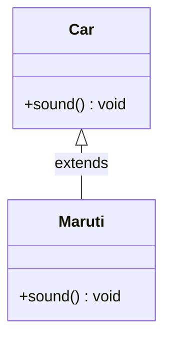
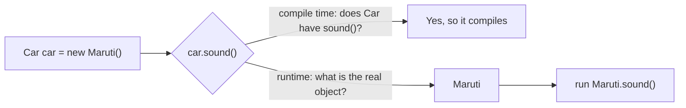

## In One Line
Polymorphism ("many forms") lets one reference type — `Car` — trigger different behaviour depending on the **actual object** behind it, so the same call `car.sound()` can mean "Maruti sound" or "Tesla sound" without the caller changing.

## Mental Model
Think of a **TV remote's power button**. You press the same button on a Sony, an LG or a Samsung TV, and each one switches on in its own way — different boot logo, different sound. You (the caller) only know the *remote interface*: "there is a power button". Which exact behaviour runs is decided by the *TV that receives the signal*.

In the code:
- The **remote** is the reference type: `Car car`.
- The **TV** is the real object on the heap: `new Maruti()`.
- **Pressing the button** is the call: `car.sound()`.
- The TV deciding how to react is the JVM's **dynamic dispatch**: it looks at the real object (`Maruti`) at runtime and runs *its* `sound()`.

## Concept
### Two kinds of polymorphism
| | Compile-time (static) | Runtime (dynamic) |
|---|---|---|
| Achieved by | **Method overloading** — same name, different parameter list | **Method overriding** — subclass redefines a parent method with the same signature |
| Decided by | The **compiler**, using the *reference/argument types* | The **JVM**, using the *actual object type* |
| Also called | Early binding | Late binding, dynamic method dispatch |
| Example | `display(String)` vs `display(String, int)` | `Car.sound()` vs `Maruti.sound()` |

This lesson's example is **runtime polymorphism**. Overloading has its own lesson.

### The three ingredients of runtime polymorphism
1. **Inheritance (or an interface)** — `Maruti extends Car`.
2. **Overriding** — `Maruti` redefines `void sound()` with the *same signature*.
3. **Upcasting** — a parent-type reference points to a child object: `Car car = new Maruti();`.

Remove any one and you no longer have runtime polymorphism.

### What the compiler checks vs what the JVM runs
This is the single most important idea in the lesson:

- **Compile time — the reference type decides what you may call.** `car` is declared as `Car`, so the compiler only lets you call methods that exist in `Car`. If `Maruti` had an extra method `turbo()`, then `car.turbo()` would be a **compile error**, even though the object really is a `Maruti`.
- **Runtime — the object type decides which version runs.** When `car.sound()` executes, the JVM looks at the real object (`Maruti`) and runs `Maruti.sound()`.

> [!INTERVIEW] "Reference type decides *what* can be called; object type decides *which implementation* runs."

### How the JVM does it (virtual method table)
Every class has a **vtable** — a table of pointers to its instance-method implementations. `Maruti`'s vtable copies `Car`'s entries and **replaces** the `sound` slot with `Maruti.sound`. A call like `car.sound()` compiles to the bytecode `invokevirtual Car.sound()`; at runtime the JVM follows the object's class pointer to *its* vtable and jumps to whatever is in the `sound` slot. That lookup is why it is called *dynamic* dispatch. (The JIT compiler usually optimises it to a direct call when only one implementation is actually seen.)

### Rules for a valid override
- Same method **name and parameter list** (the signature).
- Return type: same, or a **subtype** (covariant return), e.g. parent returns `Car`, child returns `Maruti`.
- Access can be **the same or wider**, never narrower (`protected` → `public` is fine; `public` → `private` is a compile error).
- Checked exceptions: the override may throw **fewer or narrower** checked exceptions, never new or broader ones.
- Put `@Override` on it — the compiler then errors if you accidentally overload instead of override (e.g. a typo in the name or a different parameter type).

### What is NOT polymorphic
| Member | Why not |
|---|---|
| `static` methods | Belong to the class, resolved at compile time by reference type. Redefining one in a subclass is **method hiding**, not overriding. |
| `private` methods | Not visible to the subclass, so they cannot be overridden. |
| `final` methods | Explicitly forbidden from being overridden. |
| **Fields** (instance variables) | Fields are resolved by the **reference type**. A child field with the same name *hides* the parent's field. |
| Constructors | Not inherited, so not overridden. |

### Why it matters in real code
Polymorphism is what lets you write code against an **abstraction** and plug in new behaviour later without editing the caller — the "O" in SOLID (Open/Closed). `List<String> list = new ArrayList<>();`, `Runnable r = () -> ...`, JDBC `Connection`, the Strategy pattern — they all rely on it.

## Diagram

`Maruti` inherits from `Car` and overrides `sound()` with the same signature.


The compiler only checks the reference type; the JVM picks the method from the real object.

## Code
@example CoreJava/Oops/PolymorphismExample.java

A second object shows the same reference type taking "many forms":
```java
Car[] cars = { new Car(), new Maruti() };
for (Car c : cars) {
    c.sound();   // same line of code, different behaviour
}
```
```output
Car makes a sound
Maruti makes sound
```

## Walkthrough
- `class Car { void sound() {...} }` — the parent defines a **default behaviour** for every car.
- `class Maruti extends Car` — `Maruti` **is-a** `Car` and inherits all its accessible members.
- `@Override void sound()` — `Maruti` replaces `sound()` with its own version. `@Override` makes the compiler verify that a method with this exact signature really exists in `Car`.
- `Car car = new Maruti();` — **upcasting**. The *reference* has type `Car`; the *object* on the heap is a `Maruti`. Upcasting is implicit and always safe, because every `Maruti` is a `Car`.
- `car.sound();` — the compiler accepts it because `Car` declares `sound()`. At runtime the JVM sees the object is a `Maruti` and runs `Maruti.sound()`, so the output is **`Maruti makes sound`**, not `Car makes a sound`.

## Traps
> [!ERRATA] The comment in the original says `// Calls Dog's overridden method`, but there is no `Dog` class here — it calls **`Maruti`'s** overridden `sound()`. The comment was left over from an Animal/Dog version of the example.

- **Calling a child-only method through a parent reference** — `Car car = new Maruti(); car.turbo();` is a compile error if only `Maruti` has `turbo()`. You must **downcast** first: `((Maruti) car).turbo();` — and use `instanceof` before downcasting, or you risk a `ClassCastException` at runtime.
- **Fields are not polymorphic.** If `Car` has `String name = "Car"` and `Maruti` has `String name = "Maruti"`, then `Car c = new Maruti(); c.name` is `"Car"`. Methods use the object type; fields use the reference type.
- **Static methods are hidden, not overridden.** `Car c = new Maruti(); c.staticMethod()` runs `Car`'s version.
- **Overloading is not overriding.** Changing the parameter list (`sound(int volume)`) creates a *new* method; the parent's `sound()` is still the one called through a `Car` reference. `@Override` catches this mistake.
- **Calling an overridable method from a constructor** — the child's override runs *before* the child's fields are initialised, so it can see `null`/`0` values. Avoid it.

> [!WARNING] Weaker access in an override (`private void sound()` in `Maruti`) does not compile: *"attempting to assign weaker access privileges"*.

## Tips & Tricks
- **Mnemonic — "Compile checks the Label, Runtime runs the Object."** The reference type is the label on the box; the object is what is actually inside.
- **Overloading = same name, different *Parameters* (compile time). Overriding = same name, same parameters, different *Class* (runtime).** "Overload **P**arams, Override **C**lass."
- **Always write `@Override`.** It costs nothing and turns silent bugs into compile errors.
- Declare variables with the **most general type you need**: `List<String> names = new ArrayList<>();`. You can then swap `ArrayList` for `LinkedList` without touching the rest of the code — that is polymorphism paying off.
- Seeing a long `if (type == A) ... else if (type == B) ...` chain? It is usually a sign that polymorphism (subclasses or strategies) would be cleaner.

## Interview Q&A
### [Basic] What is polymorphism in Java?
Polymorphism means one interface, many implementations: the same method call behaves differently depending on the object it is called on. Java supports two kinds — **compile-time polymorphism** through method overloading, resolved by the compiler from the argument types, and **runtime polymorphism** through method overriding, resolved by the JVM from the actual object type. For example, with `Car car = new Maruti();`, the call `car.sound()` runs `Maruti`'s version.

**Follow-up:** *Which one is "true" polymorphism?* — Runtime polymorphism (overriding) is what most people mean, because the behaviour is chosen by the object at runtime; overloading is just the compiler picking between differently-named-by-signature methods.

### [Basic] What is the difference between method overloading and method overriding?
| Overloading | Overriding |
|---|---|
| Same class (or inherited), same name, **different parameter list** | Subclass, same name, **same parameter list** |
| Resolved at **compile time** | Resolved at **runtime** |
| Return type can differ freely | Return type same or covariant (subtype) |
| Access modifier can be anything | Access same or wider |
| Works for static methods | Static methods cannot be overridden (only hidden) |

**Follow-up:** *Can you overload by changing only the return type?* — No. `int f()` and `String f()` in the same class is a compile error, because the call `f()` would be ambiguous.

### [Basic] What is upcasting and downcasting?
**Upcasting** is assigning a child object to a parent reference — `Car car = new Maruti();`. It is implicit and always safe. **Downcasting** is converting a parent reference back to a child type — `Maruti m = (Maruti) car;`. It needs an explicit cast and can fail at runtime with `ClassCastException` if the object is not really that type, so check first:
```java
if (car instanceof Maruti m) {   // Java 16+ pattern matching
    m.turbo();
}
```
**Follow-up:** *When does a bad downcast fail — compile time or runtime?* — Runtime (`ClassCastException`), unless the types are completely unrelated, in which case the compiler rejects it (`inconvertible types`).

### [Intermediate] Can we override static methods? What happens if a subclass declares the same static method?
No. Static methods belong to the class, not to objects, so they are bound at compile time using the reference type. If a subclass declares a static method with the same signature, it **hides** the parent's method. `Car c = new Maruti(); c.staticInfo();` runs `Car.staticInfo()`. Adding `@Override` to it is a compile error, which proves it is not an override.

**Follow-up:** *Can we override private or final methods?* — No. Private methods are not visible to the subclass (a same-named method is a brand-new method); final methods are explicitly locked.

### [Intermediate] Are fields polymorphic? What does this print: `Car c = new Maruti(); System.out.println(c.name);` if both classes declare `name`?
It prints the **`Car`** value. Fields are resolved by the reference type at compile time — the child field only *hides* the parent field. Only instance methods are dispatched dynamically. This is why fields should be private and accessed through (overridable) getters.

**Follow-up:** *And `c.getName()` if both classes override a getter?* — The `Maruti` version, because methods are dynamically dispatched.

### [Intermediate] What is dynamic method dispatch and how does the JVM implement it?
Dynamic method dispatch is the mechanism that picks the overridden method at runtime. The call compiles to `invokevirtual` (or `invokeinterface`) with the reference type's method. At runtime the JVM reads the object's class and looks the method up in that class's **virtual method table (vtable)**, where overridden methods replace the parent's entries. The JIT often optimises this with inline caches — if only one type is ever seen at a call site, it becomes a direct (even inlined) call.

**Follow-up:** *Which calls are NOT dynamically dispatched?* — `static`, `private`, `final` methods, constructors and `super.method()` calls — they are bound statically (`invokestatic` / `invokespecial`).

### [Intermediate] What are the rules for overriding a method that throws exceptions?
The overriding method may throw the **same, narrower, or no** checked exceptions, but not new or broader checked exceptions. It may throw any unchecked exceptions (`RuntimeException` subclasses). Reason: code written against the parent type only handles the parent's declared exceptions, so the child must not surprise it.

**Follow-up:** *Is `throws Exception` allowed if the parent declares `throws IOException`?* — No, `Exception` is broader than `IOException`.

### [Advanced] What is a covariant return type?
Since Java 5 an override may return a **subtype** of the parent method's return type. If `Car` has `Car copy()`, `Maruti` can declare `Maruti copy()`. Callers using a `Maruti` reference get the precise type without casting; callers using `Car` still get a `Car`. The compiler generates a synthetic *bridge method* to keep the bytecode signatures compatible.

**Follow-up:** *Does that work for primitive return types?* — No. `int` cannot become `short`; covariance only applies to reference types.

### [Advanced] What happens if a constructor calls an overridden method?
The child's override runs, even though the child's constructor body (and field initialisers) has not run yet. The override therefore sees default values (`null`, `0`, `false`). Example: the parent constructor calls `describe()`, and `Maruti.describe()` prints its `model` field — the output is `null`. This is why effective Java advice is: *never call overridable methods from constructors*; make them `private` or `final`.

**Follow-up:** *How do you prevent it?* — Make the called method `private`/`final`/`static`, or move the logic out of the constructor into a factory method.

### [Advanced] How does polymorphism support the Open/Closed Principle?
Code that depends on an abstraction (`Car`, `PaymentMethod`, `List`) is **closed for modification** — it never needs to change — yet the system is **open for extension**: you add a new subclass (`Tesla`, `UpiPayment`) and existing callers automatically use it through dynamic dispatch. It replaces fragile `if/else` or `switch` chains on type codes with objects that know their own behaviour — the idea behind the Strategy, State and Template Method patterns.

**Follow-up:** *Give a JDK example.* — `Collections.sort(list)` works for any `List` implementation; `Comparator` implementations plug different sort orders into the same algorithm.

## Quiz
### What does the original example print?
- [ ] Car makes a sound
- [x] Maruti makes sound
- [ ] Car makes a sound, then Maruti makes sound
- [ ] Compile error, because `car` is declared as `Car`
> The reference type is `Car`, but the object is a `Maruti`. Overridden instance methods are chosen by the **object** at runtime, so `Maruti.sound()` runs. It compiles because `Car` declares `sound()`.

### Which one decides whether `car.turbo()` compiles when `Car car = new Maruti();`?
- [x] The declared (reference) type `Car`
- [ ] The object type `Maruti`
- [ ] The JVM at runtime
- [ ] The `@Override` annotation
> The compiler only knows the declared type. If `Car` has no `turbo()`, the call does not compile — even if `Maruti` has it. You would need `((Maruti) car).turbo()`.

### What does this print?
```java
class A { String name = "A"; String getName() { return name; } }
class B extends A { String name = "B"; String getName() { return name; } }

A obj = new B();
System.out.println(obj.name + " " + obj.getName());
```
- [ ] B B
- [x] A B
- [ ] A A
- [ ] B A
> Fields are resolved by the reference type (`A`) → `"A"`. Methods are dynamically dispatched to the object (`B`) → `"B"`. Fields hide; methods override.

### What does this print?
```java
class A { static void hi() { System.out.println("A"); } }
class B extends A { static void hi() { System.out.println("B"); } }

A obj = new B();
obj.hi();
```
- [x] A
- [ ] B
- [ ] Compile error
- [ ] Runtime error
> Static methods are not overridden; `B.hi()` only *hides* `A.hi()`. The call is bound at compile time to the reference type `A`, so it prints `A`. (Calling a static method through an instance is legal but a bad habit — write `A.hi()`.)

### Spot the bug: why does `Maruti` still print "Car makes a sound"?
```java
class Car    { void sound()            { System.out.println("Car makes a sound"); } }
class Maruti extends Car { void sound(String s) { System.out.println("Maruti " + s); } }

Car car = new Maruti();
car.sound();
```
- [ ] `Maruti` must be declared `abstract`
- [x] `sound(String)` overloads instead of overriding, so `Car.sound()` is still used
- [ ] Upcasting disables overriding
- [ ] `sound()` must be `public` to be overridden
> A different parameter list creates a new overloaded method. `Maruti` never overrides `sound()`, so the inherited `Car.sound()` runs. Writing `@Override` on `sound(String)` would have turned this into a compile error.

### Which override of `protected Car build() throws IOException` is legal in a subclass?
- [ ] `private Car build() throws IOException`
- [ ] `protected Car build() throws Exception`
- [x] `public Maruti build()`
- [ ] `protected Object build()`
> Access may widen (`protected` → `public`), the return type may be a subtype (`Maruti` — covariant return), and throwing fewer checked exceptions is fine. Narrower access, broader exceptions, or a supertype return (`Object`) are all illegal.

## Takeaways
- Polymorphism = one reference type, many behaviours; Java has compile-time (overloading) and runtime (overriding) polymorphism.
- Runtime polymorphism needs inheritance/interface + overriding + upcasting (`Car car = new Maruti()`).
- The **reference type** decides what can be called (compile time); the **object type** decides which override runs (runtime).
- Only instance methods are dynamically dispatched — static, private and final methods, constructors and fields are not.
- Override rules: same signature, same or covariant return, same or wider access, same or narrower checked exceptions; always use `@Override`.
- Polymorphism is what makes code open for extension and closed for modification (Strategy, State, `List` vs `ArrayList`).
