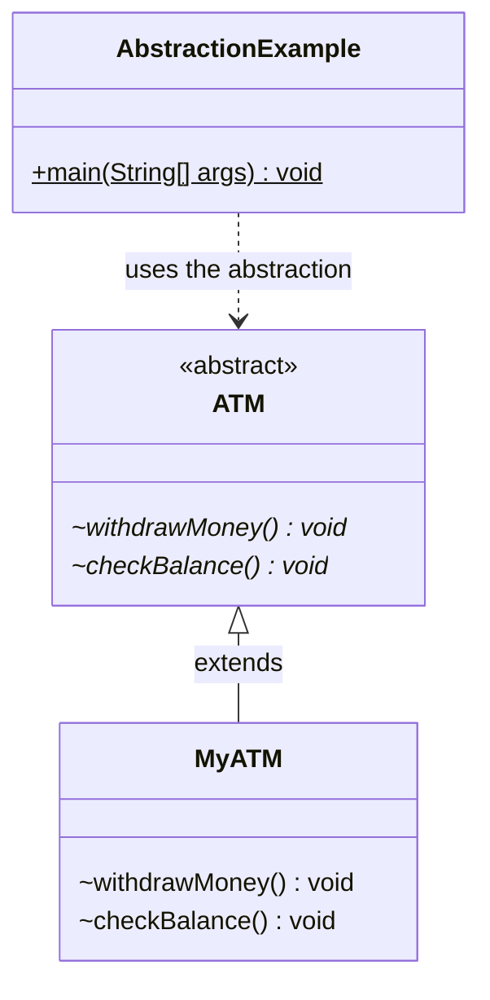
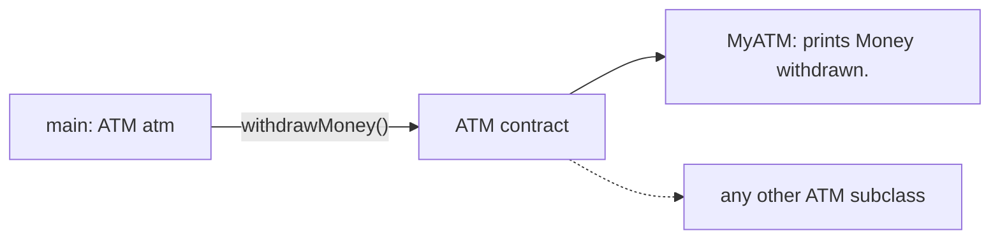

## In One Line
Abstraction means **exposing what an object can do while hiding how it does it**: callers work with the abstract type `ATM` and its operations `withdrawMoney()` and `checkBalance()`, and a concrete class such as `MyATM` supplies the details.

## Mental Model
Use the example's own picture: an **ATM**.

- The **screen menu** — "Withdraw", "Check balance" — is the abstraction: the abstract class `ATM` with its abstract methods. It promises the operations but says nothing about the machinery.
- The **bank's hardware and software** behind the screen (card reader, cash counter, network call to the core banking system) is the implementation: `MyATM`.
- **You**, the customer, are `main`: you hold an `ATM` reference and press buttons. Whether the machine belongs to SBI or HDFC, you use it the same way.

If the bank replaces its cash dispenser tomorrow, you do not have to relearn anything. That is the point: the caller depends on the **menu**, not on the **machinery**.

## Concept
### Why abstraction exists
- **Manage complexity** — a caller needs to know a handful of operations, not thousands of lines of implementation.
- **Decouple** — code written against `ATM` works with any current or future subclass (runtime polymorphism does the switching; see [Polymorphism](lesson:a01-oop/04-polymorphism)).
- **Replaceability and testing** — swap a real implementation for a fake one in tests.
- **Parallel work** — one team writes code against the abstraction while another implements it.

You meet abstraction everywhere in the JDK: `List` (you do not care whether it is an `ArrayList` or a `LinkedList`), `InputStream` (file, network or memory), JDBC `Connection` (MySQL or PostgreSQL driver).

### The two tools
| Tool | Level of abstraction | Details |
|---|---|---|
| **Abstract class** | Partial (0–100%) — can mix abstract methods with fields, constructors and concrete code | This lesson |
| **Interface** | A pure contract (plus `default`/`static`/`private` helper methods since Java 8/9), no instance state | [Abstract Class vs Interface](lesson:a01-oop/06-abstract-vs-interface) |

### Abstract class rules
| Rule | Example / error |
|---|---|
| Declared with `abstract`; **cannot be instantiated** | `new ATM()` → `ATM is abstract; cannot be instantiated` |
| An **abstract method** has no body and ends with `;` | `abstract void withdrawMoney();` — adding `{ }` → `abstract methods cannot have a body` |
| A class with any abstract method (declared or inherited and unimplemented) **must be abstract** | `class B { abstract void m(); }` → `B is not abstract and does not override abstract method m() in B` |
| A concrete subclass must implement **every** abstract method | Missing one → `HalfATM is not abstract and does not override abstract method checkBalance() in ATM` |
| A subclass may implement some methods and stay `abstract` | `abstract class BaseAtm extends ATM { ... }` |
| May have **constructors, fields, concrete methods, static methods, even `main`** | Constructors run via `super(...)` from subclasses |
| May have **zero** abstract methods | Used just to forbid direct instantiation |
| `abstract` cannot combine with `final`, `private` or `static` on a method, or with `final` on a class | `illegal combination of modifiers: abstract and final` |
| Implementations obey override rules: same signature, same or wider access | `protected abstract` can become `public` in the subclass |

Why those modifier combinations are illegal: `abstract` means "a subclass must provide this". `final` forbids subclasses/overrides, `private` hides the method from subclasses, and `static` methods are not overridden at all — each contradicts `abstract`.

### A reference of the abstract type
You cannot create an `ATM`, but you can **declare** variables, parameters and return types of type `ATM`:
```java
ATM atm = new MyATM();   // abstract reference, concrete object
```
This is "programming to an abstraction": the caller only sees the methods `ATM` declares, and the JVM runs `MyATM`'s implementations.

An **anonymous class** is a quick way to make a one-off concrete subclass — it still does not instantiate `ATM` itself:
```java
ATM test = new ATM() {
    @Override void withdrawMoney() { System.out.println("fake withdraw"); }
    @Override void checkBalance()  { System.out.println("fake balance"); }
};
```

### Abstract classes shine at "fixed algorithm, variable steps"
The **Template Method** pattern puts the fixed algorithm in a `final` concrete method of the abstract class and leaves specific steps `abstract` (or overridable). The abstract class keeps control of the order and the rules (validation, balance update), and subclasses fill in only what differs. The JDK's `AbstractList` (you implement `get` and `size`, it gives you iteration, `indexOf`, `equals`...) and `InputStream` (you implement `read()`, it gives you `read(byte[])`, `skip`, `transferTo`...) work this way. See [Template Method](lesson:a10-patterns/22-template-method).

### Abstraction vs encapsulation
| | Abstraction | Encapsulation |
|---|---|---|
| Question it answers | *What* does it do? | *How* is its state protected? |
| Hides | Implementation complexity | Internal data |
| Tools | Abstract classes, interfaces | `private` fields + methods |
| Level | Design / API | Implementation |

See [Encapsulation](lesson:a01-oop/02-encapsulation).

### Modern Java notes
- Since Java 8, interfaces can carry `default` methods, so many things that once needed an abstract class can be an interface. Abstract classes remain the choice when you need **state or constructors**.
- `sealed` abstract classes (Java 17) restrict which classes may implement the abstraction: `sealed abstract class Shape permits Circle, Square`. See [Sealed Classes](lesson:b05-modern-java/04-sealed-classes).
- Records cannot extend an abstract class (they implicitly extend `java.lang.Record`), but they can implement interfaces.

## Diagram

`*` marks abstract methods and `~` package-private access; `main` depends only on `ATM`, never on how `MyATM` works.


The caller talks to the contract; any subclass can sit behind it without the caller changing.

## Code
@example CoreJava/Oops/AbstractionExample.java

A more realistic ATM abstraction: the abstract class holds state, has a constructor, fixes the algorithm in a `final` template method, and leaves only the hardware step abstract.
```java
abstract class Atm {
    private int balance;                          // state: allowed in abstract classes

    protected Atm(int openingBalance) {           // constructor: called via super(...)
        this.balance = openingBalance;
    }

    // Template method: the fixed algorithm. final so subclasses cannot change the steps.
    public final void withdraw(int amount) {
        if (amount <= 0 || amount > balance) {
            System.out.println("Declined: " + amount);
            return;
        }
        dispense(amount);                         // the step each bank implements
        balance -= amount;
        System.out.println("Withdrew " + amount);
    }

    public int balance() { return balance; }

    protected abstract void dispense(int amount); // "what", not "how"
}

class SbiAtm extends Atm {
    SbiAtm(int openingBalance) { super(openingBalance); }

    @Override
    protected void dispense(int amount) {
        System.out.println("SBI hardware counts out " + amount);
    }
}

// in main:
Atm atm = new SbiAtm(1_000);
atm.withdraw(300);
atm.withdraw(5_000);
System.out.println("Balance: " + atm.balance());

Atm demo = new Atm(50) {                  // anonymous subclass
    @Override protected void dispense(int amount) {
        System.out.println("[demo] pretending to dispense " + amount);
    }
};
demo.withdraw(20);
```
```output
SBI hardware counts out 300
Withdrew 300
Declined: 5000
Balance: 700
[demo] pretending to dispense 20
Withdrew 20
```

Why package-private abstract methods limit an abstraction — `ATM` made `public`, but its methods left package-private, implemented from another package:
```java
// file bank/ATM.java
package bank;
public abstract class ATM {
    abstract void withdrawMoney();     // package-private abstract method
    abstract void checkBalance();
}

// file other/MyATM.java
package other;
import bank.ATM;
public class MyATM extends ATM {
    void withdrawMoney() { System.out.println("Money withdrawn."); }
    void checkBalance()  { System.out.println("Balance checked."); }
}
```
```text
other/MyATM.java:5: error: MyATM is not abstract and does not override abstract method checkBalance() in ATM
public class MyATM extends ATM {
       ^
1 error
```
`MyATM`'s methods do not override the invisible package-private ones, so the abstract methods remain unimplemented.

## Walkthrough
- `//Think of an ATM machine. ...` — the comment states the goal of abstraction: you use an ATM without knowing how it processes transactions internally.
- `abstract class ATM {` — an **abstract class**: it defines a type that cannot be instantiated. It has no access modifier, so it is package-private (usable only inside `CoreJava.Oops`).
- `abstract void withdrawMoney();` and `abstract void checkBalance();` — **abstract methods**: a signature followed by `;`, no body. They say *what* every ATM can do. Without a modifier they are package-private.
- `class MyATM extends ATM {` — a **concrete subclass**. Because it is not declared `abstract`, the compiler forces it to implement both abstract methods.
- `@Override void withdrawMoney() { System.out.println("Money withdrawn."); }` — the *how*. `@Override` makes the compiler confirm that this really implements a method of `ATM`. The access is package-private, the same as the abstract method (it could be wider, never narrower).
- `@Override void checkBalance() { System.out.println("Balance checked."); }` — the second implementation.
- `ATM atm = new MyATM();` — the variable's type is the **abstraction**; the object is the concrete `MyATM` (upcasting). `new ATM()` would not compile.
- `atm.withdrawMoney(); // Outputs: Money withdrawn.` — compiles because `ATM` declares the method; at runtime the JVM dispatches to `MyATM.withdrawMoney()`.
- `atm.checkBalance(); // Outputs: Balance checked.` — same mechanism. Both output comments match the real output.

## Traps
> [!ERRATA] The abstract methods have no access modifier, so they are **package-private**: only classes in `CoreJava.Oops` can ever implement `ATM` (and `ATM` itself is package-private too). A subclass in another package cannot override them and fails with "is not abstract and does not override abstract method" even if it declares methods with the same names (shown above). An abstraction meant to be implemented elsewhere should be `public abstract class ATM` with `public` or `protected abstract` methods.

> [!NOTE] The example's contract is simplified to the point of being unusable in real code: `withdrawMoney()` takes no amount and `checkBalance()` returns nothing, so a caller can neither choose how much to withdraw nor read the balance. A realistic abstraction looks like `withdraw(int amount)` and `int balance()` — see the `Atm` version in the Code section.

- **Trying to instantiate** — `new ATM()` → `ATM is abstract; cannot be instantiated`. (An anonymous class `new ATM() { ... }` is allowed because it creates a subclass.)
- **Forgetting one abstract method** — the subclass does not compile unless it is also declared `abstract`.
- **Giving an abstract method a body** — `abstract void f() { }` → `abstract methods cannot have a body`.
- **Illegal combinations** — `abstract` + `final`, `private` or `static` on methods, and `abstract` + `final` on classes.
- **Calling an abstract method from the abstract class's constructor** — the subclass implementation runs before the subclass's fields are initialised, so it sees `0`/`null` (see the Quiz: `Area = 0.0`).
- **Thinking an abstract class must have abstract methods** — it may have none; it may also have a `main` method and be run directly.
- **Narrowing access in the implementation** — `protected abstract void f();` implemented as package-private → compile error (weaker access).

## Tips & Tricks
- **"Abstract = What, Concrete = How."** Read every abstract method as a promise and every override as the fulfilment.
- **"Can't `new` it, can type it."** Abstract classes cannot be instantiated but make excellent variable, parameter and return types.
- **The forbidden trio: `final`, `private`, `static`** never go with an `abstract` method — each one stops overriding.
- Declare variables with the most abstract type that offers what you need: `ATM atm`, `List<String> names`, `InputStream in`.
- Reach for an abstract class when subclasses share **state or a fixed algorithm**; reach for an interface when you only need a **capability contract**.
- Make template methods `final` and hook methods `protected abstract`, so subclasses can fill steps but not break the algorithm.

## Interview Q&A
### [Basic] What is abstraction and how do you achieve it in Java?
Abstraction is hiding implementation details and exposing only the essential operations of an object — what it does, not how. In Java it is achieved with **abstract classes** (partial abstraction: can mix abstract methods with fields, constructors and concrete methods) and **interfaces** (a contract; since Java 8 they can also have `default`, `static` and, since Java 9, `private` methods). Callers depend on the abstract type (`ATM atm = new MyATM();`), and implementations can change without affecting them.

**Follow-up:** *Give a JDK example.* — `java.util.List` hides whether the list is array-backed or linked; `java.io.InputStream` hides whether bytes come from a file, a socket or memory.

### [Basic] What is an abstract class? Can you create an object of it?
An abstract class is a class declared with `abstract` that may contain abstract methods (no body) along with normal fields, constructors and methods. You cannot instantiate it directly — `new ATM()` is a compile error — because it may be incomplete. You create objects of concrete subclasses and refer to them through the abstract type. An anonymous class (`new ATM() { ... }`) is really an unnamed concrete subclass.

**Follow-up:** *Can an abstract class have a `main` method and be run?* — Yes. `main` is static and needs no instance, so `public abstract class App { public static void main(String[] a) {...} }` runs fine.

### [Basic] Can an abstract class have a constructor? Why, if you cannot instantiate it?
Yes. The constructor initialises the abstract class's own fields and enforces its invariants when a **subclass** object is created; subclasses call it with `super(...)` (implicitly or explicitly). For example, `Atm(int openingBalance)` sets the private `balance` that the template method later uses. It is often `protected`, since only subclasses should call it.

**Follow-up:** *Can an interface have a constructor?* — No. Interfaces have no instance state to initialise.

### [Intermediate] Can an abstract class have no abstract methods? Why would you do that?
Yes. Declaring a class `abstract` without abstract methods simply prevents direct instantiation, signalling "extend me; I am a base". Examples are adapter-style base classes that give empty default implementations of every method (Swing's `MouseAdapter`, the servlet API's `HttpServlet`) so subclasses override only what they need.

**Follow-up:** *Is a class with only private constructors the same thing?* — Not quite: private constructors prevent subclassing as well as instantiation (utility classes), while an abstract class is designed to be subclassed.

### [Intermediate] Which modifiers cannot be combined with `abstract`, and why?
On methods: `final` (cannot be overridden, but abstract must be), `private` (invisible to subclasses, so it can never be implemented), and `static` (static methods are not overridden, and there would be nothing to call). On classes: `final` (cannot be extended, but abstract must be). The compiler reports `illegal combination of modifiers`. `synchronized` and `native` are also illegal on abstract methods because they describe an implementation.

**Follow-up:** *Can an abstract method be `protected`?* — Yes, and it is common for hook methods that only subclasses should implement and call.

### [Intermediate] What happens if a subclass does not implement all abstract methods?
It must itself be declared `abstract`; otherwise compilation fails with `X is not abstract and does not override abstract method m() in Y`. This lets you build layered skeletons: an abstract base implements the shared parts and leaves the rest to concrete leaves (like `AbstractList` → `ArrayList`).

**Follow-up:** *Does the implementing method need `@Override`?* — No, but you should always add it: if the signature does not match, you get a compile error instead of a silent new method.

### [Intermediate] How is abstraction different from encapsulation?
Abstraction is about **design and interface**: deciding which operations an object exposes and hiding the complexity of how they are done. Encapsulation is about **implementation and protection**: keeping the object's data private and changing it only through controlled methods. Abstraction is expressed with abstract classes and interfaces; encapsulation with access modifiers. A well-designed class uses both: an abstract type describes *what*, and each implementation encapsulates its *how* and its state.

**Follow-up:** *Which comes first when designing?* — Usually abstraction: define the contract from the caller's point of view, then encapsulate the implementation behind it.

### [Advanced] What is the Template Method pattern, and why is it a natural fit for abstract classes?
Template Method defines the skeleton of an algorithm in a base-class method and defers some steps to subclasses. The skeleton method is concrete and usually `final`; the variable steps are `abstract` (must implement) or overridable hooks (may implement). It needs shared code plus holes, which is exactly what an abstract class offers. Example: `Atm.withdraw(amount)` validates, calls abstract `dispense(amount)`, then updates the balance; subclasses implement only `dispense`. JDK examples: `AbstractList`, `InputStream.read(byte[])` built on abstract `read()`.

**Follow-up:** *Why make the template method `final`?* — So subclasses cannot reorder or skip the steps (for example, skip the balance check); they can only fill in the designated steps.

### [Advanced] Why is calling an abstract method from the abstract class's constructor dangerous?
The abstract class's constructor runs before the subclass's field initialisers and constructor body. If it calls an abstract (or any overridable) method, dynamic dispatch runs the subclass implementation on a half-built object, which sees default values. With `Shape() { System.out.println("Area = " + area()); }` and `Square` having `double side = 2;`, `new Square()` prints `Area = 0.0`. Avoid calling overridable methods in constructors; use a factory method or an explicit `init()` step instead.

**Follow-up:** *Does it help to make the field `final`?* — Only by accident. `final double side = 2;` is a *constant variable* (final + constant initializer), so the compiler inlines `2` and the call prints `Area = 4.0`. But a `final` field assigned in the constructor (`Sq3(double s) { side = s; }`) or a non-constant type (`final Double side = 2.0;`) is still unset at that moment and shows `0.0` / `null`. Do not rely on it.

### [Advanced] Can you restrict which classes implement an abstraction?
Yes. Options: make the abstract class's constructor package-private so only same-package classes can extend it; since Java 17 use `sealed abstract class Shape permits Circle, Square` so the compiler knows the complete set of subclasses (which also enables exhaustive `switch` pattern matching in Java 21). Package-private abstract methods also restrict implementations to the package, as this lesson's example shows — often by accident.

**Follow-up:** *What must permitted subclasses declare?* — Each must be `final`, `sealed` or `non-sealed`.

## Quiz
### What happens with `ATM a = new ATM();` given the original `ATM`?
- [ ] It creates an ATM whose methods do nothing
- [x] Compile error: ATM is abstract; cannot be instantiated
- [ ] Runtime `InstantiationException`
- [ ] It creates a `MyATM` automatically
> The compiler refuses to instantiate an abstract class. `InstantiationException` is what *reflection* throws if you try `ATM.class.getDeclaredConstructor().newInstance()`, but a plain `new` never gets that far.

### What does this print?
```java
abstract class Shape {
    Shape() { System.out.println("Shape created"); }
    abstract double area();
    void describe() { System.out.println("Area = " + area()); }
}
class Square extends Shape {
    double side = 2;
    Square() { System.out.println("Square created"); }
    double area() { return side * side; }
}
Shape s = new Square();
s.describe();
```
- [x] Shape created, Square created, Area = 4.0
- [ ] Square created, Area = 4.0
- [ ] Compile error: abstract classes cannot have constructors
- [ ] Shape created, Square created, Area = 0.0
> The abstract class's constructor runs first (via implicit `super()`), then `Square`'s. By the time `describe()` is called, `side` is 2, so the area is 4.0. Abstract classes can have constructors.

### What does this print?
```java
abstract class Shape {
    Shape() { System.out.println("Area = " + area()); }
    abstract double area();
}
class Square extends Shape {
    double side = 2;
    double area() { return side * side; }
}
new Square();
```
- [ ] Area = 4.0
- [x] Area = 0.0
- [ ] AbstractMethodError
- [ ] Compile error
> `Shape()` runs before `Square`'s field initialiser `side = 2`, but `area()` is dispatched to `Square` anyway, which sees `side = 0.0`. This is why constructors should not call overridable methods.

### Which declaration is legal inside an abstract class?
- [ ] `abstract void f() { }`
- [ ] `private abstract void f();`
- [ ] `static abstract void f();`
- [x] `protected abstract void f();`
> Abstract methods cannot have a body and cannot be `private` or `static`, because each of those prevents a subclass from providing the implementation. `protected abstract` is common for hook methods.

### Spot the bug: why does this not compile?
```java
abstract class ATM {
    abstract void withdrawMoney();
    abstract void checkBalance();
}
class HalfATM extends ATM {
    @Override void withdrawMoney() { System.out.println("Money withdrawn."); }
}
```
- [ ] `@Override` cannot be used on abstract method implementations
- [x] `HalfATM` does not implement `checkBalance()` and is not declared abstract
- [ ] `ATM` needs a constructor
- [ ] Abstract methods must be public
> A concrete class must implement every inherited abstract method. Either implement `checkBalance()` or declare `abstract class HalfATM`. The error reads "HalfATM is not abstract and does not override abstract method checkBalance() in ATM".

### A class in package `other` extends `public abstract class bank.ATM` whose abstract methods have no access modifier. It declares `void withdrawMoney()` and `void checkBalance()`. Result?
- [ ] Compiles; the methods override the abstract ones
- [x] Compile error: the package-private abstract methods cannot be overridden from another package
- [ ] Compiles, but throws `AbstractMethodError` at runtime
- [ ] Compiles only if the methods are marked `@Override`
> Package-private methods are invisible outside their package, so same-named methods in `other` do not override them and the abstract methods stay unimplemented. Adding `@Override` only adds more errors ("method does not override or implement a method from a supertype"). Make the abstract methods `public` or `protected`.

## Takeaways
- Abstraction exposes *what* an object does and hides *how*; callers depend on the abstract type (`ATM atm = new MyATM()`).
- Java provides abstraction through abstract classes (partial: state, constructors, concrete methods allowed) and interfaces (contracts).
- An abstract class cannot be instantiated; a concrete subclass must implement every abstract method or be abstract itself.
- Abstract classes may have constructors (run via `super`), fields, static methods, `main`, and even zero abstract methods.
- `abstract` cannot be combined with `final`, `private` or `static` on methods, or with `final` on classes.
- Package-private abstract methods can only be implemented inside the same package — use `public`/`protected` for a real API.
- Abstract classes fit the Template Method pattern: a `final` algorithm with `abstract` steps; never call overridable methods from the constructor.
