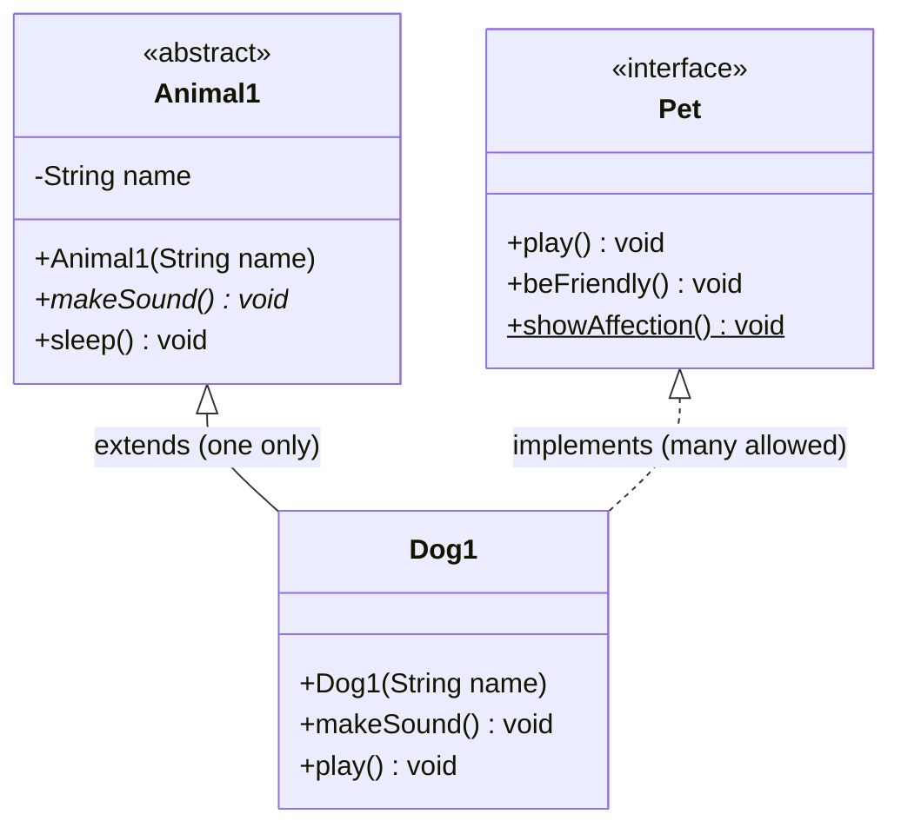
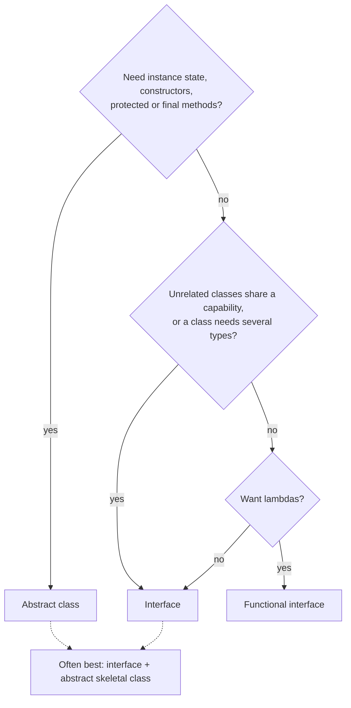
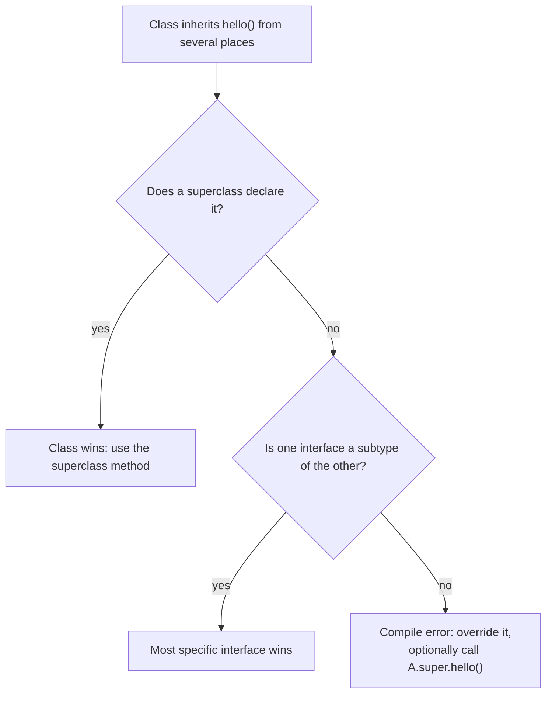

## In One Line
An **abstract class** is a partially built parent that shares **state and code** with its subclasses (a class can extend only one), while an **interface** is a **capability contract** with no instance state that any class can implement, as many as it likes — `Dog1` *is an* `Animal1` and *can act as* a `Pet`.

## Mental Model
Think of a **person's job and their certifications**.

- Your **employer** (the abstract class `Animal1`) gives you a desk, an ID badge with your name on it (**state**: `name`), an onboarding process (**constructor**) and ready-made procedures (**concrete methods**: `sleep()`), but leaves some duties for you to define (**abstract methods**: `makeSound()`). You can have only **one** employer.
- Your **certifications** (interfaces like `Pet`) each say "the holder can do X" (`play()`). A certification gives you no desk and no badge — no state — but it may come with a standard handbook procedure you can use as-is or replace (**default method**: `beFriendly()`) and a general hotline anyone can call without being certified (**static method**: `Pet.showAffection()`). You can hold **many** certifications.

`Dog1` works for `Animal1` and is certified as `Pet`.

## Concept
### Side-by-side comparison (Java 17/21)
| Feature | Abstract class | Interface |
|---|---|---|
| Declared with / used with | `abstract class` / `extends` | `interface` / `implements` (an interface `extends` other interfaces) |
| Can be instantiated | No | No |
| How many per class | **One** (single inheritance) | **Many** |
| Constructors | Yes (run through `super(...)`) | **No** |
| Instance fields (state) | Yes — any type, any access, mutable | **No** — only constants, implicitly `public static final` |
| Abstract methods | Yes, with `abstract` keyword, any non-private access | Yes — every body-less method is implicitly `public abstract` |
| Concrete instance methods | Yes, any access, can be `final` | `default` methods (Java 8), always `public`, cannot be `final` |
| Static methods | Yes, inherited by subclasses | Yes (Java 8), **not** inherited — call as `Pet.showAffection()` |
| Private methods | Yes | Yes (Java 9) — helpers for default/static methods |
| `protected` / package-private members | Yes | No |
| Can override `equals`/`hashCode`/`toString` | Yes | No — a default method may not override `Object` methods |
| Lambdas | No | Yes, if it is a functional interface (exactly one abstract method) |
| Relationship expressed | **IS-A** with shared identity, state and code | **CAN-DO** capability (`Comparable`, `Runnable`, `AutoCloseable`) |
| Adding a method later | Add a concrete method — subclasses unaffected | Add a `default` method — implementers unaffected (before Java 8 it broke them all) |

### How interfaces evolved
| Version | Interfaces could contain |
|---|---|
| Java 1.0–7 | Abstract methods and constants only |
| Java 8 | + `default` methods, + `static` methods; functional interfaces power lambdas |
| Java 9 | + `private` and `private static` methods |
| Java 16 | Records can implement interfaces (records cannot extend classes) |
| Java 17 | `sealed` interfaces with `permits` |

Default methods were added so the JDK could grow old interfaces — `Collection.stream()`, `Iterable.forEach()`, `List.sort()`, `Map.getOrDefault()` — without breaking millions of existing implementations. See [Default Methods](lesson:a05-java8/10-default-methods) and [Static Interface Methods](lesson:a05-java8/11-static-interface-methods).

### Implicit modifiers in interfaces
```java
interface Pet {
    int MAX_TOYS = 5;              // = public static final int MAX_TOYS = 5;
    void play();                   // = public abstract void play();
    default void beFriendly() {}   // public (implicitly)
    static void showAffection() {} // public (implicitly)
    private void log(String m) {}  // must say private explicitly
    class Toy {}                   // nested types are implicitly public static
}
```
Consequences: an implementing method must be `public` (`void play()` without `public` → *attempting to assign weaker access privileges; was public*); `Pet.MAX_TOYS = 6` → *cannot assign a value to static final variable*; `protected` and `final` are not allowed on interface methods.

### The diamond problem with default methods — three rules
When a class inherits the same method from several places, Java resolves it like this:
1. **Classes win.** A method from the superclass chain beats any interface default (`class Child extends Parent implements A` uses `Parent.hello()`).
2. **More specific interface wins.** If `A2 extends A` and both define `hello()`, `A2`'s version is used.
3. **Otherwise it is a compile error** — *types A and B are incompatible; class C inherits unrelated defaults for hello() from types A and B*. The class must override the method, and may call a chosen parent with `A.super.hello()`.

Interfaces have no state, so unlike C++ there is never a question of "two copies of the parent's fields".

### Static interface methods are not inherited
`Pet.showAffection()` works. `Dog1.showAffection()` and `myDog.showAffection()` do **not** compile (`cannot find symbol`), and even `Pet p = myDog; p.showAffection();` is rejected (*illegal static interface method call*). This differs from static methods of classes, which subclasses do inherit. The reason: a class may implement many interfaces with same-named static methods, so inheriting them would create ambiguity.

### Which one should I use?
- Need **shared state, constructors, `protected` members or `final` methods** → abstract class.
- Need a **capability** that unrelated classes can share, or a type that a class must be able to combine with others → interface.
- Need **lambdas** → a functional interface.
- Want both flexibility and code reuse → **both**: an interface for the type, plus an abstract *skeletal implementation* that implements the boring parts. The JDK does this everywhere: `List` + `AbstractList`, `Map` + `AbstractMap`, `Collection` + `AbstractCollection` (*Effective Java*, Item 20: prefer interfaces to abstract classes).

### Other points interviewers probe
- **Marker interfaces** have no methods at all (`Serializable`, `Cloneable`, `RandomAccess`) and simply tag a class; today annotations often serve the same purpose, but a marker interface is a *type* the compiler can check.
- **Functional interface** = exactly one abstract method (default, static and private methods, and abstract methods matching public `Object` methods, do not count). `Pet` qualifies, so `Pet p = () -> System.out.println("playing");` compiles. `@FunctionalInterface` makes the compiler enforce it. See [Functional Interfaces](lesson:a05-java8/01-functional-interfaces).
- **Two interfaces with the same abstract method** — one implementation satisfies both, no conflict.
- **Performance** — calls through an interface compile to `invokeinterface`, through a class to `invokevirtual`; after JIT inlining the difference is negligible. Choose by design, not speed.
- An interface may contain `static void main(String[] args)` and be launched directly.

## Diagram

`Dog1` gets state and code from its single abstract parent and a capability from the interface; `showAffection()` (`$` = static) stays on `Pet`.


Start from what you need: state pushes you to an abstract class, multiple types or lambdas push you to an interface.


The three default-method conflict rules, checked in this order.

## Code
@example CoreJava/Oops/AbstractVsInterfaceExample.java

All three conflict rules, running:
```java
interface A { default String hello() { return "Hello from A"; } }
interface B { default String hello() { return "Hello from B"; } }

// Rule 3: conflict -> the class must override, and may pick one with X.super
class C implements A, B {
    @Override public String hello() { return A.super.hello() + " and " + B.super.hello(); }
}

// Rule 1: class wins over interface
class Parent { public String hello() { return "Hello from Parent class"; } }
class Child extends Parent implements A { }

// Rule 2: the more specific interface wins
interface A2 extends A { default String hello() { return "Hello from A2 (more specific)"; } }
class Impl implements A, A2 { }

System.out.println(new C().hello());
System.out.println(new Child().hello());
System.out.println(new Impl().hello());
```
```output
Hello from A and Hello from B
Hello from Parent class
Hello from A2 (more specific)
```
Without the override in `C`, compilation fails: `types A and B are incompatible; class C inherits unrelated defaults for hello() from types A and B`.

Everything a modern interface can hold, next to an abstract class:
```java
abstract class Animal1 {
    private final String name;
    protected Animal1(String name) { this.name = name; }
    public String getName() { return name; }
    public abstract void makeSound();
}
interface Pet {
    int MAX_TOYS = 5;                                       // public static final
    void play();                                            // public abstract
    default void beFriendly() { log("Being friendly."); }   // Java 8
    default void greetOwner(String owner) { log("Greeting " + owner + "."); }
    static void showAffection() { System.out.println("Showing affection."); } // Java 8
    private void log(String msg) { System.out.println("[pet] " + msg); }     // Java 9
}
class Dog1 extends Animal1 implements Pet {
    Dog1(String name) { super(name); }
    @Override public void makeSound() { System.out.println(getName() + " barks."); }
    @Override public void play() { System.out.println(getName() + " is playing."); }
}

Pet p = new Dog1("Buddy");
p.play();
p.beFriendly();
p.greetOwner("Asha");
Pet.showAffection();
System.out.println(Pet.MAX_TOYS);
System.out.println(p instanceof Animal1);

Pet quick = () -> System.out.println("Lambda pet is playing.");  // Pet has one abstract method
quick.play();
```
```output
Buddy is playing.
[pet] Being friendly.
[pet] Greeting Asha.
Showing affection.
5
true
Lambda pet is playing.
```

## Walkthrough
- `abstract class Animal1 {` — the abstract parent. `private String name;` is **instance state**, something an interface cannot have. Being `private`, it is invisible to `Dog1`; only `Animal1`'s own methods use it.
- `public Animal1(String name) { this.name = name; }` — `// Constructor in abstract class`: abstract classes can have constructors; this one runs whenever a subclass object is created. (`public` works, but `protected` states the intent better, since only subclasses can call it.)
- `public abstract void makeSound();` — `// Abstract method (no implementation)`: every concrete subclass must supply it.
- `public void sleep() { System.out.println(name + " is sleeping."); }` — `// Concrete method`: shared code that uses the private state.
- `interface Pet {` — a capability contract.
- `void play();` — `// Abstract method`: implicitly `public abstract`.
- `default void beFriendly() {...}` — `// Default method (concrete method)` (Java 8): implementers get it for free and may override it.
- `static void showAffection() {...}` — `// Static method (concrete method)` (Java 8): belongs to the interface only; it is called as `Pet.showAffection()`.
- `class Dog1 extends Animal1 implements Pet {` — `extends` must come before `implements`. One class, many interfaces would be allowed: `implements Pet, Comparable<Dog1>`.
- `public Dog1(String name) { super(name); }` — `Animal1` has no no-arg constructor, so `Dog1` **must** call `super(name)` explicitly; this passes "Buddy" up to be stored in the private field.
- `@Override public void makeSound()` and `@Override public void play()` — implement the abstract class's method and the interface's method. `play()` **must** be `public` because interface methods are implicitly public.
- `Dog1 myDog = new Dog1("Buddy");` then:
  - `myDog.makeSound();` → `Dog barks.` (the implementation in `Dog1`)
  - `myDog.sleep();` → `Buddy is sleeping.` (inherited concrete method, reading the private `name` that the constructor chain stored)
  - `myDog.play();` → `Dog is playing.`
  - `myDog.beFriendly();` → `Being friendly.` (inherited default method, not overridden)
  - `Pet.showAffection();` → `Showing affection.` — called on the **interface name**, because static interface methods are not inherited by `Dog1`.
- All five output comments in the original match the real output.

## Traps
> [!ERRATA] The names `Animal1` and `Dog1` are workarounds, not good naming. All the course's OOP examples share the package `CoreJava.Oops`, and `InheritanceExample.java` already declares top-level classes `Animal` and `Dog` there; reusing those names would fail with `duplicate class: CoreJava.Oops.Animal`. Numbered names hide intent — prefer separate packages per example, or declare helper types as `static` nested classes inside each example class.

> [!ERRATA] The comment `// Interface with abstract methods and default method` undersells the interface: it has **one** abstract method, a default method **and a static method**. Since Java 9 an interface can also have private methods.

- **Calling a static interface method through the class or an instance** — `Dog1.showAffection()` / `myDog.showAffection()` → `cannot find symbol`; `petRef.showAffection()` → `illegal static interface method call`. Always `Pet.showAffection()`.
- **Implementing an interface method without `public`** — `void play()` → *attempting to assign weaker access privileges; was public*.
- **Two unrelated defaults with the same signature** — compile error until the class overrides the method.
- **Default methods cannot override `Object` methods** — `default String toString()` → *default method toString in interface Pet overrides a member of java.lang.Object*. The class (at least `Object`) always wins, so it could never run.
- **Assuming interface "fields" are per-object** — they are `public static final` constants; assigning one fails.
- **Interfaces have no constructors** — `Pet() { }` inside an interface is a syntax error.
- **`final` and `protected` are not allowed on interface methods** — `modifier final not allowed here`.
- **Calling a class method through an interface reference** — `Pet p = new Dog1("Max"); p.sleep();` → `cannot find symbol`; the reference type `Pet` does not know `sleep()`.

> [!NOTE] Because `Animal1` is the first class in the file, `java AbstractVsInterfaceExample.java` fails on JDK 21 (it looks for `main` in `Animal1`). Compile and run by class name, or use the IDE — see [Course Project Setup](lesson:a01-oop/00-course-project-setup).

## Tips & Tricks
- **"Abstract class = IS-A + shared stuff; Interface = CAN-DO."** "A Dog *is an* Animal; a Dog *can be a* Pet."
- **"Extends one, implements many."** And write `extends` before `implements`.
- **Interface members default to `public`** — remember "PSF fields, PA methods": `public static final` fields, `public abstract` methods.
- **Default-method conflicts: "Class, then Specific, then You"** — superclass wins, then the more specific interface, otherwise you must override.
- **Static interface methods stay home** — always call them on the interface name.
- Design APIs around interfaces and hide implementations behind them; add an `AbstractXxx` skeletal class if implementers need help.
- A default method is for **evolving** an interface or providing a convenience built on the abstract methods — not a back door for state.

## Interview Q&A
### [Basic] What are the main differences between an abstract class and an interface?
An abstract class can have instance fields, constructors, concrete methods with any access modifier, `final` methods and abstract methods; a class can extend only one. An interface has no instance state or constructors — only `public static final` constants, `public abstract` methods, and since Java 8 `default` and `static` methods, and since Java 9 `private` methods; a class can implement many interfaces and an interface can extend many interfaces. Abstract classes model IS-A with shared code and state; interfaces model a CAN-DO capability. Only interfaces with a single abstract method can be targets for lambdas.

**Follow-up:** *Since Java 8 interfaces have method bodies — is there still a reason for abstract classes?* — Yes: state (instance fields), constructors, `protected`/package-private members, `final` methods and overriding `Object` methods are all impossible in interfaces.

### [Basic] When would you choose an abstract class over an interface?
Choose an **abstract class** when closely related classes share state and code, when you need a constructor to enforce invariants, when you want non-public (`protected`) hooks, or a `final` template method that subclasses cannot change. Choose an **interface** when unrelated classes should share a capability (`Comparable`, `AutoCloseable`), when a class needs to be several types at once, or when you want lambda support. Often you use both: an interface for the public type and an abstract skeletal class implementing it.

**Follow-up:** *What is a skeletal implementation?* — An abstract class that implements an interface's boilerplate in terms of a few abstract methods, like `AbstractList` implementing `List` on top of `get()` and `size()`.

### [Basic] Can a class extend an abstract class and implement interfaces at the same time?
Yes: `class Dog1 extends Animal1 implements Pet, Comparable<Dog1>`. `extends` must come first, there can be only one class after it, and any number of interfaces after `implements`. The class must implement every abstract method from the abstract parent and from all interfaces, unless it is itself abstract.

**Follow-up:** *Can an interface extend a class?* — No. An interface can only extend other interfaces (`interface A extends B, C`).

### [Intermediate] What are default methods and why were they introduced?
Default methods (Java 8) are interface methods with a body, marked `default`. Implementers inherit them and may override them. They were introduced to **evolve interfaces without breaking existing implementations** — for example, adding `forEach` to `Iterable` and `stream()` to `Collection`, which every existing collection class then got for free. They also allow small convenience methods built on the abstract ones (`Comparator.reversed()`).

**Follow-up:** *Can a default method be `final` or `synchronized`?* — No. Neither modifier is allowed on default methods; a default is always overridable.

### [Intermediate] How does Java resolve the diamond problem with default methods?
Three rules: (1) a method from the class hierarchy always wins over interface defaults; (2) otherwise the most specific interface (a sub-interface) wins; (3) otherwise, if two unrelated interfaces provide the same default, the class must override the method or it does not compile, and it can delegate with `InterfaceName.super.method()`.
```java
class C implements A, B {
    @Override public String hello() { return A.super.hello(); }
}
```
Because interfaces have no instance state, there is no "which copy of the fields?" problem as in C++.

**Follow-up:** *What if one interface declares `hello()` abstract and another provides a default?* — Still a conflict; the class must implement `hello()` itself.

### [Intermediate] Are static methods in interfaces inherited by implementing classes?
No. `Pet.showAffection()` can only be called through the interface name. `Dog1.showAffection()` or `dog.showAffection()` gives `cannot find symbol`, and calling it through a `Pet` reference is an "illegal static interface method call". This avoids ambiguity when a class implements several interfaces with same-named static methods. Class static methods, in contrast, are inherited (and can be hidden).

**Follow-up:** *Why put static methods in interfaces at all?* — To keep factory and utility methods next to the type instead of in a separate companion class: `Comparator.comparing(...)`, `List.of(...)`, `Map.entry(...)`.

### [Intermediate] Why can't interfaces have instance fields or constructors?
An interface describes behaviour that many unrelated classes can adopt, possibly several at once. Instance state would bring back the diamond problem for data (whose copy of the field?) and would force a construction order among multiple interfaces. So interfaces may only hold constants (`public static final`) and have nothing to construct. State belongs in classes.

**Follow-up:** *Can a default method keep state?* — Not in the interface; it can only call the abstract methods (e.g. getters) that implementing classes provide, which is how defaults work "with" state.

### [Intermediate] Can an interface have private methods? Why?
Yes, since Java 9, both `private` and `private static`. They let default and static methods share helper code without exposing that helper as part of the public contract (before Java 9 you had to make it a public default method or duplicate code). In the Code section, `private void log(String)` is shared by two default methods.

**Follow-up:** *Can a private interface method be abstract?* — No, it must have a body; nobody outside could implement it.

### [Advanced] What is a functional interface? Is `Pet` one?
A functional interface has **exactly one abstract method** (default, static and private methods don't count, nor do abstract re-declarations of public `Object` methods like `boolean equals(Object)`). It can be implemented with a lambda or method reference. `Pet` has one abstract method, `play()`, so it is functional: `Pet p = () -> System.out.println("playing");` compiles. `@FunctionalInterface` is optional but makes the compiler reject a second abstract method.

**Follow-up:** *Can an abstract class with one abstract method be a lambda target?* — No. Lambdas only target interfaces.

### [Advanced] Why can't a default method override `equals`, `hashCode` or `toString`?
Because of rule 1, "classes win": every class inherits these methods from `Object`, a class, so an interface default would never be selected — declaring one would only mislead. The compiler therefore rejects it: *default method toString in interface Pet overrides a member of java.lang.Object*. An interface may still *declare* them abstractly (as `Comparator` declares `equals`) for documentation purposes.

**Follow-up:** *Does such an abstract `equals` declaration count against the functional interface rule?* — No; `Comparator` is still a functional interface.

### [Advanced] Abstract class or interface for a public API that will evolve?
Prefer an **interface** as the public type: it does not use up the implementer's single superclass slot, it works with lambdas, mocks and proxies (`java.lang.reflect.Proxy` only proxies interfaces), and default methods allow careful evolution. Provide an abstract skeletal class for convenience. Use an abstract class as the public type only when construction and shared mutable state are essential to the concept. Be aware that adding a default method can still break implementers that already have a method with the same signature but an incompatible return type or contract.

**Follow-up:** *How do sealed interfaces fit in (Java 17)?* — `sealed interface Shape permits Circle, Square` fixes the set of implementations, letting `switch` pattern matching check exhaustiveness — useful for closed domain models.

## Quiz
### What happens here?
```java
interface A { default String hello() { return "A"; } }
interface B { default String hello() { return "B"; } }
class C implements A, B { }
```
- [ ] `new C().hello()` returns "A" (first interface wins)
- [ ] It returns "B" (last interface wins)
- [x] Compile error: C inherits unrelated defaults for hello()
- [ ] Runtime error: ambiguous method
> Java refuses to guess. The class must override `hello()` and can delegate with `A.super.hello()`. Order in the `implements` list never matters.

### What does this print?
```java
interface A { default String hello() { return "Hello from A"; } }
class Parent { public String hello() { return "Hello from Parent class"; } }
class Child extends Parent implements A { }

System.out.println(new Child().hello());
```
- [x] Hello from Parent class
- [ ] Hello from A
- [ ] Compile error: conflict between Parent and A
- [ ] Hello from Parent classHello from A
> Rule 1: a method inherited from the class hierarchy always wins over an interface default. No conflict is reported.

### Given the original `Pet` and `Dog1`, which call compiles?
- [ ] `Dog1.showAffection();`
- [ ] `new Dog1("Buddy").showAffection();`
- [x] `Pet.showAffection();`
- [ ] `Pet p = new Dog1("Buddy"); p.showAffection();`
> Static interface methods are not inherited and must be called through the interface name. The instance and class forms give "cannot find symbol"; the `Pet`-reference form gives "illegal static interface method call".

### What does this print?
```java
class Dog1 extends Animal1 implements Pet {   // Animal1 and Pet as in the original
    public Dog1(String name) { super(name); }
    public void makeSound() { System.out.println("Dog barks."); }
    public void play() { System.out.println("Dog is playing."); }
    @Override public void beFriendly() {
        Pet.super.beFriendly();
        System.out.println("Wags tail.");
    }
}
Pet p = new Dog1("Max");
p.beFriendly();
((Animal1) p).sleep();
```
- [ ] Wags tail. then Max is sleeping.
- [x] Being friendly. then Wags tail. then Max is sleeping.
- [ ] Being friendly. then Max is sleeping.
- [ ] Compile error: `Pet.super` is only allowed in interfaces
> The override first calls the interface's default via `Pet.super.beFriendly()`, then adds its own line. The cast to `Animal1` is safe because the object is a `Dog1`, and `sleep()` prints the name stored by the constructor chain. `X.super.m()` is legal in any class that directly implements `X`.

### Spot the bug: why does `Dog1` not compile?
```java
interface Pet { void play(); }
class Dog1 implements Pet {
    void play() { System.out.println("Dog is playing."); }
}
```
- [ ] `play()` needs `@Override`
- [x] `play()` must be `public`; interface methods are implicitly public
- [ ] Interfaces cannot have abstract methods without `abstract`
- [ ] `Dog1` must be abstract
> `void play()` in `Pet` means `public abstract void play()`. Implementing it with package-private access narrows visibility: "attempting to assign weaker access privileges; was public". `@Override` is optional.

### Which of these can an interface NOT contain (Java 17)?
- [ ] A `private` helper method
- [ ] A `static` method
- [x] A constructor
- [ ] A constant `int MAX = 5;`
> Interfaces have no instances of their own to construct, so constructors are impossible. Private methods (Java 9), static methods (Java 8) and constants (always) are allowed.

### What happens?
```java
Pet p = new Dog1("Max");   // original classes
p.sleep();
```
- [ ] Prints "Max is sleeping."
- [x] Compile error: cannot find symbol `sleep()` in `Pet`
- [ ] ClassCastException
- [ ] NullPointerException
> The reference type `Pet` only knows `play()`, `beFriendly()` and its static method. Even though the object is a `Dog1` (an `Animal1`), you must cast: `((Animal1) p).sleep()`.

## Takeaways
- Abstract class: state, constructors, any access modifiers, `final` methods; a class extends only one. Interface: constants, `public abstract`, `default`, `static` and `private` methods; a class implements many.
- Abstract class expresses IS-A with shared code and state; an interface expresses a CAN-DO capability and can be a lambda target if it has one abstract method.
- Interface members are implicitly public (fields `public static final`, methods `public abstract`), so implementations must be `public`.
- Default-method conflicts: the class hierarchy wins, then the more specific interface; otherwise override and choose with `X.super.m()`.
- Static interface methods are not inherited — call them as `Pet.showAffection()`; default methods cannot override `Object` methods.
- Interfaces evolved: default/static (Java 8), private (Java 9), sealed (Java 17); records can implement interfaces but not extend classes.
- Best of both: an interface as the public type plus an abstract skeletal implementation (`List` + `AbstractList`).
