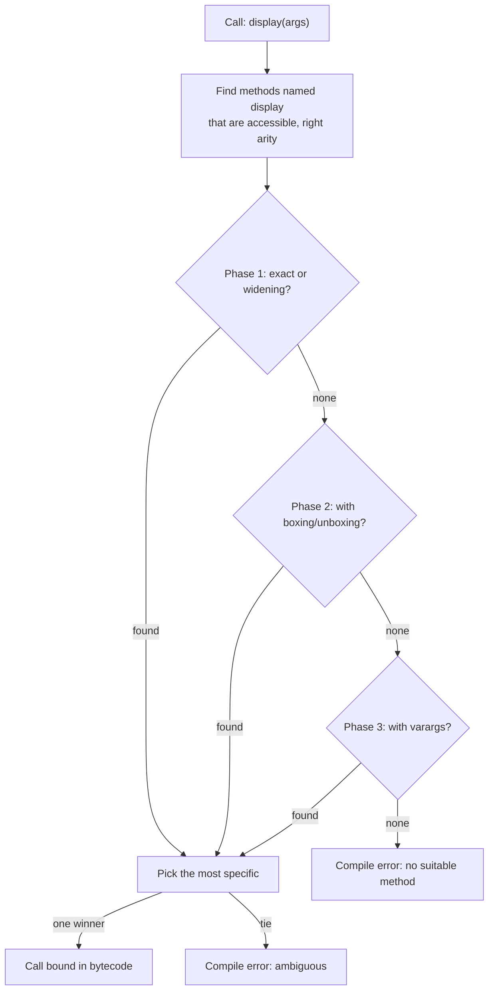
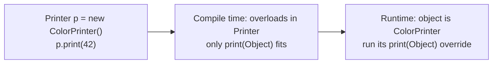

## In One Line
Method overloading means **several methods with the same name but different parameter lists** in one class (or its hierarchy); the **compiler** picks which one to call from the argument types — `display("John")` vs `display("Jane", 25)`.

## Mental Model
Think of a **coffee machine with one "Brew" button family**: "Brew (cup size)", "Brew (cup size, extra shot)", "Brew (cup size, milk type, sugar)". It is the same action — brew — and the machine knows which program to run purely from **which inputs you supplied**.

In the code:
- The **action name** is the method name `display`.
- The **inputs you supply** are the arguments: `("John")` or `("Jane", 25)`.
- The **machine choosing the program** is the compiler: it looks at the number, types and order of arguments and binds the call to `display(String)` or `display(String, int)` **before the program runs**.

The machine never looks at *who* is standing in front of it (the runtime object) — only at what was typed in. That is why overloading is *compile-time* polymorphism.

## Concept
### The rule
Two methods are overloads when they share a **name** but differ in their **parameter list**:
- **number** of parameters — `display(String)` vs `display(String, int)`
- **types** of parameters — `print(int)` vs `print(double)`
- **order** of types — `f(int, String)` vs `f(String, int)`

The compiler identifies a method by its **signature = name + parameter types**. These are **not** part of the signature, so changing only them does not create an overload:
| Changing only... | Result |
|---|---|
| Return type (`int f()` vs `String f()`) | `method f() is already defined` |
| Parameter names (`g(int a)` vs `g(int b)`) | `method g(int) is already defined` |
| Access modifier or `throws` clause | `method h(int) is already defined` |
| `static` vs instance | Still the same signature — not allowed |

Overloads may freely differ in return type, access modifier, `static`-ness and exceptions **as long as the parameter lists differ**.

### Why overloading exists
- **One concept, one name** — `println` has 10 overloads (`boolean`, `char`, `int`, `long`, `float`, `double`, `char[]`, `String`, `Object`, and no-arg). Imagine `printlnInt`, `printlnDouble`...
- **Default parameter values** — Java has none, so shorter overloads that delegate to the full one simulate them: `greet(name)` → `greet(name, "Hello")`.
- **Convenience for different input types** — `String.valueOf(int/char/boolean/...)`, `Math.max(int,int)` / `Math.max(double,double)`, `List.of(e1)`, `List.of(e1, e2)`... (fixed-arity overloads avoid varargs array allocation).

### How the compiler picks an overload (JLS 15.12.2)
1. Collect the methods with the right **name** that are **accessible** and have a compatible **arity**.
2. Try three phases in order and stop at the first phase that finds any applicable method:
   - **Phase 1 — strict:** exact match, primitive **widening** (`byte → short → int → long → float → double`, `char → int`), reference widening (subclass → superclass). **No boxing, no varargs.**
   - **Phase 2 — loose:** also allow **boxing/unboxing** (`int ↔ Integer`).
   - **Phase 3 — varargs:** also allow variable-arity methods (`int...`).
3. Within that phase, choose the **most specific** method (the one whose parameter types could be passed to the others). If none is more specific than all the others → `reference to m is ambiguous`.

Consequences (all verified in the Code section):
| Call | Candidates | Chosen | Why |
|---|---|---|---|
| `a(5)` | `a(long)`, `a(Integer)`, `a(int...)` | `a(long)` | Widening is phase 1 |
| `b(5)` | `b(Integer)`, `b(int...)` | `b(Integer)` | Boxing (phase 2) beats varargs (phase 3) |
| `c(5)` | `c(float)`, `c(double)` | `c(float)` | Both widen; `float` is more specific |
| `d('A')` | `d(int)`, `d(double)` | `d(int)` | `char` widens to `int`, the closer type |
| `e(null)` | `e(Object)`, `e(String)` | `e(String)` | `String` is more specific than `Object` |
| `f(5.0)` | `f(Object)`, `f(long)` | `f(Object)` | `double` cannot narrow to `long`; boxes to `Double` |
| `m(null)` | `m(String)`, `m(StringBuilder)` | **Compile error** | Neither is more specific |

> [!INTERVIEW] "Overload resolution prefers **widening**, then **boxing**, then **varargs** — and it uses the **compile-time (static) types** of the arguments, never their runtime types."

### Static types decide
Overloading is resolved entirely at compile time using the declared types of the argument expressions:
```java
Object o = "hello";
e(o);   // calls e(Object), even though o holds a String
```
This is the key difference from overriding, where the **runtime object** chooses the implementation. See [Polymorphism](lesson:a01-oop/04-polymorphism).

### Overloading across a class hierarchy
A subclass can add overloads of an inherited method. The compiler only considers methods visible **in the reference's static type**:
- `Printer p = new ColorPrinter(); p.print(42);` — `Printer` only has `print(Object)`, so the compiler binds to `print(Object)` (boxing 42). At runtime, *overriding* then runs `ColorPrinter`'s `print(Object)`.
- `ColorPrinter cp = ...; cp.print(42);` — now `print(int)` is visible and is the best match.

Overloading chooses the **signature** at compile time; overriding chooses the **body** at runtime.

### More rules and edge cases
- **`static` methods, constructors and `main` can be overloaded.** The JVM only ever launches `public static void main(String[] args)`; other `main` overloads are ordinary methods.
- **No implicit narrowing:** with only `m(byte)`, `m(5)` fails (`possible lossy conversion from int to byte`); you must pass a `byte` variable or cast.
- **Generics and erasure:** `m(List<String>)` and `m(List<Integer>)` cannot coexist — *name clash: ... have the same erasure* — because after type erasure both are `m(List)`. See [Type Erasure](lesson:a04-generics/07-type-erasure).
- **Varargs pairs are fragile:** `v(int...)` and `v(Integer...)` make `v(1)` ambiguous.
- **`char` arithmetic chooses a numeric overload:** `System.out.println('a' + 'b')` prints `195`, because `'a' + 'b'` is an `int`, so `println(int)` is chosen.
- **`System.out.println(null)` does not compile:** `println(char[])` and `println(String)` both match and neither is more specific.
- **Lambdas and overloading** can also clash (`submit(Runnable)` vs `submit(Callable)`); the compiler uses the lambda's shape (void or value-returning) to decide.

### Overloading vs overriding (quick recap)
| | Overloading | Overriding |
|---|---|---|
| Parameter list | Must differ | Must be the same |
| Where | Same class or subclass | Subclass only |
| Resolved | Compile time (static types) | Runtime (object type) |
| Return type | Anything | Same or covariant |
| `static`/`private`/`final` methods | Can be overloaded | Cannot be overridden |

## Diagram

The compiler stops at the first phase that finds a candidate, which is why widening beats boxing and boxing beats varargs.


Overloading picks the signature from the static type; overriding then picks the body from the object.

## Code
@example CoreJava/Oops/MethodOverloadingExample.java

The resolution phases, all in one program:
```java
static void a(long x)    { System.out.println("a(long)"); }
static void a(Integer x) { System.out.println("a(Integer)"); }
static void a(int... x)  { System.out.println("a(int...)"); }

static void b(Integer x) { System.out.println("b(Integer)"); }
static void b(int... x)  { System.out.println("b(int...)"); }

static void c(float x)   { System.out.println("c(float)"); }
static void c(double x)  { System.out.println("c(double)"); }

static void d(int x)     { System.out.println("d(int)"); }
static void d(double x)  { System.out.println("d(double)"); }

static void e(Object o)  { System.out.println("e(Object)"); }
static void e(String s)  { System.out.println("e(String)"); }

static void f(Object o)  { System.out.println("f(Object)"); }
static void f(long x)    { System.out.println("f(long)"); }

public static void main(String[] args) {
    a(5);          // widening int -> long beats boxing and varargs
    b(5);          // boxing beats varargs
    c(5);          // int -> float and int -> double: float is more specific
    d('A');        // char widens to int
    e(null);       // String is more specific than Object
    Object o = "hello";
    e(o);          // static type Object decides, not the runtime String
    f(5);          // widening (long) beats boxing (Integer -> Object)
    f(5L);
    f(5.0);        // double cannot widen to long, so box to Double -> Object
}
```
```output
a(long)
b(Integer)
c(float)
d(int)
e(String)
e(Object)
f(long)
f(long)
f(Object)
```

Overloads that delegate (simulating default parameters), varargs, and JDK overloads:
```java
static void greet(String name) {
    greet(name, "Hello");                 // delegate: one place holds the logic
}
static void greet(String name, String greeting) {
    System.out.println(greeting + ", " + name + "!");
}
static int sum(int... nums) {             // varargs: any number of ints
    int total = 0;
    for (int n : nums) total += n;
    return total;
}

greet("John");
greet("Jane", "Namaste");
System.out.println(sum());
System.out.println(sum(1, 2, 3));
System.out.println(Math.max(3, 7) + " " + Math.max(2.5, 1.5));
System.out.println(String.valueOf(10) + String.valueOf(true) + String.valueOf('c'));
```
```output
Hello, John!
Namaste, Jane!
0
6
7 2.5
10truec
```

Overloading meets overriding:
```java
class Printer {
    void print(Object o) { System.out.println("Printer.print(Object): " + o); }
}
class ColorPrinter extends Printer {
    @Override void print(Object o) { System.out.println("ColorPrinter.print(Object): " + o); }
    void print(int n) { System.out.println("ColorPrinter.print(int): " + n); }   // overload
}

Printer p = new ColorPrinter();
p.print("doc");        // overriding: runtime type decides the body
p.print(42);           // overloads visible in Printer: only print(Object) matches
ColorPrinter cp = new ColorPrinter();
cp.print(42);          // overload in ColorPrinter: print(int) is the best match
System.out.println('a' + 'b');
System.out.println("" + 'a' + 'b');
char[] chars = {'h', 'i'};
System.out.println(chars);
```
```output
ColorPrinter.print(Object): doc
ColorPrinter.print(Object): 42
ColorPrinter.print(int): 42
195
ab
hi
```
`'a' + 'b'` is `97 + 98 = 195` (an `int`, so `println(int)`); starting with `""` makes it string concatenation. `println(char[])` prints the characters, not an array reference.

## Walkthrough
- `public class MethodOverloadingExample {` — one class holding both overloads and `main`.
- `// Method with one parameter` / `public void display(String name)` — prints `Name: <name>`. Signature: `display(String)`.
- `// Overloaded method with two parameters` / `public void display(String name, int age)` — same name, different parameter list, so it is a legal overload. Signature: `display(String, int)`. Both return `void`; they could return different types, but that alone would not make them overloads.
- `// Creating an object of the class` / `MethodOverloadingExample obj = new MethodOverloadingExample();` — needed because both `display` methods are **instance** methods and `main` is static. (They do not use any instance state, so they could just as well be `static`.)
- `// Calling the overloaded methods` / `obj.display("John");` — one `String` argument; only `display(String)` has arity 1, so the compiler binds the call to it → `Name: John`.
- `obj.display("Jane", 25);` — a `String` and an `int`; only `display(String, int)` matches → `Name: Jane, Age: 25`.
- Both choices are made by `javac` and written into the bytecode as specific method references (`invokevirtual display:(Ljava/lang/String;)V` and `display:(Ljava/lang/String;I)V`). Nothing is decided at runtime. Both output comments match the real output.

> [!TIP] The two methods duplicate the `"Name: " + name` logic. In real code, let one overload delegate to the other (or to a shared private helper), as `greet` does in the Code section, so a format change happens in one place.

## Traps
- **Changing only the return type** — `int f()` and `String f()` → `method f() is already defined`. The call `f();` could not tell them apart.
- **Expecting runtime types to matter** — `Object o = "hello"; e(o);` calls `e(Object)`. Overload choice uses static types.
- **Ambiguous `null`** — with `m(String)` and `m(StringBuilder)`, `m(null)` → `reference to m is ambiguous`. Cast to pick one: `m((String) null)`.
- **Ambiguous mixed widening** — `w(int, double)` and `w(double, int)` with `w(1, 2)`: each is better for one argument, so neither is most specific → ambiguous.
- **Varargs twins** — `v(int...)` and `v(Integer...)` make `v(1)` ambiguous.
- **Boxing surprises** — `n(long)` and `n(Integer)`: `n(10)` calls `n(long)` (widening wins), although an `Integer` looks like the "natural" match.
- **No narrowing** — `m(byte)` cannot be called as `m(5)`; the literal is an `int`.
- **Generic overloads** — `m(List<String>)` and `m(List<Integer>)` clash after erasure.
- **Overloading instead of overriding by accident** — in a subclass, `equals(Dog other)` *overloads* `equals(Object)` rather than overriding it, so collections never call it. Always use `@Override`.
- **`println(null)`** does not compile (`char[]` vs `String`).

## Tips & Tricks
- **"We Buy Vegetables": Widening → Boxing → Varargs.** The order the compiler tries.
- **Signature = name + parameter types.** Not return type, not parameter names, not modifiers, not `throws`.
- **"Overloading is decided by the compiler looking at the declared types; overriding is decided by the JVM looking at the object."**
- Keep overloads **semantically identical** — same action, different inputs. If they do different things, give them different names.
- Let short overloads **delegate** to the most complete one.
- Avoid overloads with the **same number of parameters** whose types are related by boxing or inheritance (`m(int)` / `m(Integer)`, `m(Object)` / `m(String)`) — *Effective Java* Item 52: use overloading judiciously. `ObjectOutputStream` uses `writeInt`, `writeLong`... instead.
- With many optional parameters, prefer a **Builder** over a pile of overloads — see [Builder](lesson:a10-patterns/03-builder).

## Interview Q&A
### [Basic] What is method overloading? What are its rules?
Method overloading is declaring multiple methods with the same name in the same class (or across a class and its subclasses) with **different parameter lists** — different number, types or order of parameters. The return type, access modifier and `throws` clause may differ but are not enough on their own. The compiler selects the method at compile time based on the arguments, so it is called compile-time (static) polymorphism.
```java
void display(String name) { ... }
void display(String name, int age) { ... }
```
**Follow-up:** *Can two overloads differ only in parameter names?* — No; names are not part of the signature (`method g(int) is already defined`).

### [Basic] Can we overload a method by changing only its return type?
No. A call such as `f();` gives the compiler no way to decide between `int f()` and `String f()` — the result may even be ignored — so Java reports `method f() is already defined`. Interestingly, the JVM's bytecode descriptors do include the return type (the compiler uses that for covariant-return bridge methods), but the Java language forbids it.

**Follow-up:** *Can overloads have different return types at all?* — Yes, as long as their parameter lists differ: `int parse(String)` and `long parse(String, int)` are fine.

### [Basic] Can you overload `main`, static methods and constructors?
Yes to all three. Static methods overload like instance methods (`Math.max`). Constructors are commonly overloaded — see [Constructor Overloading](lesson:a01-oop/08-constructor-overloading). You can declare `main(int x)` or `main(String a, String b)`, but the JVM only starts `public static void main(String[] args)` (or `String... args`); the other `main` methods run only if you call them.

**Follow-up:** *Can you override a static method?* — No; a same-signature static method in a subclass hides the parent's.

### [Intermediate] How does the compiler choose between overloaded methods?
It collects accessible methods with that name and a compatible number of arguments, then tries three phases: (1) without boxing or varargs — exact matches and widening only; (2) allowing boxing/unboxing; (3) allowing varargs. The first phase that finds applicable methods wins, and within it the **most specific** method is chosen; if no single method is most specific, the call is ambiguous. So `a(5)` with `a(long)`, `a(Integer)`, `a(int...)` calls `a(long)`.

**Follow-up:** *Given `b(Integer)` and `b(int...)`, what does `b(5)` call?* — `b(Integer)`: boxing is phase 2, varargs phase 3.

### [Intermediate] What happens when you call `m(null)` with overloads `m(Object)` and `m(String)`? With `m(String)` and `m(StringBuilder)`?
`null` fits any reference type. In the first case both methods apply, and `String` is more specific than `Object` (a `String` can be passed to `m(Object)` but not vice versa), so `m(String)` is called. In the second case `String` and `StringBuilder` are unrelated, neither is more specific, and the compiler reports `reference to m is ambiguous`. Cast to choose: `m((StringBuilder) null)`.

**Follow-up:** *Why does `System.out.println(null)` not compile?* — `println(char[])` and `println(String)` both accept `null` and neither is more specific.

### [Intermediate] Is overloading resolved using the static type or the runtime type of arguments?
The static (compile-time) type. With `Object o = "hello";`, the call `e(o)` binds to `e(Object)` even though the object is a `String`. The compiler writes the chosen signature into the bytecode, and the JVM never reconsiders it. If you need behaviour to depend on the runtime type of an argument, use overriding on the argument itself, `instanceof`/pattern matching, or the Visitor pattern (double dispatch).

**Follow-up:** *What is double dispatch?* — Choosing behaviour based on the runtime types of two objects; Java has single dispatch, so Visitor emulates it with two virtual calls.

### [Intermediate] Explain overloading combined with inheritance: what does `Printer p = new ColorPrinter(); p.print(42);` call?
The compiler looks only at methods visible in `Printer`, the static type — just `print(Object)` — so `42` is boxed and the call is bound to `print(Object)`. At runtime, `ColorPrinter` overrides `print(Object)`, so `ColorPrinter.print(Object): 42` is printed. The overload `print(int)` in `ColorPrinter` is never considered through a `Printer` reference. Through a `ColorPrinter` reference, `print(int)` is chosen.

**Follow-up:** *So which part is compile-time and which is runtime?* — Overload selection (the signature) is compile-time; override selection (the body) is runtime.

### [Advanced] Why can't you overload `m(List<String>)` and `m(List<Integer>)`?
Generics are implemented by **type erasure**: after compilation both parameter types become the raw `List`, so the two methods would have the identical JVM signature `m(Ljava/util/List;)V`. The compiler reports *name clash: m(List<Integer>) and m(List<String>) have the same erasure*. Workarounds: different method names (`sumInts`, `joinStrings`) or a single generic method.

**Follow-up:** *Would changing the return types fix it?* — Old javac versions accepted that trick (the return type is part of the bytecode descriptor), but since Java 7 the compiler rejects it.

### [Advanced] What pitfalls do varargs and boxing bring to overloading?
Varargs methods are only considered in the last phase, so any fixed-arity match wins — `m(Object)` beats `m(int...)` for `m(5)` via boxing. Pairs like `v(int...)` and `v(Integer...)` make `v(1)` ambiguous. Boxing interacts badly with collections: `List<Integer>.remove(1)` calls `remove(int index)`, not `remove(Object)`, so it removes the element at index 1 rather than the value 1. *Effective Java* advises not to export two overloads with the same number of parameters when the types can be converted into each other.

**Follow-up:** *How do you remove the value 1 from a `List<Integer>`?* — `list.remove(Integer.valueOf(1))`, which selects `remove(Object)`.

### [Advanced] Is overloading "real" polymorphism?
It is often called *compile-time* or *ad hoc* polymorphism: one name, several implementations, selected by argument types. But the choice is fixed by the compiler from static types, so it does not adapt to runtime objects — that is what overriding (subtype polymorphism) does. Many interviewers accept both answers if you explain this distinction. Generics are a third kind: *parametric* polymorphism.

**Follow-up:** *Which kind does `Collections.sort(List<T>)` use?* — Parametric polymorphism (generics) for the element type, plus subtype polymorphism for the `List` implementation and the `compareTo` calls.

## Quiz
### What does `a(5)` print?
```java
static void a(long x)    { System.out.println("a(long)"); }
static void a(Integer x) { System.out.println("a(Integer)"); }
static void a(int... x)  { System.out.println("a(int...)"); }
```
- [x] a(long)
- [ ] a(Integer)
- [ ] a(int...)
- [ ] Compile error: ambiguous
> Phase 1 (no boxing, no varargs) already finds `a(long)` through primitive widening, so boxing to `Integer` is never tried. "a(Integer)" is tempting because `Integer` "looks" like `int`.

### What does this print?
```java
static void e(Object o) { System.out.println("e(Object)"); }
static void e(String s) { System.out.println("e(String)"); }

Object o = "hello";
e(o);
e(null);
```
- [ ] e(String) then e(String)
- [x] e(Object) then e(String)
- [ ] e(Object) then e(Object)
- [ ] Compile error on `e(null)`
> `e(o)` uses the static type `Object`, so `e(Object)`; the runtime `String` is ignored. `e(null)` matches both, and `String` is more specific, so `e(String)`.

### What does `m(5)` print?
```java
static void m(Object o) { System.out.println("Object"); }
static void m(int... x) { System.out.println("varargs"); }
```
- [x] Object
- [ ] varargs
- [ ] Compile error: ambiguous
- [ ] Compile error: int is not an Object
> Varargs is only tried in phase 3. In phase 2, `5` boxes to `Integer`, which is an `Object`, so `m(Object)` is applicable and chosen.

### Which pair is NOT a valid overload?
- [ ] `void f(int a, String b)` and `void f(String b, int a)`
- [ ] `void f(int a)` and `int f(long a)`
- [x] `int f(int a)` and `String f(int b)`
- [ ] `static void f()` and `void f(int a)`
> The third pair has the same parameter types; only the return type and parameter name differ, neither of which is part of the signature. The others differ in parameter order, type or count.

### What does this print?
```java
System.out.println('a' + 'b');
```
- [ ] ab
- [x] 195
- [ ] a+b
- [ ] Compile error
> `char + char` is numeric addition producing an `int` (97 + 98), so the `println(int)` overload is chosen. Write `"" + 'a' + 'b'` or `String.valueOf` to get `ab`.

### What does this print?
```java
class Printer { void print(Object o) { System.out.println("Printer: " + o); } }
class ColorPrinter extends Printer {
    @Override void print(Object o) { System.out.println("ColorPrinter(Object): " + o); }
    void print(int n) { System.out.println("ColorPrinter(int): " + n); }
}
Printer p = new ColorPrinter();
p.print(42);
```
- [ ] ColorPrinter(int): 42
- [x] ColorPrinter(Object): 42
- [ ] Printer: 42
- [ ] Compile error
> The compiler only sees `Printer`'s methods, so it binds to `print(Object)` (boxing 42). At runtime the override in `ColorPrinter` runs. `print(int)` is invisible through a `Printer` reference.

### Spot the bug: why does this not compile?
```java
static void m(String s) { }
static void m(StringBuilder sb) { }

m(null);
```
- [ ] `null` cannot be passed to methods
- [x] Both overloads accept `null` and neither is more specific — ambiguous call
- [ ] Overloads cannot take unrelated types
- [ ] `m` must be an instance method
> `String` and `StringBuilder` are unrelated, so the compiler cannot pick a most specific method: "reference to m is ambiguous". Fix with a cast, e.g. `m((String) null)`.

## Takeaways
- Overloading = same method name, different parameter lists (number, type or order); the signature is name + parameter types.
- Return type, parameter names, access modifiers and `throws` alone cannot distinguish overloads.
- The compiler resolves overloads at compile time from **static** argument types: widening first, then boxing, then varargs, choosing the most specific method.
- `null` and unrelated or mixed-widening candidates can make calls ambiguous — a compile error, fixed with a cast.
- Static methods, constructors and `main` can be overloaded; the JVM only launches `main(String[])`.
- Through a parent reference only the parent's overloads are visible; overloading picks the signature, overriding picks the body.
- Generic overloads that erase to the same type clash; keep overloads semantically identical and let shorter ones delegate.
