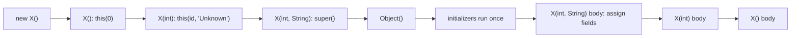
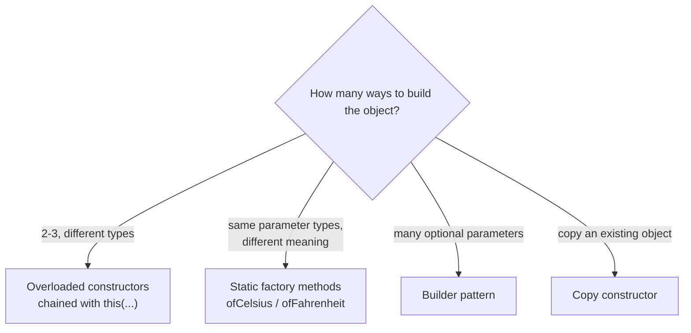

## In One Line
Constructor overloading gives a class **several constructors with different parameter lists**, so objects can be created with as much or as little information as the caller has — `new ConstructorOverloadingExample()`, `(1)` or `(2, "Alice")` — ideally with the shorter ones **chaining** to the full one via `this(...)`.

## Mental Model
Think of **ordering a sandwich**.
- "Just a sandwich" → the shop uses the house defaults: plain bread, no name on the order (**no-arg constructor** → `id = 0`, `name = "Unknown"`).
- "Sandwich number 1" → you choose the item, the rest is default (**one-arg constructor**).
- "Sandwich number 2 for Alice" → you specify everything (**full constructor**).

A well-run shop has **one** person who actually makes sandwiches; the others just fill in the defaults and pass the order on. That is **constructor chaining**: the short constructors call `this(...)` and only the full constructor does the real work. The original example instead has three people each making the whole sandwich themselves — it works, but every rule is written three times.

## Concept
### Constructor recap
A constructor initialises a newly allocated object. It has the **same name as the class**, **no return type** (not even `void`), is invoked only through `new` (or `this(...)`/`super(...)`), is **not inherited**, and can have any access modifier. More in [Constructors](lesson:a02-core/01-constructors) and [Parameterized Constructors](lesson:a02-core/03-parameterized-constructor).

### Overloading rules — the same as for methods
Constructors are overloaded exactly like methods (see [Method Overloading](lesson:a01-oop/07-method-overloading)): each must have a different **parameter list** (number, types or order). The compiler picks one at compile time using widening → boxing → varargs and the "most specific" rule.
- Two constructors with the same parameter types are illegal even if the parameter **names** mean different things: `Temperature(double celsius)` and `Temperature(double fahrenheit)` → `constructor Temperature(double) is already defined`. Use **static factory methods** with names instead (`ofCelsius`, `ofFahrenheit`).
- `null` arguments can be ambiguous: `new AmbC(null)` with `AmbC(String)` and `AmbC(Integer)` → `reference to AmbC is ambiguous`.

### Default constructor vs no-arg constructor
| | Default constructor | No-arg constructor |
|---|---|---|
| Written by | The **compiler** | **You** |
| When it exists | Only if the class declares **no constructor at all** | Whenever you write it |
| Body | Just `super();` | Whatever you write |
| Access | Same as the class | Whatever you choose |

The original example's comment calls `ConstructorOverloadingExample()` the "Default constructor" — strictly it is a user-written **no-arg** constructor (see Traps). See also [Default Constructor](lesson:a02-core/02-default-constructor).

### Constructor chaining with `this(...)`
- `this(args)` calls **another constructor of the same class**; `super(args)` calls a constructor of the parent.
- It must be the **first statement** of the constructor (Java 17/21: *call to this must be first statement in constructor*). A constructor can therefore contain `this(...)` **or** `super(...)`, never both.
- The chain must end: `A() { this(1); }` + `A(int x) { this(); }` → *recursive constructor invocation*.
- The last constructor in the chain calls `super(...)` (implicitly `super()`), so the parent is always initialised exactly once.
- **Instance initializer blocks and field initialisers run once**, right after the `super(...)` call, in the constructor that calls `super` — not in the constructors that delegate with `this(...)`. The Code section proves it.
- Java 25 (JEP 513, *flexible constructor bodies*) relaxes the first-statement rule: statements that do not use `this` (e.g. argument validation) may come before `this(...)`/`super(...)`. In Java 17/21 put validation in the target constructor or in a static helper used inside the argument list.

The usual shape — **telescoping delegation** — sends every short constructor to the most complete one, so defaults live in one place and fields are assigned in one place (which also allows them to be `final`).

### Execution order for `new ConstructorOverloadingExample()` with chaining
1. Memory allocated, fields zeroed.
2. `()` runs its first statement `this(0)` → `(int)` runs `this(0, "Unknown")` → `(int, String)` runs implicit `super()` → `Object()`.
3. Field initialisers and instance initializer blocks run (once).
4. The bodies complete in reverse order: `(int, String)` body, then `(int)` body, then `()` body.

Details in [Initialization Order](lesson:b01-fundamentals/12-initialization-order).

### When overloads multiply: alternatives
| Problem | Better tool |
|---|---|
| Two constructors would need the same parameter types | **Static factory methods** with descriptive names: `Temperature.ofCelsius(25)`, `LocalDate.of(...)`, `List.of(...)` |
| Many optional parameters → "telescoping constructors" `(a)`, `(a,b)`, `(a,b,c)`, `(a,b,c,d)` — hard to read, easy to swap arguments | **Builder**: `new Pizza.Builder(12).cheese(true).olives(true).build()` — see [Builder](lesson:a10-patterns/03-builder) |
| Creating a copy of an existing object | A **copy constructor** `Employee(Employee other)` — see [Copy Constructor](lesson:a02-core/04-copy-constructor) |
| Controlling instance creation (caching, singletons) | `private` constructor + static factory |

### Constructors in special types
- **Records** — the canonical constructor `(int x, int y)` is generated; any additional constructor **must** start with `this(...)`: otherwise *constructor is not canonical, so its first statement must invoke another constructor*. A *compact* constructor (`Point { if (x < 0) throw ...; }`) validates the canonical parameters.
- **Enums** — constructors are implicitly `private` and can be overloaded; they run once per constant.
- **Abstract classes** — constructors can be overloaded and are called by subclasses through `super(...)`.
- **Private constructors** — prevent instantiation from outside (utility classes, singletons) and prevent subclassing.

## Diagram

Calls travel down the chain to the one constructor that calls `super`; bodies then finish in reverse order.


Overloaded constructors are the right tool for a few clear variants; beyond that, names or builders read better.

## Code
@example CoreJava/Oops/ConstructorOverloadingExample.java

The same class with **chaining**: each default lives in one place, fields are assigned once (so they can be `final`), and the output is identical:
```java
class ConstructorOverloadingExample {
    private static final String DEFAULT_NAME = "Unknown";

    private final int id;
    private final String name;

    public ConstructorOverloadingExample() {
        this(0);                                   // no-arg -> one-arg
    }

    public ConstructorOverloadingExample(int id) {
        this(id, DEFAULT_NAME);                    // one-arg -> full
    }

    public ConstructorOverloadingExample(int id, String name) {
        this.id = id;                              // the only place fields are assigned
        this.name = name;
    }

    public void display() {
        System.out.println("ID: " + id + ", Name: " + name);
    }
}

new ConstructorOverloadingExample().display();
new ConstructorOverloadingExample(1).display();
new ConstructorOverloadingExample(2, "Alice").display();
```
```output
ID: 0, Name: Unknown
ID: 1, Name: Unknown
ID: 2, Name: Alice
```

Watching the chain run — the initializer block runs once per object, and bodies finish in reverse order:
```java
class Employee {
    private final int id;
    private final String name;

    { System.out.println("  (instance initializer runs)"); }

    Employee() {
        this(0);                          // -> Employee(int)
        System.out.println("  no-arg body");
    }

    Employee(int id) {
        this(id, "Unknown");              // -> Employee(int, String)
        System.out.println("  one-arg body");
    }

    Employee(int id, String name) {       // the one constructor that does the real work
        super();                          // implicit anyway: Object()
        System.out.println("  two-arg body");
        this.id = id;
        this.name = name;
    }

    void display() { System.out.println("ID: " + id + ", Name: " + name); }
}

new Employee().display();
new Employee(1).display();
new Employee(2, "Alice").display();
```
```output
  (instance initializer runs)
  two-arg body
  one-arg body
  no-arg body
ID: 0, Name: Unknown
  (instance initializer runs)
  two-arg body
  one-arg body
ID: 1, Name: Unknown
  (instance initializer runs)
  two-arg body
ID: 2, Name: Alice
```

When overloading cannot express it — named factories and a record:
```java
record Point(int x, int y) {
    Point() { this(0, 0); }                // extra constructors must delegate to the canonical one
}
final class Temperature {
    private final double celsius;
    private Temperature(double celsius) { this.celsius = celsius; }
    static Temperature ofCelsius(double c)    { return new Temperature(c); }
    static Temperature ofFahrenheit(double f) { return new Temperature((f - 32) * 5 / 9); }
    @Override public String toString() { return celsius + " C"; }
}

System.out.println(new Point());
System.out.println(new Point(3, 4));
System.out.println(Temperature.ofCelsius(25) + " / " + Temperature.ofFahrenheit(77));
```
```output
Point[x=0, y=0]
Point[x=3, y=4]
25.0 C / 25.0 C
```
`Temperature(double celsius)` and `Temperature(double fahrenheit)` could not both exist as constructors — same signature — but two named factories can.

## Walkthrough
- `int id; String name;` — package-private instance fields, zeroed to `0` and `null` at allocation.
- `// Default constructor` / `public ConstructorOverloadingExample()` — a **no-arg constructor** written by the programmer. It sets `this.id = 0` (already the default value, so this line is redundant but explicit) and `this.name = "Unknown"`.
- `// Parameterized constructor` / `public ConstructorOverloadingExample(int id)` — takes only the id; the name falls back to `"Unknown"`. `this.id = id` distinguishes the field from the parameter.
- `// Parameterized constructor` / `public ConstructorOverloadingExample(int id, String name)` — the full constructor, setting both fields from arguments.
- The three constructors differ in **number** of parameters (0, 1, 2), so they are valid overloads.
- `// Method to display the details` / `display()` — prints `ID: <id>, Name: <name>`.
- `new ConstructorOverloadingExample()` → the compiler matches the 0-argument constructor → `obj1` is `{0, "Unknown"}`.
- `new ConstructorOverloadingExample(1)` → matches `(int)` → `obj2` is `{1, "Unknown"}`.
- `new ConstructorOverloadingExample(2, "Alice")` → matches `(int, String)` → `obj3` is `{2, "Alice"}`.
- `obj1.display(); obj2.display(); obj3.display();` → the three lines of output; all three output comments match the real output.
- Each constructor here implicitly starts with `super()` (calling `Object()`), because none of them uses `this(...)`.

## Traps
> [!ERRATA] The comment `// Default constructor` is imprecise. In Java terminology the *default constructor* is the one the **compiler** generates when a class declares no constructors. A constructor you write yourself with no parameters is a **no-arg constructor**. Interviewers often test this distinction.

> [!ERRATA] The three constructors duplicate the initialisation logic: `"Unknown"` is hard-coded twice and the fields are assigned in three places. This is exactly what constructor chaining with `this(...)` is for — the refactored version in the Code section delegates `()` → `(int)` → `(int, String)`, keeps the default in one constant, and lets the fields become `final`. Also, `this.id = 0;` in the no-arg constructor only repeats the default value.

- **`this(...)` not first** — `System.out.println("hi"); this(0);` → `call to this must be first statement in constructor` (Java 17/21).
- **Both `super()` and `this()`** — impossible; whichever comes second is not the first statement.
- **Recursive chains** — `A() { this(1); }` and `A(int x) { this(); }` → `recursive constructor invocation`.
- **Same parameter types, different meaning** — `Temperature(double celsius)` / `Temperature(double fahrenheit)` → already defined. Use named static factories.
- **Losing the no-arg constructor** — adding `X(int id)` to a class that relied on the compiler's default constructor breaks every `new X()` (and frameworks such as JPA or Jackson that need one).
- **A "constructor" with a return type** — `public void Box() { size = 10; }` is an ordinary method; `new Box()` uses the compiler's default constructor and `size` stays `0` until you call `b.Box()` explicitly.
- **Ambiguous `null`** — `new AmbC(null)` with `(String)` and `(Integer)` overloads does not compile.
- **Calling overridable methods from any constructor** — a subclass override runs before the subclass is initialised.
- **Telescoping constructors with same-typed parameters** (`Pizza(int size, boolean cheese, boolean pepperoni, boolean olives)`) are easy to call with arguments in the wrong order — the compiler cannot help. Use a builder.

## Tips & Tricks
- **"Short ones delegate, one does the work."** Every constructor should reach the most complete one through `this(...)`.
- **"`this()` or `super()` — first line, only one."**
- **Default = compiler-made; no-arg = hand-made.**
- Keep default values in named constants (`DEFAULT_NAME`), not scattered literals.
- Chaining lets you make fields `final`, because each field is assigned exactly once.
- Two variants with the same parameter types → static factories (`of`, `from`, `valueOf`); four or more optional parameters → Builder.
- IDE shortcut: generate the full constructor, then write the short ones by hand as one-line `this(...)` delegations.

## Interview Q&A
### [Basic] What is constructor overloading?
Declaring multiple constructors in one class with different parameter lists (number, types or order), so objects can be created in different ways. The compiler chooses which constructor to run from the arguments to `new`, using the same resolution rules as for overloaded methods.
```java
new ConstructorOverloadingExample();            // ()
new ConstructorOverloadingExample(1);           // (int)
new ConstructorOverloadingExample(2, "Alice");  // (int, String)
```
**Follow-up:** *Can constructors be overridden?* — No. Constructors are not inherited, so there is nothing to override; each class declares its own and chains to the parent with `super(...)`.

### [Basic] What is the difference between a default constructor and a no-arg constructor?
The **default constructor** is generated by the compiler only when a class declares no constructors; it takes no parameters, has the class's access level and just calls `super()`. A **no-arg constructor** is one you write yourself; it can contain any logic. As soon as you declare any constructor, the compiler no longer generates the default one, so `new X()` breaks unless you add a no-arg constructor explicitly.

**Follow-up:** *What happens if the parent has no no-arg constructor?* — The default constructor's implicit `super()` fails to compile; the child must declare a constructor that calls `super(args)`.

### [Basic] What is constructor chaining?
Calling one constructor from another: `this(...)` for a constructor of the same class, `super(...)` for the parent's. It avoids duplicated initialisation code — shorter constructors supply defaults and delegate to the full one. The call must be the first statement (Java 17/21), a constructor can use only one of `this(...)` or `super(...)`, and every chain ends in a constructor that calls `super(...)`, implicitly or explicitly.

**Follow-up:** *In what order do the constructor bodies run?* — The call goes down to the constructor that calls `super`; bodies then complete in reverse order, so the most complete constructor's body finishes first.

### [Intermediate] Why must `this(...)` or `super(...)` be the first statement?
To guarantee that an object is never used before its superclass part (and, with `this(...)`, before its own full initialisation) is complete — the parent's invariants are established before subclass code can touch `this`. It also guarantees initialisers and parent constructors run exactly once. Java 25 (JEP 513) relaxed the rule for statements that do not reference `this`, such as argument validation, because those are safe.

**Follow-up:** *How do you validate arguments before `super(...)` in Java 17?* — Validate inside the argument expression with a static helper: `super(requirePositive(id))`.

### [Intermediate] Do instance initializer blocks run once or once per constructor in a chain?
Once per object. Field initialisers and instance initializer blocks are compiled into the constructors that call `super(...)` (explicitly or implicitly), right after that call; constructors that start with `this(...)` do not contain them. In the Code section, `new Employee()` passes through three constructors but prints "(instance initializer runs)" only once.

**Follow-up:** *And static initializers?* — They run once per class, when the class is initialised, before any instance is created.

### [Intermediate] How is constructor chaining different from calling a constructor with `new`?
`this(...)` initialises the **same** object further; `new X(...)` inside a constructor would allocate a **second** object that is thrown away (a classic bug: `X() { new X(0, "Unknown"); }` leaves the current object with default values).

**Follow-up:** *Can you call a constructor like a method, e.g. `obj.X()`?* — No. Constructors are only invoked via `new`, `this(...)` or `super(...)`. A method named like the class is just a method.

### [Intermediate] What problems appear when a class has many overloaded constructors, and what are the alternatives?
Telescoping constructors become unreadable (`new Pizza(12, true, false, true)` — which boolean is which?), easy to call with swapped arguments of the same type, and impossible when two variants need the same parameter types. Alternatives: **static factory methods** with meaningful names (`Temperature.ofCelsius`), the **Builder pattern** for many optional parameters, and for simple data carriers **records** with a compact constructor.

**Follow-up:** *Advantages of static factories over constructors?* — Names, can return cached instances or subtypes, can have identical parameter types across variants (*Effective Java*, Item 1).

### [Advanced] What rules apply to constructors in records?
A record gets a **canonical constructor** matching its components. You may redeclare it in full or in *compact* form (`Point { if (x < 0) throw new IllegalArgumentException(); }`), where the parameters are implicit and fields are assigned automatically after the body. Any additional (non-canonical) constructor **must** begin with `this(...)` delegating eventually to the canonical one; otherwise the compiler reports *constructor is not canonical, so its first statement must invoke another constructor*. This guarantees that every record instance passes through the canonical validation.

**Follow-up:** *Can a record declare a no-arg constructor?* — Yes, if it delegates: `Point() { this(0, 0); }`.

### [Advanced] How do private constructors combine with overloading?
A class can mix public and private constructors: public ones for callers, private ones as internal building blocks that public constructors or static factories delegate to (`private Temperature(double celsius)` used by `ofCelsius` and `ofFahrenheit`). If **all** constructors are private, no other class can instantiate or extend it — the basis of utility classes (`Math`, `Collections`), singletons and instance-controlled classes. Enum constructors are always implicitly private.

**Follow-up:** *Can reflection call a private constructor?* — Yes, with `setAccessible(true)` (for classes in an open package), which is why enum singletons are preferred: reflection cannot instantiate enums.

## Quiz
### What does this print?
```java
class A {
    { System.out.print("I "); }
    A() { this(1); System.out.print("A() "); }
    A(int x) { System.out.print("A(" + x + ") "); }
}
new A();
```
- [ ] I A() A(1)
- [x] I A(1) A()
- [ ] I A(1) I A()
- [ ] A(1) A() I
> The initializer runs once, right after the implicit `super()` in `A(int)`, the constructor that ends the chain. Then `A(int)`'s body prints, and finally the rest of `A()`. "I A(1) I A()" is wrong because initializers do not repeat for delegating constructors.

### What does this print?
```java
class Parent {
    Parent() { System.out.println("Parent()"); }
    Parent(String s) { System.out.println("Parent(" + s + ")"); }
}
class Child extends Parent {
    Child() { this("x"); System.out.println("Child()"); }
    Child(String s) { System.out.println("Child(" + s + ")"); }
}
new Child();
```
- [ ] Parent(x), Child(x), Child()
- [x] Parent(), Child(x), Child()
- [ ] Child(x), Child(), Parent()
- [ ] Parent(), Child()
> `Child()` delegates to `Child(String)`, which has an implicit `super()` — the **no-arg** `Parent()`, not `Parent(String)`. Passing "x" to `this(...)` does not forward it to the parent.

### Which statement about the original example's `ConstructorOverloadingExample()` is correct?
- [ ] It is the compiler-generated default constructor
- [x] It is a programmer-written no-arg constructor
- [ ] It is not a constructor because it takes no parameters
- [ ] It is a copy constructor
> The compiler generates a default constructor only when a class has no constructors. This class declares three, so the no-parameter one is a hand-written no-arg constructor — the source comment "Default constructor" is loose terminology.

### Spot the bug: why does this not compile?
```java
class NotFirst {
    int id;
    NotFirst() {
        System.out.println("hi");
        this(0);
    }
    NotFirst(int id) { this.id = id; }
}
```
- [ ] `this(0)` must be `super(0)`
- [x] `this(...)` must be the first statement of the constructor
- [ ] Constructors cannot print
- [ ] A class cannot have two constructors
> In Java 17/21, `this(...)`/`super(...)` must come first: "call to this must be first statement in constructor". Java 25 allows statements before it only if they do not use `this`.

### What happens here?
```java
class Box {
    int size;
    public void Box() { size = 10; }
}
Box b = new Box();
System.out.println(b.size);
```
- [ ] 10
- [x] 0
- [ ] Compile error: method cannot have the class name
- [ ] Compile error: Box has no constructor
> `void Box()` has a return type, so it is a method, not a constructor. The compiler adds the default constructor, `size` keeps its default `0`, and the method only runs if called (`b.Box()` would set 10). Legal but misleading code.

### Which pair of constructors can NOT coexist in one class?
- [ ] `Temp(int c)` and `Temp(long c)`
- [ ] `Temp()` and `Temp(double c, String unit)`
- [x] `Temp(double celsius)` and `Temp(double fahrenheit)`
- [ ] `Temp(String unit, double v)` and `Temp(double v, String unit)`
> Parameter names are not part of the signature, so both are `Temp(double)`: "constructor Temp(double) is already defined". Different types, counts or orders are fine. Use static factories like `ofCelsius`/`ofFahrenheit`.

### What does `new Recur()` do?
```java
class Recur {
    Recur() { this(1); }
    Recur(int x) { this(); }
}
```
- [ ] StackOverflowError at runtime
- [x] It does not compile: recursive constructor invocation
- [ ] Creates the object, calling each constructor once
- [ ] Infinite loop
> The compiler detects the cycle in `this(...)` calls and rejects it, so it never gets a chance to overflow the stack at runtime.

## Takeaways
- Constructor overloading = several constructors with different parameter lists; the compiler picks one using the method-overloading rules.
- The compiler's default constructor exists only when you declare no constructors; a constructor you write without parameters is a no-arg constructor.
- Chain constructors with `this(...)` so defaults and field assignment live in one place (and fields can be `final`); the original example duplicates them.
- `this(...)`/`super(...)` must be the first statement (Java 17/21), only one per constructor, and chains cannot be recursive.
- Initializer blocks run once per object, in the constructor that calls `super(...)`; bodies of a `this(...)` chain finish in reverse order.
- Same parameter types with different meanings → static factory methods; many optional parameters → Builder.
- A "constructor" with a return type is just a method; record non-canonical constructors must delegate with `this(...)`.
