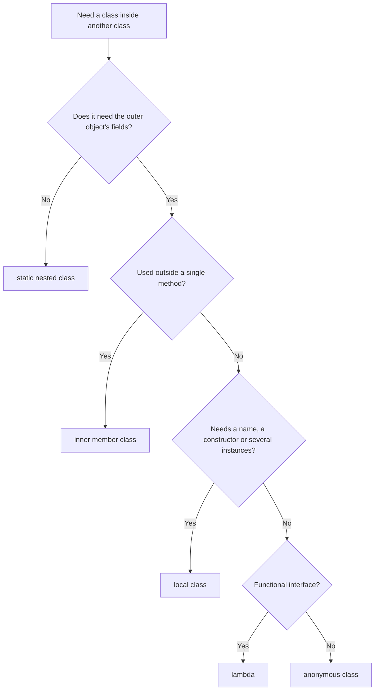
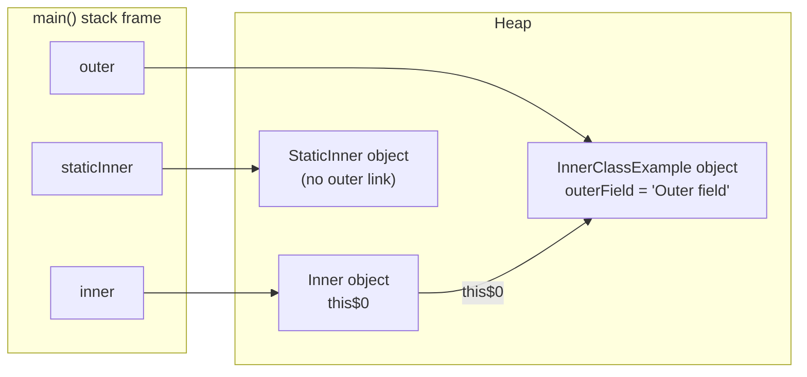
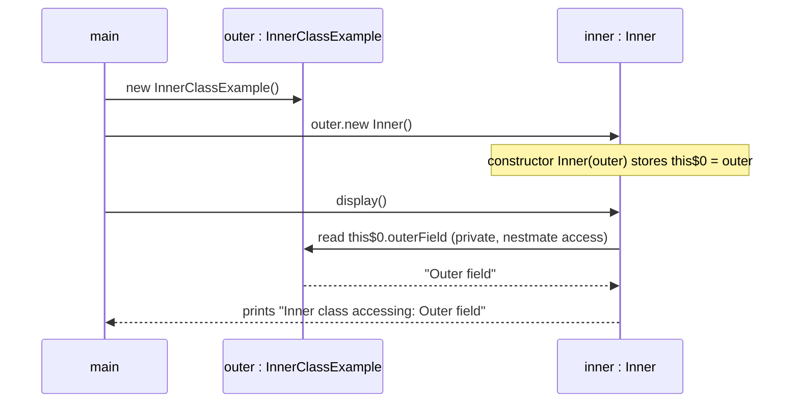

## In One Line
A class can be declared **inside** another class: a **static nested class** is just a helper type that lives in the outer class's namespace, while an **inner class** (member, local or anonymous) is tied to an **outer object** and can use that object's fields — even the private ones.

## Mental Model
Think of a **house plan** (the outer class) and the houses built from it (outer objects).

- A **static nested class** is a *garden-shed plan clipped into the same folder* as the house plan. It is filed with the house design (`InnerClassExample.StaticInner`), but you can build a shed without building a house, and a shed has no house to look inside.
- An **inner class** is a *room of a particular house*. A room cannot exist without its house (`outer.new Inner()`), and anyone in the room can open the house's private cupboards (`outerField`). Every room knows exactly which house it belongs to — Java stores that link in a hidden field.
- A **local class** is a *tent pitched in one room during one party* (one method call). It has a name, but only inside that method, and it can use what the party brought (effectively final local variables).
- An **anonymous class** is a *hired helper with no name tag*, created on the spot for one job — "here is a `Runnable`, do this". Today a lambda usually does that job with less ceremony.

## Concept
### The family tree of classes
The Java Language Specification splits classes into **top-level** classes (declared directly in a file) and **nested** classes (declared inside another class or interface). Nested classes come in four kinds; the last three are called **inner classes**.

| Kind | Declared | Tied to an outer object? | Can use outer instance fields | Class file | Typical use |
|---|---|---|---|---|---|
| **Static nested** | as a member, with `static` | No | No — only through an explicit reference | `Outer$Nested.class` | Builders, `Map.Entry`, `HashMap.Node`, grouping helpers |
| **Inner (member)** | as a member, no `static` | **Yes** | Yes | `Outer$Inner.class` | Iterators, views over the outer object (`ArrayList.Itr`) |
| **Local** | inside a method or block, with a name | Yes, if declared in an instance method | Yes, plus effectively final locals | `Outer$1Local.class` | A helper used in only one method |
| **Anonymous** | in an expression: `new Type() { ... }` | Yes, if created in an instance context | Yes, plus effectively final locals | `Outer$1.class` | One-off implementation of an interface or subclass |

> [!INTERVIEW] "All inner classes are nested, but not all nested classes are inner. A static nested class is **not** an inner class — it has no enclosing instance."

All four kinds, with reflection confirming what the compiler thinks each one is:
```java
public class FourKinds {
    private String name = "outer";
    private static int count = 42;

    static class StaticNested {                       // 1. static nested
        void show() { System.out.println("static nested sees count = " + count); }
    }

    class Inner {                                     // 2. inner (member)
        void show() { System.out.println("inner sees name = " + name); }
    }

    void demo() {
        String greeting = "hi";                       // effectively final
        class Local {                                 // 3. local
            void show() { System.out.println("local sees " + greeting + " and " + name); }
        }
        new Local().show();

        Runnable r = new Runnable() {                 // 4. anonymous
            @Override public void run() { System.out.println("anonymous sees " + greeting); }
        };
        r.run();

        for (Class<?> c : new Class<?>[]{ StaticNested.class, Inner.class, Local.class, r.getClass() }) {
            System.out.println(c.getName() + " member=" + c.isMemberClass()
                + " local=" + c.isLocalClass() + " anonymous=" + c.isAnonymousClass());
        }
    }

    public static void main(String[] args) {
        new StaticNested().show();                    // no outer object needed
        FourKinds outer = new FourKinds();
        FourKinds.Inner in = outer.new Inner();       // needs an outer object
        in.show();
        outer.demo();
    }
}
```
```output
static nested sees count = 42
inner sees name = outer
local sees hi and outer
anonymous sees hi
FourKinds$StaticNested member=true local=false anonymous=false
FourKinds$Inner member=true local=false anonymous=false
FourKinds$1Local member=false local=true anonymous=false
FourKinds$1 member=false local=false anonymous=true
```
Compiling it writes five class files: `FourKinds.class`, `FourKinds$StaticNested.class`, `FourKinds$Inner.class`, `FourKinds$1Local.class` and `FourKinds$1.class`. The JVM has no idea of "nesting" in the source sense — every nested class becomes an ordinary class with a `$` in its name.

### Static nested classes
- Declared with `static` as a member of the outer class. It is **a normal class that happens to live in the outer class's namespace**: its full name is `Outer.Nested` (`InnerClassExample.StaticInner`).
- Created with `new Outer.Nested()` — no outer object exists or is needed. Inside the outer class the short name `new Nested()` works.
- It can use the outer class's **static** members directly, including private ones (`count` above). For instance members it needs an explicit object reference, exactly like any other class.
- It may have any access modifier (`private` hides it from the outside world, which top-level classes cannot do), and it can be `abstract`, `final`, generic, extend classes and implement interfaces.
- Nested interfaces, enums and records are **implicitly static**, and a class declared inside an interface is implicitly `public static`.

Use it when the helper type belongs to the outer class conceptually but does not need a particular outer object: `Map.Entry`, `HashMap.Node`, `LinkedList.Node`, a `Builder` ([Builder pattern](lesson:a10-patterns/03-builder)).

### Inner (member) classes
- Declared as a member **without** `static`. Every inner object is created *for* one outer object and keeps a reference to it.
- **Creating one:** inside an instance method of the outer class, `new Inner()` means `this.new Inner()`. From anywhere else, you must name the outer object: `outer.new Inner()`. From a `static` method with no outer object it is a compile error:
  ```text
  NoOuter.java:4: error: non-static variable this cannot be referenced from a static context
          Inner i = new Inner();
                    ^
  ```
  If the outer reference is `null`, `outer.new Inner()` throws `NullPointerException` (the compiler inserts an `Objects.requireNonNull` check).
- **Reaching the outer object:** plain names find the nearest declaration; `Outer.this` names the enclosing object explicitly:
  ```java
  public class Shadow {
      int x = 1;

      class Inner {
          int x = 2;

          void print(int x) {
              System.out.println(x);              // parameter
              System.out.println(this.x);         // Inner's field
              System.out.println(Shadow.this.x);  // outer object's field
          }
      }

      public static void main(String[] args) {
          new Shadow().new Inner().print(3);
      }
  }
  ```
  ```output
  3
  2
  1
  ```
- **Static members inside inner classes** were forbidden until Java 16 (only compile-time constants were allowed). JEP 395 (records) relaxed the rule, so `static int created;` and static methods now compile in an inner class. With `--release 15` the same code fails with `Illegal static declaration in inner class`.
- **Generics:** an inner class can use the outer class's type parameter `T` (it has an outer instance with a concrete `T`); a static nested class cannot: `non-static type variable T cannot be referenced from a static context`. That is why `LinkedList<E>.Node` is declared `private static class Node<E>` with its own type parameter.

A realistic inner class — an iterator that walks *its own* playlist's private array, the same design as `ArrayList.Itr`:
```java
import java.util.Iterator;

public class Playlist implements Iterable<String> {
    private final String[] songs = { "Intro", "Theme", "Outro" };

    private class SongIterator implements Iterator<String> {   // inner: reads songs of ITS playlist
        private int next = 0;
        public boolean hasNext() { return next < songs.length; }
        public String next()     { return songs[next++]; }
    }

    @Override
    public Iterator<String> iterator() {
        return new SongIterator();                 // same as this.new SongIterator()
    }

    public static void main(String[] args) {
        for (String s : new Playlist()) System.out.println(s);
    }
}
```
```output
Intro
Theme
Outro
```

### How the link to the outer object really works
`javap -p -c` on the course's `InnerClassExample$Inner.class` (compiled by JDK 21) shows what the compiler generated:
```text
class CoreJava.Oops.InnerClassExample$Inner {
  final CoreJava.Oops.InnerClassExample this$0;

  CoreJava.Oops.InnerClassExample$Inner(CoreJava.Oops.InnerClassExample);
    Code:
       0: aload_0
       1: aload_1
       2: putfield      #1                  // Field this$0:LCoreJava/Oops/InnerClassExample;
       ...
  void display();
    Code:
       0: getstatic     #13                 // Field java/lang/System.out:Ljava/io/PrintStream;
       3: aload_0
       4: getfield      #1                  // Field this$0:LCoreJava/Oops/InnerClassExample;
       7: getfield      #19                 // Field CoreJava/Oops/InnerClassExample.outerField:Ljava/lang/String;
```
1. The inner class gets a hidden `final` field **`this$0`** holding the outer object.
2. Its constructor takes the outer object as an **extra first parameter** — `outer.new Inner()` really calls `new InnerClassExample$Inner(outer)`.
3. `outerField` in the source becomes `this$0.outerField` in bytecode.

Two version notes make this a good interview topic:
- **Private access — nestmates (Java 11, JEP 181).** `outerField` is `private`, yet `Inner` reads it directly. Since Java 11 the outer class and its nested classes form a **nest** (`NestHost`/`NestMembers` attributes in the class files) and the JVM lets nestmates access each other's private members. Before Java 11 the compiler had to generate a package-private *synthetic accessor*. Compiling the same example with `--release 10` adds `static java.lang.String access$000(CoreJava.Oops.InnerClassExample);` to the outer class; with release 21 there is none. Access works in both directions — the outer class can read an inner class's private fields too.
- **Unused outer link dropped (javac 18+).** When an inner class never uses its outer object, `javac` 18 and later (compiling for Java 18+) no longer generates the `this$0` field. The constructor still receives the outer object, so you still need one to create it.

### Local classes
- Declared inside a method, constructor, or block — anywhere a statement can go. The name is visible only from the declaration to the end of the block.
- No access modifier and no `static` on the class (`public class Bad {}` inside a method is a syntax error: `illegal start of expression`).
- Declared in an instance method it has an outer object like any inner class; declared in a `static` method it has none.
- It can read **local variables and parameters** of the enclosing method only if they are **final or effectively final** (never reassigned after initialisation; Java 8 added "effectively final" — before that the variable had to be declared `final`). The compiler **copies** the value into a hidden field — `javap -p` shows `final java.lang.String val$greeting;` in `FourKinds$1Local` — because the local variable dies when the method returns, while the object may live on. If the variable could still change, the copy and the original would disagree, so Java forbids it:
  ```text
  NotFinal.java:5: error: local variables referenced from an inner class must be final or effectively final
              public void run() { System.out.println(count); }
                                                     ^
  ```
- Since Java 16 you can also declare **local records, enums and interfaces**; they are implicitly `static`, so they cannot touch the outer instance or the method's locals.

### Anonymous classes
`new SuperType(args) { body }` declares a class **and** creates its only instance in one expression.
- It either **extends one class** or **implements one interface** — never both, never two interfaces.
- It has **no name, so it cannot declare a constructor**. Arguments in `new Greeter("Asha") { ... }` go to the superclass constructor, and an **instance initializer block** `{ ... }` does any extra set-up. Writing a constructor fails: `invalid method declaration; return type required`.
- Like local classes, it may capture only effectively final locals, and in an instance context it holds the outer object.
- Since Java 9 the diamond works with anonymous classes (`new Comparator<>() { ... }`) when the inferred type is denotable.
- `this` inside an anonymous class is the **anonymous object**; inside a lambda it is the enclosing object (see [this keyword](lesson:a02-core/05-this-keyword)).

```java
import java.util.*;

public class Anon {
    static abstract class Greeter {
        private final String name;
        Greeter(String name) { this.name = name; }     // anonymous subclasses pass args here
        String name() { return name; }
        abstract void greet();
    }

    public static void main(String[] args) {
        Greeter g = new Greeter("Asha") {             // "Asha" goes to Greeter(String)
            int times;
            { times = 2; }                            // instance initializer = its "constructor"
            @Override void greet() {
                for (int i = 0; i < times; i++) System.out.println("Hello, " + name());
            }
        };
        g.greet();
        System.out.println(g.getClass().getName() + " extends " + g.getClass().getSuperclass().getSimpleName());

        List<String> list = new ArrayList<>() {{ add("a"); add("b"); }};   // "double brace"
        System.out.println(list + " " + list.getClass().getName() + " " + list.equals(List.of("a", "b")));

        var point = new Object() { int x = 3, y = 4; };  // var keeps the anonymous type
        System.out.println(point.x + point.y);
    }
}
```
```output
Hello, Asha
Hello, Asha
Anon$1 extends Greeter
[a, b] Anon$2 true
7
```
- **Double-brace initialisation** (`new ArrayList<>() {{ add("a"); }}`) is an anonymous *subclass* of `ArrayList` (`Anon$2`) whose instance initializer calls `add`. It works, but it creates an extra class per use, captures the outer object when written in an instance method, and breaks `getClass()` comparisons. Use `List.of("a", "b")` or `new ArrayList<>(List.of(...))`.
- **`var` trick:** with `var`, the variable keeps the anonymous type, so `point.x` compiles. With `Object point = ...` it would not.

**Anonymous class vs lambda.** For a **functional interface** (exactly one abstract method), a lambda is shorter, creates no extra class file, and does not capture `this` unless it uses it — see [Lambda Expressions](lesson:a05-java8/02-lambda-expressions). You still need an anonymous class to extend an (abstract) class, implement an interface with several abstract methods, keep state in fields, or refer to itself with `this`.

### Inner classes and memory leaks
Because an inner object holds `this$0`, **the outer object stays alive as long as any inner object is reachable**. A small inner listener registered in a long-lived place can pin a huge outer object:
```java
import java.lang.ref.WeakReference;

public class Leak {
    static class Screen {
        byte[] pixels = new byte[50_000_000];          // a big outer object
        String title = "Home";

        class Listener {                                // inner: uses the outer object
            void onClick() { System.out.println("clicked on " + title); }
        }
        static class Tracker {                          // static nested: no outer link
            void onClick() { System.out.println("clicked"); }
        }
    }

    public static void main(String[] args) {
        Screen s1 = new Screen();
        WeakReference<Screen> ref1 = new WeakReference<>(s1);
        Object keep1 = s1.new Listener();
        s1 = null;

        Screen s2 = new Screen();
        WeakReference<Screen> ref2 = new WeakReference<>(s2);
        Object keep2 = new Screen.Tracker();
        s2 = null;

        System.gc();
        System.out.println("Screen behind inner Listener still alive? " + (ref1.get() != null));
        System.out.println("Screen behind static Tracker still alive? " + (ref2.get() != null));
        System.out.println(keep1.getClass().getSimpleName() + " " + keep2.getClass().getSimpleName());
    }
}
```
```output
Screen behind inner Listener still alive? true
Screen behind static Tracker still alive? false
Listener Tracker
```
`System.gc()` is only a request; on JDK 21 with the default G1 collector it ran a full collection in every one of five runs. The first 50 MB screen survives only because the `Listener` still points to it. This is the classic Android `Activity` leak and the reason for *Effective Java* Item 24: **"Favor static member classes over nonstatic."**

### Choosing the right kind
| You need... | Use |
|---|---|
| A helper type that does not need an outer object | **Static nested** (the default choice) |
| An object that works on *one particular* outer object's state (iterator, view) | **Inner** member class |
| A named helper used in only one method | **Local** class (or a local record for data) |
| A one-off implementation of a functional interface | **Lambda** or method reference |
| A one-off subclass, or an interface with several methods | **Anonymous** class |

JDK examples: `Map.Entry` (nested interface), `HashMap.Node` and `LinkedList.Node` (static nested), `ArrayList.Itr` (private inner class), `Thread.State` (nested enum), `AbstractMap.SimpleEntry` (public static nested).

## Diagram

Start from "static nested" and only move right when you truly need an outer object or a one-off implementation.


The inner object carries a hidden `this$0` arrow to its outer object; the static nested object carries none.


`outer.new Inner()` passes the outer object into a hidden constructor parameter, and every use of `outerField` goes through that stored reference.

## Code
@example CoreJava/Oops/InnerClassExample.java

The example shows two of the four kinds. The same outer class with a local and an anonymous class added:
```java
public class InnerKindsDemo {
    private String outerField = "Outer field";

    void run() {
        String prefix = "Local";                      // effectively final
        class LocalHelper {
            void display() { System.out.println(prefix + " class accessing: " + outerField); }
        }
        new LocalHelper().display();

        Runnable anon = new Runnable() {
            @Override public void run() { System.out.println("Anonymous class accessing: " + outerField); }
        };
        anon.run();
    }

    public static void main(String[] args) {
        new InnerKindsDemo().run();
    }
}
```
```output
Local class accessing: Outer field
Anonymous class accessing: Outer field
```

## Walkthrough
- `package CoreJava.Oops;` — the example lives in the `CoreJava.Oops` package (see [Course Project Setup](lesson:a01-oop/00-course-project-setup)).
- `// Outer class` / `public class InnerClassExample {` — the top-level class that encloses the two nested classes. It is `public`, so the file is `InnerClassExample.java`.
- `private String outerField = "Outer field";` — a **private instance field**. Each `InnerClassExample` object has its own copy. Being private, only code inside the braces of `InnerClassExample` — which *includes* its nested classes — can touch it.
- `// Non-static inner class` / `class Inner { void display() {...} }` — an **inner member class** (package-private, no `static`). Every `Inner` object belongs to one `InnerClassExample` object. Inside `display()`, the plain name `outerField` is resolved as `InnerClassExample.this.outerField`: the private field of *that* outer object. Compiled, it becomes `InnerClassExample$Inner.class` with the hidden `this$0` field shown above.
- `// Static inner class` / `static class StaticInner { void display() {...} }` — a **static nested class**. It has no outer object, so `display()` could not mention `outerField`; it only prints a fixed message. Compiled, it becomes `InnerClassExample$StaticInner.class` with no `this$0`.
- `public static void main(String[] args)` — `static`, so there is no `this` here; `main` must create an outer object before it can create an `Inner`.
- `InnerClassExample outer = new InnerClassExample();` — creates the outer object; its `outerField` is `"Outer field"`.
- `InnerClassExample.Inner inner = outer.new Inner();` — the **qualified creation** syntax: "make an `Inner` that belongs to `outer`". The type is written `InnerClassExample.Inner`; inside this class the short name `Inner` would work too. `new Inner()` alone would not compile here, because `main` has no current outer object.
- `inner.display();` — reads `outerField` through the inner object's link to `outer` and prints **`Inner class accessing: Outer field`**.
- `InnerClassExample.StaticInner staticInner = new InnerClassExample.StaticInner();` — a static nested class is created like any class, using its qualified name; no outer object is involved (`outer` is not used).
- `staticInner.display();` — prints **`Static inner class method.`**
- Both `// Output:` comments match the recorded output exactly.

## Traps
> [!ERRATA] The comment `// Static inner class` (and the variable name `staticInner`) uses a contradictory term. In the Java Language Specification an **inner class is by definition non-static**; a class declared with `static` inside another class is a **static nested class**. Likewise `// Non-static inner class` is redundant — every inner class is non-static. Many people say "static inner class" casually, but in an interview say **static nested class**.

- **`new Inner()` in a static method** — `non-static variable this cannot be referenced from a static context`. Create or pass an outer object and write `outer.new Inner()`.
- **`null` outer object** — `outer.new Inner()` with `outer == null` throws `NullPointerException` at creation time.
- **Modifying a captured local** — any assignment to the variable (before or after the class) makes it not effectively final, and the use inside the local/anonymous class stops compiling. Copy it into a new effectively final variable (`int copy = i;`) or use a field or an array/`AtomicInteger` holder.
- **Shadowing** — a field or parameter in the inner class with the same name hides the outer one. Use `Outer.this.name` to reach the outer field.
- **Hidden outer reference** — inner, local and anonymous classes created in instance code can keep a large outer object alive (listeners, callbacks, caches, threads). Prefer a static nested class and pass only what it needs.
- **Double-brace initialisation** — `new HashMap<>() {{ put(...); }}` creates an anonymous subclass (`getClass() != HashMap.class`), may capture `this`, and can break `equals` implementations that compare classes. Use `Map.of(...)`.
- **Serializing inner classes** — the hidden `this$0` and `val$...` fields and compiler-chosen names (`Outer$1`) make serialized forms fragile, and the outer object gets serialized too. The Java serialization specification strongly discourages serializing inner, local and anonymous classes; static nested classes are fine.
- **Anonymous class constructors** — not allowed. Pass arguments to the superclass constructor and use an instance initializer block.
- **Class files with `$`** — copying only `Outer.class` to another machine breaks at runtime with `NoClassDefFoundError: Outer$Inner`. Nested classes are separate files.

> [!WARNING] Before Java 16, `static` fields and methods inside an inner class did not compile (`Illegal static declaration in inner class`); only `static final` compile-time constants were allowed. Old interview answers still say "inner classes cannot have static members" — that is outdated for Java 16+.

## Tips & Tricks
- **"Static nested = no string attached. Inner = on a leash to its outer object."** The leash is the hidden `this$0` field.
- **Creation cheat sheet:** static nested → `new Outer.Nested()`; inner → `outer.new Inner()`; local → `new Local()` inside its method; anonymous → `new Type() { ... }` (declare + create in one go).
- **Default to `static`.** Make a nested class static unless it genuinely needs the outer object — cheaper objects, no leaks, easier to test (Effective Java Item 24).
- **`Outer.this.x`** reaches a shadowed outer member; plain `this` inside an inner or anonymous class is the inner object.
- **"Captured locals are copies."** That is why they must not change: effectively final = "assigned exactly once".
- **Anonymous class → lambda** whenever the target is a functional interface and you do not need `this` or fields. IntelliJ offers the conversion with Alt+Enter.
- **Count the class files:** each nested class is its own `.class` — `Outer$Inner`, `Outer$1` (anonymous), `Outer$1Local` (local).
- **Remember the Java versions:** effectively final (8), anonymous diamond (9), nestmates without `access$` methods (11), static members in inner classes and local records/enums/interfaces (16), unused `this$0` omitted (javac 18).

## Interview Q&A
### [Basic] What kinds of nested classes does Java have?
Four. A **static nested class** is declared `static` inside another class and has no enclosing instance. The other three are **inner classes**, which do have an enclosing instance when created in instance code: a **member inner class** (declared as a member without `static`), a **local class** (declared inside a method or block), and an **anonymous class** (declared and instantiated in one `new Type() { ... }` expression). Nested interfaces, enums and records are implicitly static.

**Follow-up:** *Why use nested classes at all?* — To group a helper with the only class that uses it, to hide it (`private` nested classes are invisible outside), and to give it access to the outer class's private members — better encapsulation and readability.

### [Basic] What is the difference between a static nested class and an inner class?
| Static nested | Inner (member) |
|---|---|
| Declared with `static` | No `static` |
| No link to an outer object | Holds a hidden reference (`this$0`) to one outer object |
| Created with `new Outer.Nested()` | Created with `outer.new Inner()` |
| Can use only the outer class's static members directly | Can use all outer members, instance and static, including private |
| Can use generic type parameters of the outer class? No | Yes |
| No memory-leak risk from the outer object | Keeps the outer object alive |

**Follow-up:** *Can a static nested class access the outer's private instance field?* — Yes, but only through an explicit outer object (`outerObj.privateField`); private access itself is allowed because they are nestmates.

### [Basic] How do you create an instance of an inner class from outside the outer class, and from a static method?
You need an outer object first, then use the qualified creation expression:
```java
InnerClassExample outer = new InnerClassExample();
InnerClassExample.Inner inner = outer.new Inner();
// or in one line: new InnerClassExample().new Inner();
```
Inside an instance method of the outer class, `new Inner()` is shorthand for `this.new Inner()`. In a static method there is no `this`, so `new Inner()` fails with *non-static variable this cannot be referenced from a static context*.

**Follow-up:** *And a static nested class?* — `new InnerClassExample.StaticInner()`; no outer object is needed.

### [Intermediate] Why must local variables used by local and anonymous classes be final or effectively final?
A local variable lives in the method's stack frame and disappears when the method returns, but the local/anonymous object can outlive the method (for example a `Runnable` handed to another thread). So the compiler **copies the value** into a synthetic field of the class (`val$greeting`). If the variable could still be reassigned, the copy and the original could diverge and the program would be confusing and thread-unsafe. Java therefore requires the variable to be final or, since Java 8, *effectively final* — never reassigned after initialisation. Lambdas follow the same rule.

**Follow-up:** *How do you work around it when you need a counter?* — Use a field, an `AtomicInteger`, or a one-element array; the reference stays final while the contents change.

### [Intermediate] How can an inner class read the outer class's private fields? What does the bytecode look like?
The compiler gives the inner class a hidden `final` field `this$0` referencing the outer object and adds the outer object as an extra constructor parameter; `outerField` in the source becomes `this$0.outerField`. Private access is legal because, since **Java 11 (JEP 181, nest-based access control)**, the outer and nested classes form a *nest* recorded in the `NestHost`/`NestMembers` class-file attributes, and the JVM allows nestmates to access each other's private members. Before Java 11 the compiler generated package-private synthetic accessor methods such as `access$000`, which bloated the class and slightly widened access.

**Follow-up:** *Can the outer class read an inner class's private field?* — Yes, access works both ways within a nest: `new Inner().innerSecret` compiles in the outer class.

### [Intermediate] Anonymous class or lambda — what is the difference?
A lambda can only implement a **functional interface**; an anonymous class can extend a class or implement any interface, and can have fields and several methods. In an anonymous class `this` is the anonymous object; in a lambda `this` is the enclosing object. Every anonymous class is a separate `.class` file created at compile time, while a lambda compiles to a private method plus an `invokedynamic` call site and its class is spun at runtime. An anonymous class in instance code holds the outer object whenever it uses it (and, with javac older than 18, even when it does not); a lambda captures `this` only if its body uses it.

**Follow-up:** *When is an anonymous class still necessary?* — Extending an abstract class (e.g. `TimerTask`), implementing a multi-method interface, keeping per-instance state, or needing `this` to mean the implementation itself.

### [Intermediate] When would you choose a static nested class? Give real examples.
Whenever the helper belongs logically to the outer class but does not need a specific outer object — which is most of the time. Examples: the **Builder** in the builder pattern (`Pizza.Builder`), linked structure nodes (`LinkedList.Node`, `HashMap.Node`), `Map.Entry`, small value types and enums used only by the outer class. It avoids the hidden outer reference (less memory, no leaks), can be instantiated without an outer object, and can be `private` to hide it completely.

**Follow-up:** *Then when is an inner class right?* — When each helper object must operate on one outer object's state, like `ArrayList.Itr`, which reads its list's `elementData` and `modCount`.

### [Advanced] How can inner classes cause memory leaks?
Every inner (and anonymous/local, in instance context) object holds a strong reference to its enclosing object. If the inner object is stored somewhere long-lived — a static list of listeners, a cache, a running thread, a scheduled task — the outer object and everything it references cannot be garbage collected. Demo: after dropping all direct references and calling `System.gc()`, a 50 MB `Screen` was still reachable through its inner `Listener`, while the one behind a static nested `Tracker` was collected. Fixes: use a static nested class and pass only the needed data, hold the outer object in a `WeakReference`, or unregister listeners.

**Follow-up:** *Does every inner object keep the outer alive?* — Since javac 18, an inner class that never uses its outer object gets no `this$0` field, so it does not; but you should not rely on a compiler optimisation — make it static.

### [Advanced] What is double-brace initialisation and why is it discouraged?
```java
List<String> list = new ArrayList<>() {{ add("a"); add("b"); }};
```
The outer braces create an **anonymous subclass** of `ArrayList`; the inner braces are its **instance initializer**. Problems: a new class file for every use, `list.getClass() != ArrayList.class`, the anonymous object captures the enclosing instance when written in instance code (leak and serialization problems), and it can confuse `equals` implementations based on `getClass()`. Use `List.of(...)`, `Map.of(...)` or a normal constructor followed by `add` calls.

**Follow-up:** *Why did people use it?* — Before Java 9 there was no concise way to build a populated collection inline.

### [Advanced] Can an inner class have static members? Can another class extend an inner class?
Since **Java 16** (JEP 395), yes: inner classes may declare static fields, methods and even static nested types. Before that only `static final` compile-time constants were allowed (`Illegal static declaration in inner class`). A class *can* extend an inner class, but its constructor must supply the enclosing instance with a qualified superclass constructor call:
```java
static class Sub extends Outer.Inner {
    Sub(Outer o) {
        o.super();          // qualified superclass constructor call supplies the outer object
    }
}
// new Sub(new Outer("A")).who()  ->  "inner of A"
```
**Follow-up:** *Can an inner class extend its own outer class?* — Yes; it then both *is an* `Outer` and *belongs to* another `Outer` object — legal but confusing.

## Quiz
### What does this print?
```java
public class Shadow {
    int x = 1;
    class Inner {
        int x = 2;
        void print(int x) {
            System.out.println(x);
            System.out.println(this.x);
            System.out.println(Shadow.this.x);
        }
    }
    public static void main(String[] args) {
        new Shadow().new Inner().print(3);
    }
}
```
- [ ] 1 2 3 (one per line)
- [x] 3 2 1 (one per line)
- [ ] 3 3 3 (one per line)
- [ ] Compile error: `x` is already defined
> The nearest declaration wins: `x` is the parameter (3), `this.x` is the `Inner` field (2), and `Shadow.this.x` is the field of the enclosing `Shadow` object (1). Shadowing a field with a parameter or an inner field is legal, so there is no compile error.

### Which statement inside `public static void main` of `InnerClassExample` does NOT compile?
- [ ] `InnerClassExample.StaticInner s = new InnerClassExample.StaticInner();`
- [ ] `StaticInner s = new StaticInner();`
- [x] `Inner i = new Inner();`
- [ ] `Inner i = new InnerClassExample().new Inner();`
> An inner class needs an enclosing instance; `main` is static, so there is no `this` to use: *non-static variable this cannot be referenced from a static context*. A static nested class needs no outer object, and short names work inside the outer class.

### Spot the bug: why does this not compile?
```java
int count = 0;
Runnable r = new Runnable() {
    public void run() { System.out.println(count); }
};
count++;
```
- [ ] Anonymous classes cannot implement `Runnable`
- [ ] `run()` must be `static`
- [x] `count` is modified later, so it is not effectively final and cannot be captured
- [ ] `System.out` cannot be used inside an anonymous class
> Captured locals are copied into the anonymous object, so they must never change. `count++` — even after the class — makes `count` not effectively final: *local variables referenced from an inner class must be final or effectively final*.

### What does this print?
```java
List<Runnable> tasks = new ArrayList<>();
for (int i = 0; i < 3; i++) {
    int copy = i;
    tasks.add(new Runnable() { public void run() { System.out.print(copy); } });
}
tasks.forEach(Runnable::run);
```
- [ ] 333
- [ ] 222
- [x] 012
- [ ] Compile error: `copy` is not final
> Each loop iteration declares a fresh `copy`, assigned once, so it is effectively final, and each anonymous object stores its own copy of the value. Capturing `i` directly would not compile, because `i++` modifies it. "333" is what JavaScript's old `var` closures would give, not Java.

### How many `.class` files does compiling this produce?
```java
public class FourKinds {
    static class StaticNested { }
    class Inner { }
    void demo() {
        class Local { }
        Runnable r = new Runnable() { public void run() { } };
    }
}
```
- [ ] 1
- [ ] 3
- [ ] 4
- [x] 5
> Every class, nested or not, becomes its own class file: `FourKinds`, `FourKinds$StaticNested`, `FourKinds$Inner`, `FourKinds$1Local` and `FourKinds$1` (anonymous). There is no "one file per source file" rule for class files.

### What does this print?
```java
List<String> list = new ArrayList<>() {{ add("a"); }};
System.out.println(list.getClass() == ArrayList.class);
System.out.println(list instanceof ArrayList);
```
- [ ] true, true
- [x] false, true
- [ ] true, false
- [ ] Compile error: diamond cannot be used with anonymous classes
> Double braces create an anonymous **subclass** of `ArrayList`, so its class is not `ArrayList` itself, but it *is an* `ArrayList`. Since Java 9 the diamond is allowed with anonymous classes when the inferred type can be written, so it compiles.

### Which nested class keeps its enclosing object alive?
- [ ] A static nested class created with `new Outer.Nested()`
- [x] An inner class instance that uses an outer field, created with `outer.new Inner()`
- [ ] A local record declared inside an instance method
- [ ] A nested enum
> An inner object that uses its outer object stores it in the hidden `this$0` field, so the outer object cannot be collected while the inner one is reachable. Static nested classes, local records and nested enums are all static — they have no enclosing instance.

## Takeaways
- Nested classes are static nested classes or inner classes; inner classes are member, local or anonymous. A "static inner class" is correctly called a static nested class.
- A static nested class has no outer object (`new Outer.Nested()`) and uses only the outer's static members directly; prefer it by default.
- An inner class belongs to one outer object (`outer.new Inner()`), reaches it as `Outer.this`, and is compiled with a hidden `this$0` field and an extra constructor parameter.
- Outer and nested classes can access each other's private members; since Java 11 this is nest-based access, not synthetic `access$000` methods.
- Local and anonymous classes can capture only final or effectively final locals, because the values are copied into the object.
- Anonymous classes have no name and no constructor (use superclass constructor arguments and an initializer block); for functional interfaces prefer a lambda.
- Inner objects keep their outer object alive — a source of memory leaks; double-brace initialisation is an anonymous subclass and should be avoided.
- Java 16 allows static members in inner classes and local records/enums/interfaces (which are implicitly static).
