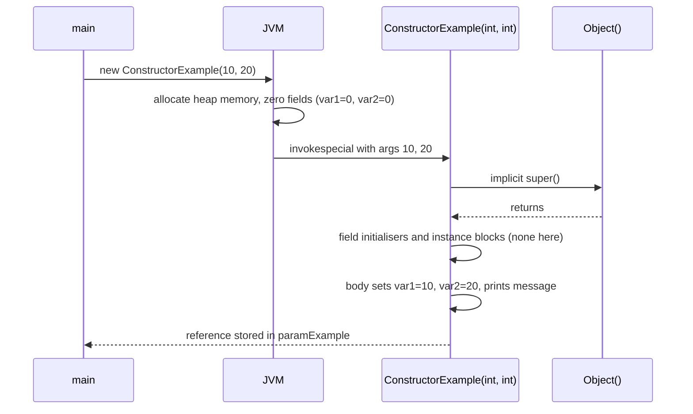
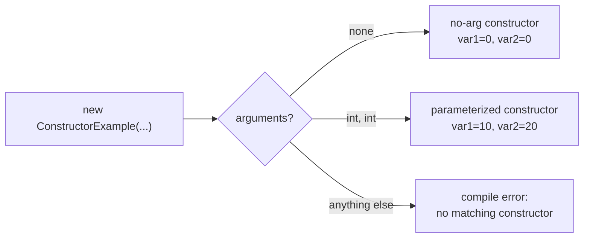

## In One Line
A constructor is the special block of code that runs **once, automatically, when `new` creates an object**, so the object starts life in a valid state — it has the class's name, no return type, and can be overloaded (no-arg, parameterized, copy) but never inherited.

## Mental Model
Think of a **new SIM card activation**. The factory (the JVM) stamps out a blank SIM — memory with every field zeroed. It is useless until the **activation step** runs: your number, your plan and your name are written onto it. Activation happens exactly once, right when the card is issued, and you cannot "re-activate" the same card later.

In the code:
- **Stamping the blank SIM** is the `new` keyword allocating memory and setting `var1` and `var2` to `0`.
- **The activation step** is the constructor body: `this.var1 = var1; this.var2 = var2;`.
- **Choosing a plan at the counter** is choosing a constructor by the arguments you pass: `new ConstructorExample()` gets the basic plan, `new ConstructorExample(10, 20)` gets the custom plan.
- **You cannot re-activate** — you cannot call a constructor again on an existing object; you can only create a new one.

## Concept
### What a constructor is
A constructor is a block that initialises a newly created object. It looks like a method, but it is not one:

```java
public ConstructorExample(int var1, int var2) {   // name = class name, no return type
    this.var1 = var1;
    this.var2 = var2;
}
```

The Java Language Specification (JLS §8.8) even says constructors are **not members** of a class — that is why they are not inherited and cannot be overridden.

### Constructor vs method
| | Constructor | Method |
|---|---|---|
| Name | Must be exactly the class name | Any valid identifier |
| Return type | None — not even `void` | Required (`void` if nothing) |
| Called by | `new`, or `this(...)` / `super(...)` from another constructor | Explicitly, by name, any number of times |
| Runs | Once per object, at creation | Whenever called |
| Inherited? | No | Yes (if accessible) |
| Overriding | Impossible | Possible (instance methods) |
| Overloading | Yes | Yes |
| Allowed modifiers | `public`, `protected`, package-private, `private` only | Also `static`, `final`, `abstract`, `synchronized`, `native`... |
| Default provided | Yes — the compiler adds one if you write none | No |
| `return;` | Allowed (no value) | Allowed / must return a value |

### What `new` actually does
`new ConstructorExample(10, 20)` is compiled to three bytecode steps: `new` (allocate), `dup`, `invokespecial <init>(II)V` (run the constructor). In order, at runtime:

1. **Class check** — if the class is not yet loaded and initialised, the JVM loads it and runs its static initialisers (see [static](lesson:a02-core/07-static-keyword)).
2. **Allocate** memory on the heap for all instance fields (including inherited ones).
3. **Zero** every field: `0`, `0.0`, `false`, `'\u0000'`, `null`. This is why `var1` is already `0` before any constructor code runs.
4. **Call the constructor** chosen by the arguments. Its first action is always `super(...)` or `this(...)` — written by you or inserted by the compiler — so the chain runs up to `Object()` first.
5. After `super(...)` returns: run **field initialisers and instance initialiser blocks**, top to bottom in source order.
6. Run the **rest of the constructor body**.
7. The expression `new ...` evaluates to the **reference** of the finished object.

Inside the class file, every constructor becomes a special method named `<init>`. `javap -c` on the course example shows the invisible `super()` call as the first instruction of *both* constructors:

```text
public CoreJava.JavaFeatures.ConstructorExample(int, int);
  Code:
     0: aload_0
     1: invokespecial #1   // Method java/lang/Object."<init>":()V
     4: aload_0
     5: iload_1
     6: putfield      #7   // Field var1:I
```

### Kinds of constructors
| Kind | What it is | Lesson |
|---|---|---|
| **Default** | Generated by the compiler only when you write **no** constructor; takes no arguments and just calls `super()` | [Default Constructor](lesson:a02-core/02-default-constructor) |
| **No-arg** | A constructor *you* write with no parameters (often called "default" informally) | [Default Constructor](lesson:a02-core/02-default-constructor) |
| **Parameterized** | Takes arguments to set the initial state | [Parameterized Constructor](lesson:a02-core/03-parameterized-constructor) |
| **Copy** | Takes another object of the same class and copies its state (a convention, not a language feature) | [Copy Constructor](lesson:a02-core/04-copy-constructor) |
| **Private** | Blocks `new` from outside: singletons, utility classes, static factories | [Singleton](lesson:a10-patterns/01-singleton) |

A class can have several constructors as long as their parameter lists differ — that is **constructor overloading** ([Constructor Overloading](lesson:a01-oop/08-constructor-overloading)). One constructor can call another with `this(...)` ([this keyword](lesson:a02-core/05-this-keyword)), and the parent's with `super(...)` ([super keyword](lesson:a02-core/06-super-keyword)).

### Rules that interviewers test
- The name must match the class name exactly (case-sensitive).
- **No return type.** Writing `void ConstructorExample()` silently turns it into an ordinary method.
- Only access modifiers are allowed. `static`, `final`, `abstract`, `synchronized` on a constructor are compile errors (*"modifier static not allowed here"*).
- `this(...)` or `super(...)` must be the **first statement**, and you can have only one of them. (JDK 22–24 previewed "statements before `super(...)`"; JDK 25 made it final as *flexible constructor bodies*, JEP 513. On Java 17/21 the first-statement rule holds.)
- A constructor **can** throw exceptions (`throws IOException` is legal). If it throws, `new` never returns a reference — the half-built object is unreachable.
- A constructor **cannot** be called like a method: `obj.ConstructorExample()` or `ConstructorExample()` is a compile error (*"cannot find symbol"*).
- A constructor can be generic (`<T> Box(T seed)`) and can take varargs.
- **Abstract classes have constructors** (called via `super(...)` from subclasses); **interfaces do not**.
- **Enum constructors are always private**; **records** get a generated *canonical* constructor ([Records](lesson:b05-modern-java/03-records)).

### Where initial values can come from
| Mechanism | Example | Runs |
|---|---|---|
| Default value | `int var1;` → `0` | At allocation, before any code |
| Field initialiser | `int var1 = 5;` | After `super()`, in source order |
| Instance initialiser block | `{ var1 = 7; }` | After `super()`, in source order with field initialisers |
| Constructor body | `this.var1 = var1;` | Last, so it has the final word |

The full ordering across static blocks and parent classes is covered in [Initialization Order](lesson:b01-fundamentals/12-initialization-order).

### Other ways objects get created
- **Constructor references** (Java 8): `Supplier<ConstructorExample> s = ConstructorExample::new;`
- **Reflection**: `ConstructorExample.class.getDeclaredConstructor(int.class, int.class).newInstance(10, 20)` (`Class.newInstance()` is deprecated since Java 9).
- **`clone()`** and **deserialization** create objects **without** running that class's constructor — one reason both are considered risky.

### Best practices
- A constructor should leave the object **fully valid**: validate arguments and fail fast with an exception.
- Keep constructors **cheap and side-effect free** — no network calls, no starting threads.
- **Do not call overridable methods** from a constructor and do not leak `this` (JDK 21 added `javac -Xlint:this-escape` to warn about it).
- When there are many parameters, prefer a **static factory** or a **Builder** ([Builder](lesson:a10-patterns/03-builder)).

## Diagram

Memory is allocated and zeroed first; the constructor only *initialises* an object that already exists, and it always starts by running the parent chain.


The compiler picks the constructor from the number and types of arguments, exactly like overloaded methods.

## Code
@example CoreJava/JavaFeatures/ConstructorExample.java

Initialisation order inside one class — field initialiser, then instance block, then constructor body:
```java
public class Order {
    public static void main(String[] args) {
        new Box(7);
    }
}

class Box {
    int size = log("field initializer", 1);

    {
        log("instance initializer block", 0);
    }

    Box(int size) {
        // super() is inserted here by the compiler
        log("constructor body, size before = " + this.size, 0);
        this.size = size;
        log("constructor body, size after = " + this.size, 0);
    }

    static int log(String msg, int value) {
        System.out.println(msg);
        return value;
    }
}
```
```output
field initializer
instance initializer block
constructor body, size before = 1
constructor body, size after = 7
```

Other ways to invoke constructors, and what happens when one throws:
```java
import java.util.function.BiFunction;
import java.util.function.Supplier;

public class Ctor {
    int var1, var2;

    public Ctor() { this(0, 0); }

    public Ctor(int var1, int var2) {
        if (var1 < 0) throw new IllegalArgumentException("var1 must be >= 0");
        this.var1 = var1;
        this.var2 = var2;
    }

    public String toString() { return "Ctor[" + var1 + ", " + var2 + "]"; }

    public static void main(String[] args) throws Exception {
        Supplier<Ctor> noArg = Ctor::new;                         // constructor reference
        BiFunction<Integer, Integer, Ctor> twoArgs = Ctor::new;
        System.out.println(noArg.get());
        System.out.println(twoArgs.apply(10, 20));

        Ctor viaReflection = Ctor.class.getDeclaredConstructor(int.class, int.class).newInstance(3, 4);
        System.out.println(viaReflection);

        Ctor c = null;
        try {
            c = new Ctor(-1, 5);
        } catch (IllegalArgumentException e) {
            System.out.println("failed: " + e.getMessage() + ", c = " + c);
        }
    }
}
```
```output
Ctor[0, 0]
Ctor[10, 20]
Ctor[3, 4]
failed: var1 must be >= 0, c = null
```

## Walkthrough
- `package CoreJava.JavaFeatures;` — the class lives in the package (folder) `CoreJava/JavaFeatures`. To run the compiled class you use its full name `CoreJava.JavaFeatures.ConstructorExample`.
- `int var1; int var2;` — two **instance variables** (fields) with package-private access. Every object gets its own pair. They have no initialiser, so they start at the default `0`.
- `public ConstructorExample() { ... }` — a constructor **with no parameters**. The comment calls it the "default constructor", but because you wrote it yourself it is technically a **no-arg constructor** (see Traps). It sets both fields to `0` — which they already are — and prints `Default constructor called.`.
- `this.var1 = 0;` — `this` is the object being built. Using `this.` is optional here (there is no parameter with the same name), but it makes clear that a field is being set.
- `public ConstructorExample(int var1, int var2) { ... }` — the **parameterized constructor**. The parameters have the same names as the fields, so they **shadow** them; `this.var1 = var1` means "field `var1` of this object = parameter `var1`". It prints `Parameterized constructor called.`.
- Having both constructors in one class is **constructor overloading**: same name, different parameter lists.
- `public void display()` — an ordinary instance method that prints the current field values. `"var1: " + var1 + ...` is string concatenation; the `int` values are converted to text.
- `public static void main(String[] args)` — the entry point. It is `static`, so it runs without any `ConstructorExample` object existing yet.
- `new ConstructorExample()` — no arguments, so the compiler binds this to the no-arg constructor. The JVM allocates the object, zeroes the fields, runs `Object()`, then the body → prints **`Default constructor called.`**.
- `defaultExample.display()` → **`var1: 0, var2: 0`**.
- `new ConstructorExample(10, 20)` — two `int` arguments match `(int, int)` → prints **`Parameterized constructor called.`**.
- `paramExample.display()` → **`var1: 10, var2: 20`**. The two objects are independent: each has its own `var1` and `var2`.
- All four `// Output:` comments match the recorded output exactly.

## Traps
> [!ERRATA] The comment `// Default constructor` labels a constructor that the programmer **wrote**. In Java terminology (JLS §8.8.9) the *default constructor* is the one the **compiler generates** when a class declares no constructor at all. A hand-written constructor with no parameters is a **no-arg constructor**. This class has two explicit constructors, so the compiler generates nothing. Interviewers often check this distinction. Also, `this.var1 = 0;` is redundant — fields are already `0` at allocation.

- **Adding a return type turns a constructor into a method.** The class then has *no* explicit constructor, so the compiler adds a default one, and your "constructor" code never runs on `new`:
```java
public class VoidTrap {
    int x;

    void VoidTrap() {          // looks like a constructor, but it is a method
        x = 42;
        System.out.println("method VoidTrap() ran");
    }

    public static void main(String[] args) {
        VoidTrap t = new VoidTrap();   // uses the compiler-generated default constructor
        System.out.println("x = " + t.x);
        t.VoidTrap();                  // legal: it's just a method with a weird name
        System.out.println("x = " + t.x);
    }
}
```
```output
x = 0
method VoidTrap() ran
x = 42
```
  `javac -Xlint:all` does not even warn; IDEs usually do.
- **Writing any constructor removes the free default constructor.** If a class only has `E(int x)`, then `new E()` fails: *"constructor E in class E cannot be applied to given types; required: int; found: no arguments"*.
- **Returning a value** from a constructor is a compile error: *"incompatible types: unexpected return value"*. A bare `return;` is allowed.
- **`static`, `final`, `abstract` on a constructor** — compile error *"modifier ... not allowed here"*.
- **Constructors are not inherited.** A subclass does not get `Parent(int)` automatically; it must declare its own constructor and call `super(value)`.
- **A throwing constructor leaves no object.** The variable keeps its old value (`c = null` above). Watch out for resources opened *before* the throw — close them, or they leak.
- **Calling an overridable method** from a constructor runs the subclass version before the subclass fields are set (see [super keyword](lesson:a02-core/06-super-keyword)).

> [!WARNING] Printing or doing heavy work in constructors, as the example does, is fine for learning but a smell in production code: constructors should only establish a valid state.

## Tips & Tricks
- **Mnemonic — "Same Name, No Return, Runs on New."** If any of the three is missing, it is not a constructor.
- **Allocation zeroes, the constructor initialises.** The object already exists (with default values) when your constructor body starts.
- **The first line is always `super(...)` or `this(...)`** — if you do not write it, the compiler writes `super()` for you.
- **"Write one, lose the free one"**: once you declare any constructor, the default constructor disappears.
- Keep a **single "full" constructor** that does all the work and let the others delegate with `this(...)` — one place to validate.
- More than 3–4 parameters, or several of the same type? Switch to a **Builder** or **static factory methods** with meaningful names.
- In interviews, say *"no-arg constructor"* for one you wrote and *"default constructor"* only for the compiler-generated one.

## Interview Q&A
### [Basic] What is a constructor and how is it different from a method?
A constructor is a special block that initialises a new object; it runs automatically when `new` is used. Differences from a method: its name must equal the class name; it has no return type (not even `void`); it is invoked only through `new` or through `this(...)`/`super(...)` from another constructor; it runs once per object; it is not inherited and so cannot be overridden (only overloaded); and only access modifiers may be applied to it. If a class declares no constructor, the compiler supplies a default one — nothing similar happens for methods.

**Follow-up:** *Can a method have the same name as the class?* — Yes. `void ConstructorExample()` compiles, but it is an ordinary method, which is a classic bug.

### [Basic] What types of constructors exist in Java?
- **Default constructor** — generated by the compiler when a class declares none; no parameters; body is just `super()`.
- **No-arg constructor** — written by the programmer, no parameters.
- **Parameterized constructor** — takes arguments to set the initial state.
- **Copy constructor** — takes an object of the same class and copies it (a convention; Java does not generate one).
- **Private constructor** — restricts creation (singleton, utility class, static factories).

Strictly, the JLS only knows "constructors" and "the default constructor"; the other names describe how they are used.

**Follow-up:** *Does Java have a copy constructor like C++?* — Not automatically; you write it yourself, or use `clone()`/copy factories.

### [Basic] Can a constructor be private? Why would you do that?
Yes. A private constructor stops other classes from calling `new`. Uses: **singletons** (only the class creates its single instance), **utility classes** such as `java.lang.Math` (only static methods, no instances), and **static factory methods** like `List.of(...)` or `Integer.valueOf(...)` that control caching or return subtypes. Nested classes and the class itself can still call it.

**Follow-up:** *Can a class with only private constructors be extended?* — Not by a top-level class: the subclass constructor must call `super(...)`, which is inaccessible. A nested class inside it can, because it has access to private members.

### [Intermediate] Why can't a constructor be static, final or abstract?
- **static** — a constructor works on a specific new object (`this`); static code has no object.
- **final** — `final` prevents overriding, but constructors are never inherited, so it would mean nothing.
- **abstract** — an abstract member has no body and must be implemented by a subclass; a constructor must have a body and cannot be overridden.
- **synchronized** — no other thread can see the object before the constructor finishes (unless you leak `this`), so there is nothing to lock against. You can still use a `synchronized` block inside.

All of these produce *"modifier ... not allowed here"*.

**Follow-up:** *Does an abstract class have a constructor then?* — Yes. You cannot call `new` on it, but subclass constructors call it through `super(...)` to initialise the inherited fields.

### [Intermediate] What exactly happens, step by step, when you write `new Student("Asha")`?
1. The class `Student` is loaded, linked and initialised if it has not been yet (static blocks run once).
2. Memory is allocated on the heap for all instance fields of `Student` and its superclasses.
3. All fields are set to default values (`0`, `false`, `null`).
4. The matching constructor `Student(String)` is invoked (`invokespecial <init>`).
5. Its first statement, `super(...)` or `this(...)`, runs — so constructors run from `Object` down to `Student`.
6. After the parent chain returns, `Student`'s field initialisers and instance blocks run in textual order.
7. The rest of the constructor body runs.
8. `new` evaluates to the reference, which is assigned to the variable.

**Follow-up:** *What if the constructor throws?* — The exception propagates out of `new`; no reference is ever returned, so the partially built object becomes garbage.

### [Intermediate] Can a constructor call another constructor? Can it call a method?
Yes to both. `this(...)` calls another constructor of the same class and `super(...)` calls a parent constructor; either must be the first statement, and only one of them is allowed. A constructor can also call methods, but calling **overridable** methods is dangerous: the subclass override runs before the subclass's fields are initialised and sees `null`/`0`. Make such helpers `private`, `static` or `final`.

**Follow-up:** *What happens with `A() { this(1); } A(int x) { this(); }`?* — Compile error *"recursive constructor invocation"*; the compiler detects constructor cycles.

### [Advanced] Is a constructor a method? What is `<init>`?
At the language level, no: the JLS treats constructors separately and states they are not members, so they are not inherited. At the bytecode level, every constructor compiles into a special method named `<init>` (and the static initialiser into `<clinit>`). `new X(a)` compiles to `new X; dup; invokespecial X.<init>(...)`. The JVM verifier requires each `<init>` to call a superclass `<init>` (or another `<init>` of the same class) before the object is used, which is how "super() first" is enforced at runtime too.

**Follow-up:** *Why `invokespecial` and not `invokevirtual`?* — Constructors must not be dynamically dispatched; the exact class's constructor must run, so they use the non-virtual `invokespecial` instruction.

### [Advanced] Which objects are created without running their class's constructor?
- **`clone()`** — `Object.clone()` copies the memory field by field; no constructor of the cloned class runs.
- **Deserialization** — for a `Serializable` class, the JVM runs only the no-arg constructor of the **first non-serializable superclass** and restores the fields from the stream.
- **Reflection hacks / `Unsafe.allocateInstance`** — used by some frameworks.

This matters because invariants and validation written in the constructor are bypassed — a reason to validate again in `readObject` and to prefer copy constructors over `clone()`.

**Follow-up:** *And records?* — Record deserialization is special: it always goes through the canonical constructor, so validation cannot be bypassed.

### [Advanced] What changed about "`super()` must be the first statement" in recent Java versions?
Up to Java 21 (and 17), `this(...)`/`super(...)` must be the very first statement, so you cannot validate or compute arguments in statements before it — you had to use static helper methods inside the argument list. JEP 447 (JDK 22 preview), refined in JDK 23 and 24, and finalized by JEP 513 in **JDK 25** allow statements *before* `super(...)`/`this(...)` as long as they do not use `this` (no reading fields or calling instance methods). Example: `Square(int side) { if (side <= 0) throw new IllegalArgumentException(); super(side, side); }`.

**Follow-up:** *How did you do that before JDK 25?* — `super(check(side), side)` with a `private static int check(int)` helper, or a static factory method.

## Quiz
### What does this print?
```java
public class Q1 {
    public static void main(String[] args) {
        System.out.println(new Box().size);
    }
}
class Box {
    int size = 5;
    Box() { System.out.print(size + " "); size = 10; }
    { size = 7; }
}
```
- [ ] 5 10
- [x] 7 10
- [ ] 0 10
- [ ] 10 10
> Field initialisers and instance blocks run in source order **before** the constructor body, even though the block is written after the constructor: `size` becomes 5, then 7. The body prints `7 ` and sets 10. `5 10` is tempting if you think the block runs after the constructor.

### Which statement about constructors is TRUE?
- [ ] A constructor may be declared `static` if it only sets static fields
- [ ] A constructor must be `public`
- [x] A constructor may be `private`
- [ ] A constructor may declare `void` as its return type
> Only access modifiers are allowed, and all four (`public`, `protected`, package-private, `private`) are legal. `static` is a compile error, and adding `void` turns it into a normal method.

### What does this print?
```java
public class VoidTrap {
    int x;
    void VoidTrap() { x = 42; }
    public static void main(String[] args) {
        VoidTrap t = new VoidTrap();
        System.out.println("x = " + t.x);
    }
}
```
- [ ] x = 42
- [x] x = 0
- [ ] Compile error: a method cannot have the class name
- [ ] Compile error: no constructor defined
> `void VoidTrap()` is a **method**, not a constructor. The class has no constructor, so the compiler adds a default one, and `new` never calls the method. A method *can* share the class's name, so it compiles.

### What does this print?
```java
public class Q2 {
    int a;
    int b = 3;
    Q2() { System.out.println(a + b); }
    Q2(int a) { this(); this.a = a; System.out.println(this.a + b); }
    public static void main(String[] args) { new Q2(4); }
}
```
- [ ] 7 only
- [x] 3, then 7
- [ ] 7, then 3
- [ ] 4, then 7
> `this()` runs the no-arg constructor first; at that point `a` is still 0 and `b` is already 3 (field initialisers run before any constructor body), so it prints 3. Then `this.a = 4` and it prints 7.

### Spot the bug: why doesn't `new Account()` compile?
```java
public class Account {
    private double balance;
    public Account(double opening) { balance = opening; }
    public static void main(String[] args) {
        Account a = new Account();
    }
}
```
- [ ] `balance` must be initialised in its declaration
- [x] Declaring `Account(double)` removed the compiler's default no-arg constructor
- [ ] A class needs at least two constructors
- [ ] `main` cannot call a constructor of its own class
> The compiler only generates a default constructor when a class declares none. Since `Account(double)` exists, `new Account()` has no match. Fix: add `public Account() { this(0.0); }` or pass an amount.

### Your constructor throws an exception. What does the variable on the left of `=` hold afterwards?
```java
Ctor c = null;
try { c = new Ctor(-1, 5); } catch (IllegalArgumentException e) { }
```
- [ ] A half-initialised `Ctor` with default field values
- [x] Still `null` — `new` never returned a reference
- [ ] A `Ctor` whose fields are -1 and 5
- [ ] It depends on the garbage collector
> If the constructor completes abruptly, the `new` expression completes abruptly too and the assignment never happens. The allocated object is unreachable and will be collected.

## Takeaways
- A constructor initialises a new object: same name as the class, no return type, runs once when `new` is used.
- `new` allocates memory and zeroes all fields **before** the constructor runs; the constructor starts with `super(...)` or `this(...)` (implicit `super()` if you write neither).
- Order inside one class: default values → `super(...)` → field initialisers and instance blocks (source order) → constructor body.
- Constructors can be overloaded but are never inherited or overridden; only access modifiers are allowed on them.
- The compiler adds a **default constructor** only if a class declares no constructor; a hand-written no-parameter constructor is a **no-arg constructor**.
- A return type such as `void` turns a "constructor" into an ordinary method — a classic silent bug.
- Keep constructors small: validate, assign, and never call overridable methods or leak `this`.
