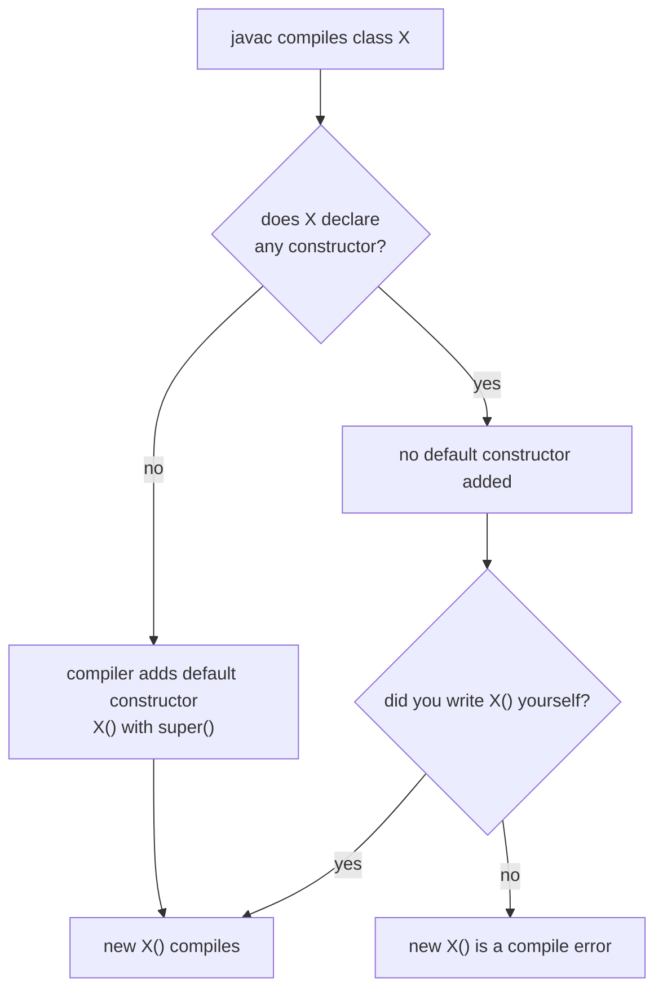
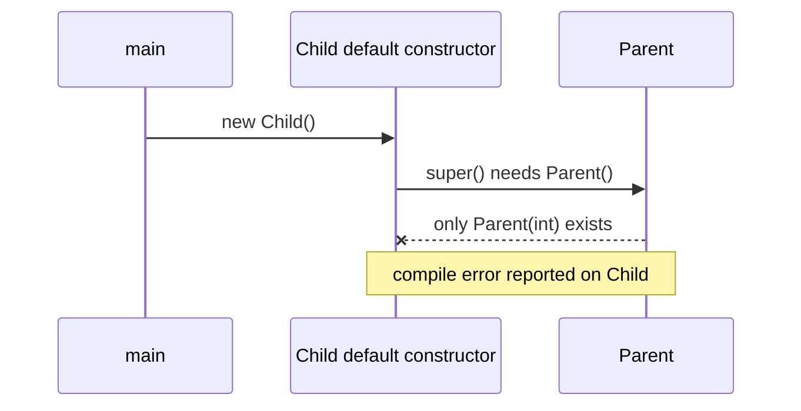

## In One Line
If you write **no constructor at all**, the compiler silently adds a **default constructor** — no parameters, same access as the class, body `super();` — and the moment you write **any** constructor yourself, that free one disappears.

## Mental Model
Think of a **hotel room**. If you book without any special requests, the hotel still gives you a room with the **standard setup**: bed made, towels folded, lights off. You did not ask for it; it is simply what every room gets. The moment you fill in a **special-request form** (extra bed, sea view), the hotel follows *your* form instead — and if your form only says "sea view room for two", the standard "no requests" option is no longer on offer unless you ask for it too.

In the code:
- **Booking with no requests** = a class with no constructor; `new Room()` still works because the compiler adds `Room() { super(); }`.
- **The standard setup** = default field values (`0`, `false`, `null`), which come from memory zeroing — not from the constructor.
- **The special-request form** = any constructor you write, e.g. `Room(int beds)`. After that, `new Room()` only works if you also write a no-arg constructor.

## Concept
### Default constructor vs no-arg constructor
These two terms are mixed up constantly — including by the course example.

| | Default constructor | No-arg constructor |
|---|---|---|
| Who writes it | The **compiler** (JLS §8.8.9) | **You** |
| When it exists | Only when the class declares **no** constructor | Whenever you declare it |
| Parameters | None | None |
| Body | Just `super();` | Whatever you write (it still starts with `super()` implicitly) |
| Access | Same as the class | Whatever you choose |
| Throws | Nothing | Whatever you declare |

Every default constructor is "no-arg", but not every no-arg constructor is "default". The course's `DefaultConstructorExample()` is a **no-arg constructor** written by hand.

### Exactly what the compiler generates
For `public class Gen { int count; }` the compiler behaves as if you wrote `public Gen() { super(); }`. `javap -c Gen.class` proves it:

```text
public Gen();
  Code:
     0: aload_0
     1: invokespecial #1   // Method java/lang/Object."<init>":()V
     4: return
```

Notice what is **not** there: no code that sets `count = 0`. The default constructor does not "initialise fields to default values" — memory zeroing does that before any constructor runs. If the class had field initialisers (`int count = 5;`) or instance blocks, the compiler would put that code into the default constructor after `super()`, exactly as for any constructor.

### Access modifier of the default constructor
The default constructor has the **same access as its class**:

| Class declared as | Default constructor |
|---|---|
| `public class A` | `public A()` |
| `class A` (package-private) | `A()` package-private |
| `protected static class A` (nested) | `protected A()` |
| `private static class A` (nested) | `private A()` |
| `enum Color` | always `private` |
| inner (non-static) class | gets a hidden parameter: the outer instance |

### The rule that breaks code: "write one, lose the free one"
```java
class Account {
    Account(double opening) { ... }
}
new Account();   // compile error: required: double, found: no arguments
```
Adding a parameterized constructor to an existing class is therefore a **breaking change** for every caller (and every subclass) that relied on `new Account()`.

### The inheritance trap
A subclass constructor always calls a parent constructor. If you write no constructor in the child, the compiler's default one calls `super()` — the parent's **no-arg** constructor. If the parent does not have one, the *child* fails to compile:

```java
class Parent { Parent(int x) { } }
class Child extends Parent { }      // error here, not in Parent
```
Fix: give `Parent` a no-arg constructor, or write `Child() { super(0); }`.

### Default values of fields
| Type | Default value |
|---|---|
| `byte`, `short`, `int` | `0` |
| `long` | `0L` |
| `float` | `0.0f` |
| `double` | `0.0` |
| `char` | `'\u0000'` (the null character, code 0) |
| `boolean` | `false` |
| any reference (`String`, arrays, objects) | `null` |

This applies to **fields and array elements** only. **Local variables get no default** — using one before assigning is a compile error (*"variable local might not have been initialized"*).

### Who needs a no-arg constructor?
Many tools create objects reflectively with `getDeclaredConstructor().newInstance()` and then fill the fields:
- **JPA / Hibernate** entities must have a `public` or `protected` no-arg constructor.
- **Jackson** (JSON) needs one unless you use `@JsonCreator` or records.
- **JavaBeans** convention: public no-arg constructor + getters/setters.
- **Java serialization**: the first **non-serializable** superclass must have an accessible no-arg constructor, otherwise deserialization fails with `InvalidClassException: ... no valid constructor`.
- **Lombok** (in the course's pom.xml) can generate one with `@NoArgsConstructor`.

### Special cases
- **Records** never get a "default constructor"; they get a **canonical constructor** with one parameter per component.
- **Anonymous classes** cannot declare constructors; the compiler creates an *anonymous constructor* that passes the arguments on to the superclass constructor.
- **Interfaces** have no constructors at all.
- `javac -Xlint:missing-explicit-ctor` (JDK 16+) warns when a public class in an exported module package relies on the default constructor, because it becomes part of your public API by accident.

## Diagram

The default constructor is all-or-nothing: it exists only when you wrote no constructor at all.


A child without constructors still calls `super()`; if the parent has no no-arg constructor, compilation fails.

## Code
@example CoreJava/JavaFeatures/DefaultConstructorExample.java

What you get when there is really **no** constructor — every field holds its default value:
```java
public class Defaults {
    byte b; short s; int i; long l;
    float f; double d; char c; boolean bool;
    String str; int[] arr;

    public static void main(String[] args) {
        Defaults x = new Defaults();          // compiler-generated default constructor
        System.out.println(x.b + " " + x.s + " " + x.i + " " + x.l);
        System.out.println(x.f + " " + x.d + " " + (int) x.c + " " + x.bool);
        System.out.println(x.str + " " + x.arr);
    }
}
```
```output
0 0 0 0
0.0 0.0 0 false
null null
```

The generated constructor copies the class's access level (inspected with reflection):
```java
import java.lang.reflect.Constructor;
import java.lang.reflect.Modifier;

public class Access {                       // public class, no constructor written
    private static class Secret { }         // private nested class
    static class Helper { }                 // package-private nested class
    class Inner { }                         // inner (non-static) class

    static void show(Class<?> type) {
        Constructor<?> c = type.getDeclaredConstructors()[0];
        String mods = Modifier.toString(c.getModifiers());
        System.out.println(type.getSimpleName() + ": "
                + (mods.isEmpty() ? "package-private" : mods)
                + ", parameters = " + c.getParameterCount());
    }

    public static void main(String[] args) {
        show(Access.class);
        show(Secret.class);
        show(Helper.class);
        show(Inner.class);
    }
}
```
```output
Access: public, parameters = 0
Secret: private, parameters = 0
Helper: package-private, parameters = 0
Inner: package-private, parameters = 1
```
The inner class's "no-arg" default constructor really has one parameter: the enclosing `Access` object.

Deserialization needs a no-arg constructor in the first non-serializable parent:
```java
import java.io.*;

public class Ser {
    public static void main(String[] args) throws Exception {
        ByteArrayOutputStream bytes = new ByteArrayOutputStream();
        try (ObjectOutputStream out = new ObjectOutputStream(bytes)) {
            out.writeObject(new Dog("Rex"));
        }
        try (ObjectInputStream in = new ObjectInputStream(new ByteArrayInputStream(bytes.toByteArray()))) {
            System.out.println(in.readObject());
        } catch (InvalidClassException e) {
            System.out.println(e);
        }
    }
}

class Animal {                       // NOT Serializable, and no no-arg constructor
    String name;
    Animal(String name) { this.name = name; }
}

class Dog extends Animal implements Serializable {
    Dog(String name) { super(name); }
}
```
```output
java.io.InvalidClassException: Dog; no valid constructor
```

## Walkthrough
- `public class DefaultConstructorExample` with fields `int var1; int var2;` — two instance fields, package-private, no initialisers, so they are `0` as soon as the object is allocated.
- `public DefaultConstructorExample() { ... }` — a constructor **written by the programmer** with no parameters. Because it exists, the compiler does **not** generate a default constructor. Strictly, this is a **no-arg constructor** (see Traps).
- `var1 = 0; var2 = 0;` — no `this.` is needed because there is no parameter or local variable with the same name; `var1` resolves to the field. These assignments are redundant: `javap` shows `iconst_0` / `putfield` instructions writing `0` over a `0`. Harmless, but it teaches the wrong idea that constructors are needed to get default values.
- `System.out.println("Default constructor called.");` — proof that the constructor body ran.
- `display()` — prints both fields with string concatenation.
- `main` → `new DefaultConstructorExample()` — no arguments, so the no-arg constructor runs: implicit `super()` (`Object()`), then the body → **`Default constructor called.`**.
- `example.display()` → **`var1: 0, var2: 0`**. You would get the same output if you deleted the constructor entirely (minus the first line), because the real default constructor plus memory zeroing gives the same `0` values.
- Both `// Output:` comments match the recorded output.

## Traps
> [!ERRATA] The class name `DefaultConstructorExample` and the comment `// Default constructor` describe a constructor that the programmer **wrote**. Per the JLS, the *default constructor* is the one the **compiler generates** only when a class declares no constructors; a hand-written parameterless constructor is a **no-arg constructor**. To actually see a default constructor, delete the constructor from the class — `new DefaultConstructorExample()` still compiles, and `display()` still prints `var1: 0, var2: 0`. The assignments `var1 = 0; var2 = 0;` are redundant, because fields are zeroed at allocation.

- **"The default constructor initialises fields to their defaults"** — a popular but wrong interview answer. Zeroing happens at allocation; the default constructor only calls `super()` (plus any field initialisers you wrote).
- **Adding a parameterized constructor breaks `new X()`** everywhere, including frameworks that need a no-arg constructor (JPA, Jackson). Add an explicit no-arg constructor if you still need one.
- **Subclass compile error caused by the parent.** `class Child extends Parent {}` fails if `Parent` only has `Parent(int)`. The error points at `Child`: *"constructor Parent in class Parent cannot be applied to given types"*.
- **Local variables have no defaults.** `int local; System.out.println(local);` → *"variable local might not have been initialized"*.
- **A private class's default constructor is private**, and an inner class's has a hidden outer-instance parameter — reflection code calling `getDeclaredConstructor()` with no arguments on an inner class fails with `NoSuchMethodException`.

> [!WARNING] `char`'s default is `'\u0000'`, not a space and not `'0'`. Printing it shows an invisible character; cast to `int` to see `0`.

## Tips & Tricks
- **Mnemonic — "Zero from the heap, `super()` from the compiler."** Default values come from memory; the default constructor only chains to the parent.
- **"Write one, lose the free one."** Any explicit constructor cancels the default constructor.
- **The default constructor wears the class's badge** — same access modifier as the class.
- In interviews, answer the terminology question precisely: *"A default constructor is compiler-generated when no constructor is declared; a no-arg constructor is one I write."*
- Library/API classes: declare constructors **explicitly** so adding one later does not silently change your public API (that is what `-Xlint:missing-explicit-ctor` guards against).
- If a framework complains about a "no default constructor" / "no valid constructor", it means a **no-arg constructor** is missing — add one (it may be `protected` for JPA).

## Interview Q&A
### [Basic] What is a default constructor?
It is the constructor the **compiler inserts** when a class declares no constructors. It takes no parameters, has the same access modifier as the class, declares no exceptions, and its body simply calls `super()` — the superclass's no-arg constructor. It lets `new MyClass()` work for simple classes without writing any constructor code.

**Follow-up:** *Does it set the fields to 0 and null?* — No. Fields are already zeroed when memory is allocated; the default constructor only calls `super()` (and runs any field initialisers you declared).

### [Basic] What is the difference between a default constructor and a no-arg constructor?
Both take no arguments. The **default constructor** is generated by the compiler, and only when there is no other constructor; its body is just `super()` and its access matches the class. A **no-arg constructor** is written by the programmer; it can contain any code, any access modifier and a `throws` clause, and it can coexist with other constructors. So every default constructor is no-arg, but not every no-arg constructor is the default constructor.

**Follow-up:** *Is the constructor in `DefaultConstructorExample` a default constructor?* — No, it is an explicit no-arg constructor; the name of the class is misleading.

### [Basic] When does the compiler NOT provide a default constructor?
As soon as the class declares **at least one** constructor of any kind — parameterized, private, copy, anything. From then on, `new X()` only compiles if you wrote an `X()` yourself. Records and interfaces never get one either (records get a canonical constructor; interfaces have no constructors).

**Follow-up:** *What error do you get?* — *"constructor X in class X cannot be applied to given types; required: int; found: no arguments"*.

### [Intermediate] A parent class only has `Parent(int x)`. Why does `class Child extends Parent {}` not compile?
`Child` has no constructor, so the compiler gives it a default constructor whose body is `super()`. That calls `Parent()`, which does not exist, so compilation fails — and the error is reported on `Child`. Fixes: add a no-arg constructor to `Parent`, or give `Child` an explicit constructor that calls `super(someValue)`.

**Follow-up:** *Does the same happen if `Child` writes its own constructor without calling `super(...)`?* — Yes; the compiler inserts `super()` into every constructor that does not start with `this(...)` or `super(...)`.

### [Intermediate] What access modifier does the default constructor have?
The same as its class: `public` for a public class, package-private for a package-private class, `private`/`protected` for private/protected nested classes. The exception is enums, whose constructors are always private. That is why a private nested class's default constructor is private (the enclosing class can still call it).

**Follow-up:** *Why does that matter?* — Reflection and frameworks may not be able to call a non-public default constructor without `setAccessible(true)`, and a public class accidentally exposes a public constructor as API.

### [Intermediate] Why do frameworks like Hibernate or Jackson need a no-arg constructor?
They create objects **reflectively** before they know the field values: `clazz.getDeclaredConstructor().newInstance()`, then they fill the fields from the database row or the JSON. Without a no-arg constructor they do not know which arguments to pass. JPA requires a `public` or `protected` no-arg constructor; Jackson can instead use a constructor annotated with `@JsonCreator` (or a record's canonical constructor). Java serialization needs an accessible no-arg constructor in the first non-serializable superclass.

**Follow-up:** *How do you keep the class safe if you must add a no-arg constructor?* — Make it `protected` (or package-private where allowed) so application code keeps using the validating constructor.

### [Advanced] What does the default constructor of an inner class or an anonymous class look like?
For an **inner (non-static) class**, the compiler adds a hidden parameter for the enclosing instance, so `Outer.Inner`'s "no-arg" default constructor really is `Inner(Outer this$0)` — reflection shows one parameter, and you create it with `outer.new Inner()`. **Anonymous classes** cannot declare constructors at all; the compiler generates an *anonymous constructor* with the same parameters as the superclass constructor you invoke (`new Thread("name") { ... }` passes `"name"` on to `Thread(String)`).

**Follow-up:** *How do you initialise fields in an anonymous class then?* — With field initialisers or an instance initialiser block `{ ... }`.

### [Advanced] Why might a library author avoid relying on the default constructor?
Because it silently becomes part of the public API. If later someone adds a parameterized constructor, the default constructor disappears and every client calling `new X()` breaks — a binary- and source-incompatible change nobody intended. Declaring constructors explicitly documents intent; JDK 16 added `javac -Xlint:missing-explicit-ctor` to warn about public classes in exported packages that rely on it, and the JDK itself was cleaned up this way.

**Follow-up:** *What if the class should not be instantiated at all?* — Declare a `private` constructor (utility classes), so no default constructor is generated.

## Quiz
### What does this print?
```java
class P { int n; String s; boolean b; double d; }

P p = new P();
System.out.println(p.n + " " + p.s + " " + p.b + " " + p.d);
```
- [ ] Compile error: P has no constructor
- [ ] 0 "" false 0
- [x] 0 null false 0.0
- [ ] NullPointerException
> `P` gets a compiler-generated default constructor, and fields start at their default values: `0`, `null`, `false`, `0.0`. A `null` String concatenates as the text `null` — no exception.

### Which class does NOT get a compiler-generated default constructor?
- [ ] `class A { int x; }`
- [ ] `class B { void B() { } }`
- [x] `class C { private C(int x) { } }`
- [ ] `class D extends Object { }`
> `C` declares a constructor (private or not), so the compiler adds nothing. `B` is the trap: `void B()` is a method, so `B` has no constructor and does get the default one.

### Spot the bug: why does this not compile?
```java
class Vehicle {
    Vehicle(String model) { }
}
class Bike extends Vehicle {
}
```
- [ ] `Bike` must be declared `abstract`
- [x] `Bike`'s default constructor calls `super()`, but `Vehicle` has no no-arg constructor
- [ ] `Vehicle` needs a default constructor to be extended at all
- [ ] Constructors cannot take a `String`
> The compiler generates `Bike() { super(); }`, and `super()` has no match in `Vehicle`. Fix with `Bike() { super("unknown"); }` or add `Vehicle()`. Option 3 is too strong: `Vehicle` can be extended if the child calls `super(String)`.

### What does this print?
```java
class Counter { int count = 5; }
class Sub extends Counter { Sub() { count++; } }

System.out.println(new Sub().count);
```
- [ ] 1
- [ ] 5
- [x] 6
- [ ] Compile error: Counter has no constructor
> `Counter`'s default constructor runs first (via the implicit `super()` in `Sub()`), and it includes the field initialiser `count = 5`. Then `Sub()`'s body adds one → 6. Answering 1 assumes the initialiser does not run.

### What is the access modifier of the default constructor of `class Helper { }` (no modifier on the class)?
- [ ] public
- [x] package-private
- [ ] private
- [ ] protected
> The default constructor takes the access level of its class. A package-private class gets a package-private default constructor.

### What does the compiler-generated default constructor of `public class Gen { int count; }` do?
- [ ] Sets `count` to 0, then calls `super()`
- [x] Calls `super()` and returns
- [ ] Nothing at all — it has an empty body with no calls
- [ ] Calls `this()`
> Its body is `super();` — `javap` shows `aload_0`, `invokespecial Object.<init>`, `return`. `count` is already 0 from allocation, so there is no assignment instruction.

## Takeaways
- The **default constructor** is generated by the compiler only when a class declares no constructor: no parameters, same access as the class, body `super()`.
- A constructor you write with no parameters is a **no-arg constructor**, not the default constructor — the course example's naming is misleading.
- Default field values (`0`, `false`, `'\u0000'`, `null`) come from memory zeroing, not from the default constructor; local variables have no defaults.
- Declaring any constructor removes the default one, which breaks `new X()` callers and subclasses relying on it.
- A subclass's default constructor calls `super()`; if the parent lacks a no-arg constructor, the child fails to compile.
- Frameworks (JPA, Jackson, serialization) often need a no-arg constructor to create objects reflectively.
