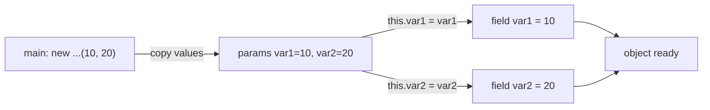
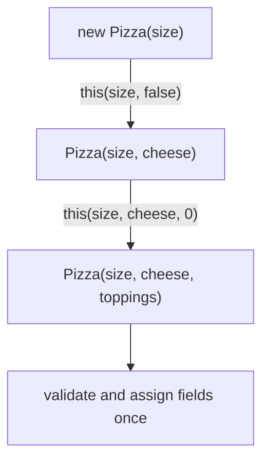

## In One Line
A parameterized constructor takes arguments so that an object is **created already holding the values it needs** — `new ParameterizedConstructorExample(10, 20)` — which lets you enforce required data, validate it once, and even make the object immutable.

## Mental Model
Think of **ordering a custom T-shirt online**. A plain "blank shirt" order would ship you a white shirt that you then have to paint yourself — and you might forget the size. The custom-order form **refuses to submit** until you fill in size, colour and text, and the shirt arrives finished.

In the code:
- **The order form's fields** are the constructor parameters `(int var1, int var2)`.
- **Submitting the form** is `new ParameterizedConstructorExample(10, 20)`.
- **"Refuses to submit"** is the compiler rejecting `new ParameterizedConstructorExample()` (no such constructor), and your validation code throwing an exception for bad values.
- **The finished shirt** is an object whose fields are set from the very first moment anyone can see it — no "half-painted" state.

## Concept
### Why parameterized constructors exist
With only a no-arg constructor, creating a useful object is a two-step dance: `new` + a series of setters. Between those steps the object is **incomplete**, and nothing forces callers to call every setter. A parameterized constructor fixes that:

| Setter-based creation | Parameterized constructor |
|---|---|
| `Emp e = new Emp(); e.setName("A"); e.setAge(30);` | `Emp e = new Emp("A", 30);` |
| Object is invalid until all setters are called | Object is valid as soon as it exists |
| Fields cannot be `final` | Fields can be `final` → immutable objects |
| Easy to forget a required value | Compiler forces you to pass every argument |
| Validation scattered over setters | Validation in one place |

### Syntax and the `this.x = x` idiom
```java
public ParameterizedConstructorExample(int var1, int var2) {
    this.var1 = var1;   // field = parameter
    this.var2 = var2;
}
```
Naming parameters after the fields is the standard Java style. Inside the constructor the **parameter shadows the field** — the simple name `var1` means the parameter. `this.var1` reaches the field of the object under construction. Forgetting `this.` gives `var1 = var1;`, which assigns the parameter to itself and leaves the field at `0` (see Traps).

### Arguments are passed by value
The caller's variables are **copied** into the parameters. Reassigning a parameter inside the constructor never affects the caller's variable. For object arguments the *reference* is copied, so the constructor and the caller point to the **same object** — which is why you make defensive copies of mutable arguments ([Pass by Value](lesson:b01-fundamentals/04-pass-by-value)). Arguments are evaluated left to right before the constructor starts.

### Validate in the constructor — fail fast
The constructor is the one place every object passes through, so it is the right place to reject bad data:
```java
this.name = Objects.requireNonNull(name, "name must not be null");
if (age < 18 || age > 100) throw new IllegalArgumentException("age out of range: " + age);
this.skills = List.copyOf(skills);   // defensive, unmodifiable copy
```
- `Objects.requireNonNull` → `NullPointerException` with a clear message.
- `IllegalArgumentException` for values outside the allowed range.
- **Defensive copy** of mutable inputs (`List`, `Date`, arrays), so the caller cannot change your object's state after construction. `List.copyOf` (Java 10) also rejects `null` elements.

### Overloading and constructor chaining
A class can offer several parameterized constructors (different parameter lists). Put all the real work in **one "full" constructor** and let the others **delegate** with `this(...)`:
```java
Pizza(String size)                        { this(size, false); }
Pizza(String size, boolean extraCheese)   { this(size, extraCheese, 0); }
Pizza(String size, boolean cheese, int n) { /* validate and assign once */ }
```
This is the **telescoping constructor** pattern. It works for 2–3 optional values but becomes unreadable with more — `new Pizza("large", true, 3, false, true)` tells the reader nothing. Then switch to a **Builder** ([Builder](lesson:a10-patterns/03-builder)). Details of overload rules are in [Constructor Overloading](lesson:a01-oop/08-constructor-overloading).

### Which constructor is chosen?
Constructor selection follows the same three phases as method overloading:
1. Exact match or **widening** (`int` → `long`) — no boxing, no varargs.
2. Then **boxing/unboxing** (`int` → `Integer`).
3. Then **varargs** (`int...`).

So with `Pick(long, long)`, `Pick(Integer, Integer)` and `Pick(int...)`, the call `new Pick(1, 2)` picks `(long, long)`.

### Static factory methods — the alternative
Constructors have limits: they must be named after the class, they cannot have two versions with the same parameter types, and they always create a new object. Static factory methods (Effective Java, Item 1) solve all three:
```java
Point.ofCartesian(3, 4);                    // descriptive names
Point.ofPolar(5, Math.toRadians(90));       // same (double, double) signature, different meaning
Integer.valueOf(127);                        // may return a cached instance
List.of(1, 2, 3);                            // may return a hidden subclass
```
A common design: one `private` constructor + several public static factories.

### Parameterized constructors in records (Java 16+)
A record's **canonical constructor** is a parameterized constructor generated for you. To validate, write a **compact constructor** (no parameter list; the assignments happen automatically at the end):
```java
record Range(int low, int high) {
    Range {
        if (low > high) throw new IllegalArgumentException(low + " > " + high);
    }
}
```
See [Records](lesson:b05-modern-java/03-records).

### Consequences worth remembering
- Declaring a parameterized constructor **removes the compiler's default constructor** — `new X()` stops compiling unless you add a no-arg constructor ([Default Constructor](lesson:a02-core/02-default-constructor)).
- Subclasses must call it explicitly: `super(10, 20)`.
- Two constructors cannot have the **same parameter types** even with different parameter names — *"constructor Point(double,double) is already defined"*.

## Diagram

Arguments are copied into the parameters; `this.` moves them from the parameters into the object's fields.


Telescoping constructors delegate to one full constructor, so validation lives in exactly one place.

## Code
@example CoreJava/JavaFeatures/ParameterizedConstructorExample.java

Validation, `requireNonNull` and a defensive copy:
```java
import java.util.ArrayList;
import java.util.List;
import java.util.Objects;

public class Validated {
    public static void main(String[] args) {
        List<String> tags = new ArrayList<>(List.of("java"));
        Employee e = new Employee("Asha", 30, tags);
        tags.add("hacked");                    // caller changes its own list later
        System.out.println(e);

        try {
            new Employee("Ravi", -5, List.of());
        } catch (IllegalArgumentException ex) {
            System.out.println("Rejected: " + ex.getMessage());
        }
        try {
            new Employee(null, 25, List.of());
        } catch (NullPointerException ex) {
            System.out.println("Rejected: " + ex.getMessage());
        }
    }
}

final class Employee {
    private final String name;
    private final int age;
    private final List<String> skills;

    Employee(String name, int age, List<String> skills) {
        this.name = Objects.requireNonNull(name, "name must not be null");
        if (age < 18 || age > 100) {
            throw new IllegalArgumentException("age out of range: " + age);
        }
        this.age = age;
        this.skills = List.copyOf(skills);     // defensive, unmodifiable copy
    }

    @Override
    public String toString() {
        return name + " (" + age + ") " + skills;
    }
}
```
```output
Asha (30) [java]
Rejected: age out of range: -5
Rejected: name must not be null
```

Telescoping constructors that delegate with `this(...)`:
```java
public class Telescope {
    public static void main(String[] args) {
        System.out.println(new Pizza("large"));
        System.out.println(new Pizza("small", true));
        System.out.println(new Pizza("medium", true, 3));
    }
}

class Pizza {
    private final String size;
    private final boolean extraCheese;
    private final int toppings;

    Pizza(String size)                          { this(size, false); }
    Pizza(String size, boolean extraCheese)     { this(size, extraCheese, 0); }
    Pizza(String size, boolean extraCheese, int toppings) {   // the one "full" constructor
        this.size = size;
        this.extraCheese = extraCheese;
        this.toppings = toppings;
    }

    @Override public String toString() {
        return size + " cheese=" + extraCheese + " toppings=" + toppings;
    }
}
```
```output
large cheese=false toppings=0
small cheese=true toppings=0
medium cheese=true toppings=3
```

Static factories give two `(double, double)` "constructors" different names:
```java
public class Factory {
    public static void main(String[] args) {
        Point a = Point.ofCartesian(3, 4);
        Point b = Point.ofPolar(5, Math.toRadians(90));
        System.out.println(a);
        System.out.printf("(%.1f, %.1f)%n", b.x, b.y);
    }
}

final class Point {
    final double x, y;

    private Point(double x, double y) { this.x = x; this.y = y; }   // one private constructor

    static Point ofCartesian(double x, double y) { return new Point(x, y); }

    static Point ofPolar(double radius, double angle) {
        return new Point(radius * Math.cos(angle), radius * Math.sin(angle));
    }

    @Override public String toString() { return "(" + x + ", " + y + ")"; }
}
```
```output
(3.0, 4.0)
(0.0, 5.0)
```

## Walkthrough
- `int var1; int var2;` — two package-private instance fields, `0` until set.
- `public ParameterizedConstructorExample(int var1, int var2)` — the **only** constructor of the class. Because it exists, the compiler does not add a default constructor; `javap -p` on the compiled class lists just `ParameterizedConstructorExample(int, int)`, `display()` and `main`. `new ParameterizedConstructorExample()` would not compile.
- The parameters `var1`/`var2` have the same names as the fields, so they **shadow** them inside the constructor.
- `this.var1 = var1;` — left side: the field of the object being created; right side: the parameter. Same for `var2`.
- `System.out.println("Parameterized constructor called.");` — shows when the constructor runs.
- `display()` — reads the fields (no shadowing there, so plain `var1` means the field) and prints them.
- `main` → `new ParameterizedConstructorExample(10, 20)` — the literals `10` and `20` are copied into the parameters; the implicit `super()` runs `Object()`; the body assigns the fields and prints **`Parameterized constructor called.`**.
- `example.display()` → **`var1: 10, var2: 20`**.
- Both `// Output:` comments match the recorded output. There are no errata in this file.

## Traps
- **Forgetting `this.`** — the parameter is assigned to itself and the fields keep their defaults. Neither `javac` nor `javac -Xlint:all` warns (IDEs do):
```java
public class Shadow {
    int var1;
    int var2;

    public Shadow(int var1, int var2) {
        var1 = var1;          // BUG: assigns the parameter to itself
        var2 = var2;          // BUG: same here, fields stay 0
    }

    public static void main(String[] args) {
        Shadow s = new Shadow(10, 20);
        System.out.println("var1: " + s.var1 + ", var2: " + s.var2);
    }
}
```
```output
var1: 0, var2: 0
```
  Making the fields `final` turns this bug into a compile error (*"variable var1 not initialized"*), another reason to prefer `final` fields.
- **The default constructor disappears.** Existing `new X()` calls and subclasses without an explicit `super(...)` stop compiling.
- **Same-type parameters are easy to swap.** `new Rect(width, height)` vs `new Rect(height, width)` both compile. Use distinct types, named factory methods or a builder.
- **Two constructors with the same parameter types** — e.g. `(double x, double y)` and `(double radius, double angle)` — is a compile error: *"constructor Point(double,double) is already defined"*. Parameter names are not part of the signature.
- **Storing a caller's mutable object directly** lets the caller change your object later. Copy it (`List.copyOf`, `new ArrayList<>(list)`, `array.clone()`).
- **Overload surprises:** `new Pick(1, 2)` chooses `(long, long)` over `(Integer, Integer)` and `(int...)` — widening beats boxing beats varargs.

> [!WARNING] Do the defensive copy **before** validating it, and validate the copy — otherwise another thread could change the argument between your check and your copy (a time-of-check/time-of-use bug).

## Tips & Tricks
- **Mnemonic — "Params in, `this.` to pin."** Parameters arrive; `this.field = param` pins them to the object.
- **Required data → constructor parameters; optional data → overloads or a builder.**
- **One full constructor, the rest delegate** with `this(...)` — validation lives in one place.
- **Validate, copy, assign** — in that order of thinking: reject bad input, copy mutable input, then assign `final` fields.
- **More than ~4 parameters or several of the same type? Use a Builder.**
- Prefer `final` fields with a parameterized constructor: the compiler then guarantees each field is assigned exactly once.
- Overload resolution order to remember: **"Widen, Box, Varargs"** (W-B-V).

## Interview Q&A
### [Basic] What is a parameterized constructor and why use it?
A constructor that takes arguments, used to give each new object its initial state: `new Employee("Asha", 30)`. Benefits: the object is valid from the moment it exists (no half-initialised state between `new` and setters), the compiler forces callers to supply required values, validation happens in one place, and fields can be `final`, enabling immutable objects.

**Follow-up:** *What happens to the default constructor when you add one?* — The compiler no longer generates it, so `new Employee()` fails unless you also write a no-arg constructor.

### [Basic] Why do we write `this.var1 = var1` in a constructor?
Because the parameter has the same name as the field, the parameter **shadows** the field inside the constructor; the simple name `var1` refers to the parameter. `this.var1` explicitly refers to the field of the current object. Without `this.`, `var1 = var1` assigns the parameter to itself and the field stays at its default value.

**Follow-up:** *Can you avoid `this` by naming parameters differently?* — Yes (`int v1`), but same-named parameters with `this.` is the idiomatic Java style and keeps names meaningful.

### [Basic] Can a class have multiple parameterized constructors?
Yes — constructor overloading. They must differ in the number, types or order of parameters; different parameter *names* are not enough. Good practice is to have one full constructor and let the others delegate with `this(...)` so initialisation and validation are not duplicated.

**Follow-up:** *What if two constructors need the same parameter types?* — Not possible; use static factory methods with different names (`ofCartesian`, `ofPolar`).

### [Intermediate] How would you validate constructor arguments?
Check them at the start of the constructor and throw immediately: `Objects.requireNonNull(arg, "msg")` for nulls, `IllegalArgumentException` for bad values, and make defensive copies of mutable inputs (`List.copyOf`, `array.clone()`). Throwing from a constructor means no object is ever created, so no invalid instance can exist. For records, put the checks in a compact constructor.

**Follow-up:** *Is it OK to throw checked exceptions from a constructor?* — Legal (`throws IOException`), but it makes every `new` noisy; prefer unchecked exceptions for invalid arguments, or a static factory for operations that can genuinely fail.

### [Intermediate] Constructor with many parameters — what are the options?
1. **Telescoping constructors** — several overloads delegating via `this(...)`; fine for 2–3 optional values, unreadable beyond.
2. **JavaBeans style** — no-arg constructor + setters; readable but the object is mutable and temporarily invalid.
3. **Builder pattern** — `Pizza.builder().size("L").cheese(true).build()`; readable, named, validation in `build()`, works with immutable objects.
4. **Static factory methods** — meaningful names for common combinations.
5. **Parameter objects / records** — group related parameters into a type.

**Follow-up:** *Why not just use setters?* — Fields cannot be `final`, the object can be observed half-built, and it is not thread-safe to share during construction.

### [Intermediate] What are the advantages of static factory methods over constructors?
They have **names** (`ofPolar` vs `ofCartesian`), so two creation paths can have the same parameter types; they **need not create a new object** (`Integer.valueOf` caches -128..127, `Boolean.valueOf`); they can **return a subtype** or hidden implementation (`List.of`, `EnumSet.noneOf` returns `RegularEnumSet` or `JumboEnumSet`); and they can reduce verbosity with type inference. Downsides: classes with only private constructors cannot be subclassed, and factories are harder to spot in docs than constructors.

**Follow-up:** *Name common naming conventions.* — `of`, `from`, `valueOf`, `getInstance`, `newInstance`, `create`.

### [Advanced] Which constructor is chosen for `new Pick(1, 2)` with `Pick(long, long)`, `Pick(Integer, Integer)` and `Pick(int...)`?
`Pick(long, long)`. Overload resolution works in three phases: phase 1 allows only exact matches and widening primitive conversions (`int` → `long`), phase 2 adds boxing/unboxing, phase 3 adds varargs. The first phase that finds an applicable constructor wins, and phase 1 already matches `(long, long)`. `new Pick(1)` and `new Pick()` only match the varargs constructor.

**Follow-up:** *What if both `(int, long)` and `(long, int)` exist and you call `(1, 2)`?* — Both are applicable in phase 1 and neither is more specific, so the call is ambiguous — compile error.

### [Advanced] How do parameterized constructors help build immutable and thread-safe objects?
All state is supplied at construction, so fields can be `private final` and there are no setters. The JLS final-field semantics (§17.5) guarantee that once the constructor finishes, any thread that obtains the reference sees the correctly initialised values of `final` fields — without synchronization — provided `this` did not escape during construction. Combine with defensive copies of mutable inputs and outputs. See [Immutable Classes](lesson:b01-fundamentals/08-immutable-classes).

**Follow-up:** *What breaks this guarantee?* — Leaking `this` from the constructor (registering listeners, starting a thread with `this`) before it completes.

## Quiz
### What does this print?
```java
public class Shadow {
    int var1, var2;
    public Shadow(int var1, int var2) {
        var1 = var1;
        var2 = var2;
    }
    public static void main(String[] args) {
        Shadow s = new Shadow(10, 20);
        System.out.println("var1: " + s.var1 + ", var2: " + s.var2);
    }
}
```
- [ ] var1: 10, var2: 20
- [x] var1: 0, var2: 0
- [ ] Compile error: parameter shadows field
- [ ] var1: 10, var2: 0
> Without `this.`, both sides of `var1 = var1` refer to the parameter, so the fields are never set and keep their default `0`. Shadowing is legal, so it compiles silently.

### Which constructor runs for `new Pick(1, 2)`?
```java
Pick(long a, long b)       { System.out.println("long, long"); }
Pick(Integer a, Integer b) { System.out.println("Integer, Integer"); }
Pick(int... values)        { System.out.println("int..."); }
```
- [x] long, long
- [ ] Integer, Integer
- [ ] int...
- [ ] Compile error: ambiguous
> Widening (`int` → `long`) is tried before boxing and varargs. `Integer, Integer` is tempting because it "looks" like the same number type, but boxing is only considered if no widening match exists.

### What does this print?
```java
class Box { int v; Box(int v) { v = v * 2; this.v = v; } }

int x = 5;
Box b = new Box(x);
System.out.println(x + " " + b.v);
```
- [ ] 10 10
- [x] 5 10
- [ ] 5 5
- [ ] 10 5
> `x` is copied into the parameter `v`; doubling the parameter does not touch the caller's `x` (pass by value). The doubled parameter is then stored in the field.

### Spot the bug: why does this class not compile?
```java
public class Point {
    double x, y;
    Point(double x, double y) { this.x = x; this.y = y; }
    Point(double radius, double angle) { /* convert polar */ }
}
```
- [ ] Constructors cannot take `double`
- [x] Both constructors have the same signature `(double, double)`; parameter names do not count
- [ ] A class can have only one parameterized constructor
- [ ] The second constructor must call `this(...)`
> Overloads must differ by parameter types, number or order. The fix is two static factories, `ofCartesian` and `ofPolar`, around one private constructor.

### After adding `Employee(String name)` to a class that had no constructors, what happens to `new Employee()` elsewhere in the code?
- [ ] It still works; the compiler keeps the default constructor
- [x] It becomes a compile error
- [ ] It compiles but throws at runtime
- [ ] It calls `Employee(null)` automatically
> The default constructor is only generated when no constructor is declared. Adding any constructor removes it, so every `new Employee()` must be updated or a no-arg constructor added.

### What does this print?
```java
List<String> tags = new ArrayList<>(List.of("java"));
Employee e = new Employee("Asha", 30, tags);   // constructor stores List.copyOf(skills)
tags.add("hacked");
System.out.println(e);                         // prints name (age) skills
```
- [ ] Asha (30) [java, hacked]
- [x] Asha (30) [java]
- [ ] UnsupportedOperationException
- [ ] ConcurrentModificationException
> The constructor made a defensive copy, so later changes to the caller's `tags` do not reach the employee. Adding to `tags` is fine because `tags` itself is a mutable `ArrayList`; only the copy is unmodifiable.

## Takeaways
- A parameterized constructor sets an object's initial state from arguments, so the object is valid the moment it exists.
- Same-named parameters shadow fields; use `this.field = param`, or the field is never set (and nothing warns you).
- Declaring a parameterized constructor removes the compiler's default constructor — add an explicit no-arg constructor if callers or frameworks need one.
- Validate and defensively copy inside the constructor; throwing means no object is created.
- Overloads must differ by parameter types; resolution tries widening, then boxing, then varargs.
- Many parameters → Builder; same parameter types with different meanings → static factory methods with names.
- Parameterized constructors plus `final` fields are the foundation of immutable, thread-safe classes.
