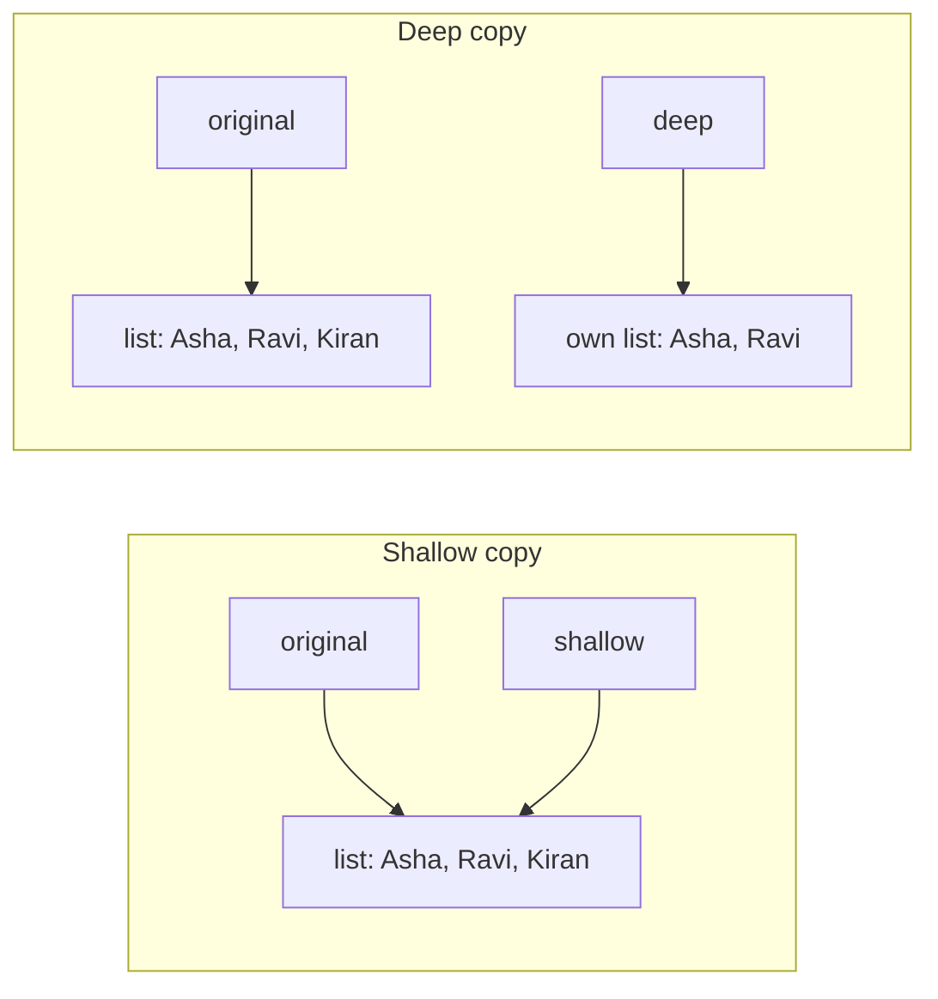
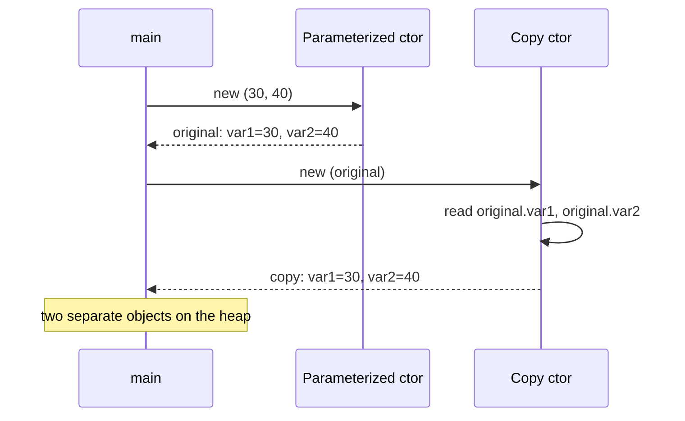

## In One Line
A copy constructor is a constructor that takes **another object of the same class** and builds a new, independent object with the same state — `new CopyConstructorExample(original)` — and in Java it is a **convention you write yourself**, where *you* decide whether the copy is shallow or deep.

## Mental Model
Think of **photocopying a filled-in form** versus **handing over a shared Google Doc link**.
- A **photocopy** (deep copy) is a separate sheet. Scribble on the copy and the original is untouched.
- **Sharing the link** (shallow copy of a reference) gives two people access to *the same* document. Anyone who edits it changes it for both.

In the code:
- `int var1, var2` are like **text written on the form** — copying them always makes a real photocopy, so `copy` and `original` are independent.
- A `List`, array or other mutable object field is like **a link inside the form**. Copying the field copies the link, not the document — unless your copy constructor explicitly makes a new list (`new ArrayList<>(other.list)`).
- **You are the photocopy operator**: Java does not generate a copy constructor for you, so what gets copied deeply is your decision.

## Concept
### What a copy constructor is
```java
public CopyConstructorExample(CopyConstructorExample example) {
    this.var1 = example.var1;
    this.var2 = example.var2;
}
```
- It is an ordinary **overloaded constructor** whose single parameter has the class's own type.
- Unlike C++, **Java never generates one**. There is no special syntax and no automatic call on assignment or parameter passing — `b = a` just copies a reference; nothing is copied.
- It can read the other object's **private** fields: access control in Java is per class, not per object.

### Assignment vs copy
| Code | Objects on the heap | Changing one affects the other? |
|---|---|---|
| `CopyConstructorExample b = a;` | **1** (two references) | Yes — it is the same object |
| `CopyConstructorExample b = new CopyConstructorExample(a);` | **2** | No, for primitive/immutable fields; depends on your code for mutable fields |

### Shallow vs deep copy
| Field type | Shallow copy (`this.f = other.f`) | Deep copy |
|---|---|---|
| Primitive (`int`, `double`...) | Value copied — already independent | Same |
| Immutable object (`String`, `Integer`, `LocalDate`, records of immutables) | Reference shared — **safe**, nobody can change it | Unnecessary |
| Mutable object (`List`, array, `Date`, your own mutable class) | Reference shared — **both objects see changes** | Create a new object: `new ArrayList<>(other.items)`, `other.arr.clone()`, `new Address(other.address)` |

The course example has only `int` fields, so its copy is fully independent. The moment a class has mutable fields, a copy constructor that just assigns references is a **shallow copy** and the two objects secretly share state.

"Deep" is also relative: `new ArrayList<>(other.members)` creates a new list, but the **elements** are still shared. That is fine when elements are immutable (`String`); if they are mutable, copy them too (`other.items.stream().map(Item::new).toList()`).

### Copy constructor vs `clone()`
Java's built-in copying mechanism is `Object.clone()` with the `Cloneable` marker interface. Effective Java (Item 13) calls it broken and recommends copy constructors or copy factories instead:

| | `clone()` | Copy constructor |
|---|---|---|
| Needs | `implements Cloneable` (a marker with no methods), override `clone()`, make it `public` | Nothing special |
| Checked exception | `CloneNotSupportedException` must be handled | None |
| Return type | `Object` → cast needed (unless covariant override) | Exact type |
| Constructor runs? | **No** — memory copied field by field, invariants bypassed | Yes — validation runs |
| `final` fields | Cannot be reassigned in `clone()`, so they cannot be deep-copied | Assign freely |
| Default depth | Shallow | Whatever you write |
| Accepts other types | No | Yes — e.g. `new ArrayList<>(anyCollection)` (a *conversion constructor*) |
| Polymorphic | Yes (virtual method) | No — `new Shape(circle)` makes a `Shape` |

Arrays are the one place `clone()` is recommended: `int[] copy = original.clone();` is simple and correct for primitives.

### Copy constructors in the JDK
Many collection classes have a constructor that takes a collection/map and copies it: `new ArrayList<>(collection)`, `new HashSet<>(collection)`, `new TreeSet<>(sortedSet)`, `new HashMap<>(map)`, `new StringBuilder(charSequence)`, `new String(string)`. Since Java 10 there are also **unmodifiable copy factories**: `List.copyOf`, `Set.copyOf`, `Map.copyOf`.

### Copying and inheritance
A copy constructor is **not polymorphic**: `new Shape(someCircle)` always builds a plain `Shape`, dropping the circle's extra state (sometimes called *slicing*). When you need "copy whatever this really is", add a virtual `copy()` method that each subclass overrides with a **covariant return type** and implements with its own copy constructor. Each subclass copy constructor calls `super(other)` so the parent copies its part.

### Best practices
- Reuse the main constructor: `this(other.var1, other.var2)` — validation runs once, in one place.
- Guard against `null`: `Objects.requireNonNull(other, "other")`, or you get a `NullPointerException` from the field access.
- **Deep-copy mutable fields**, share immutable ones.
- **Immutable classes don't need copy constructors** — sharing is safe. `new String("abc")` is almost always pointless.
- Consider a **static copy factory** (`Money.copyOf(m)`) when you want a name or want to return a subtype.
- Defensive copies (see [Immutable Classes](lesson:b01-fundamentals/08-immutable-classes)) are copy constructors applied to *inputs* and *outputs* of a class.

## Diagram

A shallow copy shares the mutable list, so a later `add` shows up in both; a deep copy owns a separate list.


The copy constructor reads the source object's fields and writes them into a brand-new object.

## Code
@example CoreJava/JavaFeatures/CopyConstructorExample.java

Shallow vs deep copy with a mutable `List` field:
```java
import java.util.ArrayList;
import java.util.List;

public class ShallowDeep {
    public static void main(String[] args) {
        Team original = new Team("Blue", new ArrayList<>(List.of("Asha", "Ravi")));

        Team shallow = Team.shallowCopy(original);
        Team deep = new Team(original);           // copy constructor (deep)

        original.members.add("Kiran");            // mutate the original's list

        System.out.println("original: " + original.members);
        System.out.println("shallow : " + shallow.members);
        System.out.println("deep    : " + deep.members);
        System.out.println("shallow shares list? " + (shallow.members == original.members));
        System.out.println("deep shares list?    " + (deep.members == original.members));
    }
}

class Team {
    String name;
    List<String> members;

    Team(String name, List<String> members) {
        this.name = name;
        this.members = members;
    }

    // Copy constructor: deep copy of the mutable list
    Team(Team other) {
        this.name = other.name;                          // String is immutable: sharing is safe
        this.members = new ArrayList<>(other.members);   // new list, same (immutable) String elements
    }

    static Team shallowCopy(Team other) {
        return new Team(other.name, other.members);      // copies the reference only
    }
}
```
```output
original: [Asha, Ravi, Kiran]
shallow : [Asha, Ravi, Kiran]
deep    : [Asha, Ravi]
shallow shares list? true
deep shares list?    false
```

`clone()` versus a copy constructor when the field is a `final` array:
```java
import java.util.Arrays;

public class CloneVsCopy {
    public static void main(String[] args) {
        Scores a = new Scores(new int[] {1, 2, 3});
        Scores cloned = a.clone();          // Object.clone(): field-by-field (shallow)
        Scores copied = new Scores(a);      // copy constructor: we decide what is deep

        a.values[0] = 100;
        System.out.println("clone : " + Arrays.toString(cloned.values));
        System.out.println("copy  : " + Arrays.toString(copied.values));

        try {
            new NotCloneable().tryClone();
        } catch (CloneNotSupportedException e) {
            System.out.println("CloneNotSupportedException: " + e.getMessage());
        }
    }
}

class Scores implements Cloneable {
    final int[] values;

    Scores(int[] values) { this.values = values; }
    Scores(Scores other) { this.values = other.values.clone(); }   // new array

    @Override
    public Scores clone() {
        try {
            return (Scores) super.clone();   // cannot fix 'values' here: it is final
        } catch (CloneNotSupportedException e) {
            throw new AssertionError(e);
        }
    }
}

class NotCloneable {
    Object tryClone() throws CloneNotSupportedException { return super.clone(); }
}
```
```output
clone : [100, 2, 3]
copy  : [1, 2, 3]
CloneNotSupportedException: NotCloneable
```

Copy constructors are not polymorphic — use a virtual `copy()` method:
```java
public class Slicing {
    public static void main(String[] args) {
        Shape s = new Circle("red", 2.5);

        Shape viaCtor = new Shape(s);     // copy constructor is NOT polymorphic
        Shape viaCopy = s.copy();         // virtual copy() dispatches to Circle

        System.out.println(viaCtor.getClass().getSimpleName() + " " + viaCtor);
        System.out.println(viaCopy.getClass().getSimpleName() + " " + viaCopy);
    }
}

class Shape {
    final String color;
    Shape(String color) { this.color = color; }
    Shape(Shape other)  { this(other.color); }          // copy constructor reuses the main one
    Shape copy()        { return new Shape(this); }
    public String toString() { return "color=" + color; }
}

class Circle extends Shape {
    final double radius;
    Circle(String color, double radius) { super(color); this.radius = radius; }
    Circle(Circle other) { super(other); this.radius = other.radius; }
    @Override Circle copy() { return new Circle(this); } // covariant return type
    public String toString() { return super.toString() + ", radius=" + radius; }
}
```
```output
Shape color=red
Circle color=red, radius=2.5
```

JDK collections have copy (conversion) constructors and copy factories:
```java
import java.util.*;

public class Jdk {
    public static void main(String[] args) {
        List<Integer> src = new ArrayList<>(List.of(3, 1, 2));
        List<Integer> copy = new ArrayList<>(src);          // conversion/copy constructor
        Set<Integer> sorted = new TreeSet<>(src);            // copy into a different type
        Map<String, Integer> m = new HashMap<>(Map.of("a", 1));
        List<Integer> frozen = List.copyOf(src);             // unmodifiable copy (Java 10)
        src.add(4);
        System.out.println(src + " " + copy + " " + sorted + " " + m + " " + frozen);
    }
}
```
```output
[3, 1, 2, 4] [3, 1, 2] [1, 2, 3] {a=1} [3, 1, 2]
```

## Walkthrough
- `int var1; int var2;` — two primitive fields. Primitives are copied by value, so any copy of them is automatically independent.
- `public CopyConstructorExample(int var1, int var2)` — the **parameterized constructor** that creates the first object; `this.var1 = var1` stores the parameters in the fields and it prints `Parameterized constructor called.`.
- `public CopyConstructorExample(CopyConstructorExample example)` — the **copy constructor**: one parameter of the class's own type. This is plain constructor overloading — `(int, int)` vs `(CopyConstructorExample)`.
- `this.var1 = example.var1;` — reads the field of the *source* object (`example`) and writes it into the *new* object (`this`). It would work even if the fields were `private`, because both objects are of the same class. It prints `Copy constructor called.`.
- `display()` — prints the current object's two fields.
- `main`: `new CopyConstructorExample(30, 40)` → **`Parameterized constructor called.`**; `original` now holds 30 and 40.
- `new CopyConstructorExample(original)` — the argument's type selects the copy constructor → **`Copy constructor called.`**. `copy` is a **second object** on the heap.
- `original.display()` and `copy.display()` both print **`var1: 30, var2: 40`**. Same values, different objects: `original == copy` would be `false`, and changing `copy.var1` later would not affect `original`.
- The four `// Output:` comments are in the same order as the real output (the two constructor messages come first because both objects are created before either `display()` call).

## Traps
- **`b = a` is not a copy.** It copies the reference; both variables point to one object. Only `new` creates a second object.
- **Shallow copy of mutable fields.** `this.items = other.items;` makes both objects share one list — the original lesson example hides this because it only has `int` fields.
- **"Deep" copy of a list with mutable elements** still shares the elements. Decide how deep you need to go.
- **`null` argument** — `new CopyConstructorExample(null)` throws `NullPointerException`. Since Java 14 (default on since 15) the helpful message is *Cannot read field "var1" because "example" is null* (shown as `"<parameter1>"` when compiled without `-g`). Use `Objects.requireNonNull(example, "example")` for a clear contract.
- **Not polymorphic.** `new Shape(circle)` silently produces a `Shape`, losing `radius`. Use an overridable `copy()` method.
- **Copying through `this(...)` runs the other constructor's side effects too.** If the copy constructor delegated with `this(example.var1, example.var2)`, the output would contain `Parameterized constructor called.` *and* `Copy constructor called.` for the copy.
- **`clone()` pitfalls** — forgetting `Cloneable` throws `CloneNotSupportedException`; `super.clone()` is shallow; `final` mutable fields cannot be deep-copied inside `clone()`.

> [!TIP] Reusing the main constructor (`this(other.var1, other.var2)`) is still the recommended style — it means validation rules live in one place. Just be aware that its print statement or other side effects also run.

## Tips & Tricks
- **Mnemonic — "Primitives photocopy, references share."** Assigning a primitive copies the value; assigning a reference copies the link.
- **Checklist for every field in a copy constructor:** primitive → copy; immutable → share; mutable → `new ...(other.field)` or `.clone()` for arrays.
- **Prefer copy constructors/factories over `clone()`**, except for arrays (`arr.clone()` is fine).
- Accept the **interface type** when it makes sense — `ArrayList(Collection<? extends E>)` can copy *any* collection. That turns a copy constructor into a **conversion constructor**.
- For immutable copies of collections, use `List.copyOf` / `Set.copyOf` / `Map.copyOf` (Java 10+).
- Need polymorphic copying? `abstract T copy()` in the base class + covariant overrides that call each class's copy constructor.

## Interview Q&A
### [Basic] What is a copy constructor? Does Java have one?
A copy constructor is a constructor whose parameter is an object of the same class; it initialises the new object from the fields of the given one, e.g. `Point(Point other) { this.x = other.x; this.y = other.y; }`. Java has no built-in copy constructor — unlike C++, the compiler never generates one and never calls one implicitly. It is simply a coding convention using constructor overloading.

**Follow-up:** *Can the copy constructor access `other`'s private fields?* — Yes. Access control is per class, not per instance, so any code in `Point` can read private fields of any `Point`.

### [Basic] What is the difference between `Point b = a;` and `Point b = new Point(a);`?
`Point b = a;` copies the **reference** — one object, two names; a change through `b` is visible through `a`. `new Point(a)` creates a **second object** with the same field values; the two can then change independently (fully so if the fields are primitives or immutable, otherwise only as deep as the copy constructor goes).

**Follow-up:** *How do you check they are different objects?* — `a == b` is `false` for the copy, while `a.equals(b)` can be `true` if `equals` compares state.

### [Intermediate] What is the difference between a shallow copy and a deep copy?
A **shallow copy** copies field values as they are: primitives are duplicated, but reference fields still point to the same objects, so mutable sub-objects (lists, arrays, `Date`) are shared. A **deep copy** also duplicates the mutable objects that the fields refer to (recursively, as far as needed), so the copy shares no mutable state with the original. Immutable objects (`String`, `Integer`) can safely be shared even in a deep copy.
```java
this.members = other.members;                    // shallow
this.members = new ArrayList<>(other.members);   // deep (one level)
```
**Follow-up:** *Is `new ArrayList<>(list)` a deep copy?* — Only one level: it is a new list, but the elements are the same objects.

### [Intermediate] Why prefer a copy constructor over `clone()`?
`Cloneable` is a marker interface without a `clone` method, `Object.clone()` is `protected` and throws a checked `CloneNotSupportedException`, the result must be cast, it is shallow by default, it creates objects **without calling a constructor** (so validation is bypassed), and it cannot deep-copy `final` fields because they cannot be reassigned after `super.clone()`. A copy constructor has none of these problems, returns the exact type, can accept an interface type (conversion constructor), and makes the copy depth explicit. Effective Java Item 13: "override clone judiciously" — for new code, use copy constructors or copy factories.

**Follow-up:** *Where is `clone()` still fine?* — Arrays: `int[] b = a.clone();` is concise and correct.

### [Intermediate] How do you deep-copy an object that contains a list of mutable objects?
Create a new list and copy each element too, using the element's own copy constructor:
```java
Order(Order other) {
    this.id = other.id;                                          // primitive
    this.customer = other.customer;                              // immutable String
    this.lines = other.lines.stream().map(Line::new).collect(Collectors.toCollection(ArrayList::new));
}
```
Every mutable class in the graph needs its own copy constructor. For very large graphs people sometimes serialize/deserialize (slow) or use libraries, but explicit copy constructors are clearer and faster.

**Follow-up:** *What about cycles in the object graph?* — Keep an `IdentityHashMap<original, copy>` while copying so each object is copied once and references are reconnected.

### [Advanced] Is a copy constructor polymorphic? How do you copy an object when you only have a base-class reference?
No. Constructors are not virtual: `new Shape(s)` always creates a `Shape`, even if `s` is a `Circle`, so the subclass state is lost. Solution: a virtual copy method — `Shape copy()` in the base, overridden in each subclass with a covariant return (`Circle copy() { return new Circle(this); }`), where each subclass copy constructor calls `super(other)` for the parent's fields. Now `shape.copy()` returns the right runtime type through dynamic dispatch — essentially the Prototype pattern ([Prototype](lesson:a10-patterns/04-prototype)).

**Follow-up:** *Why not use `getClass().getConstructor(getClass()).newInstance(this)`?* — Fragile reflection: it fails at runtime if a subclass forgets the constructor and hides errors from the compiler.

### [Advanced] Do immutable classes need copy constructors?
No. If an object can never change, sharing it is always safe, so a copy is wasted memory — that is why `String`, `Integer`, `LocalDate` and records of immutable values are shared freely, and why `new String("abc")` is considered an anti-pattern. Immutable classes instead use defensive copies of **mutable inputs** in their constructor and of **mutable outputs** in getters. `List.copyOf` even returns the same instance if the argument is already an unmodifiable list created by `List.of`/`copyOf`.

**Follow-up:** *Then why does `String(String)` exist?* — Historically (before Java 7u6), `substring` shared the big backing array, and `new String(sub)` trimmed it; today it is almost never needed.

## Quiz
### What does this print?
```java
class Cart {
    String owner = "Asha";
    List<String> items = new ArrayList<>();
    Cart() { }
    Cart(Cart other) { this.owner = other.owner; this.items = other.items; }
}

Cart a = new Cart();
a.items.add("pen");
Cart b = new Cart(a);
b.items.add("book");
b.owner = "Ravi";
System.out.println(a.owner + " " + a.items);
```
- [ ] Ravi [pen, book]
- [x] Asha [pen, book]
- [ ] Asha [pen]
- [ ] Ravi [pen]
> The copy constructor is **shallow**: `items` is shared, so `book` appears in `a`'s list too. `owner` was reassigned in `b` only — reassigning a field never affects the other object (and `String` is immutable anyway).

### What does this print?
```java
Delegate(int var1, int var2) { ...; System.out.println("Parameterized constructor called."); }
Delegate(Delegate other) {
    this(other.var1, other.var2);
    System.out.println("Copy constructor called.");
}

Delegate a = new Delegate(30, 40);
Delegate b = new Delegate(a);
b.var1 = 99;
System.out.println(a.var1 + " " + b.var1);
```
- [ ] Parameterized, Copy, 30 99
- [x] Parameterized, Parameterized, Copy, 30 99
- [ ] Parameterized, Copy, 99 99
- [ ] Parameterized, Parameterized, Copy, 99 99
> Creating `b` runs `this(...)` first, which prints "Parameterized constructor called." again, then "Copy constructor called.". `b` is a separate object with primitive fields, so setting `b.var1` does not change `a`.

### What is printed?
```java
Shape s = new Circle("red", 2.5);
Shape c = new Shape(s);          // Shape(Shape other) copy constructor
System.out.println(c.getClass().getSimpleName());
```
- [ ] Circle
- [x] Shape
- [ ] Compile error: a Circle cannot be passed to Shape(Shape)
- [ ] ClassCastException
> Constructors are not polymorphic — `new Shape(...)` always creates a `Shape`. Passing a `Circle` is legal because a `Circle` is-a `Shape`. To get a `Circle`, call an overridden `copy()` method.

### Which is the main reason Effective Java recommends copy constructors over `clone()`?
- [ ] Copy constructors are faster
- [x] `clone()` bypasses constructors, needs a cast and a checked exception, and cannot deep-copy `final` fields
- [ ] `clone()` was removed in Java 9
- [ ] Copy constructors are generated by the compiler
> `clone()` still exists but has a broken design (marker interface, protected method, checked exception, shallow, no constructor call). Copy constructors are not generated by the compiler — that is the C++ behaviour.

### Spot the bug: the copy is supposed to be independent.
```java
class Matrix {
    private final int[][] cells;
    Matrix(Matrix other) {
        this.cells = other.cells.clone();
    }
}
```
- [ ] `final` fields cannot be assigned in a copy constructor
- [ ] `clone()` cannot be called on arrays
- [x] `clone()` on a 2D array copies only the outer array; the inner rows are still shared
- [ ] `other.cells` is private, so it cannot be read
> Array `clone()` is shallow: the new outer array holds references to the same row arrays. Copy each row: `for (int i...) cells[i] = other.cells[i].clone();` or `Arrays.stream(other.cells).map(int[]::clone).toArray(int[][]::new)`.

### What does this print?
```java
class Wallet {
    private int balance;
    Wallet(int balance) { this.balance = balance; }
    Wallet(Wallet other) { this.balance = other.balance; }
    void spend(int amount) { balance -= amount; }
    int balance() { return balance; }
}

Wallet a = new Wallet(500);
Wallet b = new Wallet(a);
b.spend(200);
System.out.println(a.balance() + " " + b.balance());
```
- [ ] 300 300
- [x] 500 300
- [ ] Compile error: `other.balance` is private
- [ ] 500 500
> Reading `other.balance` is legal because access is checked per class, not per object. `b` is an independent copy with a primitive field, so only `b` changes.

## Takeaways
- A copy constructor takes an object of the same class and builds a new object with the same state; Java never generates one — you write it.
- Assignment (`b = a`) copies a reference; only `new` (for example via a copy constructor) creates a second object.
- Primitives and immutable fields are safe to copy directly; mutable fields (lists, arrays, `Date`) must be copied with `new ...(other.field)` or `.clone()` for a deep copy.
- Prefer copy constructors/copy factories over `clone()`, which bypasses constructors, needs casts and checked exceptions, and cannot deep-copy `final` fields.
- Copy constructors are not polymorphic; use an overridable `copy()` method with a covariant return type to copy the real runtime type.
- JDK collections provide copy/conversion constructors (`new ArrayList<>(c)`) and unmodifiable copy factories (`List.copyOf`).
