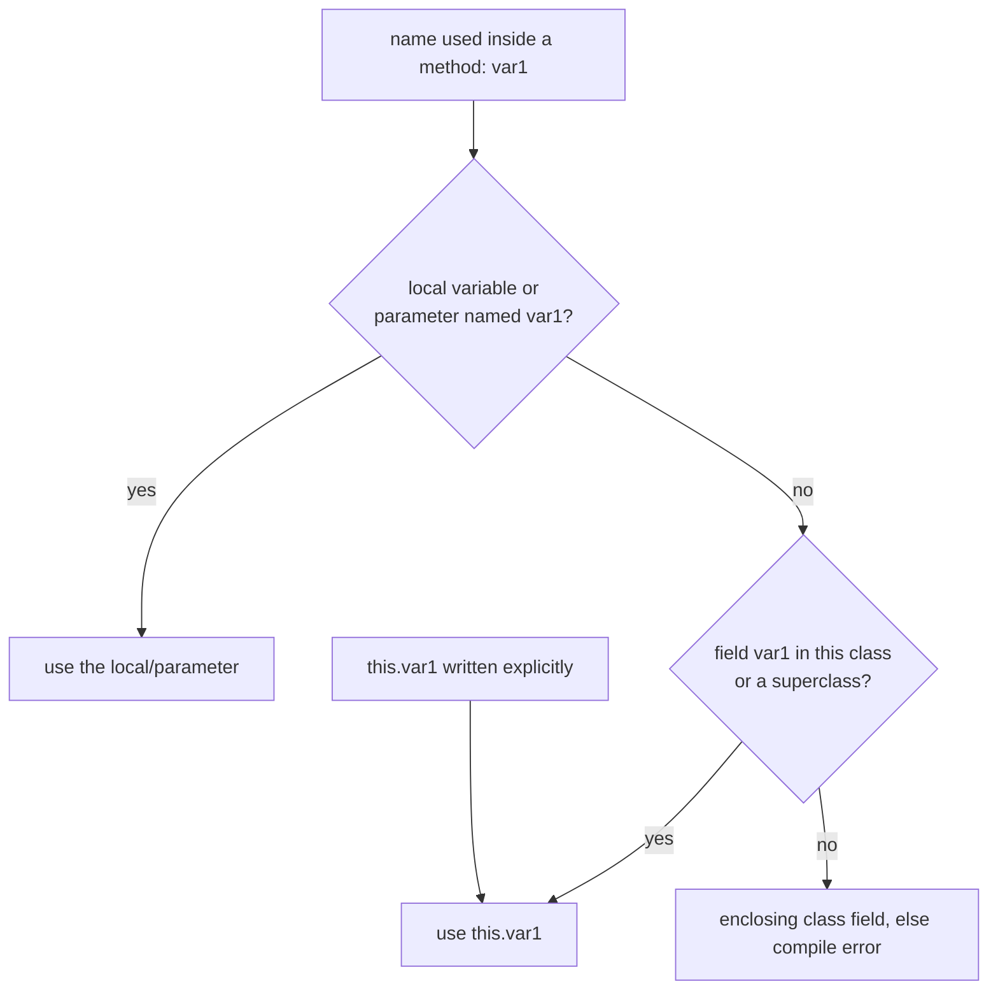
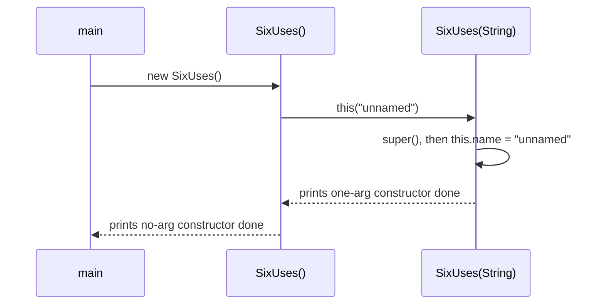

## In One Line
`this` is a **reference to the current object** — the one whose constructor or instance method is running — used to reach its fields when a parameter hides them (`this.var1 = var1`), to call another constructor (`this(...)`), and to pass or return the object itself.

## Mental Model
Think of the word **"me"** in a conversation. When ten people each say "put the parcel in *my* locker", the word is the same but each "my" points to a different person — whoever is speaking right now.

In the code:
- Every object runs the same `display()` code, and inside it `this` means **"the object this method was called on"** — `example` in `example.display()`.
- `this.var1` is **"my var1"**, as opposed to the parameter `var1` that someone just handed me ("your var1").
- In a `static` method there is **no speaker** — no object — so saying "me" makes no sense, and the compiler rejects `this`.

## Concept
### What `this` really is
Every instance method and constructor receives a hidden first argument: the object it works on. In bytecode it is local variable slot 0 — the `aload_0` instruction you see in `javap` output before every `putfield`. The keyword `this` is how you name that hidden argument in source code.

- Its type is the class it appears in.
- It is **final** — `this = new X()` is a compile error (*"cannot assign to 'this'"*).
- It is **never `null`** inside an instance method or constructor.
- It **does not exist in a static context** — *"non-static variable this cannot be referenced from a static context"*.

### The six uses of `this`
| # | Use | Example | Typical purpose |
|---|---|---|---|
| 1 | Refer to a field | `this.var1 = var1;` | Resolve shadowing by a parameter/local |
| 2 | Call an instance method | `this.log(msg);` | Usually implicit; clarifies intent |
| 3 | Call another constructor | `this(name, 0);` | Constructor chaining, one place for init |
| 4 | Pass the current object | `registry.add(this);` | Callbacks, listeners, double dispatch |
| 5 | Return the current object | `return this;` | Fluent APIs / builders / method chaining |
| 6 | Reach an enclosing object | `Outer.this.name` | From inner classes |

### 1. Shadowing: when `this.` is required
Java looks up a simple name in the **innermost scope first**: local variables and parameters, then fields of the class (and inherited fields), then outer classes. When a parameter or local has the same name as a field, the field is **shadowed**, and only `this.field` reaches it. When there is no shadowing — as in `display()` of the course example — `this.var1` and `var1` mean exactly the same thing.

### 3. `this(...)` — constructor chaining
```java
SixUses() { this("unnamed"); }        // delegates to SixUses(String)
SixUses(String name) { this.name = name; }
```
Rules:
- It must be the **first statement** of a constructor (on Java 17/21; JDK 25's flexible constructor bodies allow statements before it that do not use `this`).
- A constructor can call `this(...)` **or** `super(...)`, never both. The chain eventually reaches a constructor that calls `super(...)`.
- **No cycles** — `A() { this(1); } A(int x) { this(); }` → *"recursive constructor invocation"*.
- Arguments to `this(...)` cannot use instance fields or methods of the object being built — *"cannot reference value before supertype constructor has been called"*. Static fields and parameters are fine.
- Only works in constructors; a method cannot call `this(...)`.

### 4. Passing `this` — and the "escape" danger
Passing `this` lets another object call back into yours (listeners, visitor/double dispatch, `equals` helpers). But **passing `this` from inside a constructor** publishes an object that is not fully built: another thread or callback may see default values. JDK 21's `javac -Xlint:this-escape` warns about this. Register listeners after construction, e.g. in a static factory method.

### 5. Returning `this` — fluent interfaces
`StringBuilder.append(...)` returns `this`, which is why `sb.append("a").append("b")` works. Builders use the same trick: `new Pizza.Builder().size("L").cheese(true).build()`.

### 6. `Outer.this` — the qualified this
Inside an inner (non-static) class, plain `this` is the inner object. To reach the enclosing object write `Outer.this`. See [Inner Classes](lesson:a01-oop/09-inner-classes).

### `this` in lambdas vs anonymous classes
| | Anonymous class | Lambda |
|---|---|---|
| `this` means | The anonymous-class object | The **enclosing** object (lambdas do not create a new scope for `this`) |
| Can shadow enclosing locals? | Yes | No |

### Other places you see `this`
- `synchronized (this) { ... }` — locks on the current object (same monitor as a `synchronized` instance method).
- `if (this == o) return true;` — the fast path at the start of `equals`.
- **Receiver parameter** (Java 8): `void hello(Recv this)` — an optional, explicit declaration of `this` that exists only so you can put type annotations on it. It does not change the method's signature.
- `this` vs `super`: `this` = current object, own class's members first; `super` = same object, but the parent class's members ([super keyword](lesson:a02-core/06-super-keyword)).

## Diagram

A simple name resolves to the innermost declaration; `this.` jumps straight to the field.


`this(...)` runs the target constructor completely first, so its output appears before the caller's.

## Code
@example CoreJava/JavaFeatures/ThisKeywordExample.java

All six uses in one class:
```java
public class SixUses {
    private int count;
    private final String name;

    SixUses() {
        this("unnamed");                          // 3. this(...) calls another constructor
        System.out.println("no-arg constructor done");
    }

    SixUses(String name) {
        this.name = name;                         // 1. this.field vs parameter
        System.out.println("one-arg constructor done");
    }

    SixUses increment() {
        count++;
        return this;                              // 5. return the current object (fluent)
    }

    void print() {
        this.log("count = " + count);            // 2. call a method on the current object
    }

    void log(String msg) {
        System.out.println(name + ": " + msg);
    }

    void register(Registry r) {
        r.add(this);                              // 4. pass the current object as an argument
    }

    class Inner {
        String name = "inner";
        void show() {
            System.out.println(name + " / " + SixUses.this.name);   // 6. Outer.this
        }
    }

    public static void main(String[] args) {
        SixUses s = new SixUses();
        s.increment().increment().increment().print();
        s.register(new Registry());
        s.new Inner().show();
    }
}

class Registry {
    void add(Object o) {
        System.out.println("registered a " + o.getClass().getSimpleName());
    }
}
```
```output
one-arg constructor done
no-arg constructor done
unnamed: count = 3
registered a SixUses
inner / unnamed
```

`this` inside an anonymous class vs inside a lambda:
```java
public class LambdaThis {
    @Override
    public String toString() { return "LambdaThis object"; }

    void run() {
        Runnable anon = new Runnable() {
            @Override public void run() { System.out.println("anonymous: " + this); }
            @Override public String toString() { return "the anonymous Runnable"; }
        };
        Runnable lambda = () -> System.out.println("lambda:    " + this);
        anon.run();
        lambda.run();
    }

    public static void main(String[] args) {
        new LambdaThis().run();
    }
}
```
```output
anonymous: the anonymous Runnable
lambda:    LambdaThis object
```

## Walkthrough
- `// Instance variables` / `int var1; int var2;` — two fields; each `ThisKeywordExample` object has its own pair.
- `public ThisKeywordExample(int var1, int var2)` — the parameters deliberately reuse the field names, so inside the constructor the names `var1`/`var2` mean the **parameters** (they shadow the fields).
- `this.var1 = var1;` — `this` is the object being constructed; `this.var1` is its field; the right-hand `var1` is the parameter. `javap -c` shows `aload_0` (load `this`), `iload_1` (load parameter 1), `putfield var1`. Same for `var2`.
- `display()` — `this.var1` and `this.var2` here are **optional**: no local or parameter is called `var1`, so plain `var1` would resolve to the same field. Writing `this.` is a style choice that makes "this is a field" visible.
- `main` is `static`, so it has no `this`. It creates an object with `new ThisKeywordExample(10, 20)` — inside that constructor call, `this` refers to the new object.
- `example.display()` — inside `display()`, `this` is the object referenced by `example`, so it prints **`var1: 10, var2: 20`**, matching the `// Output:` comment.

## Traps
> [!ERRATA] The comment `// 'this' refers to the instance variable` is imprecise. `this` refers to the **current object**, not to a variable; `this.var1` (the object's `var1` field) is what refers to the instance variable. The distinction matters because `this` can also be passed, returned or used to call constructors.

- **Forgetting `this.` when a parameter shadows a field** — `var1 = var1;` assigns the parameter to itself; the field stays `0` with no compiler warning ([Parameterized Constructor](lesson:a02-core/03-parameterized-constructor)).
- **Using `this` in `static` code** — `main` or any static method: *"non-static variable this cannot be referenced from a static context"*. Create an object first and use its reference.
- **`this(...)` not first** — *"call to this must be first statement in constructor"* (Java 17/21).
- **Both `this(...)` and `super(...)`** in one constructor — impossible; the second one is *"call to super must be first statement in constructor"*.
- **Using instance fields in `this(...)` arguments** — `this(value + 1)` where `value` is an instance field → *"cannot reference value before supertype constructor has been called"*.
- **Recursive constructor calls** — *"recursive constructor invocation"*.
- **Letting `this` escape the constructor** (registering a listener, starting a thread) exposes a half-built object.
- **Lambda `this` is not the lambda.** It is the enclosing instance; inside an anonymous class it is the anonymous object.

> [!WARNING] Calling a static member through `this` (`this.staticVar`) compiles but misleads readers into thinking the field belongs to the object. Use `ClassName.staticVar`.

## Tips & Tricks
- **Mnemonic — "`this` = me, right now."** Whatever object the current constructor or instance method is running for.
- **Six uses — "F-M-C-P-R-O":** Field, Method, Constructor call, Pass, Return, Outer.this.
- **No object, no `this`**: static methods, static blocks and static nested class *static* members cannot use it.
- Write `this.field = field` in constructors and setters; skip `this.` elsewhere unless it helps readability.
- One "full" constructor + others calling `this(...)` = no duplicated initialisation code.
- In a lambda, `this` is the outer object — handy for calling outer instance methods without `Outer.this`.

## Interview Q&A
### [Basic] What is the `this` keyword in Java?
`this` is a final reference to the current object — the object on which an instance method was invoked, or the object being built in a constructor. It is used to access fields that are shadowed by parameters (`this.name = name`), to call other instance methods, to call another constructor of the same class with `this(...)`, to pass the current object to another method, to return the current object for method chaining, and (qualified as `Outer.this`) to reach the enclosing instance from an inner class.

**Follow-up:** *Can `this` be null?* — No. An instance method can only be invoked on a non-null reference, so inside it `this` is never `null`.

### [Basic] Why can't we use `this` in a static method?
A static method belongs to the class and is called without any object (`ThisKeywordExample.main(...)`), so there is no "current object" for `this` to point to. The compiler reports *"non-static variable this cannot be referenced from a static context"*. The same applies to `super` and to unqualified instance fields/methods in static code.

**Follow-up:** *How does `main` then reach instance members?* — It creates an object (`new ThisKeywordExample(10, 20)`) and uses that reference.

### [Basic] When is `this.` mandatory and when is it optional?
It is mandatory when a local variable or parameter has the same name as a field (shadowing) and you mean the field — typically in constructors and setters. Everywhere else, an unqualified field name already resolves to `this.field`, so `this.` is optional and only a readability choice (as in `display()` in the example).

**Follow-up:** *Is shadowing a field by a parameter bad practice?* — No; for constructors and setters it is the standard Java idiom, as long as you use `this.`.

### [Intermediate] What is constructor chaining with `this()`? What are its rules?
`this(args)` calls another constructor of the same class so initialisation code is written once. Rules: it must be the first statement (Java 17/21), a constructor can contain either `this(...)` or `super(...)` but not both, there must be no cycle (compile error *recursive constructor invocation*), its arguments cannot use instance members of the object being built, and it can be used only inside constructors. The called constructor runs completely before the rest of the calling constructor.

**Follow-up:** *Where does `super()` go when you use `this()`?* — The last constructor in the `this(...)` chain (the one that does not call `this(...)`) calls `super(...)`, implicitly or explicitly, so the parent is still initialised exactly once.

### [Intermediate] Why would a method return `this`?
To enable **method chaining** (fluent interfaces): each call returns the same object so the next call can be made on it — `sb.append("a").append(1).reverse()`, builder setters (`builder.name("A").age(30).build()`), and `Stream`-like APIs on mutable objects. It reads like a sentence and avoids repeating the variable name.

**Follow-up:** *What is the downside?* — Chained calls on a mutable object make it easy to miss that the object itself was modified, and it complicates inheritance (subclass methods returning the parent type) — solved with covariant returns or self-typed generics.

### [Intermediate] What does `this` mean inside a lambda compared to an anonymous class?
In an **anonymous class**, `this` refers to the anonymous-class instance itself, because the class body creates a new scope. In a **lambda**, `this` refers to the **enclosing instance**: lambdas are lexically scoped and do not introduce a new `this`. So `() -> System.out.println(this)` inside `LambdaThis.run()` prints the `LambdaThis` object, while the anonymous `Runnable` prints itself.

**Follow-up:** *How do you reach the outer object from an anonymous class?* — `Outer.this`.

### [Advanced] What does "`this` escaping the constructor" mean, and why is it dangerous?
It means a reference to an object becomes visible to other code before its constructor has finished — for example `registry.add(this)`, `new Thread(this::run).start()` or calling an overridable method from the constructor. Other code (or another thread) can then observe fields that are still `null`/`0`, and the JLS guarantees for `final` fields (§17.5) no longer hold. Fix: finish construction first, then publish — often with a private constructor plus a static factory that registers the object after `new`. JDK 21 added `javac -Xlint:this-escape` to flag possible escapes.

**Follow-up:** *Does it matter if the class is final?* — Overridable-method escapes disappear, but explicit publication (`registry.add(this)`) is still unsafe for other threads.

### [Advanced] What is `Outer.this` and how is it implemented?
Inside an inner (non-static) class, `Outer.this` is the reference to the enclosing object. The compiler implements it with a hidden `final` field (traditionally named `this$0`) in the inner class, filled through a hidden constructor parameter. That is why an inner object cannot exist without an outer object (`outer.new Inner()`), and why inner-class instances keep their outer object alive — a common memory-leak source (e.g. anonymous listeners holding an Activity in Android).

**Follow-up:** *How do you avoid that leak?* — Use a `static` nested class and pass only what it needs.

## Quiz
### What does this print?
```java
class T {
    int x = 10;
    void show() {
        int x = 20;
        System.out.println(x + this.x);
    }
}
new T().show();
```
- [ ] 20
- [x] 30
- [ ] 40
- [ ] Compile error: duplicate variable x
> The local `x` (20) shadows the field; `this.x` still reaches the field (10). A local may shadow a field — only two locals with the same name in overlapping scopes are illegal.

### What does this print?
```java
class Counter { int n; Counter inc() { n++; return this; } }

Counter c = new Counter();
c.inc().inc();
System.out.println(c.inc().n);
```
- [ ] 1
- [ ] 2
- [x] 3
- [ ] Compile error: cannot call a method on a method call
> `inc()` returns the same object, so all three calls increment the one `Counter`. Answering 1 assumes each call returns a new object.

### What is printed when `new LambdaThis().run()` executes?
```java
public String toString() { return "LambdaThis object"; }
void run() {
    Runnable anon = new Runnable() {
        public void run() { System.out.println("anonymous: " + this); }
        public String toString() { return "the anonymous Runnable"; }
    };
    Runnable lambda = () -> System.out.println("lambda: " + this);
    anon.run();
    lambda.run();
}
```
- [ ] anonymous: LambdaThis object / lambda: LambdaThis object
- [x] anonymous: the anonymous Runnable / lambda: LambdaThis object
- [ ] anonymous: the anonymous Runnable / lambda: the anonymous Runnable
- [ ] Compile error: `this` cannot be used in a lambda
> An anonymous class introduces its own `this`; a lambda does not, so its `this` is the enclosing `LambdaThis` object.

### In what order are the lines printed by `new SixUses()`?
```java
SixUses()            { this("unnamed"); System.out.println("no-arg constructor done"); }
SixUses(String name) { this.name = name; System.out.println("one-arg constructor done"); }
```
- [ ] no-arg constructor done, then one-arg constructor done
- [x] one-arg constructor done, then no-arg constructor done
- [ ] only no-arg constructor done
- [ ] only one-arg constructor done
> `this("unnamed")` is the first statement, and the called constructor runs to completion before the rest of the no-arg body.

### Spot the bug: why does this not compile?
```java
public class Q2 {
    int value = 1;
    Q2() { this(value + 1); }
    Q2(int v) { value = v; }
}
```
- [ ] `this(...)` cannot pass an expression
- [x] The argument uses the instance field `value` before the object is initialised
- [ ] A class cannot have two constructors
- [ ] `value` must be `final`
> Arguments to `this(...)`/`super(...)` are evaluated before any superclass constructor has run, so instance fields and methods cannot be used: *"cannot reference value before supertype constructor has been called"*. If `value` were `static`, it would compile.

### Which statement about `this` is FALSE?
- [ ] `this` is a final reference, so `this = other;` does not compile
- [ ] `this` can be returned from a method
- [x] `this` can be used inside a `static` method to refer to the class
- [ ] `this` can be passed as an argument to another method
> Static methods have no current object, so `this` is illegal there. To refer to the class, use its name (`ThisKeywordExample.staticVar`) or `ThisKeywordExample.class`.

## Takeaways
- `this` is a final, never-null reference to the current object; it does not exist in static code.
- Use `this.field` when a parameter or local variable shadows a field; otherwise it is optional.
- `this(...)` calls another constructor of the same class; it must be first (Java 17/21), cannot be combined with `super(...)`, and cannot form a cycle.
- Returning `this` enables fluent method chaining (`StringBuilder`, builders); passing `this` enables callbacks — but never let `this` escape from a constructor.
- `Outer.this` reaches the enclosing object from an inner class; in a lambda, `this` is the enclosing object, in an anonymous class it is the anonymous object.
- In bytecode, `this` is the hidden argument in local slot 0 (`aload_0`) of every instance method and constructor.
