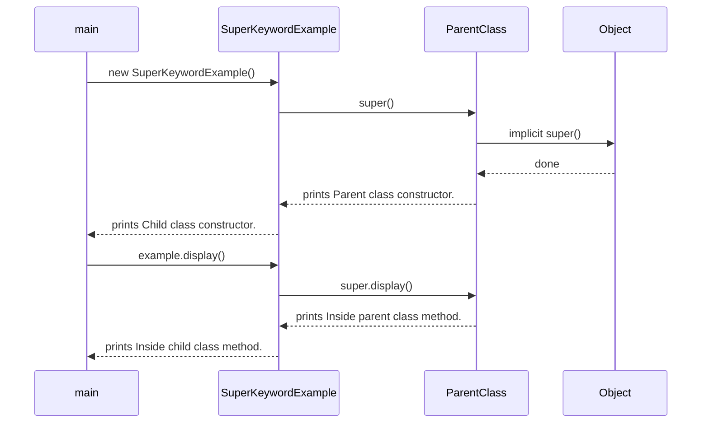
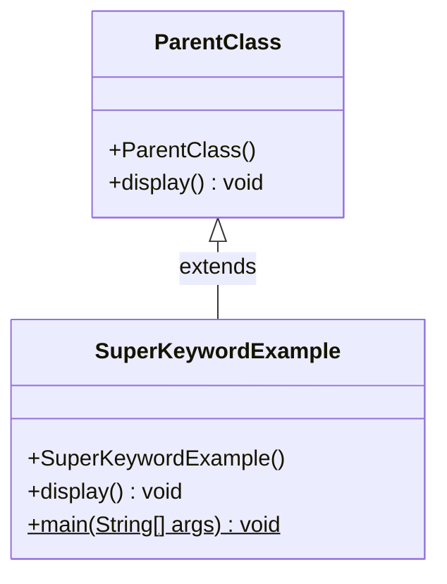

## In One Line
`super` lets a subclass talk to **its parent's part of the same object**: `super(...)` runs the parent constructor (always first, added automatically if you omit it), and `super.method()` / `super.field` reach the parent's version of a member that the child has overridden or hidden.

## Mental Model
Think of a **house renovation**. The new owner (the child class) keeps the original structure (the parent) and adds a new kitchen.
- The **foundation must be laid before the walls** — you cannot build the child's part until the parent's part exists. That is `super(...)` running first in every constructor.
- Sometimes the new owner wants to **use the original feature and then add to it** — keep the old doorbell chime and add a light. That is `super.display()` followed by the child's own code.

In the code:
- `SuperKeywordExample()` must first let `ParentClass()` lay its foundation → `Parent class constructor.` prints before `Child class constructor.`.
- The overriding `display()` first calls the **original** version via `super.display()` → `Inside parent class method.`, then adds its own line → `Inside child class method.`.
- There is still **one house** (one object); `super` just says "use the original part", it does not point to a separate parent object.

## Concept
### What `super` is — and is not
`super` is **not** a reference to a separate parent object. When you create a `SuperKeywordExample`, there is exactly **one object** on the heap, containing the fields of both classes. `super` means "the current object (`this`), but look up members starting in the **superclass**". That is why `super` cannot be stored in a variable, printed or returned — it only appears as `super(...)`, `super.member` or `Interface.super.method()`.

### The four uses of `super`
| Use | Syntax | Purpose |
|---|---|---|
| Call a parent constructor | `super(args);` | Initialise the inherited part of the object |
| Call the parent's version of a method | `super.display();` | Extend (not replace) inherited behaviour |
| Access a hidden parent field | `super.name` | Reach a parent field hidden by a child field of the same name |
| Call a specific interface's default method | `Swimmer.super.greet();` | Resolve a default-method conflict (Java 8+) |

### `super(...)` — constructor chaining up the hierarchy
- **Every constructor starts by calling a superclass constructor**, either explicitly `super(...)` or indirectly via `this(...)`. If you write neither, the compiler inserts **`super();`** — so the `super();` in the course example is redundant (but harmless and explicit).
- It must be the **first statement** (Java 17/21; JDK 25's flexible constructor bodies, JEP 513, allow statements before it that don't touch `this`).
- You cannot write both `this(...)` and `super(...)` in one constructor.
- If the parent has **no no-arg constructor**, every child constructor must call `super(args)` explicitly — otherwise *"constructor X in class X cannot be applied to given types"*.
- The chain goes all the way to `java.lang.Object()`, so **constructors run from the top down**: `Object` → `ParentClass` → `SuperKeywordExample`. Each parent finishes its field initialisers and constructor body before the child's field initialisers run.
- Constructors are **not inherited** — `super(...)` is the only way to use a parent's constructor.

### `super.method()` — calling the overridden version
Inside an overriding method, a plain call `display()` would call *this class's* `display()` again (infinite recursion). `super.display()` calls the parent's implementation **non-virtually**: `javap -c` shows `invokespecial ParentClass.display`, not `invokevirtual`. Typical use: *extend* the parent's behaviour — call `super.method()` then add more (or add before). Framework examples: `super.onCreate(savedInstanceState)` in Android, `super.toString()`, `super.equals(o)` in a subclass that adds fields.

Important: the non-virtual lookup applies **only to that one call**. Inside the parent's method, `this` is still the child object, so any further calls it makes are dynamically dispatched and may land back in the child's overrides.

### `super.field` — hidden fields
If a child declares a field with the same name as a parent field, the child's field **hides** the parent's. Fields are not polymorphic, so `super.name` (or `((Parent) this).name`) reaches the parent's field. Hiding fields is legal but confusing — avoid it.

### `Interface.super.method()` — default-method conflicts
If a class implements two interfaces that both provide a `default` method with the same signature, the class **must** override it (*"types Swimmer and Flyer are incompatible; class inherits unrelated defaults"*). Inside the override it can call a specific one with `Swimmer.super.greet()`. See [Default Methods](lesson:a05-java8/10-default-methods).

### What `super` cannot do
- **`super.super.method()`** — not legal syntax; you can only reach your direct parent's view. (Grandparent behaviour is reachable only if the parent itself calls `super`.)
- **Access `private` members** — *"secret() has private access"*. `super` obeys normal access rules; `protected` and public members (and package-private within the package) are reachable.
- **Be used in a static context** — *"non-static variable super cannot be referenced from a static context"*.
- **Be used as a value** — `Object p = super;` does not compile.

### `this` vs `super`
| | `this` | `super` |
|---|---|---|
| Refers to | The current object | The current object, viewed as its superclass |
| Constructor call | `this(...)` — same class | `super(...)` — parent class |
| Member lookup starts in | The current class (virtual for methods) | The direct superclass (non-virtual) |
| Can be passed/returned | Yes | No |
| Static context | Not allowed | Not allowed |
| Implicit insertion | Never | `super()` is inserted into constructors |

Full ordering of static blocks, instance blocks and constructors across a hierarchy is in [Initialization Order](lesson:b01-fundamentals/12-initialization-order); the inheritance basics are in [Inheritance](lesson:a01-oop/03-inheritance).

## Diagram

Constructors complete from the top of the hierarchy down; `super.display()` runs the parent's code, then control returns to the child.


`SuperKeywordExample` inherits from `ParentClass` and overrides `display()`; the constructors are separate and linked only by `super()`.

## Code
@example CoreJava/JavaFeatures/SuperKeywordExample.java

A three-level chain — the implicit and explicit `super()` behave the same:
```java
public class Chain {
    public static void main(String[] args) {
        new C();
    }
}

class A {
    A() { System.out.println("A constructor"); }
}

class B extends A {
    B() { System.out.println("B constructor"); }          // super() inserted by javac
}

class C extends B {
    C() {
        super();                                           // explicit, same effect
        System.out.println("C constructor");
    }
}
```
```output
A constructor
B constructor
C constructor
```

`super.field`, `super.method()` and a cast compared:
```java
public class Fields {
    public static void main(String[] args) {
        new Dog().show();
    }
}

class Animal {
    String name = "animal";
    String sound() { return "..."; }
}

class Dog extends Animal {
    String name = "dog";                                  // hides Animal.name

    @Override
    String sound() { return "Woof"; }

    void show() {
        System.out.println(name + " / " + this.name + " / " + super.name);
        System.out.println(sound() + " / " + super.sound());
        System.out.println(((Animal) this).name + " / " + ((Animal) this).sound());
    }
}
```
```output
dog / dog / animal
Woof / ...
animal / Woof
```
A cast changes which **field** you see, but not which **method** runs — only `super.sound()` bypasses dynamic dispatch.

Resolving two conflicting default methods with `Interface.super`:
```java
public class Iface {
    public static void main(String[] args) {
        new Duck().greet();
    }
}

interface Swimmer { default void greet() { System.out.println("Swimmer says hi"); } }
interface Flyer   { default void greet() { System.out.println("Flyer says hi"); } }

class Duck implements Swimmer, Flyer {
    @Override
    public void greet() {                 // must override: two defaults clash
        Swimmer.super.greet();
        Flyer.super.greet();
        System.out.println("Duck says quack");
    }
}
```
```output
Swimmer says hi
Flyer says hi
Duck says quack
```

## Walkthrough
- `class ParentClass` — a package-private top-level class in the same file (only one top-level class per file may be `public`, and it must match the file name).
- `public ParentClass()` — prints `Parent class constructor.`. It has no explicit `super()`, so the compiler inserts a call to `Object()`.
- `public void display()` in `ParentClass` — the behaviour the child will extend.
- `public class SuperKeywordExample extends ParentClass` — the child; one `SuperKeywordExample` object contains the (empty) state of both classes.
- `super(); // Calls parent class constructor` — explicitly runs `ParentClass()` first. Deleting this line changes nothing: the compiler would insert exactly the same call (`javap` shows `invokespecial ParentClass."<init>"` as the first instruction either way).
- `System.out.println("Child class constructor.");` — runs only after the parent constructor has returned.
- `@Override public void display()` — overrides the parent's method (same signature; `@Override` makes the compiler check it).
- `super.display(); // Calls parent class method` — runs `ParentClass.display()` on the same object, compiled to the non-virtual `invokespecial`. Then the child adds `Inside child class method.`.
- `main` → `new SuperKeywordExample()` → **`Parent class constructor.`** then **`Child class constructor.`**.
- `example.display()` → dynamic dispatch picks the child's `display()`, which first prints **`Inside parent class method.`** (via `super`) and then **`Inside child class method.`**.
- The `// Output:` block in the comment matches the recorded output line for line.

## Traps
- **The parent constructor always runs first** — you cannot print, validate or compute anything before it on Java 17/21 (not even logging). Use a static helper in the argument list: `super(validate(x))`.
- **Parent without a no-arg constructor** — any child constructor that does not call `super(args)` fails with *"constructor ParentClass in class ParentClass cannot be applied to given types"*, even an empty one or the compiler's default.
- **Calling an overridable method from a parent constructor** runs the child's override **before the child's fields are initialised**:
```java
public class Early {
    public static void main(String[] args) {
        new Child();
    }
}

class Parent {
    Parent() {
        System.out.println("Parent constructor calls describe()");
        describe();                                   // dynamic dispatch -> Child.describe()
    }
    void describe() { System.out.println("Parent.describe"); }
}

class Child extends Parent {
    private String model = "Tesla";

    Child() {
        super();
        System.out.println("Child constructor: model = " + model);
    }

    @Override
    void describe() {
        System.out.println("Child.describe: model = " + model);
    }
}
```
```output
Parent constructor calls describe()
Child.describe: model = null
Child constructor: model = Tesla
```
  `model = "Tesla"` is assigned only after `super()` returns, so the override sees `null`.
- **`super.super.x()` does not exist** — the parser rejects it (*"<identifier> expected"*).
- **Forgetting `super.method()`** in an override that must extend the parent (e.g. lifecycle callbacks) silently drops the parent's behaviour.
- **Infinite recursion**: writing `display()` instead of `super.display()` inside the override calls itself forever → `StackOverflowError`.
- **`super` inside a parent method is not "sticky"**: when `super.greet()` runs the parent's code, calls made there (`hello()`) are still dynamically dispatched to the child's overrides.

> [!NOTE] The explicit `super();` in the course example is redundant — the compiler inserts it anyway — but writing it can make the chain obvious to beginners. It becomes **required** only when you need to pass arguments (`super(name)`).

## Tips & Tricks
- **Mnemonic — "Parents first."** Constructors run top-down (`Object` → parent → child); `super(...)` is always the first thing a constructor does.
- **`super` = "this object, parent's view".** One object, not two.
- **Extend, don't replace:** in overrides that should keep the parent's work, call `super.method()` first (or last, deliberately).
- **Four forms to remember:** `super(...)`, `super.method()`, `super.field`, `Interface.super.method()`.
- **Never call overridable methods from constructors** — make them `private`, `final` or `static`.
- If you get "cannot be applied to given types" on a class that has no constructor, look at its **parent's** constructors.

## Interview Q&A
### [Basic] What is the `super` keyword used for?
`super` refers to the superclass part of the current object. It is used to (1) call a parent constructor with `super(args)` — which must be the first statement of a constructor; (2) call the parent's implementation of an overridden method with `super.method()`; (3) access a parent field hidden by a child field with `super.field`; and (4) since Java 8, call a specific interface's default method with `Interface.super.method()`.

**Follow-up:** *Is `super` a separate object?* — No. There is only one object; `super` just starts member lookup in the parent class and bypasses dynamic dispatch for that call.

### [Basic] What happens if you don't write `super()` in a constructor?
The compiler inserts `super();` as the first statement of every constructor that does not begin with `this(...)` or `super(...)`. So the parent's no-arg constructor always runs first. If the parent has no accessible no-arg constructor, compilation fails and you must call `super(args)` explicitly.

**Follow-up:** *So is the `super();` in `SuperKeywordExample` needed?* — No, the compiled bytecode is identical with or without it.

### [Basic] In what order do constructors run in a class hierarchy?
From the top down: `Object`, then each superclass, then the class being instantiated. Each constructor first calls `super(...)`, so the calls go up the chain, and the bodies execute on the way back down. For each class, its field initialisers and instance blocks run right after its `super(...)` call returns and before its own constructor body.

**Follow-up:** *Where do static blocks fit?* — They run once, at class initialisation, parent class before child, before any constructor (see Initialization Order).

### [Intermediate] Can we use `this()` and `super()` in the same constructor?
No. Both must be the first statement, so only one can appear. It is also unnecessary: if a constructor calls `this(...)`, the constructor it delegates to (or the last one in that chain) is the one that calls `super(...)`, so the parent is still initialised exactly once.

**Follow-up:** *What error do you get?* — *"call to super must be first statement in constructor"* (or the same for `this`).

### [Intermediate] How does `super.method()` differ from calling an overridden method normally?
A normal call `method()` (or `this.method()`) is **virtual**: compiled to `invokevirtual`, it runs the most-derived override of the actual object. `super.method()` is compiled to `invokespecial` targeting the direct superclass's implementation, so it runs exactly that version regardless of the object's runtime class. Only that one call is non-virtual; code inside the parent method still dispatches dynamically on `this`.

**Follow-up:** *Can you call a grandparent's version, skipping the parent?* — No, `super.super.method()` is illegal; that would break the parent's encapsulation.

### [Intermediate] What is the problem with calling an overridable method from a parent constructor?
During `super(...)`, the object's runtime class is already the child, so the call is dispatched to the child's override — but the child's field initialisers and constructor body have not run yet. The override sees default values (`null`, `0`), which can cause wrong results or `NullPointerException`. Example: `Parent()` calls `describe()`, `Child.describe()` prints `model` → `null`. Rule (Effective Java Item 19): constructors must not invoke overridable methods; make them `private`/`final`/`static`.

**Follow-up:** *Why does a `final` field with a constant sometimes show its value anyway?* — A `final` primitive/String field initialised with a constant expression is a compile-time constant, so its uses are inlined by `javac` and never read from the uninitialised field.

### [Advanced] Two interfaces both provide `default void greet()`. How does a class implementing both compile, and how does it call one of them?
It does not compile unless it overrides `greet()` — the compiler reports that the class inherits unrelated defaults. In the override, call the chosen ones explicitly: `Swimmer.super.greet();` and/or `Flyer.super.greet();`. The rules: a class method always wins over interface defaults ("class wins"); a more specific interface wins over a less specific one; otherwise the class must resolve the conflict.

**Follow-up:** *Can you use `Interface.super.m()` for an interface you do not directly implement?* — No, only for direct superinterfaces.

### [Advanced] Can `super` access a `protected` member of a parent in another package?
Yes. `protected` members are accessible to subclasses in other packages through inheritance, so `super.protectedMethod()` or `this.protectedField` works inside the subclass. What does **not** work across packages is accessing the protected member through a reference of the **parent type** that is not `this`/a subclass object (`new Parent().protectedMethod()` from the other package fails). `private` members are never accessible via `super`.

**Follow-up:** *Does that make `protected` more open than package-private?* — Yes: `protected` = package access **plus** subclass access (see Access Modifiers).

## Quiz
### What does this print?
```java
class A { void show() { System.out.print("A "); } }
class B extends A { void show() { super.show(); System.out.print("B "); } }
class C extends B { void show() { super.show(); System.out.print("C"); } }

new C().show();
```
- [ ] C
- [ ] B C
- [x] A B C
- [ ] C B A
> Each override first calls its parent's version, so the calls go C → B → A and the prints happen on the way back: `A B C`. `C B A` would require printing before calling `super`.

### What does this print?
```java
class Person {
    Person()         { System.out.println("Person()"); }
    Person(String n) { System.out.println("Person(" + n + ")"); }
}
class Kid extends Person {
    Kid()         { System.out.println("Kid()"); }
    Kid(String n) { this(); System.out.println("Kid(" + n + ")"); }
}
new Kid("Asha");
```
- [ ] Person(Asha), Kid(Asha)
- [x] Person(), Kid(), Kid(Asha)
- [ ] Kid(), Person(), Kid(Asha)
- [ ] Person(), Kid(Asha)
> `Kid(String)` calls `this()`, and `Kid()` gets an implicit `super()` that calls the **no-arg** `Person()`. Passing `n` to the parent would need an explicit `super(n)`, so `Person(Asha)` never runs.

### What does this print?
```java
class P {
    void greet() { System.out.print("P.greet "); hello(); }
    void hello() { System.out.print("P.hello "); }
}
class Q extends P {
    @Override void greet() { super.greet(); }
    @Override void hello() { System.out.print("Q.hello"); }
}
new Q().greet();
```
- [ ] P.greet P.hello
- [x] P.greet Q.hello
- [ ] Q.hello
- [ ] StackOverflowError
> `super.greet()` runs `P.greet()`, but inside it `this` is still a `Q`, so `hello()` is dynamically dispatched to `Q.hello()`. Only the `super.` call itself is non-virtual.

### What does this print?
```java
class Parent {
    Parent() { describe(); }
    void describe() { System.out.println("Parent"); }
}
class Child extends Parent {
    private String model = "Tesla";
    @Override void describe() { System.out.println("model = " + model); }
}
new Child();
```
- [ ] Parent
- [ ] model = Tesla
- [x] model = null
- [ ] NullPointerException
> The parent constructor runs before `Child`'s field initialiser, but the call is dispatched to `Child.describe()`, which reads the still-`null` field. Printing `null` via concatenation does not throw.

### Spot the bug: why does `Car` not compile?
```java
class Vehicle {
    Vehicle(String model) { }
}
class Car extends Vehicle {
    Car() { System.out.println("new car"); }
}
```
- [ ] `Car()` must be `public`
- [x] The compiler inserts `super()`, but `Vehicle` has no no-arg constructor
- [ ] A subclass constructor cannot print anything
- [ ] `Vehicle` must be `abstract`
> Without an explicit `super(...)`, `Car()` implicitly calls `Vehicle()`, which does not exist. Fix: `Car() { super("default"); System.out.println("new car"); }`.

### Which use of `super` compiles?
- [ ] `Object p = super;`
- [ ] `super.super.display();`
- [x] `Swimmer.super.greet();` inside a class that implements `Swimmer`
- [ ] `super.display();` inside a `static` method
> `super` is not a value, cannot be chained, and does not exist in static code. `Interface.super.method()` is the Java 8 syntax for calling a direct superinterface's default method.

## Takeaways
- `super` refers to the parent-class part of the **same** object; it is not a separate object and cannot be stored or returned.
- Every constructor begins with `super(...)` (inserted as `super()` if you write neither `this(...)` nor `super(...)`), so constructors run top-down from `Object`.
- If the parent lacks a no-arg constructor, every child constructor must call `super(args)` explicitly.
- `super.method()` calls the parent's implementation non-virtually (`invokespecial`) — use it to extend rather than replace behaviour.
- `super.field` reaches a hidden parent field; `Interface.super.method()` resolves conflicting default methods.
- `super.super`, `super` in static code and `super` to reach private members are all illegal.
- Never call overridable methods from a constructor: the child override runs before the child's fields are initialised.
