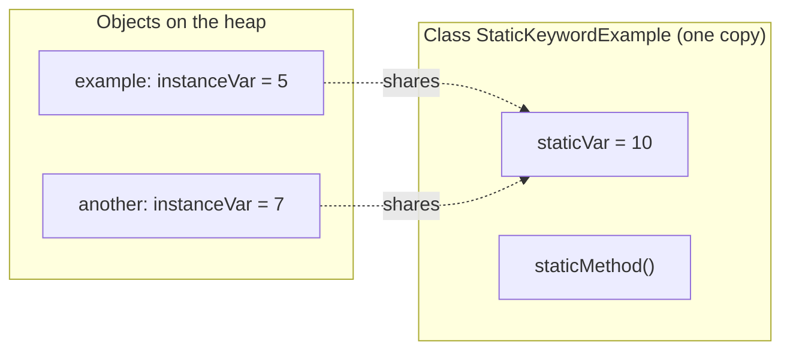
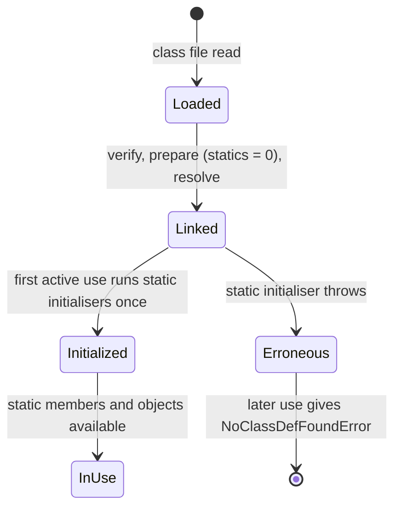

## In One Line
`static` means **"belongs to the class, not to any object"**: a static field has exactly **one shared copy**, a static method runs **without an object** (so it has no `this`), and a static block runs **once** when the class is initialised.

## Mental Model
Think of an **office building**. Each employee has their **own desk** with their own stuff on it — that is instance state. The building also has **one notice board in the lobby** that everyone reads and writes — that is a static field. And there is a **reception desk** you can walk up to without being an employee — that is a static method: anyone can use it via the building's name, and the receptionist cannot look at "your" desk because they don't know who you are.

In the code:
- `int instanceVar` = **each employee's desk** — every `StaticKeywordExample` object has its own copy (`5` for `example`).
- `static int staticVar = 10` = **the lobby notice board** — one copy for the whole class, readable as `StaticKeywordExample.staticVar` before any object exists.
- `static void staticMethod()` = **the reception desk** — called as `StaticKeywordExample.staticMethod()`, no object needed, and it has no `this`.
- **The building opening in the morning** = class initialisation, when `staticVar` is set to `10` and static blocks run — once.

## Concept
### Static vs instance at a glance
| | Static (class) member | Instance member |
|---|---|---|
| Belongs to | The class | Each object |
| Copies | **One** per class (per class loader) | One per object |
| Created | When the class is initialised | When the object is created with `new` |
| Accessed via | `ClassName.member` | `reference.member` |
| Can use `this` / `super` | No | Yes |
| Can access instance members directly | No — needs an object reference | Yes |
| Can access static members | Yes | Yes |
| Methods: dispatch | Bound at compile time (no overriding, only hiding) | Dynamic dispatch (overriding) |

### What can be `static`
| Element | Allowed? | Notes |
|---|---|---|
| Field | Yes | Class variable — shared state, counters, constants (`static final`) |
| Method | Yes | Utility/factory methods, `main` |
| Initialiser block `static { }` | Yes | Runs once during class initialisation |
| Nested class | Yes | Static nested class — no link to an outer instance ([Inner Classes](lesson:a01-oop/09-inner-classes)) |
| Import | Yes | `import static java.lang.Math.max;` |
| Top-level class | **No** | *"modifier static not allowed here"* |
| Constructor | **No** | Constructors always work on a new object |
| Local variable | **No** | Illegal inside a method body |
| Members of inner classes | Yes **since Java 16** | JEP 395 relaxed the rule; before that only constants were allowed |

Nested enums, records and interfaces are **implicitly static**.

### Static variables — one shared copy
`static int staticVar = 10;` creates one variable for the whole class. Every object and every static method sees the same value; a change made through one object is visible through all. Typical uses: **constants** (`public static final double PI`), **counters** (how many objects were created), **caches and registries**, **singletons**.

Where does it live? In HotSpot (since JDK 7), static fields are stored in the class's `java.lang.Class` mirror object **on the heap**; the class metadata (methods, bytecode) lives in **Metaspace** (which replaced PermGen in JDK 8). The old answer "static variables live in PermGen" is outdated. See [Memory Areas](lesson:b02-jvm/02-memory-areas).

### Static methods — no object, no `this`
- Called as `ClassName.method()`; the bytecode instruction is `invokestatic`.
- They **cannot** use `this`/`super` or touch instance fields/methods directly — *"non-static variable instanceVar cannot be referenced from a static context"*. They can if they are given an object: `example.instanceVar`.
- They **can be overloaded** and **are inherited** (callable through a subclass name), but they **cannot be overridden**. A subclass static method with the same signature **hides** the parent's; the version is chosen by the **reference type** at compile time. `@Override` on a static method is a compile error.
- An instance method cannot "override" a static one and vice versa — both are compile errors.
- `main` is static so the JVM can call it without creating an object. (Java 21 previews "instance main methods", JEP 445; finalised in JDK 25.)
- Good for **pure functions** (`Math.max`), **factories** (`List.of`, `Integer.valueOf`) and **utility classes** (`Collections`, `Arrays`) — usually with a `private` constructor so nobody instantiates them.

### Static blocks and class initialisation
```java
static {
    // runs once, when the class is initialised
}
```
- Static field initialisers and static blocks are merged, **in textual order**, into one hidden method `<clinit>`. `javap` on the course example shows `static {}` containing `bipush 10; putstatic staticVar`.
- A class is initialised **lazily**, on first *active use*: `new`, calling a static method, reading/writing a static field (**except compile-time constants**), `Class.forName(...)`, reflection, initialising a subclass, or being the main class.
- **Compile-time constants** (`static final int LIMIT = 50;` — primitive/String with a constant initialiser) are copied into the using class by `javac`, so reading them does **not** initialise the class.
- The JVM guarantees `<clinit>` runs **once and thread-safely** — the basis of the lazy "holder" singleton idiom.
- If a static initialiser throws, the first access fails with `ExceptionInInitializerError` and **every later access** with `NoClassDefFoundError: Could not initialize class ...`.

Detailed ordering with instance blocks and constructors is in [Initialization Order](lesson:b01-fundamentals/12-initialization-order); loading/linking in [Class Loading](lesson:b02-jvm/01-class-loading).

### Accessing static members through a reference
`example.staticVar` and even `((StaticKeywordExample) null).staticVar` compile and work: the compiler only looks at the **type** of the expression and emits `getstatic`. No object is used, so there is **no `NullPointerException`**. javac `-Xlint:static` warns: *"static variable should be qualified by type name"*. Always use the class name.

### Static and concurrency / memory
- Static mutable state is **shared by all threads**: `count++` on a static field is a race. Use `AtomicInteger`, `synchronized static` methods (which lock on the `Class` object) or avoid shared state.
- Static collections live as long as the class (usually the whole application) — a classic **memory leak** source when entries are never removed.
- Static state makes code harder to test (hidden global state, order dependence). Prefer passing dependencies in.

### Interface static methods (Java 8)
Interfaces can have `static` methods (`Comparator.naturalOrder()`), but unlike class static methods they are **not inherited** by implementing classes — you must call them through the interface name. See [Static Interface Methods](lesson:a05-java8/11-static-interface-methods).

## Diagram

Each object has its own `instanceVar`, but all of them (and code with no object at all) share the single `staticVar`.


Static fields get default values during linking and their real values once, during initialisation; a failed initialisation poisons the class.

## Code
@example CoreJava/JavaFeatures/StaticKeywordExample.java

A static counter shared by all objects:
```java
public class Counter {
    static int created = 0;      // one copy, shared by every Counter
    int id;                      // one copy per object

    Counter() {
        created++;
        id = created;
    }

    public static void main(String[] args) {
        Counter a = new Counter();
        Counter b = new Counter();
        Counter c = new Counter();
        System.out.println("ids: " + a.id + ", " + b.id + ", " + c.id);
        System.out.println("created: " + Counter.created);
        a.created = 100;                          // legal but misleading: it is the shared field
        System.out.println("b sees: " + b.created);
    }
}
```
```output
ids: 1, 2, 3
created: 3
b sees: 100
```

When does class initialisation happen? Constants do not trigger it:
```java
public class InitOrder {
    static {
        System.out.println("1. InitOrder static block (before main)");
    }

    public static void main(String[] args) {
        System.out.println("2. main starts");
        System.out.println("3. Config.LIMIT = " + Config.LIMIT);     // constant: no class init
        System.out.println("4. Config.name  = " + Config.name);      // triggers class init
        System.out.println("5. Config.name  = " + Config.name);      // already initialised
    }
}

class Config {
    static final int LIMIT = 50;          // compile-time constant, inlined by javac
    static String name = init();

    static {
        System.out.println("   Config static block");
    }

    static String init() {
        System.out.println("   Config.name initialiser");
        return "prod";
    }
}
```
```output
1. InitOrder static block (before main)
2. main starts
3. Config.LIMIT = 50
   Config.name initialiser
   Config static block
4. Config.name  = prod
5. Config.name  = prod
```
Line 4's text appears *after* the initialisation messages because `Config.name` must be evaluated (initialising `Config`) before the string can be built and printed.

Static methods are hidden, not overridden:
```java
public class Hiding {
    public static void main(String[] args) {
        Parent p = new Child();
        p.info();        // static: chosen by the reference type (Parent)
        p.greet();       // instance: chosen by the object (Child)
        Child.info();
    }
}

class Parent {
    static void info() { System.out.println("Parent.info (static)"); }
    void greet()       { System.out.println("Parent.greet"); }
}

class Child extends Parent {
    static void info() { System.out.println("Child.info (static)"); }   // hides, does not override
    @Override void greet() { System.out.println("Child.greet"); }
}
```
```output
Parent.info (static)
Child.greet
Child.info (static)
```

A failing static initialiser poisons the class:
```java
public class Broken {
    public static void main(String[] args) {
        for (int i = 1; i <= 2; i++) {
            try {
                System.out.println(Settings.value);
            } catch (Throwable t) {
                System.out.println("attempt " + i + ": " + t);
            }
        }
    }
}

class Settings {
    static int value = Integer.parseInt("not a number");
}
```
```output
attempt 1: java.lang.ExceptionInInitializerError
attempt 2: java.lang.NoClassDefFoundError: Could not initialize class Settings
```

## Walkthrough
- `static int staticVar = 10;` — a **class variable**. It exists once, created when the class is initialised; the `= 10` is compiled into the class's static initialiser (`static {}` in `javap`: `bipush 10`, `putstatic staticVar`).
- `static void staticMethod()` — a **class method**; it prints `Inside static method.` and has no `this`.
- `int instanceVar;` — an **instance variable**; each object gets its own.
- `public StaticKeywordExample(int instanceVar)` — the constructor sets the object's field; `this.instanceVar` is needed because the parameter shadows it.
- `public static void main(...)` — `StaticKeywordExample` is the main class, so it is initialised before `main` runs — `staticVar` is already `10`.
- `StaticKeywordExample.staticVar` — read through the class name, **no object exists yet** (compiled to `getstatic`). Prints **`Static variable: 10`**. Inside its own class the prefix is optional; writing it makes "this is static" obvious.
- `StaticKeywordExample.staticMethod()` — compiled to `invokestatic`, prints **`Inside static method.`**.
- `new StaticKeywordExample(5)` — now an object is created; `example.instanceVar` (`getfield`) prints **`Instance variable: 5`**.
- Notice what `main` could **not** do: write `instanceVar` alone. There is no current object in a static method, so it must go through `example`.
- All three `// Output:` comments match the recorded output; there are no errata in this file.

## Traps
- **Using instance members from `main`/static methods** — *"non-static variable instanceVar cannot be referenced from a static context"* (and *"non-static method ... cannot be referenced..."*). Create an object and use its reference.
- **Static state is shared** — changing `a.created` changes it for every object (`b sees: 100`). Accessing statics through a reference hides this; use the class name.
- **No NPE on null references for statics** — `StaticKeywordExample ref = null; ref.staticVar` prints `10`; the reference is ignored.
- **Static methods are hidden, not overridden** — `Parent p = new Child(); p.info()` runs `Parent.info()`. `@Override` on a static method: *"static methods cannot be annotated with @Override"*.
- **Instance ↔ static clash** — a child cannot declare an instance method with the same signature as a parent static method (*"overridden method is static"*), nor a static one over an instance one (*"overriding method is static"*).
- **`static` local variables do not exist** in Java (unlike C). Use a field.
- **Constants are inlined at compile time** — if class `A` uses `Config.LIMIT` and you change `LIMIT` and recompile only `Config`, `A` keeps the old value until it is recompiled.
- **Static initialiser exceptions** — first `ExceptionInInitializerError`, then `NoClassDefFoundError` forever (for that class loader).
- **Race conditions** on static counters (`created++` is read-modify-write) — use `AtomicInteger` in multi-threaded code.
- **Memory leaks** from ever-growing static `Map`/`List` caches.

> [!WARNING] "Static variables are stored in PermGen" is outdated. Since JDK 7 (HotSpot) static fields live with the `Class` object on the heap, and PermGen itself was removed in JDK 8 (Metaspace holds class metadata).

## Tips & Tricks
- **Mnemonic — "Static = Shared, Single, Stateless-about-you."** One copy, shared by all, and static methods know nothing about any particular object.
- **Rule of thumb:** if a method does not use any instance field or `this`, it *can* be static; make it static when it is a pure utility or factory.
- **Always access statics via the class name** (`Math.PI`, `Counter.created`), never via an object.
- **Constants:** `public static final` + `UPPER_SNAKE_CASE` (see [final keyword](lesson:a02-core/08-final-keyword)).
- **Utility class recipe:** `final` class + `private` constructor + only static methods.
- **Lazy, thread-safe singleton:** a `private static class Holder { static final X INSTANCE = new X(); }` — relies on the JVM's once-only class initialisation.
- **Initialisation triggers — "N-S-S-R-S":** `new`, Static method call, Static field access (non-constant), Reflection/`Class.forName`, Subclass initialisation.

## Interview Q&A
### [Basic] What does the `static` keyword mean in Java?
`static` marks a member as belonging to the class rather than to instances. A static variable has a single copy shared by all objects; a static method can be called with the class name without an object and has no `this`; a static block runs once when the class is initialised; and a static nested class does not need an instance of the outer class. It can be applied to fields, methods, initialiser blocks, nested types and imports — not to top-level classes, constructors or local variables.

**Follow-up:** *When would you make a field static?* — When the value is common to all instances: constants, counters, caches, configuration, singletons.

### [Basic] Why is the `main` method static?
The JVM must call `main` before any object of the class exists. Making it static lets the launcher invoke `ClassName.main(args)` directly without constructing an instance (and without knowing which constructor to use). Since JDK 21 there is a preview (JEP 445, final in JDK 25) that allows instance `main` methods for simpler programs, but the classic, portable signature remains `public static void main(String[] args)`.

**Follow-up:** *Can you overload `main`?* — Yes, but the JVM only calls the `(String[])` version.

### [Basic] Can a static method access instance variables?
Not directly. A static method has no `this`, so the compiler rejects unqualified instance fields and methods (*"non-static variable ... cannot be referenced from a static context"*). It can access them through an object reference — as `main` does with `example.instanceVar`. The reverse is always fine: instance methods can use static members.

**Follow-up:** *Can a static method use `this` or `super`?* — No, both require a current object.

### [Intermediate] Can we override a static method?
No. Static methods are resolved at compile time from the reference type (`invokestatic`), so there is no dynamic dispatch. A subclass may declare a static method with the same signature — that **hides** the parent's method: `Parent p = new Child(); p.info()` runs `Parent.info()`. `@Override` on it is a compile error. Static methods can be overloaded and are inherited (you can call `Child.parentStaticMethod()`).

**Follow-up:** *Can an instance method in the child have the same signature as a static method in the parent?* — No, compile error: *"overridden method is static"*.

### [Intermediate] When is a static block executed? What triggers class initialisation?
Static blocks (and static field initialisers, merged in textual order into `<clinit>`) run once, when the class is **initialised** — lazily on its first active use: creating an instance, calling a static method, reading or writing a non-constant static field, reflection such as `Class.forName("X")`, initialising a subclass, or being the main class. For the main class this happens before `main`. Reading a compile-time constant (`static final int X = 50`) does **not** trigger it, because `javac` inlines the value.

**Follow-up:** *Is static initialisation thread-safe?* — Yes. The JVM holds an initialisation lock so `<clinit>` runs exactly once even if several threads race to use the class.

### [Intermediate] What happens if you access a static member through a null reference?
It works. `StaticKeywordExample ref = null; ref.staticVar` prints `10` and `ref.staticMethod()` runs, because the compiler uses only the **declared type** of `ref` and emits `getstatic`/`invokestatic`; the reference value is never dereferenced. It is legal but misleading, and `javac -Xlint:static` warns about it.

**Follow-up:** *And an instance method through null?* — `NullPointerException`, because `invokevirtual` needs the object to find the method.

### [Intermediate] Where are static variables stored in memory?
In HotSpot, since JDK 7 static fields are stored in the `java.lang.Class` object that represents the class, which lives on the **heap**. Class metadata (method bytecode, constant pool, field layout) lives in **Metaspace**, native memory that replaced PermGen in JDK 8. Static *references* live there; the objects they point to are ordinary heap objects, reachable as long as the class is loaded — so large static collections are GC roots and can leak memory.

**Follow-up:** *When are static variables garbage-collected?* — Only when their class is unloaded, which requires its class loader to become unreachable (never for classes of the application/system class loader in a normal run).

### [Advanced] What happens when a static initialiser throws an exception?
The first thread that triggers initialisation gets `ExceptionInInitializerError` (wrapping the original exception, e.g. `NumberFormatException`). The class is marked as **erroneous**, and every later attempt to use it in that class loader throws `NoClassDefFoundError: Could not initialize class X` — without the original cause, which makes production debugging confusing. Checked exceptions cannot be thrown from a static block; wrap them. Keep static initialisers simple, or use lazy initialisation.

**Follow-up:** *Why does the second error say "NoClassDefFoundError" if the class file exists?* — Because the class definition is unusable after failed initialisation; "definition not found" refers to a usable, initialised class, not the file.

### [Advanced] Static vs singleton — which would you choose?
A **static utility class** suits stateless helpers (`Math`, `Collections`): simple, no instance. A **singleton** is an object, so it can implement interfaces, be passed as a dependency, be replaced with a mock in tests, be lazily initialised, and hold state behind an API. Static methods cannot be overridden or mocked easily and create hidden global coupling. In modern code, dependency injection usually provides "single instance" semantics without either. See [Singleton](lesson:a10-patterns/01-singleton).

**Follow-up:** *Best way to write a singleton?* — An `enum` with one constant, or the static holder idiom; both are thread-safe thanks to class initialisation.

## Quiz
### What does this print?
```java
public class S {
    static { System.out.print("A "); }
    public static void main(String[] args) {
        System.out.print("B ");
        new Z(); new Z();
        Z z = new Z();
        System.out.println(z.s + " " + z.i);
    }
    static { System.out.print("C "); }
}
class Z { static int s; int i; Z() { s++; i++; } }
```
- [ ] A B C 3 3
- [x] A C B 3 1
- [ ] B A C 3 1
- [ ] A C B 1 1
> Both static blocks of the main class run (in textual order) before `main`, so `A C` comes before `B`. `s` is shared and counts all three objects; `i` belongs to each object and is 1 for `z`.

### What does this print?
```java
public class NullStatic {
    static int staticVar = 10;
    public static void main(String[] args) {
        NullStatic ref = null;
        System.out.println(ref.staticVar);
    }
}
```
- [ ] NullPointerException
- [x] 10
- [ ] 0
- [ ] Compile error
> A static field is accessed via the **type** of `ref`, not its value; the compiler emits `getstatic`. It compiles (with a lint warning) and prints `10`.

### What does this print?
```java
class Parent { static void info() { System.out.println("Parent"); } }
class Child extends Parent { static void info() { System.out.println("Child"); } }

Parent p = new Child();
p.info();
```
- [x] Parent
- [ ] Child
- [ ] Compile error: static methods cannot be redeclared
- [ ] Runtime error
> Static methods are hidden, not overridden. The call is bound at compile time to the reference type `Parent`. For an instance method, the answer would be `Child`.

### Does printing `Config.LIMIT` (declared `static final int LIMIT = 50;`) run `Config`'s static block?
- [ ] Yes, any static field access initialises the class
- [x] No, `LIMIT` is a compile-time constant inlined by `javac`
- [ ] Only if `Config` has a `main` method
- [ ] Only the first time the program runs
> A `static final` primitive/String initialised with a constant expression is a constant variable; its value is copied into the calling class, so `Config` is not touched. A non-constant static field (e.g. `static String name = init();`) does trigger initialisation.

### Spot the bug:
```java
public class Report {
    int pages = 10;
    public static void main(String[] args) {
        System.out.println(pages);
    }
}
```
- [ ] `pages` must be `final`
- [x] `main` is static and has no object, so it cannot use the instance field `pages` directly
- [ ] `System.out.println` cannot print an `int`
- [ ] The class needs a constructor
> Compile error: *"non-static variable pages cannot be referenced from a static context"*. Fix: `System.out.println(new Report().pages);` or make `pages` static if it really is shared.

### Where can `static` NOT be used?
- [ ] On a nested class
- [ ] On an initialiser block
- [x] On a local variable inside a method
- [ ] On an import
> Java has no static local variables — `static int count = 0;` inside a method does not compile. Nested classes, blocks and imports can all be static (and top-level classes and constructors cannot).

## Takeaways
- `static` members belong to the class: one shared copy of a static field, static methods callable without an object.
- Static methods have no `this`/`super` and cannot use instance members directly — they need an object reference.
- Static methods are bound at compile time: they can be overloaded and hidden, but never overridden.
- Static initialisers run once, lazily, thread-safely, on the class's first active use; compile-time constants do not trigger it.
- A failed static initialiser gives `ExceptionInInitializerError` first and `NoClassDefFoundError` on every later access.
- Access statics via the class name — through a reference (even `null`) it works but misleads.
- Shared static mutable state brings race conditions, memory leaks and testing pain; keep statics for constants, pure utilities and factories.
