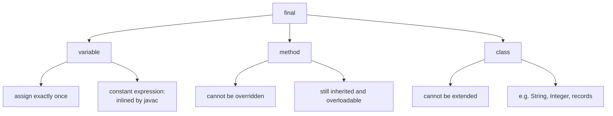
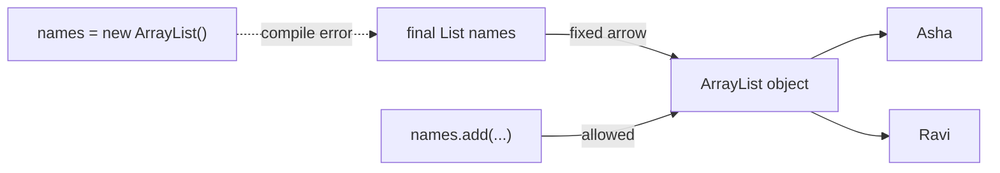

## In One Line
`final` means **"cannot be changed after this point"**: a final **variable** can be assigned only once, a final **method** cannot be overridden, and a final **class** cannot be extended — but a final *reference* does **not** make the object it points to immutable.

## Mental Model
Think of **writing in pen instead of pencil**.
- A **final variable** is a form field filled in with pen: you write it once, and you cannot erase it. If the field is a *locker number* (a reference), you cannot change which locker is yours — but you can still put things into and take things out of that locker.
- A **final method** is a clause in a franchise agreement marked **"do not modify"**: franchisees (subclasses) inherit it and can add their own clauses, but they cannot rewrite that one.
- A **final class** is a **sealed, finished product** — nobody can build a variant of it.

In the code:
- `final int finalVar = 100;` — written in pen: any later `finalVar = 200;` is a compile error.
- `public final void finalMethod()` — the locked clause: the commented-out `SubClass` tries to rewrite it and the compiler refuses.
- A final class (not shown in the example) would be `final class FinalKeywordExample`, which would stop `SubClass` from even extending it.

## Concept
### `final` in three places
| Applied to | Meaning | Typical use |
|---|---|---|
| **Variable** (field, local, parameter) | Assigned exactly once | Constants, immutable objects, lambda captures |
| **Method** | Cannot be overridden (can be inherited and overloaded) | Lock an algorithm step, security-sensitive logic, methods called from constructors |
| **Class** | Cannot be extended | Immutable value classes (`String`, `Integer`), utility classes, security |

### Final variables
**Final instance fields**
- Must be **definitely assigned exactly once** — in the declaration, in an instance initialiser block, or in **every** constructor.
- A final field without an initialiser is a **blank final**. If a constructor forgets it: *"variable x might not have been initialized"*; if there is no constructor at all: *"variable x not initialized in the default constructor"*.
- Assigning twice: *"variable x might already have been assigned"*; assigning later in a method: *"cannot assign a value to final variable x"*.

**Final static fields**
- Assigned in the declaration or in a `static` block, exactly once.
- `public static final` + `UPPER_SNAKE_CASE` is the Java idiom for constants: `public static final int MAX_USERS = 100;`.

**Final local variables and parameters**
- `final int n = 5;` / `void m(final int n)` — cannot be reassigned (*"final parameter n may not be assigned"*).
- Since Java 8, locals captured by lambdas and anonymous/local classes must be **final or effectively final** (never reassigned after initialisation) — *"local variables referenced from a lambda expression must be final or effectively final"*.
- Exception parameters in multi-catch (`catch (IOException | SQLException e)`) are implicitly final; since Java 9, try-with-resources accepts effectively-final variables.

### A final reference is not an immutable object
`final` locks the **variable** (the reference), not the **object**:
```java
final List<String> names = new ArrayList<>();
names.add("Asha");            // fine — the list object changes
names = new ArrayList<>();    // compile error — the reference cannot
```
Same for arrays: `final int[] nums` still allows `nums[0] = 99`. For an immutable object you need an immutable type (`List.of(...)`, `String`, records of immutable values) — see [Immutable Classes](lesson:b01-fundamentals/08-immutable-classes).

### Compile-time constants (constant variables)
A `final` variable of primitive or `String` type initialised with a **constant expression** is a *constant variable* (JLS §4.12.4) — even if it is an instance field like `finalVar`. Consequences:
- `javac` **inlines** its value at every use. `javap` on the course example shows `example.finalVar` compiled to `Objects.requireNonNull(example)` + `bipush 100` — the field is never read.
- It can be used as a `case` label (`case ONE:`); a non-final local gives *"constant expression required"*.
- Reading a `static final` constant of another class **does not initialise** that class.
- Across classes, a changed constant is only picked up after **recompiling the users**.
- `final String b = "Java"; b + 21` is a compile-time constant and is **interned** — `"Java21" == b + 21` is `true`, but not with a non-final `b`.
- It is visible even "too early": an override called from a parent constructor sees `wheels = 4` for a constant, but `null`/`0` for non-constant final fields.

### Final methods
- Cannot be overridden: *"finalMethod() in SubClass cannot override finalMethod() in FinalKeywordExample; overridden method is final"*.
- **Are inherited** and **can be overloaded** (a different parameter list is a different method).
- `private` methods are implicitly final — a same-named method in a subclass is a *new* method, not an override.
- `static final` methods cannot be **hidden** by a subclass static method (*"overridden method is static,final"*).
- `abstract final` is illegal (*"illegal combination of modifiers: abstract and final"*) — abstract demands an override, final forbids it.
- Use them for template-method skeletons, for methods called from constructors (safe from the "override sees uninitialised fields" problem), and for security-critical logic. Interface methods cannot be `final`.

### Final classes
- Cannot be subclassed: *"cannot inherit from final String"*.
- All methods of a final class are effectively final.
- JDK examples: `String`, all wrapper classes (`Integer`, `Long`...), `Math`, `System`, `StringBuilder`, `LocalDate`.
- **Records** are implicitly final; **enums** are implicitly final (unless a constant has a body, in which case the compiler makes the enum sealed and the constant body an anonymous subclass).
- `abstract final class` is illegal.

### Sealed classes — the middle ground (Java 17)
`final` = no subclasses, non-final = anyone may subclass. `sealed ... permits A, B` = **only the listed** subclasses, each of which must itself be `final`, `sealed` or `non-sealed`. This enables exhaustive `switch` pattern matching. See [Sealed Classes](lesson:b05-modern-java/04-sealed-classes).

### Final and multithreading
The Java Memory Model gives `final` fields a special guarantee (JLS §17.5): once a constructor finishes, any thread that sees the object reference sees the correctly initialised values of its final fields — **without synchronization** — as long as `this` did not escape during construction. This is why immutable objects with final fields are thread-safe by design. See [Java Memory Model](lesson:b03-concurrency/01-java-memory-model-and-volatile).

### Can reflection change a final field?
Partly. `Field.setAccessible(true)` + `set(...)` can change a **non-static final instance field** of an ordinary class, but not `static final` fields, record fields or hidden-class fields. Even when it "works", reads of a constant variable were already inlined by `javac` and keep showing the old value. Newer JDKs are moving to forbid this entirely (JEP 500, "Prepare to Make Final Mean Final", starts by warning).

### `final` vs `finally` vs `finalize`
| | What | Notes |
|---|---|---|
| `final` | Keyword — no reassign / override / extend | This lesson |
| `finally` | Block after `try`/`catch` that always runs | Cleanup; prefer try-with-resources ([Exceptions](lesson:b01-fundamentals/10-exceptions-fundamentals)) |
| `finalize()` | `Object` method once called by the GC before reclaiming an object | Deprecated in Java 9, **deprecated for removal** in Java 18 (JEP 421); use `Cleaner` or try-with-resources |

## Diagram

One keyword, three targets; each forbids a different kind of change.


`final` freezes the arrow (the reference), not the object at the end of it.

## Code
@example CoreJava/JavaFeatures/FinalKeywordExample.java

If you remove the comment markers around `SubClass`, the compiler reports:
```text
FinalKeywordExample.java:25: error: finalMethod() in SubClass cannot override finalMethod() in FinalKeywordExample
    public void finalMethod() {
                ^
  overridden method is final
1 error
```

A final reference to a mutable object vs an immutable object:
```java
import java.util.ArrayList;
import java.util.List;

public class FinalRef {
    public static void main(String[] args) {
        final List<String> names = new ArrayList<>();
        names.add("Asha");                 // OK: the object can change
        names.add("Ravi");
        // names = new ArrayList<>();      // compile error: the reference cannot
        System.out.println(names);

        final int[] nums = {1, 2, 3};
        nums[0] = 99;                      // OK: array elements are not final
        System.out.println(nums[0]);

        List<String> locked = List.of("Asha", "Ravi");   // immutable object
        try {
            locked.add("Kiran");
        } catch (UnsupportedOperationException e) {
            System.out.println("immutable list: " + e);
        }
    }
}
```
```output
[Asha, Ravi]
99
immutable list: java.lang.UnsupportedOperationException
```

Blank finals, assigned exactly once in a constructor or static block:
```java
public class Blank {
    private final int id;                  // blank final: no initialiser
    private static final String PREFIX;    // blank static final

    static {
        PREFIX = "EMP-";                   // assigned exactly once, in a static block
    }

    Blank(int id) {
        this.id = id;                      // assigned exactly once, in every constructor
    }

    Blank() {
        this(0);                           // delegates, so id is still assigned once
    }

    public static void main(String[] args) {
        System.out.println(PREFIX + new Blank(7).id);
        System.out.println(PREFIX + new Blank().id);
    }
}
```
```output
EMP-7
EMP-0
```

Effectively final variables captured by lambdas:
```java
import java.util.List;
import java.util.function.IntUnaryOperator;

public class Effective {
    public static void main(String[] args) {
        int base = 10;                           // never reassigned -> effectively final
        IntUnaryOperator add = x -> x + base;    // lambda may capture it
        System.out.println(add.applyAsInt(5));

        for (final String s : List.of("a", "b")) {   // a fresh final variable per iteration
            Runnable r = () -> System.out.print(s);
            r.run();
        }
        System.out.println();
    }
}
```
```output
15
ab
```

Constant variables are inlined — visible even before the constructor assigns fields:
```java
public class Constant {
    public static void main(String[] args) {
        new Child();
    }
}

class Parent {
    Parent() { show(); }            // calls the override before Child's fields are set
    void show() { }
}

class Child extends Parent {
    final int wheels = 4;                   // constant variable: every use is inlined as 4
    final Integer doors = 4;                // final, but NOT a constant expression
    final int seats = Integer.parseInt("5"); // final, but NOT a constant expression

    @Override
    void show() {
        System.out.println("wheels=" + wheels + " doors=" + doors + " seats=" + seats);
    }
}
```
```output
wheels=4 doors=null seats=0
```

Reflection vs a final field (and why the constant still reads 100):
```java
import java.lang.reflect.Field;

public class Reflect {
    final int constant = 100;           // constant variable: reads are inlined by javac
    final Integer boxed = 100;          // not a constant expression: read from the field

    public static void main(String[] args) throws Exception {
        Reflect r = new Reflect();
        for (String name : new String[] {"constant", "boxed"}) {
            Field f = Reflect.class.getDeclaredField(name);
            f.setAccessible(true);
            f.set(r, 7);
        }
        System.out.println("r.constant = " + r.constant);   // javac inlined 100
        System.out.println("r.boxed    = " + r.boxed);
        System.out.println("reflective read = " + Reflect.class.getDeclaredField("constant").get(r));
    }
}
```
```output
r.constant = 100
r.boxed    = 7
reflective read = 7
```

Sealed hierarchy — between `final` and fully open:
```java
public class Sealed {
    sealed interface Shape permits Circle, Square, Blob { }
    record Circle(double r) implements Shape { }          // records are implicitly final
    static final class Square implements Shape { }
    static non-sealed class Blob implements Shape { }      // re-opens the hierarchy
    static class Goo extends Blob { }                       // allowed: Blob is non-sealed

    public static void main(String[] args) {
        Shape[] shapes = { new Circle(1), new Square(), new Goo() };
        for (Shape s : shapes) {
            String kind = switch (s) {
                case Circle c -> "circle r=" + c.r();
                case Square q -> "square";
                case Blob b   -> "blob (" + b.getClass().getSimpleName() + ")";
            };
            System.out.println(kind);
        }
        System.out.println(java.lang.reflect.Modifier.isFinal(Circle.class.getModifiers()));
    }
}
```
```output
circle r=1.0
square
blob (Goo)
true
```

## Walkthrough
- `final int finalVar = 100;` — a **final instance field** with an initialiser. Every object gets its own copy, always `100`; no code can reassign it (`finalVar = 200;` → *"cannot assign a value to final variable finalVar"*). Because it is `final`, of type `int`, and initialised with a constant expression, it is also a **constant variable**.
- `public final void finalMethod()` — a **final method**: inherited by subclasses, callable normally, but not overridable. It prints `Inside final method.`.
- `main` → `new FinalKeywordExample()` — the (compiler-generated default) constructor runs; the field initialiser sets `finalVar` to `100`.
- `example.finalVar` — prints **`Final variable: 100`**. Because `finalVar` is a constant variable, `javac` does not even read the field here: the bytecode null-checks `example` and pushes the literal `100` (`bipush 100`).
- `example.finalMethod()` — prints **`Inside final method.`**. Calls to a final method still compile to `invokevirtual`, but the JIT knows there can be no override.
- The commented-out block after the class: `class SubClass extends FinalKeywordExample` — **extending** is allowed (the class is not final). The `@Override public void finalMethod()` inside it is what fails, with *"overridden method is final"* (shown above). The comment *"Uncommenting below code will cause a compile-time error"* is accurate.
- Both `// Output:` comments match the recorded output.

## Traps
> [!NOTE] `final int finalVar = 100;` is a per-object constant: every `FinalKeywordExample` stores its own copy of the same value. For a true class-wide constant, Java style is `static final int FINAL_VAR = 100;` (one copy, `UPPER_SNAKE_CASE`). A non-static final field makes sense when each object gets its **own** value, usually set in the constructor (a blank final).

- **`final` ≠ immutable.** `final List<String> list` can still be modified; only reassignment is blocked. Use unmodifiable types for immutability.
- **Blank final not assigned in every constructor** — *"variable x might not have been initialized"*; assigned twice — *"might already have been assigned"*.
- **Final method ≠ final class.** The example's `SubClass` can extend `FinalKeywordExample`; only the override fails. To block subclassing entirely, mark the class `final`.
- **Final methods can be overloaded.** `void finalMethod(int n)` in a subclass is legal — it is a different method.
- **Private methods look overridable but are not.** A subclass method with the same name is a new, unrelated method; calls inside the parent still go to the parent's private one.
- **Constant inlining across classes** — changing `public static final int LIMIT` in a library without recompiling the clients leaves them using the old value.
- **Lambdas need effectively final locals** — reassigning a captured variable anywhere (even after the lambda) is a compile error.
- **`abstract final`**, **`final` interface methods**, **`final` constructors** — all illegal.
- **`static final` with a mutable object** (`public static final List<String> NAMES = new ArrayList<>();`) is a *mutable* global, not a constant. Use `List.of(...)`.

> [!WARNING] Don't confuse `final`, `finally` and `finalize()`. `finalize()` is deprecated for removal (JEP 421, Java 18) — never rely on it for cleanup.

## Tips & Tricks
- **Mnemonic — "Variable: once. Method: no override. Class: no children."**
- **"final freezes the arrow, not the box"** — the reference is fixed; the object may still change.
- **Default to `final` for fields** that should not change after construction: the compiler then checks that every constructor sets them, and you get JMM safe-publication for free.
- **Constants:** `public static final` + `UPPER_SNAKE_CASE`, and only for immutable values.
- **Design for inheritance or prohibit it** (Effective Java Item 19): if a class is not designed to be extended, make it `final` (or give it only private constructors).
- **Want "some subclasses but not all"?** Use `sealed ... permits` (Java 17) instead of `final`.
- **Rule for lambdas:** if the compiler says "effectively final", copy the value into a new local that you never reassign.

## Interview Q&A
### [Basic] What does the `final` keyword do on a variable, a method and a class?
On a **variable** it allows only one assignment — a final field must be assigned exactly once (at declaration, in an initialiser block or in every constructor), a final local/parameter cannot be reassigned. On a **method** it prevents overriding in subclasses (the method is still inherited and can be overloaded). On a **class** it prevents inheritance — nobody can extend it, as with `String` and the wrapper classes.

**Follow-up:** *Can a constructor be final?* — No. Constructors are not inherited, so `final` is meaningless and the compiler rejects it.

### [Basic] If a reference variable is `final`, can the object it points to change?
Yes. `final` only prevents the variable from being pointed at a different object. The object itself remains mutable if its class allows it: `final List<String> names = new ArrayList<>(); names.add("x");` works, `names = new ArrayList<>();` does not compile. Likewise the elements of a `final` array can be changed. Immutability requires an immutable class (e.g. `List.of`, `String`, records of immutable values).

**Follow-up:** *How do you make the list itself unmodifiable?* — `List.of(...)`, `List.copyOf(list)`, or `Collections.unmodifiableList(list)` (a read-only view).

### [Basic] What is a blank final variable?
A `final` variable declared without an initialiser. A blank final **instance** field must be assigned exactly once in every constructor (or an instance initialiser); a blank `static final` field must be assigned exactly once in a static initialiser block. The compiler's definite-assignment analysis enforces "exactly once". Blank finals let each object have its own, unchangeable value — e.g. `private final int id;` set from a constructor parameter.

**Follow-up:** *What if one of three constructors forgets to assign it?* — Compile error *"variable id might not have been initialized"*, reported on that constructor.

### [Intermediate] Can we override a final method? Can we overload it? Can we override a private or static method?
A final method **cannot be overridden** (*"overridden method is final"*), but it **can be overloaded** — in the same class or a subclass — because a different parameter list is a different method. Private methods are implicitly final: a subclass can declare a method with the same signature, but it is an unrelated new method. Static methods are never overridden, only hidden — and a `static final` method cannot even be hidden.

**Follow-up:** *Why make a method final?* — To lock behaviour that subclasses must not change (template-method skeletons, security checks) and to make it safe to call from constructors.

### [Intermediate] What does "effectively final" mean?
A local variable or parameter is effectively final if it is never reassigned after initialisation, even though it is not declared `final`. Since Java 8, lambdas and anonymous/local classes may capture such variables. The reason: captured locals are **copied** into the lambda/inner object; if the variable could change later, the copy and the original would disagree, so Java forbids it (*"local variables referenced from a lambda expression must be final or effectively final"*).

**Follow-up:** *How do you "modify" a counter inside a lambda then?* — Use a mutable holder such as `AtomicInteger` or an `int[1]` array — or better, restructure with streams (`count()`, `sum()`).

### [Intermediate] Why is `String` final?
Because `String` is designed to be **immutable**, and a subclass could break that: it could add mutable state or override methods (`equals`, `hashCode`, `length`) to lie. Immutability is relied on for the **string pool** (sharing literals), **hash-based collections** (a key's hash must never change; `String` even caches its hash), **security** (class names, file paths and URLs checked once cannot change afterwards) and **thread safety**. Making the class final guarantees every `String` really is the JDK's `String`. See [String Pool & Immutability](lesson:b01-fundamentals/07-string-pool-and-immutability).

**Follow-up:** *Which other JDK classes are final?* — All wrappers (`Integer`, `Double`...), `Math`, `System`, `StringBuilder`, `LocalDate` and the other `java.time` value classes.

### [Advanced] What is a compile-time constant, and what surprises can it cause?
A `final` primitive or `String` variable initialised with a constant expression (e.g. `static final int MAX = 100;`, even the instance field `final int finalVar = 100;`). `javac` inlines its value at every use site. Surprises: (1) changing a `public static final` constant in one class does not affect other classes until they are recompiled; (2) reading it does not trigger class initialisation; (3) it can be used in `case` labels and annotations; (4) string constants are concatenated and interned at compile time, so `final String b = "Java"; "Java21" == b + 21` is `true`; (5) an override called from a parent constructor sees a constant's value but `null`/`0` for other final fields; (6) changing it via reflection has no visible effect at the inlined uses.

**Follow-up:** *How do you prevent inlining for a public constant that may change?* — Initialise it with a non-constant expression (e.g. a static method call) or expose it via a static method.

### [Advanced] How do `final` fields help thread safety?
The JMM's final-field semantics (JLS §17.5) add a "freeze" at the end of the constructor: any thread that obtains a reference to the object **after** construction is guaranteed to see the constructor-assigned values of its final fields (and of objects reachable through them as of that moment), even if the reference was published through a data race without `volatile` or locks. Non-final fields have no such guarantee — another thread could see default values. The guarantee is void if `this` escapes during construction. That is why immutable classes use `private final` fields.

**Follow-up:** *Does `final` make the referenced object's later changes visible?* — No. Only the state at the end of the constructor is covered; later mutations of a referenced mutable object need proper synchronization.

### [Advanced] `final` vs `finally` vs `finalize()`?
`final` is a modifier (no reassignment, no overriding, no subclassing). `finally` is a block after `try`/`catch` that always executes — used for cleanup, although try-with-resources is preferred; it is skipped only if the JVM exits or the thread dies. `finalize()` is a method of `Object` that the garbage collector *might* call before reclaiming an object; it is unpredictable, slow and can resurrect objects, was deprecated in Java 9 and is deprecated for removal since Java 18 (JEP 421). Use `AutoCloseable` + try-with-resources or `java.lang.ref.Cleaner` instead.

**Follow-up:** *Can a `return` in `finally` hide an exception?* — Yes; a `return` in `finally` discards any exception thrown in `try`/`catch` — never do it.

## Quiz
### What does this print?
```java
final StringBuilder sb = new StringBuilder("Java");
sb.append(" 21");
System.out.println(sb);
final int[] a = {1, 2};
a[1] = a[0] + a[1];
System.out.println(a[1]);
```
- [ ] Compile error: `sb` is final
- [x] Java 21, then 3
- [ ] Java, then 2
- [ ] Java 21, then compile error on the array line
> `final` only forbids reassigning `sb` and `a`. Mutating the objects they point to (`append`, changing an element) is allowed.

### What happens if you uncomment `SubClass` in the course example?
- [ ] It compiles, and `SubClass.finalMethod()` hides the parent's method
- [ ] Error: cannot inherit from final `FinalKeywordExample`
- [x] Error: `finalMethod()` in `SubClass` cannot override `finalMethod()`; overridden method is final
- [ ] It compiles, but throws at runtime when `finalMethod()` is called
> The class is not final, so extending it is fine; the override of the final method is what fails. "Cannot inherit from final" would appear only if the class itself were declared `final`.

### What does this print?
```java
String a = "Java21";
final String b = "Java";
String c = "Java";
System.out.println(a == b + 21);
System.out.println(a == c + 21);
```
- [ ] true, true
- [x] true, false
- [ ] false, false
- [ ] false, true
> `b` is a constant variable, so `b + 21` is a compile-time constant `"Java21"`, interned and identical to the literal. `c` is not final, so `c + 21` is built at runtime into a new `String` object — `==` compares references and is false.

### What does this print?
```java
class Parent { Parent() { show(); } void show() { } }
class Child extends Parent {
    final int wheels = 4;
    final Integer doors = 4;
    @Override void show() { System.out.println(wheels + " " + doors); }
}
new Child();
```
- [ ] 4 4
- [x] 4 null
- [ ] 0 null
- [ ] Compile error: final fields cannot be read before assignment
> `show()` runs during `Parent()`, before `Child`'s fields are assigned. `wheels` is a constant variable, so `javac` inlined `4`; `doors` (`Integer`) is not a constant expression and is still `null`.

### Spot the bug:
```java
public class Invoice {
    private final double total;
    public Invoice(double total) { this.total = total; }
    public Invoice() { }
}
```
- [ ] `final` fields cannot be `private`
- [x] The no-arg constructor leaves the blank final `total` unassigned
- [ ] A class with a final field cannot have two constructors
- [ ] `this.total = total` is illegal for a final field
> Every constructor must assign a blank final exactly once: *"variable total might not have been initialized"*. Fix: `public Invoice() { this(0.0); }`.

### Which combination is legal?
- [ ] `abstract final class Shape`
- [ ] `final Invoice() { }` (a constructor)
- [x] `private static final int MAX = 10;`
- [ ] `interface Api { final void call(); }`
> `abstract` + `final` contradict each other, constructors cannot be `final`, and interface methods cannot be `final`. `private static final` is the normal way to declare a private constant.

### What does this print?
```java
class Base { final void hello() { System.out.println("Base.hello"); } }
class Derived extends Base { void hello(int times) { System.out.println("Derived.hello x" + times); } }

Derived d = new Derived();
d.hello();
d.hello(3);
```
- [ ] Compile error: cannot override final method
- [x] Base.hello, then Derived.hello x3
- [ ] Derived.hello x3, twice
- [ ] Compile error: hello() is ambiguous
> `hello(int)` has a different parameter list, so it **overloads** rather than overrides the final `hello()`. Both methods exist on `Derived`: one inherited, one new.

## Takeaways
- `final` variable = assigned exactly once; `final` method = cannot be overridden; `final` class = cannot be extended.
- A final reference does not make the object immutable — only the variable is frozen (`final List` can still `add`).
- Blank finals must be assigned exactly once on every constructor path (or in a static block for `static final`).
- Final primitive/String variables with constant initialisers are compile-time constants: inlined by `javac`, usable in `case` labels, interned when concatenated, and do not trigger class initialisation.
- Final methods are still inherited and can be overloaded; private methods are implicitly final; `abstract final` is illegal.
- Lambdas and inner classes may only capture final or effectively final local variables.
- Final fields give JMM safe-publication guarantees — the backbone of immutable, thread-safe classes; `sealed` (Java 17) sits between `final` and open classes.
