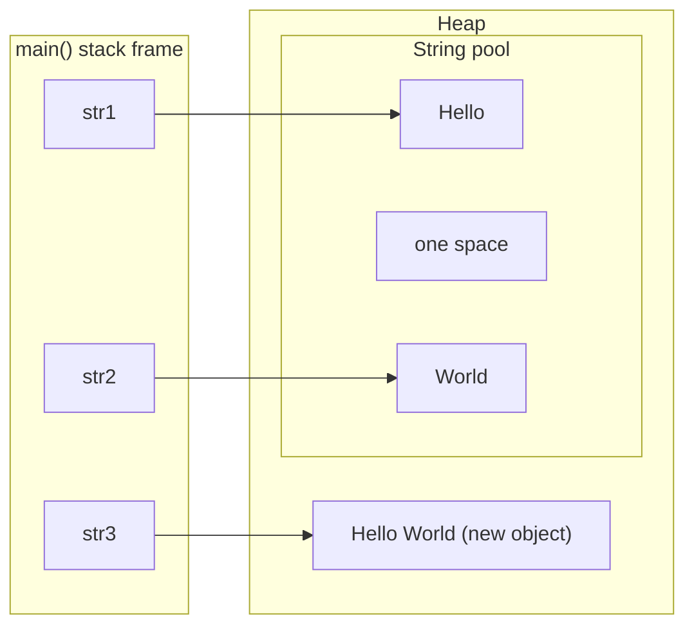
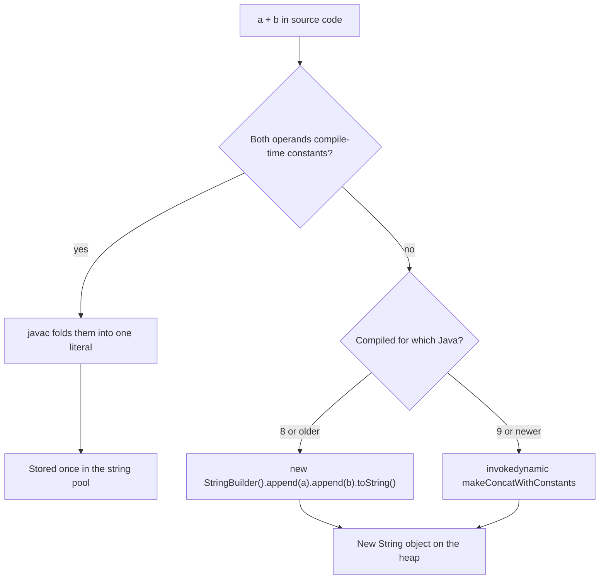

## In One Line
A `String` is an **immutable**, `final` object that holds a sequence of UTF-16 characters: literals are shared through the **string pool**, indexes start at 0, and every "change" — including `+` — produces a **new** `String` instead of editing the old one.

## Mental Model
Think of **engraved name plates** at an office reception.

- A plate is **engraved once** and can never be edited. To "change" `Hello` into `Hello World` you order a **new plate**; the old one still says `Hello` (immutability).
- Reception keeps a **rack of shared plates** (the string pool). When anyone asks for a plate by its exact text written in the source code (a literal like `"Hello"`), reception hands out the plate already on the rack, so two people asking for `"Hello"` hold **the same plate**.
- Saying `new String("Hello")` is insisting on a **freshly engraved private copy** even though an identical plate is on the rack. Same text, different plate.
- Because nobody can scratch a plate, it is safe to hand the same plate to many people at once (thread safety) and to use it as a key on a key cabinet (`HashMap` key).
- Letters on the plate are numbered from **0**: `charAt(1)` is the second letter, and `substring(6, 11)` means "from slot 6 up to, but not including, slot 11".

## Concept
### What a String really is
```java
public final class String
    implements java.io.Serializable, Comparable<String>, CharSequence,
               Constable, ConstantDesc {          // last two since Java 12
    private final byte[] value;   // the characters (Java 9+); char[] up to Java 8
    private final byte coder;     // LATIN1 (1 byte/char) or UTF16 (2 bytes/char)
    private int hash;             // cached hashCode, computed on first call
    private boolean hashIsZero;   // Java 13+: remembers "hash really is 0"
    ...
}
```
- **`final` class** — nobody can subclass `String` and override `equals`, `length` or `charAt` to behave differently. That is what makes the immutability guarantee trustworthy.
- **`private final` array, no method that writes into it** — nothing can change the characters after construction.
- **`CharSequence`** — the read-only "sequence of chars" interface shared with `StringBuilder`, `StringBuffer` and `CharBuffer`. Methods that accept a `CharSequence` (like `contains`, `String.join`) accept all of them.
- **`Comparable<String>`** — strings have a natural (lexicographic, by UTF-16 code unit) order, so `Collections.sort` and `TreeMap` work on them.

### Compact Strings (Java 9, JEP 254)
Before Java 9 every character took 2 bytes (`char[]`). Most real-world strings are plain Latin-1 text, so half the memory was zeros. Since Java 9, `String` stores a `byte[]` plus a `coder` flag:

| Content | `coder` | Bytes per char |
|---|---|---|
| Every char fits in Latin-1 (`\u0000`–`ÿ`), e.g. `"Hello World"` | `LATIN1` | 1 |
| Any char outside Latin-1, e.g. `"नमस्ते"` or an emoji | `UTF16` | 2 |

It is completely invisible to your code — `length()`, `charAt()` and friends behave exactly as before. It can be switched off with `-XX:-CompactStrings`.

### Ways to create a String
| Code | What you get |
|---|---|
| `String s = "Hello";` | A **literal**. The JVM interns it: one shared object in the string pool. |
| `new String("Hello")` | A **new object on the heap** with the same characters (plus the pooled literal `"Hello"` if it was not there yet). Almost never needed. |
| `new String(char[])`, `new String(byte[], UTF_8)` | New string copied from an array (the array is copied, so later changes to it do not leak in). |
| `sb.toString()` | New string from a `StringBuilder`/`StringBuffer`. |
| `String.valueOf(x)` | Text form of any value; `String.valueOf((Object) null)` gives `"null"`. |
| `a + b`, `a.concat(b)` | New string built at runtime (unless both are compile-time constants). |
| `"""` text block `"""` (Java 15) | A multi-line literal — also pooled. See [Text Blocks & New String Methods](lesson:b05-modern-java/06-text-blocks-and-new-string-methods). |

### The string pool (String Constant Pool)
- Every string **literal** and every **compile-time constant expression** (`"Hel" + "lo"`, or `final` variables initialised with literals) is stored once in a JVM-wide table, the **string pool**. All uses of the same literal refer to that one object.
- Since **Java 7** the pool lives in the **main heap** (before that it was in PermGen, a small fixed area that often overflowed). Pooled strings are garbage-collected like other objects once no class or variable refers to them.
- `s.intern()` returns the pooled object with the same text, adding `s` to the pool if needed. After `d = c.intern()`, `d == "Hello"` is `true`.
- `new String("Hello")` creates **up to two** objects: the pooled literal (only if not already there — usually created when the class is loaded) and one fresh heap object.

The deep dive (intern tables, `-XX:StringTableSize`, G1 string deduplication) is in [String Pool & Immutability](lesson:b01-fundamentals/07-string-pool-and-immutability).

### `==` versus `equals()`
| | `a == b` | `a.equals(b)` |
|---|---|---|
| Compares | **References** — same object? | **Content** — same characters, same order? |
| `"Hi" == "Hi"` (two literals) | `true` (both pooled) | `true` |
| `"Hi" == new String("Hi")` | `false` | `true` |
| Null-safe? | yes | `a` must not be `null` — write `"Hi".equals(a)` or `Objects.equals(a, b)` |

Rule: **always compare string content with `equals()`** (or `equalsIgnoreCase()`). `==` "working" on literals is an accident of pooling.

### Why is String immutable?
1. **String pool** — sharing one object among all users is only safe if nobody can change it.
2. **Security** — file paths, URLs, class names, user names and DB connection strings are passed as `String`s. If they were mutable, code could pass a security check and then change the value.
3. **Thread safety** — immutable objects can be shared between threads without locks.
4. **Hash caching** — `hashCode()` is computed once and cached in the `hash` field, which makes `String` a fast, safe `HashMap` key; a key that changed after insertion would be lost in the wrong bucket.
5. **Class loading** — class names are strings; a mutable name could make the JVM load the wrong class.

The price: every modification creates a new object. For many modifications, use [StringBuilder](lesson:a02-core/11-stringbuilder).

### Concatenation with `+`
`+` becomes string concatenation as soon as **one operand is a `String`**. Otherwise it is arithmetic. Evaluation is strictly **left to right**:

| Expression | Result | Why |
|---|---|---|
| `"a" + 1 + 2` | `"a12"` | `"a"+1` → `"a1"`, then `+2` |
| `1 + 2 + "a"` | `"3a"` | `1+2` is int addition first |
| `"a" + (1 + 2)` | `"a3"` | parentheses first |
| `'a' + 'b'` | `195` | `char + char` is **int** arithmetic (97 + 98) |
| `"x" + null` | `"xnull"` | `null` is converted to `"null"` |

How `+` is compiled:
- **Both sides compile-time constants** (`"Hel" + "lo"`, or a `final String` initialised with a literal) → `javac` folds them into one literal `"Hello"`, which is pooled.
- **Anything else** → a new `String` is built at runtime:
  - Java 5–8: `new StringBuilder().append(a).append(b).toString()`.
  - Java 9+ (JEP 280): a single `invokedynamic` call to `StringConcatFactory.makeConcatWithConstants`, which lets the JVM choose the fastest strategy at runtime (it pre-computes the exact length and fills one byte array). You can see it with `javap -c`.
- `a.concat(b)` is a method alternative: it throws `NullPointerException` if `b` is `null`, and returns `a` itself if `b` is empty.

> [!WARNING] `+=` inside a loop copies the whole string every iteration: O(n²). Building a 100,000-character string with `s += "x"` took about 3.8 seconds on the machine used for this lesson; the same loop with `StringBuilder.append` took under 1 ms.

### `length()`, `charAt()`, `substring()`
- `length()` — the number of **UTF-16 code units** (`char`s), not "letters". A character outside the Basic Multilingual Plane (most emoji) is stored as a **surrogate pair** of two `char`s, so `"Hi\uD83D\uDE00"` ("Hi" plus the grinning-face emoji U+1F600) has `length()` **4**. Use `codePointCount(0, s.length())` to count real characters (3).
- `charAt(i)` — the `char` at index `i`, where `0 <= i < length()`. Anything else throws `StringIndexOutOfBoundsException` (a subclass of `IndexOutOfBoundsException`). It returns a primitive `char`, so `charAt(1) + 1` is arithmetic, not text.
- `substring(begin, end)` — characters from `begin` (**inclusive**) to `end` (**exclusive**). The result length is always `end - begin`. `end` may equal `length()`; `begin == end` gives `""`.
- `substring(begin)` — from `begin` to the end.
- When the range covers the whole string, `substring` returns **the same object** (`this`) — there is nothing new to build.

> [!NOTE] **Java 7u6 changed `substring`.** Before, the substring *shared* the parent's `char[]` with an offset. Taking a 10-character substring of a 10 MB string kept all 10 MB alive — a classic memory leak. Since 7u6 `substring` copies just the characters it needs, so it costs O(length of the result).

### String API timeline (useful in "what's new" questions)
| Java | Addition |
|---|---|
| 5 | `StringBuilder`, `contains`, `replace(CharSequence, CharSequence)`, `String.format` |
| 7 | `switch` on strings; pool moved to the heap; 7u6 `substring` copies |
| 8 | `String.join`, `chars()` stream |
| 9 | Compact Strings, `invokedynamic` concatenation |
| 11 | `isBlank`, `strip`, `stripLeading/Trailing`, `repeat`, `lines` |
| 12 | `indent`, `transform` |
| 15 | Text blocks, `formatted`, `stripIndent`, `translateEscapes` |
| 21 | `indexOf(ch, begin, end)`, `splitWithDelimiters`; `StringBuilder.repeat` |

The individual methods are taught in [String Methods](lesson:a02-core/10-string-methods).

## Diagram

The two literals (and the `" "` literal) live in the pool; `str1 + " " + str2` is computed at runtime, so `str3` points to a brand-new object outside the pool.


Only constant expressions are pooled; everything computed at runtime is a new object, which is why `==` on runtime-built strings is `false`.

## Code
@example CoreJava/JavaFeatures/StringExample.java

Pool, `==` versus `equals()`, and immutability in one run:
```java
public class PoolDemo {
    public static void main(String[] args) {
        String a = "Hello";               // literal -> string pool
        String b = "Hello";               // same literal -> same pooled object
        String c = new String("Hello");   // forced new object on the heap
        String d = c.intern();            // pooled copy of c's text

        System.out.println(a == b);       // same object?
        System.out.println(a == c);
        System.out.println(a.equals(c));  // same characters?
        System.out.println(a == d);

        String greeting = a;
        a = a + "!";                      // builds a NEW string; "Hello" is untouched
        System.out.println(a + " / " + greeting);
    }
}
```
```output
true
false
true
true
Hello! / Hello
```

The rules of `+`:
```java
public class ConcatRules {
    public static void main(String[] args) {
        System.out.println(1 + 2 + "a");      // left to right: 1+2=3, then "3"+"a"
        System.out.println("a" + 1 + 2);      // "a1", then "a12"
        System.out.println("a" + (1 + 2));    // parentheses first
        System.out.println('a' + 'b');        // char + char = int arithmetic
        System.out.println('a' + 'b' + "c");  // 97+98=195, then "195c"
        String n = null;
        System.out.println("x" + n);          // null becomes "null"

        final String hel = "Hel";             // compile-time constant
        String lo = "lo";                     // ordinary variable
        System.out.println((hel + "lo") == "Hello");  // folded by javac into the literal "Hello"
        System.out.println(("Hel" + lo) == "Hello");  // built at runtime -> new object
    }
}
```
```output
3a
a12
a3
195
195c
xnull
true
false
```

Index rules and edge cases for `length()`, `charAt()` and `substring()`:
```java
public class IndexDemo {
    public static void main(String[] args) {
        String s = "Hello World";
        System.out.println(s.length());             // 11 chars: indexes 0..10
        System.out.println(s.charAt(0) + "" + s.charAt(10));
        System.out.println(s.substring(6));         // from 6 to the end
        System.out.println(s.substring(0, 5));      // [0, 5) -> 5 chars
        System.out.println(s.substring(3, 3).isEmpty());
        System.out.println(s.substring(0, s.length()) == s);  // whole string -> same object

        try {
            s.charAt(11);
        } catch (StringIndexOutOfBoundsException e) {
            System.out.println(e.getMessage());
        }
        try {
            s.substring(6, 12);
        } catch (StringIndexOutOfBoundsException e) {
            System.out.println(e.getMessage());
        }

        String smile = "Hi\uD83D\uDE00";           // "Hi" + one emoji (a surrogate pair)
        System.out.println(smile.length());          // UTF-16 code units
        System.out.println(smile.codePointCount(0, smile.length()));  // real characters
    }
}
```
```output
11
Hd
World
Hello
true
true
Index 11 out of bounds for length 11
Range [6, 12) out of bounds for length 11
4
3
```

## Walkthrough
**The class shell**
- `package CoreJava.JavaFeatures;` — the file lives in the folder `CoreJava/JavaFeatures` of the course project. (Convention says package names are all lowercase, e.g. `corejava.javafeatures`; the course uses capitals, which compiles fine.)
- `public class StringExample` with `public static void main(String[] args)` — the entry point. Notice that even `main` receives its command-line arguments as a `String[]`: strings are everywhere in Java.

**Creating strings**
- `String str1 = "Hello";` and `String str2 = "World";` — two **literals**. When the class is loaded, the JVM puts `"Hello"` and `"World"` in the string pool; the variables hold references to those pooled objects. No `new` is needed — string literals are built into the language.

**Concatenating**
- `String str3 = str1 + " " + str2;` — `str1` and `str2` are ordinary (non-`final`) variables, so this is **not** a compile-time constant. At runtime Java 9+ runs one `invokedynamic makeConcatWithConstants` call (on Java 8 it would be a `StringBuilder` chain) and creates a **new** object `"Hello World"` on the heap, outside the pool. `str1` and `str2` are unchanged.
- `System.out.println("Concatenated string: " + str3);` — another runtime concatenation; `println(String)` prints it followed by a line separator. Output: `Concatenated string: Hello World`.

**Length**
- `str3.length()` — `"Hello World"` has 5 + 1 + 5 = **11** chars (the space counts). Valid indexes are therefore `0` to `10`. The `int` 11 is converted to text by the surrounding `+`.

**Character at an index**
- `str3.charAt(1)` — indexes start at 0, so index 0 is `H` and index 1 is **`e`**. It returns a `char`; because the left operand of `+` is a `String`, the char is appended as a character, not as its number 101.

**Substring**
- `str3.substring(6, 11)` — begin index 6 is `W` (H0 e1 l2 l3 o4 space5 **W6**), end index 11 is *exclusive*, so it takes indexes 6..10 = **`World`** (length 11 − 6 = 5). `11` is allowed as an end index because it equals `length()`; `substring(6, 12)` would throw.

Every `// Output:` comment in the file matches the recorded output.

## Traps
- **`==` compares references.** `"Hello" == new String("Hello")` is `false`. It may *seem* to work with literals because of pooling — never rely on it. Use `equals()`.
- **Ignoring the return value.** `s.toUpperCase();` or `s.concat("!");` on its own line does nothing useful — the result is thrown away and `s` is unchanged. Write `s = s.toUpperCase();`.
- **`substring` end is exclusive.** `substring(6, 11)` stops at index 10. The length of the result is `end - begin`.
- **Off-by-one on `charAt`.** The last char is `charAt(length() - 1)`; `charAt(length())` throws `StringIndexOutOfBoundsException`. `"".charAt(0)` also throws.
- **`char + char` is a number.** `'a' + 'b'` is `195`. Put a `String` first: `"" + 'a' + 'b'` → `"ab"`.
- **`+` is left to right.** `1 + 2 + "a"` is `"3a"` but `"a" + 1 + 2` is `"a12"`.
- **`null` concatenation does not throw** — `"x" + null` is `"xnull"` — but `"x".concat(null)` and `null.length()` throw `NullPointerException`.
- **`length()` counts UTF-16 units, not characters.** An emoji counts as 2.
- **`s += ...` in a loop** is quadratic. Use `StringBuilder`.
- **`new String("literal")`** wastes an object and breaks `==` identity. There is no reason to write it.

> [!NOTE] The label `"Substring of str3 from index 6 to 11"` is easy to misread as "indexes 6 through 11". Index 11 does not exist in an 11-character string; the end index is exclusive, so the substring covers indexes 6 to 10.

## Tips & Tricks
- **"Strings are engraved, not written."** Every method that looks like it changes a string returns a new one — always capture the result.
- **Half-open ranges: `[begin, end)`.** Length = `end − begin`. The same convention is used by `substring`, `StringBuilder.delete/replace`, `Arrays.copyOfRange`, `List.subList` and `IntStream.range` — learn it once.
- **Constant first to avoid NPE:** `"admin".equals(role)` never throws, `role.equals("admin")` does when `role` is `null`. Or use `Objects.equals(a, b)`.
- **Mnemonic for `+`:** "Numbers add until a String joins the party — after that everybody becomes text."
- Need to check "is it empty"? `s.isEmpty()` (length 0) vs `s.isBlank()` (only whitespace, Java 11).
- To see what `+` compiles to, run `javap -c YourClass` and look for `makeConcatWithConstants`.
- In interviews, say **"String is immutable, final, pooled, and caches its hash"** — those four words answer half the String questions.

## Interview Q&A
### [Basic] Why is String immutable in Java?
Because it is shared so widely that mutability would be dangerous:
1. **String pool** — literals are shared by every class in the JVM; if one user could change `"Hello"`, every other user would see it.
2. **Security** — file names, URLs, class names and credentials are passed as strings; a value could be changed after it passed a security check.
3. **Thread safety** — immutable objects need no synchronization.
4. **Hash caching** — the hash is computed once and cached, which makes strings fast and reliable `HashMap` keys.
5. **Class loading** relies on class-name strings not changing.

Immutability is implemented by making the class `final`, the character array `private final`, never exposing that array, and returning new objects from every "modifying" method.

**Follow-up:** *Can you still change a String with reflection?* — Before Java 9 you could hack the private `value` array with `setAccessible(true)`. Since Java 9's module system, `java.base` is strongly encapsulated (by default since Java 16/17), so that throws `InaccessibleObjectException` unless you add `--add-opens`.

### [Basic] What is the difference between `==` and `equals()` for strings?
`==` compares **references** — whether both variables point to the same object. `equals()` compares **content** — the same characters in the same order. Two literals `"Hi"` are the same pooled object, so `==` is `true`, but `new String("Hi") == "Hi"` is `false` while `equals` is `true`. Always use `equals()` (or `equalsIgnoreCase()`), with the constant first to be null-safe: `"Hi".equals(s)`.

**Follow-up:** *How is `String.equals` implemented?* — It checks `this == other` first, then `instanceof String`, then compares the coder and the byte arrays (length first, then contents, using an intrinsic that compares several bytes at once).

### [Basic] How many objects does `String s = new String("Hello");` create?
Up to **two**. The literal `"Hello"` is placed in the string pool when the class is loaded (if it is not already there), and `new` creates a **second**, separate object on the heap with the same characters. `s` refers to the heap object. If `"Hello"` was already pooled, only one new object is created. (The `String(String)` constructor copies only the reference to the internal array, so both objects share the same `byte[]` — but they are still two distinct `String` objects.)

**Follow-up:** *How do you get the pooled one back?* — `s.intern()` returns the pooled instance, so `s.intern() == "Hello"` is `true`.

### [Intermediate] What happens when you write `s1 + s2`?
If both operands are compile-time constants, `javac` folds them into a single literal that goes into the pool. Otherwise a new `String` is created at runtime. On Java 8 and earlier, `javac` generated `new StringBuilder().append(s1).append(s2).toString()`. Since Java 9 (JEP 280) it emits one `invokedynamic` instruction bootstrapped by `StringConcatFactory.makeConcatWithConstants`; the JVM generates an optimised strategy at runtime that computes the exact final length and fills a single array, avoiding intermediate builders. `null` operands become `"null"`.

**Follow-up:** *Then why still use StringBuilder in loops?* — Indy concatenation optimises **one expression**. In a loop each iteration is a separate expression that copies the whole accumulated string again, so `s += x` is still O(n²); one `StringBuilder` across the loop is O(n).

### [Intermediate] Where is the string pool stored, and can pooled strings be garbage-collected?
Since **Java 7** the pool (the JVM's `StringTable`) lives in the **regular heap**. In Java 6 and earlier it was in **PermGen**, which had a small fixed size and caused `OutOfMemoryError: PermGen space` in apps that interned a lot. Because it is in the heap, interned strings that are no longer referenced can be garbage-collected. The table size can be tuned with `-XX:StringTableSize`.

**Follow-up:** *Should I call `intern()` to save memory?* — Rarely. It trades CPU (a hash-table lookup) for memory and only helps with many duplicate long-lived strings. G1's `-XX:+UseStringDeduplication` deduplicates the underlying arrays automatically without changing identity.

### [Intermediate] What does `"Hi\uD83D\uDE00".length()` return, and why?
**4**. `length()` returns the number of UTF-16 code units. `H` and `i` take one each; the emoji (U+1F600) is outside the Basic Multilingual Plane and is stored as a **surrogate pair** of two `char`s. To count user-visible code points use `s.codePointCount(0, s.length())` → 3, and iterate with `s.codePoints()` instead of `charAt` when text may contain such characters.

**Follow-up:** *Does Compact Strings change `length()`?* — No. Compact Strings changes only the internal storage (1 byte per char for Latin-1); the API still works in UTF-16 units.

### [Intermediate] Why is the String class `final`?
If `String` could be subclassed, a subclass could override `equals`, `hashCode`, `length` or `charAt` and add mutable state — breaking immutability, the pool, `HashMap` keys and every security check that trusts a `String` parameter. Making it `final` guarantees that any `String` you receive behaves exactly like the JDK's `String`.

**Follow-up:** *Is making the class `final` enough for immutability?* — No; the fields must also be private and final, with no mutators and no leaking of the internal array. See [Immutable Classes](lesson:b01-fundamentals/08-immutable-classes).

### [Advanced] What are Compact Strings?
A Java 9 optimisation (JEP 254). `String` stores its characters in a `byte[]` plus a `coder` byte. If every character fits in Latin-1, each takes **1 byte**; otherwise the whole string uses UTF-16, **2 bytes** per char. Strings are often a quarter or more of a typical heap and are mostly Latin-1, so this roughly halves the memory of those strings and improves cache behaviour. The public API is unchanged. `StringBuilder` uses the same scheme and "inflates" to UTF-16 when a non-Latin-1 char is appended.

**Follow-up:** *Can you turn it off?* — Yes, `-XX:-CompactStrings`, which forces UTF-16 everywhere; useful only if nearly all text is non-Latin-1.

### [Advanced] How did `substring()` change in Java 7u6, and why?
Up to Java 7u5, a `String` had `offset` and `count` fields, and `substring` returned a new `String` **sharing the same `char[]`** — O(1) but dangerous: a tiny substring of a huge string kept the entire huge array reachable, a hidden memory leak (people used `new String(s.substring(...))` to cut it loose). Since 7u6 the fields were removed and `substring` **copies** the needed characters — O(n) in the result length but no leak.

**Follow-up:** *Does `substring(0)` copy?* — No. If the range covers the whole string, it returns `this`.

### [Advanced] Why is `char[]` preferred over `String` for passwords?
A `String` is immutable and may be pooled, so the password stays in memory until garbage collection — you cannot wipe it — and it can show up in heap dumps or logs. A `char[]` can be overwritten with `Arrays.fill(pw, '\0')` as soon as it has been used. That is why `JPasswordField.getPassword()` and `Console.readPassword()` return `char[]`.

**Follow-up:** *Is that a complete protection?* — No, only damage limitation; copies can still exist briefly (e.g. in I/O buffers). But it shortens the exposure window, which is what security reviewers look for.

## Quiz
### What does this print?
```java
System.out.println(1 + 2 + "3" + 4 + 5);
```
- [ ] 15
- [ ] 12345
- [x] 3345
- [ ] 339
> `+` goes left to right: `1 + 2` is int `3`; `3 + "3"` becomes the string `"33"`; after that every `+` is concatenation: `"334"`, `"3345"`. `12345` is tempting but ignores that the first `+` happens before any string appears.

### What does this print?
```java
String a = "Java";
String b = new String("Java");
String c = b.intern();
System.out.println((a == b) + " " + a.equals(b) + " " + (a == c));
```
- [ ] true true true
- [x] false true true
- [ ] false true false
- [ ] false false true
> `a` is the pooled literal and `b` a separate heap object, so `a == b` is `false`, but their content is equal. `intern()` returns the pooled instance, which is `a` itself, so `a == c` is `true`.

### Spot the bug: what does this print?
```java
String name = "java";
name.toUpperCase();
name.concat(" rocks");
System.out.println(name);
```
- [x] java
- [ ] JAVA
- [ ] JAVA rocks
- [ ] java rocks
> Strings are immutable: `toUpperCase()` and `concat()` return **new** strings, which are thrown away here. `name` still refers to `"java"`. The fix is `name = name.toUpperCase().concat(" rocks");`.

### What does this print?
```java
String s = "Hello World";
System.out.println(s.substring(s.indexOf('W')) + s.charAt(4) + s.length());
```
- [x] Worldo11
- [ ] World o 11
- [ ] Worldo10
- [ ] World11111
> `indexOf('W')` is 6, so `substring(6)` is `"World"`. `charAt(4)` is `'o'` (H0 e1 l2 l3 o4), appended as a character because the left side is already a `String`. `length()` is 11 — the space counts, and length is not the last index (10).

### What does this print?
```java
final String x = "Ja";
String y = "Ja";
System.out.println((x + "va" == "Java") + " " + (y + "va" == "Java"));
```
- [ ] true true
- [x] true false
- [ ] false false
- [ ] false true
> `x` is a `final` variable initialised with a literal — a compile-time constant — so `x + "va"` is folded into the literal `"Java"`, the same pooled object. `y` is not final, so `y + "va"` is computed at runtime into a new object and `==` is `false`, even though the text is equal.

### Since which Java version is the string pool stored in the main heap instead of PermGen?
- [ ] Java 5
- [x] Java 7
- [ ] Java 8
- [ ] Java 9
> Java 7 moved interned strings to the heap. Java 8 is the tempting answer because it removed PermGen entirely (replaced by Metaspace), but the pool had already moved one release earlier.

### Which statement about `str3.substring(6, 11)` on `"Hello World"` is true?
- [ ] It throws, because index 11 does not exist
- [ ] It returns `" World"` (6 chars)
- [x] It returns `"World"`; the end index is exclusive and may equal `length()`
- [ ] It returns `"World"` and shares the original's character array
> The range is `[6, 11)` → indexes 6..10. `end == length()` is legal. Sharing the array was the behaviour before Java 7u6; modern Java copies the characters.

## Takeaways
- `String` is a `final`, immutable class; since Java 9 it stores a `byte[]` + `coder` (Compact Strings: 1 byte per Latin-1 char) and caches its hash code.
- Literals and compile-time constant expressions are interned in the string pool (in the heap since Java 7); `new String("x")` creates a separate object; `intern()` returns the pooled one.
- Compare content with `equals()`, never `==`; put the constant first (`"x".equals(s)`) for null safety.
- `+` is left to right and turns into concatenation once a `String` appears; runtime concatenation builds a new object (StringBuilder in Java 8, `invokedynamic` `StringConcatFactory` since Java 9); never `+=` in a loop.
- Indexes are 0-based: `charAt(i)` needs `0 <= i < length()`; `substring(begin, end)` is half-open `[begin, end)` with length `end - begin`.
- `length()` counts UTF-16 code units — a surrogate-pair emoji counts as 2; use `codePointCount`/`codePoints()` for real characters.
- Every "modifying" String method returns a new String — always use the return value.
