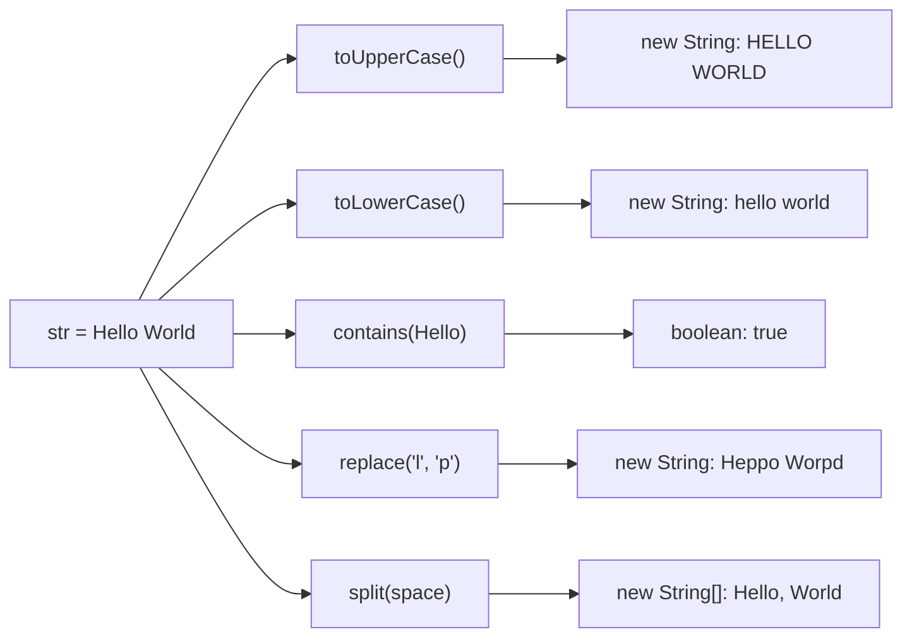
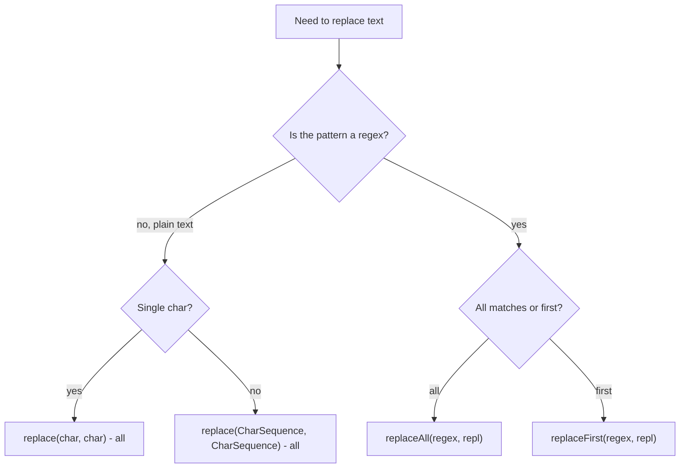

## In One Line
`String` has a rich toolbox — change case, search, compare, replace, split, trim, join and format — and **every one of these methods returns a new value and leaves the original string untouched**, because strings are immutable.

## Mental Model
Think of a **photocopier with filters**.

- You put the original page (`str`) on the glass. You choose a filter — "ALL CAPS" (`toUpperCase`), "swap every `l` for `p`" (`replace`), "cut at every space" (`split`) — and press copy.
- Out comes a **new sheet** (the returned `String` or `String[]`). The original on the glass is exactly as it was.
- If you walk away without picking up the copy (`str.toUpperCase();` with no assignment), the work is simply lost.
- Some filters read the page as **plain text** (`replace`, `contains`), others read your instruction as a **pattern language** (`split`, `replaceAll`, `matches` use regular expressions). Handing a pattern filter a `.` means "any character", not "a dot" — the most common source of surprises in this lesson.

## Concept
### The method families
| Family | Methods | Returns |
|---|---|---|
| **Inspect** | `length()`, `isEmpty()`, `isBlank()` (11), `charAt(i)`, `codePointAt(i)` | `int` / `boolean` / `char` |
| **Search** | `indexOf`, `lastIndexOf`, `contains`, `startsWith`, `endsWith`, `matches` (regex) | index (`-1` if absent) / `boolean` |
| **Compare** | `equals`, `equalsIgnoreCase`, `compareTo`, `compareToIgnoreCase`, `contentEquals`, `regionMatches` | `boolean` / `int` |
| **Transform** | `toUpperCase`, `toLowerCase`, `trim`, `strip` (11), `replace`, `replaceAll`, `replaceFirst`, `concat`, `repeat` (11), `indent` (12) | new `String` |
| **Extract / split** | `substring`, `subSequence`, `split`, `toCharArray`, `chars()`, `codePoints()`, `lines()` (11) | `String` / `String[]` / `char[]` / stream |
| **Build (static)** | `String.join`, `String.valueOf`, `String.format`, `"...".formatted(...)` (15) | new `String` |

### Case conversion: `toUpperCase()` / `toLowerCase()`
- Return a new string with every character converted; characters without case (digits, spaces) stay as they are.
- The no-argument versions use the **default locale of the machine** (`Locale.getDefault()`). That matters: in Turkish, lowercase `i` uppercases to `İ` (U+0130, dotted capital I), so `"title".toUpperCase()` on a Turkish machine is **not** `"TITLE"`. For identifiers, keys, protocol words and file extensions, use `toUpperCase(Locale.ROOT)`.
- The length can change: German `"straße".toUpperCase()` is `"STRASSE"` (6 → 7 chars). Never assume the result has the same length or indexes.
- To compare ignoring case, prefer `equalsIgnoreCase` over `a.toLowerCase().equals(b.toLowerCase())` — no extra objects, no locale surprise.

### Searching: `contains`, `indexOf`, `startsWith`, `endsWith`
- `contains(CharSequence s)` is literally `indexOf(s.toString()) >= 0`. It is **case-sensitive**, `contains("")` is always `true`, and `contains(null)` throws `NullPointerException`.
- `indexOf(x)` returns the first index or **`-1`**; `indexOf(x, from)` starts the search at `from`; `lastIndexOf` searches backwards. Always check for `-1` before using the index.
- `startsWith(prefix)` / `endsWith(suffix)` — cheap checks at the ends; `startsWith(prefix, offset)` checks at a position.
- Case-insensitive search: `s.toLowerCase(Locale.ROOT).contains(x.toLowerCase(Locale.ROOT))`, or `regionMatches(true, ...)`, or a `Pattern` with `CASE_INSENSITIVE`.

### Replacing: four methods, two questions
Ask two questions: **literal or regex?** and **all or first?**

| Method | Pattern is | Replaces | Example on `"a.b.c"` |
|---|---|---|---|
| `replace(char old, char new)` | literal char | **all** | `replace('.', '-')` → `a-b-c` |
| `replace(CharSequence, CharSequence)` | literal text | **all** | `replace(".", "-")` → `a-b-c` |
| `replaceAll(String regex, String repl)` | **regex** | all matches | `replaceAll(".", "-")` → `-----` |
| `replaceFirst(String regex, String repl)` | **regex** | first match | `replaceFirst("\\.", "-")` → `a-b.c` |

The name `replaceAll` fools many people into thinking `replace` replaces only the first occurrence. It does not — **both replace every occurrence**; the difference is regex versus literal. In `replaceAll`/`replaceFirst` the *replacement* is special too: `$1` refers to a captured group and `\` escapes, so a literal `$` must be escaped (`Matcher.quoteReplacement`).

If `replace(char, char)` finds nothing to replace, it returns **the same object** (`this`) — documented behaviour.

### Splitting: `split(String regex)` and `split(regex, limit)`
- The argument is a **regular expression**. `.`, `|`, `$`, `*`, `+`, `?`, `(`, `[`, `{`, `^` and `\` are special: split on a dot with `"\\."` (or `Pattern.quote(".")`).
- **Consecutive delimiters produce empty strings**: `"Hello  World".split(" ")` has an empty token in the middle. Split on `"\\s+"` (one or more whitespace chars) and `trim()` first for "words".
- **Trailing empty strings are removed** (with the default `limit` 0). **Leading** empty strings are kept.
- `limit > 0` → at most `limit` pieces (the last one holds the rest). `limit < 0` → no limit and trailing empties are **kept**.
- `"".split(",")` returns `[""]` — an array of length 1, not 0.
- Performance: a one-character delimiter that is not a regex metacharacter (like `" "` or `","`) takes a fast path with no regex compilation. For a complex regex in a hot loop, compile once: `Pattern p = Pattern.compile("\\s*,\\s*"); p.split(s)`.

### Trimming: `trim()` versus `strip()` (Java 11)
| | `trim()` | `strip()` |
|---|---|---|
| Removes | chars `<= ' '` (ASCII control chars and space) | anything `Character.isWhitespace` says is whitespace, including Unicode spaces like U+2003 (em space) |
| Since | Java 1.0 | Java 11, with `stripLeading()` and `stripTrailing()` |

`isEmpty()` is `length() == 0`; `isBlank()` (11) is "empty or only whitespace".

### Comparing: `equals`, `equalsIgnoreCase`, `compareTo`
- `equals` — exact content; `equalsIgnoreCase` — ignores case char by char (no locale).
- `compareTo` — **lexicographic** order by UTF-16 code unit. It returns the difference of the **first differing characters** (`'A' - 'a'` = −32), or, if one string is a prefix of the other, the **difference in length** (`"app".compareTo("apple")` = −2). Only the **sign** is guaranteed by the contract — never test for `== -1`.
- `String.CASE_INSENSITIVE_ORDER` is a ready-made `Comparator`.

### Building strings
- `String.join(", ", "a", "b")` or `String.join(", ", list)` — joins with a delimiter (Java 8). For streams: `Collectors.joining(", ", "[", "]")`; for manual use: `StringJoiner`.
- `String.valueOf(x)` — works for every type; for `(Object) null` it returns `"null"` instead of throwing.
- `String.format("%05d|%.2f|%-4s", ...)` and `"...".formatted(...)` (15) — printf-style formatting.
- `"ab".repeat(3)` → `"ababab"` (11).

### Immutability in every method
None of these methods changes the string it is called on. They return a new `String` (or array, or the same object when nothing changed). That is why the example stores each result in a new variable: `upperStr`, `lowerStr`, `replacedStr`, `parts`.

## Diagram

One original, five independent results: `str` itself never changes, which is why each result is stored in its own variable.


Choose by "literal or regex?" first; "all or first?" only matters for the regex versions — plain `replace` always replaces every occurrence.

## Code
@example CoreJava/JavaFeatures/StringMethodsExample.java

The regex traps in `split`:
```java
import java.util.Arrays;

public class SplitTraps {
    public static void main(String[] args) {
        System.out.println(Arrays.toString("a.b.c".split(".")));          // "." is a regex: any char
        System.out.println(Arrays.toString("a.b.c".split("\\.")));        // escape it
        System.out.println(Arrays.toString("a|b".split("|")));            // "|" is regex OR
        System.out.println(Arrays.toString("Hello  World".split(" ")));   // two spaces -> empty token
        System.out.println(Arrays.toString(" Hello  World ".trim().split("\\s+")));
        System.out.println(Arrays.toString("a,b,,c,,".split(",")));       // trailing empties dropped
        System.out.println(Arrays.toString("a,b,,c,,".split(",", -1)));   // negative limit keeps them
        System.out.println(Arrays.toString("key=a=b".split("=", 2)));     // at most 2 parts
        System.out.println(",a".split(",").length);                        // leading empty is kept
        System.out.println("".split(",").length);                          // [""] - one empty string
    }
}
```
```output
[]
[a, b, c]
[a, |, b]
[Hello, , World]
[Hello, World]
[a, b, , c]
[a, b, , c, , ]
[key, a=b]
2
1
```

The replace family side by side:
```java
import java.util.regex.Matcher;

public class ReplaceFamily {
    public static void main(String[] args) {
        String s = "a.b.c";
        System.out.println(s.replace('.', '-'));          // every char, literal
        System.out.println(s.replace(".", "-"));          // every substring, literal
        System.out.println(s.replaceAll(".", "-"));       // regex: "." matches everything
        System.out.println(s.replaceAll("\\.", "-"));     // escaped regex
        System.out.println(s.replaceFirst("\\.", "-"));   // only the first match
        System.out.println("a1b22c333".replaceAll("[0-9]+", "#"));  // real regex power
        System.out.println(s.replace('z', 'q') == s);     // nothing to replace -> same object

        try {
            System.out.println("cost: X".replaceAll("X", "$5"));   // $ means "group" in the replacement
        } catch (RuntimeException e) {
            System.out.println(e);
        }
        System.out.println("cost: X".replaceAll("X", Matcher.quoteReplacement("$5")));
        System.out.println("cost: X".replace("X", "$5"));          // replace() is always literal
    }
}
```
```output
a-b-c
a-b-c
-----
a-b-c
a-b.c
a#b#c#
true
java.lang.IndexOutOfBoundsException: No group 5
cost: $5
cost: $5
```

Why case conversion needs a `Locale`:
```java
import java.util.Locale;

public class LocaleTrap {
    public static void main(String[] args) {
        Locale turkish = Locale.forLanguageTag("tr");
        String upper = "title".toUpperCase(turkish);
        System.out.println(upper.equals("TITLE"));             // Turkish has a dotted capital I
        System.out.println((int) upper.charAt(1));              // U+0130, not 'I' (73)
        System.out.println("title".toUpperCase(Locale.ROOT));   // same result on every machine

        String street = "stra\u00DFe";                          // "straße" with German sharp s
        String shout = street.toUpperCase(Locale.ROOT);
        System.out.println(shout + " " + street.length() + " -> " + shout.length());
    }
}
```
```output
false
304
TITLE
STRASSE 6 -> 7
```

A tour of the other everyday methods:
```java
import java.util.List;

public class MethodTour {
    public static void main(String[] args) {
        String s = "Hello World";
        // searching
        System.out.println(s.indexOf('o') + " " + s.lastIndexOf('o') + " " + s.indexOf('o', 5) + " " + s.indexOf("xyz"));
        System.out.println(s.startsWith("Hell") + " " + s.endsWith("World") + " " + s.contains("world"));
        // comparing
        System.out.println(s.equals("hello world") + " " + s.equalsIgnoreCase("hello world"));
        System.out.println("apple".compareTo("banana") + " " + "Apple".compareTo("apple") + " " + "app".compareTo("apple"));
        // whitespace
        String padded = "\u2003 hi \u2003";      // em space (Unicode whitespace) + normal spaces
        System.out.println(padded.trim().length() + " vs " + padded.strip().length());
        System.out.println("".isEmpty() + " " + "   ".isEmpty() + " " + "   ".isBlank());
        // building
        System.out.println(String.join("-", "2026", "09", "24") + " " + String.join(", ", List.of("x", "y")));
        System.out.println("ab".repeat(3) + " " + String.valueOf(3.5) + " " + String.format("%05d|%.2f|%-4s|", 42, 3.14159, "ok"));
        System.out.println("%s is %d".formatted("Age", 30));
        // characters
        System.out.println(s.toCharArray().length + " " + s.chars().filter(c -> c == 'l').count());
    }
}
```
```output
4 7 7 -1
true true false
false true
-1 -32 -2
6 vs 2
true false true
2026-09-24 x, y
ababab 3.5 00042|3.14|ok  |
Age is 30
11 3
```

## Walkthrough
- `package CoreJava.JavaFeatures;` / `public class StringMethodsExample` / `main` — the usual course shell (folder `CoreJava/JavaFeatures`).
- `String str = "Hello World";` — one pooled literal. Every call below reads it; none changes it.
- `String upperStr = str.toUpperCase();` — builds a new string with each letter upper-cased → `HELLO WORLD`. It uses the machine's default locale (see Traps). The result is kept in a new variable because `str` stays `"Hello World"`.
- `String lowerStr = str.toLowerCase();` — likewise → `hello world`. Note it is still computed from the **original** `str`, not from `upperStr`.
- `boolean containsHello = str.contains("Hello");` — a case-sensitive, literal substring search; `"Hello"` occurs at index 0 → `true`. The `boolean` is turned into the text `true` by `+`. (`str.contains("hello")` would be `false`.)
- `String replacedStr = str.replace('l', 'p');` — the `char, char` overload replaces **every** `l`: `He`**`ll`**`o Wor`**`l`**`d` → `Heppo Worpd` (three replacements, not one).
- `String[] parts = str.split(" ");` — cuts the string at each match of the regex `" "` (a single space, which takes the fast non-regex path) → `["Hello", "World"]`. The separator itself is not included.
- `System.out.println("Split string:");` then `for (String part : parts) System.out.println(part);` — the enhanced for loop visits each array element in order and prints it on its own line: `Hello`, then `World`.

All the `//` output comments match the real output; two of them (`replace` and the loop) just omit the `Output:` prefix the others use.

## Traps
- **Ignoring the result.** `str.toUpperCase();` alone does nothing — strings are immutable. Assign it: `str = str.toUpperCase();`.
- **`replace` replaces all, not the first.** The "All" in `replaceAll` means *regex*, not "all occurrences".
- **Regex metacharacters in `split`, `replaceAll`, `replaceFirst`, `matches`.** `split(".")` returns an empty array; `split("|")` splits between every character. Escape with `"\\."` / `"\\|"` or use `Pattern.quote(...)`.
- **`$` and `\` in the replacement of `replaceAll`** are special (`$5` means "group 5"). Use `Matcher.quoteReplacement(...)` or plain `replace(...)`.
- **`split(" ")` with repeated spaces** produces empty strings; use `trim().split("\\s+")`.
- **`split` silently drops trailing empty strings** — a CSV line `"a,b,,"` gives 2 fields, not 4. Use `split(",", -1)`.
- **`contains`, `indexOf`, `equals` are case-sensitive.** Use `equalsIgnoreCase`, or lower-case both sides with `Locale.ROOT`.
- **`indexOf` returns `-1` when not found** — passing that to `substring` throws `StringIndexOutOfBoundsException`.
- **`compareTo` returns a difference, not just −1/0/1.** Test `< 0`, `== 0`, `> 0`.
- **`trim()` only removes chars `<= ' '`**, so Unicode spaces such as the em space U+2003 survive; `strip()` removes them. Neither removes the no-break space U+00A0, because Java does not classify it as whitespace — use `replace('\u00A0', ' ')` first if your input contains it.
- **Calling methods on `null`** — `str.toUpperCase()` with `str == null` throws `NullPointerException`; `String.valueOf(obj)` is the null-safe way to get text.

> [!ERRATA] `str.toUpperCase()` and `str.toLowerCase()` without a `Locale` depend on the machine's default locale. That is fine for text shown to a user in their own language, but wrong for anything the program compares or looks up (keys, commands, enum names, file extensions): on a Turkish-locale machine `"title".toUpperCase()` is `TİTLE`, not `TITLE`. Write `toUpperCase(Locale.ROOT)` for locale-independent text.

## Tips & Tricks
- **Two questions for replace: "Regex? All or first?"** — no regex → `replace` (always all); regex → `replaceAll` / `replaceFirst`.
- **"split, replaceAll, replaceFirst, matches speak regex"** — remember the four regex methods; everything else is literal.
- **Escape once for regex, once for Java:** a literal dot is `\.` in regex, written `"\\."` in Java source.
- **`Locale.ROOT` for machines, default locale for humans.**
- **Null-safe comparisons:** `"yes".equalsIgnoreCase(input)` never throws.
- **Words from a sentence:** `s.trim().split("\\s+")`. **CSV that keeps empty fields:** `line.split(",", -1)`.
- **Count a char:** `s.chars().filter(c -> c == 'l').count()`; or `s.length() - s.replace("l", "").length()`.
- More string algorithms (palindrome, anagram, reverse words, first non-repeating char) are drilled in [String Programs](lesson:b06-coding-drills/03-string-programs).

## Interview Q&A
### [Basic] What is the difference between `replace()`, `replaceAll()` and `replaceFirst()`?
`replace` has two overloads — `(char, char)` and `(CharSequence, CharSequence)` — and treats its arguments as **literal** text; it replaces **every** occurrence. `replaceAll(regex, replacement)` treats the first argument as a **regular expression** and replaces every match; `replaceFirst` does the same for only the first match. In the regex versions the replacement string is also interpreted (`$1` = group 1, `\` escapes). So `"a.b".replace(".", "-")` is `a-b`, but `"a.b".replaceAll(".", "-")` is `---`.

**Follow-up:** *How do you replace a literal `$` with `replaceAll`?* — Escape it in the replacement (`"\\$"`) or wrap it with `Matcher.quoteReplacement(...)` — or just use `replace`, which is literal.

### [Basic] Does `str.toUpperCase()` change `str`?
No. `String` is immutable, so every "modifying" method returns a **new** string and the original is unchanged. `str.toUpperCase();` on its own line throws the result away; you must write `str = str.toUpperCase();` or use the returned value. (Some methods return the same object if nothing changes — e.g. `replace(char, char)` when the char is absent — but they never modify it.)

**Follow-up:** *Which class would you use if you really need in-place changes?* — `StringBuilder` (or `StringBuffer` when shared between threads).

### [Basic] What is the difference between `trim()` and `strip()`? And `isEmpty()` versus `isBlank()`?
`trim()` (Java 1.0) removes leading and trailing characters whose code is `<= U+0020` — ASCII space and control characters. `strip()` (Java 11) removes leading and trailing **Unicode whitespace** as defined by `Character.isWhitespace`, so it also removes characters like the em space U+2003; `stripLeading()`/`stripTrailing()` do one side. `isEmpty()` is `length() == 0`; `isBlank()` (Java 11) is true for empty strings or strings of only whitespace.

**Follow-up:** *Which should new code use?* — `strip()`/`isBlank()`, unless you specifically want the old ASCII-only behaviour.

### [Intermediate] Explain how `split()` works and its common pitfalls.
`split(regex)` = `split(regex, 0)`: it cuts the string at every match of the **regular expression** and returns the pieces without the delimiters. Pitfalls:
1. Regex metacharacters: `split(".")` returns an empty array because `.` matches every character; escape as `"\\."`.
2. Adjacent delimiters give empty strings (`"a  b".split(" ")` → `[a, , b]`); use `"\\s+"`.
3. With limit 0, **trailing** empty strings are removed (`"a,b,,".split(",")` → 2 elements); a **leading** delimiter still gives a leading `""`.
4. `limit > 0` caps the number of pieces; `limit < 0` keeps trailing empties.
5. `"".split(",")` returns `[""]`, length 1.

**Follow-up:** *Is `split` slow?* — A one-character, non-metacharacter delimiter uses a fast path. Otherwise `split` compiles a `Pattern` on every call, so in a hot loop precompile it: `Pattern.compile(regex).split(s)`.

### [Intermediate] How does `compareTo` work for strings?
It compares lexicographically, character by character (by UTF-16 code unit value). At the first position where the strings differ it returns `this.charAt(k) - other.charAt(k)`; if one string is a prefix of the other it returns `this.length() - other.length()`; equal strings return 0. So `"Apple".compareTo("apple")` is `'A' - 'a'` = −32 and `"app".compareTo("apple")` is −2. Uppercase letters sort before lowercase. Callers must only rely on the **sign**.

**Follow-up:** *How do you sort case-insensitively or by human language rules?* — `String.CASE_INSENSITIVE_ORDER` for simple cases; `java.text.Collator.getInstance(locale)` for real linguistic ordering (accents, etc.).

### [Intermediate] Why should you pass a `Locale` to `toUpperCase`/`toLowerCase`?
Without an argument they use `Locale.getDefault()`, so the result depends on the machine. The classic bug is Turkish: `"title".toUpperCase()` gives `TİTLE` (dotted capital I, U+0130) and `"TITLE".toLowerCase()` gives a dotless `ı`, which breaks comparisons of keywords, HTTP headers, enum names or file extensions. Use `Locale.ROOT` for program-internal text and the user's locale only for displayed text. Also remember case mapping can change the length (`ß` → `SS`).

**Follow-up:** *Is `equalsIgnoreCase` locale-sensitive?* — No; it compares char by char using `Character.toUpperCase`/`toLowerCase`, independent of the default locale.

### [Intermediate] How do you check whether a string contains another string, ignoring case?
Options:
- `s.toLowerCase(Locale.ROOT).contains(t.toLowerCase(Locale.ROOT))` — simple, creates two new strings.
- `s.regionMatches(true, i, t, 0, t.length())` in a loop over `i` — no allocation.
- `Pattern.compile(Pattern.quote(t), Pattern.CASE_INSENSITIVE).matcher(s).find()` — good when reused.

`contains` itself is case-sensitive and is implemented as `indexOf(s.toString()) >= 0`.

**Follow-up:** *What does `s.contains("")` return?* — `true`; the empty string is found at index 0 of every string.

### [Intermediate] What are `String.join`, `StringJoiner` and `Collectors.joining`, and when do you use each?
All three join pieces with a delimiter (Java 8). `String.join(", ", a, b, c)` or `String.join(", ", iterable)` is the one-liner. `StringJoiner` adds a prefix and suffix and lets you add pieces one by one (`new StringJoiner(", ", "[", "]").add("a").add("b")`), with `setEmptyValue` for the no-elements case. `Collectors.joining(", ", "[", "]")` is the stream version and uses a `StringJoiner` internally.

**Follow-up:** *What does `String.join(",", List.of())` return?* — The empty string `""`.

### [Advanced] Which `String` methods take a regular expression, and what are the performance implications?
`matches`, `split`, `replaceAll` and `replaceFirst`. Each call (except `split`'s single-char fast path) compiles a new `java.util.regex.Pattern`, which is comparatively expensive. In loops, compile once and reuse: `private static final Pattern COMMA = Pattern.compile("\\s*,\\s*");` then `COMMA.split(s)` or `COMMA.matcher(s).replaceAll(...)`. When no regex is needed, prefer the literal methods `replace`, `contains`, `startsWith`, `indexOf`. User-supplied text used as a pattern must be wrapped with `Pattern.quote` to avoid both bugs and regex-injection.

**Follow-up:** *What is ReDoS?* — "Regular-expression denial of service": a badly written regex (nested quantifiers like `(a+)+`) can take exponential time on crafted input; never run untrusted patterns.

## Quiz
### What does this print?
```java
System.out.println("a.b.c".split(".").length);
```
- [x] 0
- [ ] 3
- [ ] 5
- [ ] 1
> `split` takes a regex and `.` matches **every** character, so every piece between matches is empty — and empty trailing strings are removed, leaving an array of length 0. `3` is what you get with the escaped regex `"\\."`.

### What does the original example print for `str.replace('l', 'p')` on `"Hello World"`?
- [ ] Heplo World
- [x] Heppo Worpd
- [ ] Hello World
- [ ] Heppo World
> `replace` replaces **every** occurrence of the char, and `"Hello World"` has three `l`s. `Heplo World` is the tempting "first occurrence only" answer — that is what `replaceFirst` would do.

### What does this print?
```java
System.out.println("Apple".compareTo("apple") + " " + "app".compareTo("apple"));
```
- [ ] -1 -1
- [x] -32 -2
- [ ] 32 2
- [ ] 0 -2
> At the first differing char `compareTo` returns the difference: `'A'`(65) − `'a'`(97) = −32. When one string is a prefix of the other it returns the length difference: 3 − 5 = −2. It does not return just −1/0/1.

### What does this print?
```java
System.out.println("a,b,,c,,".split(",").length);
```
- [ ] 6
- [x] 4
- [ ] 3
- [ ] 5
> The pieces are `a`, `b`, `""`, `c`, `""`, `""`. With the default limit 0, **trailing** empty strings are removed, but the empty string in the middle stays → 4. Use `split(",", -1)` to keep all 6.

### Spot the bug: the user typed `YES`, but the program says "Not confirmed". Why?
```java
String input = scanner.next();          // user typed YES
if (input.toLowerCase() == "yes") {
    System.out.println("Confirmed");
} else {
    System.out.println("Not confirmed");
}
```
- [ ] `toLowerCase()` changes `input` in place, so the comparison sees the old value
- [x] `==` compares references; `toLowerCase()` creates a new object that is never the pooled `"yes"` literal
- [ ] `toLowerCase()` of `YES` is `Yes`
- [ ] `scanner.next()` returns `null`
> The content is `"yes"`, but it is a runtime-built object, so `==` is `false`. Use `"yes".equalsIgnoreCase(input)`, which also removes the need for `toLowerCase()` and is null-safe.

### What does `"   ".isEmpty() + " " + "   ".isBlank()` evaluate to?
- [ ] true true
- [x] false true
- [ ] false false
- [ ] true false
> `isEmpty()` only checks `length() == 0`; three spaces have length 3. `isBlank()` (Java 11) is true when the string is empty **or** contains only whitespace.

### What does this print?
```java
String t = "banana";
System.out.println(t.replace("an", "AN") + " " + t.replaceFirst("an", "AN") + " " + t.indexOf("an") + " " + t.lastIndexOf("an"));
```
- [ ] bANana bANana 1 3
- [x] bANANa bANana 1 3
- [ ] bANANa bANANa 1 1
- [ ] bANANa bANana 2 4
> `replace` changes **all** occurrences (`b`+`AN`+`AN`+`a`), `replaceFirst` only the first. `"an"` first starts at index 1 (`b`=0) and last starts at index 3. `t` itself is never modified, so each call works on `"banana"`.

## Takeaways
- Every String method returns a new value; the original never changes — always assign or use the result.
- `replace` (char or text) is literal and replaces **all** occurrences; `replaceAll`/`replaceFirst` use regex — the "All" is about regex, not count.
- `split`, `replaceAll`, `replaceFirst` and `matches` take regular expressions: escape `.`, `|`, `$` etc. (`"\\."`, `Pattern.quote`).
- `split` drops trailing empty strings (use limit `-1` to keep them), keeps leading ones, and yields empty tokens for repeated delimiters (use `"\\s+"`).
- `contains`, `indexOf`, `equals`, `compareTo` are case-sensitive; `indexOf` returns `-1` when absent; `compareTo` returns a char or length difference — test only its sign.
- Pass `Locale.ROOT` to `toUpperCase`/`toLowerCase` for program-internal text; the default locale breaks on Turkish `i`, and case mapping can change length.
- Java 11 added `strip`, `isBlank`, `repeat`, `lines`; `strip` understands Unicode whitespace, `trim` only ASCII `<= ' '`.
