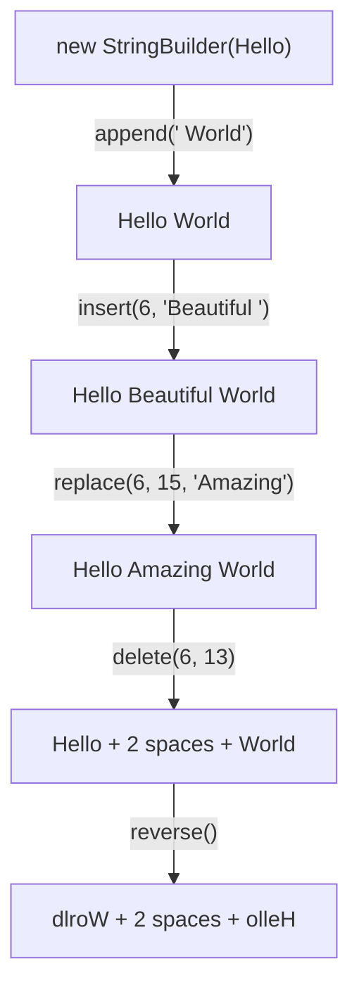
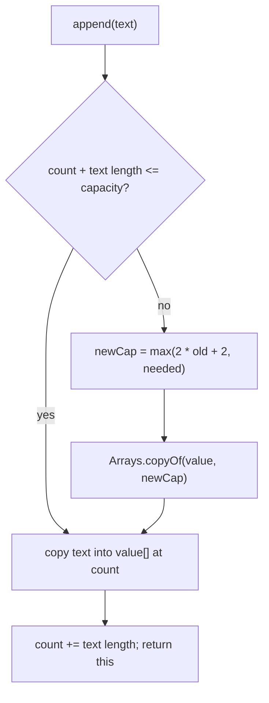

## In One Line
`StringBuilder` is a **mutable**, resizable buffer of characters: `append`, `insert`, `replace`, `delete` and `reverse` change the **same object** in place (and return it, so calls can be chained), which makes building text step by step fast — but it is **not thread-safe**.

## Mental Model
Think of a **whiteboard** next to the engraved name plates of the [Strings](lesson:a02-core/09-strings) lesson.

- On a whiteboard you **write, erase and rewrite in place** — no new board for every edit. That is `StringBuilder`: one object, edited over and over.
- The board has a fixed **width** (the *capacity*). When your text no longer fits, someone fetches a **bigger board (about double the size) and copies everything across** — that is how the internal array grows.
- When you are done you **take a photo** of the board (`toString()`) — the photo is an immutable `String`; later scribbles on the board do not change the photo.
- A whiteboard has **no queue discipline**: if two people write on it at the same time, letters get lost or overwritten. For a shared board you need a supervisor — that is `StringBuffer` (next lesson).

## Concept
### Why StringBuilder exists
`String` is immutable, so a loop like `s += x` creates a new string and copies all previous characters every iteration — O(n²) work and lots of garbage. `StringBuilder` (added in **Java 5** as the unsynchronized twin of `StringBuffer`) keeps one growing array and appends into it — amortised O(1) per append, O(n) total.

```java
StringBuilder sb = new StringBuilder();
for (String word : words) {
    sb.append(word).append(' ');
}
String sentence = sb.toString();
```

### Class structure
```java
public final class StringBuilder extends AbstractStringBuilder
        implements Appendable, java.io.Serializable,
                   Comparable<StringBuilder>, CharSequence   // Comparable since Java 11
```
`AbstractStringBuilder` (package-private) holds the real state and logic:

| Field (JDK 21) | Meaning |
|---|---|
| `byte[] value` | the character storage (Java 9+; `char[]` before) — its length is the **capacity** |
| `byte coder` | `LATIN1` or `UTF16`, same Compact Strings idea as `String`; the buffer "inflates" to UTF-16 when a non-Latin-1 char arrives |
| `int count` | how many chars are actually used — the **length** |

### Length versus capacity
- `length()` — number of characters currently in the builder.
- `capacity()` — how many characters fit before the array must grow.
- Constructors: `new StringBuilder()` → capacity **16**; `new StringBuilder(int cap)` → that capacity; `new StringBuilder("Hello")` → **16 + length** = 21; `new StringBuilder(CharSequence)` → same rule.
- **Growth rule:** when an append does not fit, the new capacity is `max(oldCapacity * 2 + 2, neededLength)`. 16 → 34 → 70 → 142 → 286. Each growth allocates a new array and copies the old content (`Arrays.copyOf`), which is why appends are *amortised* O(1).
- `ensureCapacity(n)` grows in advance; `trimToSize()` shrinks the array to the length; `setLength(n)` truncates or pads with `'\0'`.

> [!TIP] If you know roughly how big the result will be, pass it to the constructor — `new StringBuilder(1024)` — to avoid the repeated grow-and-copy steps.

### The core methods
All positions are 0-based; ranges are half-open `[start, end)` exactly like `substring`.

| Method | Effect | Notes |
|---|---|---|
| `append(x)` | adds `x` at the end | overloaded for every primitive, `char[]`, `CharSequence`, `Object` (uses `String.valueOf`); `null` appends `"null"` |
| `insert(offset, x)` | inserts `x` **before** index `offset` | `0 <= offset <= length()`; `offset == length()` is the same as append |
| `replace(start, end, str)` | removes `[start, end)` and puts `str` there | `end` greater than `length()` is clamped; lengths need not match |
| `delete(start, end)` | removes `[start, end)` | `end` greater than `length()` is clamped |
| `deleteCharAt(i)` | removes one char | `i` must be `< length()` |
| `reverse()` | reverses in place | keeps surrogate pairs (emoji) intact |
| `setCharAt(i, c)` | overwrites one char | |
| `charAt`, `indexOf`, `lastIndexOf`, `substring`, `length` | read-only, like `String` | |
| `repeat(cs, n)`, `repeat(codePoint, n)` | appends `n` copies | **Java 21** |
| `toString()` | copies the content into a new immutable `String` | O(n) each call |

Every mutating method **returns `this`**, so you can chain: `sb.append("a").append(1).insert(0, '[')`. The return value is the same object, not a copy.

### Complexity
| Operation | Cost |
|---|---|
| `append` | amortised O(1) per char (occasional O(n) grow-and-copy) |
| `insert`, `delete`, `replace` in the middle | O(n) — everything after the position is shifted with `System.arraycopy` |
| `reverse` | O(n) |
| `charAt`, `setCharAt`, `length` | O(1) |
| `toString` | O(n) copy |

### `equals` is NOT overridden
`StringBuilder` does not override `equals` or `hashCode` — it inherits identity comparison from `Object`. `new StringBuilder("abc").equals(new StringBuilder("abc"))` is **`false`**. To compare content use `sb1.toString().equals(sb2.toString())`, `sb1.compareTo(sb2) == 0` (Java 11+), or `"abc".contentEquals(sb)`. For the same reason, never use a `StringBuilder` as a `HashMap` key or in a `HashSet`.

### StringBuilder vs `+`
- For a **single expression** (`a + ":" + b`), just use `+`: the compiler already optimises it (a `StringBuilder` chain up to Java 8, `invokedynamic` since Java 9), and it is more readable.
- For **loops or conditional building**, use one explicit `StringBuilder` — the compiler cannot merge concatenations across loop iterations.

### Not thread-safe
None of the methods are synchronized. If two threads append to the same builder, updates to `count` and the array can interleave: characters are lost, and a grow can race with a write and throw `ArrayIndexOutOfBoundsException`. That is fine for the usual case — a builder that lives in **one method, on one thread** (a local variable). For a shared buffer see [StringBuffer](lesson:a02-core/12-stringbuffer), or better, avoid sharing.

## Diagram

One object moves through every state of the example; no new `StringBuilder` is created — each method edits the same buffer and returns it.


Most appends take the fast "yes" branch; the occasional grow doubles the array, so the copying cost averages out to O(1) per character.

## Code
@example CoreJava/JavaFeatures/StringBuilderExample.java

Length versus capacity, and how the array grows:
```java
public class CapacityDemo {
    public static void main(String[] args) {
        System.out.println(new StringBuilder().capacity());          // default 16
        System.out.println(new StringBuilder("Hello").capacity());   // 16 + 5

        StringBuilder sb = new StringBuilder();                      // watch it grow
        int cap = sb.capacity();
        for (int i = 0; i < 150; i++) {
            sb.append('x');
            if (sb.capacity() != cap) {
                System.out.println("length " + sb.length() + ": " + cap + " -> " + sb.capacity());
                cap = sb.capacity();
            }
        }

        StringBuilder small = new StringBuilder(4);
        small.append("a string of 25 characters");                  // 4*2+2 = 10 is too small
        System.out.println(small.capacity());                        // grows straight to 25

        small.append('!');                                           // full again: 25*2+2
        System.out.println(small.capacity());
        small.trimToSize();                                          // shrink to fit the 26 chars
        System.out.println(small.capacity());

        StringBuilder trap = new StringBuilder('a');                 // char -> int capacity!
        System.out.println("[" + trap + "] length=" + trap.length() + " capacity=" + trap.capacity());
    }
}
```
```output
16
21
length 17: 16 -> 34
length 35: 34 -> 70
length 71: 70 -> 142
length 143: 142 -> 286
25
52
26
[] length=0 capacity=97
```

Chaining, the other methods, and the `equals` trap:
```java
public class BuilderTour {
    public static void main(String[] args) {
        StringBuilder sb = new StringBuilder()
                .append("Java ").append(21).append(' ').append(true)   // every append returns this
                .append(' ').append(3.5).append(' ').append((String) null);
        System.out.println(sb);

        sb.setLength(7);                        // cut back to "Java 21"
        sb.setCharAt(0, 'j');
        sb.deleteCharAt(4);                     // remove the space
        sb.insert(sb.length(), "!");            // insert at length() == append
        System.out.println(sb + " length=" + sb.length() + " indexOf(21)=" + sb.indexOf("21"));

        StringBuilder a = new StringBuilder("abc");
        StringBuilder b = new StringBuilder("abc");
        System.out.println(a.equals(b));                         // Object.equals: identity
        System.out.println(a.toString().equals(b.toString()));   // compare contents
        System.out.println(a.compareTo(b) == 0);                 // Java 11+: Comparable
        System.out.println("abc".contentEquals(a));              // String vs any CharSequence

        StringBuilder d = new StringBuilder("Hello World");
        d.delete(5, 100);                       // end past length() is clamped, no exception
        System.out.println("[" + d + "]");
        try {
            d.insert(99, "x");                  // insert offset must be 0..length()
        } catch (StringIndexOutOfBoundsException e) {
            System.out.println("insert(99): " + e.getClass().getSimpleName());
        }

        System.out.println(new StringBuilder().repeat("ab", 3).repeat('-', 2));  // Java 21
    }
}
```
```output
Java 21 true 3.5 null
java21! length=7 indexOf(21)=4
false
true
true
true
[Hello]
insert(99): StringIndexOutOfBoundsException
ababab--
```

## Walkthrough
- `package CoreJava.JavaFeatures;` / `public class StringBuilderExample` / `main` — the usual course shell.
- `StringBuilder sb = new StringBuilder("Hello");` — creates a builder holding `Hello` (length 5) with capacity 16 + 5 = 21.
- `sb.append(" World");` — adds 6 chars at the end → `Hello World` (length 11, still fits in 21). The returned reference (`sb` itself) is ignored here, which is fine.
- `System.out.println("Appended string: " + sb);` — string concatenation calls `sb.toString()` (via `String.valueOf`) to take a snapshot. Output: `Appended string: Hello World`.
- `sb.insert(6, "Beautiful ");` — index 6 is the `W` (H0 e1 l2 l3 o4 space5 **W6**). The text is inserted **before** it and everything from `W` on shifts right by 10 → `Hello Beautiful World` (length 21 — exactly the capacity, so still no growth).
- `sb.replace(6, 15, "Amazing");` — in `Hello Beautiful World`, indexes 6..14 are `Beautiful` (9 chars) and index 15 is the space before `World`. `[6, 15)` removes exactly `Beautiful` and puts the 7-char `Amazing` in its place; the builder shrinks by 2 → `Hello Amazing World`.
- `sb.delete(6, 13);` — in `Hello Amazing World`, indexes 6..12 are `Amazing`; the end index 13 (the space after it) is exclusive and survives. The space at index 5 also survives, so the result has **two spaces**: `Hello  World`. The comment in the source shows the two spaces correctly — easy to miss when reading.
- `sb.reverse();` — reverses in place, character by character (both spaces included) → `dlroW  olleH`.

| Step | Buffer after the step | length |
|---|---|---|
| `new StringBuilder("Hello")` | `Hello` | 5 |
| `append(" World")` | `Hello World` | 11 |
| `insert(6, "Beautiful ")` | `Hello Beautiful World` | 21 |
| `replace(6, 15, "Amazing")` | `Hello Amazing World` | 19 |
| `delete(6, 13)` | `Hello  World` | 12 |
| `reverse()` | `dlroW  olleH` | 12 |

Every `// Output:` comment in this file matches the recorded output.

## Traps
- **`new StringBuilder('a')` is an empty builder with capacity 97.** There is no `StringBuilder(char)` constructor; the `char` widens to `int` and picks `StringBuilder(int capacity)`. Use `new StringBuilder("a")` or `new StringBuilder().append('a')`.
- **`append('d' + 'e')` appends `201`**, not `de` — `char + char` is `int` arithmetic before `append` ever sees it.
- **`equals` compares identity.** Two builders with the same text are not `equals`. Compare `toString()`s, use `compareTo` (11+) or `contentEquals`.
- **Methods mutate *and* return `this`.** `sb.reverse().toString().equals(sb.toString())` is **always true** — by the time the right side runs, `sb` has already been reversed. Take a snapshot first: `String original = sb.toString();`.
- **Aliasing:** `StringBuilder y = x.append("!");` — `x` and `y` are the same object; changing one "changes" the other.
- **Index rules differ by method:** `delete`/`replace` clamp an `end` beyond `length()`, but `insert`, `charAt`, `deleteCharAt`, `setCharAt` and a `start` beyond `length()` throw `StringIndexOutOfBoundsException`.
- **Shared across threads** → lost characters or `ArrayIndexOutOfBoundsException`. Keep builders local, or use `StringBuffer`.
- **Using a builder where `+` is clearer.** `new StringBuilder().append(a).append(b).toString()` in a single statement is no faster than `a + b` on modern Java — just noisier.

## Tips & Tricks
- **"String = engraved plate, StringBuilder = whiteboard, StringBuffer = whiteboard with a guard."**
- **Growth formula: "double plus two"** — `2 * old + 2` (or the needed size if that is bigger). Default 16, or 16 + initial text length.
- **Half-open ranges everywhere:** `replace(6, 15, ...)` and `delete(6, 13)` never touch index `end`. Length removed = `end − start`.
- **Reverse a string in one line:** `new StringBuilder(s).reverse().toString()` — and it handles emoji surrogate pairs correctly, unlike a naive char swap.
- **Joining with separators?** Consider `String.join`, `StringJoiner` or `Collectors.joining` instead of manual "append separator unless last" logic.
- **Remove the trailing separator:** `if (sb.length() > 0) sb.setLength(sb.length() - 1);`.
- **Pre-size big builders:** `new StringBuilder(expectedSize)` avoids repeated copying.

## Interview Q&A
### [Basic] Why use `StringBuilder` instead of `String` for building text?
`String` is immutable, so every modification creates a new object and copies the old characters; building a string of n pieces with `+=` in a loop is O(n²) time and creates n temporary strings. `StringBuilder` is mutable: it keeps one internal array, appends into it in place, and only copies when the array has to grow (doubling), so the loop is O(n) overall. Call `toString()` once at the end to get the immutable result.

**Follow-up:** *Should `String s = a + b + c;` be rewritten with StringBuilder?* — No. A single expression is already optimised by the compiler (`StringBuilder` chain before Java 9, `invokedynamic` `StringConcatFactory` since), and `+` is more readable.

### [Basic] What is the difference between `String`, `StringBuilder` and `StringBuffer`?
| | `String` | `StringBuilder` | `StringBuffer` |
|---|---|---|---|
| Mutable | no | yes | yes |
| Thread-safe | yes (immutable) | **no** | yes (synchronized methods) |
| Speed for building | slow (copies) | fastest | slightly slower (locking) |
| Since | 1.0 | 5 | 1.0 |
| `equals` by content | yes | no (identity) | no (identity) |

Use `String` for values, `StringBuilder` for building text in a single thread (the normal case), and `StringBuffer` only for legacy APIs or a buffer genuinely shared between threads.

**Follow-up:** *Why was StringBuilder added if StringBuffer already existed?* — Most buffers are used by one thread; paying for locks on every call was wasted work, so Java 5 added the unsynchronized version with the same API.

### [Intermediate] What is the capacity of a StringBuilder and how does it grow?
Capacity is the size of the internal array — how many chars fit before a reallocation; length is how many are used. The default is 16; `new StringBuilder("Hello")` has 16 + 5 = 21; `new StringBuilder(n)` has n. When an append does not fit, the new capacity is `max(2 * old + 2, required)`: 16 → 34 → 70 → 142. Growing allocates a new array and copies the content, which makes appends amortised O(1). `ensureCapacity` pre-grows, `trimToSize` shrinks to the length.

**Follow-up:** *What is the capacity of `new StringBuilder('a')`?* — 97, and the builder is empty: the `char` is widened to `int` and the `StringBuilder(int capacity)` constructor is chosen.

### [Intermediate] Why does `sb1.equals(sb2)` return false for builders with the same content?
`StringBuilder` (and `StringBuffer`) do not override `equals`/`hashCode`, so they inherit `Object`'s identity comparison. That is deliberate: a mutable object's content — and so its hash — can change at any time, which would break hash-based collections. To compare content, use `sb1.toString().equals(sb2.toString())`, `sb1.compareTo(sb2) == 0` (both implement `Comparable` since Java 11), or `someString.contentEquals(sb)`.

**Follow-up:** *Can you use a StringBuilder as a HashMap key?* — You can, but it is compared by identity, so a different builder with the same text will not find the entry. Use its `toString()` instead.

### [Intermediate] What are the time complexities of StringBuilder operations?
`append` is amortised O(1) per character (occasional O(n) copy on growth). `insert`, `delete`, `deleteCharAt` and `replace` in the middle are O(n) because the characters after the position are shifted with `System.arraycopy`. `charAt`/`setCharAt`/`length` are O(1). `reverse` is O(n). `toString` is O(n) — it copies the content into a new `String` every time you call it.

**Follow-up:** *So is inserting at position 0 in a loop a good idea?* — No, that is O(n²). Append and reverse once at the end, or use an `ArrayDeque`/`LinkedList` of pieces.

### [Intermediate] What happens if two threads share a StringBuilder?
Its methods are not synchronized. Two threads can read the same `count`, write into the same slot and both increment — characters are lost. If one thread grows the array while another writes, the writer may use the old array or index and throw `ArrayIndexOutOfBoundsException`. Running four threads that each append 100,000 chars typically ends with a length well below 400,000. Fix: confine the builder to one thread (the normal usage — a local variable), use `StringBuffer`, or synchronize externally.

**Follow-up:** *Is a local StringBuilder inside a method used by many threads safe?* — Yes. Each call creates its own builder on its own stack frame, so nothing is shared.

### [Advanced] How does `reverse()` handle Unicode surrogate pairs?
Characters outside the Basic Multilingual Plane (most emoji) are stored as two `char`s — a high and a low surrogate. `reverse()` swaps chars and then walks the result to un-swap any surrogate pair that got reversed, so `"ab" + U+1F600` becomes U+1F600 + `"ba"` with the emoji intact. A naive "swap `char`s from both ends" loop puts the low surrogate first and produces an invalid string.

```java
String s = "ab\uD83D\uDE00";                   // "ab" + emoji U+1F600
String r = new StringBuilder(s).reverse().toString();
System.out.println(Integer.toHexString(r.codePointAt(0)) + " " + r.substring(2));
```
```output
1f600 ba
```
**Follow-up:** *Does `reverse` handle combining characters (e.g. `e` + accent)?* — No. It works on code points, not grapheme clusters; an accent would move to the other side of its letter. Use `java.text.BreakIterator` for grapheme-aware reversal.

### [Advanced] How is StringBuilder implemented internally in modern Java?
`StringBuilder` extends the package-private `AbstractStringBuilder`, which holds `byte[] value`, a `byte coder` (`LATIN1` or `UTF16`, the Compact Strings scheme from Java 9) and an `int count`. While everything is Latin-1 it uses 1 byte per char; the first non-Latin-1 char "inflates" the whole buffer to UTF-16. Growth goes through `ArraysSupport.newLength`, giving `max(2 * old + 2, needed)` and capping near `Integer.MAX_VALUE` (beyond that you get `OutOfMemoryError`). `toString()` copies the used bytes into a new `String`, so later edits cannot affect strings already returned.

**Follow-up:** *Why doesn't `toString()` share the array to save the copy?* — The builder is mutable; sharing would let later appends change an "immutable" `String`. (Java 1.4's `StringBuffer` did share-until-modified; it was dropped because it wasted memory.)

## Quiz
### What does the original example print after `sb.replace(6, 15, "Amazing")`?
- [ ] String after replacement: Hello AmazingWorld
- [x] String after replacement: Hello Amazing World
- [ ] String after replacement: Hello Amazingul World
- [ ] It throws StringIndexOutOfBoundsException
> In `Hello Beautiful World`, `[6, 15)` covers exactly `Beautiful` (indexes 6–14); index 15, the space, is excluded and survives. `Hello AmazingWorld` is what the StringBuffer example gets with `replace(6, 16, ...)`, which also removes that space.

### What does this print?
```java
StringBuilder sb = new StringBuilder("abc");
sb.append('d' + 'e');
System.out.println(sb);
```
- [ ] abcde
- [x] abc201
- [ ] abcd
- [ ] Compile error
> `'d' + 'e'` is evaluated first as `int` arithmetic: 100 + 101 = 201. The `append(int)` overload then appends the text `201`. Write `sb.append('d').append('e')` or `sb.append("de")`.

### What are the length and capacity of `new StringBuilder('a')`?
- [ ] length 1, capacity 17
- [x] length 0, capacity 97
- [ ] length 1, capacity 16
- [ ] Compile error: no char constructor
> There is no `StringBuilder(char)` constructor, but `char` widens to `int`, so `StringBuilder(int capacity)` is chosen with capacity 97 (the code of `'a'`). It compiles and silently produces an empty builder.

### Spot the bug: why does this say every word is a palindrome?
```java
StringBuilder sb = new StringBuilder("hello");
boolean palindrome = sb.reverse().toString().equals(sb.toString());
System.out.println(palindrome + " " + sb);
```
- [x] `reverse()` mutates `sb`, so both sides compare the reversed text: prints `true olleh`
- [ ] `equals` on `StringBuilder` compares identity: prints `false hello`
- [ ] `reverse()` returns a copy, so it prints `false hello`
- [ ] It prints `false olleh`
> `reverse()` changes the builder in place and returns the same object. By the time `sb.toString()` on the right runs, `sb` is already `olleh`, so the comparison is always `true`. Fix: `String original = sb.toString(); boolean p = sb.reverse().toString().equals(original);`. (`equals` here is called on `String`s, so the identity issue does not apply.)

### What does this print?
```java
StringBuilder x = new StringBuilder("Java");
StringBuilder y = x.append("21");
y.insert(0, "Hi ");
System.out.println(x + " " + (x == y));
```
- [ ] Java21 false
- [ ] Java false
- [x] Hi Java21 true
- [ ] Hi Java21 false
> `append` returns `this`, so `x` and `y` refer to the **same** builder. The insert through `y` is visible through `x`, and `x == y` is `true`.

### What does this print?
```java
StringBuilder r = new StringBuilder("Hello World");
r.replace(6, 11, "Java").reverse();
System.out.println(r);
```
- [x] avaJ olleH
- [ ] Hello Java
- [ ] dlroW olleH
- [ ] avaJolleH
> `replace(6, 11, "Java")` swaps `World` for `Java` → `Hello Java`; `reverse()` is chained on the same object → `avaJ olleH`. The space at index 5 is untouched.

### Which statement about `StringBuilder` is true?
- [ ] Its methods are synchronized, so it is safe to share between threads
- [ ] `toString()` returns a view that changes when the builder changes
- [x] `delete(start, end)` with `end > length()` deletes to the end instead of throwing
- [ ] `insert(offset, s)` accepts any `offset` and pads with spaces
> `delete` and `replace` clamp `end` to `length()`. `StringBuilder` is not synchronized (that is `StringBuffer`), `toString()` makes an independent copy, and `insert` requires `0 <= offset <= length()`.

## Takeaways
- `StringBuilder` is a mutable, non-synchronized char buffer (Java 5+) for building text; `toString()` produces an independent immutable `String`.
- Mutating methods (`append`, `insert`, `replace`, `delete`, `reverse`, ...) change the same object and return `this` — great for chaining, dangerous for aliasing.
- Capacity: default 16 (or 16 + initial text length); grows to `max(2 * old + 2, needed)` by copying; pre-size with `new StringBuilder(n)`.
- Ranges are half-open `[start, end)`; `delete`/`replace` clamp `end`, while `insert`/`charAt`/`deleteCharAt` throw on bad indexes.
- `equals`/`hashCode` are identity-based — compare with `toString().equals`, `compareTo` (Java 11+) or `contentEquals`.
- `new StringBuilder('a')` is an empty builder with capacity 97; `append('a' + 'b')` appends a number.
- Use `+` for one-line concatenation, `StringBuilder` for loops; keep builders thread-confined (use `StringBuffer` only when truly shared).
