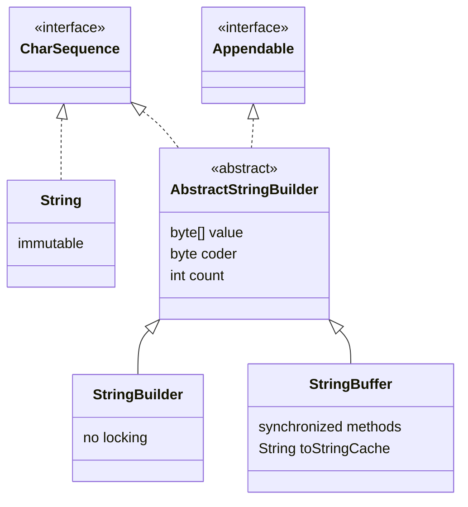
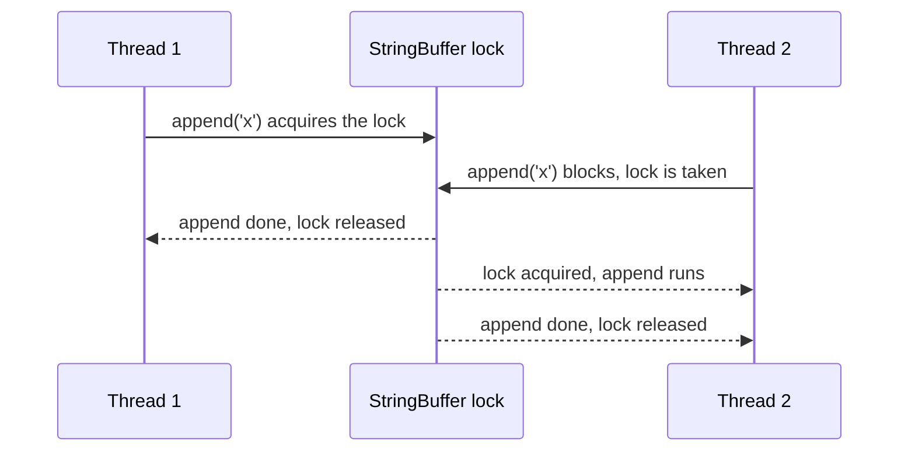

## In One Line
`StringBuffer` is the **thread-safe** twin of `StringBuilder`: the same mutable character buffer and the same methods, but every public method is `synchronized`, so one call at a time can touch it — safer for sharing, slower for everything else, and today mostly legacy.

## Mental Model
Take the **whiteboard** from the [StringBuilder](lesson:a02-core/11-stringbuilder) lesson and put a **guard with a single marker pen** next to it.

- Anyone who wants to write must first get the pen from the guard (acquire the object's lock). Only one person holds the pen, so two people can never scribble over each other — **each single edit is clean**.
- Getting and returning the pen takes a moment every time, even when you are the only person in the room (locking overhead).
- The guard hands out the pen **per edit**, not per job. If you need "look at the board, then decide what to write" as one step, someone else may get the pen between your look and your write. For multi-step jobs you must ask the guard to reserve the pen for the whole job (`synchronized (buffer) { ... }`).
- In most offices only one person ever uses a given whiteboard. Paying for a guard there is waste — which is why `StringBuilder` (no guard) is the default choice.

## Concept
### Same API, different locking
`StringBuffer` has existed since **Java 1.0**. Java 5 extracted the implementation into the package-private `AbstractStringBuilder` and added `StringBuilder` as an unsynchronized copy. Both classes therefore share:
- the same storage (`byte[] value` + `coder` + `count` since Java 9; `char[]` before),
- the same capacity rules (default 16, or 16 + initial length; grows to `max(2 * old + 2, needed)`),
- the same methods: `append`, `insert`, `replace`, `delete`, `deleteCharAt`, `reverse`, `setCharAt`, `setLength`, `charAt`, `indexOf`, `substring`, `capacity`, `ensureCapacity`, `trimToSize`, `toString`, and in Java 21 `repeat`,
- the same index rules (half-open `[start, end)`, `end` clamped in `delete`/`replace`),
- the same identity-based `equals`/`hashCode`, and `Comparable` since Java 11.

The difference: in `StringBuffer` every public method that reads or writes state is declared **`synchronized`** — it locks the `StringBuffer` object itself (its intrinsic monitor) for the duration of the call.

```java
// java.lang.StringBuffer (simplified)
@Override
public synchronized StringBuffer append(String str) {
    toStringCache = null;
    super.append(str);
    return this;
}
```

### `toStringCache`
`StringBuffer` has one extra field, `private transient String toStringCache`. `toString()` stores the `String` it created there, and every mutating method resets it to `null`. Calling `toString()` repeatedly on an unchanged buffer therefore returns the **same** `String` object instead of copying again.

### What "thread-safe" really means here
Each **individual method call is atomic**: two threads appending at the same time never lose characters or corrupt the array. But a **sequence of calls is not atomic**:

```java
// Shared StringBuffer log, several threads run this:
if (log.length() > 0) {    // 1. check  - atomic on its own
    log.append(", ");      // 2. act    - atomic on its own
}
log.append(name);          // 3. act    - atomic on its own
```
Another thread can run between steps 1, 2 and 3, producing `Alice, , Bob` or `AliceBob`. To make the whole block atomic, hold the lock yourself:
```java
synchronized (log) {       // same lock that StringBuffer's methods use
    if (log.length() > 0) log.append(", ");
    log.append(name);
}
```
Once you do that, the inner per-method locks add nothing — which is one more reason `StringBuilder` plus your own synchronization (or no sharing at all) is usually the better design.

### Performance
Acquiring an **uncontended** lock is cheap but not free. HotSpot's JIT can remove locks on a `StringBuffer` that provably never escapes the method (**lock elision** via escape analysis) and merge adjacent synchronized calls (**lock coarsening**), so a local `StringBuffer` is often nearly as fast as a `StringBuilder`. Biased locking, which used to make single-thread locking almost free, was disabled by default in JDK 15 (JEP 374) and later removed, so on modern JDKs the gap can be larger when the JIT cannot elide the lock. Under **contention**, threads queue on the lock and throughput drops sharply.

### String vs StringBuilder vs StringBuffer
| | `String` | `StringBuilder` | `StringBuffer` |
|---|---|---|---|
| Mutable | no | yes | yes |
| Thread-safe | yes (immutable) | no | yes — per method call |
| Locking | none needed | none | `synchronized` on every public method |
| Speed when building | slow (new object per change) | fastest | slower (lock per call) |
| Introduced | 1.0 | 5 | 1.0 |
| `equals` compares content | yes | no | no |
| Use it for | values, keys, constants | building text in one thread (default) | legacy APIs; a buffer truly shared between threads |

### Where you still meet `StringBuffer`
- **Legacy APIs:** `java.io.StringWriter.getBuffer()` returns a `StringBuffer`; `Matcher.appendReplacement/appendTail` only accepted `StringBuffer` until Java 9 added `StringBuilder` overloads; old code written before Java 5.
- **A buffer genuinely written by several threads** — although a thread-safe queue, a logger, or per-thread builders joined at the end are usually cleaner.

## Diagram

`StringBuilder` and `StringBuffer` are siblings sharing one implementation; the only real difference is the `synchronized` keyword (plus `toStringCache`). All three are `CharSequence`s.


Calls from different threads are serialised one at a time — no lost writes, but the second thread waits. Nothing holds the lock *between* two calls.

## Code
@example CoreJava/JavaFeatures/StringBufferExample.java

Proof that only `StringBuffer` is synchronized:
```java
import java.lang.reflect.Method;
import java.lang.reflect.Modifier;

public class SyncCheck {
    public static void main(String[] args) throws NoSuchMethodException {
        for (Class<?> type : new Class<?>[] { StringBuffer.class, StringBuilder.class }) {
            Method append = type.getMethod("append", String.class);
            Method length = type.getMethod("length");
            System.out.println(type.getSimpleName()
                    + ": append synchronized=" + Modifier.isSynchronized(append.getModifiers())
                    + ", length synchronized=" + Modifier.isSynchronized(length.getModifiers()));
        }
        System.out.println(StringBuffer.class.getSuperclass().getName());
        System.out.println(StringBuilder.class.getSuperclass().getName());
    }
}
```
```output
StringBuffer: append synchronized=true, length synchronized=true
StringBuilder: append synchronized=false, length synchronized=false
java.lang.AbstractStringBuilder
java.lang.AbstractStringBuilder
```

What thread safety buys you — four threads hammer the same object:
```java
public class ThreadSafetyDemo {
    // Runs 4 threads that each append 'x' 100,000 times to the same object.
    static void hammer(Appendable target) throws InterruptedException {
        Runnable task = () -> {
            try {
                for (int i = 0; i < 100_000; i++) target.append('x');
            } catch (Exception e) {
                System.out.println("  thread died: " + e.getClass().getSimpleName());
            }
        };
        Thread[] threads = new Thread[4];
        for (int i = 0; i < 4; i++) (threads[i] = new Thread(task)).start();
        for (Thread t : threads) t.join();
    }

    public static void main(String[] args) throws InterruptedException {
        StringBuffer buffer = new StringBuffer();
        hammer(buffer);
        System.out.println("StringBuffer length:  " + buffer.length());   // always 400000

        StringBuilder builder = new StringBuilder();
        hammer(builder);
        System.out.println("StringBuilder length: " + builder.length());  // usually less
    }
}
```
One real run on a 4-core machine:
```output
StringBuffer length:  400000
  thread died: ArrayIndexOutOfBoundsException
StringBuilder length: 234401
```
This output **varies from run to run** (thread timing). `StringBuffer` always reaches 400000. In a batch of 25 further runs the `StringBuilder` length ranged from 296526 up to exactly 400000 (the race does not hit every time), and twice a thread crashed with `ArrayIndexOutOfBoundsException` because it wrote into the array while another thread was replacing it with a bigger one. Most racy runs also left `'\0'` gaps inside the text — slots that were counted but never written.

## Walkthrough
- `package CoreJava.JavaFeatures;` / `public class StringBufferExample` / `main` — the usual course shell. The example is **single-threaded**, so it shows the API but not the one feature that distinguishes `StringBuffer` (see the demo above for that).
- `StringBuffer sb = new StringBuffer("Hello");` — a buffer holding `Hello` (length 5, capacity 21). The variable name `sb` is the same one used for `StringBuilder`; that is legal but hides which class you are dealing with.
- `sb.append(" World");` → `Hello World`. The print label is misspelled: it prints **`Apended string: Hello World`** (see Errata).
- `sb.insert(6, "Beautiful ");` — inserts before index 6 (`W`) → `Hello Beautiful World` (length 21).
- `sb.replace(6, 16, "Amazing");` — here the range is `[6, 16)`: indexes 6..14 are `Beautiful` **and index 15 is the space** after it. Both are removed, so the result is `Hello AmazingWorld` — with no space. (The StringBuilder example used `[6, 15)` and kept the space.)
- `sb.delete(6, 13);` — indexes 6..12 of `Hello AmazingWorld` are `Amazing`; removing them joins `Hello ` and `World` → `Hello World` with a single space.
- `sb.reverse();` → `dlroW olleH`.
- Every `System.out.println("..." + sb)` calls `sb.toString()` (a synchronized method that fills `toStringCache`).

| Step | Buffer | length |
|---|---|---|
| `new StringBuffer("Hello")` | `Hello` | 5 |
| `append(" World")` | `Hello World` | 11 |
| `insert(6, "Beautiful ")` | `Hello Beautiful World` | 21 |
| `replace(6, 16, "Amazing")` | `Hello AmazingWorld` | 18 |
| `delete(6, 13)` | `Hello World` | 11 |
| `reverse()` | `dlroW olleH` | 11 |

## Traps
> [!ERRATA] The first print statement says `"Apended string: "` (one `p`), so the program really prints `Apended string: Hello World`, while the `// Output:` comment next to it claims `Appended string: Hello World`. The comment is wrong about the actual output; the label should be spelled `"Appended string: "`.

- **"Thread-safe" is per call, not per task.** `if (sb.length() > 0) sb.append(",")` is a check-then-act race even on a `StringBuffer`. Wrap multi-call sequences in `synchronized (sb) { ... }`.
- **`replace(6, 16, ...)` vs `replace(6, 15, ...)`.** One index decides whether the space survives; the StringBuffer and StringBuilder examples differ exactly there. Always count `[start, end)` carefully.
- **`equals` is identity-based**, same as `StringBuilder`: `new StringBuffer("x").equals(new StringBuffer("x"))` is `false`.
- **`new StringBuffer('a')`** is an empty buffer with capacity 97 (the `char` widens to the `int` capacity constructor).
- **Using `StringBuffer` "to be safe" in local variables** costs locking for nothing. If the object never leaves the method, use `StringBuilder`.
- **Mixing them up in method signatures:** a method taking `StringBuffer` will not accept a `StringBuilder`. Accept `CharSequence` (to read) or `Appendable` (to write) if you want both.

## Tips & Tricks
- **"Buffer = Bouncer."** StringBuffer has a bouncer (lock) at the door; StringBuilder lets everyone in.
- **Age hint:** Buffer is the **old** one (1.0, synchronized, like `Vector` and `Hashtable`); Builder is the **new** one (5, unsynchronized, like `ArrayList` and `HashMap`). The same "legacy synchronized vs modern unsynchronized" pattern appears across the JDK.
- **Default choice: `StringBuilder`.** Reach for `StringBuffer` only when an API demands it or the buffer is truly shared — and then consider whether sharing is the real problem.
- **Need atomic multi-step edits?** `synchronized (buffer) { ... }` — it uses the same monitor as the buffer's own methods.
- **Writing a method for both?** Take `Appendable` (write) or `CharSequence` (read) as the parameter type.

## Interview Q&A
### [Basic] What is the difference between `StringBuffer` and `StringBuilder`?
They have the same API and implementation (both extend `AbstractStringBuilder`). `StringBuffer` (Java 1.0) declares its public methods `synchronized`, so it is thread-safe per call but pays for locking on every call. `StringBuilder` (Java 5) has no synchronization, so it is faster but must not be shared between threads without external locking. Since most buffers are local to one method and one thread, `StringBuilder` is the default.

**Follow-up:** *Can you convert between them?* — Yes: `new StringBuilder(buffer)` / `new StringBuffer(builder)` (both accept any `CharSequence`), or go through `toString()`.

### [Basic] Is `StringBuffer` thread-safe? What exactly does that guarantee?
Each public method is `synchronized` on the buffer, so any single call — `append`, `insert`, `toString` — runs atomically and sees a consistent state; concurrent appends never lose characters or corrupt the array. It does **not** make sequences of calls atomic: `if (buf.length() == 0) buf.append("first")` can interleave with another thread between the check and the append. For that you need `synchronized (buf) { ... }` around the sequence.

**Follow-up:** *Which lock does `synchronized (buf)` use?* — The same intrinsic monitor of the `buf` object that its synchronized methods use, so it excludes them for the duration of the block.

### [Intermediate] If StringBuffer is thread-safe, why is StringBuilder recommended?
Because sharing a mutable text buffer between threads is rare and usually a design smell. In the common case (a local variable) the locks in `StringBuffer` do nothing useful and still cost time; HotSpot can often elide them via escape analysis, but not always, and biased locking — which used to make them almost free — was disabled in JDK 15. When sharing *is* needed, per-call locking is often not enough anyway (compound actions), so you need your own synchronization — at which point `StringBuilder` inside a `synchronized` block does the job.

**Follow-up:** *What are better ways to build text from several threads?* — Let each thread build its own `StringBuilder` and combine at the end, or send pieces through a `BlockingQueue`/`ConcurrentLinkedQueue` to one writer, or use a parallel stream with `Collectors.joining()`.

### [Intermediate] What happens if you share a StringBuilder between threads instead?
Appends can interleave inside the method: two threads read the same `count`, write to the same slot, and one character is lost; or one thread grows the array while another writes to the old one, causing lost data or `ArrayIndexOutOfBoundsException`. In the demo above, four threads appending 100,000 chars each ended with lengths like 234401 instead of 400000, sometimes with a crashed thread. `StringBuffer` always ends at 400000.

**Follow-up:** *Is the StringBuilder result at least "valid text"?* — Not guaranteed; it can contain `'\0'` gaps where a write was lost after `count` was advanced.

### [Intermediate] What is `toStringCache` in StringBuffer?
A `transient String` field that caches the result of the last `toString()`. Mutating methods set it to `null`; `toString()` reuses it if it is still set, so repeated `toString()` calls on an unchanged buffer return the same `String` without copying the characters again. `StringBuilder` has no such cache — each `toString()` copies.

**Follow-up:** *Why is it transient?* — It is derived data; after deserialization it can simply be rebuilt on the next `toString()`.

### [Intermediate] Do `StringBuffer`/`StringBuilder` override `equals()` and `hashCode()`?
No. Both inherit `Object`'s identity-based versions, because they are mutable — a content-based hash would change as the text changes and break hash collections. To compare content use `a.toString().equals(b.toString())`, `a.compareTo(b) == 0` (both implement `Comparable` since Java 11), or `someString.contentEquals(buffer)` — `String.contentEquals(StringBuffer)` even synchronizes on the buffer while comparing.

**Follow-up:** *Can a StringBuilder be compared with a StringBuffer via `compareTo`?* — No, `compareTo` is typed to the same class; use `CharSequence.compare(a, b)` (Java 11) for any two `CharSequence`s.

### [Advanced] How does the JVM make `StringBuffer` cheaper when it is used by only one thread?
The C2 JIT uses **escape analysis**: if a `StringBuffer` is created in a method and never escapes (not stored in a field, not passed out), no other thread can ever lock it, so the JIT removes the `monitorenter`/`monitorexit` entirely (**lock elision**). It can also **coarsen** a run of adjacent synchronized calls on the same object into one lock/unlock pair. Before JDK 15, **biased locking** also made repeated locking by the same thread nearly free; it was disabled by default in JDK 15 (JEP 374) and later removed because its complexity outweighed the benefit for modern code.

**Follow-up:** *So is there any difference left for local buffers?* — Often small after JIT warm-up, but not guaranteed (interpreted code, escape analysis failing when the buffer is passed to a non-inlined method). Using `StringBuilder` makes the intent explicit and does not depend on JIT heuristics.

### [Advanced] Where would you still legitimately encounter or use `StringBuffer` today?
- Legacy and JDK APIs: `StringWriter.getBuffer()` returns one; `Matcher.appendReplacement/appendTail` accepted only `StringBuffer` before Java 9; pre-Java-5 libraries.
- Rare cases of a text buffer written by several threads where each write is a single call (e.g. a simple shared diagnostic log), where per-call atomicity is exactly what is needed.
Everything else should use `StringBuilder`.

**Follow-up:** *What other JDK classes follow the same "old synchronized vs new unsynchronized" pattern?* — `Vector` vs `ArrayList`, `Hashtable` vs `HashMap`; and for concurrency the modern answers are `java.util.concurrent` classes rather than the synchronized legacy ones.

## Quiz
### What is the first line the original StringBufferExample prints?
- [ ] Appended string: Hello World
- [x] Apended string: Hello World
- [ ] Appended string: Hello
- [ ] Apended string: HelloWorld
> The label in the code is spelled `"Apended string: "`, so that is what gets printed. The `// Output:` comment says `Appended` — a wrong comment, not a different behaviour.

### What does this print?
```java
StringBuffer s = new StringBuffer("Hello World");
s.replace(6, 16, "Amazing");
System.out.println(s);
s.delete(6, 13);
System.out.println(s);
```
- [ ] Hello Amazing, then Hello World
- [x] Hello Amazing, then Hello (with a trailing space)
- [ ] StringIndexOutOfBoundsException, because 16 is greater than length()
- [ ] Hello AmazingWorld, then Hello World
> `replace` clamps an `end` beyond `length()` (11), so `[6, 16)` removes `World` → `Hello Amazing`. `delete(6, 13)` removes `Amazing`, leaving `Hello ` (with its space). The last option is what happens in the original, where the buffer was the longer `Hello Beautiful World`.

### Which statement about `StringBuffer` is true?
- [ ] It is faster than `StringBuilder` because it caches `toString()`
- [ ] It makes any sequence of calls atomic automatically
- [x] Each public method is synchronized on the buffer, so single calls are atomic but compound actions are not
- [ ] It overrides `equals` to compare contents
> Per-method `synchronized` gives atomic single calls only; check-then-act sequences still race. It is generally slower than `StringBuilder`, and `equals` is inherited from `Object` (identity).

### What does this print?
```java
StringBuffer a = new StringBuffer("x");
StringBuffer b = new StringBuffer("x");
System.out.println(a.equals(b) + " " + (a.compareTo(b) == 0));
```
- [ ] true true
- [x] false true
- [ ] false false
- [ ] Compile error: StringBuffer has no compareTo
> `equals` is `Object`'s identity check → `false`. `StringBuffer` implements `Comparable<StringBuffer>` since Java 11, and `compareTo` compares contents → `0` → `true`.

### Spot the bug: several threads call `addName` on a shared `StringBuffer`. What can go wrong?
```java
void addName(StringBuffer log, String name) {
    if (log.length() > 0) {
        log.append(", ");
    }
    log.append(name);
}
```
- [ ] Nothing: StringBuffer is thread-safe, so the method is safe
- [ ] Characters inside a name can be lost
- [x] Separators can be missing or doubled, because the check and the two appends are separate atomic calls
- [ ] It deadlocks
> Each call is atomic, so no characters are lost inside a name — but another thread can run between `length()` and `append`, giving `Alice, , Bob` or `AliceBob`. Fix: put the body in `synchronized (log) { ... }`.

### What does this print?
```java
System.out.println(new StringBuffer("abc").insert(1, 42).reverse());
```
- [ ] a42bc
- [x] cb24a
- [ ] cba42
- [ ] 24cba
> `insert(1, 42)` uses the `insert(int, int)` overload and puts the text `42` before index 1 → `a42bc`. `reverse()` works on the same buffer → `cb24a`.

### You build a report inside one method using a local variable. Which class should you use?
- [ ] StringBuffer, because thread safety never hurts
- [x] StringBuilder
- [ ] String with `+=`
- [ ] Either buffer; they are the same class
> A local variable is confined to one thread, so `StringBuffer`'s locks buy nothing and `+=` in a loop is O(n²). `StringBuilder` is the idiomatic choice. They are separate sibling classes, not the same class.

## Takeaways
- `StringBuffer` (Java 1.0) and `StringBuilder` (Java 5) share one implementation (`AbstractStringBuilder`) and the same API; `StringBuffer`'s public methods are `synchronized`.
- Thread safety is per method call: single calls are atomic, sequences (check-then-act) need `synchronized (buffer) { ... }`.
- Sharing a `StringBuilder` between threads loses characters or throws `ArrayIndexOutOfBoundsException`; a `StringBuffer` does not.
- Locking costs time; the JIT can elide locks on non-escaping buffers, but `StringBuilder` is the default for single-threaded (local) use.
- `StringBuffer` caches its last `toString()` in `toStringCache`; neither buffer overrides `equals`/`hashCode` (identity), both are `Comparable` since Java 11.
- The original example prints `Apended string:` (typo) although its comment claims `Appended`; its `replace(6, 16, ...)` also removes the space, unlike the builder example's `replace(6, 15, ...)`.
