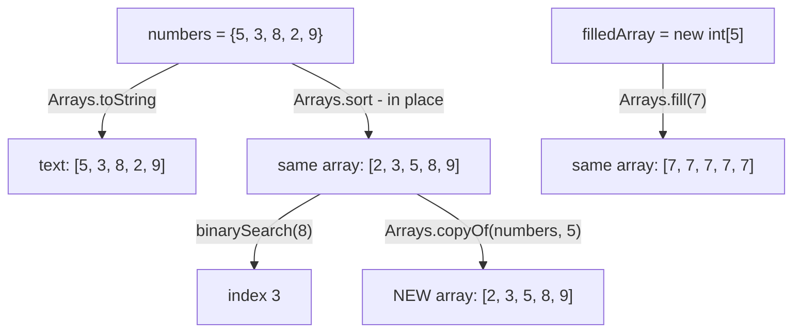
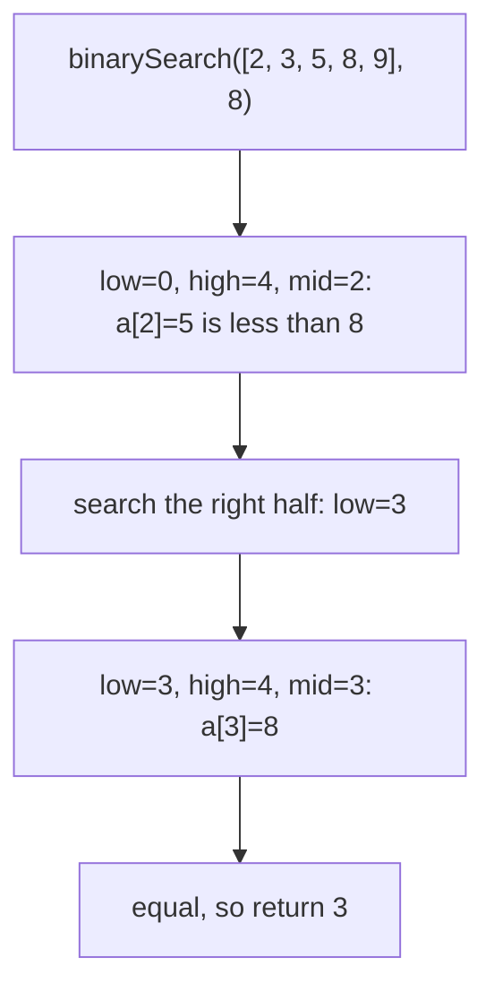

## In One Line
A Java array is a **fixed-length object** that stores elements of one type in consecutive, 0-indexed slots, and the utility class `java.util.Arrays` gives you the everyday operations on it — `toString`, `sort`, `binarySearch`, `fill`, `copyOf`, `equals`, `asList` and more.

## Mental Model
Think of a **row of numbered lockers** in a school corridor.

- The row is built with a **fixed number of lockers** — you cannot bolt on another one later. Need more? Build a new, longer row and move everything over (`Arrays.copyOf`).
- Lockers are numbered from **0**. Asking for locker 5 in a row of 5 sets off the alarm (`ArrayIndexOutOfBoundsException`).
- A new row comes with every locker already holding a **default item** (`0`, `false`, `null`) — never "garbage".
- The variable `numbers` is not the row itself — it is a **card with the row's location** written on it. Copying the card (`int[] b = a;`) gives two cards to the **same** row.
- `java.util.Arrays` is the **caretaker** who can list the contents (`toString`), put them in order (`sort`), find an item quickly **if the lockers are in order** (`binarySearch`), fill every locker with the same item (`fill`) or build a copy of the row (`copyOf`).

## Concept
### What an array is
- An array is an **object** on the heap. Its class is created by the JVM: `int[]` is `[I`, `String[]` is `[Ljava.lang.String;`, `int[][]` is `[[I`. Every array class extends `Object` and implements `Cloneable` and `Serializable`.
- It has a **fixed length** chosen at creation, exposed as the `final` field **`length`** (no parentheses — unlike `String.length()` and `List.size()`).
- Elements are stored contiguously: a primitive array holds the values themselves; an object array holds **references**.
- Index range is `0` to `length - 1`; any other index throws `ArrayIndexOutOfBoundsException`. A negative size throws `NegativeArraySizeException`. The maximum length is a little under `Integer.MAX_VALUE` (VM-dependent).
- Every element starts with its **default value**: `0` for numeric types, `'\u0000'` for `char`, `false` for `boolean`, `null` for references.

### Declaring and creating
```java
int[] a;                        // preferred: the type is "int array"
int b[];                        // C-style, legal but discouraged
int[] c = new int[5];           // five zeros
int[] d = {5, 3, 8, 2, 9};      // array initializer (only in a declaration)
d = new int[] {1, 2, 3};        // anonymous array: needed when not declaring
int[][] grid = new int[3][4];   // 3 rows of 4
int[][] jagged = new int[3][];  // rows created later, can differ in length
var e = new double[] {1.5};     // Java 10+ local type inference
```
A 2D array is really an **array of arrays**: `grid[1]` is itself an `int[]`, and rows need not have the same length (jagged arrays).

### Printing arrays
Arrays do not override `toString()`, so `System.out.println(arr)` prints something like `[I@1b6d3586` (type code + identity hash). Use:
- `Arrays.toString(arr)` → `[5, 3, 8, 2, 9]` for one-dimensional arrays;
- `Arrays.deepToString(arr2d)` → `[[1, 2], [3]]` for nested arrays.
(`char[]` is the exception: `println(char[])` prints the characters.)

### The `java.util.Arrays` toolbox
`Arrays` is a final utility class with only static methods (private constructor). Most methods are overloaded for every primitive type and for `Object[]`/generic `T[]`.

| Method | What it does | Notes |
|---|---|---|
| `toString(a)`, `deepToString(a)` | readable text | `"null"` for a `null` array |
| `sort(a)`, `sort(a, from, to)` | sorts in place, ascending | see algorithms below |
| `sort(T[] a, Comparator c)` | sorts objects with a custom order | not available for primitive arrays |
| `parallelSort(a)` | parallel merge sort (fork/join) | faster for large arrays (more than 8192 elements) |
| `binarySearch(a, key)` | index of `key` in a **sorted** array | `-(insertionPoint) - 1` if absent |
| `fill(a, v)`, `fill(a, from, to, v)` | sets every (or a range of) element to `v` | same object reference for every slot if `v` is an object |
| `copyOf(a, newLength)` | new array, truncated or padded with defaults | how `ArrayList` grows |
| `copyOfRange(a, from, to)` | new array of `[from, to)` | |
| `equals(a, b)`, `deepEquals(a, b)` | element-wise comparison | `a.equals(b)` is only identity! |
| `hashCode(a)`, `deepHashCode(a)` | content-based hash | |
| `asList(T...)` | fixed-size `List` **view** backed by the array | `set` writes through; `add`/`remove` throw |
| `stream(a)` | `IntStream`/`LongStream`/`DoubleStream`/`Stream<T>` | Java 8 |
| `setAll(a, i -> ...)` | fills using a function of the index | Java 8 |
| `mismatch(a, b)`, `compare(a, b)` | first differing index / lexicographic compare | Java 9 |

### How `Arrays.sort` works
| Array type | Algorithm | Stable? | Complexity |
|---|---|---|---|
| Primitives (`int[]`, `double[]`, ...) | **Dual-Pivot Quicksort** (Yaroslavskiy, Bentley, Bloch), with insertion sort for tiny ranges and, since JDK 14, heap-sort fallback | stability is meaningless for primitives | O(n log n) |
| Objects (`String[]`, `Integer[]`, ...) | **TimSort** (merge sort + insertion sort that exploits existing runs) | **yes** — equal elements keep their order | O(n log n), O(n) on nearly sorted input |

Objects must be `Comparable` (natural order) or you pass a `Comparator`; otherwise `ClassCastException`. Strings sort by UTF-16 code, so **uppercase letters come before lowercase** (`"Carol"` before `"alice"`). See [Comparable vs Comparator](lesson:b01-fundamentals/09-comparable-vs-comparator).

### How `Arrays.binarySearch` works
Binary search halves the search range each step: compare the key with the middle element, then continue in the left or right half. O(log n) — but **only correct on a sorted array**. On unsorted input it returns a meaningless index or a negative number even when the key is present.
- Found → the index (if there are duplicates, **any** matching index).
- Not found → `-(insertionPoint) - 1`, where *insertionPoint* is where the key would go to keep the array sorted. The `- 1` makes sure "not found at position 0" (`-1`) is distinguishable from "found at index 0" (`0`). Recover the position with `-(result + 1)`.
- The JDK computes the middle as `(low + high) >>> 1`, which avoids the famous `(low + high) / 2` integer-overflow bug on huge arrays.

### Copying arrays
| Way | Creates new array? | Can resize? | Typical use |
|---|---|---|---|
| `b = a` | **no** — both names point to one array | no | aliasing (usually a bug) |
| `a.clone()` | yes, same length | no | quick full copy (return type is `int[]`, no cast) |
| `Arrays.copyOf(a, n)` | yes | yes (truncate/pad) | copy or grow |
| `Arrays.copyOfRange(a, from, to)` | yes | range | slices |
| `System.arraycopy(src, srcPos, dest, destPos, len)` | no — copies into an **existing** array | no | fastest bulk move, overlapping ranges handled correctly |

All of these are **shallow** copies: for arrays of objects (including 2D arrays) the element **references** are copied, not the objects.

### Arrays vs collections
| | Array | `ArrayList` |
|---|---|---|
| Size | fixed | grows automatically |
| Element types | primitives or objects | objects only (boxing for primitives) |
| Type check | at runtime (covariant, `ArrayStoreException`) | at compile time (generics, invariant) |
| Performance | fastest, least memory | small overhead |
| API | `length`, `Arrays.*` | rich `List` methods |

Two important rules connect them:
- **Arrays are covariant:** a `String[]` *is an* `Object[]`, so `Object[] o = new String[2]; o[0] = 42;` compiles but throws `ArrayStoreException` at runtime. Generics are invariant (`List<String>` is not a `List<Object>`), which catches the same mistake at compile time.
- **No generic array creation:** `new T[10]` and `new List<String>[10]` do not compile, because arrays need their exact element type at runtime and generics are erased. See [Type Erasure](lesson:a04-generics/07-type-erasure).

## Diagram

`sort` and `fill` change the array they are given; `copyOf` returns a brand-new array; `toString` and `binarySearch` only read.


Each step halves the range, which is why the array **must be sorted**: the "go right because 5 < 8" decision is only valid if everything to the left is smaller.

## Code
@example CoreJava/JavaFeatures/ArraysExample.java

Arrays as objects — defaults, `length`, runtime type, jagged rows and the two array exceptions:
```java
import java.util.Arrays;

public class ArrayBasics {
    public static void main(String[] args) {
        int[] a = new int[3];                  // all elements get default values
        boolean[] flags = new boolean[2];
        String[] names = new String[2];
        System.out.println(Arrays.toString(a) + " " + Arrays.toString(flags) + " " + Arrays.toString(names));

        int[] b = {5, 3, 8};                   // array initializer
        int c[] = new int[] {1, 2};            // C-style brackets + anonymous array
        System.out.println(b.length + " " + c.length);   // length is a field, not a method

        System.out.println(b.getClass().getName() + " " + names.getClass().getName()
                + " " + b.getClass().getSuperclass().getSimpleName());
        System.out.println(b.toString().startsWith("[I@"));  // toString() is Object's: type@hash

        int[][] jagged = new int[3][];         // rows created later, may differ in length
        jagged[0] = new int[] {1};
        jagged[1] = new int[] {2, 3, 4};
        System.out.println(Arrays.deepToString(jagged));

        try {
            System.out.println(b[3]);
        } catch (ArrayIndexOutOfBoundsException e) {
            System.out.println(e.getMessage());
        }

        Object[] objects = new String[2];      // arrays are covariant...
        try {
            objects[0] = 42;                   // ...so the JVM checks every store
        } catch (ArrayStoreException e) {
            System.out.println("ArrayStoreException: " + e.getMessage());
        }
    }
}
```
```output
[0, 0, 0] [false, false] [null, null]
3 2
[I [Ljava.lang.String; Object
true
[[1], [2, 3, 4], null]
Index 3 out of bounds for length 3
ArrayStoreException: java.lang.Integer
```

More of `java.util.Arrays`, including the classic traps:
```java
import java.util.Arrays;
import java.util.Collections;
import java.util.List;

public class ArraysUtility {
    public static void main(String[] args) {
        int[] sorted = {2, 3, 5, 8, 9};
        System.out.println(Arrays.binarySearch(sorted, 4));    // not found: -(insertionPoint) - 1
        System.out.println(Arrays.binarySearch(sorted, 10));

        int[] unsorted = {5, 3, 8, 2, 9};
        System.out.println(Arrays.binarySearch(unsorted, 3));  // unsorted input: garbage answer

        System.out.println(Arrays.toString(Arrays.copyOf(sorted, 3))       // truncate
                + Arrays.toString(Arrays.copyOf(sorted, 7))                // pad with 0
                + Arrays.toString(Arrays.copyOfRange(sorted, 1, 4)));      // [1, 4)

        int[] part = new int[6];
        Arrays.fill(part, 1, 4, 9);                             // fill [1, 4) only
        System.out.println(Arrays.toString(part));

        int[] x = {1, 2, 3};
        int[] y = {1, 2, 3};
        System.out.println((x == y) + " " + x.equals(y) + " " + Arrays.equals(x, y));
        int[][] m1 = {{1, 2}, {3}};
        int[][] m2 = {{1, 2}, {3}};
        System.out.println(Arrays.equals(m1, m2) + " " + Arrays.deepEquals(m1, m2));

        String[] words = {"bob", "Dave", "alice", "Carol"};
        Arrays.sort(words);                                     // natural order: uppercase first
        System.out.println(Arrays.toString(words));
        Arrays.sort(words, String.CASE_INSENSITIVE_ORDER);
        System.out.println(Arrays.toString(words));
        Integer[] boxed = {5, 3, 8};
        Arrays.sort(boxed, Collections.reverseOrder());         // comparators need objects
        System.out.println(Arrays.toString(boxed));

        List<String> view = Arrays.asList(words);               // fixed-size view of the array
        view.set(0, "Zed");
        System.out.println(words[0]);                           // write-through to the array
        try {
            view.add("Eve");
        } catch (UnsupportedOperationException e) {
            System.out.println("asList cannot grow: " + e.getClass().getSimpleName());
        }
        System.out.println(Arrays.asList(new int[] {1, 2}).size());  // List<int[]> with ONE element

        int[] squares = new int[5];
        Arrays.setAll(squares, i -> i * i);
        System.out.println(Arrays.toString(squares) + " sum=" + Arrays.stream(squares).sum());
        System.out.println(Arrays.mismatch(new int[] {1, 2, 3}, new int[] {1, 2, 4}));
    }
}
```
```output
-3
-6
-1
[2, 3, 5][2, 3, 5, 8, 9, 0, 0][3, 5, 8]
[0, 9, 9, 9, 0, 0]
false false true
false true
[Carol, Dave, alice, bob]
[alice, bob, Carol, Dave]
[8, 5, 3]
Zed
asList cannot grow: UnsupportedOperationException
1
[0, 1, 4, 9, 16] sum=30
2
```

Four ways to copy, and why they are all shallow:
```java
import java.util.Arrays;

public class CopyDemo {
    public static void main(String[] args) {
        int[] src = {1, 2, 3, 4, 5};
        int[] c1 = src.clone();                          // same length, new array
        int[] c2 = Arrays.copyOf(src, src.length);       // same thing, can also resize
        int[] c3 = new int[5];
        System.arraycopy(src, 1, c3, 0, 3);              // (src, srcPos, dest, destPos, length)
        c1[0] = 100;
        System.out.println(src[0] + " " + c1[0] + " " + (c2 == src) + " " + Arrays.toString(c3));

        int[][] grid = {{1, 2}, {3, 4}};
        int[][] shallow = grid.clone();                  // copies the row REFERENCES only
        shallow[0][0] = 99;
        System.out.println(grid[0][0] + " " + (shallow[0] == grid[0]));

        int[][] deep = new int[grid.length][];
        for (int i = 0; i < grid.length; i++) deep[i] = grid[i].clone();
        deep[0][0] = -1;
        System.out.println(grid[0][0] + " " + deep[0][0]);
    }
}
```
```output
1 100 false [2, 3, 4, 0, 0]
99 true
99 -1
```

## Walkthrough
- `import java.util.Arrays;` — the utility class lives in `java.util`, not `java.lang`, so it must be imported. (Do not confuse it with the concept "arrays" or with `java.lang.reflect.Array`, the reflection helper.)
- `int[] numbers = {5, 3, 8, 2, 9};` — creates an `int[]` object of length 5 on the heap with those values; `numbers` holds a reference to it.
- `Arrays.toString(numbers)` — builds the text `[5, 3, 8, 2, 9]`. Printing `numbers` directly would show `[I@...` instead.
- `Arrays.sort(numbers);` — sorts **in place** with Dual-Pivot Quicksort; it returns `void`. `numbers` now holds `[2, 3, 5, 8, 9]` and the original order is gone.
- `int index = Arrays.binarySearch(numbers, 8);` — works because the array was just sorted: mid index 2 holds 5 (< 8) → right half; mid index 3 holds 8 → returns **3**.
- `int[] filledArray = new int[5];` — five default zeros; `Arrays.fill(filledArray, 7);` overwrites every slot with 7 → `[7, 7, 7, 7, 7]`.
- `int[] copiedArray = Arrays.copyOf(numbers, numbers.length);` — allocates a **new** array of the same length and copies the (already sorted) elements → `[2, 3, 5, 8, 9]`. Changing `copiedArray` later would not affect `numbers`. With a larger length it would pad with zeros; with a smaller one it would truncate.

All `// output:` comments match the recorded output. Note that "Copied array" shows the **sorted** values because the copy is taken after `sort`.

## Traps
- **`binarySearch` on an unsorted array** returns garbage — sometimes even the right answer by luck (in the original, searching the *unsorted* array for 8 would happen to return 2, its correct index, while searching for 3 returns −1 although 3 is present). Always sort first, with the same ordering you search with.
- **Negative results are not "−1 means missing" only.** Any negative value means "not found"; `-(r + 1)` is the insertion point.
- **`a.equals(b)` and `a == b` compare identity** for arrays. Use `Arrays.equals`, and `Arrays.deepEquals` for nested arrays (`Arrays.equals` on 2D arrays compares row references).
- **Printing an array directly** gives `[I@hash`. Use `Arrays.toString` / `deepToString`.
- **`Arrays.asList` is fixed-size and backed by the array:** `set` writes through, `add`/`remove` throw `UnsupportedOperationException`. Wrap it — `new ArrayList<>(Arrays.asList(...))` — for a growable list, or use `List.of(...)` for an immutable one.
- **`Arrays.asList(intArray)` gives a `List<int[]>` of size 1**, because generics cannot hold primitives. Use `Arrays.stream(intArray).boxed().toList()` or an `Integer[]`.
- **`int[] b = a;` is not a copy** — both names refer to the same array; sorting `b` sorts `a`.
- **Copies are shallow:** cloning a 2D array or an array of objects shares the inner objects.
- **`length` vs `length()` vs `size()`** — array field, `String` method, collection method.
- **Covariance:** storing the wrong type into an array seen through a supertype reference compiles but throws `ArrayStoreException`.
- **`Arrays.fill(objArray, new ArrayList<>())`** puts the **same** list in every slot.
- **Sorting strings:** uppercase sorts before lowercase in natural order; use `String.CASE_INSENSITIVE_ORDER` or a `Collator` for human ordering.

## Tips & Tricks
- **"Arrays are rigid, `Arrays` is the handyman."** The array has a fixed size; the `Arrays` class does the chores.
- **Sort-before-search rule:** "No sort, no binary search."
- **Decode a negative `binarySearch` result:** `insertionPoint = -(result + 1)`. `-3` → insert at index 2.
- **Deep = nested:** whenever you have `[][]`, reach for `deepToString`, `deepEquals`, `deepHashCode`.
- **Grow an array:** `arr = Arrays.copyOf(arr, arr.length * 2);` — exactly what `ArrayList` does internally.
- **Reverse-sort primitives:** sort ascending then walk backwards, or `Arrays.stream(a).boxed().sorted(Comparator.reverseOrder())` — `Arrays.sort(int[], Comparator)` does not exist.
- **Quick list from an array:** `List.of(arr)` (immutable, rejects nulls) or `Arrays.asList(arr)` (fixed-size view).
- Classic array interview programs (second largest, rotate, missing number, two-sum) are drilled in [Array & Number Programs](lesson:b06-coding-drills/04-array-and-number-programs).

## Interview Q&A
### [Basic] What is an array in Java, and how is it different from an ArrayList?
An array is a fixed-length object that stores elements of a single type (primitives or references) in contiguous, 0-indexed slots, with its size in the `length` field. `ArrayList` is a class from the Collections Framework that wraps an array and **resizes automatically** (it grows by about 1.5× via `Arrays.copyOf`), stores only objects (so primitives are boxed), is type-checked by generics at compile time, and offers a rich `List` API. Arrays are slightly faster and more memory-efficient, and are the only choice for primitive-heavy code without boxing.

**Follow-up:** *Can you change an array's size?* — No. You create a new array and copy (`Arrays.copyOf`), which is what `ArrayList` does behind the scenes.

### [Basic] What are the default values of array elements?
Every element is initialised automatically: `0` for `byte`/`short`/`int`/`long`, `0.0` for `float`/`double`, `'\u0000'` (code 0) for `char`, `false` for `boolean`, and `null` for any reference type (including `String` and nested arrays). This differs from **local variables**, which have no default and must be assigned before use.

**Follow-up:** *What does `new int[3][]` contain?* — An array of three `null` rows; the inner arrays must be created separately.

### [Basic] How do you compare two arrays for equality?
`a == b` and `a.equals(b)` both compare **references** — arrays inherit `equals` from `Object`. For content use `Arrays.equals(a, b)` (same length, element-wise `==` for primitives or `equals` for objects). For nested arrays use `Arrays.deepEquals(a, b)`, because `Arrays.equals` would compare the inner arrays by reference. The matching hash functions are `Arrays.hashCode` and `Arrays.deepHashCode`.

**Follow-up:** *And to compare order, like strings?* — `Arrays.compare(a, b)` (Java 9) compares lexicographically; `Arrays.mismatch(a, b)` returns the first differing index or −1.

### [Intermediate] What does `Arrays.binarySearch` return when the key is missing, and why that formula?
It returns `-(insertionPoint) - 1`, where the insertion point is the index at which the key would be inserted to keep the array sorted (or `length` if it is greater than everything). The extra `- 1` guarantees the result is negative even when the insertion point is 0; otherwise "not found, insert at 0" would look like "found at index 0". So `binarySearch({2,3,5,8,9}, 4)` returns −3 (insertion point 2). The array must be sorted — the result on unsorted data is undefined — and with duplicates any matching index may be returned.

**Follow-up:** *What was the famous bug in binary search?* — Computing `mid = (low + high) / 2` overflows `int` for very large arrays; the JDK uses `(low + high) >>> 1` (fixed in Java 6 after Joshua Bloch's 2006 write-up).

### [Intermediate] Which sorting algorithms does `Arrays.sort` use?
For primitive arrays, a **Dual-Pivot Quicksort** (two pivots split the range into three parts), with insertion sort for small ranges and — since JDK 14 — a heap-sort fallback, giving O(n log n). Stability does not matter for primitives. For object arrays it uses **TimSort**, a stable, adaptive merge sort that runs in O(n) on already-sorted data; stability matters there, because equal objects can still be distinguished (e.g. sort employees by department after sorting by name). `Arrays.parallelSort` uses a parallel merge sort on the common fork/join pool for large arrays.

**Follow-up:** *Why not use quicksort for objects too?* — Quicksort is not stable, and the object sort's contract promises stability (`Collections.sort` relies on it).

### [Intermediate] What is the difference between `clone()`, `Arrays.copyOf()` and `System.arraycopy()`?
`arr.clone()` returns a new array of the same type and length with the same elements (no cast needed since Java 5). `Arrays.copyOf(arr, n)` also creates a new array but lets you choose the length — truncating or padding with default values — and `copyOfRange` copies a slice. `System.arraycopy(src, srcPos, dest, destPos, len)` is a native method that copies into an **existing** array, handles overlapping ranges within the same array correctly, and throws `ArrayStoreException` for incompatible types. All three are **shallow**: object references are copied, not the objects.

**Follow-up:** *How do you deep-copy a 2D int array?* — Clone each row: `int[][] copy = Arrays.stream(grid).map(int[]::clone).toArray(int[][]::new);`.

### [Intermediate] What are the pitfalls of `Arrays.asList`?
1. The list is **fixed-size**: `add`/`remove` throw `UnsupportedOperationException`.
2. It is a **view backed by the array**: `list.set(0, x)` changes the array and vice versa.
3. With a **primitive array** it produces a `List<int[]>` with one element, because type parameters cannot be primitives.
4. It allows `null`s (unlike `List.of`).
For a normal growable list use `new ArrayList<>(Arrays.asList(a))`; for an immutable one `List.of(a)`.

**Follow-up:** *Why does `add` throw instead of failing to compile?* — The returned class (`Arrays$ArrayList`) implements `List`, whose `add` is declared; the "optional operation" is simply not supported and throws at runtime.

### [Advanced] Why are Java arrays covariant, and what problem does that cause?
Covariance means `String[]` is a subtype of `Object[]`. It was introduced in Java 1.0 so that general methods like `Arrays.sort(Object[])` or `Arrays.fill(Object[], Object)` could work on any object array before generics existed. The cost is type safety: `Object[] o = new String[1]; o[0] = 42;` compiles, so the JVM must check every store into an object array at runtime and throw `ArrayStoreException`. Generics (Java 5) are **invariant** instead — `List<String>` is not a `List<Object>` — which moves the check to compile time.

**Follow-up:** *Why can't you create `new T[]` or `new List<String>[10]`?* — Arrays must know their exact element type at runtime to perform that store check, but generic type arguments are erased; the JVM could not check stores, so the language forbids creating such arrays.

### [Advanced] How is an array laid out in memory, and why is iterating it fast?
An array object has an object header (mark word + class pointer), a 4-byte length field, and then the elements stored **contiguously**. For `int[]` the elements are the 4-byte values themselves; for `Integer[]` or `String[]` they are references to objects elsewhere on the heap. Contiguous primitive data gives excellent CPU cache locality and lets the JIT vectorise loops and remove bounds checks it can prove unnecessary. That is why `int[]` loops beat `List<Integer>` loops, which chase a reference and unbox for every element.

**Follow-up:** *Is a 2D array contiguous?* — No. `int[3][4]` is one array of 3 references, each pointing to a separate `int[4]`; for cache-friendly matrices people sometimes use a single `int[rows * cols]`.

## Quiz
### What does this print?
```java
System.out.println(Arrays.binarySearch(new int[] {2, 3, 5, 8, 9}, 4));
```
- [ ] -1
- [ ] -2
- [x] -3
- [ ] 2
> 4 is absent; it would be inserted at index 2 (between 3 and 5). The result is `-(2) - 1 = -3`. `-1` is the tempting "not found" guess, but the JDK encodes the insertion point.

### What does this print?
```java
int[] nums = {4, 1, 3};
int[] alias = nums;
Arrays.sort(alias);
System.out.println(Arrays.toString(nums) + " " + nums.length);
```
- [ ] [4, 1, 3] 3
- [x] [1, 3, 4] 3
- [ ] [1, 3, 4] 2
- [ ] Compile error: length needs parentheses
> `alias = nums` copies the reference, not the array, so sorting through `alias` sorts the one shared array. `length` is a field of arrays (no parentheses).

### Spot the bug: why does this report 3 as missing?
```java
int[] data = {9, 1, 5, 3};
int pos = Arrays.binarySearch(data, 3);   // returns -3
```
- [ ] `binarySearch` only works on `Integer[]`
- [x] The array is not sorted, so binary search's halving decisions are invalid
- [ ] 3 is at the last index, which binary search skips
- [ ] It should be `Arrays.search`
> Binary search assumes sorted input. On `{9, 1, 5, 3}` it checks the middle (1), goes right, checks 5, goes left — and never looks at index 3. Call `Arrays.sort(data)` first; then the search for 3 returns 1.

### What does `Arrays.asList(new int[] {1, 2}).size()` return?
- [ ] 2
- [x] 1
- [ ] 0
- [ ] It does not compile
> `asList(T... a)` needs objects; an `int[]` is itself one object, so `T` becomes `int[]` and the list contains a single element — the whole array. With `Integer[]` the size would be 2.

### What does this print?
```java
System.out.println(Arrays.toString(Arrays.copyOf(new int[] {1, 2}, 4)));
```
- [ ] [1, 2]
- [x] [1, 2, 0, 0]
- [ ] [1, 2, 1, 2]
- [ ] ArrayIndexOutOfBoundsException
> `copyOf` with a larger length creates a new array and pads the extra slots with the type's default value, `0` for `int`. It never repeats elements and never throws for a larger length.

### Which line compiles but throws at runtime?
- [ ] `int[] a = new int[0];`
- [ ] `String[] s = new String[2]; Object o = s;`
- [x] `Object[] o = new String[2]; o[0] = 42;`
- [ ] `int[][] g = new int[2][];`
> Arrays are covariant, so a `String[]` can be referred to as `Object[]`, and storing an `Integer` compiles. The JVM checks the real element type on every store and throws `ArrayStoreException`. A zero-length array and a jagged declaration are perfectly legal.

### Which statement about the original `ArraysExample` is true?
- [ ] "Copied array" prints `[5, 3, 8, 2, 9]` because `copyOf` copies the original order
- [x] `binarySearch` returns 3 only because `Arrays.sort` ran first
- [ ] `Arrays.sort(numbers)` returns a new sorted array and leaves `numbers` unchanged
- [ ] `Arrays.fill(filledArray, 7)` creates a new array
> `sort` works in place and returns `void`, so `numbers` itself is sorted before the search and before the copy — which is why the copy shows the sorted order. `fill` also modifies the existing array.

## Takeaways
- An array is a fixed-length heap object with a `length` field, 0-based indexes, default element values, and a JVM-generated class (`[I`, `[Ljava.lang.String;`).
- `java.util.Arrays` provides `toString`/`deepToString`, `sort`, `binarySearch`, `fill`, `copyOf`/`copyOfRange`, `equals`/`deepEquals`, `asList`, `stream`, `setAll`, `mismatch`, `compare`.
- `Arrays.sort` sorts in place: Dual-Pivot Quicksort for primitives, stable TimSort for objects (Comparable or Comparator).
- `binarySearch` needs a sorted array and returns `-(insertionPoint) - 1` when the key is missing.
- `==` and `equals` on arrays compare identity — use `Arrays.equals`/`deepEquals`; print with `Arrays.toString`.
- `clone`, `copyOf` and `System.arraycopy` are shallow copies; `b = a` is no copy at all.
- `Arrays.asList` is a fixed-size, write-through view and turns an `int[]` into a one-element `List<int[]>`.
- Arrays are covariant (runtime `ArrayStoreException`), generics are invariant; generic arrays like `new T[]` cannot be created.
