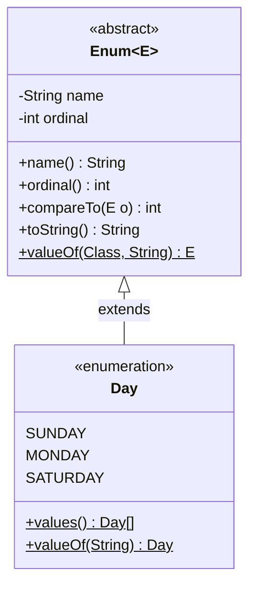
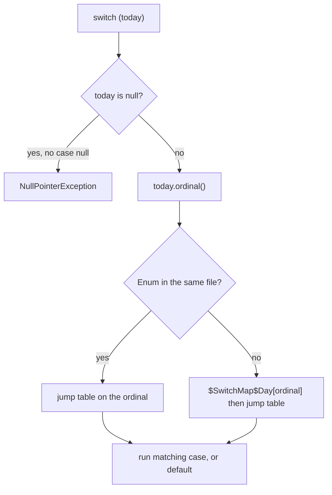

## In One Line
An `enum` is a special class with a **fixed, named set of instances** (`SUNDAY`, `MONDAY`, ...) created once by the JVM — type-safe constants that can be compared with `==`, used in `switch`, iterated with `values()`, and given fields, constructors and methods like any class.

## Mental Model
Think of the **days printed on a wall calendar**.

- There are exactly seven, printed at the factory. Nobody can print an eighth day or a second copy of Monday (no public constructor, no `new`).
- Everybody in the office points at **the same** printed "MONDAY" — so asking "is today *that* Monday?" with `==` is always reliable.
- Each day has a **position** on the calendar (`ordinal()`: SUNDAY is 0) and a **printed name** (`name()`: `"MONDAY"`).
- You can read the calendar left to right (`Day.values()`), or look a day up by its printed name (`Day.valueOf("MONDAY")`).
- A fancy calendar can print extra information on each day — opening hours, a colour, even an instruction ("on FRIDAY: order pizza") — that is an enum with **fields and methods**.

Compared with old-style `public static final int MONDAY = 1;` constants, the calendar cannot be handed a meaningless "day 42": the compiler only accepts real `Day` values.

## Concept
### Why enums exist (Java 5)
Before Java 5, constants were plain `int`s or `String`s (the "int enum pattern"):
```java
public static final int SUNDAY = 0, MONDAY = 1;   // any int is accepted: setDay(42) compiles
```
Problems: no type safety (a `Day` and a `Month` are both `int`), printing shows `1` instead of `MONDAY`, no way to iterate over all values, and constants are compiled into callers (changing a value needs recompiling every client). `enum` fixes all of these.

### What the compiler generates
The one line `enum Day { SUNDAY, MONDAY, ... }` becomes (seen with `javap -p` on the compiled example):
```java
final class EnumExample$Day extends java.lang.Enum<EnumExample$Day> {
    public static final EnumExample$Day SUNDAY;      // one field per constant
    public static final EnumExample$Day MONDAY;
    ...
    private static final EnumExample$Day[] $VALUES;  // all constants in declaration order

    public static EnumExample$Day[] values()          { return $VALUES.clone(); }
    public static EnumExample$Day valueOf(String name) { return Enum.valueOf(EnumExample$Day.class, name); }
    private EnumExample$Day(String name, int ordinal)  { super(name, ordinal); }

    static {                                           // runs once, when the class is initialised
        SUNDAY = new EnumExample$Day("SUNDAY", 0);
        MONDAY = new EnumExample$Day("MONDAY", 1);
        ...
        $VALUES = $values();
    }
}
```
Key facts that follow:
- Every enum **extends `java.lang.Enum<E>`**, so it cannot extend anything else (Java has single inheritance). It **can implement interfaces**.
- The class is implicitly **`final`** (unless a constant has a body — then it is implicitly *sealed*, permitting only those anonymous subclasses).
- Constructors are implicitly **`private`**; `new Day()` does not compile, and reflection is blocked (`Cannot reflectively create enum objects`).
- Each constant is a `public static final` field holding **the only instance** with that name. Creation happens in the static initialiser — lazily and thread-safely on first use of the enum.
- A **nested enum is implicitly `static`**, which is why `EnumExample.Day` needs no outer instance. Enums can also be top-level (their own file), or since Java 16 declared locally inside a method.
- `values()` returns a **new copy** of the array on every call, so callers cannot corrupt `$VALUES`. Cache it in a `private static final` field if you call it in a hot loop.

### Methods every enum has
| Method | From | Returns |
|---|---|---|
| `name()` | `Enum` (final) | the exact identifier: `"MONDAY"` |
| `toString()` | `Enum` (overridable) | `name()` by default — override for display text |
| `ordinal()` | `Enum` (final) | 0-based position in the declaration |
| `compareTo(e)` | `Enum` (final, `Comparable<E>`) | ordinal difference: declaration order is the natural order |
| `equals`, `hashCode` | `Enum` (final) | identity-based — `==` and `equals` always agree |
| `getDeclaringClass()` | `Enum` | the enum type, even for constants with bodies |
| `values()` | generated | array copy of all constants |
| `valueOf(String)` | generated | constant with that exact name, else `IllegalArgumentException`; `null` → `NullPointerException` |
| `Enum.valueOf(Class, String)` | `Enum` (static) | the generic version |

`clone()` throws `CloneNotSupportedException`, and serialization writes only the **name**, deserializing back to the existing constant — so an enum stays a true singleton per constant.

### Enums with fields, constructors and methods
```java
enum Planet {
    MERCURY(3.303e+23, 2.4397e6), EARTH(5.976e+24, 6.37814e6);  // constants FIRST, then ';'
    private final double mass, radius;
    Planet(double mass, double radius) { this.mass = mass; this.radius = radius; }
    double surfaceGravity() { return 6.67300E-11 * mass / (radius * radius); }
}
```
Rules: the constant list must come **first**; if anything follows it, end the list with `;`. Fields should be `final` — enum constants are shared globally, so mutable state in them is a shared-global-variable bug waiting to happen.

### Constant-specific behaviour
A constant can have its own class body, typically to implement an `abstract` method declared by the enum — the "strategy per constant" pattern:
```java
enum Op {
    PLUS  { int apply(int a, int b) { return a + b; } },
    TIMES { int apply(int a, int b) { return a * b; } };
    abstract int apply(int a, int b);
}
```
Each such constant is an **anonymous subclass** (`Op$1`), so `Op.PLUS.getClass() != Op.class` — use `getDeclaringClass()` to get `Op`.

### Enums in `switch`
| Style | Syntax | Notes |
|---|---|---|
| Classic statement (Java 5+) | `case MONDAY: ...; break;` | Falls through without `break`; `default` optional; no completeness check |
| Arrow form (Java 14+) | `case SATURDAY, SUNDAY -> ...` | No fall-through, several labels per case |
| Switch **expression** (Java 14+) | `String k = switch (d) { ... };` | Must be **exhaustive**: covering every constant is enough — no `default` needed, and the compiler complains when a new constant is added |
| Pattern switch (Java 21) | `case null ->`, `case Day.MONDAY ->` | `null` can be handled explicitly; qualified names like `Day.MONDAY` are allowed as labels |

- Case labels use the **bare constant name** (`case MONDAY`, not `case Day.MONDAY`) — the type is known from the selector. Java 21 also accepts the qualified form.
- Switching on a **`null`** enum without `case null` throws `NullPointerException`.
- Under the hood, `switch` works on `ordinal()`. For an enum in the same file javac switches on the ordinal directly; for an enum from another file it builds a synthetic `$SwitchMap$...` array mapping ordinals to case numbers, so reordering the enum's constants does not break already-compiled switches.

Details of modern switch are in [Switch Expressions & Pattern Matching](lesson:b05-modern-java/05-switch-expressions-and-pattern-matching).

### EnumSet and EnumMap
- **`EnumSet<E>`** — a `Set` of constants stored as a **bit vector** (one `long` for up to 64 constants). `contains`/`add` are single bit operations. Factories: `EnumSet.of(...)`, `range(from, to)`, `allOf(Day.class)`, `noneOf(Day.class)`, `complementOf(set)`. Use it instead of bit flags (`int flags = READ | WRITE`).
- **`EnumMap<K, V>`** — a `Map` with enum keys backed by an **array indexed by ordinal**. Faster and more compact than `HashMap`; iterates in declaration order; `null` keys are not allowed.

### Best practices and uses
- Compare with `==` — it is null-safe (`day == Day.MONDAY` is simply `false` for `null`) and checked at compile time.
- Never persist or compute with **`ordinal()`** — adding a constant in the middle changes every ordinal. Store `name()` or an explicit field (a code).
- `valueOf` is strict (exact, case-sensitive); for user input, write a lookup that returns `Optional` or a default.
- **Enum singleton** (Effective Java, Item 3): `enum Registry { INSTANCE; ... }` — thread-safe lazy creation, serialization-safe and reflection-proof for free. See [Singleton](lesson:a10-patterns/01-singleton).
- Enums implementing an interface give an **extensible** set of strategies: `enum BasicOp implements Operation { ... }`.

## Diagram

Every enum is a `final` subclass of `java.lang.Enum`; each constant is one instance carrying its `name` and `ordinal`; `values()` and `valueOf(String)` are generated by the compiler (only three of the seven constants are drawn).


An enum switch is an integer switch on the ordinal; the synthetic `$SwitchMap` keeps compiled code correct even if the enum's constants are reordered later.

## Code
@example CoreJava/JavaFeatures/EnumExample.java

The built-in API of every enum:
```java
public class EnumBasics {
    enum Day { SUNDAY, MONDAY, TUESDAY, WEDNESDAY, THURSDAY, FRIDAY, SATURDAY }

    public static void main(String[] args) {
        Day d = Day.valueOf("FRIDAY");                  // String -> constant (exact name)
        System.out.println(d.name() + " " + d.ordinal() + " " + d.compareTo(Day.MONDAY));
        System.out.println(d == Day.FRIDAY);             // one instance per constant: == is safe
        System.out.println(Day.values().length + " " + (Day.values() == Day.values()));  // a fresh copy each call

        try {
            Day.valueOf("friday");                       // case-sensitive
        } catch (IllegalArgumentException e) {
            System.out.println(e.getMessage());
        }

        System.out.println(Day.class.getSuperclass().getName());   // every enum extends java.lang.Enum
        System.out.println(d instanceof Comparable<?>);             // Enum implements Comparable
    }
}
```
```output
FRIDAY 5 4
true
7 false
No enum constant EnumBasics.Day.friday
java.lang.Enum
true
```

Enums as full classes — fields, constructors, constant-specific bodies, exhaustive switch expressions, `EnumSet` and `EnumMap`:
```java
import java.util.EnumMap;
import java.util.EnumSet;
import java.util.Map;
import java.util.StringJoiner;

public class RichEnums {
    enum Planet {
        MERCURY(3.303e+23, 2.4397e6), EARTH(5.976e+24, 6.37814e6);   // constructor arguments

        private final double mass;     // kg
        private final double radius;   // m
        Planet(double mass, double radius) { this.mass = mass; this.radius = radius; }  // implicitly private

        double surfaceGravity() { return 6.67300E-11 * mass / (radius * radius); }
    }

    enum Op {
        PLUS("+")  { int apply(int a, int b) { return a + b; } },    // constant-specific body
        TIMES("*") { int apply(int a, int b) { return a * b; } };

        private final String symbol;
        Op(String symbol) { this.symbol = symbol; }
        abstract int apply(int a, int b);                             // every constant must implement it
        @Override public String toString() { return symbol; }
    }

    enum Day { SUNDAY, MONDAY, TUESDAY, WEDNESDAY, THURSDAY, FRIDAY, SATURDAY }

    public static void main(String[] args) {
        System.out.printf("%s %.2f%n", Planet.EARTH, Planet.EARTH.surfaceGravity());
        System.out.println("3 " + Op.TIMES + " 4 = " + Op.TIMES.apply(3, 4) + ", name=" + Op.TIMES.name());
        System.out.println(Op.PLUS.getClass() == Op.class);           // constant body = anonymous subclass
        System.out.println(Op.PLUS.getDeclaringClass() == Op.class);  // use this to get the enum type

        StringJoiner line = new StringJoiner(" ");
        for (Day day : Day.values()) {
            String kind = switch (day) {                   // Java 14 switch expression:
                case SATURDAY, SUNDAY -> "weekend";        // no fall-through, no break,
                case MONDAY -> "start";                    // and the compiler checks that
                case FRIDAY -> "end";                      // every constant is covered
                case TUESDAY, WEDNESDAY, THURSDAY -> "midweek";
            };
            line.add(day.name().substring(0, 3) + "=" + kind);
        }
        System.out.println(line);

        EnumSet<Day> weekend = EnumSet.of(Day.SATURDAY, Day.SUNDAY);   // bit-vector set
        System.out.println(weekend + " " + EnumSet.range(Day.MONDAY, Day.FRIDAY));
        Map<Day, String> plan = new EnumMap<>(Day.class);              // array-backed map
        plan.put(Day.FRIDAY, "movie");
        plan.put(Day.MONDAY, "gym");
        System.out.println(plan);                                      // ordinal order, not insertion order
    }
}
```
```output
EARTH 9.80
3 * 4 = 12, name=TIMES
false
true
SUN=weekend MON=start TUE=midweek WED=midweek THU=midweek FRI=end SAT=weekend
[SUNDAY, SATURDAY] [MONDAY, TUESDAY, WEDNESDAY, THURSDAY, FRIDAY]
{MONDAY=gym, FRIDAY=movie}
```

The original switch treats Saturday as a midweek day (see Errata); an exhaustive switch expression fixes it:
```java
public class SaturdayBug {
    enum Day { SUNDAY, MONDAY, TUESDAY, WEDNESDAY, THURSDAY, FRIDAY, SATURDAY }

    static String original(Day today) {           // the switch from EnumExample
        switch (today) {
            case MONDAY:
                return "Start of the work week.";
            case FRIDAY:
                return "End of the work week.";
            case SUNDAY:
                return "It's the weekend!";
            default:
                return "Midweek day.";
        }
    }

    static String fixed(Day today) {
        return switch (today) {
            case MONDAY -> "Start of the work week.";
            case FRIDAY -> "End of the work week.";
            case SATURDAY, SUNDAY -> "It's the weekend!";
            case TUESDAY, WEDNESDAY, THURSDAY -> "Midweek day.";
        };
    }

    public static void main(String[] args) {
        System.out.println("original: " + original(Day.SATURDAY));
        System.out.println("fixed:    " + fixed(Day.SATURDAY));
    }
}
```
```output
original: Midweek day.
fixed:    It's the weekend!
```

Java 21 additions — `case null` and qualified constant labels:
```java
public class NullCase {
    enum Day { SUNDAY, MONDAY, SATURDAY }
    public static void main(String[] args) {
        Day today = null;
        String s = switch (today) {
            case null -> "no day";                       // Java 21: null can be a case
            case Day.SATURDAY, Day.SUNDAY -> "weekend";  // Java 21: qualified constant names allowed
            case MONDAY -> "start";
        };
        System.out.println(s);
    }
}
```
```output
no day
```

## Walkthrough
- `package CoreJava.JavaFeatures;` / `public class EnumExample` — the course shell.
- `enum Day { SUNDAY, MONDAY, ..., SATURDAY }` — a **nested** enum (implicitly `static`) declared inside `EnumExample`; it compiles to its own class file `EnumExample$Day.class`. The constants are listed in the order Sunday-first, so `SUNDAY.ordinal()` is 0 and `SATURDAY.ordinal()` is 6. No semicolon is needed after the last constant because nothing else follows in the body.
- `Day today = Day.MONDAY;` — reads the `public static final` field `MONDAY`. The first access triggers the enum's static initialiser, which creates all seven constants.
- `System.out.println("Today is: " + today);` — concatenation calls `String.valueOf(today)` → `today.toString()` → by default `name()` → `Today is: MONDAY`.
- `switch (today)` — a classic switch **statement** on an enum. Case labels are the bare constant names (`case MONDAY:`), because the compiler already knows the type is `Day`. `MONDAY` matches, prints `Start of the work week.`, and `break` stops execution from falling through into the `FRIDAY` case. `FRIDAY` and `SUNDAY` have their own cases; every other day — **including `SATURDAY`** — goes to `default` and prints `Midweek day.` The `break` after `default` is harmless but unnecessary (it is the last case). Because `Day` is in the same source file, `javap` shows the switch compiled as a `lookupswitch` directly on `today.ordinal()` with keys 0, 1 and 5.
- `for (Day day : Day.values())` — `values()` returns a fresh `Day[]` in declaration order; the enhanced for loop prints each constant's `toString()`: `SUNDAY` ... `SATURDAY`. The `// Output:` block after the loop is written as comments, which is fine.

Every `// Output:` comment matches the recorded output for `MONDAY`; the logic problem only appears for other days.

## Traps
> [!ERRATA] The `switch` has cases for `MONDAY`, `FRIDAY` and `SUNDAY` (printed "It's the weekend!") but not for `SATURDAY`, so Saturday falls into `default` and prints **"Midweek day."** — a logic bug that the example's single test value (`MONDAY`) never reveals. Fix: `case SATURDAY: case SUNDAY:` (or `case SATURDAY, SUNDAY ->` in Java 14+), and prefer an exhaustive switch expression without `default`, so the compiler lists every constant you forgot.

- **Relying on `ordinal()`** for storage or logic — inserting a constant renumbers everything after it. Store `name()` or an explicit code field.
- **`valueOf` is exact and throws.** `Day.valueOf("monday")` → `IllegalArgumentException`; `valueOf(null)` → `NullPointerException`.
- **Switching on a `null` enum** throws `NullPointerException` (unless Java 21 `case null` is present).
- **Forgetting `break`** in a classic switch runs the next case too (fall-through). Arrow cases (`->`) never fall through.
- **`default` hides missing constants.** When someone adds `HOLIDAY`, a switch with `default` silently treats it as "midweek"; an exhaustive switch expression without `default` refuses to compile.
- **`getClass()` on a constant with a body** returns the anonymous subclass (`Op$1`); use `getDeclaringClass()`.
- **`values()` allocates a new array each call** — cache it if used in a hot path.
- **Mutable fields in enum constants** are global shared state; keep them `final`.
- **Qualified case labels** (`case Day.MONDAY:`) do not compile before Java 21.

## Tips & Tricks
- **Mnemonic "FINE": enums are Final classes, Instances fixed, Name + ordinal built in, Extend `Enum` (so implement, don't extend).**
- **`==` for enums, always.** It is faster, null-safe and type-checked.
- **"Constants first, semicolon, then the class body."**
- **Prefer switch expressions for enums** — exhaustiveness turns "forgot a constant" into a compile error.
- **Bit flags? Use `EnumSet`. Enum-keyed map? Use `EnumMap`.**
- **Need a safe lookup from user text?** `Arrays.stream(Day.values()).filter(d -> d.name().equalsIgnoreCase(s)).findFirst()`.
- **Singleton in one line:** `enum Config { INSTANCE; }` — Effective Java's recommended approach.

## Interview Q&A
### [Basic] What is an enum and why use it instead of int or String constants?
An enum is a special class whose instances are a fixed set of named constants, e.g. `enum Day { SUNDAY, MONDAY, ... }`. Compared with `static final int` constants it gives **type safety** (a method taking `Day` cannot receive 42 or a `Month`), readable `toString()` output, iteration with `values()`, lookup with `valueOf()`, use in `switch`, the ability to add fields and behaviour, and efficient collections (`EnumSet`, `EnumMap`). Constants are singletons, so `==` comparison is correct.

**Follow-up:** *Can an enum have a constructor?* — Yes, but it is always private (implicitly); it runs once per constant when the enum class is initialised, with the arguments written after each constant: `EARTH(5.976e24, 6.378e6)`.

### [Basic] What is the difference between `name()`, `toString()` and `ordinal()`?
`name()` is `final` and always returns the exact identifier from the source (`"MONDAY"`). `toString()` returns `name()` by default but may be overridden for display text (e.g. `"Monday"`). `ordinal()` is the 0-based position in the declaration (`SUNDAY` = 0). Use `name()` for persistence and lookups (it pairs with `valueOf`), `toString()` for display, and avoid depending on `ordinal()` except inside `EnumSet`/`EnumMap`-style internals.

**Follow-up:** *If `toString()` is overridden, what does `valueOf` expect?* — Still the `name()`. `valueOf(someEnum.toString())` can then throw `IllegalArgumentException`.

### [Basic] Can an enum extend a class or implement an interface?
It cannot extend a class, because every enum already implicitly extends `java.lang.Enum` and Java allows only one superclass. It **can implement** any number of interfaces, and each constant can even implement interface methods differently via constant-specific bodies. Enums also cannot be extended: they are implicitly `final` (or sealed, if constants have bodies).

**Follow-up:** *Can you declare an abstract method in an enum?* — Yes, if every constant provides a body implementing it; otherwise it does not compile.

### [Intermediate] How does the compiler implement an enum?
It generates a `final` class extending `Enum<Day>` with one `public static final Day` field per constant, a private constructor taking `(String name, int ordinal)` plus any declared parameters, a static initialiser that creates each constant in order and fills a private `$VALUES` array, and two static methods: `values()` (returns `$VALUES.clone()`) and `valueOf(String)` (delegates to `Enum.valueOf(Day.class, name)`). Constants with bodies become anonymous subclasses. `javap -p` on the compiled class shows all of this.

**Follow-up:** *Why does `values()` clone the array?* — Arrays are mutable; returning the internal array would let callers overwrite constants in it.

### [Intermediate] How does `switch` on an enum work, and what happens with `null`?
The compiler turns it into an integer switch on `ordinal()`. If the enum is in another compilation unit, javac adds a synthetic class with a `$SwitchMap$Pkg$Day` array mapping the runtime ordinal to a case index, so reordering the enum later does not break compiled switches. Since the selector's `ordinal()` is called, a `null` selector throws `NullPointerException` — unless Java 21's `case null` is used. Switch **expressions** (Java 14+) must be exhaustive; covering all constants is enough, and the compiler inserts a hidden default that throws `MatchException` (Java 21; `IncompatibleClassChangeError` before) if a new constant appears at runtime without recompiling.

**Follow-up:** *Why write case labels without the enum name?* — The selector's type determines the constants, so `case MONDAY` is unambiguous; Java 21 also permits `case Day.MONDAY`.

### [Intermediate] What are EnumSet and EnumMap, and why are they faster than HashSet/HashMap?
`EnumSet` stores membership as a bit vector — a single `long` for enums with up to 64 constants (`RegularEnumSet`), a `long[]` otherwise (`JumboEnumSet`) — so `add`, `contains` and set operations are a few bit operations. `EnumMap` stores values in an array indexed by the key's ordinal: no hashing, no collisions, no entry objects. Both iterate in declaration order and reject `null` keys/elements. They are the recommended replacements for bit flags and for `HashMap<SomeEnum, V>`.

**Follow-up:** *How do you create an EnumSet of all or no constants?* — `EnumSet.allOf(Day.class)` and `EnumSet.noneOf(Day.class)`.

### [Advanced] Why is an enum the best way to implement a Singleton?
`enum Singleton { INSTANCE; ... }` gets from the JVM for free what other singletons must code by hand: **lazy, thread-safe** creation (class initialisation is thread-safe), **serialization safety** (enums are serialized by name and resolved to the existing constant, so deserialization cannot create a second instance), and **reflection safety** (`Constructor.newInstance` throws `IllegalArgumentException: Cannot reflectively create enum objects`). It is also the shortest code. Limitation: it cannot extend another class.

**Follow-up:** *When would you not use an enum singleton?* — When the singleton must extend a class, or needs lazy initialisation separate from other static members of the type (a holder class may fit better), or when a DI framework manages lifecycle.

### [Advanced] What is the "constant-specific method implementation" pattern, and how is it different from a switch?
Each constant supplies its own implementation of an abstract method declared in the enum: `PLUS { int apply(int a, int b) { return a + b; } }`. Behaviour lives with the constant, so adding a new constant forces you (via the compiler) to implement the method — nothing can be forgotten. A `switch (this)` inside the enum does the same job but can silently miss a new constant if it has a `default`. Constant bodies compile to anonymous subclasses, so `getClass()` differs from `getDeclaringClass()`, and since Java 17 such an enum is implicitly `sealed`.

**Follow-up:** *Can constants share code between some of them?* — Yes: put the shared logic in a normal method, or pass a strategy object (e.g. a lambda) through the constructor: `PLUS((a, b) -> a + b)`.

### [Intermediate] Why shouldn't you rely on `ordinal()`?
The ordinal is just the declaration position. Inserting, removing or reordering constants changes the ordinals of others, silently corrupting anything that stored or computed with them (database columns, array indexes, file formats). The `Enum` Javadoc says it is intended for data structures like `EnumSet`/`EnumMap`. Store `name()` or give the enum an explicit field (`CODE_A("A")`) with a static lookup map.

**Follow-up:** *And for JPA?* — Use `@Enumerated(EnumType.STRING)` rather than the default `ORDINAL`, for exactly this reason.

## Quiz
### What does the original example print if you change `today` to `Day.SATURDAY`?
- [ ] It's the weekend!
- [x] Midweek day.
- [ ] Nothing, because there is no case for SATURDAY
- [ ] End of the work week.
> Only `MONDAY`, `FRIDAY` and `SUNDAY` have cases; `SATURDAY` falls into `default`, which prints "Midweek day." — the example's logic bug. A missing case never means "nothing happens" when a `default` exists.

### What does this print?
```java
enum Size { SMALL, MEDIUM, LARGE;
    Size() { System.out.print("init "); }
}
// in main:
System.out.println(Size.LARGE.ordinal());
```
- [ ] 2
- [ ] init 2
- [x] init init init 2
- [ ] 3
> The first use of `Size` initialises the enum class, which constructs **all three** constants (the constructor prints each time) before `LARGE.ordinal()` returns 2. Ordinals start at 0, so `LARGE` is 2, not 3.

### What does this print?
```java
enum Level { LOW, HIGH;
    @Override public String toString() { return name().toLowerCase(); }
}
// in main:
System.out.println(Level.HIGH + " " + Level.HIGH.name() + " " + Level.valueOf("HIGH"));
```
- [ ] HIGH HIGH HIGH
- [x] high HIGH high
- [ ] high high high
- [ ] IllegalArgumentException
> Concatenation uses the overridden `toString()` → `high`. `name()` is final and always returns the identifier `HIGH`. `valueOf("HIGH")` matches by name and returns the constant, which is then printed via `toString()` → `high`.

### Which statement about enums is true?
- [ ] An enum can extend an abstract class if it implements its methods
- [ ] Enum constructors can be `public`
- [x] Every enum implicitly extends `java.lang.Enum`, and its constructors are implicitly private
- [ ] `Day.values()` returns the same array object each time
> `extends Enum` is implicit, so no other superclass is possible; a `public` or `protected` constructor does not compile. `values()` returns a new clone on every call.

### What happens here?
```java
Day d = null;
switch (d) {
    case MONDAY: System.out.println("Mon"); break;
    default:     System.out.println("other");
}
```
- [ ] Prints "other"
- [ ] Does not compile
- [x] Throws NullPointerException
- [ ] Prints nothing
> A classic enum switch calls `d.ordinal()`, so a `null` selector throws before any case is chosen; `default` does not catch `null`. Only Java 21's `case null` label handles it.

### What is the output of `Day.valueOf("monday")` for `enum Day { MONDAY }`?
- [ ] MONDAY
- [ ] null
- [x] IllegalArgumentException: No enum constant ...Day.monday
- [ ] Compile error
> `valueOf` requires the exact, case-sensitive name. It never returns `null`; an unknown name throws `IllegalArgumentException` (and a `null` name throws `NullPointerException`).

### Which is the best way to store the set `{SATURDAY, SUNDAY}` of `Day` values?
- [ ] `new HashSet<>(List.of(Day.SATURDAY, Day.SUNDAY))`
- [x] `EnumSet.of(Day.SATURDAY, Day.SUNDAY)`
- [ ] `int weekend = (1 << 6) | (1 << 0);`
- [ ] `new TreeSet<>(Day.SATURDAY, Day.SUNDAY)`
> `EnumSet` keeps the type safety of enums and the speed of bit flags — internally it is one `long` bit vector. A `HashSet` works but is slower and bigger; raw bit flags lose type safety; `TreeSet` has no such constructor.

## Takeaways
- An enum is a `final` class extending `java.lang.Enum` whose only instances are its constants, created once in the static initialiser; constructors are implicitly private.
- Compare enums with `==`; they are singletons per constant, and `equals`/`hashCode` are identity-based and final.
- Built-ins: `name()` (exact identifier), `toString()` (overridable), `ordinal()` (position — do not persist it), `compareTo` (declaration order), generated `values()` (fresh array copy) and `valueOf(String)` (exact name or `IllegalArgumentException`).
- Enums can have fields, constructors, methods, abstract methods with constant-specific bodies, and can implement interfaces — but cannot extend a class.
- `switch` on an enum uses bare constant names, throws NPE for `null` (Java 21: `case null`), and as a Java 14+ switch expression must be exhaustive — prefer that over `default` so missing constants are compile errors.
- The original example's switch treats `SATURDAY` as "Midweek day." because only `SUNDAY` has the weekend case.
- `EnumSet` (bit vector) and `EnumMap` (ordinal-indexed array) are the fastest set and map for enum values; an enum is also the safest Singleton.
