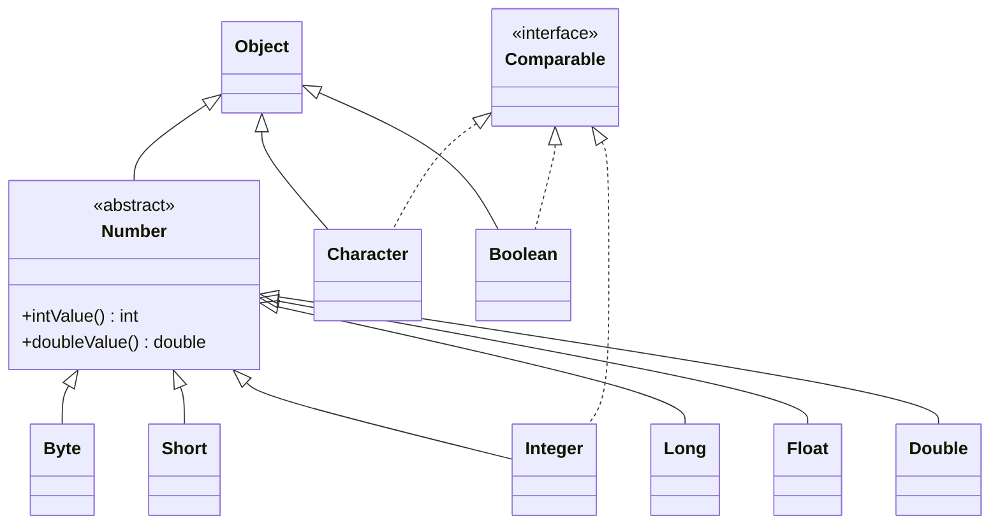
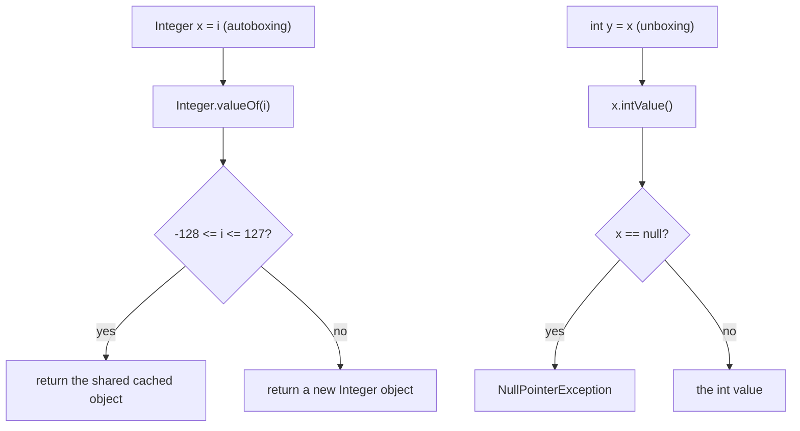
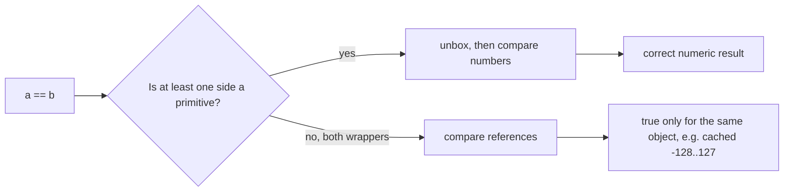

## In One Line
Every primitive type has a **wrapper class** (`int` → `Integer`, `double` → `Double`, ...) — an immutable object that holds one primitive value so it can live in collections and generics, be `null`, and carry utility methods; the compiler converts between the two automatically (**autoboxing** and **unboxing**).

## Mental Model
Think of **coins and gift boxes**.

- A **primitive** is a loose coin: small, fast, held directly in your hand (the variable).
- A **wrapper object** is a *sealed gift box with one coin inside*. It is bigger and lives on the heap, but boxes can be stacked on shelves that only accept boxes — **collections and generics** (`List<Integer>`, never `List<int>`).
- **Autoboxing** is the shop assistant who boxes your coin when a shelf needs a box (`Integer.valueOf(5)`), and **unboxing** opens it when you need to spend the coin (`intValue()`).
- The box is **sealed** (immutable): to "change" the coin you get a new box.
- An **empty box** is `null`. Asking the assistant to take the coin out of an empty box is a `NullPointerException`.
- The shop keeps a **stack of pre-wrapped boxes** for common coins, -128 to 127 (the **Integer cache**). Ask for `100` twice and you get the *same* box; ask for `1000` twice and you get two different boxes holding equal coins — so `==` (same box?) and `equals` (same coin?) disagree.

## Concept
### The eight wrappers
| Primitive | Wrapper | Superclass | Cached by `valueOf` / autoboxing |
|---|---|---|---|
| `byte` | `Byte` | `Number` | all 256 values |
| `short` | `Short` | `Number` | -128 .. 127 |
| `int` | `Integer` | `Number` | -128 .. 127 (upper bound configurable) |
| `long` | `Long` | `Number` | -128 .. 127 |
| `float` | `Float` | `Number` | none |
| `double` | `Double` | `Number` | none |
| `char` | `Character` | `Object` | 0 .. 127 (`'\u0000'`..`'\u007f'`) |
| `boolean` | `Boolean` | `Object` | `Boolean.TRUE`, `Boolean.FALSE` |

Only two names are not just the capitalised primitive: **`Integer`** and **`Character`**. All eight are in `java.lang`, are **`final`**, **immutable**, `Serializable` and `Comparable` to themselves. The six numeric ones extend the abstract class **`Number`**, which gives every one of them `intValue()`, `longValue()`, `doubleValue()`, `floatValue()`, `byteValue()` and `shortValue()` — so any `Number` can be converted to any primitive number (with the usual narrowing).

### Why wrappers exist
1. **Generics and collections** only work with objects: `List<Integer>`, `Map<String, Double>`. See [Why Generics](lesson:a04-generics/01-why-generics).
2. **`null` as "no value"** — an `Integer` field can say "unknown", an `int` field is always some number (`0` by default). Database columns and JSON fields that may be missing map to wrappers.
3. **Utility methods and constants** — parsing (`Integer.parseInt`), formatting (`Integer.toHexString`), comparison (`Integer.compare`), bit tricks (`Integer.bitCount`), limits (`Integer.MAX_VALUE`), character tests (`Character.isDigit`).
4. **Anywhere an `Object` is required** — reflection, `Object[]`, `equals(Object)`, `String.format` arguments.

Primitives still exist because they are much cheaper: an `int` is 4 bytes stored right in the variable or array, while an `Integer` is a separate heap object (about 16 bytes) plus a 4-8 byte reference to it. See [Data Types and Casting](lesson:b01-fundamentals/02-data-types-and-casting).

### Autoboxing and unboxing (Java 5)
The compiler inserts the conversion calls for you. `javap -c` on the course example shows exactly what it wrote:

| Source | Compiled to |
|---|---|
| `Integer intWrapper = intPrimitive;` | `Integer.valueOf(intPrimitive)` — **autoboxing** |
| `int anotherIntPrimitive = anotherIntWrapper;` | `anotherIntWrapper.intValue()` — **unboxing** |

Conversions happen in every context where the types need it:
- assignment (`Integer x = 5;`), method arguments (`list.add(5)`), return values;
- arithmetic and relational operators — `+`, `-`, `<`, `>=`, `++` all **unbox** (`counter++` becomes `counter = Integer.valueOf(counter.intValue() + 1)`);
- `==` / `!=` unbox **only if one side is a primitive**; with two wrapper objects they compare **references**;
- conditions (`if (Boolean flag)`), `switch` on an `Integer`, enhanced `for` over `List<Integer>` into an `int` variable.

Boxing only produces the **matching** wrapper: `int` boxes to `Integer`, never to `Long` or `Double`.
```text
LongBad.java:3: error: incompatible types: int cannot be converted to Long
        Long l = 42;
                 ^
```
Write `Long l = 42L;` and `Double d = 1.0;`. The one exception: an `int` **constant** that fits may be narrowed and boxed to `Byte`, `Short` or `Character` — `Short sh = 5;` and `Character ch = 65;` compile (the latter is `'A'`). How boxing interacts with overload resolution (widening beats boxing beats varargs) is covered in [Method Overloading](lesson:a01-oop/07-method-overloading).

### The Integer cache — why `==` lies
`Integer.valueOf(int)` — and therefore autoboxing — returns a **shared, pre-built object** for values from -128 to 127 and creates a new object for anything else:
```java
public class Cache {
    public static void main(String[] args) {
        Integer a = 127, b = 127;
        Integer c = 128, d = 128;
        System.out.println(a == b);          // same cached object
        System.out.println(c == d);          // two different objects
        System.out.println(c.equals(d));     // compares values
        System.out.println(c == 128);        // Integer == int -> unboxing, numeric compare

        Long big = 127L, big2 = 127L;
        Character ch = 'A', ch2 = 'A';
        Double x = 1.0, y = 1.0;
        Boolean t = true, t2 = true;
        System.out.println((big == big2) + " " + (ch == ch2) + " " + (x == y) + " " + (t == t2));
    }
}
```
```output
true
false
true
true
true true false true
```
- The Java Language Specification (§5.1.7) **guarantees** that boxing gives identical objects for `int`/`short`/`byte` values in -128..127, `char` values 0..127 and both `boolean` values. `Long` caches the same range in practice. `Float` and `Double` are never cached — `x == y` is `false` even for `1.0`.
- Only the `Integer` cache's **upper bound** can be raised: `-XX:AutoBoxCacheMax=1000` (or `-Djava.lang.Integer.IntegerCache.high=1000`). With that flag, the same program's first two lines are both `true` — proof that `128 == 128` "working" or not depends on JVM settings. Never rely on it.
- The cache is safe only because wrappers are **immutable** — shared objects that could change would be a disaster. It is the same idea as the [String pool](lesson:b01-fundamentals/07-string-pool-and-immutability).

> [!INTERVIEW] "Compare wrapper **values** with `equals()` (or unbox with `intValue()`); `==` on two wrapper objects compares references and only *appears* to work inside the -128..127 cache."

### Unboxing `null` throws `NullPointerException`
A wrapper can be `null`; a primitive cannot. Every hidden `intValue()` call is a hidden NPE risk:
```java
import java.util.*;

public class Npe {
    public static void main(String[] args) {
        Map<String, Integer> stock = new HashMap<>();
        stock.put("apple", 3);
        try {
            int bananas = stock.get("banana");   // get() returns null -> unboxing NPE
        } catch (NullPointerException e) {
            System.out.println("1: " + e.getMessage());
        }
        try {
            Integer discount = null;
            boolean member = false;
            int price = member ? 100 : discount; // ?: unboxes discount
        } catch (NullPointerException e) {
            System.out.println("2: " + e.getMessage());
        }
        int apples = stock.getOrDefault("banana", 0);
        System.out.println("3: " + apples);
    }
}
```
```output
1: Cannot invoke "java.lang.Integer.intValue()" because the return value of "java.util.Map.get(Object)" is null
2: Cannot invoke "java.lang.Integer.intValue()" because "<local2>" is null
3: 0
```
The *helpful NullPointerException* messages (Java 14+, on by default since 15) name the hidden `intValue()` call. Local variable names appear only if the class was compiled with `-g`; compiled that way, message 2 says `because "discount" is null`. In the conditional `member ? 100 : discount`, one operand is an `int` and the other an `Integer`, so the result type is `int` and `discount` is unboxed.

### Immutability
Wrappers have no setters; their `value` field is `private final`. Every "change" produces a new object:
```java
Integer counter = 5;
Integer before = counter;
counter++;                               // new object: counter = Integer.valueOf(counter + 1)
System.out.println(before + " " + counter + " " + (before == counter));
```
```output
5 6 false
```
So a method cannot change the caller's `Integer`: `static void increment(Integer n) { n++; }` rebinds only its own parameter, and the caller's `count` stays `10`. Java passes the reference by value, and the object behind it cannot be modified ([Pass by Value](lesson:b01-fundamentals/04-pass-by-value)). Use a return value, an `int[]` holder or `AtomicInteger` if you need a shared mutable counter.

### Creating wrappers: `valueOf` vs constructors vs `parseXxx`
| Call | Returns | Caches? | Status |
|---|---|---|---|
| `Integer.valueOf(10)` / autoboxing | `Integer` | Yes (-128..127) | **Preferred** |
| `Integer.valueOf("123")` | `Integer` | Yes | Parses, then `valueOf` |
| `Integer.parseInt("123")` | `int` | — (no object) | Preferred when you need a primitive |
| `new Integer(10)` | always a new `Integer` | Never | Deprecated since Java 9, **for removal** since Java 16 |

All wrapper constructors (`new Integer(...)`, `new Double(...)`, `new Boolean(...)`, ...) were deprecated in Java 9 and marked `forRemoval` in Java 16 by **JEP 390**, which declared the wrappers **value-based classes**: their identity should not matter, so code must not depend on `==`, `System.identityHashCode` or `synchronized` on them. `javac` 21 warns on both:
```text
WrapperClassExample.java:11: warning: [removal] Integer(int) in Integer has been deprecated and marked for removal
SyncVB.java:4: warning: [synchronization] attempt to synchronize on an instance of a value-based class
```
Synchronizing on an `Integer` is also a real bug: the cached `42` is shared by the whole JVM, so unrelated code may lock the same object. Project Valhalla aims to turn wrappers into identity-free value classes, which is why the constructors are going away.

### Parsing, formatting and handy methods
```java
System.out.println(Integer.parseInt("-42") + Integer.parseInt("+8"));
System.out.println(Integer.parseInt("ff", 16) + " " + Integer.parseInt("1010", 2));
System.out.println(Integer.valueOf("123") + " " + Integer.decode("0x1F") + " " + Integer.decode("010"));
System.out.println(Integer.toBinaryString(10) + " " + Integer.toHexString(255) + " " + Integer.toString(255, 8));
System.out.println(Double.parseDouble("1e3") + " " + Long.parseLong("9000000000"));
System.out.println(Integer.compare(3, 7) + " " + Integer.max(3, 7) + " " + Integer.sum(3, 7) + " " + Integer.signum(-9));
System.out.println(Integer.bitCount(255) + " " + Integer.reverse(1) + " " + Integer.toUnsignedString(-1));
System.out.println(Character.isDigit('7') + " " + Character.isLetter('x') + " " + Character.toUpperCase('q') + " " + Character.getNumericValue('7'));
System.out.println(Integer.valueOf(42).hashCode() + " " + Boolean.TRUE.hashCode() + " " + Long.valueOf(1L << 32).hashCode());
```
```output
-34
255 10
123 31 8
1010 ff 377
1000.0 9000000000
-1 7 10 -1
8 -2147483648 4294967295
true true Q 7
42 1231 1
```
- `parseInt` accepts an optional `+`/`-` sign and a radix (2..36). `decode` understands `0x`/`#` (hex) and a leading `0` (octal), so `"010"` is **8**.
- `Integer.sum`, `max`, `min` and `compare` exist mainly to be used as method references: `reduce(0, Integer::sum)`, `sort(Integer::compare)`.
- `hashCode()`: `Integer` returns its value, `Boolean` returns `1231`/`1237`, `Long` folds the two halves (`(int)(v ^ (v >>> 32))`, so `2^32` hashes to `1`).
- Invalid input throws the unchecked `NumberFormatException`:
```output
NFE: For input string: "12a"
NFE: For input string: " 5"
NFE: For input string: ""
NFE: For input string: "2147483648"
NFE: Cannot parse null string
```
Spaces are not trimmed (call `strip()` first), and a value outside the `int` range is rejected rather than wrapped.

### Constants: `MIN_VALUE` is not always "the most negative"
```output
-2147483648 9223372036854775807 32 4
4.9E-324 -1.7976931348623157E308 2.2250738585072014E-308 1.4E-45
65535 -128 32767
```
(`Integer.MIN_VALUE`, `Long.MAX_VALUE`, `Integer.SIZE` in bits, `Integer.BYTES`; then `Double.MIN_VALUE`, `-Double.MAX_VALUE`, `Double.MIN_NORMAL`, `Float.MIN_VALUE`; then `(int) Character.MAX_VALUE`, `Byte.MIN_VALUE`, `Short.MAX_VALUE`.)

For the integer types `MIN_VALUE` is the most negative value. For **`Float` and `Double`, `MIN_VALUE` is the smallest *positive* value** (`Double.MIN_VALUE` = 2^-1074 ≈ 4.9E-324). The most negative `double` is `-Double.MAX_VALUE`.

### Equality corner cases of `Double`, `Float` and `Long`
```java
Long l = 10L;
System.out.println(l.equals(10));        // 10 boxes to Integer, not Long
System.out.println(l.equals(10L));
System.out.println(l == 10);             // unboxing + widening: numeric compare

System.out.println(Double.NaN == Double.NaN);
System.out.println(Double.valueOf(Double.NaN).equals(Double.NaN));
System.out.println(0.0 == -0.0);
System.out.println(Double.valueOf(0.0).equals(-0.0));
```
```output
false
true
true
false
true
true
false
```
- `equals` first checks the **class**: a `Long` is never equal to an `Integer`, even with the same number.
- `Double.equals` compares the bit patterns (`doubleToLongBits`) so that `equals` stays consistent with `hashCode`: `NaN` equals itself, and `0.0` and `-0.0` are different. The primitive `==` follows IEEE 754: `NaN != NaN`, `0.0 == -0.0`. `Double.compare` follows `equals`.

### Performance: boxing is not free
- Each boxed value outside the cache is a heap allocation plus a pointer to follow. A `List<Integer>` of a million numbers holds a million separate objects; an `int[]` holds one array.
- A classic slowdown: `Long sum = 0L; for (...) sum += i;` unboxes, adds and **re-boxes a new `Long`** on every iteration. Declare `long sum`.
- Prefer primitive streams (`mapToInt(Integer::intValue).sum()`, `IntStream.range`) — see [Stream Operations](lesson:a05-java8/13-stream-operations) — and primitive arrays for large numeric data.
- Use wrappers where you need objects or `null`: collections, generics, optional database/JSON fields.

## Diagram

Six numeric wrappers share the abstract `Number` (so each converts to any primitive number); `Character` and `Boolean` extend `Object` directly. All eight are final, immutable and `Comparable` (only three arrows drawn).


Boxing may or may not create an object; unboxing is a hidden method call that fails on `null`.


`==` on two wrapper objects is an identity test; use `equals()` to compare values.

## Code
@example CoreJava/JavaFeatures/WrapperClassExample.java

The same program, written the modern way and extended to show the difference between `parseInt` and `valueOf`:
```java
public class WrapperModern {
    public static void main(String[] args) {
        Integer boxed = 5;                       // Integer.valueOf(5)
        Integer ten = Integer.valueOf(10);       // instead of new Integer(10)
        int unboxed = ten;                       // ten.intValue()
        int parsed = Integer.parseInt("123");    // primitive result
        Integer parsedBoxed = Integer.valueOf("123");   // Integer result
        System.out.println(boxed + " " + unboxed + " " + parsed + " " + parsedBoxed);
        System.out.println("smallest positive double: " + Double.MIN_VALUE);
        System.out.println("most negative double: " + -Double.MAX_VALUE);
    }
}
```
```output
5 10 123 123
smallest positive double: 4.9E-324
most negative double: -1.7976931348623157E308
```

## Walkthrough
- `package CoreJava.JavaFeatures;` / `public class WrapperClassExample` — a single class with only `main`.
- `// Autoboxing: Converting primitives into wrapper objects` — `int intPrimitive = 5;` is a plain primitive. `Integer intWrapper = intPrimitive; // Autoboxing` makes the compiler call `Integer.valueOf(5)`; since 5 is in -128..127, it returns the JVM's shared cached `Integer`, no new object.
- `System.out.println("Integer wrapper: " + intWrapper);` — string concatenation calls the wrapper's `toString()` (compiled to an `invokedynamic` `makeConcatWithConstants` call), printing **`Integer wrapper: 5`**. Concatenating a `null` wrapper would print `null`, not throw.
- `// Unboxing: Converting wrapper objects into primitives` — `Integer anotherIntWrapper = new Integer(10);` explicitly allocates a **new** object with the deprecated constructor (see Traps). `int anotherIntPrimitive = anotherIntWrapper; // Unboxing` compiles to `anotherIntWrapper.intValue()`. It prints **`Primitive int: 10`**.
- `// Using wrapper class methods` — `String str = "123"; int parsedInt = Integer.parseInt(str);` turns text into a primitive `int`. It would throw `NumberFormatException` for `"12a"`, `" 123"` or `""`. Prints **`Parsed int: 123`**.
- `// Using constants from wrapper classes` — `Integer.MAX_VALUE` is 2^31 - 1 = **2147483647**. Because it is a `static final` compile-time constant, the compiler folds `"Integer MAX_VALUE: " + Integer.MAX_VALUE` into the single string literal `"Integer MAX_VALUE: 2147483647"` (visible as one `ldc` instruction in `javap -c`).
- `Double.MIN_VALUE` prints **`4.9E-324`** — the **smallest positive** `double` (2^-1074), not the most negative one. `Double.toString` uses scientific notation (`E-324`) for magnitudes below 10^-3 and prints the shortest digits that identify the value.
- All five output comments carry the right values; the output matches them.

## Traps
> [!ERRATA] `new Integer(10)` uses a constructor that has been **deprecated since Java 9 and marked for removal since Java 16** (JEP 390). Compiling the example on JDK 21 prints `warning: [removal] Integer(int) in Integer has been deprecated and marked for removal`. It also always allocates a new object, bypassing the cache. Write `Integer anotherIntWrapper = 10;` or `Integer.valueOf(10)`.

> [!WARNING] The example prints `Double.MIN_VALUE` next to `Integer.MAX_VALUE` as if both were range limits, but they are not symmetric: `Integer.MIN_VALUE` is negative (-2147483648), while `Double.MIN_VALUE` (4.9E-324) is the smallest **positive** double. For the lowest double use `-Double.MAX_VALUE`.

> [!NOTE] Two output comments are inconsistently formatted — `// Output:Integer MAX_VALUE: ...` has no space after the colon, and the last one omits `Output:` entirely. The values in them are correct.

- **`==` between two wrappers** compares references: `Integer c = 128, d = 128; c == d` is `false`, while `c <= d` and `c >= d` are both `true` (relational operators unbox). Use `equals()` or `intValue()`.
- **Unboxing `null`** — `int n = map.get(key);`, `member ? 100 : discount`, `Integer total = null; total++;`, or a method declared to return `int` doing `return someInteger;` all throw `NullPointerException`. Use `getOrDefault`, `Objects.requireNonNullElse`, or keep primitives.
- **`Long.equals(10)`** is `false` — `10` boxes to `Integer`, and `equals` checks the class. Compare with `10L`.
- **`list.remove(1)` on a `List<Integer>`** calls `remove(int index)` — exact match beats boxing — and removes the element at **index** 1: `[10, 20, 30]` becomes `[10, 30]`. To remove the **value**, write `list.remove(Integer.valueOf(1))`.
- **Mixed conditional operator** — `Object o = true ? 1 : 2.0;` is `1.0` (a `Double`): the operands are unboxed/promoted to a common numeric type before the result is boxed.
- **`Boolean.getBoolean("true")` is `false`, `Integer.getInteger("123")` is `null`.** These read **system properties** with that name; they do not parse. The parsers are `Boolean.parseBoolean` (true only for `"true"`, any case — `"yes"` is `false`) and `Integer.parseInt`.
- **`Double.NaN` and `-0.0`** — `==` and `equals` disagree for them (see above).
- **Boxing in hot loops** — `Long sum` in a loop allocates a new `Long` per iteration.
- **Locking on a wrapper** — `synchronized (someInteger)` locks a JVM-wide shared cached object; `javac` warns about it.

## Tips & Tricks
- **"Two odd names: `Integer` and `Character`."** Every other wrapper is its primitive with a capital letter.
- **"Box = `valueOf`, unbox = `xxxValue()`."** Autoboxing is just the compiler typing those calls for you — and every hidden `xxxValue()` is a place a `null` can explode.
- **Cache range `-128..127` = one signed byte.** `Byte`, `Short`, `Integer`, `Long` cache it; `Character` caches 0..127 (ASCII); `Float`/`Double` never.
- **"Objects with `equals`, primitives with `==`."** If either side of `==` is a primitive, you get a numeric comparison; if both are wrappers, you get an identity check.
- **`parseXxx` → primitive, `valueOf` → object.** Choose by what you need next.
- **`MIN_VALUE` of `float`/`double` is tiny and positive.** Lowest double = `-Double.MAX_VALUE`.
- **Primitives by default**; wrappers only for collections, generics, and "may be missing" values.
- **`getOrDefault(key, 0)` and `merge(key, 1, Integer::sum)`** avoid unboxing `null` when counting with maps.

## Interview Q&A
### [Basic] What are wrapper classes and why does Java need them?
Wrapper classes are the eight classes in `java.lang` — `Byte`, `Short`, `Integer`, `Long`, `Float`, `Double`, `Character`, `Boolean` — that each hold one primitive value as an object. Java needs them because generics and collections work only with objects (`List<Integer>`, not `List<int>`), because a wrapper can be `null` to mean "no value", and because they carry utility methods and constants (`Integer.parseInt`, `Integer.MAX_VALUE`, `Character.isDigit`). They are `final` and immutable; the numeric ones extend `Number`.

**Follow-up:** *Why not use only wrappers?* — Cost: each wrapper is a heap object of about 16 bytes plus a reference, needs allocation and garbage collection, and hurts cache locality. Primitives are stored directly.

### [Basic] What are autoboxing and unboxing, and how are they implemented?
Autoboxing (Java 5) is the automatic conversion of a primitive to its wrapper; unboxing is the reverse. They are pure compiler features: `Integer x = 5;` compiles to `Integer x = Integer.valueOf(5);` and `int y = x;` to `int y = x.intValue();` (visible with `javap -c`). They happen in assignments, method calls and returns, arithmetic and relational operators, and collection operations.
```java
List<Integer> list = new ArrayList<>();
list.add(7);            // list.add(Integer.valueOf(7))
int first = list.get(0); // list.get(0).intValue()
```
**Follow-up:** *Can `int` autobox to `Long`?* — No. Boxing only produces the matching wrapper; `Long l = 42;` is a compile error, `Long l = 42L;` works.

### [Basic] What is the difference between `Integer.parseInt` and `Integer.valueOf`?
`parseInt(String)` returns a primitive `int`. `valueOf(String)` parses the same way but returns an `Integer`, using the -128..127 cache. `valueOf(int)` is also what autoboxing calls. Both throw `NumberFormatException` for invalid text (and `parseInt(null)` throws it too, with the message "Cannot parse null string"). Use `parseInt` when you need a number to compute with, `valueOf` when you need an object.

**Follow-up:** *And `new Integer("123")`?* — Deprecated since Java 9, marked for removal since 16; it always allocates. Use `valueOf`.

### [Intermediate] Why is `Integer a = 127, b = 127; a == b` true but the same with 128 false?
Autoboxing calls `Integer.valueOf`, which returns cached objects for -128..127 (the range the JLS §5.1.7 guarantees), so both variables point to the **same** object and `==` — a reference comparison — is `true`. 128 is outside the cache, so two distinct objects are created and `==` is `false` although the values are equal. The upper limit can be raised with `-XX:AutoBoxCacheMax`, which makes the 128 case `true` — so relying on `==` is a bug either way. Compare with `equals()`, or unbox one side (`a.intValue() == b`).

**Follow-up:** *Which other wrappers cache?* — `Byte`, `Short`, `Long` (-128..127), `Character` (0..127) and `Boolean` (`TRUE`/`FALSE`); `Float` and `Double` do not.

### [Intermediate] When can autoboxing cause a NullPointerException?
Whenever a `null` wrapper is unboxed, because unboxing is a hidden `intValue()` call: `int n = map.get("missing");`, `Integer total = null; total++;`, a conditional such as `flag ? 0 : nullableInteger` (its type is `int`, so the `Integer` is unboxed), passing a `null` `Integer` to a method taking `int`, or `if (nullableBoolean)`. Since Java 14 the message says `Cannot invoke "java.lang.Integer.intValue()" because ... is null`. Avoid it with `getOrDefault`, explicit null checks, `Objects.requireNonNullElse(x, 0)`, or primitives where `null` makes no sense.

**Follow-up:** *Why did `member ? 100 : discount` unbox rather than box 100?* — The JLS rules for `?:` say that if one operand is `int` and the other `Integer`, the type of the whole expression is `int`.

### [Intermediate] Are wrapper classes immutable? What happens on `Integer i = 5; i++;`?
Yes: the value is stored in a `private final` field and there are no setters. `i++` compiles to `i = Integer.valueOf(i.intValue() + 1)` — a **new** object (or a different cached one) is assigned to the variable; the old object is unchanged. Immutability is what makes caching and sharing safe, makes wrappers thread-safe, and keeps them reliable as `HashMap` keys. It also means a method that receives an `Integer` cannot change the caller's value.

**Follow-up:** *How do you share a mutable counter then?* — `AtomicInteger` (thread-safe), an `int[1]` holder, or a return value.

### [Intermediate] What does `list.remove(1)` do on a `List<Integer>` containing `[10, 20, 30]`?
It removes the element at **index 1**, giving `[10, 30]`. `List` has two overloads, `remove(int index)` and `remove(Object o)`; the argument `1` is an `int`, and overload resolution prefers an exact match in phase 1 over boxing in phase 2. To remove the value 1 write `list.remove(Integer.valueOf(1))` (or `(Object) 1`).

**Follow-up:** *Does `Collection<Integer> c; c.remove(1)` behave the same?* — No. `Collection` has only `remove(Object)`, so `1` is boxed and the value is removed. The static type decides.

### [Intermediate] Why is `Long.valueOf(10).equals(10)` false?
`equals(Object)` takes an object, so the literal `10` is autoboxed to an **`Integer`**. `Long.equals` first checks `obj instanceof Long`, which fails, so it returns `false` without comparing numbers. `Long.valueOf(10).equals(10L)` is `true`, and `l == 10` is also `true` because `==` with a primitive operand unboxes and widens.

**Follow-up:** *How do you compare numbers of different wrapper types?* — Convert to a common primitive (`a.longValue() == b.longValue()`) or use `compareTo` on `BigDecimal` for exact decimal values.

### [Advanced] Why were the wrapper constructors deprecated for removal, and what is a value-based class?
JEP 390 (Java 16) designated the wrappers as **value-based classes**: instances are fully defined by their value, and code must not depend on their identity — `==`, `System.identityHashCode`, or `synchronized`. Constructors always create a fresh identity and defeat caching, so they were deprecated (Java 9) and marked `forRemoval` (Java 16); use `valueOf` or autoboxing. `javac` also warns on `synchronized (anInteger)`, and HotSpot can log or fail it with `-XX:DiagnoseSyncOnValueBasedClasses`. The goal is Project Valhalla, where wrappers become identity-free value classes that the JVM can store flat, like primitives.

**Follow-up:** *Other value-based classes?* — `Optional`, `LocalDate` and the other `java.time` types, and the immutable collections from `List.of`.

### [Advanced] How do `==`, `equals` and `compare` treat `Double.NaN` and `-0.0`?
Primitive `==` follows IEEE 754: `NaN == NaN` is `false`, `0.0 == -0.0` is `true`. `Double.equals` and `Double.compare` compare the bit patterns (via `doubleToLongBits`), so `NaN` equals itself and `0.0` differs from `-0.0` — this keeps `equals` consistent with `hashCode`, which is required for `HashMap`/`HashSet` to work. `Double.compare` also orders `-0.0` before `0.0` and `NaN` after everything, giving a total order for sorting.

**Follow-up:** *How do you test for NaN?* — `Double.isNaN(x)`; `x == Double.NaN` is always `false`.

### [Advanced] What is the performance cost of autoboxing, and how do you avoid it?
Every boxing of a value outside the cache allocates an object (header + value, about 16 bytes) and adds pointer indirection; collections of wrappers spread data over the heap and put pressure on the garbage collector. Classic mistakes: a `Long sum` accumulator in a loop (a new `Long` every iteration), `Map<Integer, Integer>` counters updated millions of times, and `Stream<Integer>` arithmetic. Fixes: primitive locals, primitive arrays, `IntStream`/`LongStream`/`mapToInt`, and specialised primitive collections from libraries when needed. The JIT's escape analysis removes some boxing, but you should not depend on it.

**Follow-up:** *Why does `Stream<Integer>.sum()` not exist?* — `sum()` is defined on `IntStream`; `Stream<T>` is generic and cannot know `T` is numeric. Convert with `mapToInt(Integer::intValue)`.

## Quiz
### What does this print?
```java
Integer c = 128, d = 128;
System.out.println((c <= d) + " " + (c >= d) + " " + (c == d));
```
- [ ] true true true
- [x] true true false
- [ ] false false false
- [ ] Compile error: cannot use `<=` on objects
> `<=` and `>=` unbox both sides and compare numbers, so both are `true`. `==` on two wrapper objects compares references; 128 is outside the -128..127 cache, so they are different objects and the result is `false`. "true true true" would be right for 127.

### What does this print?
```java
Long l = 10L;
System.out.println(l.equals(10) + " " + (l == 10));
```
- [ ] true true
- [x] false true
- [ ] true false
- [ ] false false
> `l.equals(10)` boxes `10` to an `Integer`, and `Long.equals` returns `false` for any non-`Long` argument. `l == 10` has a primitive operand, so `l` is unboxed and compared numerically: `true`.

### What does this print?
```java
List<Integer> list = new ArrayList<>(List.of(10, 20, 30));
list.remove(1);
System.out.println(list);
```
- [ ] [20, 30]
- [x] [10, 30]
- [ ] [10, 20, 30]
- [ ] IndexOutOfBoundsException
> `remove(int index)` matches the `int` argument exactly, so it wins over `remove(Object)`, which would need boxing. The element at index 1 (`20`) is removed. To remove the value, use `list.remove(Integer.valueOf(1))` — which here would remove nothing, as 1 is not in the list.

### Spot the bug: why does this crash with a `NullPointerException`?
```java
Map<String, Integer> stock = new HashMap<>();
stock.put("apple", 3);
int bananas = stock.get("banana");
```
- [ ] `HashMap` does not accept `String` keys
- [x] `get` returns `null` for a missing key, and assigning it to an `int` unboxes `null`
- [ ] `put` must be called with `Integer.valueOf(3)`
- [ ] `int` variables cannot hold map values
> Assigning an `Integer` to an `int` calls `intValue()` on it; for a missing key that is `null.intValue()`. The message is `Cannot invoke "java.lang.Integer.intValue()" because the return value of "java.util.Map.get(Object)" is null`. Fix: `stock.getOrDefault("banana", 0)`.

### What does this print?
```java
Object o = true ? 1 : 2.0;
System.out.println(o);
```
- [ ] 1
- [x] 1.0
- [ ] 2.0
- [ ] Compile error
> Both operands are numeric, so the conditional's type is the promoted type `double`; `1` becomes `1.0`, which is then boxed to a `Double`. It is tempting to think the untaken branch has no effect, but the *type* of the whole expression is fixed at compile time.

### Which declaration does NOT compile?
- [ ] `Short s = 5;`
- [ ] `Character c = 65;`
- [x] `Long l = 42;`
- [ ] `Double d = 1.0;`
> `42` is an `int`, and boxing only produces the matching wrapper (`Integer`), which is not a `Long`: "int cannot be converted to Long". An `int` *constant* that fits may be narrowed and then boxed to `Byte`, `Short` or `Character`, so the first two compile; `1.0` is already a `double`.

### What does this print?
```java
static void increment(Integer n) { n++; }

Integer count = 10;
increment(count);
System.out.println(count);
```
- [x] 10
- [ ] 11
- [ ] NullPointerException
- [ ] Compile error: cannot use `++` on `Integer`
> `n++` means `n = Integer.valueOf(n + 1)`: it creates a new object and rebinds only the parameter `n`, a copy of the caller's reference. The `Integer` object 10 is immutable and `count` still points to it. `++` on a wrapper is legal (unbox, add, box).

### In the original example, `Double.MIN_VALUE` prints `4.9E-324`. What is it?
- [ ] The most negative `double`
- [x] The smallest positive `double`
- [ ] The smallest `double` that has full precision
- [ ] A rounding error of `0.0`
> For `Float` and `Double`, `MIN_VALUE` is the smallest positive (subnormal) value, 2^-1074. The most negative double is `-Double.MAX_VALUE`; the smallest *normal* (full-precision) double is `Double.MIN_NORMAL` (2.2250738585072014E-308). Integer types are different: their `MIN_VALUE` is the most negative value.

## Takeaways
- Each primitive has a `final`, immutable wrapper in `java.lang`; six numeric wrappers extend `Number`, and only `Integer` and `Character` are not simply the capitalised primitive name.
- Autoboxing compiles to `Wrapper.valueOf(x)` and unboxing to `x.xxxValue()`; boxing only produces the matching wrapper (`Long l = 42;` does not compile).
- `valueOf` and autoboxing reuse cached objects for -128..127 (`Character` 0..127, `Boolean` two constants, `Float`/`Double` none), so `==` on two wrappers is unreliable — compare values with `equals()`.
- `==` unboxes when one side is primitive; `<`, `>`, `<=`, `>=` and arithmetic always unbox; unboxing `null` throws `NullPointerException` (watch `map.get`, `?:`, `++`).
- `parseInt` returns a primitive, `valueOf` an object; invalid text throws `NumberFormatException`; `Boolean.getBoolean`/`Integer.getInteger` read system properties, they do not parse.
- Wrapper constructors like `new Integer(10)` are deprecated for removal (Java 9/16, JEP 390 value-based classes): use `valueOf` or autoboxing, and never synchronize on a wrapper.
- `Double.MIN_VALUE` is the smallest positive double; `Double.equals` treats `NaN` as equal to itself and `0.0` as different from `-0.0`, unlike `==`.
- Boxing costs memory and allocations: use primitives, primitive arrays and `IntStream` for heavy numeric work; `list.remove(1)` on a `List<Integer>` removes by index.
