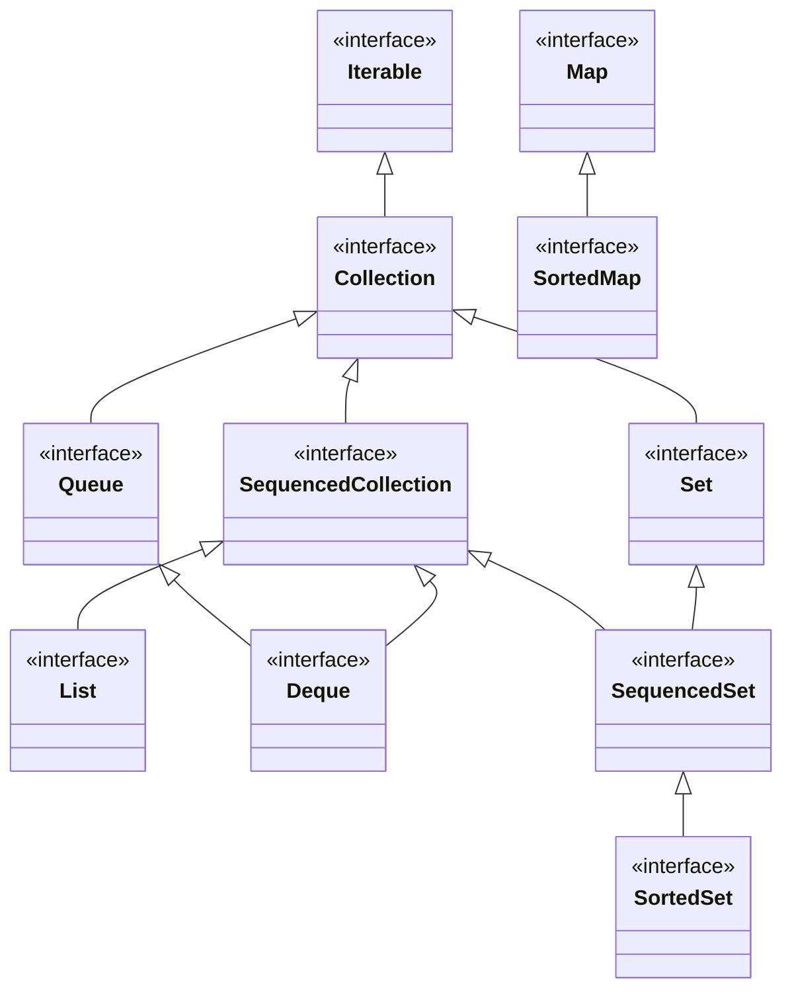
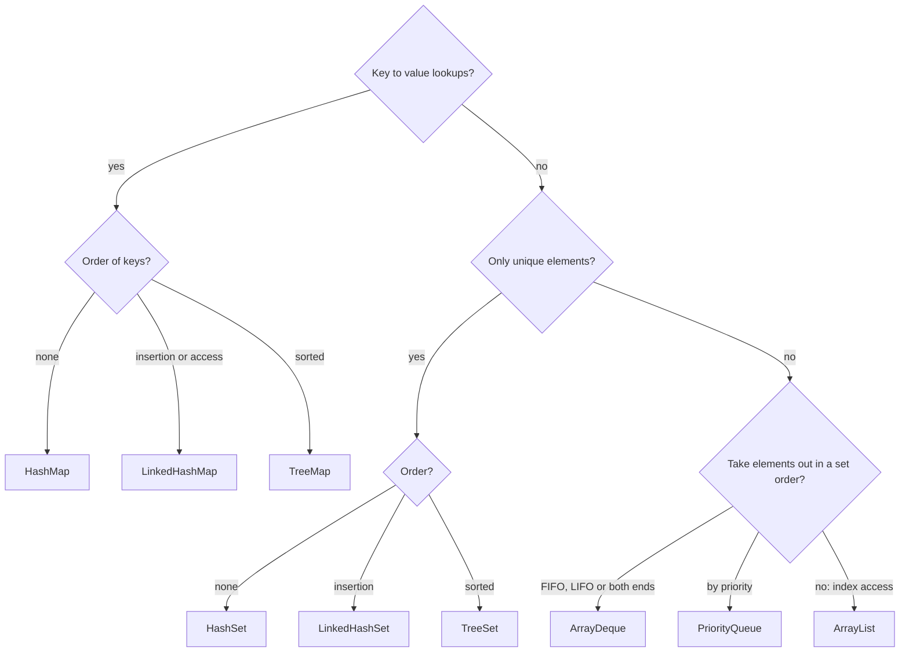

## In One Line
The Java Collections Framework (JCF) is a set of **interfaces** (`List`, `Set`, `Queue`, `Deque`, `Map`), **implementations** (`ArrayList`, `HashSet`, `ArrayDeque`, `HashMap`, ...) and **algorithms** (`Collections.sort`, ...) in `java.util` that let you store and process groups of objects without writing your own data structures.

## Mental Model
Think of a **kitchen with different containers**:

| Container | Collection type | Why you pick it |
|---|---|---|
| A **numbered shelf** of jars | `List` | Items stay in order, each has a position (index), duplicates allowed |
| A **spice rack with one slot per spice** | `Set` | No duplicates. You ask "do I have cumin?" |
| A **ticket line at the counter** | `Queue` | First in, first out; you serve the head |
| A **stack of plates** | stack (`Deque`) | Last in, first out; you take from the top |
| A **labelled drawer cabinet** | `Map` | You look things up by a key (label), not by position |

The *container type* is the interface: it says **what you can do** (put on shelf, ask "is it there?", take the next one). The *material it is made of* (glass jar vs plastic tub) is the implementation: `ArrayList` vs `LinkedList` both behave like a numbered shelf, but they cost different amounts of time for different jobs. You write your recipe against the container type, and you can swap the material later.

## Concept
### What the framework gives you
Before Java 1.2 there were only a few ad-hoc classes (`Vector`, `Stack`, `Hashtable`, `Enumeration`) with inconsistent method names. Java 1.2 (1998, designed by Joshua Bloch) introduced the **Collections Framework**, built from three parts:

1. **Interfaces** — abstract data types: `Collection`, `List`, `Set`, `Queue`, `Deque`, `Map`, and their sorted/navigable variants.
2. **Implementations** — concrete classes: `ArrayList`, `LinkedList`, `HashSet`, `TreeSet`, `ArrayDeque`, `PriorityQueue`, `HashMap`, `TreeMap`, ...
3. **Algorithms** — static helpers that work on any implementation: `Collections.sort`, `binarySearch`, `reverse`, `shuffle`, `max`, `min`, `frequency`, ...

Benefits: less code to write, fast tuned implementations, **interoperability** (any method that accepts a `Collection` works with all of them), and one API to learn.

### The interface hierarchy
```text
Iterable<E>                      (anything usable in for-each)
 └─ Collection<E>                (group of elements: add, remove, contains, size, iterator)
     ├─ SequencedCollection<E>   (Java 21: getFirst/getLast/addFirst/addLast/removeFirst/removeLast/reversed)
     │   ├─ List<E>              ordered by index, duplicates allowed
     │   ├─ Deque<E>             double-ended queue (also extends Queue)
     │   └─ SequencedSet<E>      (also extends Set) ─ SortedSet<E> ─ NavigableSet<E>
     ├─ Set<E>                   no duplicates
     └─ Queue<E>                 hold elements for processing, usually FIFO
Map<K,V>                          key → value; NOT a Collection
 └─ SequencedMap<K,V> (Java 21) ─ SortedMap<K,V> ─ NavigableMap<K,V>
```

- **`Iterable`** (in `java.lang`) has one abstract method, `iterator()`. Anything `Iterable` can be used in an enhanced `for` loop, and gets `forEach(Consumer)` (Java 8).
- **`Collection`** is the root of the element collections: `add`, `addAll`, `remove`, `removeAll`, `retainAll`, `contains`, `containsAll`, `size`, `isEmpty`, `clear`, `iterator`, `toArray`, plus Java 8's `removeIf`, `stream`, `parallelStream`, `spliterator`.
- **`List`** — ordered, index-based, duplicates allowed: `get(i)`, `set(i, e)`, `add(i, e)`, `remove(i)`, `indexOf`, `subList`, `listIterator`, `sort`, `replaceAll`.
- **`Set`** — no two elements `e1.equals(e2)`. Adds nothing new to `Collection`, only a stronger contract.
- **`Queue`** — "holding area before processing": `offer`/`poll`/`peek` plus the exception-throwing `add`/`remove`/`element`.
- **`Deque`** — insert/remove at **both** ends; replaces `Stack` for LIFO work.
- **`Map`** — key/value pairs, unique keys: `put`, `get`, `remove`, `containsKey`, `keySet`, `values`, `entrySet`.

### Why `Map` is not a `Collection`
`Collection.add(E)` takes **one** element; a map needs **two** things (key and value). The designers chose not to force a map into that shape. Instead, a `Map` gives you three **collection views**: `keySet()` (a `Set`), `values()` (a `Collection`) and `entrySet()` (a `Set<Map.Entry<K,V>>`). Those views *are* collections, and changes through them write back into the map.

### The main implementations
| Interface | General-purpose choice | Other implementations |
|---|---|---|
| `List` | `ArrayList` | `LinkedList`, `CopyOnWriteArrayList` (concurrent), legacy `Vector`/`Stack` |
| `Set` | `HashSet` | `LinkedHashSet` (insertion order), `TreeSet` (sorted), `EnumSet`, `CopyOnWriteArraySet`, `ConcurrentSkipListSet` |
| `Queue` | `ArrayDeque` | `LinkedList`, `PriorityQueue`, `ConcurrentLinkedQueue`, `BlockingQueue` family (`ArrayBlockingQueue`, `LinkedBlockingQueue`, ...) |
| `Deque` | `ArrayDeque` | `LinkedList`, `ConcurrentLinkedDeque`, `LinkedBlockingDeque` |
| `Map` | `HashMap` | `LinkedHashMap`, `TreeMap`, `EnumMap`, `WeakHashMap`, `IdentityHashMap`, `ConcurrentHashMap`, legacy `Hashtable`/`Properties` |

Skeleton classes such as `AbstractCollection`, `AbstractList`, `AbstractSequentialList`, `AbstractSet`, `AbstractQueue` and `AbstractMap` implement most methods on top of a few abstract ones, so writing your own collection is easy.

### Collection vs Collections (and friends)
| | `Collection` | `Collections` |
|---|---|---|
| What | **Interface** — root of `List`/`Set`/`Queue` | **Final utility class** with only static methods |
| Package | `java.util` | `java.util` |
| Use | As a type: `Collection<String> c = new ArrayList<>();` | As helpers: `Collections.sort(list)` |

Useful `Collections` methods: `sort`, `reverse`, `shuffle`, `swap`, `rotate`, `fill`, `copy`, `max`, `min`, `frequency`, `binarySearch` (list must be sorted), `disjoint`, `addAll`, `nCopies`, `emptyList/Set/Map`, `singletonList`, `unmodifiableList/Set/Map/Collection`, `synchronizedList/Set/Map`, `checkedList`, `reverseOrder`.

The same singular/plural pattern appears elsewhere: `Array` (reflection) vs **`Arrays`** (utilities for arrays), `Object` vs **`Objects`**, `Path` vs **`Paths`**.

### Choosing a collection
Ask these questions in order:
1. **Key → value lookups?** Use a `Map`: `HashMap` by default, `LinkedHashMap` for insertion/access order (LRU caches), `TreeMap` for sorted keys and range queries.
2. **Must elements be unique?** Use a `Set`: `HashSet` by default, `LinkedHashSet` to keep insertion order, `TreeSet` for sorted order.
3. **Do you process elements in a specific order and remove them as you go?** FIFO or LIFO or both ends → `ArrayDeque`. Smallest/highest priority first → `PriorityQueue`. Producer/consumer across threads → a `BlockingQueue`.
4. **Otherwise** you want a `List`: `ArrayList` almost always.
5. **Multiple threads?** Use `java.util.concurrent` classes (`ConcurrentHashMap`, `CopyOnWriteArrayList`, `ConcurrentLinkedQueue`, `LinkedBlockingQueue`), not the legacy synchronized classes.

### Big-O cheat sheet
| Operation | `ArrayList` | `LinkedList` | `ArrayDeque` | `PriorityQueue` | `HashSet` / `HashMap` | `TreeSet` / `TreeMap` |
|---|---|---|---|---|---|---|
| Add at end / `offer` | O(1) amortised | O(1) | O(1) amortised | O(log n) | O(1) average | O(log n) |
| Add at front | O(n) | O(1) | O(1) amortised | — | — | — |
| `get(i)` | **O(1)** | O(n) | — | — | — | — |
| Insert/remove at index | O(n) (shift) | O(n) (walk) + O(1) link | — | — | — | — |
| Remove head | O(n) (`remove(0)` shifts) | O(1) | O(1) | O(log n) (`poll`) | — | O(log n) (`pollFirst`) |
| `contains` / search | O(n) | O(n) | O(n) | O(n) | **O(1)** average | O(log n) |
| Peek head / min | O(1) | O(1) | O(1) | **O(1)** | — | O(log n) |

"Amortised O(1)" means occasionally one add is O(n) (the array is copied into a bigger one), but averaged over many adds each costs O(1). Hash structures are O(1) on average; before Java 8 a badly hashed bucket could degrade to O(n), and since Java 8 long buckets are turned into red-black trees. `Vector` and `Stack` have the same complexities as `ArrayList`.

### Nulls, order and thread-safety at a glance
| Class | Order | Duplicates | `null` allowed? | Thread-safe? |
|---|---|---|---|---|
| `ArrayList`, `LinkedList` | insertion (index) | yes | yes | no |
| `Vector`, `Stack` | insertion (index) | yes | yes | yes (synchronized methods) |
| `HashSet` | none guaranteed | no | one `null` | no |
| `LinkedHashSet` | insertion | no | one `null` | no |
| `TreeSet` | sorted | no | no (natural ordering) | no |
| `ArrayDeque` | FIFO/LIFO | yes | **no** | no |
| `PriorityQueue` | heap (head = smallest) | yes | **no** | no |
| `HashMap` | none guaranteed | unique keys | one `null` key, many `null` values | no |
| `Hashtable`, `ConcurrentHashMap` | none guaranteed | unique keys | **no** | yes |

### Legacy classes
The classes that existed before Java 1.2 are called **legacy classes**. They were retrofitted into the framework (`Vector` implements `List`, `Hashtable` implements `Map`) but carry old design choices: every method `synchronized`, duplicate method names (`addElement` next to `add`), and `Enumeration` instead of `Iterator`.

| Legacy (Java 1.0) | Modern replacement |
|---|---|
| `Vector` | `ArrayList` (or `CopyOnWriteArrayList` / `Collections.synchronizedList` for threads) |
| `Stack` | `Deque` / `ArrayDeque` (`push`, `pop`, `peek`) |
| `Hashtable` | `HashMap` (or `ConcurrentHashMap` for threads) |
| `Dictionary` (abstract parent of `Hashtable`) | `Map` interface |
| `Enumeration` | `Iterator` (`Enumeration.asIterator()` since Java 9) |
| `Properties` (extends `Hashtable`) | still used for `.properties` config files |

None of them is deprecated, so old code still compiles, but new code should not use them.

### Why collections hold objects, not primitives
Generics work only with reference types, so a `List<int>` is illegal; you write `List<Integer>` and Java **autoboxes** `int` ↔ `Integer`. Costs: each element is an object (more memory), and unboxing a `null` throws `NullPointerException`. For huge primitive data, use arrays, `IntStream`, or libraries with primitive collections.

### What the elements must provide
- **`equals`** — used by `contains`, `indexOf`, `remove(Object)` in every collection.
- **`hashCode`** — used by `HashSet`/`HashMap` (must be consistent with `equals`). See [equals and hashCode](lesson:b01-fundamentals/06-object-class-equals-hashcode).
- **`compareTo`** (via `Comparable`) or a **`Comparator`** — used by `TreeSet`, `TreeMap`, `PriorityQueue`, `Collections.sort`. See [Comparable vs Comparator](lesson:b01-fundamentals/09-comparable-vs-comparator).

### Java version milestones
| Version | What arrived |
|---|---|
| 1.0 | `Vector`, `Stack`, `Hashtable`, `Enumeration` |
| 1.2 | The Collections Framework: `Collection`, `List`, `Set`, `Map`, `ArrayList`, `LinkedList`, `HashMap`, `TreeMap`, `Iterator` |
| 1.4 | `LinkedHashMap`, `LinkedHashSet`, `IdentityHashMap`, `RandomAccess` |
| 5 | Generics, enhanced `for`, autoboxing, `Queue`, `PriorityQueue`, `java.util.concurrent` |
| 6 | `Deque`, `ArrayDeque`, `NavigableSet`, `NavigableMap` |
| 8 | Lambdas and streams: `forEach`, `removeIf`, `replaceAll`, `List.sort`, `stream()`, `Map.getOrDefault/merge/compute` |
| 9 / 10 | Immutable factories `List.of`, `Set.of`, `Map.of`; `List.copyOf` |
| 21 | **Sequenced collections**: `SequencedCollection`, `SequencedSet`, `SequencedMap` with `getFirst`, `getLast`, `reversed`, ... |

## Diagram

Everything hangs off `Collection` except `Map`, which is its own tree (`SortedMap` sits under `SequencedMap` since Java 21, and `NavigableSet`/`NavigableMap` extend the sorted interfaces).


Walk it top to bottom: map, then set, then queue/deque, and fall back to `ArrayList`.

## Code
One method written against the `Collection` interface works with every implementation, and the output shows each one's personality (order, duplicates):
```java
import java.util.*;

public class SameCodeManyCollections {
    // Written once against the interface: works for every Collection implementation
    static void fill(Collection<String> c) {
        c.add("banana");
        c.add("apple");
        c.add("cherry");
        c.add("apple");            // a duplicate
        System.out.printf("%-14s %-31s size=%d%n", c.getClass().getSimpleName(), c, c.size());
    }

    public static void main(String[] args) {
        fill(new ArrayList<>());       // List: keeps order and duplicates
        fill(new LinkedList<>());
        fill(new HashSet<>());         // Set: no duplicates, order from hash codes
        fill(new LinkedHashSet<>());   // Set: no duplicates, insertion order
        fill(new TreeSet<>());         // Set: no duplicates, sorted
        fill(new ArrayDeque<>());      // Deque: FIFO order here
        fill(new PriorityQueue<>());   // Queue: heap order, smallest at the head
    }
}
```
```output
ArrayList      [banana, apple, cherry, apple]  size=4
LinkedList     [banana, apple, cherry, apple]  size=4
HashSet        [banana, apple, cherry]         size=3
LinkedHashSet  [banana, apple, cherry]         size=3
TreeSet        [apple, banana, cherry]         size=3
ArrayDeque     [banana, apple, cherry, apple]  size=4
PriorityQueue  [apple, apple, cherry, banana]  size=4
```

`Collection` (the interface) vs `Collections` (the utility class), and `Map` vs its collection views:
```java
import java.util.*;

public class CollectionsUtility {
    public static void main(String[] args) {
        List<Integer> nums = new ArrayList<>(List.of(5, 3, 9, 1, 3));
        Collections.sort(nums);
        System.out.println("sort:      " + nums);
        Collections.reverse(nums);
        System.out.println("reverse:   " + nums);
        System.out.println("max=" + Collections.max(nums) + " min=" + Collections.min(nums)
                + " frequency(3)=" + Collections.frequency(nums, 3));
        Collections.swap(nums, 0, 4);
        System.out.println("swap(0,4): " + nums);
        System.out.println("nCopies:   " + Collections.nCopies(3, "ab"));

        List<Integer> readOnly = Collections.unmodifiableList(nums);
        try {
            readOnly.add(7);
        } catch (UnsupportedOperationException e) {
            System.out.println("unmodifiableList.add -> UnsupportedOperationException");
        }
        nums.add(7);   // the wrapper is a VIEW: changes to the original show through
        System.out.println("view sees: " + readOnly);

        Map<String, Integer> stock = new HashMap<>();
        System.out.println("Map instanceof Collection? " + (stock instanceof Collection));
        System.out.println("keySet() instanceof Collection? " + (stock.keySet() instanceof Collection));
    }
}
```
```output
sort:      [1, 3, 3, 5, 9]
reverse:   [9, 5, 3, 3, 1]
max=9 min=1 frequency(3)=2
swap(0,4): [1, 5, 3, 3, 9]
nCopies:   [ab, ab, ab]
unmodifiableList.add -> UnsupportedOperationException
view sees: [1, 5, 3, 3, 9, 7]
Map instanceof Collection? false
keySet() instanceof Collection? true
```

Java 21 gave every ordered collection the same "first / last / reversed" methods:
```java
List<String> list = new ArrayList<>(List.of("a", "b", "c"));
Deque<String> deque = new ArrayDeque<>(List.of("a", "b", "c"));
LinkedHashSet<String> set = new LinkedHashSet<>(List.of("a", "b", "c"));
for (SequencedCollection<String> sc : List.<SequencedCollection<String>>of(list, deque, set)) {
    System.out.println(sc.getClass().getSimpleName() + ": first=" + sc.getFirst()
            + " last=" + sc.getLast() + " reversed=" + sc.reversed());
}
```
```output
ArrayList: first=a last=c reversed=[c, b, a]
ArrayDeque: first=a last=c reversed=[c, b, a]
LinkedHashSet: first=a last=c reversed=[c, b, a]
```

## Walkthrough
This overview has no course example; the snippets above are the examples.

**`SameCodeManyCollections`**
- `static void fill(Collection<String> c)` — the parameter type is the **interface**, so the method accepts any collection. This is "programming to an interface".
- `c.add(...)` four times, with `"apple"` twice. `add` returns `boolean`: `true` if the collection changed. For a `Set`, the second `"apple"` returns `false` and nothing is stored.
- `printf("%-14s %-31s size=%d%n", ...)` — left-aligned columns: the class name (`getClass().getSimpleName()`), the collection's `toString()` (every JCF collection prints as `[a, b, c]`, inherited from `AbstractCollection.toString`) and `size()`.
- **Lists** (`ArrayList`, `LinkedList`) keep insertion order and the duplicate: size 4.
- **`HashSet`** drops the duplicate; its order `[banana, apple, cherry]` comes from the strings' hash codes. It happens to match insertion order here, but that is luck — never rely on `HashSet` order.
- **`LinkedHashSet`** guarantees insertion order; **`TreeSet`** sorts alphabetically.
- **`ArrayDeque`** keeps duplicates; `add` appends at the tail, so it prints in FIFO order.
- **`PriorityQueue`** prints `[apple, apple, cherry, banana]` — its internal **heap array**, not sorted order. Only the head (`apple`) is guaranteed to be the smallest. See [PriorityQueue](lesson:a03-collections/07-priority-queue).

**`CollectionsUtility`**
- `Collections.sort`, `reverse`, `swap`, `max`, `min`, `frequency`, `nCopies` are **static helpers** in the `Collections` class; they work on any `List`/`Collection`.
- `Collections.unmodifiableList(nums)` returns a **read-only view**: `add` throws `UnsupportedOperationException`, but after `nums.add(7)` the view shows `7` too. Unmodifiable is not the same as immutable.
- `stock instanceof Collection` is `false` — a `Map` is not a `Collection` — but `stock.keySet()` is a `Set`, so it is one.

**`Sequenced`** — `ArrayList`, `ArrayDeque` and `LinkedHashSet` have nothing in common except order, yet since Java 21 all three answer `getFirst()`, `getLast()` and `reversed()` through the `SequencedCollection` interface.

## Traps
- **`Collection` vs `Collections`.** One letter apart, completely different things: interface vs utility class. Interviewers love this.
- **`Map` is not a `Collection`.** `for (x : map)` does not compile; iterate `map.entrySet()`, `keySet()` or `values()`.
- **Printing is not the order you think.** `HashSet`/`HashMap` order is unspecified and can change between runs of different data or JDK versions; `PriorityQueue.toString()` is heap order.
- **Unmodifiable ≠ immutable.** `Collections.unmodifiableList(list)` is a view; whoever holds the original can still change it. `List.copyOf(list)` or `List.of(...)` gives a truly immutable copy.
- **Three different "read-only-ish" lists.**

| Created by | `set` | `add`/`remove` | `null` elements | Reflects source changes? |
|---|---|---|---|---|
| `Arrays.asList(arr)` | yes (writes to the array) | `UnsupportedOperationException` | yes | yes, it is a view of the array |
| `Collections.unmodifiableList(l)` | no | no | yes | yes, it is a view |
| `List.of(...)` / `List.copyOf(l)` | no | no | `NullPointerException` | no, it is independent |

- **`Arrays.asList` with a primitive array.** `Arrays.asList(new int[]{1, 2, 3})` is a `List<int[]>` of **size 1**, because generics cannot hold `int`. Use `Integer[]` or `IntStream.of(arr).boxed().toList()`.
- **Mutating an element that is used as a key.** Changing a field that `hashCode`/`compareTo` depends on after inserting into a `HashSet`, `HashMap`, `TreeSet` or `PriorityQueue` corrupts the structure — the element "disappears". Use immutable keys.
- **"Synchronized" ≠ safe for compound actions.** `Vector`/`Hashtable`/`Collections.synchronizedList` lock each call, but `if (!list.contains(x)) list.add(x)` is still a race.

> [!WARNING] Autounboxing `null`: `Map<String, Integer> m = new HashMap<>(); int n = m.get("missing");` throws `NullPointerException`. Use `getOrDefault` or an `Integer` variable.

## Tips & Tricks
- **Mnemonic "LSQ-M":** **L**ist = line-up with numbers, **S**et = no twins, **Q**ueue = wait your turn, **M**ap = look it up by name.
- **Default picks: `ArrayList`, `HashSet`, `HashMap`, `ArrayDeque`.** Reach for the others only when you need their special property (order, sorting, priority, concurrency).
- **Prefix = property.** `Linked...` → remembers insertion order. `Tree...` → sorted. `Hash...` → fast, no order. `Concurrent...`/`CopyOnWrite...` → thread-safe. `Priority...` → heap.
- **Declare with the interface:** `List<String> names = new ArrayList<>();` — swap the implementation later without touching the rest of the code.
- **Singular = type, plural = tools:** `Collection`/`Collections`, `Array`/`Arrays`, `Object`/`Objects`.
- **Legacy radar:** if you see `Vector`, `Stack`, `Hashtable`, `Enumeration` in an interview answer or code review, say what replaces it.
- **Say the complexity with the choice** — "I'd use a `HashSet` because `contains` is O(1) on average" is a much stronger interview answer than just "a `HashSet`".

## Interview Q&A
### [Basic] What is the Java Collections Framework?
It is the unified architecture in `java.util` (since Java 1.2) for storing and manipulating groups of objects. It has three parts: **interfaces** (`Collection`, `List`, `Set`, `Queue`, `Deque`, `Map`) that define abstract data types; **implementations** (`ArrayList`, `LinkedList`, `HashSet`, `TreeSet`, `ArrayDeque`, `PriorityQueue`, `HashMap`, `TreeMap`, ...); and **algorithms** (`Collections.sort`, `binarySearch`, `shuffle`, ...). Because all implementations share interfaces, code written against `List` or `Collection` works with any of them, and you get well-tested, high-performance data structures for free.

**Follow-up:** *What was there before it?* — Only the Java 1.0 classes `Vector`, `Stack`, `Hashtable`, `Dictionary` and `Enumeration`, with no common interface. They were retrofitted into the framework and are now called legacy classes.

### [Basic] What is the difference between `Collection` and `Collections`?
`Collection` is the **root interface** of the element collections — `List`, `Set`, `Queue` and `Deque` extend it — and declares methods such as `add`, `remove`, `contains`, `size` and `iterator`. `Collections` is a **final utility class** with only static methods that operate on or return collections: `sort`, `reverse`, `shuffle`, `max`, `min`, `frequency`, `unmodifiableList`, `synchronizedMap`, `emptyList`, `singletonList`, `nCopies`, and so on.

**Follow-up:** *Name a similar pair.* — `Array` (in `java.lang.reflect`) and `Arrays` (utilities like `sort`, `asList`, `toString`), or `Object` and `Objects`.

### [Basic] Explain the differences between List, Set, Queue and Map.
- **`List`**: ordered by index, allows duplicates and `null`; positional access with `get(i)`. Example: `ArrayList`.
- **`Set`**: no duplicates (decided by `equals`/`hashCode`, or `compareTo` for sorted sets); no index. Example: `HashSet`.
- **`Queue`**: holds elements for processing in a defined order — FIFO for `ArrayDeque`/`LinkedList`, priority order for `PriorityQueue`; you work at the head with `offer`/`poll`/`peek`.
- **`Map`**: key → value pairs with unique keys; not a `Collection`. Example: `HashMap`.

**Follow-up:** *Where does `Deque` fit?* — It extends `Queue` and allows insertion and removal at both ends, so it works as a queue and as a stack.

### [Basic] Why does `Map` not extend `Collection`?
`Collection` models a group of single elements — `add(E)`, `contains(Object)`. A map stores **pairs**, and its core operations (`put(K, V)`, `get(K)`) do not fit that contract. Making `Map` a `Collection` of entries would force awkward semantics (what would `remove(Object)` mean — a key or an entry?). So the designers kept `Map` separate and gave it three **collection views**: `keySet()`, `values()` and `entrySet()`. Those views are backed by the map, so removing from `keySet()` removes the mapping.

**Follow-up:** *Can you add to `keySet()`?* — No, `add` throws `UnsupportedOperationException`, because a key without a value makes no sense; you can remove, though.

### [Intermediate] How do you choose the right collection for a problem?
I ask four questions. (1) Do I look things up by a key? Then a `Map` — `HashMap`, or `LinkedHashMap` for predictable order/LRU, or `TreeMap` for sorted keys and range queries. (2) Must elements be unique? Then a `Set` — `HashSet`, `LinkedHashSet` or `TreeSet` by the same order logic. (3) Do I consume elements in a fixed order? FIFO/LIFO → `ArrayDeque`; by priority → `PriorityQueue`; across threads → a `BlockingQueue`. (4) Otherwise a `List`, almost always `ArrayList`. Then I check the dominant operation's complexity: `contains` on a list is O(n), on a `HashSet` O(1) average, on a `TreeSet` O(log n). Finally, for concurrent access I pick a `java.util.concurrent` class.

**Follow-up:** *When is `LinkedList` the right answer?* — Rarely: when you insert/remove in the middle through an iterator, or need a list that is also a deque and allows `null`. For plain queues `ArrayDeque` is faster.

### [Intermediate] What are the legacy collection classes and what replaced them?
`Vector` → `ArrayList`; `Stack` → `ArrayDeque` via the `Deque` interface; `Hashtable` → `HashMap` (or `ConcurrentHashMap`); `Dictionary` → the `Map` interface; `Enumeration` → `Iterator`. The legacy classes synchronize every method, which adds lock overhead in single-threaded code and still does not make compound actions safe. `Stack` also extends `Vector`, so it exposes index methods that break LIFO. They are not deprecated; `Properties` (a `Hashtable` subclass) is still commonly used for config files.

**Follow-up:** *Which collections are thread-safe then?* — The legacy ones, the `Collections.synchronizedXxx` wrappers, and the `java.util.concurrent` classes (`ConcurrentHashMap`, `CopyOnWriteArrayList`, `ConcurrentLinkedQueue`, `BlockingQueue` implementations), which are the ones to use.

### [Intermediate] What is the difference between an unmodifiable, an immutable and a fixed-size list?
- **Fixed-size** — `Arrays.asList(array)`: a view over the array; `set` works and writes through to the array, but `add`/`remove` throw `UnsupportedOperationException`.
- **Unmodifiable view** — `Collections.unmodifiableList(list)`: every mutator throws, but it is only a *view*; changes to the underlying list are visible through it.
- **Immutable** — `List.of(...)` (Java 9) and `List.copyOf(...)` (Java 10), or `stream.toList()` (Java 16): no mutators work, no one holds a mutable reference to the data, and `null` elements are rejected with `NullPointerException`.

**Follow-up:** *Are the elements immutable too?* — No. All three only protect the list structure; if the elements are mutable objects, they can still be changed.

### [Intermediate] Why can't a collection hold primitives, and what does that cost?
Collections are generic, and Java generics only accept reference types (type erasure turns `E` into `Object`). So `List<int>` is illegal and we use wrapper types: `List<Integer>`, with autoboxing converting automatically. The costs are memory (each `Integer` is an object with a header, plus a reference to it), CPU for boxing/unboxing, and the risk of `NullPointerException` when unboxing a `null`. Also `==` on wrappers compares references (it happens to work for cached values -128..127 only).

**Follow-up:** *What if performance matters?* — Use primitive arrays, `IntStream`, or a primitive-collection library; Project Valhalla aims to fix this in the language.

### [Advanced] What are Sequenced Collections in Java 21?
JEP 431 added three interfaces: `SequencedCollection` (extended by `List`, `Deque` and `SequencedSet`), `SequencedSet` (implemented by `LinkedHashSet`, extended by `SortedSet`) and `SequencedMap` (implemented by `LinkedHashMap`, extended by `SortedMap`). They give every collection with a defined encounter order a uniform API: `getFirst()`, `getLast()`, `addFirst()`, `addLast()`, `removeFirst()`, `removeLast()` and `reversed()` (a reverse-ordered **view**); maps get `firstEntry()`, `lastEntry()`, `pollFirstEntry()`, `putFirst()`, `sequencedKeySet()` etc. Before Java 21 getting the last element was `list.get(list.size() - 1)` for a list, `deque.getLast()` for a deque and a full iteration for a `LinkedHashSet`.

**Follow-up:** *What does `addFirst` do on a `TreeSet`?* — It throws `UnsupportedOperationException`, because a sorted set decides positions itself.

### [Advanced] What contracts must your element classes honour to work correctly in collections?
`equals` must be correct for `contains`/`remove`/`indexOf` in any collection. Hash-based collections additionally need `hashCode` consistent with `equals` (equal objects → equal hash codes), otherwise duplicates appear in a `HashSet` and `get` misses in a `HashMap`. Sorted collections (`TreeSet`, `TreeMap`, `PriorityQueue`) need a `Comparable` implementation or a `Comparator`, ideally *consistent with equals*, because `TreeSet` uses `compareTo == 0` to decide duplicates. Finally, fields used by `hashCode`/`compareTo` must not change while the object is inside the collection. Records are a convenient way to get correct `equals`/`hashCode` for free.

**Follow-up:** *What happens if `compareTo` is inconsistent with equals, e.g. `BigDecimal("1.0")` and `BigDecimal("1.00")`?* — A `HashSet` keeps both (different `equals`), a `TreeSet` keeps only one (`compareTo` returns 0).

## Quiz
### Which of these is NOT a subtype of `Collection`?
- [ ] `Deque`
- [ ] `SortedSet`
- [x] `Map`
- [ ] `List`
> `Map` stores key/value pairs and is a separate hierarchy; it only offers collection *views* (`keySet`, `values`, `entrySet`). `Deque` extends `Queue`, which extends `Collection`, so it is a tempting but wrong pick.

### What is `Collections`?
- [ ] The root interface of `List` and `Set`
- [x] A utility class with static methods such as `sort` and `unmodifiableList`
- [ ] The plural form used for generic collections, like `Collections<String>`
- [ ] A deprecated legacy class
> `Collections` is a final class of static helpers. The root interface is `Collection` (singular). There is no generic type `Collections<T>`.

### What does this print?
```java
Collection<String> c = new TreeSet<>();
c.add("banana"); c.add("apple"); c.add("cherry"); c.add("apple");
System.out.println(c + " size=" + c.size());
```
- [ ] [banana, apple, cherry, apple] size=4
- [ ] [banana, apple, cherry] size=3
- [x] [apple, banana, cherry] size=3
- [ ] [apple, apple, banana, cherry] size=4
> A `TreeSet` drops the duplicate and keeps elements sorted, so it prints `[apple, banana, cherry] size=3`. Insertion order (`banana` first) would be a `LinkedHashSet`.

### You need unique usernames that you can print in alphabetical order. Which collection?
- [ ] `ArrayList<String>`
- [ ] `HashSet<String>`
- [x] `TreeSet<String>`
- [ ] `PriorityQueue<String>`
> A set guarantees uniqueness, and `TreeSet` keeps it sorted. `HashSet` is unique but unordered; `PriorityQueue` allows duplicates and only its head is ordered.

### What does this print?
```java
int[] prim = {1, 2, 3};
System.out.println(Arrays.asList(prim).size());
```
- [ ] 3
- [x] 1
- [ ] 0
- [ ] Compile error
> `Arrays.asList(T... a)` needs objects. An `int[]` is itself one object, so `T` becomes `int[]` and the result is a `List<int[]>` with one element. With `Integer[]` it would be 3.

### What does this print?
```java
List<Integer> nums = new ArrayList<>(List.of(1, 2));
List<Integer> view = Collections.unmodifiableList(nums);
nums.add(3);
System.out.println(view);
```
- [ ] [1, 2]
- [x] [1, 2, 3]
- [ ] UnsupportedOperationException
- [ ] ConcurrentModificationException
> `unmodifiableList` returns a read-only **view** of `nums`. Changing `nums` directly is allowed and shows through the view. Only calling `view.add` would throw `UnsupportedOperationException`.

### Which class is a legacy class whose methods are all synchronized?
- [ ] `ArrayList`
- [ ] `ArrayDeque`
- [x] `Vector`
- [ ] `LinkedHashMap`
> `Vector` dates from Java 1.0 and synchronizes every method; `ArrayList` is its unsynchronized modern replacement. `ArrayDeque` and `LinkedHashMap` are modern and not thread-safe.

## Takeaways
- The Collections Framework = interfaces (`List`, `Set`, `Queue`, `Deque`, `Map`) + implementations + algorithms, all in `java.util` since Java 1.2.
- `Iterable` → `Collection` → `List`/`Set`/`Queue`/`Deque`; `Map` is a separate hierarchy with `keySet`/`values`/`entrySet` views.
- `Collection` is the root interface; `Collections` is a utility class of static helpers (`sort`, `unmodifiableList`, `synchronizedList`, ...).
- Default choices: `ArrayList`, `HashSet`, `HashMap`, `ArrayDeque`; use `Linked...` for insertion order, `Tree...` for sorting, `PriorityQueue` for priority, `java.util.concurrent` for threads.
- Know the costs: `ArrayList.get` O(1), `contains` on a list O(n), hash `contains` O(1) average, tree operations O(log n), heap `offer`/`poll` O(log n).
- Legacy classes (`Vector`, `Stack`, `Hashtable`, `Enumeration`) are synchronized relics; replace them with `ArrayList`, `ArrayDeque`, `HashMap`/`ConcurrentHashMap`, `Iterator`.
- `Arrays.asList` is fixed-size, `Collections.unmodifiableList` is a read-only view, `List.of` is truly immutable and rejects `null`.
- Java 21 sequenced collections give `List`, `Deque`, `LinkedHashSet` and sorted sets a common `getFirst`/`getLast`/`reversed` API.
