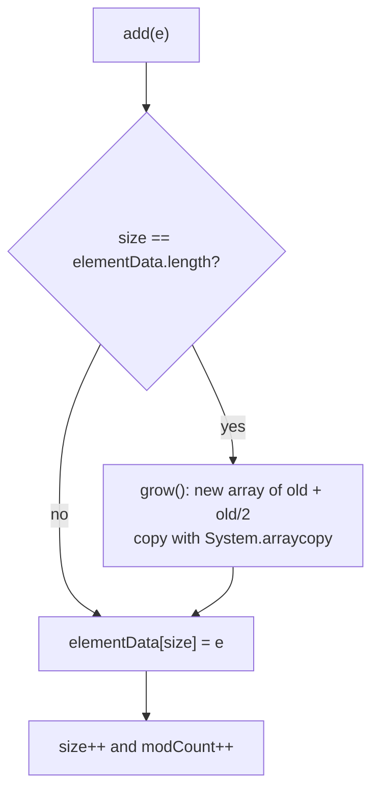
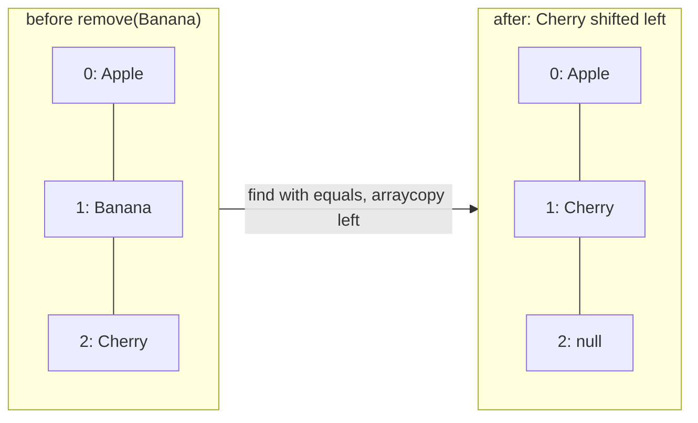
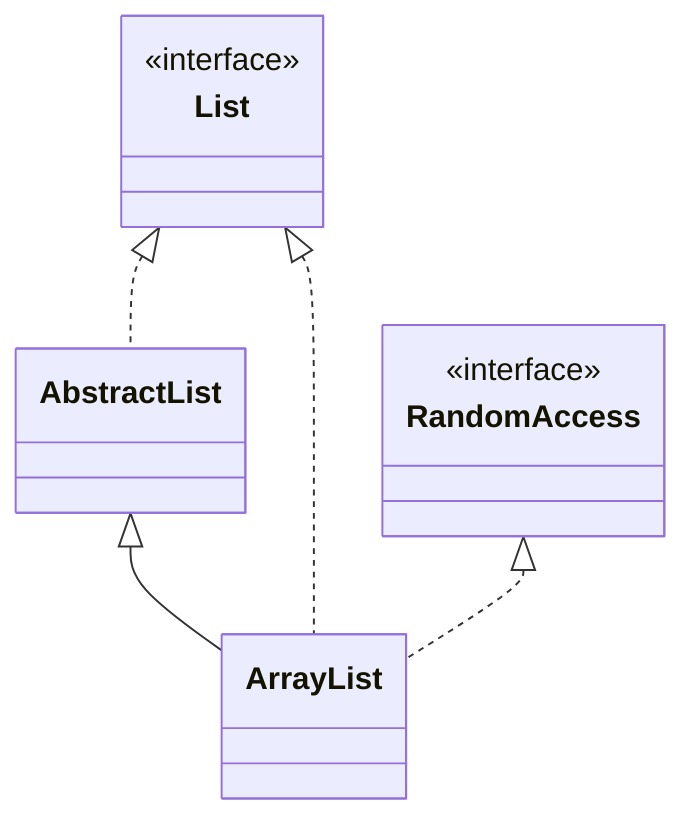

## In One Line
`ArrayList` is a **resizable array**: a `List` that keeps elements in insertion order, allows duplicates and `null`, gives **O(1) access by index**, and grows automatically (by about 1.5×) when its internal array is full.

## Mental Model
Picture a **row of numbered lockers** in a school corridor.

- Each locker has a number starting at 0 — that is the **index**. Walking straight to locker 7 takes the same time as walking to locker 0: **`get(i)` is O(1)**.
- The school built more lockers than there are students — that spare room is the **capacity**; the number of lockers in use is the **size**.
- When every locker is taken and a new student arrives, the school builds a **new corridor 1.5× longer** and moves everyone's things across. That move is expensive, but it happens rarely, so on average adding a student is cheap (**amortised O(1)**).
- If a student in locker 1 leaves, everyone after them **shifts one locker to the left** so there are no gaps — that is why removing from the middle is **O(n)**.

## Concept
### What an ArrayList is
```java
public class ArrayList<E> extends AbstractList<E>
        implements List<E>, RandomAccess, Cloneable, java.io.Serializable
```
Internally it holds just two fields that matter:
```java
transient Object[] elementData;   // the backing array (capacity = elementData.length)
private int size;                  // how many slots are actually used
```
- **Ordered** — elements stay in the order you add them (index order).
- **Duplicates and `null`** — both allowed.
- **`RandomAccess`** — a marker interface (no methods) saying "index access is fast". Algorithms such as `Collections.binarySearch` check it to choose an index loop instead of an iterator.
- **Not synchronized** — not safe for concurrent writes (see Traps).
- **Fail-fast iterators** — structural changes during iteration throw `ConcurrentModificationException`.

### Constructors
| Constructor | What it does |
|---|---|
| `new ArrayList<>()` | Starts with a shared **empty** array; the first `add` allocates capacity **10** (lazy since Java 7u40; Java 6 allocated it in the constructor). |
| `new ArrayList<>(int initialCapacity)` | Allocates exactly that capacity. Negative → `IllegalArgumentException`. `0` → shared empty array, then grows 1, 2, 3, 4, 6, 9, ... |
| `new ArrayList<>(Collection<? extends E> c)` | Copies the elements of `c` (capacity = its size). |

### How `add` and growth work
`add(e)` stores the element at `elementData[size]` and increments `size`. If the array is full it first calls `grow()`:
```text
newCapacity = oldCapacity + (oldCapacity >> 1)     // about 1.5x
```
then copies the old array into the new one with `Arrays.copyOf` (a native `System.arraycopy`). Capacities observed on JDK 21 for `new ArrayList<>()` while adding 200 elements: **0 → 10 → 15 → 22 → 33 → 49 → 73 → 109 → 163 → 244**.

**Why amortised O(1)?** Each resize copies n elements, but it only happens after roughly n/2 cheap adds, so the copying cost averaged over all adds is a constant. Growing by a *factor* (not by a fixed amount) is what makes this work.

**Capacity is not size.** `new ArrayList<>(100)` has capacity 100 but size 0, so `list.get(0)` or `list.set(0, x)` throws `IndexOutOfBoundsException`. Capacity is a performance hint only.

- `ensureCapacity(n)` — grow once up front before a big bulk add.
- `trimToSize()` — shrink the array to exactly `size`. The array **never shrinks automatically**, even after you remove most elements.

### Operation costs
| Operation | Cost | Why |
|---|---|---|
| `get(i)`, `set(i, e)` | O(1) | Direct array index (after a bounds check) |
| `add(e)` | O(1) amortised | Store at the end; occasional resize |
| `add(i, e)` | O(n) | Shifts `size - i` elements right with `System.arraycopy` |
| `remove(i)` | O(n) | Shifts elements after `i` left, nulls the last slot |
| `remove(Object)` | O(n) | Linear search with `equals`, then shift |
| `contains`, `indexOf`, `lastIndexOf` | O(n) | Linear search with `equals` |
| `clear()` | O(n) | Nulls every slot so objects can be garbage collected |

Removing near the **end** is cheap (few elements to shift); removing at index 0 of a big list is the worst case.

### `remove(int)` vs `remove(Object)`
`List` has two overloads and they bite with `List<Integer>`:
- `list.remove(1)` → the literal `1` is an `int`, so the compiler picks `remove(int index)` (an exact primitive match beats boxing).
- `list.remove(Integer.valueOf(1))` or `list.remove((Integer) 1)` → `remove(Object o)`, which removes the first element **equal** to 1 and returns `boolean`.

### Equality matters
`contains`, `indexOf` and `remove(Object)` compare with **`equals`**. A class that does not override `equals` is compared by identity, so `list.contains(new Point(1, 2))` is `false` even if an identical-looking point is inside. Records and properly written classes fix that.

### Iterating
```java
for (int i = 0; i < list.size(); i++) list.get(i);   // fine for ArrayList (RandomAccess)
for (String s : list) { ... }                          // Iterator under the hood
list.forEach(System.out::println);                     // Java 8
list.stream().filter(...).toList();                    // Java 8 / 16
```
Removing inside a for-each throws `ConcurrentModificationException`. Use `Iterator.remove()` or `removeIf` (Java 8). How the fail-fast check works is covered in [Fail-fast iterators](lesson:a03-collections/22-fail-fast-iterators).

### Useful API beyond the basics
| Method | Notes |
|---|---|
| `addAll(c)`, `addAll(i, c)`, `removeAll(c)`, `retainAll(c)` | Bulk operations |
| `subList(from, to)` | A **view** of `[from, to)`; changes write through. `list.subList(2, 5).clear()` removes a range. |
| `sort(Comparator)`, `replaceAll(UnaryOperator)`, `removeIf(Predicate)` | Java 8 |
| `toArray()` / `toArray(new String[0])` / `toArray(String[]::new)` | `Object[]` vs typed array (the last form is Java 11) |
| `getFirst()`, `getLast()`, `addFirst()`, `removeLast()`, `reversed()` | Java 21 sequenced-collection methods; `getFirst` on an empty list throws `NoSuchElementException` |
| `clone()` | Shallow copy (the elements are shared) |
| `equals(o)` | `true` for **any** `List` with equal elements in the same order — an `ArrayList` can equal a `LinkedList` |

### Creating lists: three flavours
| Expression | Mutable? | `null`? |
|---|---|---|
| `new ArrayList<>(List.of("a", "b"))` | fully mutable | yes |
| `Arrays.asList("a", "b")` | fixed size: `set` works, `add`/`remove` throw | yes |
| `List.of("a", "b")` (Java 9) | immutable: every mutator throws | no, `NullPointerException` |

### ArrayList vs array
| | Array `String[]` | `ArrayList<String>` |
|---|---|---|
| Size | Fixed at creation | Grows automatically |
| Primitives | `int[]` allowed | Only objects (`Integer`, autoboxing) |
| Length | `arr.length` (field) | `list.size()` (method) |
| Type safety | Checked at runtime (`ArrayStoreException`) | Checked at compile time (generics) |
| API | `Arrays` helpers | Rich `List` API, streams |
| Speed | Slightly faster, less memory | Tiny overhead, much more convenient |

### Serialization and limits
`elementData` is `transient`; `ArrayList` has its own `writeObject` that writes only the `size` used elements, not the empty tail. The maximum practical size is about `Integer.MAX_VALUE - 8` elements (the JVM's array limit); beyond that you get `OutOfMemoryError`.

### Thread safety
`ArrayList` is not thread-safe. Options: `Collections.synchronizedList(new ArrayList<>())` (each call locked, iterate inside `synchronized (list)`), `CopyOnWriteArrayList` for read-mostly data, or keep the list confined to one thread. `Vector` is the legacy synchronized version — see [Vector](lesson:a03-collections/03-vector).

## Diagram

Most adds take the short "no" path; the occasional resize is why `add` is *amortised* O(1).


Removing shifts every later element one slot left and nulls the old last slot so it can be garbage collected; `size` drops from 3 to 2.


`ArrayList` inherits the skeleton from `AbstractList` (including `modCount`) and advertises fast index access with the `RandomAccess` marker.

## Code
@example Collections/Lists/ArrayListExample.java

The `remove` overload trap with `Integer` elements:
```java
List<Integer> nums = new ArrayList<>(List.of(10, 20, 30));
nums.remove(1);                    // remove(int index)  -> removes 20
System.out.println(nums);
nums.remove(Integer.valueOf(10));  // remove(Object o)   -> removes 10
System.out.println(nums);
boolean removed = nums.remove(Integer.valueOf(99));
System.out.println("removed 99? " + removed);
```
```output
[10, 30]
[30]
removed 99? false
```

More of the `List` API — insert, replace, search, `subList` view, Java 8 bulk methods and Java 21 sequenced methods:
```java
List<String> list = new ArrayList<>(List.of("Apple", "Cherry"));
list.add(1, "Banana");               // insert: shifts Cherry right
list.set(0, "Apricot");              // replace: returns old value
System.out.println(list);
System.out.println(list.indexOf("Cherry") + " " + list.contains("Apple") + " " + list.size());

List<String> view = list.subList(0, 2);  // [0, 2) - a VIEW, not a copy
view.set(0, "Avocado");
System.out.println(list);

list.replaceAll(String::toUpperCase);
list.sort(Comparator.reverseOrder());
System.out.println(list);

// Java 21 SequencedCollection methods
System.out.println(list.getFirst() + " " + list.getLast() + " " + list.reversed());

String[] arr = list.toArray(new String[0]);
System.out.println(arr.length + " " + arr[0]);

List<String> linked = new LinkedList<>(list);
System.out.println("equals LinkedList? " + list.equals(linked));

try { list.get(3); } catch (IndexOutOfBoundsException e) { System.out.println(e.getMessage()); }
```
```output
[Apricot, Banana, Cherry]
2 false 3
[Avocado, Banana, Cherry]
[CHERRY, BANANA, AVOCADO]
CHERRY AVOCADO [AVOCADO, BANANA, CHERRY]
3 CHERRY
equals LinkedList? true
Index 3 out of bounds for length 3
```

Removing while iterating — the wrong way and two right ways:
```java
List<String> a = new ArrayList<>(List.of("Apple", "Banana", "Cherry"));
try {
    for (String s : a) {
        if (s.equals("Apple")) a.remove(s);
    }
} catch (ConcurrentModificationException e) {
    System.out.println("Removing Apple: " + e.getClass().getSimpleName());
}

List<String> fruits = new ArrayList<>(List.of("Apple", "Banana", "Avocado", "Cherry"));
Iterator<String> it = fruits.iterator();
while (it.hasNext()) {
    if (it.next().startsWith("A")) it.remove();   // 1. Iterator.remove()
}
System.out.println(fruits);

List<String> more = new ArrayList<>(List.of("Apple", "Banana", "Avocado", "Cherry"));
more.removeIf(f -> f.startsWith("A"));             // 2. removeIf (Java 8+)
System.out.println(more);
```
```output
Removing Apple: ConcurrentModificationException
[Banana, Cherry]
[Banana, Cherry]
```

## Walkthrough
- `package Collections.Lists;` — the file lives in folder `Collections/Lists`. (See the errata about the package name.)
- `import java.util.ArrayList;` — `ArrayList` lives in `java.util`, which is not imported automatically (only `java.lang` is).
- `ArrayList<String> arrayList = new ArrayList<>();` — creates an empty list that may hold only `String`s. The **diamond** `<>` (Java 7) lets the compiler infer `<String>` from the left side. Internally the list starts with an empty shared array; no capacity-10 array exists yet.
- `arrayList.add("Apple")` — first add allocates the capacity-10 array and stores `"Apple"` at index 0; `"Banana"` goes to index 1, `"Cherry"` to 2. `add` returns `true` (always, for a list).
- `System.out.println("ArrayList elements: " + arrayList);` — string concatenation calls `arrayList.toString()`, inherited from `AbstractCollection`, which prints `[Apple, Banana, Cherry]` — elements joined by `", "` inside brackets.
- `String element = arrayList.get(1);` — index access is **zero-based**, so index 1 is `"Banana"`. No cast is needed because of generics (before Java 5 you wrote `(String) list.get(1)`). This is O(1): it reads `elementData[1]` after checking `1 < size`.
- `arrayList.remove("Banana");` — calls `remove(Object)`: it scans from index 0 comparing with `equals`, finds `"Banana"` at index 1, shifts `"Cherry"` left into index 1, sets index 2 to `null` and decreases `size` to 2. It returns `true` (ignored here). The output `[Apple, Cherry]` confirms it.
- `System.out.print("Iterating over ArrayList: ");` — `print`, not `println`, so the fruits continue on the same line.
- `for (String fruit : arrayList)` — the enhanced for loop; the compiler turns it into `Iterator<String> it = arrayList.iterator(); while (it.hasNext()) { String fruit = it.next(); ... }`.
- `System.out.print(fruit + " ");` — prints `Apple ` then `Cherry `, so the last line of output is `Iterating over ArrayList: Apple Cherry ` with a trailing space and **no final newline**.
- The `// Output:` comments match the recorded run line by line (apart from the invisible trailing space).

## Traps
> [!ERRATA] `package Collections.Lists;` breaks the Java naming convention: package names should be all lowercase (for example `collections.lists`). A package called `Collections` is also confusing because `java.util.Collections` is a well-known class. The same package style is used by every example in this module.

> [!ERRATA] The last loop prints `fruit + " "` with `print`, so the output ends with a trailing space and the program never prints a newline — your shell prompt appears glued to `Apple Cherry `. The `// Output:` comment hides this. Cleaner: `System.out.println("Iterating over ArrayList: " + String.join(" ", arrayList));`, which prints `Iterating over ArrayList: Apple Cherry` followed by a newline.

- **Declaring the implementation type.** `ArrayList<String> arrayList = new ArrayList<>();` works, but prefer `List<String> list = new ArrayList<>();` unless you need an `ArrayList`-only method such as `ensureCapacity` or `trimToSize`.
- **`remove(1)` on a `List<Integer>` removes index 1, not the value 1.** Use `remove(Integer.valueOf(1))`.
- **Capacity ≠ size.** `new ArrayList<>(10).set(0, x)` throws `IndexOutOfBoundsException: Index 0 out of bounds for length 0`.
- **Removing inside for-each** throws `ConcurrentModificationException` — except when you remove the **second-to-last** element: then `hasNext()` sees `cursor == size` and the loop silently stops, skipping the last element with no exception. The bug is still there; it just hides.
- **`Arrays.asList(...)` is fixed-size**: `add` throws `UnsupportedOperationException`. Wrap it: `new ArrayList<>(Arrays.asList(...))`.
- **`subList` is a view.** Structurally changing the original list afterwards makes the sublist throw `ConcurrentModificationException` on next use.
- **`contains` with objects that do not override `equals`** — compares identity, so a "same-looking" object is not found.
- **Unboxing `null`**: `int x = listOfIntegers.get(0);` throws `NullPointerException` if that element is `null`.
- **Big list, many `add(0, x)` or `remove(0)`** — each is O(n). If you work at the front, use `ArrayDeque`.

> [!WARNING] `ArrayList` shared between threads without synchronization can lose updates, throw `ArrayIndexOutOfBoundsException` during a resize, or leave `null` holes. Use `Collections.synchronizedList`, `CopyOnWriteArrayList`, or confinement.

## Tips & Tricks
- **"ArrayList = Array + List":** array speed for `get`/`set`, list convenience for growing. Front and middle changes are the weak spot.
- **Growth rule to remember:** "**one and a half**" — `old + old >> 1`; default first capacity **10**, allocated **lazily** on the first `add`.
- **Know the size in advance?** `new ArrayList<>(expectedSize)` avoids repeated copying.
- **Remove by condition:** `list.removeIf(x -> ...)` — one line, no `ConcurrentModificationException`, and O(n) overall.
- **Remove a range:** `list.subList(from, to).clear()`.
- **Print without a trailing separator:** `String.join(", ", list)` or `list.stream().map(...).collect(Collectors.joining(", "))`.
- **`toArray(new T[0])`** is the recommended form (the zero-length array is as fast as a presized one on modern JVMs); Java 11 adds `toArray(T[]::new)`.
- **Interview line:** "ArrayList gives O(1) random access and amortised O(1) append, but O(n) insert/remove in the middle because of shifting."

## Interview Q&A
### [Basic] What is an ArrayList and how is it different from an array?
`ArrayList` is a `List` implementation backed by an `Object[]` that grows automatically. Differences from an array: an array has a fixed length set at creation, while an `ArrayList` resizes; arrays can hold primitives (`int[]`), while `ArrayList` holds only objects (`List<Integer>` with autoboxing); arrays expose `length` as a field, `ArrayList` has `size()`; arrays are type-checked at runtime (`ArrayStoreException`), `ArrayList` at compile time through generics; and `ArrayList` has a rich API (`add`, `remove`, `contains`, `sort`, streams).

**Follow-up:** *Which is faster?* — A raw array is slightly faster and smaller (no boxing, no bounds-check wrapper), but for most code the difference is negligible compared to the convenience of `ArrayList`.

### [Basic] What is the default capacity of an ArrayList and how does it grow?
With the no-arg constructor the list starts with a shared empty array, and the **first `add`** allocates capacity **10** (lazy allocation since Java 7u40; Java 6 allocated 10 immediately). When the array is full, `grow()` creates a new array of `oldCapacity + (oldCapacity >> 1)` — about **1.5×** — and copies the elements over with `System.arraycopy`. So capacities go 10, 15, 22, 33, 49, ... The array never shrinks by itself; `trimToSize()` does that.

**Follow-up:** *Why 1.5× and not 2×?* — It is a trade-off: a growth factor still gives amortised O(1) adds, while 1.5× wastes less memory than doubling. `Vector` doubles by default.

### [Basic] What is the time complexity of the main ArrayList operations?
`get(i)` and `set(i, e)` are O(1). `add(e)` at the end is amortised O(1). `add(i, e)` and `remove(i)` are O(n) because elements after `i` are shifted with `System.arraycopy` (cheap near the end, worst at index 0). `contains`, `indexOf` and `remove(Object)` are O(n) linear searches using `equals`. Iteration is O(n).

**Follow-up:** *Why is `add` only "amortised" O(1)?* — Because occasionally the backing array is full and must be copied (O(n)); since the capacity grows geometrically, those copies are rare enough that the average cost per add is constant.

### [Intermediate] What is the difference between `remove(int)` and `remove(Object)` on a `List<Integer>`?
`remove(int index)` removes the element at that position and returns it; `remove(Object o)` removes the first element equal to `o` and returns `boolean`. With `list.remove(1)` the argument is an `int`, and overload resolution prefers an exact primitive match over boxing, so it is treated as an **index**. To remove the value 1, pass an `Integer`: `list.remove(Integer.valueOf(1))` or `list.remove((Integer) 1)`.

**Follow-up:** *What does `list.remove(5)` do on a 3-element list?* — Throws `IndexOutOfBoundsException`, because it is an index, not a value.

### [Intermediate] Why do we get `ConcurrentModificationException` when removing inside a for-each loop, and how do we fix it?
The for-each loop uses the list's iterator. `ArrayList` keeps a `modCount` that every structural change increments; the iterator remembers the value it saw at creation (`expectedModCount`) and checks it on every `next()`. `list.remove(x)` changes `modCount` behind the iterator's back, so the next `next()` throws. Fixes: use `Iterator.remove()` (which updates both counts), `list.removeIf(predicate)` (Java 8), iterate backwards with an index loop, or collect items to remove and call `removeAll` afterwards.

**Follow-up:** *Is there a case where it does not throw?* — Yes: removing the second-to-last element makes `hasNext()` return `false` (cursor equals the new size), so the loop just ends and the last element is never visited. It is still a bug.

### [Intermediate] What is the `RandomAccess` interface?
It is a **marker interface** with no methods, implemented by `ArrayList`, `Vector` and `CopyOnWriteArrayList`, but not by `LinkedList`. It tells generic algorithms that `get(i)` is fast (O(1)), so an index-based loop is fine. Methods in `Collections` (for example `binarySearch`, `shuffle`, `fill`) check `list instanceof RandomAccess` and use index access for such lists and an iterator for sequential ones like `LinkedList`.

**Follow-up:** *Why does that matter for `LinkedList`?* — `get(i)` on a `LinkedList` walks the nodes, so an index loop becomes O(n²); iterators keep it O(n).

### [Intermediate] How do you make an ArrayList thread-safe?
Options: (1) `Collections.synchronizedList(new ArrayList<>())` — every method synchronizes on a mutex, and you must wrap iteration in `synchronized (list) { ... }`; (2) `CopyOnWriteArrayList` — writes copy the whole array, reads and iteration are lock-free and never throw `ConcurrentModificationException`; best for read-mostly lists like listener registries; (3) the legacy `Vector`; (4) avoid sharing — confine the list to one thread or use a concurrent queue for hand-offs. Per-method locking still does not make compound actions like check-then-add atomic.

**Follow-up:** *When is `CopyOnWriteArrayList` a bad choice?* — When writes are frequent or the list is large, because each write copies the entire array.

### [Intermediate] What is the difference between `Arrays.asList`, `List.of` and `new ArrayList<>(...)`?
`new ArrayList<>(c)` is a normal, fully mutable list. `Arrays.asList(arr)` is a **fixed-size view** of the array: `set` works and writes through to the array, but `add`/`remove` throw `UnsupportedOperationException`; it allows `null`. `List.of(...)` (Java 9) is **immutable**: all mutators throw, it rejects `null` elements with `NullPointerException`, and it does not reflect any source array.

**Follow-up:** *How do you get a mutable list from literals?* — `new ArrayList<>(List.of("a", "b"))`.

### [Advanced] Why is `elementData` transient, and how is an ArrayList serialized?
If the backing array were serialized directly, all the empty slots of the capacity (say 244 slots for 164 elements) would be written too. So `elementData` is `transient`, and `ArrayList` implements private `writeObject`/`readObject`: `writeObject` writes the `size` and then only the used elements, and `readObject` allocates an array of exactly that size. `writeObject` also checks `modCount` and throws `ConcurrentModificationException` if the list changed during serialization.

**Follow-up:** *Is `clone()` deep or shallow?* — Shallow: the new list has its own array, but the element objects are shared.

### [Advanced] If you remove most elements from a big ArrayList, is the memory released?
No. Removing only sets the freed slots to `null` (so the *elements* can be garbage collected) and decreases `size`; the backing array keeps its capacity. A list that once held a million elements keeps a million-slot array. Call `trimToSize()` to shrink the array to `size`, or replace the list with a new one. The reverse also matters: `ensureCapacity(n)` before bulk-adding avoids repeated grow-and-copy cycles.

**Follow-up:** *Does `clear()` shrink it?* — No, `clear()` nulls every slot and sets `size` to 0, but keeps the capacity.

## Quiz
### What does the original example print on its second line?
- [ ] Element at index 1: Apple
- [x] Element at index 1: Banana
- [ ] Element at index 1: Cherry
- [ ] IndexOutOfBoundsException
> Indexes start at 0: `Apple` is 0, `Banana` is 1. The removal of `Banana` happens later, so at this point index 1 is still `Banana`.

### What does this print?
```java
List<Integer> list = new ArrayList<>();
list.add(5); list.add(6); list.add(7);
list.add(0, 8);
list.remove(1);
System.out.println(list);
```
- [ ] [8, 5, 6, 7]
- [x] [8, 6, 7]
- [ ] [5, 6, 7]
- [ ] [8, 5, 7]
> `add(0, 8)` inserts at the front: `[8, 5, 6, 7]`. `remove(1)` passes an `int`, so the `remove(int index)` overload removes **index 1** (the value 5), giving `[8, 6, 7]`. `[8, 5, 6, 7]` is the tempting answer if you think it looks for the *value* 1 (not present); `[5, 6, 7]` assumes indexes start at 1.

### What happens here?
```java
List<String> s = new ArrayList<>(5);
s.set(0, "a");
```
- [ ] The list becomes [a]
- [ ] The list becomes [a, null, null, null, null]
- [x] IndexOutOfBoundsException: Index 0 out of bounds for length 0
- [ ] Compile error
> `5` is the initial **capacity**, not the size. The list is empty (size 0), so there is no index 0 to replace.

### Spot the bug: what does this print?
```java
List<String> b = new ArrayList<>(List.of("Apple", "Banana", "Cherry"));
for (String s : b) {
    if (s.equals("Banana")) b.remove(s);
}
System.out.println(b);
```
- [ ] ConcurrentModificationException
- [x] [Apple, Cherry]
- [ ] [Apple, Banana, Cherry]
- [ ] [Apple]
> Removing the second-to-last element shrinks `size` to 2 while the iterator's cursor is already 2, so `hasNext()` returns `false` and the loop ends without calling `next()` — no exception. It looks fine, but `Cherry` was never visited. Removing `Apple` would have thrown `ConcurrentModificationException`. Use `removeIf`.

### What does this print?
```java
class P { int x, y; P(int x, int y) { this.x = x; this.y = y; } }
record R(int x, int y) { }
List<P> ps = new ArrayList<>(List.of(new P(1, 2)));
List<R> rs = new ArrayList<>(List.of(new R(1, 2)));
System.out.println(ps.contains(new P(1, 2)) + " " + rs.contains(new R(1, 2)));
```
- [ ] true true
- [x] false true
- [ ] false false
- [ ] true false
> `contains` uses `equals`. `P` inherits `Object.equals` (identity), so a new `P(1, 2)` is a different object → `false`. A record generates value-based `equals`, so `R(1, 2)` is found → `true`.

### Which statement about ArrayList capacity is TRUE on JDK 21?
- [ ] `new ArrayList<>()` immediately allocates an array of 10
- [x] It grows to about 1.5× the old capacity when full
- [ ] It shrinks automatically when elements are removed
- [ ] It doubles like `Vector`
> The growth formula is `old + (old >> 1)`. The capacity-10 array is allocated lazily on the first `add`, the array never shrinks by itself (use `trimToSize`), and doubling is `Vector`'s default.

### Which is the best way to remove all strings starting with "A" from an ArrayList?
- [ ] A for-each loop calling `list.remove(s)`
- [ ] An index loop from 0 to `size()` calling `list.remove(i)`
- [x] `list.removeIf(s -> s.startsWith("A"))`
- [ ] `list.stream().filter(s -> !s.startsWith("A"))` on its own
> `removeIf` is safe and O(n). The for-each version throws `ConcurrentModificationException`; the forward index loop skips the element after each removed one; a stream on its own creates a new result and does not change the list.

## Takeaways
- `ArrayList` is a resizable `Object[]` with a `size`; it is ordered, allows duplicates and `null`, and is not synchronized.
- `get`/`set` are O(1); `add` at the end is amortised O(1); insert/remove in the middle and `contains` are O(n).
- The default capacity 10 is allocated lazily on the first `add`; growth is ~1.5× (`old + old >> 1`); the array never shrinks unless you call `trimToSize()`.
- Capacity is not size: `new ArrayList<>(100)` is still empty.
- On a `List<Integer>`, `remove(1)` removes the index; `remove(Integer.valueOf(1))` removes the value.
- Never remove inside for-each; use `Iterator.remove()` or `removeIf`.
- `Arrays.asList` is fixed-size, `List.of` is immutable, `new ArrayList<>(...)` is mutable; declare variables as `List<T>`.
