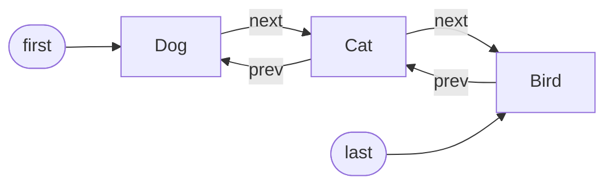
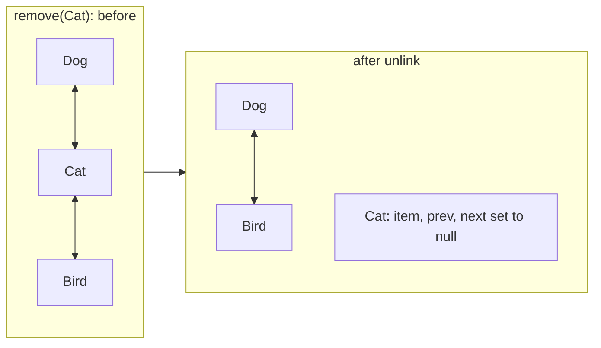
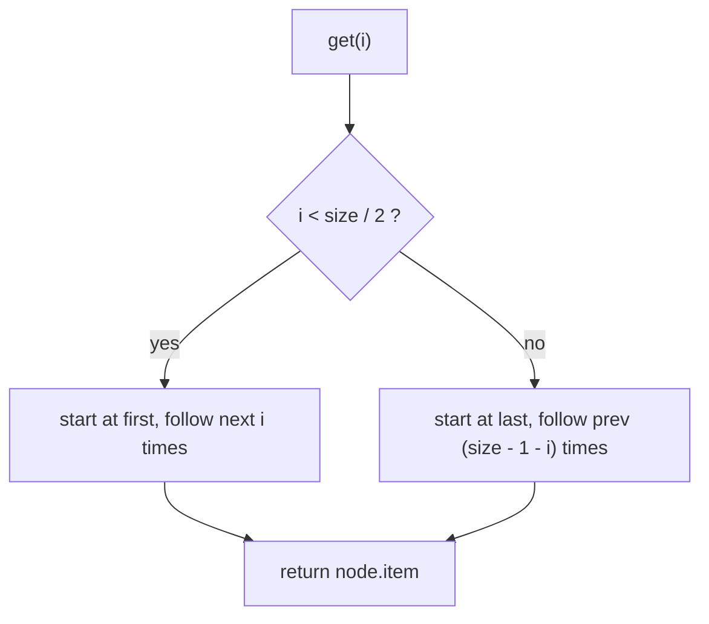

## In One Line
`LinkedList` is a **doubly linked list**: each element lives in its own node that points to the previous and next node, so adding or removing at **either end is O(1)**, but reaching the element at index `i` means **walking the chain — O(n)**. It is both a `List` and a `Deque`.

## Mental Model
Think of a **train**. Each carriage (node) carries one passenger (the element) and is coupled to the carriage in front and the carriage behind.

- Adding a carriage at the **front or the back** is quick: couple it on — **O(1)**.
- Removing a carriage in the middle is quick **once you are standing next to it**: uncouple it and join its neighbours — O(1). But *getting there* means walking through the carriages — **O(n)**.
- "Give me carriage number 57" has no shortcut: you count carriages from the nearer end of the train. `LinkedList` does exactly that — it starts from the head or the tail, whichever is closer.
- Each carriage also weighs a lot compared to a locker in a corridor: the couplings (`prev`/`next` references) and the carriage body (object header) cost memory that an `ArrayList` slot does not.

## Concept
### Structure
```java
public class LinkedList<E> extends AbstractSequentialList<E>
        implements List<E>, Deque<E>, Cloneable, java.io.Serializable

transient int size;
transient Node<E> first;   // head
transient Node<E> last;    // tail

private static class Node<E> {
    E item;
    Node<E> next;
    Node<E> prev;
}
```
- **Doubly linked**: every node knows both neighbours, so you can walk in both directions and unlink a node in O(1).
- `first.prev` and `last.next` are `null` — it is not circular.
- Implements **`List`** (index API) **and `Deque`** (head/tail API: `addFirst`, `pollLast`, `push`, `pop`, ...). Since Java 21 both come together through `SequencedCollection`.
- Does **not** implement `RandomAccess` — a signal to algorithms that `get(i)` is slow.
- Allows **duplicates and `null`**. Not synchronized. Fail-fast iterators.

### How the main operations work
| Operation | What happens | Cost |
|---|---|---|
| `add(e)` / `addLast(e)` / `offer(e)` | `linkLast`: new node after `last`, update `last` | O(1) |
| `addFirst(e)` / `push(e)` / `offerFirst(e)` | `linkFirst`: new node before `first` | O(1) |
| `getFirst()` / `getLast()` / `peekFirst()` / `peekLast()` | read `first.item` / `last.item` | O(1) |
| `removeFirst()` / `pop()` / `poll()` / `removeLast()` | unlink the end node | O(1) |
| `get(i)` / `set(i, e)` | `node(i)`: walk from `first` if `i < size / 2`, else from `last` backwards | O(n) (at most n/2 hops) |
| `add(i, e)` / `remove(i)` | walk to node `i`, then relink | O(n) walk + O(1) link |
| `remove(Object)` / `contains` / `indexOf` | walk from `first` comparing with `equals` | O(n) |
| `ListIterator.add` / `Iterator.remove` at the cursor | relink the neighbours | **O(1)** |

The last row is the one real strength: if you are *already* walking the list with an iterator, inserting or deleting at that point is O(1) — no shifting.

### Throwing vs non-throwing head/tail methods
| Empty list | Throws `NoSuchElementException` | Returns `null` |
|---|---|---|
| Look at head | `getFirst()`, `element()` | `peekFirst()`, `peek()` |
| Look at tail | `getLast()` | `peekLast()` |
| Remove head | `removeFirst()`, `remove()`, `pop()` | `pollFirst()`, `poll()` |
| Remove tail | `removeLast()` | `pollLast()` |

Because `LinkedList` accepts `null` elements, a `null` from `poll()` is ambiguous: empty list, or a stored `null`? One more reason to prefer `ArrayDeque` (which forbids `null`) for queues.

### Three `remove` methods
- `remove()` — from `Deque`/`Queue`: removes the **head**.
- `remove(int index)` — from `List`: removes by position.
- `remove(Object o)` — from `Collection`: removes the first equal element.

### ArrayList vs LinkedList
| | `ArrayList` | `LinkedList` |
|---|---|---|
| Structure | Resizable array | Doubly linked nodes |
| `get(i)` | **O(1)** | O(n) |
| Add/remove at end | O(1) amortised | O(1) |
| Add/remove at front | O(n) | **O(1)** |
| Insert/remove in the middle | O(n) shift (fast `arraycopy`) | O(n) walk + O(1) relink |
| Memory per element | ~4 bytes (one reference slot) + spare capacity | ~24 bytes per node (header + 3 references) |
| CPU cache | Contiguous array, cache-friendly | Nodes scattered on the heap, cache misses |
| Interfaces | `List`, `RandomAccess` | `List`, `Deque` |
| Best for | Almost everything | Many insertions/removals through an iterator; list + deque in one |

(Memory figures are typical for a 64-bit JVM with compressed references.)

In practice `ArrayList` wins even for many middle insertions on moderate sizes, because walking nodes (pointer chasing) is slower than `System.arraycopy` moving a contiguous block. Joshua Bloch, who wrote `LinkedList`, has joked that he never uses it. For queue/stack work, `ArrayDeque` beats `LinkedList` too.

### Java 21 notes
- `getFirst()`/`getLast()`/`removeFirst()`/`removeLast()` used to be available only on `LinkedList`/`Deque` types. Since Java 21 every `List` has them (via `SequencedCollection`), so `List<String> animals = new LinkedList<>(); animals.getFirst();` compiles.
- `reversed()` returns a reverse-ordered **view** (for `LinkedList` the return type is `LinkedList<E>`).

## Diagram

The list after the three `add` calls: the `LinkedList` object only holds `first`, `last` and `size`; every element sits in its own node linked both ways.


Unlinking only rewires two references (`Dog.next = Bird`, `Bird.prev = Dog`) and clears the removed node for the garbage collector — no elements move. Finding `Cat` first is the O(n) part.


`node(i)` halves the worst case by starting from the nearer end, but it is still O(n).

## Code
@example Collections/Lists/LinkedListExample.java

The `Deque` side of `LinkedList` — work at both ends:
```java
LinkedList<String> list = new LinkedList<>(List.of("Dog", "Cat"));
list.addFirst("Ant");       // O(1) at the head
list.addLast("Bee");        // O(1) at the tail (same as add)
list.add(2, "Cow");         // O(n): walk to index 2, then O(1) link
System.out.println(list);

System.out.println(list.removeFirst() + " " + list.removeLast() + " -> " + list);
list.push("Eel");           // push = addFirst
System.out.println(list.pop() + " " + list.peek() + " " + list.poll() + " -> " + list);

LinkedList<String> empty = new LinkedList<>();
System.out.println("peekFirst on empty: " + empty.peekFirst());
try {
    empty.getFirst();
} catch (NoSuchElementException e) {
    System.out.println("getFirst on empty: " + e.getClass().getSimpleName());
}
```
```output
[Ant, Dog, Cow, Cat, Bee]
Ant Bee -> [Dog, Cow, Cat]
Eel Dog Dog -> [Cow, Cat]
peekFirst on empty: null
getFirst on empty: NoSuchElementException
```

Where `LinkedList` shines — O(1) insertion at the iterator's position — plus two ways to walk backwards:
```java
LinkedList<String> animals = new LinkedList<>(List.of("Dog", "Cat", "Bird"));
ListIterator<String> it = animals.listIterator();
while (it.hasNext()) {
    if (it.next().equals("Cat")) {
        it.add("Kitten");   // O(1): links a node right after Cat
    }
}
System.out.println(animals);
System.out.println(animals.reversed());   // Java 21 view
Iterator<String> back = animals.descendingIterator();
StringBuilder sb = new StringBuilder();
while (back.hasNext()) sb.append(back.next()).append(' ');
System.out.println(sb.toString().trim());
```
```output
[Dog, Cat, Kitten, Bird]
[Bird, Kitten, Cat, Dog]
Bird Kitten Cat Dog
```

The three `remove` overloads:
```java
LinkedList<Integer> list = new LinkedList<>(List.of(5, 6, 7, 8));
list.remove();                     // Deque/Queue: remove the head
list.remove(1);                    // List: remove at index 1
list.remove(Integer.valueOf(8));   // Collection: remove this value
System.out.println(list);
```
```output
[6]
```

## Walkthrough
- `package Collections.Lists;` and `import java.util.LinkedList;` — same package as the other list examples; `LinkedList` is in `java.util`.
- `LinkedList<String> linkedList = new LinkedList<>();` — creates an empty list: `first = last = null`, `size = 0`. Unlike `ArrayList` there is no capacity; memory is allocated one node per element. The variable is declared as `LinkedList` (not `List`) because, before Java 21, `getFirst()`/`getLast()` did not exist on `List`.
- `linkedList.add("Dog")`, `add("Cat")`, `add("Bird")` — each call is `linkLast`: a new node is created with `prev = last`, the old last node's `next` points to it, and `last` moves to it. After three adds: `Dog ⇄ Cat ⇄ Bird`.
- `System.out.println("LinkedList elements: " + linkedList);` — `toString()` from `AbstractCollection` walks the nodes: `[Dog, Cat, Bird]`.
- `linkedList.getFirst()` / `getLast()` — read `first.item` and `last.item` directly, O(1): `Dog` and `Bird`. On an empty list both would throw `NoSuchElementException` (the `peekFirst`/`peekLast` versions return `null` instead).
- `linkedList.remove("Cat");` — `remove(Object)`: walks from `first` comparing with `equals`, finds the `Cat` node and **unlinks** it (`Dog.next = Bird`, `Bird.prev = Dog`). Nothing is shifted. Returns `true` (ignored). Output `[Dog, Bird]`.
- `System.out.print("Iterating over LinkedList: ");` then `for (String animal : linkedList)` — the for-each loop uses `LinkedList`'s `ListItr`, which follows `next` pointers: O(1) per step. It prints `Dog Bird ` with a trailing space and no newline.
- Every `// Output:` comment matches the recorded run.

## Traps
> [!ERRATA] Same as the `ArrayList` example: the final loop uses `print(animal + " ")`, so the program ends with a trailing space and no newline (the shell prompt lands on the same line). Use `System.out.println("Iterating over LinkedList: " + String.join(" ", linkedList));`. The package name `Collections.Lists` also breaks the lowercase package convention (see [ArrayList](lesson:a03-collections/01-arraylist)).

- **Index loops are O(n²).** `for (int i = 0; i < list.size(); i++) list.get(i)` walks from an end on every call. On a 100,000-element `LinkedList` this took about 4 seconds on the test machine, while a for-each loop over the same list took a couple of milliseconds. Always iterate a `LinkedList` with for-each / an iterator.
- **"Insertion is O(1)" is only half true.** `add(i, e)` must first walk to position `i` — O(n). Only insertion at the ends or at an iterator's current position is O(1).
- **`getFirst()` on an empty list throws** `NoSuchElementException`; `peekFirst()` returns `null`. Pick the one that matches how you want to handle "empty".
- **`remove()` with no arguments removes the head** — easy to confuse with `remove(int)` and `remove(Object)`.
- **`push` adds at the front, `add` adds at the back.** Mixing them changes the order in surprising ways (see the quiz).
- **`null` elements are allowed**, which makes `poll()`/`peek()` returning `null` ambiguous.
- **Memory:** a list of a million `Integer`s costs a million nodes plus a million `Integer` objects. Prefer `ArrayList` unless you have a measured reason.

## Tips & Tricks
- **"Train, not lockers":** cheap to couple at the ends, slow to find carriage number n.
- **Use it as a `List`? Probably use `ArrayList`. Use it as a `Queue`/`Deque`? Probably use `ArrayDeque`.** `LinkedList` is the right tool when you need `null` elements in a deque, or many insertions/removals *through an iterator* in a long list.
- **Remember the node:** `item`, `next`, `prev` — and the list keeps `first`, `last`, `size`.
- **`node(i)` starts from the nearer end** — worst case n/2 hops, still O(n).
- **Method families:** `offer/poll/peek` return special values; `add/remove/element` and `getFirst/removeFirst` throw. Same pattern in every queue.
- **Interview line:** "LinkedList gives O(1) insertion at the ends and at an iterator position, but O(n) random access and poor cache locality, so ArrayList or ArrayDeque is usually faster in practice."

## Interview Q&A
### [Basic] How is LinkedList implemented internally?
It is a **doubly linked list**. The `LinkedList` object holds `first` and `last` node references and a `size`. Each `Node<E>` holds the element (`item`) and references to the `next` and `prev` nodes. `add(e)` links a new node after `last`; `addFirst(e)` links one before `first`; removing a node rewires its neighbours' pointers. There is no backing array and no capacity. It extends `AbstractSequentialList` and implements `List`, `Deque`, `Cloneable` and `Serializable`.

**Follow-up:** *Is it circular?* — No; `first.prev` and `last.next` are `null`.

### [Basic] What is the difference between ArrayList and LinkedList?
`ArrayList` is backed by a resizable array: O(1) `get(i)`, amortised O(1) append, O(n) insert/remove at the front or middle because of shifting, compact memory and good cache locality. `LinkedList` is a doubly linked list: O(1) add/remove at both ends and at an iterator position, but O(n) `get(i)`, about 24 bytes of overhead per node, and scattered memory. `LinkedList` also implements `Deque`, so it can act as a queue or stack; `ArrayList` implements `RandomAccess`. In real workloads `ArrayList` is faster for most things, including many middle insertions, because `System.arraycopy` on contiguous memory beats pointer chasing.

**Follow-up:** *So when would you pick LinkedList?* — When you insert/remove many elements while iterating a long list (via `ListIterator`), or need a deque that allows `null`. Otherwise `ArrayList` or `ArrayDeque`.

### [Intermediate] Why is `get(i)` O(n) in LinkedList, and what optimisation does it use?
Nodes are not stored contiguously, so there is no address arithmetic: to reach index `i` you must follow references one by one. `LinkedList.node(i)` checks whether `i < size >> 1`; if so, it walks forward from `first`, otherwise backward from `last`. That caps the walk at n/2 hops, but it is still linear.

**Follow-up:** *What is the complexity of a classic `for (int i...) list.get(i)` loop on a LinkedList?* — O(n²), because each `get` is O(n). Use an iterator/for-each for O(n).

### [Intermediate] Is inserting into the middle of a LinkedList O(1)?
Only if you already have a reference to the position — that is, when you use a `ListIterator` and call `it.add(x)` or `it.remove()`. `list.add(i, x)` must first locate node `i` by walking (O(n)), and only the relinking is O(1). For comparison, `ArrayList.add(i, x)` is O(n) too, but its O(n) is a fast block copy.

**Follow-up:** *What does `ListIterator.add` do to the cursor?* — The new element is inserted before the cursor; the next `next()` is unaffected and `previous()` would return the new element.

### [Intermediate] LinkedList or ArrayDeque for a queue?
`ArrayDeque`. It stores elements in a circular array: no node allocation per element, less garbage, better cache locality, and the Javadoc says it is "likely to be faster than `LinkedList` when used as a queue". `ArrayDeque` also rejects `null`, which keeps `poll()` returning `null` unambiguous. Choose `LinkedList` only if you need `null` elements or also need `List` operations on the same object.

**Follow-up:** *And for a stack?* — Also `ArrayDeque` (`push`/`pop`/`peek`), not `Stack`.

### [Basic] What is the difference between `getFirst()` and `peekFirst()`?
Both return the head without removing it. On an empty list `getFirst()` throws `NoSuchElementException`, while `peekFirst()` returns `null`. The same pairing exists for removal: `removeFirst()` throws, `pollFirst()` returns `null`; and for the tail: `getLast`/`peekLast`, `removeLast`/`pollLast`. Use the throwing versions when emptiness is a bug, and the `null`-returning ones when emptiness is a normal condition.

**Follow-up:** *Which one does `element()` behave like?* — `getFirst()`: it throws on an empty queue.

### [Advanced] Why does LinkedList not implement RandomAccess, and why does it matter?
`RandomAccess` is a marker interface meaning "positional access is fast". `LinkedList` does not implement it because `get(i)` is O(n). Generic algorithms check for it: `Collections.binarySearch`, for example, uses index-based access for `RandomAccess` lists and an iterator-based version for others, so it does not accidentally become O(n log n) node walking — the iterator version needs O(n) link traversals and O(log n) comparisons.

**Follow-up:** *How can your own code use it?* — `if (list instanceof RandomAccess) { index loop } else { iterator loop }`.

### [Advanced] Write code to reverse a singly linked list.
Walk the list once, flipping each `next` pointer to point backwards, keeping three references: `prev`, `curr`, and the saved `next`.
```java
static class Node {
    int val; Node next;
    Node(int val, Node next) { this.val = val; this.next = next; }
}

static Node reverse(Node head) {
    Node prev = null, curr = head;
    while (curr != null) {
        Node next = curr.next;   // remember the rest
        curr.next = prev;        // flip the pointer
        prev = curr;             // step forward
        curr = next;
    }
    return prev;                 // old tail is the new head
}
// 1 -> 2 -> 3   becomes   3 -> 2 -> 1
```
```output
1 -> 2 -> 3
3 -> 2 -> 1
```
O(n) time, O(1) extra space. For `java.util.LinkedList` you would simply call `Collections.reverse(list)` (O(n), swapping from both ends with two list iterators) or use the Java 21 view `list.reversed()`.

**Follow-up:** *Recursive version?* — `Node rest = reverse(head.next); head.next.next = head; head.next = null; return rest;` with base case `head == null || head.next == null`; it uses O(n) stack space.

### [Advanced] How much memory does a LinkedList use compared with an ArrayList?
On a typical 64-bit JVM with compressed references, each `LinkedList.Node` is an object with a 12-byte header plus three 4-byte references — 24 bytes after alignment — per element, on top of the element object itself. An `ArrayList` needs one 4-byte slot per element plus unused capacity (up to 50% after a resize). So a `LinkedList` uses roughly 4–6× more memory for the structure, creates one object per element (more GC work) and scatters them across the heap (more cache misses).

**Follow-up:** *How would you measure it?* — With a tool such as JOL (Java Object Layout) or a heap dump analysed in a profiler.

## Quiz
### Which operation is O(1) on a LinkedList?
- [ ] `get(size / 2)`
- [x] `addFirst(e)`
- [ ] `contains(e)`
- [ ] `add(size / 2, e)`
> `addFirst` only links a node before `first`. `get` and `add` at the middle must walk about n/2 nodes, and `contains` scans the list.

### What does this print?
```java
LinkedList<Integer> list = new LinkedList<>();
list.add(1);
list.push(2);
list.offer(3);
list.addFirst(4);
System.out.println(list + " " + list.pop() + " " + list.pollLast());
```
- [ ] [1, 2, 3, 4] 1 4
- [x] [4, 2, 1, 3] 4 3
- [ ] [4, 3, 2, 1] 4 1
- [ ] [2, 1, 3, 4] 2 4
> `add` → `[1]`; `push` adds at the front → `[2, 1]`; `offer` adds at the back → `[2, 1, 3]`; `addFirst` → `[4, 2, 1, 3]`. The string is built left to right, so the list is printed before `pop()` removes the head `4` and `pollLast()` removes `3`. Thinking `push` adds at the back gives the first option.

### What does this print?
```java
LinkedList<Integer> list = new LinkedList<>(List.of(5, 6, 7, 8));
list.remove();
list.remove(1);
list.remove(Integer.valueOf(8));
System.out.println(list);
```
- [ ] [5, 7]
- [ ] [7]
- [x] [6]
- [ ] [6, 7]
> `remove()` removes the head (5) → `[6, 7, 8]`; `remove(1)` removes index 1 (7) → `[6, 8]`; `remove(Integer.valueOf(8))` removes the value 8 → `[6]`.

### What happens when you call `getFirst()` on an empty LinkedList?
- [ ] It returns `null`
- [x] It throws `NoSuchElementException`
- [ ] It throws `IndexOutOfBoundsException`
- [ ] It throws `NullPointerException`
> `getFirst()` is the throwing variant. `peekFirst()` is the one that returns `null`. `IndexOutOfBoundsException` comes from index methods such as `get(0)`.

### Spot the performance bug
```java
LinkedList<Integer> nums = loadMillionNumbers();
long sum = 0;
for (int i = 0; i < nums.size(); i++) {
    sum += nums.get(i);
}
```
- [ ] `size()` is O(n) on a LinkedList
- [x] `get(i)` walks the nodes on every call, so the loop is O(n²)
- [ ] Auto-unboxing makes it O(n²)
- [ ] There is no bug; LinkedList is `RandomAccess`
> `size()` is a stored field (O(1)); the problem is `get(i)`, which walks from the nearer end each time. Use `for (int n : nums)` for O(n). `LinkedList` does not implement `RandomAccess`.

### Which interface does LinkedList implement that ArrayList does not?
- [ ] `List`
- [ ] `RandomAccess`
- [x] `Deque`
- [ ] `Serializable`
> `LinkedList` implements `Deque`, which gives it `addFirst`, `pollLast`, `push`, `pop` and friends. `RandomAccess` is the other way round: `ArrayList` has it, `LinkedList` does not.

## Takeaways
- `LinkedList` is a doubly linked list: the list holds `first`, `last`, `size`; each node holds `item`, `prev`, `next`.
- O(1) add/remove at both ends and at an iterator's position; O(n) `get(i)` (it walks from the nearer end), `contains` and `add(i, e)`.
- It implements both `List` and `Deque`, allows `null`, is not synchronized and not `RandomAccess`.
- `getFirst`/`removeFirst` throw `NoSuchElementException` on empty; `peekFirst`/`pollFirst` return `null`.
- Never loop a `LinkedList` with `get(i)` — that is O(n²); use for-each or an iterator.
- In practice `ArrayList` (for lists) and `ArrayDeque` (for queues/stacks) are faster because of contiguous memory and no per-element nodes.
- Since Java 21 `getFirst`, `getLast` and `reversed()` are available on every `List`.
