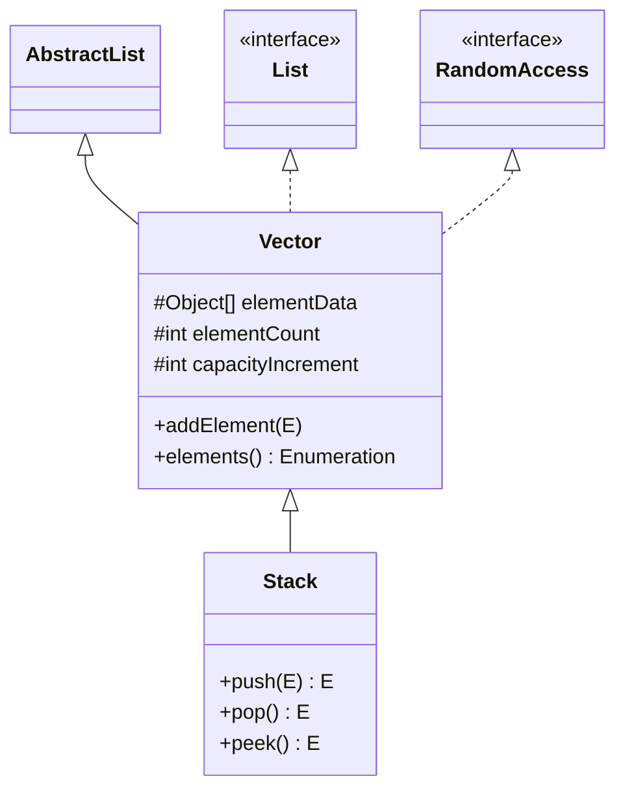
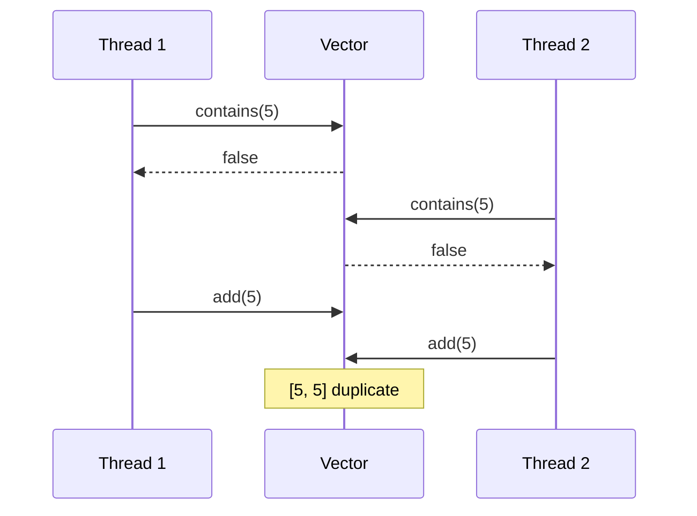

## In One Line
`Vector` is the **legacy (Java 1.0) synchronized version of `ArrayList`**: a growable array whose every public method takes a lock on the vector, which doubles its capacity when full and still carries old methods like `addElement` and `elements()`; new code should use `ArrayList` or a `java.util.concurrent` class instead.

## Mental Model
Imagine the school lockers from the `ArrayList` lesson, but with **one security guard** at the corridor entrance who lets in **only one person at a time**.

- Every action — open a locker, count the lockers, add a locker — requires going past the guard. That is `synchronized` on every method.
- It stops two people from bumping into each other *during one action*. But if you check "is locker 5 free?", leave, and come back to put your bag in, someone else may have taken it in between. The guard protects each **single action**, not your **sequence of actions**.
- Even when you are the only person in the building, you still have to pass the guard every time — wasted effort in single-threaded code.
- When the corridor is full, this school **doubles** it (ArrayList's school builds only 1.5×).

## Concept
### Where Vector comes from
`Vector` existed before the Collections Framework. In Java 1.2 it was **retrofitted** to implement `List`, so it has two sets of method names:

```java
public class Vector<E> extends AbstractList<E>
        implements List<E>, RandomAccess, Cloneable, java.io.Serializable

protected Object[] elementData;    // the backing array
protected int elementCount;        // the size
protected int capacityIncrement;   // 0 = double when full
```
The fields are `protected` (not `private`) because `Stack` extends `Vector` and was designed to reach into them.

### Legacy methods and their modern equivalents
| Legacy `Vector` method | `List` equivalent |
|---|---|
| `addElement(e)` | `add(e)` |
| `insertElementAt(e, i)` | `add(i, e)` (note the swapped parameters) |
| `elementAt(i)` | `get(i)` |
| `setElementAt(e, i)` | `set(i, e)` (swapped parameters, returns `void`) |
| `removeElement(o)` | `remove(o)` |
| `removeElementAt(i)` | `remove(i)` (returns `void`) |
| `removeAllElements()` | `clear()` |
| `firstElement()` / `lastElement()` | `getFirst()` / `getLast()` (Java 21) |
| `elements()` → `Enumeration` | `iterator()` → `Iterator` |
| `capacity()`, `setSize(n)`, `copyInto(arr)`, `indexOf(o, from)` | no direct `List` equivalent |

`setSize(n)` is unusual: growing pads the vector with `null`s; shrinking discards elements past `n`.

### Constructors and growth
| Constructor | Initial capacity | Growth when full |
|---|---|---|
| `new Vector<>()` | 10, allocated **immediately** | doubles |
| `new Vector<>(int initialCapacity)` | as given | doubles |
| `new Vector<>(int initialCapacity, int capacityIncrement)` | as given | + `capacityIncrement` each time |
| `new Vector<>(Collection c)` | `c.size()` | doubles |

Growth rule: `newCapacity = oldCapacity + (capacityIncrement > 0 ? capacityIncrement : oldCapacity)`. Observed on JDK 21: `new Vector<>()` goes 10 → 20 → 40 → 80 → 160; `new Vector<>(4, 3)` goes 4 → 7 → 10 → 13.
A small fixed increment makes adds O(n) each in the long run (the array is copied every few adds), so leave `capacityIncrement` at 0 unless you have a reason.

### How synchronization works in Vector
Almost every public method is declared `synchronized`, so it locks the `Vector` object itself (`this`). Consequences:

1. **Each single call is thread-safe.** Two threads calling `add` at the same time cannot corrupt the array.
2. **Compound actions are not atomic.** `if (!v.contains(x)) v.add(x);` is two calls with a gap between them; another thread can add `x` in the gap. In a test with 8 threads each doing this for 0..9999 without extra locking, the vector ended up with sizes like 10003 or 10591 instead of 10000 (it varies run to run). The fix is client-side locking: `synchronized (v) { if (!v.contains(x)) v.add(x); }` — this works because `Vector` locks on itself.
3. **Iteration is not atomic.** Another thread can modify the vector between `next()` calls, and the iterator then throws `ConcurrentModificationException`. Hold `synchronized (v)` for the whole loop.
4. **You pay for locks you may not need.** In single-threaded code every call still acquires and releases a monitor. Modern JVMs make uncontended locks cheap (and the JIT can remove locks on objects that never escape a thread), but it is still overhead and it limits scalability under contention because all threads queue on one lock.

### Enumeration vs Iterator
| | `Enumeration` (`elements()`) | `Iterator` (`iterator()`, for-each) |
|---|---|---|
| Since | Java 1.0 | Java 1.2 |
| Methods | `hasMoreElements()`, `nextElement()` | `hasNext()`, `next()`, `remove()`, `forEachRemaining()` |
| Remove while iterating | no | yes, `remove()` |
| Fail-fast | **no** — it just reads `elementCount` each time | **yes** — `ConcurrentModificationException` |
| Convert | `enumeration.asIterator()` (Java 9) | `Collections.enumeration(collection)` |

### Vector vs ArrayList
| | `Vector` | `ArrayList` |
|---|---|---|
| Since | Java 1.0 (legacy) | Java 1.2 |
| Synchronized | yes, every method | no |
| Growth | ×2 (or `+capacityIncrement`) | ×1.5 |
| Default capacity 10 | allocated in the constructor | allocated lazily on first `add` |
| Extra API | `addElement`, `elements()`, `capacity()`, `setSize()` ... | `ensureCapacity`, `trimToSize` (Vector has these too) |
| Iteration | `Iterator` (fail-fast) + `Enumeration` (not) | `Iterator` (fail-fast) |
| Use today | legacy code / APIs that demand it | default choice |

### What to use instead
| Need | Use |
|---|---|
| Single-threaded list | `ArrayList` |
| Occasional sharing, simple | `Collections.synchronizedList(new ArrayList<>())` (same coarse lock, but explicit) |
| Read-mostly, iterated often (listeners, config) | `CopyOnWriteArrayList` — lock-free reads, snapshot iterators |
| Producer/consumer hand-off | a `BlockingQueue` such as `LinkedBlockingQueue` |
| LIFO stack | `ArrayDeque` (not `Stack`, which extends `Vector`) |

`Vector` is **not deprecated** — it still compiles and works, and a few old APIs (for example Swing's `DefaultListModel` and `JComboBox` constructors) still use it.

## Diagram

`Vector` sits next to `ArrayList` under `AbstractList`, and the legacy `Stack` extends it — which is why `Stack` is synchronized too.


Each call is locked, but the lock is released between `contains` and `add`, so both threads pass the check. Wrap the pair in `synchronized (v) { ... }`.

## Code
@example Collections/Lists/VectorExample.java

The legacy API — `addElement`, `insertElementAt`, `elementAt`, `Enumeration`, `capacity`, `setSize`:
```java
Vector<String> v = new Vector<>(3, 2);       // initial capacity 3, grow by 2
v.addElement("A");
v.addElement("B");
v.addElement("C");
System.out.println("size=" + v.size() + " capacity=" + v.capacity());
v.addElement("D");                           // full -> grows by capacityIncrement
System.out.println("size=" + v.size() + " capacity=" + v.capacity());

v.insertElementAt("Z", 0);
System.out.println(v + " first=" + v.firstElement() + " last=" + v.lastElement()
        + " elementAt(2)=" + v.elementAt(2));

Enumeration<String> en = v.elements();       // the pre-Iterator cursor
while (en.hasMoreElements()) {
    System.out.print(en.nextElement() + " ");
}
System.out.println();

v.removeElement("Z");
v.setSize(6);                                // pads with nulls
System.out.println(v + " size=" + v.size());
v.removeAllElements();
System.out.println(v.isEmpty() + " capacity still " + v.capacity());
```
```output
size=3 capacity=3
size=4 capacity=5
[Z, A, B, C, D] first=Z last=D elementAt(2)=B
Z A B C D 
[A, B, C, D, null, null] size=6
true capacity still 7
```

Why the example casts to `(Integer)`:
```java
Vector<Integer> a = new Vector<>(List.of(1, 2, 3));
a.remove(2);               // remove(int index): removes the element AT index 2
System.out.println(a);

Vector<Integer> b = new Vector<>(List.of(1, 2, 3));
b.remove((Integer) 2);     // remove(Object): removes the VALUE 2
System.out.println(b);
```
```output
[1, 2]
[1, 3]
```

`Enumeration` is not fail-fast, `Iterator` is:
```java
Vector<Integer> v = new Vector<>(List.of(1, 2, 3));
Enumeration<Integer> e = v.elements();
while (e.hasMoreElements()) {
    Integer x = e.nextElement();
    if (x == 1) v.add(99);          // modify while enumerating
    System.out.print(x + " ");
}
System.out.println("<- Enumeration: no exception");

Vector<Integer> w = new Vector<>(List.of(1, 2, 3));
try {
    for (Integer x : w) {           // for-each uses Iterator
        if (x == 1) w.add(99);
    }
} catch (ConcurrentModificationException ex) {
    System.out.println("Iterator: " + ex.getClass().getSimpleName());
}
```
```output
1 2 3 99 <- Enumeration: no exception
Iterator: ConcurrentModificationException
```

Making a check-then-act atomic with client-side locking (8 threads, each tries to add 0..9999 once):
```java
Vector<Integer> v = new Vector<>();
ExecutorService pool = Executors.newFixedThreadPool(8);
for (int t = 0; t < 8; t++) {
    pool.submit(() -> {
        for (int i = 0; i < 10_000; i++) {
            synchronized (v) {                 // make check-then-act atomic
                if (!v.contains(i)) v.add(i);
            }
        }
    });
}
pool.shutdown();
pool.awaitTermination(1, TimeUnit.MINUTES);
System.out.println("size = " + v.size());
```
```output
size = 10000
```
Without the `synchronized (v)` block the result varies from run to run and is usually above 10000 — duplicates slipped in.

## Walkthrough
- `package Collections.Lists;` and `import java.util.Vector;` — `Vector` lives in `java.util`.
- `Vector<Integer> vector = new Vector<>();` — calls `this(10)`: a 10-slot array is allocated **right away** (unlike `ArrayList`), `capacityIncrement` is 0, so it will double when full. The element type is `Integer`, because collections cannot hold `int`.
- `vector.add(1); vector.add(2); vector.add(3);` — each `int` literal is **autoboxed** with `Integer.valueOf`. `add` is `synchronized`: each call locks the vector, stores at `elementData[elementCount++]`, and unlocks.
- `System.out.println("Vector elements: " + vector);` — `Vector.toString()` (synchronized, delegating to `AbstractCollection.toString`) prints `[1, 2, 3]`.
- `int element = vector.get(1);` — `get` returns the `Integer` at index 1 (the value 2), which is **auto-unboxed** to `int`. If that slot held `null`, this line would throw `NullPointerException`.
- `vector.remove((Integer) 2);` — the cast is essential. `remove` is overloaded: `remove(int index)` and `remove(Object o)`. With a plain `2` the compiler picks `remove(int)` (exact match, no boxing) and would delete the element at **index 2** (the value 3). Casting to `Integer` selects `remove(Object)`, which removes the first element **equal** to 2. The comment "Remove the Integer value 2" is accurate, and the output `[1, 3]` confirms it.
- `System.out.print("Iterating over Vector: ");` then `for (int number : vector)` — the for-each loop uses `vector.iterator()` (a fail-fast `Iterator` whose `next()` synchronizes on the vector). Declaring the loop variable as `int` unboxes each `Integer`. It prints `1 3 ` with a trailing space and no final newline.
- Every `// Output:` comment matches the recorded run.

## Traps
> [!ERRATA] Outdated API choice: the example teaches `Vector` without saying it is a legacy class. Its own Javadoc says: "If a thread-safe implementation is not needed, it is recommended to use `ArrayList` in place of `Vector`." In new code write `List<Integer> list = new ArrayList<>();`, or a `java.util.concurrent` collection if threads share the list. Like the other list examples, the last loop also leaves a trailing space and no final newline (`String.join` fixes it), and the package name `Collections.Lists` breaks the lowercase package convention.

- **"Vector is thread-safe, so my code is thread-safe"** — false for compound actions (check-then-act, iterate-while-others-write). Lock the vector around the whole sequence.
- **`remove(2)` vs `remove((Integer) 2)`** — index vs value, as the example shows.
- **Unboxing `null`**: `int x = vector.get(0);` throws `NullPointerException` if the element is `null` (`Vector` allows `null`).
- **Enumeration silently sees concurrent changes** — no `ConcurrentModificationException`, so bugs go unnoticed. The `Iterator` is fail-fast.
- **Parameter order of legacy methods**: `insertElementAt(element, index)` and `setElementAt(element, index)` take the element **first** — the reverse of `add(index, element)` and `set(index, element)`.
- **`setSize` pads with `null`** and silently truncates when shrinking.
- **Tiny `capacityIncrement`** (like 1) turns appends into repeated full-array copies — O(n) per add over time.
- **Doubling wastes memory**: right after a resize, up to half the array is empty.

## Tips & Tricks
- **"Vector = ArrayList + a lock on every door + double growth."**
- **Legacy trio to replace on sight:** `Vector` → `ArrayList`, `Stack` → `ArrayDeque`, `Hashtable` → `HashMap`/`ConcurrentHashMap`.
- **Synchronized collection ≠ thread-safe program.** Say this sentence in interviews; then mention client-side locking or concurrent collections.
- **Iterating a shared Vector:** `synchronized (vector) { for (E e : vector) { ... } }`.
- **Got an `Enumeration` from an old API?** `for (E e : (Iterable<E>) () -> en.asIterator())` or `Collections.list(en)` turns it into something modern.
- **Growth mnemonic:** **V**ector **V**ery greedy (×2), **A**rrayList **A** bit less (×1.5).

## Interview Q&A
### [Basic] What is Vector in Java?
`Vector` is a growable-array implementation of `List` from Java 1.0. It stores elements in a protected `Object[] elementData`, keeps its size in `elementCount`, allows duplicates and `null`, supports O(1) index access (`RandomAccess`), and synchronizes almost every public method on the vector itself. It was retrofitted into the Collections Framework in Java 1.2, which is why it has both `List` methods (`add`, `get`) and legacy ones (`addElement`, `elementAt`, `elements()`).

**Follow-up:** *Is it deprecated?* — No, but it is considered legacy; the Javadoc recommends `ArrayList` when thread safety is not needed.

### [Basic] What are the differences between Vector and ArrayList?
`Vector` is synchronized, `ArrayList` is not, so `ArrayList` is faster in single-threaded code. `Vector` doubles its capacity when full (or grows by `capacityIncrement`), `ArrayList` grows by 50%. `Vector` allocates its default 10 slots in the constructor; `ArrayList` allocates them lazily on the first add. `Vector` also offers the legacy `Enumeration` via `elements()` (not fail-fast) and methods like `capacity()` and `setSize()`. Both are `RandomAccess`, allow `null`, and have fail-fast iterators.

**Follow-up:** *Which one would you use in a multithreaded program?* — Usually neither directly: `CopyOnWriteArrayList` for read-mostly lists, a `BlockingQueue` for hand-offs, or an `ArrayList` guarded by my own lock when I need compound operations.

### [Intermediate] Is Vector thread-safe? Is code that uses it thread-safe?
Each individual method call is thread-safe, because it is `synchronized` on the vector. But a program that makes **several calls** that must happen together is not automatically safe: `if (!v.contains(x)) v.add(x)` can add duplicates, and `for (int i = 0; i < v.size(); i++) v.get(i)` can throw `ArrayIndexOutOfBoundsException` if another thread removes an element between `size()` and `get(i)`. Iterating with an `Iterator` while another thread modifies the vector throws `ConcurrentModificationException`. The fix is to hold the vector's lock for the whole compound action: `synchronized (v) { ... }`.

**Follow-up:** *Why does `synchronized (v)` work?* — Because `Vector`'s own methods lock on the same object (`this`), so while you hold it, no other thread can run any `Vector` method.

### [Intermediate] How does Vector grow, and what is `capacityIncrement`?
When the backing array is full, `Vector` allocates a new array and copies the elements. If `capacityIncrement` (set by the `Vector(int initialCapacity, int capacityIncrement)` constructor) is greater than 0, the new capacity is `old + capacityIncrement`; otherwise it doubles. The default vector therefore goes 10 → 20 → 40 → 80. `capacity()` reports the current array length and `ensureCapacity`/`trimToSize` let you manage it manually.

**Follow-up:** *Why is a small increment a bad idea?* — Growing by a constant means a full copy every few adds, so appends become O(n) each on average instead of amortised O(1); geometric growth avoids that.

### [Intermediate] What is the difference between Enumeration and Iterator?
`Enumeration` (Java 1.0) has only `hasMoreElements()` and `nextElement()`; it cannot remove elements and `Vector`'s enumeration is **not fail-fast** — it happily reads elements added during the loop. `Iterator` (Java 1.2) has shorter names, adds `remove()` and `forEachRemaining()`, and the collection iterators are **fail-fast**, throwing `ConcurrentModificationException` on concurrent structural modification. Since Java 9 `Enumeration.asIterator()` adapts one to the other.

**Follow-up:** *Where do you still meet `Enumeration`?* — In legacy APIs such as `Vector.elements()`, `Hashtable.keys()`, `ClassLoader.getResources()` and the servlet API's `getParameterNames()`.

### [Intermediate] Vector vs `Collections.synchronizedList` vs `CopyOnWriteArrayList`?
`Vector` and `Collections.synchronizedList(new ArrayList<>())` are both "one big lock" lists: every call locks, iteration must be manually synchronized, and throughput suffers under contention. The wrapper has the advantage of working with any `List` and keeping the class name honest. `CopyOnWriteArrayList` copies its array on every write, so reads and iteration take no lock and never throw `ConcurrentModificationException` (iterators work on a snapshot); it is excellent for read-mostly data like listener lists and terrible for write-heavy data.

**Follow-up:** *What does `CopyOnWriteArrayList`'s iterator see if the list changes during iteration?* — The snapshot from when the iterator was created; its `remove()` throws `UnsupportedOperationException`.

### [Advanced] If Vector is synchronized, why isn't that a big performance problem any more — and why is it still discouraged?
Uncontended locking on modern HotSpot is a cheap compare-and-swap, and the JIT can eliminate locks on objects that never escape a thread (escape analysis → lock elision) or merge adjacent lock regions (lock coarsening). (Biased locking, an older optimisation for this case, was disabled by default in JDK 15.) So in single-threaded code the overhead is small but not zero. It is still discouraged because (1) the synchronization gives a false sense of safety — compound actions are still racy; (2) under real contention, one global lock serialises all threads; and (3) better tools exist: concurrent collections designed for specific access patterns.

**Follow-up:** *What does "lock coarsening" mean?* — The JIT merges several back-to-back `synchronized` regions on the same object (for example consecutive `v.add` calls) into one, acquiring the lock once.

### [Advanced] Why is `remove((Integer) 2)` needed in the example?
`Vector` (like every `List`) has `remove(int index)` and `remove(Object o)`. Overload resolution happens in phases: phase 1 considers only methods applicable **without boxing/unboxing**, and `remove(int)` matches the `int` literal `2` exactly, so it wins — the element at index 2 would be removed. Casting to `Integer` (or using `Integer.valueOf(2)`) makes the argument a reference, so only `remove(Object)` applies, and it removes the first element equal to 2.

**Follow-up:** *What would `vector.remove(5)` do on a 3-element vector?* — Throw `ArrayIndexOutOfBoundsException` (a subclass of `IndexOutOfBoundsException`), since 5 is treated as an index.

## Quiz
### What does the original example print after `vector.remove((Integer) 2)`?
- [ ] Vector after removing 2: [1, 2]
- [x] Vector after removing 2: [1, 3]
- [ ] Vector after removing 2: [2, 3]
- [ ] Vector after removing 2: [1, 2, 3]
> The cast selects `remove(Object)`, which removes the value 2. `[1, 2]` is what `remove(2)` (the index overload) would produce.

### What does this print?
```java
Vector<Integer> a = new Vector<>(List.of(1, 2, 3));
a.remove(2);
System.out.println(a);
```
- [ ] [1, 3]
- [x] [1, 2]
- [ ] [2, 3]
- [ ] Compile error: ambiguous call
> The `int` literal matches `remove(int index)` without boxing, so the element at index 2 (value 3) is removed. There is no ambiguity: exact primitive matches are tried before boxing.

### What does this print?
```java
Vector<String> v = new Vector<>(3, 2);
v.addElement("A"); v.addElement("B"); v.addElement("C"); v.addElement("D");
System.out.println(v.size() + " " + v.capacity());
```
- [ ] 4 6
- [x] 4 5
- [ ] 4 4
- [ ] 4 3
> The vector starts with capacity 3 and `capacityIncrement` 2. The fourth add finds it full and grows it by 2, not by doubling, so capacity is 5. Doubling (the default when the increment is 0) would give 6.

### What is the capacity of `new Vector<>()` after adding 11 elements?
- [ ] 11
- [ ] 15
- [x] 20
- [ ] 16
> The default vector starts at 10 and doubles when full, so the 11th add grows it to 20. 15 is what an `ArrayList` would have (×1.5).

### What does this print?
```java
Vector<Integer> v = new Vector<>(List.of(1, 2, 3));
Enumeration<Integer> e = v.elements();
while (e.hasMoreElements()) {
    Integer x = e.nextElement();
    if (x == 1) v.add(99);
    System.out.print(x + " ");
}
```
- [ ] 1 then ConcurrentModificationException
- [ ] 1 2 3
- [x] 1 2 3 99
- [ ] 99 1 2 3
> `Vector`'s `Enumeration` is not fail-fast; it simply reads up to the current `elementCount`, so it also sees the added 99. A for-each loop (an `Iterator`) would throw `ConcurrentModificationException`.

### Spot the bug: two threads run this on a shared Vector
```java
if (!names.contains(name)) {
    names.add(name);
}
```
- [ ] None: every Vector method is synchronized
- [x] The check and the add are separate locked calls, so both threads can pass the check and add duplicates
- [ ] `contains` is not synchronized in Vector
- [ ] It deadlocks because the same lock is taken twice
> Each call is atomic, but the lock is released between them. Wrap both in `synchronized (names) { ... }`. Re-acquiring the same monitor in one thread is fine (monitors are reentrant), so there is no deadlock.

## Takeaways
- `Vector` is a legacy (Java 1.0) growable array retrofitted to `List` in 1.2; it allows duplicates and `null` and is `RandomAccess`.
- Every public method is `synchronized` on the vector, but compound actions and iteration still need `synchronized (vector) { ... }`.
- Default capacity 10 is allocated immediately; it doubles when full, or grows by `capacityIncrement` if one is given.
- Legacy methods (`addElement`, `elementAt`, `insertElementAt(e, i)`, `elements()`) duplicate the `List` API; `Enumeration` is not fail-fast.
- `remove(2)` removes index 2; `remove((Integer) 2)` removes the value 2.
- For new code: `ArrayList` single-threaded, `CopyOnWriteArrayList` for read-mostly sharing, concurrent queues for hand-offs, `ArrayDeque` instead of `Stack`.
