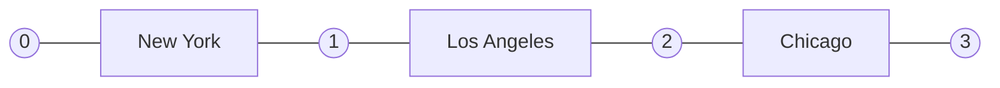
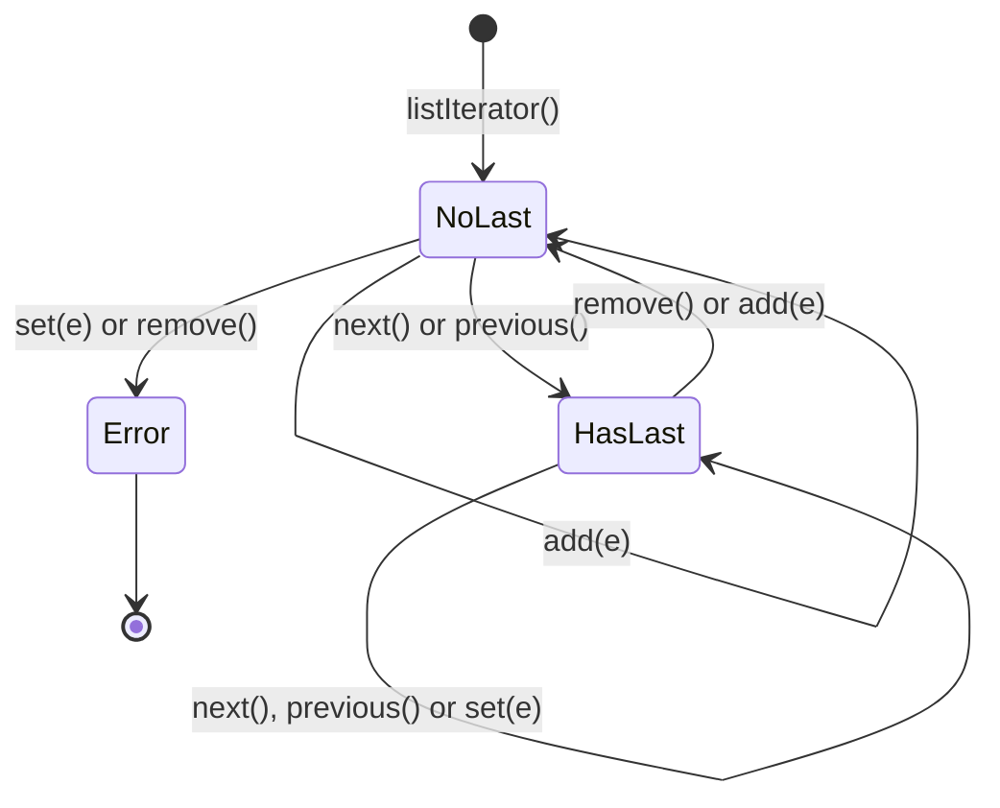

## In One Line
`ListIterator` is the **two-way iterator for lists**: besides `hasNext()`/`next()`/`remove()` it can walk **backwards** (`hasPrevious()`/`previous()`), tell you **where it is** (`nextIndex()`/`previousIndex()`), and **replace** (`set`) or **insert** (`add`) elements while iterating — safely, without `ConcurrentModificationException`.

## Mental Model
Think of the **text cursor in a word processor** — the blinking bar.

- The cursor never sits *on* a letter; it sits **between** letters. In a 3-letter word there are **4 positions**: before the first letter, between each pair, and after the last.
- Pressing **→** jumps over the next letter (that is `next()`, which returns the letter it jumped over). Pressing **←** jumps back over the previous letter (`previous()`).
- **Typing** inserts a letter at the cursor, and the cursor ends up **after** what you typed (`add()`).
- **Overwrite** and **Delete** act on the letter you **just jumped over** (`set()` and `remove()`). If you have not jumped over anything yet, or you just typed or deleted, there is no "last letter" to act on — that is the `IllegalStateException`.

## Concept
### Iterator vs ListIterator
```java
public interface Iterator<E> {
    boolean hasNext();
    E next();
    default void remove();                                  // optional operation
    default void forEachRemaining(Consumer<? super E> action);  // Java 8
}

public interface ListIterator<E> extends Iterator<E> {
    boolean hasPrevious();
    E previous();
    int nextIndex();
    int previousIndex();
    void set(E e);      // optional operation
    void add(E e);      // optional operation
    // plus hasNext, next, remove from Iterator
}
```
| | `Iterator` | `ListIterator` |
|---|---|---|
| Works on | any `Collection` (`Set`, `Queue`, `List`, ...) | only `List` |
| Obtained by | `collection.iterator()` | `list.listIterator()` or `list.listIterator(index)` |
| Direction | forward only | forward and backward |
| Position info | none | `nextIndex()`, `previousIndex()` |
| Remove | `remove()` | `remove()` |
| Replace | no | `set(e)` |
| Insert | no | `add(e)` |

### The cursor model
For a list of `n` elements there are `n + 1` cursor positions, numbered 0 to `n`:
```text
 cursor:  0     1       2       3
          | "A" |  "B"  |  "C"  |
```
- `next()` returns the element **after** the cursor and moves the cursor right. `previous()` returns the element **before** the cursor and moves it left.
- `nextIndex()` = index of the element `next()` would return (equals `size()` at the end). `previousIndex()` = index `previous()` would return (`-1` at the start).
- Calling `next()` then `previous()` returns **the same element twice** — you step over it and back.
- `hasNext()` is `nextIndex() < size()`; `hasPrevious()` is `nextIndex() > 0`.

### Starting positions
- `list.listIterator()` — cursor at 0 (before the first element); `hasPrevious()` is `false`.
- `list.listIterator(index)` — cursor at `index`. To walk **backwards from the end** in one step use `list.listIterator(list.size())`. An index outside `0..size()` throws `IndexOutOfBoundsException`.

### The "last returned element" rule (`set`, `remove`, `add`)
The iterator remembers the element most recently returned by `next()` or `previous()` (in `ArrayList`'s implementation this is the field `lastRet`).
| Method | Acts on | Allowed when | After it |
|---|---|---|---|
| `set(e)` | the last returned element (replaces it) | a `next()`/`previous()` happened and no `add`/`remove` since | may call `set` again |
| `remove()` | the last returned element (deletes it) | same condition | "last returned" is cleared |
| `add(e)` | inserts **at the cursor** (before the element `next()` would return) | always | cursor moves past the new element; "last returned" is cleared |

Otherwise these methods throw `IllegalStateException`. Consequences of `add`:
- the next `next()` is **unaffected** (it does not return the new element), so you cannot loop forever by adding;
- a `previous()` right after `add` **would** return the new element;
- `nextIndex()`/`previousIndex()` both increase by one.

`set` is not a structural change; `add` and `remove` are, but because they go **through the iterator**, it updates its own `expectedModCount` and does not throw `ConcurrentModificationException`.

### Fail-fast behaviour
The list iterators of `ArrayList`, `LinkedList` and `Vector` are **fail-fast**: if the list is structurally modified by anything *other than this iterator* (for example `list.add(x)` inside the loop), the next `next()`/`previous()` throws `ConcurrentModificationException`. The rule: **modify through the iterator, never through the list, while iterating.** See [Fail-fast iterators](lesson:a03-collections/22-fail-fast-iterators).

### Optional operations
`set`, `add` and `remove` are *optional*: a list that does not support them throws `UnsupportedOperationException`.
| List | `set` | `add` / `remove` |
|---|---|---|
| `ArrayList`, `LinkedList`, `Vector` | yes | yes |
| `Arrays.asList(...)` (fixed size) | yes | `UnsupportedOperationException` |
| `List.of(...)`, `Collections.unmodifiableList(...)` | `UnsupportedOperationException` | `UnsupportedOperationException` |

### Performance: why ListIterator matters for LinkedList
| Operation during traversal | `ArrayList` | `LinkedList` |
|---|---|---|
| `next()` / `previous()` | O(1) | O(1) (follow a pointer) |
| `it.set(e)` | O(1) | O(1) |
| `it.add(e)` / `it.remove()` | O(n) (shifts the array) | **O(1)** (relinks neighbours) |

Traversing a `LinkedList` with `get(i)` is O(n²); with a (list) iterator it is O(n). `ListIterator` is the way to edit a `LinkedList` in place efficiently.

### The Java cursor family
| | `Enumeration` | `Iterator` | `ListIterator` | `Spliterator` |
|---|---|---|---|---|
| Since | 1.0 | 1.2 | 1.2 | 8 |
| For | legacy (`Vector`, `Hashtable`) | all collections | lists | streams / parallel splitting |
| Directions | forward | forward | both | forward, can split |
| Modify | no | remove | remove, set, add | no |

### Modern alternatives for common jobs
- Replace every element: `list.replaceAll(x -> ...)` (Java 8).
- Remove by condition: `list.removeIf(x -> ...)` (Java 8).
- Iterate backwards: `for (E e : list.reversed())` (Java 21) or `listIterator(list.size())`.
- Use `ListIterator` when you need to **insert**, need the **index while walking**, need to **go back and forth**, or are editing a **`LinkedList`**.

## Diagram

The cursor (circles) always sits between elements: a 3-element list has 4 positions. `next()` jumps right over one element and returns it; `previous()` jumps left. After the forward loop the cursor is at 3; after the backward loop it is back at 0.


`set` and `remove` need a "last returned element"; `remove` and `add` clear it. Calling them from `NoLast` throws `IllegalStateException`.

## Code
The first example walks a list of cities forward, backward, then edits one with `set`:

@example Collections/Lists/ListIteratorExample.java

The second example does the same forward/backward walk over integers, using the `List` interface type:

@example Collections/Iterators/ListIteratorExample.java

Watching the cursor with `nextIndex()` and `previousIndex()`:
```java
List<String> list = new ArrayList<>(List.of("A", "B", "C"));
ListIterator<String> it = list.listIterator();
System.out.println("start: nextIndex=" + it.nextIndex() + " previousIndex=" + it.previousIndex());
while (it.hasNext()) {
    String s = it.next();
    System.out.println("next()=" + s + " -> nextIndex=" + it.nextIndex() + " previousIndex=" + it.previousIndex());
}
System.out.println("previous()=" + it.previous() + " -> nextIndex=" + it.nextIndex());
```
```output
start: nextIndex=0 previousIndex=-1
next()=A -> nextIndex=1 previousIndex=0
next()=B -> nextIndex=2 previousIndex=1
next()=C -> nextIndex=3 previousIndex=2
previous()=C -> nextIndex=2
```

`add`, `set` and `remove` during iteration:
```java
List<String> list = new ArrayList<>(List.of("A", "B", "C"));
ListIterator<String> it = list.listIterator();
while (it.hasNext()) {
    String s = it.next();
    it.add(s.toLowerCase());     // inserted before the cursor: never revisited by next()
}
System.out.println(list);

ListIterator<String> it2 = list.listIterator();
while (it2.hasNext()) {
    String s = it2.next();
    if (s.equals(s.toLowerCase())) it2.remove();   // remove the lowercase copies
    else it2.set(s + "!");
}
System.out.println(list);
```
```output
[A, a, B, b, C, c]
[A!, B!, C!]
```

The state rules — when `set`/`remove` are illegal:
```java
List<String> list = new ArrayList<>(List.of("A", "B"));
ListIterator<String> it = list.listIterator();
try { it.set("X"); } catch (IllegalStateException e) { System.out.println("set before next: IllegalStateException"); }
it.next();
it.remove();
try { it.remove(); } catch (IllegalStateException e) { System.out.println("remove twice: IllegalStateException"); }
it.next();
it.add("C");
try { it.set("Y"); } catch (IllegalStateException e) { System.out.println("set after add: IllegalStateException"); }
System.out.println(list);
```
```output
set before next: IllegalStateException
remove twice: IllegalStateException
set after add: IllegalStateException
[B, C]
```

Starting at the end, and modifying through the list instead of the iterator:
```java
List<Integer> list = new ArrayList<>(List.of(1, 2, 3, 4, 5));
ListIterator<Integer> it = list.listIterator(list.size());  // cursor after the last element
StringBuilder sb = new StringBuilder();
while (it.hasPrevious()) sb.append(it.previous()).append(' ');
System.out.println(sb.toString().trim());

List<String> cities = new ArrayList<>(List.of("New York", "Los Angeles", "Chicago"));
ListIterator<String> cit = cities.listIterator();
try {
    while (cit.hasNext()) {
        String c = cit.next();
        if (c.equals("New York")) cities.add("Boston");   // list.add, not cit.add
    }
} catch (ConcurrentModificationException e) {
    System.out.println("ConcurrentModificationException");
}
System.out.println(cities);
```
```output
5 4 3 2 1
ConcurrentModificationException
[New York, Los Angeles, Chicago, Boston]
```

Editing a `LinkedList` in place — each `remove`/`set` is O(1):
```java
List<Integer> nums = new LinkedList<>(List.of(1, 2, 3, 4, 5, 6));
ListIterator<Integer> it = nums.listIterator();
while (it.hasNext()) {
    int n = it.next();
    if (n % 2 == 0) it.remove();        // O(1) unlink on a LinkedList
    else it.set(n * 10);
}
System.out.println(nums);
```
```output
[10, 30, 50]
```

The Java 8/21 one-liners for the example's jobs:
```java
List<String> cities = new ArrayList<>(List.of("New York", "Los Angeles", "Chicago"));
cities.replaceAll(c -> c.equals("Chicago") ? "San Francisco" : c);   // Java 8
System.out.println(cities);
System.out.println(cities.reversed());                                // Java 21 view
```
```output
[New York, Los Angeles, San Francisco]
[San Francisco, Los Angeles, New York]
```

## Walkthrough
**`Collections/Lists/ListIteratorExample.java` (cities)**
- `package Collections.Lists;`, `import java.util.ArrayList;`, `import java.util.ListIterator;` — `ListIterator` is an interface in `java.util`.
- `ArrayList<String> cities = new ArrayList<>();` and three `add` calls — the list is `[New York, Los Angeles, Chicago]`.
- `ListIterator<String> iterator = cities.listIterator();` — asks the list for its list iterator. For `ArrayList` this is the private inner class `ArrayList.ListItr`, which keeps a `cursor` (starts at 0), `lastRet` (starts at -1: "nothing returned yet") and `expectedModCount`.
- `System.out.println("Forward iteration:");` then `while (iterator.hasNext()) System.out.println(iterator.next());` — `hasNext()` checks `cursor != size`; each `next()` checks for concurrent modification, returns the element at `cursor`, sets `lastRet = cursor` and moves the cursor right. Prints `New York`, `Los Angeles`, `Chicago`. The cursor ends at **3** (after the last element).
- `System.out.println("Backward iteration:");` then `while (iterator.hasPrevious()) System.out.println(iterator.previous());` — the **same iterator** continues from position 3. `hasPrevious()` checks `cursor != 0`; `previous()` moves the cursor left and returns the element it passed: `Chicago`, `Los Angeles`, `New York`. The cursor ends at **0**.
- `System.out.println("Modifying elements:");` — prints only the header; the loop below prints nothing.
- `while (iterator.hasNext()) { String city = iterator.next(); if (city.equals("Chicago")) iterator.set("San Francisco"); }` — this third pass works **only because** the backward loop brought the cursor back to 0. When `next()` returns `"Chicago"`, `lastRet` is 2, and `set("San Francisco")` calls `cities.set(2, "San Francisco")`. `set` is not a structural change, so no `ConcurrentModificationException` risk even through the list.
- `System.out.println("Cities after modification: " + cities);` — prints `[New York, Los Angeles, San Francisco]`: the iterator wrote straight into the underlying list.

**`Collections/Iterators/ListIteratorExample.java` (integers)**
- `package Collections.Iterators;` — a different package, so a second class with the same simple name `ListIteratorExample` is legal (their fully qualified names differ).
- `List<Integer> list = new ArrayList<>();` — declared with the **interface** type `List`, the recommended style; `listIterator()` is a `List` method, so nothing is lost. Five `add` calls autobox `1..5`.
- `ListIterator<Integer> iterator = list.listIterator();` — cursor at 0.
- Forward loop prints `Element: 1` ... `Element: 5` (string concatenation calls `Integer.toString`). Cursor ends at 5.
- Backward loop prints `Element: 5` ... `Element: 1`, reusing the same iterator from the end. Cursor ends at 0.
- All `// Output:` comments in both files match the recorded runs.

## Traps
> [!NOTE] Both originals are correct and their `// Output:` comments match the recorded runs. The one subtle point is the cities example's third loop: it silently depends on the backward loop having rewound the cursor. Delete the backward loop and the "modifying" loop finds `hasNext()` already `false`, does nothing, and prints `Cities after modification: [New York, Los Angeles, Chicago]` (verified). When a new pass needs a fresh start, ask for a fresh `listIterator()`. The package names (`Collections.Lists`, `Collections.Iterators`) break the lowercase package convention, as noted in [ArrayList](lesson:a03-collections/01-arraylist).

- **`set()`/`remove()` before any `next()`/`previous()`**, twice in a row, or right after `add()` → `IllegalStateException`.
- **Modifying through the list while iterating** (`list.add`, `list.remove`) → `ConcurrentModificationException`. Use `it.add`, `it.remove`.
- **`next()` then `previous()` returns the same element** — people expect the one before it.
- **`add()` does not make `next()` return the new element**; `previous()` would.
- **A fresh iterator cannot go backwards**: `list.listIterator().hasPrevious()` is `false`. Start with `listIterator(list.size())`.
- **`next()` past the end** throws `NoSuchElementException` — always guard with `hasNext()`.
- **`ListIterator` only exists for `List`.** Sets and queues have only `Iterator` (plus `descendingIterator()` on `Deque`/`NavigableSet`).
- **Optional operations**: `set` on `List.of(...)`, or `add` on `Arrays.asList(...)`, throws `UnsupportedOperationException`.

## Tips & Tricks
- **"Cursor between the letters."** n elements → n + 1 positions; `nextIndex()` is the index to the right of the cursor, `previousIndex()` the one to the left.
- **"Set and Remove touch the Last one; Add goes at the Cursor."** Mnemonic: **S**et/**R**emove = **L**ast returned, **A**dd = **C**ursor.
- **Reverse walk idiom:** `for (ListIterator<E> it = list.listIterator(list.size()); it.hasPrevious(); ) { E e = it.previous(); ... }`.
- **In-place edit of a `LinkedList`** → always a `ListIterator` (O(1) per edit).
- **Simple replace-all/remove-if** → `replaceAll` / `removeIf` are shorter and clearer than an explicit iterator.
- **Interview line:** "ListIterator is bidirectional, index-aware, and supports `set` and `add` as well as `remove`; it works only on lists."

## Interview Q&A
### [Basic] What is a ListIterator and how does it differ from an Iterator?
`ListIterator<E>` extends `Iterator<E>` and is available only for `List`s via `listIterator()`. An `Iterator` can only move forward and remove the last element. A `ListIterator` can also move backward (`hasPrevious()`, `previous()`), report its position (`nextIndex()`, `previousIndex()`), replace the last returned element (`set`) and insert at the cursor (`add`). It can also start anywhere with `listIterator(int index)`.

**Follow-up:** *Can you get one for a `HashSet`?* — No. A set has no positions, so only `Iterator` is available. `Deque` and `NavigableSet` offer `descendingIterator()` for reverse traversal instead.

### [Basic] How do you iterate a list backwards?
Create the iterator with the cursor at the end — `ListIterator<E> it = list.listIterator(list.size());` — and loop `while (it.hasPrevious()) it.previous();`. Alternatives: an index loop `for (int i = list.size() - 1; i >= 0; i--)` (fine for `ArrayList`, O(n²) for `LinkedList`), or since Java 21 `for (E e : list.reversed())`. `Collections.reverse(list)` reverses the list itself, which is different from just iterating backwards.

**Follow-up:** *Why not `list.listIterator()` and then `previous()`?* — The cursor starts at 0, so `hasPrevious()` is `false` and `previous()` would throw `NoSuchElementException`.

### [Intermediate] Explain the cursor model. What do `nextIndex()` and `previousIndex()` return?
The cursor lies between elements, so a list of size n has n + 1 positions. `next()` returns the element to the right of the cursor and moves right; `previous()` returns the element to the left and moves left. `nextIndex()` returns the index of the element that `next()` would return — `size()` at the end — and `previousIndex()` returns `nextIndex() - 1`, which is `-1` at the start. That is why calling `next()` and then `previous()` returns the same element.

**Follow-up:** *What is `nextIndex()` after iterating to the end of a 3-element list?* — 3 (equal to `size()`), and `previousIndex()` is 2.

### [Intermediate] When do `set()` and `remove()` throw `IllegalStateException`?
Both operate on the **last element returned** by `next()` or `previous()`. They throw `IllegalStateException` if neither `next()` nor `previous()` has been called yet, or if `remove()` or `add()` has been called since the last `next()`/`previous()` (those clear the "last returned" element). `set()` itself does not clear it, so you may call `set()` several times in a row. In `ArrayList`'s implementation this is the `lastRet` field being `-1`.

**Follow-up:** *Can you call `remove()` twice after one `next()`?* — No, the second call throws `IllegalStateException`; call `next()` again first.

### [Intermediate] Where does `add()` insert, and will the loop visit the new element?
`add(e)` inserts immediately **before** the element that `next()` would return — that is, at the cursor — and moves the cursor past the new element. A following `next()` is unaffected, so a forward loop never visits what it just added (no infinite loop); a following `previous()` would return the new element. Both indexes increase by one. Example: iterating `[A, B, C]` and calling `it.add(s.toLowerCase())` after each `next()` produces `[A, a, B, b, C, c]`.

**Follow-up:** *What if you are at the end?* — `add` appends to the end of the list, just like `list.add(e)`.

### [Intermediate] Why does modifying the list inside an iterator loop throw ConcurrentModificationException, but `it.add`/`it.remove` do not?
The list keeps a `modCount` incremented on every structural change. The iterator copies it into `expectedModCount` when created and compares them on every `next()`/`previous()`. If you call `list.add(x)`, `modCount` changes behind the iterator's back and the next call throws. When you call `it.add(x)` or `it.remove()`, the iterator performs the change and then sets `expectedModCount = modCount`, so it stays consistent. `set()` is not a structural modification at all.

**Follow-up:** *Is the check guaranteed?* — No, fail-fast behaviour is best-effort; it exists to catch bugs, not to provide thread safety.

### [Advanced] Why is ListIterator the right tool for editing a LinkedList?
In a `LinkedList`, `get(i)`, `set(i, e)`, `add(i, e)` and `remove(i)` each walk from the nearer end — O(n) per call, so an index-based editing loop is O(n²). A `ListIterator` holds a reference to the current node, so `next()`, `set()`, `add()` and `remove()` are all O(1), making the whole pass O(n). For an `ArrayList`, `it.add`/`it.remove` are still O(n) each because the array must shift, so for bulk removals `removeIf` (which compacts in one pass) is better.

**Follow-up:** *How does `removeIf` on `ArrayList` achieve O(n)?* — It first marks which indexes to remove, then shifts the survivors left once, instead of shifting after each removal.

### [Advanced] Compare Enumeration, Iterator, ListIterator and Spliterator.
`Enumeration` (1.0) is the legacy read-only forward cursor (`hasMoreElements`/`nextElement`) of `Vector` and `Hashtable`, and is not fail-fast. `Iterator` (1.2) is the universal forward cursor for every collection, with optional `remove()`, and is fail-fast for the standard collections. `ListIterator` (1.2) is the bidirectional, index-aware list cursor with `set` and `add`. `Spliterator` (Java 8) is designed for streams: it traverses (`tryAdvance`, `forEachRemaining`), can **split** itself (`trySplit`) for parallel processing, and reports characteristics such as `ORDERED`, `SIZED`, `DISTINCT`.

**Follow-up:** *Which one does the enhanced for loop use?* — `Iterator`, via `Iterable.iterator()`; for arrays it compiles to an index loop instead.

## Quiz
### In the cities example, what does the "Modifying elements:" loop itself print?
- [ ] New York, Los Angeles, San Francisco on separate lines
- [ ] San Francisco
- [x] Nothing — only the header line, then the final "Cities after modification" line
- [ ] Nothing, and the list stays unchanged
> The loop body only calls `next()` and `set()`; it has no `println`. It does run (the backward loop rewound the cursor to 0), so the list is changed to `[New York, Los Angeles, San Francisco]`.

### If you delete the backward loop from the cities example, what is the final line?
- [ ] Cities after modification: [New York, Los Angeles, San Francisco]
- [x] Cities after modification: [New York, Los Angeles, Chicago]
- [ ] IllegalStateException
- [ ] NoSuchElementException
> After the forward loop the cursor is at the end, so the modification loop's `hasNext()` is `false` immediately and `set` is never called. Nothing throws; the list simply stays the same.

### What does this print?
```java
List<Integer> list = new ArrayList<>(List.of(1, 2, 3));
ListIterator<Integer> it = list.listIterator();
it.next();
it.add(9);
System.out.println(it.next() + " " + it.previous() + " " + it.previous() + " " + list);
```
- [ ] 9 9 1 [1, 9, 2, 3]
- [x] 2 2 9 [1, 9, 2, 3]
- [ ] 2 9 1 [1, 9, 2, 3]
- [ ] 2 1 9 [9, 1, 2, 3]
> After `next()` (1) the cursor is at 1; `add(9)` inserts at the cursor and moves past it, so `next()` returns 2, not 9. Then `previous()` steps back over 2 (same element again), and the second `previous()` returns 9.

### What does this print?
```java
List<String> list = new ArrayList<>(List.of("x", "y", "z"));
ListIterator<String> it = list.listIterator();
while (it.hasNext()) it.next();
while (it.hasPrevious()) {
    String s = it.previous();
    if (s.equals("y")) it.set("Y");
}
System.out.println(list + " " + it.nextIndex());
```
- [ ] [x, y, z] 3
- [x] [x, Y, z] 0
- [ ] [x, Y, z] 3
- [ ] IllegalStateException
> `set` replaces the element last returned by `previous()` just as well as by `next()`, so `y` becomes `Y`. After walking back to the start the cursor is at 0, so `nextIndex()` is 0.

### What happens?
```java
ListIterator<String> it = new ArrayList<>(List.of("A", "B")).listIterator();
it.set("X");
```
- [ ] The list becomes [X, B]
- [ ] The list becomes [X, A, B]
- [x] IllegalStateException
- [ ] UnsupportedOperationException
> `set` replaces the last element returned by `next()`/`previous()`, and none has been returned yet. `UnsupportedOperationException` would come from an unmodifiable list such as `List.of`.

### Spot the bug
```java
ListIterator<String> it = cities.listIterator();
while (it.hasNext()) {
    if (it.next().equals("New York")) cities.add("Boston");
}
```
- [ ] `hasNext()` loops forever because the list keeps growing
- [x] `cities.add` modifies the list behind the iterator, so the next `next()` throws ConcurrentModificationException
- [ ] `add` is not allowed on an `ArrayList` during iteration at all
- [ ] Nothing is wrong
> Structural changes must go through the iterator (`it.add("Boston")`). The list's `modCount` changed, the iterator's `expectedModCount` did not, and the check in `next()` fails.

### Which method does ListIterator NOT have?
- [ ] `previousIndex()`
- [ ] `set(E e)`
- [x] `hasMoreElements()`
- [ ] `add(E e)`
> `hasMoreElements()` belongs to the legacy `Enumeration`. `ListIterator` has `hasNext`, `next`, `hasPrevious`, `previous`, `nextIndex`, `previousIndex`, `remove`, `set` and `add`.

## Takeaways
- `ListIterator` extends `Iterator` for lists only: it goes both ways and adds `nextIndex`, `previousIndex`, `set` and `add`.
- The cursor sits between elements (n + 1 positions); `next()` then `previous()` returns the same element.
- `set` and `remove` act on the last element returned by `next`/`previous`; `add` inserts at the cursor; illegal sequences throw `IllegalStateException`.
- Use `list.listIterator(list.size())` to start at the end and walk backwards.
- Modify through the iterator (`it.add`, `it.remove`, `it.set`), never through the list, or you get `ConcurrentModificationException`.
- On a `LinkedList`, iterator edits are O(1), making `ListIterator` the efficient way to edit in place.
- For simple jobs, `replaceAll`, `removeIf` and Java 21's `reversed()` are shorter alternatives.
