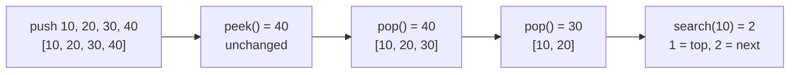
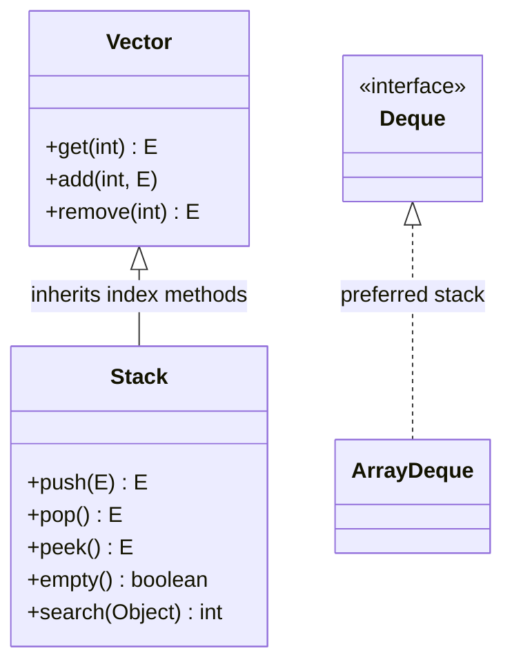

## In One Line
A **stack** is a **LIFO** (Last In, First Out) structure — you `push` onto the top, `peek` at the top and `pop` from the top; `java.util.Stack` is the legacy Java 1.0 class that implements it by **extending `Vector`**, and modern code uses `Deque<E> stack = new ArrayDeque<>()` instead.

## Mental Model
A **stack of plates** in a cafeteria.

- You put a clean plate **on top** (`push`).
- You look at the top plate without taking it (`peek`).
- You take the **top** plate (`pop`) — always the one put there last. The plate at the bottom waits the longest.
- "How far down is the blue plate?" — count from the top, starting at **1** (`search`).
- Trying to take a plate from an empty stack is an error (`EmptyStackException`).

Now the flaw of `java.util.Stack`: imagine the plate stack is secretly an **open shelf** (`Vector`). Anyone can pull a plate out of the middle or slide one in at the bottom — the "only touch the top" rule is not enforced. That is what inheriting from `Vector` does to `Stack`.

## Concept
### LIFO in one picture
```text
push(10) push(20) push(30) push(40)      pop() -> 40     pop() -> 30

  | 40 |  <- top                          | 30 | <- top    
  | 30 |                                  | 20 |            | 20 | <- top
  | 20 |                                  | 10 |            | 10 |
  | 10 |                                                    
```

### `java.util.Stack` API
```java
public class Stack<E> extends Vector<E>
```
| Method | Does | Empty stack |
|---|---|---|
| `E push(E item)` | adds on top, **returns the item** | — |
| `E pop()` | removes and returns the top | throws `EmptyStackException` |
| `E peek()` | returns the top without removing | throws `EmptyStackException` |
| `boolean empty()` | `true` if no elements (`isEmpty()` from `Vector` does the same) | — |
| `int search(Object o)` | **1-based** distance from the top of the nearest match (using `equals`); `-1` if absent | returns `-1` |

How it is built on `Vector` (JDK source, simplified):
```java
public E push(E item)           { addElement(item); return item; }          // append at the end
public synchronized E peek()    { if (size() == 0) throw new EmptyStackException();
                                  return elementAt(size() - 1); }           // last element = top
public synchronized E pop()     { E obj = peek(); removeElementAt(size() - 1); return obj; }
public synchronized int search(Object o) { int i = lastIndexOf(o);
                                  return i >= 0 ? size() - i : -1; }
```
- The **top is the end** of the internal array (index `size() - 1`), so `push`/`pop`/`peek` are O(1) (push is amortised: the array doubles when full, like `Vector`).
- `search` is O(n): `lastIndexOf` scans from the top.
- Every method is synchronized (inherited from `Vector` or declared on `Stack`).
- `EmptyStackException` is in `java.util` and is **unchecked** (extends `RuntimeException`).
- `toString()` and iteration come from `Vector`: **bottom → top**, e.g. `[10, 20, 30, 40]` with 40 on top.

### Why `Stack` is considered broken design
1. **It extends `Vector`** — "a stack *is-a* vector" is false. A stack should allow only top operations, but `Stack` inherits `add(int, E)`, `get(int)`, `remove(int)`, `insertElementAt`, `set` ... so any caller can break LIFO. This is the textbook example of *favour composition over inheritance* (Effective Java) and a Liskov-substitution smell.
2. **Every method is synchronized** — overhead in the usual single-threaded case, and still not safe for compound actions like `if (!s.empty()) s.pop()`.
3. **Iteration order is bottom-to-top**, the opposite of how you think about a stack.
4. The JDK itself says: *"A more complete and consistent set of LIFO stack operations is provided by the `Deque` interface and its implementations, which should be used in preference to this class."*

### The modern stack: `Deque`
```java
Deque<Integer> stack = new ArrayDeque<>();
stack.push(10);          // addFirst
stack.peek();            // peekFirst  -> null if empty
stack.pop();             // removeFirst -> NoSuchElementException if empty
stack.isEmpty();
```
| | `Stack` | `ArrayDeque` via `Deque` |
|---|---|---|
| Since | Java 1.0 | Java 6 |
| Built on | extends `Vector` (array, top = end) | circular array (top = head) |
| Thread-safe | synchronized methods | no (use `ConcurrentLinkedDeque` / `LinkedBlockingDeque` if needed) |
| Empty `pop()` | `EmptyStackException` | `NoSuchElementException` |
| Empty `peek()` | `EmptyStackException` | returns `null` |
| `null` elements | allowed | **not allowed** (`NullPointerException`) |
| `toString()`/iteration | bottom → top `[10, 20, 30]` | top → bottom `[30, 20, 10]` |
| Index access | yes (`get(i)`) — breaks LIFO | no |
| `search(o)` | yes | no (use `contains`, or iterate) |
| Speed | slower (locks, legacy growth) | faster |

Use `ArrayDeque` by default; `LinkedList` also implements `Deque` if you need `null` elements.

### Where stacks are used
- **Undo/redo**, browser back button.
- **Balanced brackets**, expression parsing, **postfix (RPN) evaluation**, infix → postfix (shunting-yard).
- **Depth-first search** and backtracking (iterative DFS replaces recursion with an explicit stack).
- **Monotonic stack** problems (next greater element, largest rectangle in a histogram, daily temperatures).
- **Reversing** a sequence: push everything, pop everything.
- The JVM itself keeps a **call stack** per thread (frames for method calls) — conceptually the same LIFO idea, but unrelated to `java.util.Stack`. Too-deep recursion overflows it: `StackOverflowError`.

## Diagram

The example's journey: the top is the right end of the printed list, `pop` removes from there, and `search` counts from the top starting at 1.


`Stack` inherits every `Vector` method, so callers can bypass LIFO; `ArrayDeque` exposes only deque operations through the `Deque` interface.

## Code
@example Collections/Stack/StackExample.java

`Stack` vs `ArrayDeque` — same pushes, opposite printing order:
```java
Stack<Integer> stack = new Stack<>();
Deque<Integer> deque = new ArrayDeque<>();
for (int n : new int[]{10, 20, 30}) {
    stack.push(n);
    deque.push(n);
}
System.out.println("Stack      toString: " + stack);   // bottom -> top
System.out.println("ArrayDeque toString: " + deque);   // top -> bottom
System.out.println("peek: " + stack.peek() + " vs " + deque.peek());
System.out.println("pop:  " + stack.pop() + " vs " + deque.pop());
```
```output
Stack      toString: [10, 20, 30]
ArrayDeque toString: [30, 20, 10]
peek: 30 vs 30
pop:  30 vs 30
```

What happens on an empty stack:
```java
Stack<String> stack = new Stack<>();
try { stack.pop(); } catch (EmptyStackException e) { System.out.println("Stack.pop()  -> " + e.getClass().getName()); }
try { stack.peek(); } catch (EmptyStackException e) { System.out.println("Stack.peek() -> " + e.getClass().getName()); }

Deque<String> deque = new ArrayDeque<>();
try { deque.pop(); } catch (NoSuchElementException e) { System.out.println("Deque.pop()  -> " + e.getClass().getName()); }
System.out.println("Deque.peek() -> " + deque.peek());
System.out.println("empty()=" + stack.empty() + " isEmpty()=" + stack.isEmpty());
```
```output
Stack.pop()  -> java.util.EmptyStackException
Stack.peek() -> java.util.EmptyStackException
Deque.pop()  -> java.util.NoSuchElementException
Deque.peek() -> null
empty()=true isEmpty()=true
```

Inherited `Vector` methods break LIFO:
```java
Stack<String> stack = new Stack<>();
stack.push("A");
stack.push("B");
stack.push("C");
stack.add(0, "Z");        // inherited from Vector: insert at the BOTTOM
stack.remove(1);          // inherited: remove from the middle
System.out.println(stack + " get(0)=" + stack.get(0) + " peek=" + stack.peek());
```
```output
[Z, B, C] get(0)=Z peek=C
```

`search` counts from the top, starting at 1, and finds the occurrence nearest the top; `push` returns its argument:
```java
Stack<String> s = new Stack<>();
s.push("a"); s.push("b"); s.push("a"); s.push("c");   // top is "c"
System.out.println(s + " search(c)=" + s.search("c") + " search(a)=" + s.search("a")
        + " search(b)=" + s.search("b") + " search(x)=" + s.search("x"));
System.out.println("push returns: " + s.push("d"));
```
```output
[a, b, a, c] search(c)=1 search(a)=2 search(b)=3 search(x)=-1
push returns: d
```

A classic stack problem — balanced brackets — written with the modern `Deque`:
```java
static boolean isBalanced(String s) {
    Deque<Character> stack = new ArrayDeque<>();
    for (char ch : s.toCharArray()) {
        switch (ch) {
            case '(', '[', '{' -> stack.push(ch);
            case ')', ']', '}' -> {
                if (stack.isEmpty()) return false;
                char open = stack.pop();
                if ((ch == ')' && open != '(') || (ch == ']' && open != '[') || (ch == '}' && open != '{')) return false;
            }
            default -> { }
        }
    }
    return stack.isEmpty();
}
// for "{[()]}", "([)]", "((", "a(b)c":
```
```output
{[()]} -> true
([)] -> false
(( -> false
a(b)c -> true
```

## Walkthrough
- `package Collections.Stack;` and `import java.util.Stack;` — note that the package's last segment has the same name as the class it imports; legal, but confusing (see Traps).
- `Stack<Integer> stack = new Stack<>();` — the no-arg constructor creates an empty `Vector` with capacity 10 underneath.
- `stack.push(10)` ... `stack.push(40)` — each `int` is autoboxed to `Integer` and appended at the end of the internal array via `addElement`. The end of the array is the **top**. `push` returns the pushed item (ignored here).
- `System.out.println("Stack: " + stack);` — `toString()` is `Vector`'s, printing from index 0 (bottom) to the top: `[10, 20, 30, 40]`. Read it as "top is on the right".
- `stack.peek()` — returns the element at index `size() - 1` without removing it: `40`.
- `stack.pop()` twice — each returns and removes the top: `40`, then `30`. Because both calls are inside string concatenations, each result is printed on its own line.
- `"Stack after popping elements: " + stack` → `[10, 20]`.
- `if (stack.isEmpty()) ... else ...` — `isEmpty()` comes from `Vector` (the `Stack`-specific `empty()` does the same). Two elements remain, so it prints `The stack is not empty.`
- `int position = stack.search(10);` — `10` is autoboxed; `search` calls `lastIndexOf(10)`, which finds index 0, and returns `size() - 0 = 2`. Position 1 would be the top (`20`); `10` is second from the top, so `2`. If the element were missing, `search` would return `-1`, which is exactly what the `if (position != -1)` check guards.
- Output: `Element 10 found at position: 2`. All `// Output:` comments match the recorded run.

## Traps
> [!ERRATA] Outdated API: the example teaches `java.util.Stack`, whose own Javadoc recommends the `Deque` interface instead. The same program in modern Java is `Deque<Integer> stack = new ArrayDeque<>();` with `push`/`peek`/`pop`/`isEmpty` — but note two behaviour changes: `System.out.println(stack)` would print `[40, 30, 20, 10]` (top first), and `Deque` has no `search` method. Also, the package name `Collections.Stack` uses capitals and repeats the class name `Stack`; packages should be lowercase (for example `collections.stack`).

- **`search` is 1-based from the top**, not a 0-based index from the bottom. `search(top)` is 1.
- **Empty `pop`/`peek` throw `EmptyStackException`** — check `empty()`/`isEmpty()` first. With `ArrayDeque`, `pop` throws `NoSuchElementException` but `peek` returns `null`.
- **Printed order differs**: `Stack` prints bottom → top, `ArrayDeque` prints top → bottom. For-each loops follow the same orders.
- **Inherited methods break LIFO**: `add(0, x)`, `get(i)`, `remove(i)`, `set(i, x)` all compile on a `Stack`.
- **Compound actions are not atomic** despite synchronization: `if (!stack.empty()) stack.pop();` can still throw if another thread pops in between.
- **`ArrayDeque` rejects `null`** — code that pushed `null` onto a `Stack` breaks when migrated.
- **Autoboxing in `search`**: `search(10)` boxes the `int`, and comparison uses `equals`, so `search(10L)` on a `Stack<Integer>` returns `-1` (a `Long` never equals an `Integer`).

## Tips & Tricks
- **LIFO = "Last In, First Out" = plates.** FIFO = queue = people in line.
- **Stack vocabulary:** `push` (put), `pop` (take), `peek` (look). `Deque` uses the same three names, so migrating is easy.
- **Default choice:** `Deque<T> stack = new ArrayDeque<>();` — declare as `Deque` so only deque methods are visible.
- **"When I see nested/matching things, I think stack":** brackets, tags, undo, recursion → iteration, DFS.
- **Reverse anything:** push all, pop all. Example: pushing the characters of `"JAVA"` into an `ArrayDeque` and popping them all gives `AVAJ`.
- **Min-stack trick:** keep a second stack of "current minimum" values to answer `min()` in O(1).
- **Interview line:** "I'd use `ArrayDeque` as a stack: `java.util.Stack` extends `Vector`, so it's synchronized and exposes index methods that break LIFO."

## Interview Q&A
### [Basic] What is a stack, and what methods does `java.util.Stack` provide?
A stack is a LIFO collection: the last element added is the first one removed. `java.util.Stack<E>` (Java 1.0) extends `Vector<E>` and adds five methods: `push(E)` adds on top and returns the item; `pop()` removes and returns the top; `peek()` returns the top without removing it; `empty()` tests for emptiness; and `search(Object)` returns the 1-based position from the top, or -1. `pop` and `peek` throw `EmptyStackException` on an empty stack. Internally the top is the last element of the vector's array, so push/pop/peek are O(1).

**Follow-up:** *Is `EmptyStackException` checked?* — No, it extends `RuntimeException`.

### [Basic] What does `search()` return?
The distance from the top of the stack to the **nearest** occurrence of the object, counting the top as **1**. It uses `lastIndexOf(o)` (which compares with `equals`) and returns `size() - index`, or `-1` if the object is not present. For the stack `[10, 20]` (20 on top), `search(20)` is 1 and `search(10)` is 2.

**Follow-up:** *Complexity?* — O(n), because `lastIndexOf` scans the array.

### [Intermediate] Why is `java.util.Stack` not recommended?
Three reasons. (1) **Bad inheritance**: it extends `Vector`, so it inherits index-based methods (`add(int, E)`, `get`, `remove(int)`, `set`) that let anyone violate LIFO; a stack *has-a* storage, it is not *a* vector — composition would have been correct. (2) **Unneeded synchronization**: every method locks, which costs time in single-threaded code and still does not make compound actions safe. (3) **Surprising iteration order** (bottom to top). The Javadoc itself recommends `Deque` implementations such as `ArrayDeque`.

**Follow-up:** *What principle does this violate?* — "Favour composition over inheritance"; it also leaks implementation details, breaking encapsulation of the LIFO abstraction.

### [Intermediate] What are the differences between `Stack` and `ArrayDeque` used as a stack?
`ArrayDeque` is not synchronized and is faster; it stores elements in a circular array with the top at the head. Behaviour differences: on an empty deque `pop()` throws `NoSuchElementException` (not `EmptyStackException`) and `peek()` returns `null` instead of throwing; `ArrayDeque` rejects `null` elements; its `toString()`/iterator go top → bottom while `Stack` goes bottom → top; and it has no `search` or index methods. For concurrent use there are `ConcurrentLinkedDeque` and `LinkedBlockingDeque`.

**Follow-up:** *Why declare the variable as `Deque` and not `ArrayDeque`?* — So the code depends only on the interface and could switch to `LinkedList` or a concurrent deque without changes.

### [Intermediate] Check whether a string of brackets is balanced.
Push every opening bracket; on a closing bracket, the stack must be non-empty and its popped top must be the matching opener; at the end the stack must be empty.
```java
static boolean isBalanced(String s) {
    Deque<Character> stack = new ArrayDeque<>();
    for (char ch : s.toCharArray()) {
        switch (ch) {
            case '(', '[', '{' -> stack.push(ch);
            case ')', ']', '}' -> {
                if (stack.isEmpty()) return false;
                char open = stack.pop();
                if ((ch == ')' && open != '(') || (ch == ']' && open != '[') || (ch == '}' && open != '{')) return false;
            }
            default -> { }
        }
    }
    return stack.isEmpty();
}
```
It returns `true` for `{[()]}` and `a(b)c`, and `false` for `([)]` and `((`. O(n) time, O(n) space.

**Follow-up:** *Why check `isEmpty()` before popping?* — For input like `")("`, a closing bracket arrives first; popping an empty `ArrayDeque` would throw `NoSuchElementException`.

### [Intermediate] Design a stack that returns its minimum in O(1).
Keep two stacks: one for values and one where each entry is the minimum of all values at or below that level. Push onto both (the min stack gets `min(x, currentMin)`), pop from both, and `min()` is the top of the min stack.
```java
private final Deque<Integer> values = new ArrayDeque<>();
private final Deque<Integer> mins = new ArrayDeque<>();   // top = minimum of everything below

void push(int x) {
    values.push(x);
    mins.push(mins.isEmpty() ? x : Math.min(x, mins.peek()));
}
int pop() { mins.pop(); return values.pop(); }
int min() { return mins.peek(); }
// push 5, 3, 7, 2 -> min 2; pop -> min 3; pop twice more -> min 5
```
```output
min=2
after pop, min=3
after two more pops, min=5
```
All operations are O(1); extra space is O(n).

**Follow-up:** *Can you save space?* — Push onto the min stack only when `x <= currentMin`, and pop from it only when the popped value equals its top.

### [Advanced] Evaluate a postfix (Reverse Polish) expression.
Scan tokens left to right: push numbers; for an operator, pop the right operand, then the left one, apply the operator and push the result. The final stack holds the answer.
```java
static int eval(String expr) {
    Deque<Integer> stack = new ArrayDeque<>();
    for (String tok : expr.split(" ")) {
        switch (tok) {
            case "+" -> stack.push(stack.pop() + stack.pop());
            case "*" -> stack.push(stack.pop() * stack.pop());
            case "-" -> { int b = stack.pop(), a = stack.pop(); stack.push(a - b); }
            default -> stack.push(Integer.parseInt(tok));
        }
    }
    return stack.pop();
}
// eval("3 4 + 2 *") and eval("10 2 3 * -")
```
```output
14
4
```
The order of pops matters for non-commutative operators: the first pop is the **right** operand.

**Follow-up:** *How do you convert infix to postfix?* — Dijkstra's shunting-yard algorithm, which uses a stack of operators ordered by precedence.

### [Advanced] How is `java.util.Stack` related to the JVM stack and `StackOverflowError`?
Only by name and idea. The JVM gives every thread its own **call stack** of frames (local variables, operand stack, return address); each method call pushes a frame and each return pops it. If recursion goes too deep, the thread's stack runs out of space and the JVM throws `StackOverflowError` (an `Error`, not an exception you should catch). `java.util.Stack` is an ordinary heap object; filling it only consumes heap and could eventually cause `OutOfMemoryError`. Converting deep recursion to an explicit `ArrayDeque` stack is a standard fix for `StackOverflowError`.

**Follow-up:** *How do you change the thread stack size?* — With the `-Xss` JVM option, or the `stackSize` argument of the `Thread` constructor.

## Quiz
### What does `stack.search(10)` return in the original example, when the stack is `[10, 20]`?
- [ ] 0
- [ ] 1
- [x] 2
- [ ] -1
> `search` counts from the top starting at 1. The top is `20` (position 1), so `10` is at position 2. `0` would be a zero-based index from the bottom, which `search` never returns.

### What does this print?
```java
Stack<Integer> s = new Stack<>();
s.push(1); s.push(2); s.push(3);
s.pop();
s.push(4);
System.out.println(s + " " + s.peek() + " " + s.search(1));
```
- [ ] [4, 2, 1] 4 3
- [x] [1, 2, 4] 4 3
- [ ] [1, 2, 4] 4 1
- [ ] [1, 2, 3, 4] 4 4
> `pop` removes 3, then `push(4)` → `[1, 2, 4]` printed bottom to top. `peek` is 4. `1` is at the bottom of three elements, so `search(1)` is 3. `[4, 2, 1]` is how an `ArrayDeque` would print.

### Same pushes, what does this print?
```java
Deque<Integer> d = new ArrayDeque<>();
d.push(10); d.push(20); d.push(30);
System.out.println(d);
```
- [ ] [10, 20, 30]
- [x] [30, 20, 10]
- [ ] [30]
- [ ] [10]
> `Deque.push` is `addFirst`, and `toString` iterates from the head, so the top comes first. `java.util.Stack` would print `[10, 20, 30]`.

### What happens when you call `pop()` on an empty `java.util.Stack`?
- [ ] Returns `null`
- [ ] Throws `NoSuchElementException`
- [x] Throws `EmptyStackException`
- [ ] Throws `ArrayIndexOutOfBoundsException`
> `Stack.pop()` calls `peek()`, which throws `java.util.EmptyStackException` when the size is 0. `NoSuchElementException` is what `ArrayDeque.pop()` throws.

### What does this print?
```java
Stack<String> stack = new Stack<>();
stack.push("A"); stack.push("B"); stack.push("C");
stack.add(0, "Z");
stack.remove(1);
System.out.println(stack + " peek=" + stack.peek());
```
- [ ] Compile error: Stack has no add(int, E)
- [ ] [A, B, C] peek=C
- [x] [Z, B, C] peek=C
- [ ] [Z, A, B] peek=B
> `Stack` inherits `add(int, E)` and `remove(int)` from `Vector`. `add(0, "Z")` gives `[Z, A, B, C]`; `remove(1)` deletes `A` → `[Z, B, C]`. It compiles — which is exactly the design flaw.

### Which is the recommended replacement for `java.util.Stack`?
- [ ] `Vector`
- [ ] `PriorityQueue`
- [x] `ArrayDeque` used through the `Deque` interface
- [ ] `TreeSet`
> The `Stack` Javadoc recommends `Deque` implementations; `ArrayDeque` is the fast default. `Vector` is `Stack`'s legacy parent, and `PriorityQueue` orders by priority, not LIFO.

## Takeaways
- A stack is LIFO: `push` onto the top, `pop` and `peek` from the top.
- `java.util.Stack` extends `Vector`: top = end of the array, O(1) push/pop/peek, synchronized, and it prints/iterates bottom → top.
- `pop()`/`peek()` on an empty `Stack` throw the unchecked `EmptyStackException`; `search(o)` is 1-based from the top and returns -1 if absent.
- Inheriting from `Vector` exposes `add(i, e)`, `get(i)`, `remove(i)` — a classic "composition over inheritance" mistake.
- Use `Deque<E> stack = new ArrayDeque<>()` instead: faster, no `null`, `pop` throws `NoSuchElementException`, `peek` returns `null`, prints top → bottom.
- Typical uses: bracket matching, expression evaluation, undo, DFS/backtracking, reversing, monotonic-stack problems.
