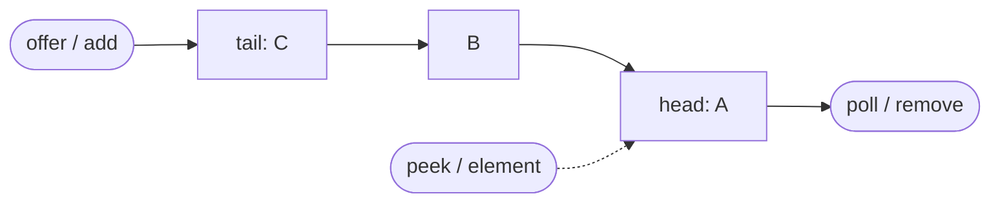
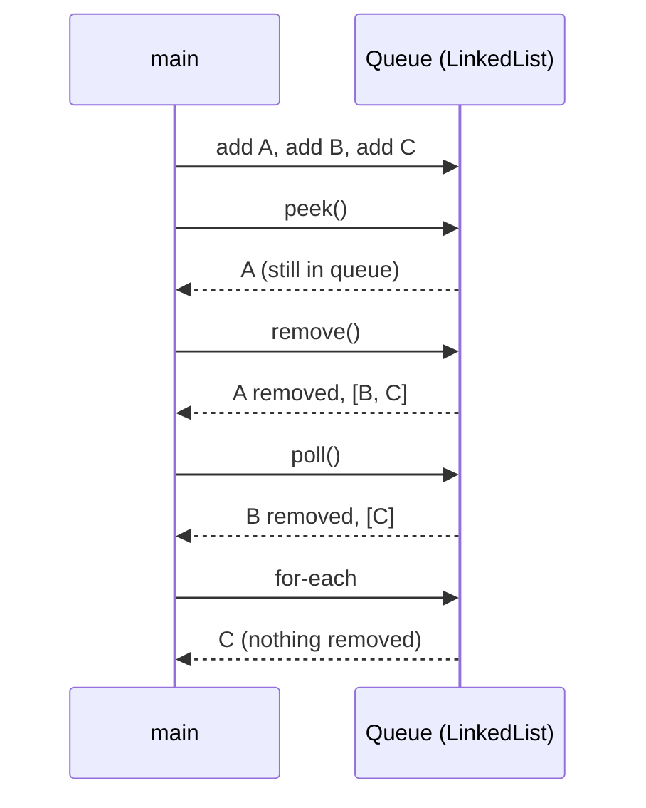
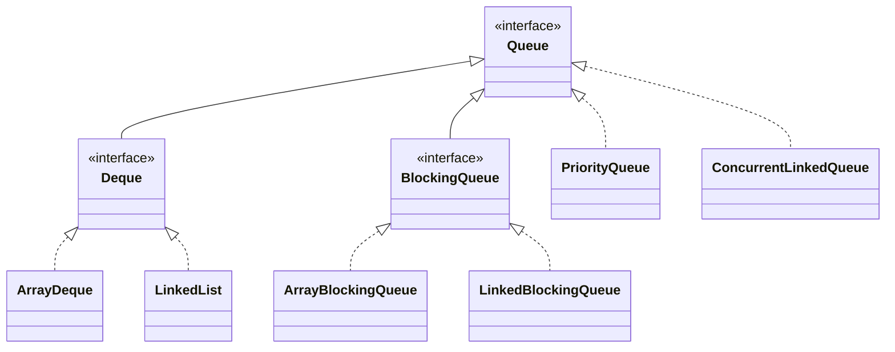

## In One Line
`Queue<E>` is the interface for collections that **hold elements waiting to be processed**, usually in **FIFO** (First In, First Out) order: you add at the **tail** with `offer`/`add` and take from the **head** with `poll`/`remove`, looking with `peek`/`element` — each operation in a throwing and a non-throwing version.

## Mental Model
A **ticket counter line**.

- New people join at the **back** (tail) — `offer(e)`.
- The person at the **front** (head) is served and leaves — `poll()`.
- You can see who is at the front without serving them — `peek()`.
- Walking along the line to look at everyone (`for (String s : queue)`) does not serve anybody — iteration does not remove.
- If the line is **roped off at a maximum length** (a bounded queue), a newcomer is either politely turned away (`offer` returns `false`) or causes a scene (`add` throws `IllegalStateException`).
- If nobody is waiting, a clerk calling "next!" either gets silence (`poll` returns `null`) or complains (`remove` throws `NoSuchElementException`).

## Concept
### The Queue interface (Java 5)
```java
public interface Queue<E> extends Collection<E> {
    boolean add(E e);      // insert, throws IllegalStateException if no space
    boolean offer(E e);    // insert, returns false if no space
    E remove();            // remove head, throws NoSuchElementException if empty
    E poll();              // remove head, returns null if empty
    E element();           // examine head, throws NoSuchElementException if empty
    E peek();              // examine head, returns null if empty
}
```
The six methods form a 3 × 2 table — memorise it:

| | Throws an exception | Returns a special value |
|---|---|---|
| **Insert** (at tail) | `add(e)` → `IllegalStateException` | `offer(e)` → `false` |
| **Remove** (head) | `remove()` → `NoSuchElementException` | `poll()` → `null` |
| **Examine** (head) | `element()` → `NoSuchElementException` | `peek()` → `null` |

- For **unbounded** queues (`LinkedList`, `ArrayDeque`, `PriorityQueue`) `add` and `offer` behave the same: there is always space.
- The difference shows in **capacity-restricted** queues such as `ArrayBlockingQueue`: `offer` is the preferred insert because a full queue is a normal situation, not an error.
- `remove()` with **no argument** removes the head; `remove(Object o)` (inherited from `Collection`) removes a specific element anywhere in the queue.
- Iteration (`for`, `iterator()`, `toString()`) goes from head to tail for FIFO queues and **does not remove** anything.

### "Usually FIFO"
The interface only says elements are ordered *somehow*; each implementation defines the order:
- **FIFO**: `LinkedList`, `ArrayDeque`, `ConcurrentLinkedQueue`, `ArrayBlockingQueue`, `LinkedBlockingQueue`.
- **Priority order**: `PriorityQueue`, `PriorityBlockingQueue` — head is the smallest element (see [PriorityQueue](lesson:a03-collections/07-priority-queue)).
- **LIFO**: a `Deque` used with `push`/`pop` (see [Deque](lesson:a03-collections/08-deque)).
- **By delay**: `DelayQueue` — an element can be taken only after its delay expires.

### Implementations
| Class | Structure | Bounded? | Thread-safe? | `null`? | Notes |
|---|---|---|---|---|---|
| `ArrayDeque` | circular array | no | no | no | **default choice** for a single-threaded FIFO queue |
| `LinkedList` | doubly linked nodes | no | no | **yes** | also a `List`; one node per element |
| `PriorityQueue` | binary heap | no | no | no | head = smallest by `Comparable`/`Comparator` |
| `ConcurrentLinkedQueue` | lock-free linked nodes | no | yes (non-blocking) | no | high-throughput concurrent FIFO |
| `ArrayBlockingQueue` | array | **yes** (fixed) | yes (one lock) | no | classic bounded producer/consumer buffer |
| `LinkedBlockingQueue` | linked nodes | optional (default `Integer.MAX_VALUE`) | yes (separate put/take locks) | no | used by `Executors.newFixedThreadPool` |
| `PriorityBlockingQueue` | heap | no | yes | no | concurrent priority queue |
| `DelayQueue`, `SynchronousQueue`, `LinkedTransferQueue` | special | — | yes | no | scheduling, direct hand-off, transfer |

### BlockingQueue: two more columns
`java.util.concurrent.BlockingQueue` adds methods that **wait**:

| | Throws | Special value | **Blocks** | **Times out** |
|---|---|---|---|---|
| Insert | `add(e)` | `offer(e)` | `put(e)` | `offer(e, time, unit)` |
| Remove | `remove()` | `poll()` | `take()` | `poll(time, unit)` |
| Examine | `element()` | `peek()` | — | — |

This is the backbone of the **producer–consumer** pattern: producers `put`, consumers `take`, and the queue handles all waiting and signalling. Details in [BlockingQueue and concurrent collections](lesson:b03-concurrency/04-blockingqueue-and-concurrent-collections).

### Why queues should not contain `null`
`poll()` and `peek()` use `null` to mean "empty". If `null` were a legal element, a `null` result would be ambiguous. That is why the `Queue` Javadoc says implementations *generally* do not allow `null` — `ArrayDeque`, `PriorityQueue` and all concurrent queues throw `NullPointerException` — while `LinkedList` is the historical exception.

### Complexity
| Operation | `ArrayDeque` / `LinkedList` | `PriorityQueue` |
|---|---|---|
| `offer` / `add` | O(1) (amortised for `ArrayDeque`) | O(log n) |
| `poll` / `remove()` | O(1) | O(log n) |
| `peek` / `element` | O(1) | O(1) |
| `contains`, `remove(Object)` | O(n) | O(n) |

### Where queues are used
- **Breadth-first search** (BFS) and level-order tree traversal.
- **Task/job scheduling**, print spoolers, message buffers.
- **Producer–consumer** between threads (`BlockingQueue`), thread-pool work queues.
- **Rate limiting / sliding windows** (keep timestamps, drop the old ones from the head).
- **Caching** order (FIFO eviction).

### Programming to the `Queue` interface
Declaring `Queue<String> queue = new LinkedList<>();` hides every `List` method of `LinkedList`: `queue.get(0)` does **not compile** (`cannot find symbol ... method get(int) ... variable queue of type Queue<String>`). That is a feature — it keeps the code honest about using the collection as a queue, and lets you switch to `ArrayDeque` by changing one word.

## Diagram

Elements enter at the tail and leave from the head in arrival order; `peek` only looks at the head.


The example's calls in order: `peek` looks, `remove` and `poll` both take the head, iteration only reads.


The queue family: `Deque` adds the second end, `BlockingQueue` adds waiting; `LinkedList` becomes a queue through `Deque`.

## Code
@example Collections/Queues/QueueExample.java

The throwing and non-throwing methods on an empty queue:
```java
Queue<String> q = new ArrayDeque<>();
System.out.println("poll()  on empty -> " + q.poll());
System.out.println("peek()  on empty -> " + q.peek());
try { q.remove(); }  catch (NoSuchElementException e) { System.out.println("remove() on empty -> NoSuchElementException"); }
try { q.element(); } catch (NoSuchElementException e) { System.out.println("element() on empty -> NoSuchElementException"); }
```
```output
poll()  on empty -> null
peek()  on empty -> null
remove() on empty -> NoSuchElementException
element() on empty -> NoSuchElementException
```

`offer` vs `add` on a full bounded queue:
```java
Queue<String> q = new ArrayBlockingQueue<>(2);   // capacity 2
System.out.println(q.offer("A") + " " + q.offer("B") + " " + q.offer("C"));
try {
    q.add("C");
} catch (IllegalStateException e) {
    System.out.println("add -> IllegalStateException: " + e.getMessage());
}
System.out.println(q);
```
```output
true true false
add -> IllegalStateException: Queue full
[A, B]
```

Why `null` in a queue is a bad idea:
```java
Queue<String> linked = new LinkedList<>();
linked.offer(null);                               // allowed, but...
System.out.println("size=" + linked.size() + ", poll()=" + linked.poll() + " (element or empty?)");

Queue<String> array = new ArrayDeque<>();
try {
    array.offer(null);
} catch (NullPointerException e) {
    System.out.println("ArrayDeque.offer(null) -> NullPointerException");
}
```
```output
size=1, poll()=null (element or empty?)
ArrayDeque.offer(null) -> NullPointerException
```

The idiomatic "drain" loop — `poll` until `null`:
```java
Queue<String> printJobs = new ArrayDeque<>(List.of("report.pdf", "photo.png", "notes.txt"));
String job;
while ((job = printJobs.poll()) != null) {
    System.out.println("printing " + job);
}
System.out.println("queue empty? " + printJobs.isEmpty());
```
```output
printing report.pdf
printing photo.png
printing notes.txt
queue empty? true
```

Breadth-first search — the queue's signature algorithm:
```java
Map<String, List<String>> graph = Map.of(
        "A", List.of("B", "C"),
        "B", List.of("D"),
        "C", List.of("D", "E"),
        "D", List.of(),
        "E", List.of());

Queue<String> queue = new ArrayDeque<>();
Set<String> seen = new HashSet<>();
queue.offer("A");
seen.add("A");
List<String> order = new ArrayList<>();
while (!queue.isEmpty()) {
    String node = queue.poll();          // take from the head
    order.add(node);
    for (String next : graph.get(node)) {
        if (seen.add(next)) queue.offer(next);   // join at the tail
    }
}
System.out.println("BFS order: " + order);
```
```output
BFS order: [A, B, C, D, E]
```

## Walkthrough
- `package Collections.Queues;`, `import java.util.LinkedList;`, `import java.util.Queue;` — `Queue` is an interface in `java.util`; `LinkedList` is one of its implementations (through `Deque`).
- `Queue<String> queue = new LinkedList<>();` — the variable's type is the **interface**, so only `Queue`/`Collection` methods are visible; the object is a `LinkedList` whose head is `first` and tail is `last`.
- `queue.add("A"); add("B"); add("C");` — each appends at the tail (`linkLast`). For an unbounded queue `add` always returns `true`; `offer` would behave identically here.
- `System.out.println("Queue: " + queue);` — `toString()` walks head → tail: `[A, B, C]`.
- `queue.peek()` — returns the head `A` **without removing it**. On an empty queue it would return `null`.
- `queue.remove();` — the no-argument `remove()` from `Queue`: removes and returns the head (`A`); the return value is ignored. On an empty queue it would throw `NoSuchElementException`. Result: `[B, C]`.
- `String polledElement = queue.poll();` — also removes and returns the head, here `B`, but would return `null` on an empty queue. The example uses both so you can compare them. Result `[C]`.
- `for (String element : queue) System.out.println(element);` — iterates head → tail and prints `C`; the queue is unchanged afterwards (size still 1).
- All `// Output:` comments match the recorded run.

## Traps
> [!NOTE] The example is correct and its output comments match. Two style notes: `ArrayDeque` is the usual choice for a plain FIFO queue (its Javadoc says it is likely faster than `LinkedList` used as a queue, and it rejects `null`), and the package name `Collections.Queues` breaks the lowercase package convention.

- **`remove()` vs `remove(Object)`** — no argument removes the head; with an argument it removes that element wherever it is (O(n)).
- **`poll()` returning `null` is ambiguous** if the queue can contain `null` (only possible with `LinkedList`).
- **`add` on a full bounded queue throws** `IllegalStateException: Queue full`; use `offer` (or `put` to wait).
- **Iterating does not dequeue.** To process and remove, use `while ((x = q.poll()) != null)` or `while (!q.isEmpty())`.
- **`PriorityQueue` is a `Queue` but not FIFO**, and its `toString()` is not sorted.
- **Queues do not have index access**: `queue.get(0)` does not compile through a `Queue` reference.
- **`equals` is not content-based for most queues.** `ArrayDeque`, `PriorityQueue` and the concurrent queues inherit `Object.equals` (identity): two `ArrayDeque`s holding `[1, 2]` are not `equals`. `LinkedList` is equal by content only because it is a `List`. Compare contents with `new ArrayList<>(q1).equals(new ArrayList<>(q2))`.
- **Concurrent use of `ArrayDeque`/`LinkedList`** is unsafe — use `ConcurrentLinkedQueue` or a `BlockingQueue`.

## Tips & Tricks
- **The 3 × 2 table:** rows *insert / remove / examine*, columns *throw / special value* → `add/offer`, `remove/poll`, `element/peek`. Mnemonic: "**O**ffer, **P**oll, **P**eek are **P**olite (they don't throw)."
- **Default FIFO queue:** `Queue<T> q = new ArrayDeque<>();`.
- **Across threads:** `BlockingQueue` with `put`/`take`; fixed memory → `ArrayBlockingQueue`.
- **BFS template:** offer the start, mark it seen; while not empty: poll, visit, offer unseen neighbours (mark them seen **when enqueuing**, not when polling, to avoid duplicates).
- **"Level by level" BFS:** record `int size = queue.size()` at the start of each level and poll exactly that many.
- **Interview line:** "A queue is FIFO: offer at the tail, poll from the head, both O(1) with `ArrayDeque`; for threads I use a `BlockingQueue`."

## Interview Q&A
### [Basic] What is a Queue in Java?
`java.util.Queue<E>` (Java 5) is a sub-interface of `Collection` for holding elements before processing. Most implementations are FIFO — elements are added at the tail and removed from the head — but the interface allows other orders, such as priority order in `PriorityQueue`. It defines insert (`add`/`offer`), remove (`remove`/`poll`) and examine (`element`/`peek`) operations, each in an exception-throwing and a special-value form. Common implementations are `ArrayDeque`, `LinkedList`, `PriorityQueue`, and the concurrent `ConcurrentLinkedQueue` and `BlockingQueue` classes.

**Follow-up:** *Is `Queue` a class?* — No, it is an interface; you instantiate an implementation such as `new ArrayDeque<>()`.

### [Basic] What is the difference between `offer` and `add`, `poll` and `remove`, `peek` and `element`?
They do the same job but differ in how they report failure. `add` throws `IllegalStateException` when a capacity-restricted queue is full, while `offer` returns `false`. `remove()` throws `NoSuchElementException` on an empty queue, while `poll()` returns `null`. `element()` throws `NoSuchElementException` on an empty queue, while `peek()` returns `null`. Use the special-value versions when "full" or "empty" is an expected situation, and the throwing ones when it would be a bug.

**Follow-up:** *Do `add` and `offer` differ for `LinkedList`?* — No; an unbounded queue always has space, so both return `true`.

### [Intermediate] Which Queue implementation would you choose, and why?
Single-threaded FIFO: `ArrayDeque` — circular array, O(1) at both ends, no per-element nodes, rejects `null`. Need ordering by priority: `PriorityQueue`. Need a queue that is also a `List` or holds `null`: `LinkedList`. Multiple threads: `ConcurrentLinkedQueue` for non-blocking high throughput; a `BlockingQueue` when consumers should wait for work or producers should wait for space — `ArrayBlockingQueue` for a fixed-size buffer, `LinkedBlockingQueue` for higher throughput with separate put/take locks. `DelayQueue` for scheduled items, `SynchronousQueue` for direct hand-off.

**Follow-up:** *Which queue does `Executors.newFixedThreadPool` use?* — An unbounded `LinkedBlockingQueue`, which is why an overloaded fixed pool can accumulate tasks until it runs out of memory.

### [Intermediate] Why do most Queue implementations reject `null`?
Because `null` is the "special value" returned by `poll()` and `peek()` to signal an empty queue. If `null` could be stored, you could not tell "the head is `null`" from "the queue is empty". So `ArrayDeque`, `PriorityQueue` and every `java.util.concurrent` queue throw `NullPointerException` on `offer(null)`. `LinkedList` allows it for historical reasons, and the `Queue` Javadoc advises not to insert `null` even there.

**Follow-up:** *How do you represent "no value" in a queue then?* — Use a sentinel object (for example a "poison pill" to stop a consumer) or `Optional`.

### [Intermediate] How does BFS use a queue?
BFS explores a graph level by level. Put the start node in a queue and mark it seen. Repeatedly `poll` the head, process it, and `offer` each unseen neighbour, marking it seen at the moment it is enqueued. Because the queue is FIFO, all nodes at distance k are processed before any node at distance k + 1, which is why BFS finds shortest paths in unweighted graphs. Time O(V + E), space O(V). In the lesson's graph, starting from `A` the order is `[A, B, C, D, E]`.

**Follow-up:** *What changes if you use a stack instead?* — You get depth-first order (DFS), and you lose the shortest-path guarantee.

### [Intermediate] What is a BlockingQueue, and how does it implement producer–consumer?
`BlockingQueue` extends `Queue` with `put(e)`, which waits while the queue is full, and `take()`, which waits while it is empty (plus timed `offer`/`poll`). Producers call `put`, consumers call `take`, and the queue handles all locking and signalling — no `wait`/`notify` code needed.
```java
BlockingQueue<String> queue = new ArrayBlockingQueue<>(2);   // bounded buffer
Thread producer = new Thread(() -> {
    try {
        for (String job : new String[]{"job-1", "job-2", "job-3", "STOP"}) queue.put(job);
    } catch (InterruptedException e) { Thread.currentThread().interrupt(); }
});
Thread consumer = new Thread(() -> {
    try {
        String job;
        while (!(job = queue.take()).equals("STOP")) System.out.println("consumed " + job);
    } catch (InterruptedException e) { Thread.currentThread().interrupt(); }
});
producer.start(); consumer.start();
producer.join(); consumer.join();
System.out.println("done, queue empty: " + queue.isEmpty());
```
```output
consumed job-1
consumed job-2
consumed job-3
done, queue empty: true
```
The `"STOP"` element is a **poison pill** that tells the consumer to finish. The bounded capacity (2) provides back-pressure: the producer waits when it gets ahead.

**Follow-up:** *`ArrayBlockingQueue` vs `LinkedBlockingQueue`?* — Array: fixed capacity, one lock for both ends, optional fairness. Linked: optionally bounded (default `Integer.MAX_VALUE`), separate put and take locks so producers and consumers do not block each other, but one node allocation per element.

### [Advanced] Implement a queue using two stacks.
Use an `in` stack for offers and an `out` stack for polls. When `out` is empty, pop everything from `in` onto `out`, which reverses the order so the oldest element ends up on top.
```java
static class StackQueue<E> {
    private final Deque<E> in = new ArrayDeque<>();    // receives offers
    private final Deque<E> out = new ArrayDeque<>();   // serves polls

    void offer(E e) { in.push(e); }

    E poll() {
        if (out.isEmpty()) {
            while (!in.isEmpty()) out.push(in.pop());   // reverse once: oldest ends on top
        }
        return out.poll();                               // null if both are empty
    }
}
// offer 1, 2, 3; poll; offer 4; poll four times
```
```output
1 2 3 4 null
```
Each element is moved from `in` to `out` at most once, so `offer` and `poll` are **amortised O(1)**, even though a single `poll` can be O(n).

**Follow-up:** *And a stack using queues?* — With one queue: after each `offer(x)`, rotate the previous `size - 1` elements from the head to the tail so `x` becomes the head; `push` is O(n), `pop` O(1).

### [Advanced] Does iterating over a Queue remove elements, and how do `equals`/`hashCode` behave for queues?
Iteration never removes: `for (x : queue)` and `toString()` just walk the elements (head to tail for FIFO queues, in arbitrary heap order for `PriorityQueue`). To consume, loop on `poll()`. As for equality, the `Queue` interface does not define content-based `equals`/`hashCode`, because for queues with different ordering policies "equal" is unclear. `ArrayDeque`, `PriorityQueue` and the concurrent queues use `Object`'s identity `equals`, so two deques with the same elements are not equal. `LinkedList` is equal by content only because it follows the `List` contract.

**Follow-up:** *How do you compare two queues' contents in order?* — Copy them into lists: `new ArrayList<>(q1).equals(new ArrayList<>(q2))`.

## Quiz
### What does the original example print after `queue.remove()`?
- [x] Queue after removing an element: [B, C]
- [ ] Queue after removing an element: [A, B]
- [ ] Queue after removing an element: [A, B, C]
- [ ] Compile error: remove needs an argument
> `Queue.remove()` with no argument removes the **head**, `A`. It compiles because `Queue` declares a no-argument `remove()` in addition to `Collection.remove(Object)`. `[A, B]` would be removing from the tail (stack behaviour).

### What does `poll()` return on an empty `ArrayDeque`?
- [ ] It throws `NoSuchElementException`
- [x] `null`
- [ ] `false`
- [ ] It blocks until an element arrives
> `poll` is the special-value version of `remove()`. The throwing version is `remove()`; blocking is `BlockingQueue.take()`.

### What does this print?
```java
Queue<Integer> q = new LinkedList<>();
q.offer(3); q.offer(1); q.offer(2);
q.poll();
q.offer(q.peek() * 10);
System.out.println(q + " " + q.size());
```
- [ ] [1, 2, 30] 3
- [x] [1, 2, 10] 3
- [ ] [3, 1, 2, 10] 4
- [ ] [2, 10] 2
> FIFO: `poll` removes `3` (the first in) → `[1, 2]`. `peek` is now `1`, so `10` is offered at the tail → `[1, 2, 10]`, size 3. Thinking `poll` removes the smallest or last element leads to wrong answers — this is not a `PriorityQueue`.

### What does this print?
```java
Queue<String> q = new ArrayBlockingQueue<>(2);
System.out.println(q.offer("A") + " " + q.offer("B") + " " + q.offer("C"));
```
- [x] true true false
- [ ] true true true
- [ ] true true, then IllegalStateException
- [ ] false false false
> The queue holds only 2 elements; the third `offer` returns `false` instead of throwing. `add("C")` would throw `IllegalStateException: Queue full`.

### Why does this not compile?
```java
Queue<String> queue = new LinkedList<>();
queue.add("A");
System.out.println(queue.get(0));
```
- [ ] `LinkedList` has no `get` method
- [x] The reference type `Queue` has no `get(int)` method
- [ ] `add` must be `offer` for a `Queue`
- [ ] Generic queues cannot hold `String`
> The compiler only allows methods of the declared type. `LinkedList` does have `get(int)`, but `Queue` does not: `cannot find symbol ... method get(int)`. `add` is a valid `Queue` method.

### What does this print?
```java
Queue<Integer> a = new ArrayDeque<>(List.of(1, 2));
Queue<Integer> b = new ArrayDeque<>(List.of(1, 2));
Queue<Integer> c = new LinkedList<>(List.of(1, 2));
Queue<Integer> d = new LinkedList<>(List.of(1, 2));
System.out.println(a.equals(b) + " " + c.equals(d));
```
- [ ] true true
- [x] false true
- [ ] false false
- [ ] true false
> `ArrayDeque` does not override `equals`, so it compares identity → `false`. `LinkedList` is a `List`, and lists compare element by element → `true`.

### Which of these queues does NOT give FIFO order?
- [ ] `ArrayDeque` used with `offer`/`poll`
- [ ] `LinkedBlockingQueue`
- [x] `PriorityQueue`
- [ ] `ConcurrentLinkedQueue`
> `PriorityQueue` always hands out the smallest element (by natural order or a comparator), regardless of arrival order. The others are FIFO.

## Takeaways
- `Queue<E>` (Java 5) holds elements for processing, usually FIFO: insert at the tail, remove/examine at the head.
- Six methods in a 3 × 2 table: `add`/`offer`, `remove`/`poll`, `element`/`peek` — the first of each pair throws, the second returns `false`/`null`.
- `offer` vs `add` only differ for bounded queues; `remove()` with no argument removes the head.
- Default single-threaded queue: `ArrayDeque`; priority: `PriorityQueue`; threads: `ConcurrentLinkedQueue` or a `BlockingQueue` with `put`/`take`.
- Avoid `null` in queues (only `LinkedList` allows it) because `poll`/`peek` use `null` for "empty".
- Iteration does not remove; drain with `while ((x = q.poll()) != null)`.
- Classic uses: BFS, scheduling, buffering, producer–consumer.
