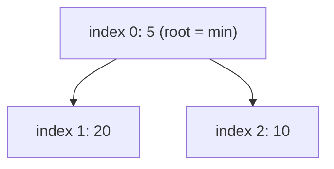
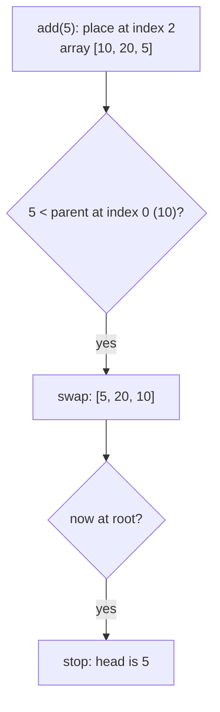
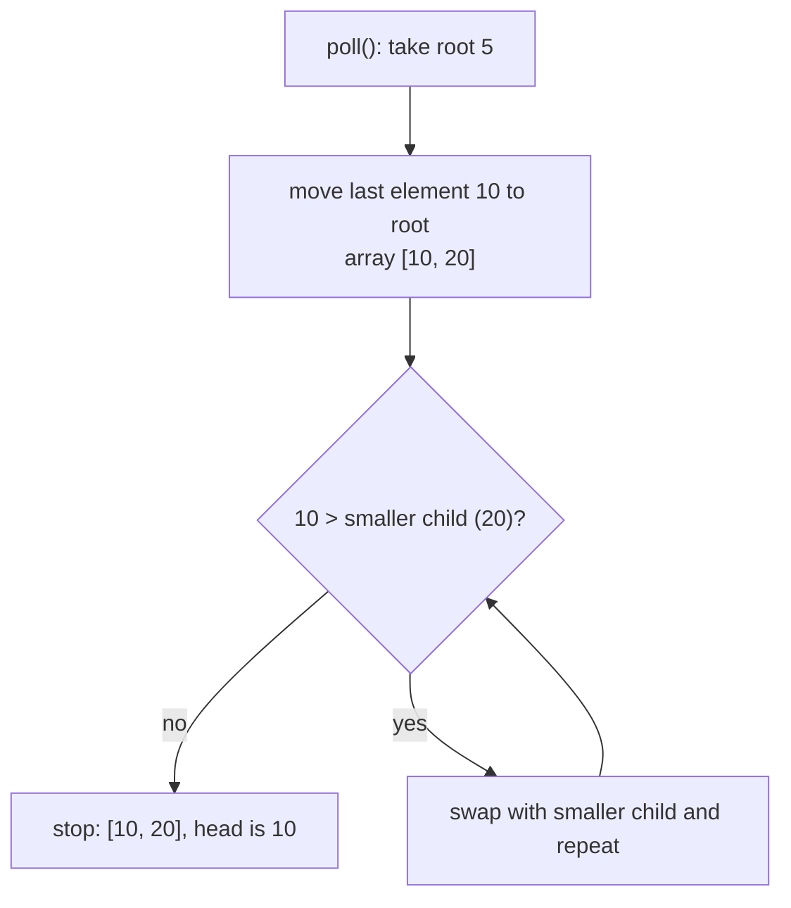

## In One Line
`PriorityQueue` is an unbounded `Queue` that always hands out the **smallest element first** (by natural order or a `Comparator`); inside it is a **binary min-heap stored in an array**, so `offer`/`poll` are O(log n) and `peek` is O(1) — but its `toString()` and iterator are **not** in sorted order.

## Mental Model
A **hospital emergency room**.

- Patients do not leave in arrival order: the **most urgent** one is always treated next (`poll`). "Most urgent" is whatever rule the triage nurse uses — that is the `Comparator`.
- The nurse does not keep the whole waiting room sorted; she only makes sure the most urgent patient is at the front desk. That partial order is the **heap**: cheap to maintain, but the waiting room as a whole is not in order (so `toString()` looks jumbled).
- When a new patient arrives, they sit in the last chair and "bubble up" past less urgent patients (`siftUp`). When the front patient leaves, the last patient is moved to the front chair and "sinks down" until everyone above is more urgent (`siftDown`).
- If a patient's condition changes while waiting (you mutate the object), the nurse does not notice — you must take them out and check them in again.

## Concept
### What it is
```java
public class PriorityQueue<E> extends AbstractQueue<E> implements java.io.Serializable

transient Object[] queue;        // the heap, stored level by level
int size;
private final Comparator<? super E> comparator;   // null = natural ordering
```
- **Head = least element** according to the ordering. Ties are broken **arbitrarily** — equal elements do not come out in insertion order.
- **Ordering**: elements implement `Comparable` (natural order), or you pass a `Comparator` to the constructor. `comparator()` returns `null` for natural ordering.
- **No `null`** (`NullPointerException`), **duplicates allowed**, **not thread-safe** (use `PriorityBlockingQueue`), **fail-fast** iterator.
- **Unbounded**: the array grows automatically. Default initial capacity **11**; growth is `+ (old + 2)` while small (< 64) and `+50%` after that — observed 11 → 24 → 50 → 102 → 153 → 229 on JDK 21.

### The binary heap in an array
A binary heap is a complete binary tree where **every parent ≤ its children** (min-heap). It is stored in an array level by level, so no node objects or pointers are needed:

| For the element at index `i` | Index |
|---|---|
| parent | `(i - 1) / 2` (the JDK writes `(i - 1) >>> 1`) |
| left child | `2 * i + 1` |
| right child | `2 * i + 2` |

The root `queue[0]` is always the minimum. Nothing else is guaranteed: siblings, cousins and the rest of the array are in no particular order.

### How the operations work
- **`offer(e)` / `add(e)`** — put `e` in the first free slot (`queue[size]`), then **sift up**: while `e` is smaller than its parent, swap them. At most one swap per level → **O(log n)**.
- **`poll()` / `remove()`** — take `queue[0]`, move the **last** element to the root, then **sift down**: swap it with its **smaller** child while that child is smaller. **O(log n)**.
- **`peek()` / `element()`** — return `queue[0]`: **O(1)**.
- **`remove(Object)`, `contains(Object)`** — linear search through the array: **O(n)** (removal then re-heapifies from that slot).
- **`new PriorityQueue<>(collection)`** — copies and **heapifies** bottom-up in **O(n)**, faster than n separate offers (O(n log n)).
- **Iterator, `toString()`, `toArray()`, `forEach`** — walk the array in index order: heap order, **not sorted**.

| Operation | Complexity |
|---|---|
| `offer`, `add` | O(log n) |
| `poll`, `remove()` | O(log n) |
| `peek`, `element`, `size`, `isEmpty` | O(1) |
| `remove(Object)`, `contains` | O(n) |
| build from a collection | O(n) |
| getting all n elements sorted (poll n times) | O(n log n) |

### Constructors
| Constructor | Notes |
|---|---|
| `PriorityQueue()` | capacity 11, natural ordering |
| `PriorityQueue(int initialCapacity)` | capacity < 1 → `IllegalArgumentException` |
| `PriorityQueue(Comparator<? super E> c)` | Java 8+ |
| `PriorityQueue(int initialCapacity, Comparator<? super E> c)` | |
| `PriorityQueue(Collection<? extends E> c)` | heapifies in O(n); keeps the comparator if `c` is a `SortedSet` or `PriorityQueue` |
| `PriorityQueue(PriorityQueue<? extends E> c)`, `PriorityQueue(SortedSet<? extends E> c)` | copy with the same ordering |

### Ordering recipes
```java
new PriorityQueue<Integer>();                                    // min-heap: 1, 2, 3
new PriorityQueue<Integer>(Comparator.reverseOrder());           // max-heap: 3, 2, 1
new PriorityQueue<Integer>(Collections.reverseOrder());          // same, older style
new PriorityQueue<Task>(Comparator.comparingInt(Task::priority)); // by a field
new PriorityQueue<String>(Comparator.comparingInt(String::length)
        .thenComparing(Comparator.naturalOrder()));              // by length, then alphabetically
```
Never write `(a, b) -> a - b` for integers: the subtraction overflows for large values of opposite sign and silently breaks the heap. Use `Integer::compare` or `Comparator.comparingInt`.

### What the elements must provide
With natural ordering, every element must implement `Comparable`. If it does not, the **very first `add`** already throws `ClassCastException` (the JDK casts the element to `Comparable` while sifting, even when the queue is empty). The ordering should be **consistent**: if `compare` is not a valid total order, the heap invariant silently breaks.

### PriorityQueue vs TreeSet vs sorted List
| | `PriorityQueue` | `TreeSet` | `ArrayList` + `sort` |
|---|---|---|---|
| Duplicates | yes | no (`compare == 0` → rejected) | yes |
| Get min | O(1) `peek` | O(log n) `first()` | O(1) after sorting |
| Remove min | O(log n) | O(log n) `pollFirst()` | O(n) `remove(0)` |
| Insert | O(log n) | O(log n) | O(n) to keep sorted |
| Get max as well | no (O(n)) | yes, O(log n) `last()` | O(1) |
| Sorted iteration | **no** | yes | yes |
| Range queries (`floor`, `ceiling`) | no | yes | via binary search |
| Memory | one array | one node per element | one array |

Use `PriorityQueue` when you repeatedly need "the next smallest" and nothing else.

### Classic uses
- **Scheduling** by priority or by time (`DelayQueue` and `ScheduledThreadPoolExecutor` use heaps).
- **Dijkstra's shortest path** and Prim's MST (`(distance, node)` pairs).
- **Top-K** largest/smallest, **K-way merge** of sorted lists, **median of a stream** (two heaps), **event simulation**.
- **Heap sort** idea: add everything, poll everything.

## Diagram

The example's heap after `add(10)`, `add(20)`, `add(5)`: stored as the array `[5, 20, 10]`. Parent ≤ children is the only rule, which is why the array prints `20` before `10`.


`offer` = append at the end, then sift up — at most one swap per level, O(log n).


`poll` = remove the root, move the last element up, then sift down along the smaller child — O(log n).

## Code
@example Collections/Queues/PriorityQueueExample.java

`toString()` shows the heap array, not sorted order — only polling gives sorted output:
```java
PriorityQueue<Integer> pq = new PriorityQueue<>();
for (int n : new int[]{5, 1, 4, 2, 3}) pq.offer(n);
System.out.println("toString (heap array order): " + pq);
StringBuilder sorted = new StringBuilder();
while (!pq.isEmpty()) sorted.append(pq.poll()).append(' ');
System.out.println("poll() one by one:          " + sorted.toString().trim());
```
```output
toString (heap array order): [1, 2, 4, 5, 3]
poll() one by one:          1 2 3 4 5
```

Watching the heap step by step, plus `comparator()`, `contains` and `remove(Object)`:
```java
PriorityQueue<Integer> pq = new PriorityQueue<>();
pq.add(10); System.out.println(pq);
pq.add(20); System.out.println(pq);
pq.add(5);  System.out.println(pq);
pq.add(1);  System.out.println(pq);
System.out.println(pq.poll() + " -> " + pq);
System.out.println("comparator(): " + pq.comparator());
System.out.println("contains(20): " + pq.contains(20) + ", remove(20): " + pq.remove(20) + " -> " + pq);
```
```output
[10]
[10, 20]
[5, 20, 10]
[1, 5, 10, 20]
1 -> [5, 20, 10]
comparator(): null
contains(20): true, remove(20): true -> [5, 10]
```

Max-heap and a multi-key comparator:
```java
PriorityQueue<Integer> max = new PriorityQueue<>(Comparator.reverseOrder());
max.addAll(List.of(10, 20, 5));
System.out.println("head=" + max.peek() + " heap=" + max);
PriorityQueue<String> byLength = new PriorityQueue<>(
        Comparator.comparingInt(String::length).thenComparing(Comparator.naturalOrder()));
byLength.addAll(List.of("pear", "fig", "banana", "kiwi"));
StringBuilder sb = new StringBuilder();
while (!byLength.isEmpty()) sb.append(byLength.poll()).append(' ');
System.out.println(sb.toString().trim());
```
```output
head=20 heap=[20, 10, 5]
fig kiwi pear banana
```

A real-world task queue with a record and a comparator:
```java
record Task(String name, int priority) { }

PriorityQueue<Task> tasks = new PriorityQueue<>(Comparator.comparingInt(Task::priority));
tasks.offer(new Task("write tests", 2));
tasks.offer(new Task("fix prod bug", 1));
tasks.offer(new Task("update docs", 3));
while (!tasks.isEmpty()) {
    Task t = tasks.poll();
    System.out.println(t.priority() + " " + t.name());
}
```
```output
1 fix prod bug
2 write tests
3 update docs
```

What the queue rejects:
```java
static class Box { }

PriorityQueue<Box> pq = new PriorityQueue<>();
try {
    pq.add(new Box());
} catch (ClassCastException e) {
    System.out.println("first add -> ClassCastException");
}
try {
    new PriorityQueue<Integer>().add(null);
} catch (NullPointerException e) {
    System.out.println("add(null) -> NullPointerException");
}
try {
    new PriorityQueue<Integer>(0);
} catch (IllegalArgumentException e) {
    System.out.println("new PriorityQueue<>(0) -> IllegalArgumentException");
}
```
```output
first add -> ClassCastException
add(null) -> NullPointerException
new PriorityQueue<>(0) -> IllegalArgumentException
```

## Walkthrough
- `package Collections.Queues;` and `import java.util.PriorityQueue;`.
- `PriorityQueue<Integer> priorityQueue = new PriorityQueue<>();` — natural ordering (`Integer` implements `Comparable`), so it is a **min-heap**; initial array of 11 slots.
- `priorityQueue.add(10);` — goes to index 0: `[10]`.
- `priorityQueue.add(20);` — goes to index 1; its parent (index 0) is 10, and 20 > 10, so it stays: `[10, 20]`.
- `priorityQueue.add(5);` — goes to index 2; parent index `(2 - 1) / 2 = 0` holds 10; 5 < 10, so they swap: `[5, 20, 10]`. 5 is now the root.
- `System.out.println("PriorityQueue: " + priorityQueue);` — `toString()` walks the **array**, printing `[5, 20, 10]`. Notice it is *not* sorted (20 before 10): only the root is guaranteed smallest.
- `priorityQueue.peek()` — returns `queue[0]` = `5` without removing it.
- `priorityQueue.poll();` — removes the root 5 (return value ignored). The last element, 10, moves to the root; its only child is 20, and 10 < 20, so no swap: `[10, 20]`.
- `"PriorityQueue after polling: " + priorityQueue` → `[10, 20]`.
- `for (Integer element : priorityQueue)` — the iterator also walks the array in index order: `10`, then `20`. It looks sorted here only because a 2-element heap happens to be; with more elements (see the `[1, 2, 4, 5, 3]` snippet) iteration order is visibly unsorted.
- The `// Output:` comments all match the recorded run.

## Traps
> [!NOTE] The example is correct, and its comment `// Output: PriorityQueue: [5, 20, 10]` even shows the unsorted heap order honestly. The risk is the last loop: printing `10` then `20` makes it look as if iterating a `PriorityQueue` gives sorted order. It does not — iteration follows the heap array. To process in priority order, loop on `poll()`. (The package name `Collections.Queues` breaks the lowercase convention, as in the other examples.)

- **`toString()`, for-each, `iterator()`, `toArray()`, `stream()` are NOT sorted.** Only `poll()`/`peek()` respect priority.
- **Head is the smallest**, not the largest. For a max-heap pass `Comparator.reverseOrder()`.
- **Equal priorities are not FIFO.** Four tasks with the same priority `a, b, c, d` came out as `a d c b` in a test run. If you need FIFO among equals, add a sequence number as a tie-breaker: `comparingInt(Task::priority).thenComparingLong(Task::seq)`.
- **Mutating an element after insertion corrupts the order.** The heap is only fixed during `offer`/`poll`. Remove the element, change it, and offer it again (O(n) for the removal).
- **`(a, b) -> a - b` overflows.** With `Integer.MIN_VALUE`, `1` and `Integer.MAX_VALUE`, such a heap reported `1` as its head instead of `Integer.MIN_VALUE`.
- **Non-`Comparable` elements without a comparator** throw `ClassCastException` on the first `add`.
- **`null` is rejected** with `NullPointerException`; `poll()` on an empty queue returns `null`, `remove()` throws `NoSuchElementException`.
- **`new PriorityQueue<>(0)`** throws `IllegalArgumentException` — the capacity must be at least 1.
- **Not thread-safe** — use `PriorityBlockingQueue`, which also offers a blocking `take()`.

## Tips & Tricks
- **"Heap = only the top is tidy."** The root is the minimum; everything else is just "parent ≤ children".
- **Index formulas:** children `2i+1`, `2i+2`; parent `(i-1)/2`. Say them in interviews.
- **Min-heap by default, `reverseOrder()` for max-heap.** "Priority 1 = most urgent" fits the default min-heap naturally.
- **Top-K largest → min-heap of size K** (evict the smallest when size > K). **Top-K smallest → max-heap of size K.** Cost O(n log K).
- **Need sorted output?** `while (!pq.isEmpty()) pq.poll()` — or just `list.sort(...)` if you do not need incremental access.
- **Comparator building blocks:** `Comparator.comparingInt(...)`, `.thenComparing(...)`, `.reversed()`, `Comparator.reverseOrder()`.
- **Interview line:** "A PriorityQueue is a binary min-heap in an array: O(log n) offer and poll, O(1) peek, O(n) contains; its iterator is not sorted."

## Interview Q&A
### [Basic] What is a PriorityQueue in Java?
`java.util.PriorityQueue<E>` (Java 5) is an unbounded queue whose head is always the least element according to the natural ordering (`Comparable`) or a supplied `Comparator`. It is implemented as a binary min-heap in a resizable array. `offer`/`add` and `poll`/`remove` are O(log n), `peek` is O(1), and `contains`/`remove(Object)` are O(n). It allows duplicates, rejects `null`, is not thread-safe, and its iterator does not return elements in priority order.

**Follow-up:** *Is it FIFO?* — No; elements leave in priority order, and ties come out in no guaranteed order.

### [Basic] How do you create a max-heap with PriorityQueue?
Pass a reversing comparator: `new PriorityQueue<>(Comparator.reverseOrder())` or `new PriorityQueue<>(Collections.reverseOrder())` for `Comparable` types, or `Comparator.comparingInt(Task::priority).reversed()` for objects. For the example's numbers, `[10, 20, 5]` in a max-heap has head `20` and prints `[20, 10, 5]`.

**Follow-up:** *Why not `(a, b) -> b - a`?* — Integer subtraction can overflow for large values of opposite sign and produce the wrong sign; `Integer.compare(b, a)` is always correct.

### [Intermediate] How does PriorityQueue work internally?
It stores a complete binary tree in an array: the children of index `i` are `2i + 1` and `2i + 2`, the parent is `(i - 1) / 2`, and every parent is ≤ its children, so the minimum is at index 0. `offer` places the new element at the end and sifts it up, swapping with its parent while smaller. `poll` removes index 0, moves the last element to the root and sifts it down, swapping with the smaller child while larger. Both touch one path from root to leaf, so O(log n). The array starts at 11 slots and grows (roughly doubling while small, then by 50%).

**Follow-up:** *Why an array instead of tree nodes?* — A complete tree has no gaps, so index arithmetic replaces pointers: less memory and better cache locality.

### [Intermediate] Why doesn't printing or iterating a PriorityQueue give sorted order?
Because both simply walk the internal array, and a heap is only **partially** ordered: parent ≤ children, but siblings and different subtrees are unordered. Adding `5, 1, 4, 2, 3` prints `[1, 2, 4, 5, 3]`. The Javadoc states that the iterator "is not guaranteed to traverse the elements in any particular order". To get sorted order, poll repeatedly (O(n log n)), or copy to an array/list and sort it.

**Follow-up:** *Then why did the example's loop print 10, 20 in order?* — Coincidence: a two-element heap is always sorted, since the root is the smaller one.

### [Intermediate] PriorityQueue or TreeSet?
Both give access to the minimum in sorted order, but: a `TreeSet` rejects duplicates (elements comparing equal), while a `PriorityQueue` keeps them; `PriorityQueue.peek` is O(1) versus O(log n) for `TreeSet.first`; `TreeSet` also gives O(log n) access to the maximum, sorted iteration and range queries (`floor`, `ceiling`, `subSet`), and O(log n) removal of arbitrary elements (O(n) in a heap). `PriorityQueue` uses a compact array; `TreeSet` allocates a node per element. Pick `PriorityQueue` for "keep giving me the next smallest", `TreeSet` for a sorted, navigable set.

**Follow-up:** *Which one for Dijkstra?* — Usually a `PriorityQueue` with "lazy deletion" (push a new `(distance, node)` pair and skip stale ones when polled), because it cannot decrease a key in place.

### [Intermediate] Find the K largest elements of an array.
Keep a **min-heap of size K**: offer each number; whenever the heap grows beyond K, poll the smallest. At the end the heap holds the K largest.
```java
static List<Integer> topK(int[] nums, int k) {
    PriorityQueue<Integer> minHeap = new PriorityQueue<>();   // keeps the k largest seen so far
    for (int n : nums) {
        minHeap.offer(n);
        if (minHeap.size() > k) minHeap.poll();                 // evict the smallest
    }
    List<Integer> result = new ArrayList<>(minHeap);
    result.sort(Comparator.reverseOrder());
    return result;
}
// topK(new int[]{7, 2, 9, 4, 11, 5, 9}, 3)
```
```output
[11, 9, 9]
```
Time O(n log k), space O(k) — better than sorting (O(n log n)) when k is small.

**Follow-up:** *Why a min-heap for the largest elements?* — The heap's root is the smallest of the current top K, i.e. the one to evict when a bigger element arrives.

### [Advanced] Why is building a heap from a collection O(n) and not O(n log n)?
`new PriorityQueue<>(collection)` copies the elements into the array and then runs **bottom-up heapify**: it calls sift-down on every non-leaf node from index `n/2 - 1` down to 0. Half the nodes are leaves (no work), a quarter sift down at most one level, an eighth at most two levels, and so on. The total is n × Σ(h / 2^h), which converges to about 2n, so O(n). Offering the elements one by one would cost O(n log n) in the worst case.

**Follow-up:** *Does that make heap sort O(n)?* — No; building is O(n) but extracting all n elements is still O(n log n).

### [Advanced] How would you find the running median of a stream of numbers?
Use two heaps: a **max-heap** `low` for the smaller half and a **min-heap** `high` for the larger half, keeping `low` equal in size to `high` or one larger. The median is `low.peek()` (odd count) or the average of both tops (even count).
```java
private final PriorityQueue<Integer> low = new PriorityQueue<>(Comparator.reverseOrder()); // max-heap: smaller half
private final PriorityQueue<Integer> high = new PriorityQueue<>();                        // min-heap: larger half

void add(int n) {
    low.offer(n);
    high.offer(low.poll());                  // move the largest of the small half up
    if (high.size() > low.size()) low.offer(high.poll());   // keep low >= high in size
}

double median() {
    return low.size() > high.size() ? low.peek() : (low.peek() + high.peek()) / 2.0;
}
// add 5, 15, 1, 3 one at a time
```
```output
after 5: median = 5.0
after 15: median = 10.0
after 1: median = 5.0
after 3: median = 4.0
```
Each `add` is O(log n); `median` is O(1).

**Follow-up:** *Why pass every number through `low` first?* — It guarantees every element in `low` is ≤ every element in `high` without extra comparisons.

### [Advanced] What happens if you change an element's priority after inserting it?
Nothing visible at first — and that is the problem. The heap only restores order during `offer`/`poll`/`remove`, so a mutated element stays where it was. In a test, a patient's severity was raised from 1 to 9 after insertion into a max-heap by severity, and `peek()` still returned the old top. `PriorityQueue` has no "decrease-key"/"update" operation. Correct approaches: make elements immutable (for example records) and **remove + re-insert** a new object (O(n) for the removal), or leave the stale entry and skip it when it is polled (lazy deletion).

**Follow-up:** *Is there a JDK structure with O(log n) arbitrary removal?* — `TreeSet`/`TreeMap` (with a tie-breaker so different elements never compare equal).

## Quiz
### What does the original example print as the first line?
- [ ] PriorityQueue: [5, 10, 20]
- [x] PriorityQueue: [5, 20, 10]
- [ ] PriorityQueue: [10, 20, 5]
- [ ] PriorityQueue: [20, 10, 5]
> `toString()` shows the heap array. After adding 10 and 20, the 5 goes to index 2 and swaps with its parent 10, giving `[5, 20, 10]`. The sorted `[5, 10, 20]` is the tempting answer, but a heap is not sorted.

### What does this print?
```java
PriorityQueue<Integer> pq = new PriorityQueue<>();
for (int n : new int[]{5, 1, 4, 2, 3}) pq.offer(n);
System.out.println(pq);
```
- [ ] [1, 2, 3, 4, 5]
- [x] [1, 2, 4, 5, 3]
- [ ] [5, 1, 4, 2, 3]
- [ ] [5, 4, 3, 2, 1]
> Each offer sifts up: the resulting heap array is `[1, 2, 4, 5, 3]`. Only index 0 is guaranteed to be the minimum; the rest just satisfies parent ≤ children.

### What does this print?
```java
PriorityQueue<Integer> pq = new PriorityQueue<>(List.of(3, 1, 2));
pq.offer(0);
pq.poll();
System.out.println(pq.peek() + " " + pq.size());
```
- [ ] 0 3
- [x] 1 3
- [ ] 1 4
- [ ] 3 3
> The queue holds 3, 1, 2; offering 0 makes it the head, and `poll` removes it. The new head is the smallest remaining (1), and 3 elements remain.

### What does this print?
```java
PriorityQueue<String> pq = new PriorityQueue<>(Comparator.reverseOrder());
pq.add("b"); pq.add("c"); pq.add("a");
System.out.println(pq.poll() + pq.poll() + pq.poll());
```
- [ ] abc
- [x] cba
- [ ] bca
- [ ] bac
> `reverseOrder()` turns it into a max-heap, so polling returns the largest first: `c`, `b`, `a`. `abc` would be the default min-heap; `bca` is insertion order.

### Spot the bug
```java
PriorityQueue<Integer> pq = new PriorityQueue<>((a, b) -> a - b);
pq.addAll(List.of(Integer.MIN_VALUE, 1, Integer.MAX_VALUE));
System.out.println(pq.peek());   // prints 1
```
- [ ] `addAll` does not heapify
- [x] `a - b` overflows, so the comparator reports the wrong sign
- [ ] `PriorityQueue` cannot hold `Integer.MIN_VALUE`
- [ ] `peek` returns the last added element
> `1 - Integer.MIN_VALUE` overflows to a negative number, so `1` is considered smaller than `MIN_VALUE`. Use `Integer::compare` (or natural ordering), which returns `-2147483648` as the head.

### What happens on the first `add`?
```java
class Box { }
PriorityQueue<Box> pq = new PriorityQueue<>();
pq.add(new Box());
```
- [ ] It works; comparison only happens from the second element on
- [x] `ClassCastException`, because `Box` is not `Comparable`
- [ ] Compile error, because `Box` is not `Comparable`
- [ ] `NullPointerException`, because there is no comparator
> With natural ordering the JDK casts each added element to `Comparable` while sifting — even the first one — so it throws `ClassCastException`. It compiles because `PriorityQueue<E>` does not require `E extends Comparable`. Pass a `Comparator` or implement `Comparable`.

### What are the time complexities of `peek`, `poll` and `contains`?
- [ ] O(1), O(1), O(log n)
- [x] O(1), O(log n), O(n)
- [ ] O(log n), O(log n), O(log n)
- [ ] O(1), O(n), O(n)
> `peek` reads index 0; `poll` sifts down one root-to-leaf path; `contains` has to scan the array because a heap is not searchable like a sorted tree.

## Takeaways
- `PriorityQueue` is an unbounded queue whose head is the smallest element by natural order or a `Comparator`; use `Comparator.reverseOrder()` for a max-heap.
- Internally it is a binary min-heap in an array: children at `2i+1`/`2i+2`, parent at `(i-1)/2`, default capacity 11.
- `offer`/`poll` are O(log n) (sift up / sift down), `peek` is O(1), `contains`/`remove(Object)` are O(n), building from a collection is O(n).
- `toString()`, iteration and streams are in heap-array order, not sorted — poll repeatedly to get sorted order.
- No `null`, duplicates allowed, ties not FIFO, not thread-safe (`PriorityBlockingQueue` is), and elements must be `Comparable` or you need a comparator.
- Never mutate an element's priority while it is inside; remove and re-insert instead. Avoid `a - b` comparators.
- Classic uses: task scheduling, Dijkstra, top-K, K-way merge, running median.
