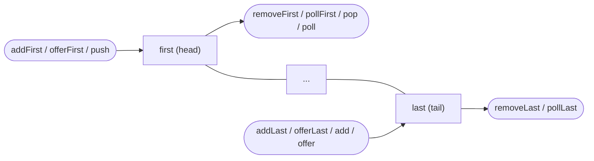
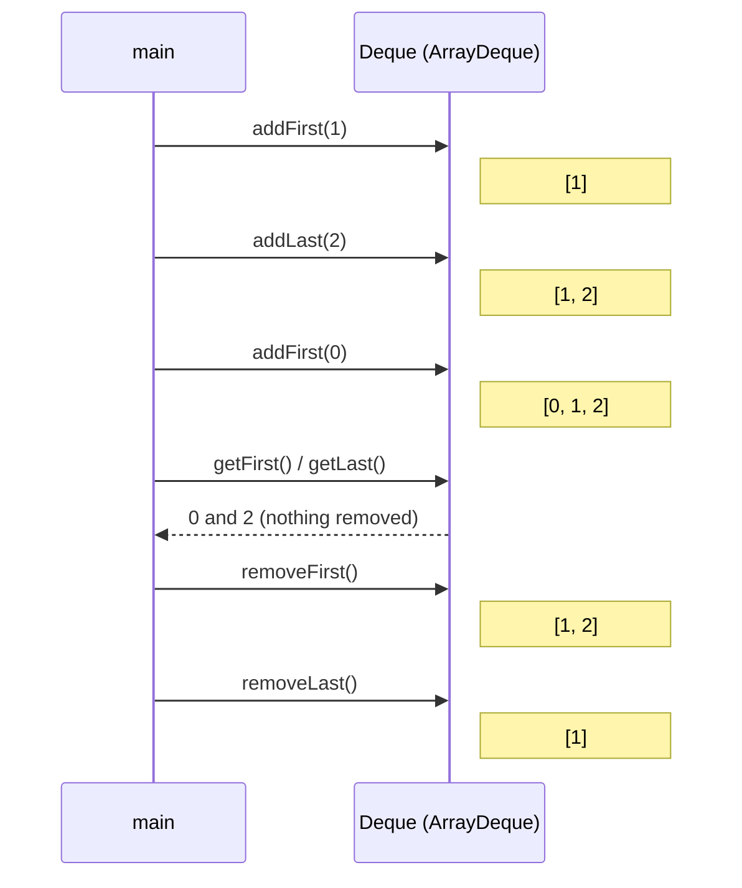
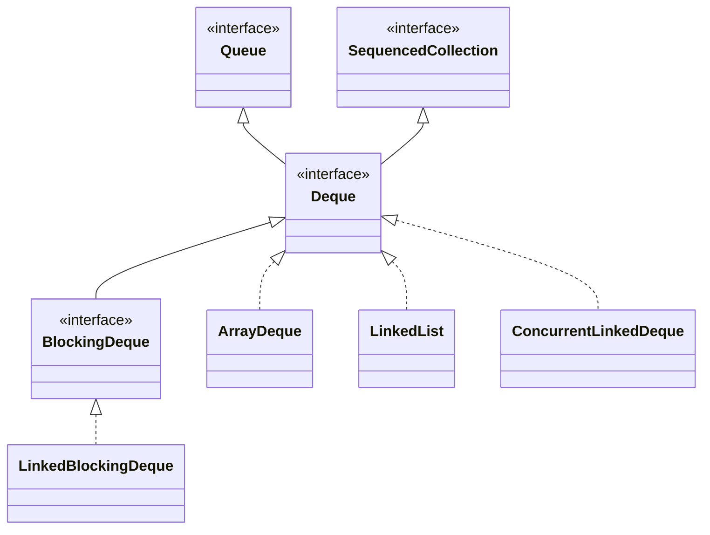

## In One Line
`Deque<E>` (say "deck", short for **d**ouble-**e**nded **que**ue) is a queue you can add to, remove from and look at from **both ends** — so one interface serves as a FIFO queue, a LIFO stack, or both at once.

## Mental Model
A **deck of cards lying face up on a table**.

- You may put a card on the **top** (`addFirst`) or slide one under the **bottom** (`addLast`).
- You may take the **top** card (`removeFirst`) or pull out the **bottom** card (`removeLast`).
- You may look at the top or bottom card without taking it (`getFirst` / `getLast`, or the polite `peekFirst` / `peekLast`).
- Pulling a card out of the **middle** is possible (`removeFirstOccurrence`) but you have to search the whole deck for it — slow, and there is no "give me card number 7" (no index access).
- If you only ever put on top and take from top, you are playing a **stack** game. If you put at the bottom and take from the top, you are running a **queue**. The deck does not care — that is why `Deque` replaces both `Stack` and plain queues.

In the code: the deck is the `Deque` object, "top" is the **first** end (the head), "bottom" is the **last** end (the tail), and each hand movement is one of the deque methods.

## Concept
### Where Deque sits
`java.util.Deque<E>` was added in **Java 6** together with `ArrayDeque`. It extends `Queue<E>` (so every deque is a queue), and since **Java 21** it also extends `SequencedCollection<E>` (the interface for collections with a defined first and last element). It adds the "other end" to every queue operation.

- The **first** end = the **head** — where `poll()`, `peek()`, `push()` and `pop()` work.
- The **last** end = the **tail** — where `add()` and `offer()` insert.
- Iteration (`for`, `iterator()`, `toString()`) always goes **first → last**.

### The 12 core methods: 2 ends × 3 operations × 2 failure styles
| | **First element (head)** — throws | **First** — special value | **Last element (tail)** — throws | **Last** — special value |
|---|---|---|---|---|
| **Insert** | `addFirst(e)` | `offerFirst(e)` → `false` | `addLast(e)` | `offerLast(e)` → `false` |
| **Remove** | `removeFirst()` | `pollFirst()` → `null` | `removeLast()` | `pollLast()` → `null` |
| **Examine** | `getFirst()` | `peekFirst()` → `null` | `getLast()` | `peekLast()` → `null` |

- The **throwing** versions throw `NoSuchElementException` on an empty deque (remove/examine) and `IllegalStateException` on a full capacity-restricted deque (insert).
- The **special-value** versions return `null` (empty) or `false` (full).
- For unbounded deques (`ArrayDeque`, `LinkedList`) `addX` and `offerX` behave the same; they differ only for bounded ones such as `new LinkedBlockingDeque<>(2)`.
- Naming hook: **get/remove/add throw, peek/poll/offer are polite.** The same rule as in [Queue](lesson:a03-collections/06-queue), with `First`/`Last` appended.

### Deque as a Queue (FIFO): enter at the tail, leave from the head
| `Queue` method | Equivalent `Deque` method |
|---|---|
| `add(e)` | `addLast(e)` |
| `offer(e)` | `offerLast(e)` |
| `remove()` | `removeFirst()` |
| `poll()` | `pollFirst()` |
| `element()` | `getFirst()` |
| `peek()` | `peekFirst()` |

### Deque as a Stack (LIFO): everything happens at the head
| Stack method | Equivalent `Deque` method |
|---|---|
| `push(e)` | `addFirst(e)` |
| `pop()` | `removeFirst()` |
| `peek()` | `peekFirst()` |

The JDK's own advice (in the `Deque` and `Stack` Javadoc): use `Deque` in preference to the legacy `java.util.Stack`. The full comparison — synchronization, `EmptyStackException` vs `NoSuchElementException`, printing order — is in the [Stack](lesson:a03-collections/05-stack) lesson. The key fact for this lesson: **the top of a deque-stack is the first element**, so `toString()` prints top → bottom.

> [!INTERVIEW] "`push`, `pop` and `peek` all work on the **head**; `add` and `offer` insert at the **tail**. So a deque is a stack if you push, a queue if you offer — and `poll`/`pop`/`peek` serve both."

### The other methods
| Method | What it does |
|---|---|
| `removeFirstOccurrence(o)` / `removeLastOccurrence(o)` | Remove the first/last element `equals` to `o`; return `true` if one was found. O(n). |
| `remove(Object o)` | Same as `removeFirstOccurrence(o)`. **Not** an index — `Deque` has no `remove(int)`. |
| `contains(o)`, `size()`, `isEmpty()`, `clear()` | From `Collection`; `contains` is O(n). |
| `iterator()` | First → last. |
| `descendingIterator()` | Last → first. |
| `reversed()` | **Java 21**: a reverse-ordered **view** (no copy); writing through it writes to the original. |
| `addAll(c)` | Adds each element of `c` at the tail, as if by `addLast`. |
| `Collections.asLifoQueue(deque)` | (Java 6 helper) wraps a deque as a `Queue` whose `offer`/`add` become `push`, so code that only accepts a `Queue` gets LIFO order: offering `a`, `b`, `c` prints `[c, b, a]` and `poll()` returns `c`. |

What `Deque` deliberately does **not** have:
- **No index access** (`get(i)`, `set(i, e)`, `add(i, e)`) — it is not a `List`.
- **No content-based `equals`/`hashCode`** — implementations generally inherit identity equality from `Object`, because "equal" is unclear for different ordering policies. (`LinkedList` is the exception because it is also a `List`.)
- **`null` elements are discouraged** — `poll`/`peek` use `null` to mean "empty". The Javadoc says implementations are "strongly encouraged" to reject `null`; `ArrayDeque` and all concurrent deques throw `NullPointerException`, while `LinkedList` accepts it.

### Implementations
| Class | Since | Structure | Bounded | Thread-safe | `null` | Use it when |
|---|---|---|---|---|---|---|
| `ArrayDeque` | 6 | circular array | no | no | no | **default** single-threaded stack/queue/deque — see [ArrayDeque](lesson:a03-collections/09-arraydeque) |
| `LinkedList` | 1.2 (Deque since 6) | doubly linked nodes | no | no | **yes** | you also need `List` methods or `null` elements — see [LinkedList](lesson:a03-collections/02-linkedlist) |
| `ConcurrentLinkedDeque` | 7 | lock-free linked nodes | no | yes, non-blocking | no | many threads, no waiting; beware `size()` is **O(n)** |
| `LinkedBlockingDeque` | 6 | linked nodes + one lock | optional capacity | yes, blocking | no | producer/consumer at both ends (`putFirst`, `takeLast`, ...) |

`BlockingDeque` (implemented by `LinkedBlockingDeque`) adds waiting versions of every end-operation: `putFirst`/`putLast` block while full, `takeFirst`/`takeLast` block while empty, plus timed `offerFirst(e, time, unit)` / `pollLast(time, unit)`. See [BlockingQueue and concurrent collections](lesson:b03-concurrency/04-blockingqueue-and-concurrent-collections).

### Complexity
| Operation | `ArrayDeque` | `LinkedList` |
|---|---|---|
| add/offer/remove/poll/peek at either end | O(1) (insert amortised) | O(1) |
| `contains`, `removeFirstOccurrence`, `remove(Object)` | O(n) | O(n) |
| `size()` | O(1) | O(1) |
| Memory per element | one array slot (4 bytes with compressed references) + spare capacity | one ~24-byte node + the element |

### Java 21: sequenced collections
Before Java 21, `getFirst()`/`getLast()`/`addFirst()`/... existed only on `Deque` (and `LinkedList`). Java 21 moved them up into the new `SequencedCollection` interface, so `List`, `LinkedHashSet` and `SortedSet` now have them too, and `Deque` gained `reversed()`. The deque methods themselves did not change meaning.

### Classic uses (interview favourites)
| Problem | How the deque is used |
|---|---|
| Stack problems (brackets, undo, DFS, expression evaluation) | `push` / `pop` / `peek` at the head |
| Queue problems (BFS, task queues) | `offer` at the tail, `poll` at the head |
| **Sliding-window maximum/minimum** | a *monotonic* deque of indexes: drop out-of-window indexes from the head, drop smaller values from the tail — O(n) total |
| **Palindrome check** | compare `pollFirst()` with `pollLast()` until one element is left |
| **Bounded history / recent items** | `addFirst(newest)`; if `size() > limit`, `removeLast()` |
| **0-1 BFS** (edge weights 0 or 1) | weight-0 neighbours `addFirst`, weight-1 neighbours `addLast` |
| **Work stealing** (`ForkJoinPool`) | each worker pushes/pops its own tasks at one end (LIFO); idle threads steal from the other end (FIFO) |

## Diagram

Every stack operation and every queue *removal* happens at the head; queue *insertion* happens at the tail. The tail can also be removed from — that is the "double-ended" part.


The example's state after each call: inserts grow the deque at the chosen end, `get` only looks, `remove` shrinks it from the chosen end.


`Deque` is a `Queue` with a second end (and, since Java 21, a `SequencedCollection`); four JDK classes implement it.

## Code
@example Collections/Queues/DequeExample.java

Throwing vs special-value methods on an empty deque:
```java
Deque<String> d = new ArrayDeque<>();
System.out.println("pollFirst() -> " + d.pollFirst() + ", pollLast() -> " + d.pollLast());
System.out.println("peekFirst() -> " + d.peekFirst() + ", peekLast() -> " + d.peekLast());
try { d.getFirst(); }   catch (NoSuchElementException e) { System.out.println("getFirst()    -> NoSuchElementException"); }
try { d.removeLast(); } catch (NoSuchElementException e) { System.out.println("removeLast()  -> NoSuchElementException"); }
try { d.pop(); }        catch (NoSuchElementException e) { System.out.println("pop()         -> NoSuchElementException"); }
```
```output
pollFirst() -> null, pollLast() -> null
peekFirst() -> null, peekLast() -> null
getFirst()    -> NoSuchElementException
removeLast()  -> NoSuchElementException
pop()         -> NoSuchElementException
```

Queue methods and stack methods on the **same** deque — `offer` goes to the tail, `push` to the head, and `peek`/`poll`/`pop` all read the head:
```java
Deque<String> deque = new ArrayDeque<>();
deque.offer("A");        // queue insert -> tail (last)
deque.offer("B");
deque.push("Z");         // stack insert -> head (first)
System.out.println(deque);
System.out.println("peek() = " + deque.peek() + "  (same as peekFirst)");
System.out.println("poll() = " + deque.poll() + "  (queue remove = head)");
System.out.println("pop()  = " + deque.pop() + "  (stack remove = head too)");
System.out.println(deque);
```
```output
[Z, A, B]
peek() = Z  (same as peekFirst)
poll() = Z  (queue remove = head)
pop()  = A  (stack remove = head too)
[B]
```

Walking backwards, the Java 21 `reversed()` view, and removing from the middle:
```java
Deque<Integer> nums = new ArrayDeque<>(List.of(1, 2, 3, 2, 4));
Iterator<Integer> back = nums.descendingIterator();
StringBuilder sb = new StringBuilder();
while (back.hasNext()) sb.append(back.next()).append(' ');
System.out.println("descending : " + sb.toString().trim());
System.out.println("reversed() : " + nums.reversed());           // Java 21 view, no copy
nums.removeLastOccurrence(2);                                      // the 2 nearest the tail
System.out.println("removeLastOccurrence(2) -> " + nums);
nums.remove(1);                                                    // Deque has no remove(int): value 1
System.out.println("remove(1)               -> " + nums);
```
```output
descending : 4 2 3 2 1
reversed() : [4, 2, 3, 2, 1]
removeLastOccurrence(2) -> [1, 2, 3, 4]
remove(1)               -> [2, 3, 4]
```

The same `LinkedList` object behaves differently depending on the **reference type** — `List.remove(int)` removes by index, `Deque.remove(Object)` by value:
```java
LinkedList<Integer> l2 = new LinkedList<>(List.of(1, 2, 3));
Deque<Integer> d2 = new LinkedList<>(List.of(1, 2, 3));
l2.remove(1); d2.remove(1);
System.out.println("LinkedList ref: " + l2 + "  Deque ref: " + d2);
```
```output
LinkedList ref: [1, 3]  Deque ref: [2, 3]
```

Sliding-window maximum — the monotonic deque, O(n):
```java
static int[] maxSlidingWindow(int[] nums, int k) {
    int[] result = new int[nums.length - k + 1];
    Deque<Integer> window = new ArrayDeque<>();      // indexes; their values decrease from head to tail
    for (int i = 0; i < nums.length; i++) {
        if (!window.isEmpty() && window.peekFirst() <= i - k) {
            window.pollFirst();                       // head slid out of the window
        }
        while (!window.isEmpty() && nums[window.peekLast()] <= nums[i]) {
            window.pollLast();                        // smaller values can never be a maximum again
        }
        window.offerLast(i);
        if (i >= k - 1) result[i - k + 1] = nums[window.peekFirst()];
    }
    return result;
}
// System.out.println(Arrays.toString(maxSlidingWindow(new int[]{1, 3, -1, -3, 5, 3, 6, 7}, 3)));
```
```output
[3, 3, 5, 5, 6, 7]
```

Palindrome check — compare the two ends:
```java
static boolean isPalindrome(String text) {
    Deque<Character> d = new ArrayDeque<>();
    for (char c : text.toLowerCase().toCharArray()) {
        if (Character.isLetterOrDigit(c)) d.addLast(c);
    }
    while (d.size() > 1) {
        if (!d.pollFirst().equals(d.pollLast())) return false;
    }
    return true;
}
// System.out.println(isPalindrome("Madam, I'm Adam") + " " + isPalindrome("Java"));
```
```output
true false
```

A bounded "recently visited" list — newest at the front, oldest dropped from the back:
```java
Deque<String> recent = new ArrayDeque<>();
int limit = 3;
for (String page : List.of("home", "search", "product", "cart", "checkout")) {
    recent.addFirst(page);
    if (recent.size() > limit) recent.removeLast();
    System.out.println("visited " + page + " -> " + recent);
}
```
```output
visited home -> [home]
visited search -> [search, home]
visited product -> [product, search, home]
visited cart -> [cart, product, search]
visited checkout -> [checkout, cart, product]
```

`add` vs `offer` only differ on a **bounded** deque:
```java
Deque<String> bounded = new LinkedBlockingDeque<>(2);
bounded.addFirst("x");
bounded.addLast("y");
System.out.println("offerFirst on full -> " + bounded.offerFirst("z"));
try { bounded.addFirst("z"); }
catch (IllegalStateException e) { System.out.println("addFirst on full   -> IllegalStateException: " + e.getMessage()); }
```
```output
offerFirst on full -> false
addFirst on full   -> IllegalStateException: Deque full
```

## Walkthrough
- `package Collections.Queues;` — the example lives in the same package as the queue examples. `import java.util.ArrayDeque;` and `import java.util.Deque;` — the interface and its array-based implementation, both in `java.util`.
- `Deque<Integer> deque = new ArrayDeque<>();` — the variable's type is the **interface** `Deque`, the object is an `ArrayDeque`. The diamond `<>` lets the compiler infer `<Integer>`. Only `Deque` (and inherited `Queue`/`Collection`) methods are visible, so you could swap in `LinkedList` or `ConcurrentLinkedDeque` by changing one word. The element type must be a reference type (`Integer`), not `int`.
- `deque.addFirst(1);` — the `int` literal `1` is **autoboxed** to `Integer.valueOf(1)` and inserted at the head. Deque: `[1]`.
- `deque.addLast(2);` — inserted at the tail: `[1, 2]`.
- `deque.addFirst(0);` — inserted at the head, in front of `1`: `[0, 1, 2]`. This is the whole point of a deque — `0` was added last but sits first.
- `System.out.println("Deque: " + deque);` — string concatenation calls `toString()` (inherited from `AbstractCollection`), which iterates first → last: `Deque: [0, 1, 2]`.
- `deque.getFirst()` / `deque.getLast()` — **examine** the two ends without removing: `0` and `2`. On an empty deque both would throw `NoSuchElementException`; `peekFirst()`/`peekLast()` would return `null` instead.
- `deque.removeFirst(); deque.removeLast();` — remove the head (`0`) and the tail (`2`). Both methods **return** the removed element; the example ignores the return values. On an empty deque they would throw `NoSuchElementException` (`pollFirst`/`pollLast` would return `null`). Result: `[1]`.
- `for (Integer element : deque)` — the enhanced for loop uses `deque.iterator()`, which walks first → last, so it prints `1`. Iterating does not remove anything.
- Every `// Output:` comment matches the recorded run.

## Traps
> [!NOTE] The example is correct and all its `// Output:` comments match the real run. Small style points: the return values of `removeFirst()`/`removeLast()` are thrown away (in real code you usually want the removed element, e.g. `Integer first = deque.removeFirst();`), and the package name `Collections.Queues` breaks the lowercase package convention (`collections.queues`). The example is almost identical to the [ArrayDeque](lesson:a03-collections/09-arraydeque) one — together they show that the `Deque` interface is the API and `ArrayDeque` is the usual implementation.

- **`push` and `offer` go to opposite ends.** `push` = `addFirst` (head), `offer`/`add` = `addLast` (tail). Mixing them by accident turns a stack into a queue or vice versa.
- **`peek()` means `peekFirst()`** — the head — whether you think of the deque as a stack or a queue. There is no plain "peek at the tail" except `peekLast()`/`getLast()`.
- **`getFirst()` throws, `peekFirst()` does not.** Same for `removeFirst()` vs `pollFirst()`. Pick the one that matches whether "empty" is a bug or a normal situation.
- **`remove(1)` on a `Deque<Integer>` removes the value 1**, because `Deque` has no `remove(int index)`. Through a `LinkedList`/`List` reference the same call removes **index** 1.
- **`null` is rejected** by `ArrayDeque` and the concurrent deques (`NullPointerException`). `LinkedList` accepts it, which makes `pollFirst()` returning `null` ambiguous.
- **No index access** — `deque.get(0)` does not compile. If you need both ends *and* indexes, use `ArrayList` (Java 21 gives it `getFirst`/`getLast`/`removeLast`) or `LinkedList` through a `List` reference.
- **Do not modify a deque while iterating over it** with a for-each loop — the iterator is fail-fast (on a best-effort basis) and may throw `ConcurrentModificationException`. Use `iterator.remove()` or `removeIf`.
- **`equals` is identity for `ArrayDeque`**: two deques holding `[1, 2]` are not `equals`. Compare contents with `new ArrayList<>(a).equals(new ArrayList<>(b))`.
- **`ArrayDeque` and `LinkedList` are not thread-safe.** Use `ConcurrentLinkedDeque` or `LinkedBlockingDeque`, and remember `ConcurrentLinkedDeque.size()` walks the whole deque.

## Tips & Tricks
- **Pronounce it "deck"** and picture a deck of cards: top = first, bottom = last.
- **The 12-method grid:** `{add, offer} / {remove, poll} / {get, peek}` × `{First, Last}`. The first word of each pair **throws**, the second is **polite** (returns `false`/`null`).
- **"Push, pop, peek live at the Front; Add and offer go to the back (Last)."**
- **One deque, many jobs:** stack → `push`/`pop`/`peek`; queue → `offer`/`poll`/`peek`; double-ended → the `First`/`Last` methods.
- **Default choice:** `Deque<T> d = new ArrayDeque<>();` — declare the interface type. Choose `LinkedList` only for `null`s or `List` methods; `LinkedBlockingDeque` for producer/consumer; `ConcurrentLinkedDeque` for lock-free sharing.
- **Sliding-window template:** store *indexes*; pop expired ones from the head, pop weaker ones from the tail, answer is at the head.
- **Bounded history template:** `addFirst(item); if (size() > limit) removeLast();`.
- **Interview line:** "I use `ArrayDeque` through the `Deque` interface for both stacks and queues — O(1) at both ends, no synchronization overhead, and it replaces the legacy `Stack` class."

## Interview Q&A
### [Basic] What is a Deque and how is it different from a Queue?
A `Deque` (double-ended queue, Java 6) is a sub-interface of `Queue` that supports insertion, removal and inspection at **both** ends — the first element (head) and the last element (tail). A plain `Queue` only inserts at the tail and removes/examines at the head. Because a deque can work at either end, it can act as a FIFO queue (`offerLast` + `pollFirst`), a LIFO stack (`push` + `pop` at the head), or a true double-ended structure. It does not support index access. Main implementations: `ArrayDeque`, `LinkedList`, `ConcurrentLinkedDeque`, `LinkedBlockingDeque`.

**Follow-up:** *Is every `Deque` a `Queue`?* — Yes, `Deque extends Queue`, so you can pass an `ArrayDeque` anywhere a `Queue` is expected; the `Queue` methods map to `addLast`/`pollFirst`/`peekFirst`.

### [Basic] Explain the methods of Deque. Why are there two versions of each operation?
There are three operations (insert, remove, examine) at two ends (first, last), and each comes in two styles:
- **Throwing:** `addFirst`/`addLast`, `removeFirst`/`removeLast`, `getFirst`/`getLast` — throw `IllegalStateException` when a bounded deque is full and `NoSuchElementException` when it is empty.
- **Special value:** `offerFirst`/`offerLast` return `false`, `pollFirst`/`pollLast` and `peekFirst`/`peekLast` return `null`.

Two styles exist so you can choose whether "empty" or "full" is an error (throw) or an expected condition (check the return value). Plus stack methods `push`/`pop`/`peek`, queue methods, `removeFirstOccurrence`/`removeLastOccurrence` and `descendingIterator`.

**Follow-up:** *What does `pop()` do on an empty `ArrayDeque`?* — It throws `NoSuchElementException`, because `pop()` is `removeFirst()`. `peek()` returns `null`.

### [Basic] How do you use a Deque as a stack, and why is it preferred over `java.util.Stack`?
`Deque<Integer> stack = new ArrayDeque<>();` then `push(x)` (= `addFirst`), `pop()` (= `removeFirst`) and `peek()` (= `peekFirst`) — the top of the stack is the head. It is preferred because `Stack` extends `Vector`: every method is synchronized (overhead with no real thread-safety for compound actions) and it inherits index methods like `add(int, E)` and `get(int)` that break LIFO. The Javadoc of both `Stack` and `Deque` recommends the deque. Details: [Stack](lesson:a03-collections/05-stack).

**Follow-up:** *In what order does `System.out.println(stack)` print a deque-stack after pushing 1, 2, 3?* — `[3, 2, 1]`, top first, because iteration goes from the head. A `java.util.Stack` would print `[1, 2, 3]`.

### [Intermediate] Which Deque implementation would you choose, and why?
- **`ArrayDeque`** — default for single-threaded code. Circular array, amortised O(1) at both ends, compact memory, cache-friendly, rejects `null`.
- **`LinkedList`** — when you also need `List` operations (index access, `ListIterator`) or must store `null`. More memory per element (a node with two links).
- **`ConcurrentLinkedDeque`** (Java 7) — many threads, lock-free, never blocks; but `size()` is O(n) and bulk operations are not atomic.
- **`LinkedBlockingDeque`** — many threads where consumers should wait for elements (`takeFirst`/`takeLast`) or producers should wait for space in a bounded deque (`putFirst`/`putLast`).

**Follow-up:** *Why is `ArrayDeque` usually faster than `LinkedList` as a queue?* — No node allocation per element, less garbage, and contiguous memory that the CPU cache prefetches well. See [ArrayDeque](lesson:a03-collections/09-arraydeque).

### [Intermediate] If you call `push` and `offer` on the same deque, where do the elements go?
`push(e)` inserts at the **head** (it is `addFirst`), `offer(e)` inserts at the **tail** (it is `offerLast`). Removal methods `poll()`, `pop()` and `remove()` all take from the head, and `peek()` looks at the head. So after `offer("A"); offer("B"); push("Z");` the deque is `[Z, A, B]`, and both `poll()` and `pop()` return `Z` first. Using `add`/`offer` where you meant `push` is a classic bug: a "stack" filled with `add` and emptied with `pop` returns elements in FIFO order.

**Follow-up:** *Which method removes from the tail?* — Only `removeLast()` / `pollLast()` (or `removeLastOccurrence` for a specific value); none of the stack or queue shortcut methods touch the tail on removal.

### [Intermediate] How do you iterate a Deque in reverse or remove an element from the middle?
Use `descendingIterator()`, which walks last → first, or, since Java 21, `deque.reversed()`, which returns a reverse-ordered **view** (changes through the view affect the original; `reversed().addFirst(x)` adds at the original's tail). To remove an interior element use `removeFirstOccurrence(o)` / `removeLastOccurrence(o)` (or `remove(o)`, which equals `removeFirstOccurrence`) — O(n), because a deque has no index. During a normal iteration, remove only through `iterator.remove()` or use `removeIf(predicate)`.

**Follow-up:** *Does `deque.remove(1)` remove index 1 on a `Deque<Integer>`?* — No. `Deque` has no `remove(int)`, so `1` is boxed and the first element equal to 1 is removed. Through a `List` reference (`LinkedList` declared as `List`) the same call would remove index 1.

### [Intermediate] Why do most Deque implementations reject null and not override equals?
`null` is the "special value" meaning "empty" for `pollFirst`, `peekLast` and friends; if `null` could be an element, a `null` result would be ambiguous. So `ArrayDeque` and all concurrent deques throw `NullPointerException`; only `LinkedList` allows it (and even there it is discouraged). As for equality, the `Deque` contract does not define element-based `equals`/`hashCode`, so implementations inherit `Object`'s identity-based versions: `new ArrayDeque<>(List.of(1, 2)).equals(new ArrayDeque<>(List.of(1, 2)))` is `false`.

**Follow-up:** *How do you compare two deques by content?* — `new ArrayList<>(d1).equals(new ArrayList<>(d2))`, or compare with iterators element by element.

### [Advanced] Find the maximum of every window of size k in an array in O(n).
Keep a deque of **indexes** whose values are **decreasing** from head to tail (a monotonic deque). For each new index `i`: (1) if the head index has left the window (`<= i - k`), `pollFirst()`; (2) while the value at the tail index is `<=` the new value, `pollLast()` — those elements are older *and* smaller, so they can never be a window maximum again; (3) `offerLast(i)`; (4) once the first window is complete, the head holds the maximum. Each index is added once and removed at most once, so the total is **O(n)** time and O(k) extra space, versus O(n·k) for the naive approach. For `[1, 3, -1, -3, 5, 3, 6, 7]` with k = 3 the answer is `[3, 3, 5, 5, 6, 7]` (full code in the Code section).

**Follow-up:** *How would you get the window minimum?* — Same algorithm with the comparison flipped: keep values increasing from head to tail (pop while the tail value is `>=` the new value).

### [Advanced] What is a BlockingDeque, and where does the JDK itself rely on deques?
`BlockingDeque` (Java 6, implemented by `LinkedBlockingDeque`) is a `Deque` plus `BlockingQueue` whose operations can wait: `putFirst`/`putLast` block while a bounded deque is full, `takeFirst`/`takeLast` block while it is empty, and timed `offerFirst(e, t, unit)`/`pollLast(t, unit)` give up after a timeout. Inside the JDK, `ForkJoinPool` (used by parallel streams and `CompletableFuture`'s default executor) gives each worker thread its own work-stealing deque: the owner pushes and pops its own subtasks at one end (LIFO — good cache locality, newest and smallest tasks first) while idle threads **steal** from the other end (FIFO — the oldest, usually largest tasks), which keeps contention between owner and thieves low.

**Follow-up:** *Why steal from the opposite end?* — The owner and the thief then touch different ends and rarely race, and the oldest task is typically the biggest chunk of work, so one steal gives the thief a lot to do.

### [Advanced] What changed for Deque in Java 21?
JEP 431 (Sequenced Collections) introduced `SequencedCollection`, and `Deque` now extends it. `addFirst`, `addLast`, `getFirst`, `getLast`, `removeFirst` and `removeLast` — originally deque-only — are now declared in `SequencedCollection`, so `List`, `LinkedHashSet` and `SortedSet` have them as well. `Deque` also gained `reversed()`, which returns a `Deque` view in the opposite order. The behaviour of the existing deque methods did not change.

**Follow-up:** *Does `reversed()` copy the elements?* — No, it is a live view; adding to the view's first end adds to the original's last end.

## Quiz
### What does the original example print right after the three inserts?
- [ ] Deque: [1, 2, 0]
- [x] Deque: [0, 1, 2]
- [ ] Deque: [2, 1, 0]
- [ ] Deque: [1, 0, 2]
> `addFirst(1)` → `[1]`, `addLast(2)` → `[1, 2]`, `addFirst(0)` puts `0` in front → `[0, 1, 2]`. `[1, 2, 0]` would be the result if every call appended at the tail, as a `List.add` would.

### What does this print?
```java
Deque<Integer> d = new ArrayDeque<>();
d.push(1);
d.offer(2);
d.push(3);
d.offerFirst(4);
System.out.println(d + " " + d.pollLast() + " " + d.pop());
```
- [ ] [4, 3, 2, 1] 1 4
- [x] [4, 3, 1, 2] 2 4
- [ ] [1, 2, 3, 4] 4 1
- [ ] [4, 3, 1, 2] 2 3
> `push` and `offerFirst` insert at the head, `offer` at the tail: `[1]` → `[1, 2]` → `[3, 1, 2]` → `[4, 3, 1, 2]`. The concatenation is evaluated left to right, so the deque is printed before `pollLast()` removes `2` and `pop()` removes the head `4`. Thinking `offer` also goes to the front gives the wrong `[4, 3, 2, 1]`.

### Spot the bug: this "reverse a string with a stack" prints `abc`, not `cba`. Why?
```java
Deque<Character> stack = new ArrayDeque<>();
for (char c : "abc".toCharArray()) stack.add(c);
StringBuilder sb = new StringBuilder();
while (!stack.isEmpty()) sb.append(stack.pop());
System.out.println(sb);
```
- [ ] `ArrayDeque` cannot hold `Character`
- [x] `add` inserts at the tail but `pop` removes from the head, so it behaves as a FIFO queue
- [ ] `pop` removes from the tail
- [ ] `isEmpty()` must be replaced by `size() > 0`
> `add` = `addLast`, `pop` = `removeFirst`: elements leave in the order they came, giving `abc`. Use `push(c)` (= `addFirst`) so the last character ends up on top. `pop` never touches the tail.

### What does this print?
```java
Deque<Integer> e = new LinkedList<>(List.of(1, 5, 1, 5));
e.remove(1);
e.removeLastOccurrence(5);
System.out.println(e);
```
- [ ] [1, 1]
- [ ] [1, 5]
- [x] [5, 1]
- [ ] [5, 1, 5]
> Through a `Deque` reference there is no `remove(int)`, so `remove(1)` boxes `1` and removes the first element equal to `1` → `[5, 1, 5]`. Then the **last** `5` is removed → `[5, 1]`. The tempting `[1, 1]` comes from reading `remove(1)` as "remove index 1", which is what happens through a `List` reference (`[1, 1, 5]` after that call); `[1, 5]` comes from removing the first `5` instead of the last.

### What does this print on an empty `ArrayDeque<String> x`?
```java
System.out.println(x.peek() + " " + x.peekLast() + " " + x.poll());
```
- [x] null null null
- [ ] It throws NoSuchElementException
- [ ] It throws NullPointerException
- [ ] "" "" ""
> `peek`, `peekLast` and `poll` are the special-value methods: they return `null` on an empty deque. `element()`, `getLast()` or `remove()` would throw `NoSuchElementException`. Concatenating `null` into a string gives the text `null`, not an exception.

### What does this print? (Java 21)
```java
Deque<String> w = new ArrayDeque<>(List.of("a", "b", "c"));
Deque<String> r = w.reversed();
r.addFirst("z");
System.out.println(w + " " + r);
```
- [ ] [a, b, c] [z, c, b, a]
- [ ] [z, a, b, c] [c, b, a, z]
- [x] [a, b, c, z] [z, c, b, a]
- [ ] Compile error: reversed() does not exist
> `reversed()` returns a live **view**, not a copy. The view's first end is the original's last end, so `r.addFirst("z")` appends `z` to `w`. `reversed()` exists on `Deque` since Java 21; before that, use `descendingIterator()`.

### Which call removes the element at the **tail** of a deque?
- [ ] `pop()`
- [ ] `poll()`
- [ ] `remove()`
- [x] `pollLast()`
> `pop()`, `poll()` and `remove()` all remove the **head** (they are `removeFirst`/`pollFirst`/`removeFirst`). Only the `...Last` methods work on the tail.

## Takeaways
- `Deque` (Java 6, "deck") is a double-ended queue: insert, remove and examine at both the first (head) and last (tail) ends; it extends `Queue` and, since Java 21, `SequencedCollection`.
- 12 core methods = `{add/offer, remove/poll, get/peek}` × `{First, Last}`; the first of each pair throws, the second returns `false`/`null`.
- As a stack: `push`/`pop`/`peek` = `addFirst`/`removeFirst`/`peekFirst`. As a queue: `offer` = `offerLast`, `poll` = `pollFirst`. Both remove from the head.
- `Deque` replaces the legacy `Stack` class; `ArrayDeque` is the default implementation, `LinkedList` if you need `null` or `List` methods, `ConcurrentLinkedDeque`/`LinkedBlockingDeque` for threads.
- No index access, no `null` (except `LinkedList`), identity-based `equals`; `remove(o)` = `removeFirstOccurrence(o)` and is O(n).
- Reverse traversal: `descendingIterator()`, or the Java 21 `reversed()` view.
- Classic deque problems: sliding-window maximum (monotonic deque, O(n)), palindromes, bounded history, 0-1 BFS, work stealing.
