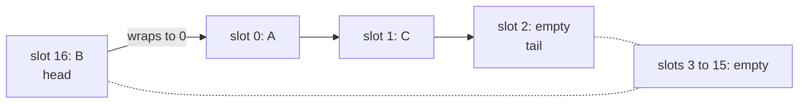
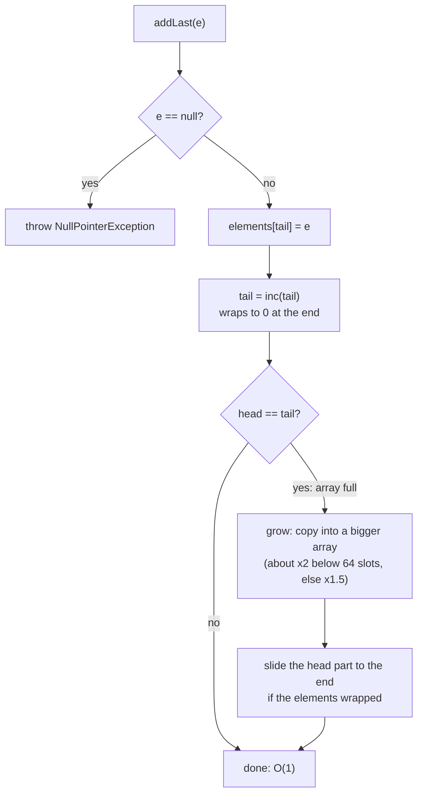
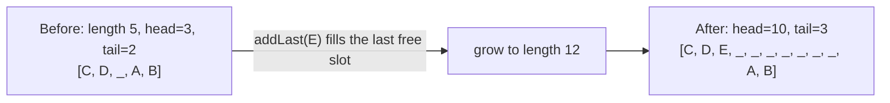

## In One Line
`ArrayDeque` is the JDK's **resizable circular array** implementation of [`Deque`](lesson:a03-collections/08-deque): two moving indexes, `head` and `tail`, wrap around the ends of one array, so adding and removing at **both ends is O(1)** without ever shifting elements — which makes it the default choice for a stack *and* a queue in single-threaded code.

## Mental Model
A **round table with numbered chairs** in a restaurant.

- Guests of one party sit in **consecutive chairs**. A card marks the chair of the first guest (`head`) and another card marks the **empty chair after the last guest** (`tail`).
- A late guest who joins at the back sits on the `tail` chair and the card moves one chair clockwise — `addLast`.
- A VIP who wants to be first sits on the chair *before* `head` and the head card moves one chair back — `addFirst`.
- Because the table is **round**, after chair 16 comes chair 0. Nobody ever stands up and shuffles along (no shifting); only the cards move.
- When the last free chair is taken, the party moves to a **bigger table** (a bigger array, elements copied over). It is expensive, but it happens rarely, so on average each guest costs O(1) — *amortised* O(1).
- Nobody is allowed to be "invisible" (`null`): an empty chair is how the waiter knows a seat is free.

In the code: the table is the `Object[] elements` array, the cards are the `int head` and `int tail` fields, and moving to a bigger table is the private `grow` method.

## Concept
### What it is
```java
public class ArrayDeque<E> extends AbstractCollection<E>
                           implements Deque<E>, Cloneable, Serializable
```
- Added in **Java 6** (authors Josh Bloch and Doug Lea), in `java.util`.
- Implements `Deque` → also `Queue`, `Collection`, `Iterable`, and since Java 21 `SequencedCollection`.
- **Not** a `List` and **not** `RandomAccess`: there is no `get(i)`, even though an array is underneath.
- **No capacity limit** (grows as needed), **no `null` elements**, **not thread-safe**, fail-fast iterators.
- The Javadoc: *"This class is likely to be faster than `Stack` when used as a stack, and faster than `LinkedList` when used as a queue."*

### Inside: a circular array (JDK 21 source, simplified)
```java
transient Object[] elements;   // all cells not holding elements are null; at least one is always null
transient int head;            // index of the first element (removed by pop()/poll())
transient int tail;            // index where the next addLast goes; elements[tail] is always null

public void addFirst(E e) {
    if (e == null) throw new NullPointerException();
    final Object[] es = elements;
    es[head = dec(head, es.length)] = e;         // step back, wrapping from 0 to length-1
    if (head == tail) grow(1);                   // array just became full
}

public void addLast(E e) {
    if (e == null) throw new NullPointerException();
    final Object[] es = elements;
    es[tail] = e;
    if (head == (tail = inc(tail, es.length)))   // step forward, wrapping from length-1 to 0
        grow(1);
}

public E pollFirst() {
    final Object[] es; final int h;
    E e = elementAt(es = elements, h = head);
    if (e != null) { es[h] = null; head = inc(h, es.length); }   // null slot = empty deque
    return e;
}

static final int inc(int i, int modulus) { if (++i >= modulus) i = 0; return i; }
static final int dec(int i, int modulus) { if (--i < 0) i = modulus - 1; return i; }
public int size() { return sub(tail, head, elements.length); }   // (tail - head) mod length
```
Key invariants:
- **Empty ⇔ `head == tail`.** Because one slot (at `tail`) is always kept `null`, "full" never looks like "empty": the moment an insert makes `head == tail`, the array is grown immediately.
- **Wrap-around** is a compare-and-reset (`inc`/`dec`), not the `%` operator — cheap and branch-predictable.
- `pollLast` is the mirror image: `tail = dec(tail)`, read, null the slot.
- `push` = `addFirst`, `pop` = `removeFirst`, `offer`/`add` = `addLast`, `poll` = `pollFirst`, `peek` = `peekFirst` — all O(1).

### Capacity and growth
| Construction | Array length | Usable before growing |
|---|---|---|
| `new ArrayDeque<>()` | 17 | 16 |
| `new ArrayDeque<>(n)` | n + 1 | n |
| `new ArrayDeque<>(0)` | 1 | 0 |
| `new ArrayDeque<>(collection)` | size + 1 | size |

**Growth rule** (`grow`): when full, the new length is `old + (old + 2)` while the array is small (`old < 64`, roughly doubling) and `old + old / 2` (×1.5) after that. From the default: **17 → 36 → 74 → 111 → 166 → 249 → 373**. If the elements were wrapped around the end, the "head part" is slid to the end of the new array so the circle stays intact. The maximum is about `Integer.MAX_VALUE - 8` slots (beyond that: `IllegalStateException("Sorry, deque too big")` or `OutOfMemoryError`).

**It never shrinks.** `clear()` nulls the used slots and resets `head = tail = 0`, but keeps the big array. There is no `trimToSize()`; to release memory, replace the deque with a new one.

### Version history (useful for "how does it work internally?" questions)
| Version | Change |
|---|---|
| Java 6–8 | Capacity always a **power of two** (default 16, minimum 8); indexes wrapped with a bit mask, e.g. `head = (head - 1) & (elements.length - 1)`; `doubleCapacity()` when full. |
| Java 9 | Rewritten (jsr166 update): **any capacity**, `inc`/`dec` wrapping, one always-free slot, growth ×2 when small and ×1.5 when large, linear-time `removeIf`/`removeAll`/`retainAll`. Default array still 16, so the 16th insert already triggered a resize. |
| Java 12 | Default array became `16 + 1`, so the promised 16 elements really fit. |
| Java 21 | Gains `reversed()` (through `Deque`) and the `SequencedCollection` supertype. |

### Why `null` is forbidden
Two reasons, one public and one internal:
1. **API**: `poll`/`peek` return `null` for "empty"; a stored `null` would be ambiguous.
2. **Implementation**: `ArrayDeque` uses `null` slots to *know* which cells are free — `pollFirst` literally returns `elements[head]` and treats `null` as "nothing there", and the iterator treats an unexpected `null` as a sign of concurrent modification. Storing `null` would break the data structure itself.

### Removing from the middle: shift the shorter side
`remove(Object)`, `removeFirstOccurrence`, `removeLastOccurrence` and `iterator.remove()` all end in a private `delete(i)`. It counts the elements **in front of** `i` and **behind** `i` and moves whichever side is **smaller** by one slot (advancing `head` or retreating `tail`). The search is still O(n), but the shifting costs only O(min(front, back)). Bulk removal (`removeIf`, `removeAll`, `retainAll`) marks victims in a bitset and compacts in **one linear pass**, so prefer `removeIf` over removing many elements one by one.

### Iterators: fail-fast, but only best effort
`ArrayDeque` has **no `modCount`** (unlike `ArrayList`/`HashMap`). Its iterator remembers the cursor index and how many elements remain, and throws `ConcurrentModificationException` only when it *notices* damage — for example the slot it expects is suddenly `null`, or a resize moved the elements. So modifying the deque during a for-each loop sometimes throws and sometimes silently "works" (see the Code section). Never rely on either: modify only through `iterator.remove()` or use `removeIf`.

### Other details
- `toString()` comes from `AbstractCollection` (first → last); `equals`/`hashCode` are **identity-based** (inherited from `Object`).
- `clone()` is **shallow**: it copies the array, not the elements.
- **Serializable**: `elements`, `head` and `tail` are `transient`; `writeObject` writes the size and then the elements in order, and `readObject` rebuilds a compact array — the wrap-around layout is not serialized.
- `spliterator()` reports `SIZED`, `SUBSIZED`, `ORDERED` and `NONNULL`, so parallel streams split it well.
- `descendingIterator()` walks tail → head without copying.

### Complexity
| Operation | Cost |
|---|---|
| `addFirst`, `addLast`, `offer*`, `push`, `add` | O(1) amortised (the occasional resize is O(n)) |
| `pollFirst`, `pollLast`, `pop`, `poll`, `remove()`, `peek*`, `get*` | O(1) |
| `size`, `isEmpty` | O(1) |
| `contains`, `remove(o)`, `removeFirstOccurrence`, `removeLastOccurrence`, `iterator.remove()` | O(n) |
| `removeIf`, `removeAll`, `retainAll`, `clear`, `toArray`, `clone` | O(n), one pass |

### ArrayDeque vs the alternatives
| | `ArrayDeque` | `LinkedList` | `Stack` | `ArrayList` |
|---|---|---|---|---|
| Structure | circular array | doubly linked nodes | array (extends `Vector`) | array |
| Add/remove at the front | O(1) | O(1) | not supported as an operation (index 0 insert is O(n)) | O(n) (shift) |
| Add/remove at the back | O(1) amortised | O(1) | O(1) amortised (`push`/`pop`) | O(1) amortised |
| Index access `get(i)` | **no** | O(n) | O(1) (inherited from `Vector`) | O(1) |
| `null` elements | **no** | yes | yes | yes |
| Synchronized | no | no | **yes** | no |
| Memory per element | one array slot | one node (~24 bytes) + links | one array slot | one array slot |
| Best for | stacks, queues, deques | list + deque in one, iterator splicing | legacy code only | indexed lists |

Why `ArrayDeque` beats `LinkedList` as a queue: no node object per element (less memory, far less garbage collection), and elements sit in contiguous memory, which the CPU cache prefetches. Why it beats `Stack`: no lock acquisition on every call and no `Vector` baggage. See [LinkedList](lesson:a03-collections/02-linkedlist) and [Stack](lesson:a03-collections/05-stack).

### When NOT to use ArrayDeque
- You need **index access** or `List` methods → `ArrayList` (or `LinkedList`).
- You need to store **`null`** → `LinkedList` (or a sentinel object).
- **Multiple threads** share it → `ConcurrentLinkedDeque` (non-blocking) or `LinkedBlockingDeque` / `ArrayBlockingQueue` (blocking). There is no `Collections.synchronizedDeque`.
- You need **priority order** → `PriorityQueue`.

## Diagram

The original example right after `addLast("C")`: `addFirst("B")` stepped `head` back from 0 to 16, so the deque `[B, A, C]` already **wraps around** the end of the 17-slot array. Iteration starts at `head` and follows the arrows.


Insertion is a store plus an index bump; the rare resize is what makes it *amortised* O(1). `addFirst` is the mirror image with `head = dec(head)`.


Growing a wrapped deque: the elements before the wrap (`C, D, E`) stay at the start, and the head part (`A, B`) is slid to the end of the new array, so the logical order `[A, B, C, D, E]` is preserved.

## Code
@example Collections/Queues/ArrayDequeExample.java

**Looking inside** the original example with reflection. `elements`, `head` and `tail` are private to `java.util`, so the JVM must be told to open the package: run it with `java --add-opens java.base/java.util=ALL-UNNAMED Inside.java` (never do this in production code — it is only a learning tool).
```java
import java.lang.reflect.Field;
import java.util.*;

public class Inside {
    static Field ELEMENTS, HEAD, TAIL;
    static {
        try {
            ELEMENTS = ArrayDeque.class.getDeclaredField("elements");
            HEAD = ArrayDeque.class.getDeclaredField("head");
            TAIL = ArrayDeque.class.getDeclaredField("tail");
            ELEMENTS.setAccessible(true); HEAD.setAccessible(true); TAIL.setAccessible(true);
        } catch (ReflectiveOperationException e) { throw new RuntimeException(e); }
    }

    static void show(String step, ArrayDeque<?> d) throws Exception {
        Object[] es = (Object[]) ELEMENTS.get(d);
        StringBuilder used = new StringBuilder();
        for (int i = 0; i < es.length; i++) if (es[i] != null) used.append(i).append('=').append(es[i]).append(' ');
        System.out.printf("%-14s length=%d head=%-2d tail=%d  slots: %s -> %s%n",
                step, es.length, HEAD.getInt(d), TAIL.getInt(d),
                used.length() == 0 ? "(none)" : used.toString().trim(), d);
    }

    public static void main(String[] args) throws Exception {
        ArrayDeque<String> deque = new ArrayDeque<>();
        show("new", deque);
        deque.add("A");       show("add(A)", deque);
        deque.addFirst("B");  show("addFirst(B)", deque);
        deque.addLast("C");   show("addLast(C)", deque);
        deque.removeFirst();  show("removeFirst()", deque);
        deque.removeLast();   show("removeLast()", deque);
    }
}
```
```output
new            length=17 head=0  tail=0  slots: (none) -> []
add(A)         length=17 head=0  tail=1  slots: 0=A -> [A]
addFirst(B)    length=17 head=16 tail=1  slots: 0=A 16=B -> [B, A]
addLast(C)     length=17 head=16 tail=2  slots: 0=A 1=C 16=B -> [B, A, C]
removeFirst()  length=17 head=0  tail=2  slots: 0=A 1=C -> [A, C]
removeLast()   length=17 head=0  tail=1  slots: 0=A -> [A]
```

Capacity growth and the constructors (same reflection trick, same `--add-opens` flag):
```java
ArrayDeque<Integer> d = new ArrayDeque<>();
List<String> steps = new ArrayList<>();
int last = capacity(d);                       // capacity(d) = ((Object[]) ELEMENTS.get(d)).length
steps.add("start " + last);
for (int i = 1; i <= 300; i++) {
    d.addLast(i);
    int now = capacity(d);
    if (now != last) { steps.add("size " + i + " -> " + now); last = now; }
}
System.out.println(String.join(", ", steps));
d.clear();
System.out.println("after clear(): size=" + d.size() + " array length=" + capacity(d));
System.out.println("new ArrayDeque<>(100): " + capacity(new ArrayDeque<Integer>(100)));
System.out.println("new ArrayDeque<>(0):   " + capacity(new ArrayDeque<Integer>(0)));
System.out.println("new ArrayDeque<>(List.of(1, 2, 3)): " + capacity(new ArrayDeque<>(List.of(1, 2, 3))));
```
```output
start 17, size 17 -> 36, size 36 -> 74, size 74 -> 111, size 111 -> 166, size 166 -> 249, size 249 -> 373
after clear(): size=0 array length=373
new ArrayDeque<>(100): 101
new ArrayDeque<>(0):   1
new ArrayDeque<>(List.of(1, 2, 3)): 4
```
The 17th element fills the last free slot, so the array grows on that insert (17 → 36). After `clear()` the 373-slot array is still there.

Wrap-around growth, and `delete` shifting the **shorter** side (`show` prints `head`, `tail` and the raw array with `null` as `_`):
```java
ArrayDeque<String> d = new ArrayDeque<>(4);     // array length 5
d.addLast("C"); d.addLast("D");
d.addFirst("B"); d.addFirst("A");
show("4 elements", d);
d.addLast("E");                                  // array full -> grow
show("addLast(E)", d);

ArrayDeque<Integer> n = new ArrayDeque<>();
for (int i = 1; i <= 8; i++) n.addLast(i);
show("1..8", n);
n.remove((Integer) 7);                           // near the tail: shift the back part left
show("remove(7)", n);
n.remove((Integer) 2);                           // near the head: shift the front part right
show("remove(2)", n);
```
```output
4 elements        head=3  tail=2  [C, D, _, A, B] -> [A, B, C, D]
addLast(E)        head=10 tail=3  [C, D, E, _, _, _, _, _, _, _, A, B] -> [A, B, C, D, E]
1..8              head=0  tail=8  [1, 2, 3, 4, 5, 6, 7, 8, _, _, _, _, _, _, _, _, _] -> [1, 2, 3, 4, 5, 6, 7, 8]
remove(7)         head=0  tail=7  [1, 2, 3, 4, 5, 6, 8, _, _, _, _, _, _, _, _, _, _] -> [1, 2, 3, 4, 5, 6, 8]
remove(2)         head=1  tail=7  [_, 1, 3, 4, 5, 6, 8, _, _, _, _, _, _, _, _, _, _] -> [1, 3, 4, 5, 6, 8]
```
Removing `7` moved only `8` (the back side was shorter; `tail` went back). Removing `2` moved only `1` (the front side was shorter; `head` went forward).

Best-effort fail-fast — the same mistake, three different outcomes:
```java
Deque<String> roomy = new ArrayDeque<>();          // 17 slots, no resize below
roomy.addAll(List.of("a", "b", "c"));
for (String s : roomy) {
    System.out.print(s + " ");
    if (s.equals("a")) roomy.addLast("d");         // no exception!
}
System.out.println("-> " + roomy);

Deque<String> tight = new ArrayDeque<>(List.of("a", "b", "c"));   // exactly 4 slots
try {
    for (String s : tight) {
        System.out.print(s + " ");
        if (s.equals("a")) tight.addLast("d");     // forces a resize that moves elements
    }
} catch (ConcurrentModificationException e) {
    System.out.println("-> ConcurrentModificationException");
}

Deque<String> d3 = new ArrayDeque<>();
d3.addAll(List.of("a", "b", "c"));
try {
    for (String s : d3) {
        System.out.print(s + " ");
        if (s.equals("a")) d3.pollLast();          // nulls a slot the iterator still expects
    }
} catch (ConcurrentModificationException e) {
    System.out.println("-> ConcurrentModificationException");
}
```
```output
a b c -> [a, b, c, d]
a -> ConcurrentModificationException
a b -> ConcurrentModificationException
```
The first loop "works" only because the iterator counted 3 remaining elements when it started and nothing moved, so it never sees `d`. The second resizes the array (the element slots move, the iterator's next slot becomes `null`). The third nulls the slot of `c` before the iterator reaches it. An `ArrayList` would throw in all three cases, because it checks a modification counter.

Same class, stack or queue — only the methods differ; and `clone()` is shallow:
```java
Deque<Integer> stack = new ArrayDeque<>();
Queue<Integer> queue = new ArrayDeque<>();
for (int i = 1; i <= 3; i++) { stack.push(i); queue.offer(i); }
System.out.println("stack pops: " + stack.pop() + stack.pop() + stack.pop()
        + "  queue polls: " + queue.poll() + queue.poll() + queue.poll());

ArrayDeque<StringBuilder> orig = new ArrayDeque<>(List.of(new StringBuilder("a"), new StringBuilder("b")));
ArrayDeque<StringBuilder> copy = orig.clone();
copy.pollFirst();                    // structure is independent...
copy.peekFirst().append("!");        // ...but the elements are shared
System.out.println("orig=" + orig + " copy=" + copy);
```
```output
stack pops: 321  queue polls: 123
orig=[a, b!] copy=[b!]
```

## Walkthrough
- `package Collections.Queues;` and `import java.util.ArrayDeque;` — only the class is imported because the variable is declared with the class type.
- `ArrayDeque<String> deque = new ArrayDeque<>();` — creates an empty deque with a 17-slot array, `head = tail = 0`. Declaring the variable as `ArrayDeque` (not `Deque`) works but exposes class-only methods such as `clone()`; declaring it as `Deque<String>` is the more flexible habit.
- `deque.add("A");` — `add` is the `Queue`/`Collection` insert, identical to `addLast`: `A` goes into slot 0, `tail` becomes 1. Deque: `[A]`.
- `deque.addFirst("B");` — `head` steps back from 0 and **wraps to 16** (the last slot); `B` is stored there. Deque: `[B, A]`.
- `deque.addLast("C");` — `C` goes into slot 1 (the old `tail`), `tail` becomes 2. Deque: `[B, A, C]` — physically spread over slots 16, 0, 1 (see the first diagram and the reflection output).
- `System.out.println("ArrayDeque: " + deque);` — `toString()` walks from `head` around the circle to `tail`: `ArrayDeque: [B, A, C]`.
- `deque.getFirst()` → `B` and `deque.getLast()` → `C` — O(1) reads of `elements[head]` and `elements[tail - 1]`; nothing is removed. On an empty deque they would throw `NoSuchElementException`.
- `deque.removeFirst();` — nulls slot 16 and moves `head` forward, wrapping to 0; returns `B` (ignored). `deque.removeLast();` — moves `tail` back to 1 and nulls slot 1; returns `C` (ignored). Deque: `[A]`, and the 17-slot array is kept.
- `for (String element : deque)` — the iterator starts at `head` and returns the one remaining element, `A`.
- Every `// Output:` comment matches the recorded run.

## Traps
> [!NOTE] The example is correct: every `// Output:` comment matches the recorded run. Style points only: the variable is declared as the concrete `ArrayDeque<String>` rather than the interface `Deque<String>`; the removed elements returned by `removeFirst()`/`removeLast()` are ignored; and the package `Collections.Queues` should be lowercase by convention. The program is almost a copy of the [Deque](lesson:a03-collections/08-deque) example — the new idea here is *how* the class stores the elements.

- **`add(null)` / `push(null)` / `offer(null)` throw `NullPointerException`.** Code migrated from `Stack` or `LinkedList` that stored `null` breaks.
- **No index access**: `deque.get(0)` does not compile (`cannot find symbol ... method get(int) ... variable deque of type ArrayDeque<String>`). Use `peekFirst()`/`peekLast()` or an iterator.
- **It never shrinks.** A deque that once held a million elements keeps its big array after `clear()` or after polling everything. Replace it (`deque = new ArrayDeque<>()`) if memory matters.
- **Not thread-safe.** Concurrent `offer`/`poll` from several threads can lose elements or corrupt `head`/`tail`. Use `ConcurrentLinkedDeque` or a `BlockingQueue`/`BlockingDeque`.
- **Fail-fast is best effort** — modifying during a for-each may throw or may silently skip elements. Use `iterator.remove()` or `removeIf`.
- **`contains` and `remove(Object)` are O(n)** — an `ArrayDeque` is not a set. Pair it with a `HashSet` if you need fast membership (as in BFS's `seen` set).
- **`equals` compares identity**, and `clone()` is shallow (the elements are shared).
- **`push` vs `add` go to opposite ends** — `push` = `addFirst`, `add` = `addLast`. Filling with `add` and emptying with `pop` gives FIFO, not LIFO.

## Tips & Tricks
- **Mnemonic — "two cards on a round table":** `head` marks the first guest, `tail` marks the free chair after the last one; both just move around the circle.
- **Numbers to remember (JDK 21):** default 16 elements (17 slots), grows ~×2 below 64 slots and ×1.5 above, never shrinks.
- **Pre-size it** when you know the size: `new ArrayDeque<>(expected)` avoids all resizes.
- **Default declarations:** `Deque<T> stack = new ArrayDeque<>();` and `Queue<T> queue = new ArrayDeque<>();` — the interface type documents *how* you use it.
- **Bulk delete with `removeIf`** (one linear pass) rather than many `remove(o)` calls.
- **Interview line:** "`ArrayDeque` is a circular array with head and tail indexes. Both ends are O(1) amortised with no shifting and no per-element nodes, so it beats `LinkedList` as a queue and `Stack` as a stack. The trade-offs: no `null`, no index access, not thread-safe."

## Interview Q&A
### [Basic] What is ArrayDeque and when would you use it?
`ArrayDeque` (Java 6) is a resizable-array implementation of the `Deque` interface. It supports O(1) amortised insertion and removal at both ends, so it is the go-to class for a **stack** (`push`/`pop`/`peek`), a **FIFO queue** (`offer`/`poll`/`peek`) or a **double-ended queue** in single-threaded code. It has no capacity limit, rejects `null`, is not synchronized, and has fail-fast iterators. I use it wherever older code would use `Stack` or `LinkedList` as a queue — BFS, DFS with an explicit stack, undo history, sliding windows.

**Follow-up:** *What does `new ArrayDeque<>()` allocate?* — In JDK 12+ an array of 17 slots, enough for 16 elements (one slot always stays empty).

### [Basic] Why is ArrayDeque preferred over Stack and LinkedList?
Over **`Stack`**: `Stack` extends `Vector`, so every call is synchronized (lock overhead with no real benefit for single-threaded code), and it inherits index methods that break LIFO; `ArrayDeque` is unsynchronized and exposes only deque operations. Over **`LinkedList`**: `LinkedList` allocates a node object (item + two links, about 24 bytes) per element, scattered across the heap, which costs memory, garbage-collection work and cache misses; `ArrayDeque` stores references in one contiguous array. The `ArrayDeque` Javadoc itself says it is likely faster than `Stack` as a stack and than `LinkedList` as a queue.

**Follow-up:** *When would you still pick `LinkedList`?* — When you need `null` elements, `List` methods on the same object, or O(1) insert/remove in the middle through a `ListIterator`.

### [Intermediate] How does ArrayDeque work internally?
It keeps an `Object[] elements` and two indexes: `head` (the first element) and `tail` (the slot where the next `addLast` goes, always `null`). `addLast` stores at `tail` and increments it; `addFirst` decrements `head` and stores there. Both indexes **wrap around** — past the last slot they continue at 0, and before 0 they continue at the last slot — so the array is used as a circle and nothing is ever shifted. `head == tail` means empty; as soon as an insert makes them equal, the array is full and is grown. `size()` is `(tail - head)` modulo the length. Removals null the slot and move the index, so the removed object can be garbage collected.

**Follow-up:** *How did Java 8 do the wrap-around?* — Capacities were always powers of two, so it used a bit mask: `head = (head - 1) & (elements.length - 1)`. Java 9 switched to arbitrary capacities with compare-and-reset `inc`/`dec` helpers.

### [Intermediate] How does ArrayDeque grow, and does it ever shrink?
When an insert fills the last free slot, `grow` allocates a bigger array: if the old length is below 64 the new length is `old + old + 2` (about double), otherwise `old * 1.5`. From the default 17 slots it goes 17 → 36 → 74 → 111 → 166 → 249 → 373. `Arrays.copyOf` copies the slots; if the elements wrapped around the end, the part from `head` to the old end is slid to the end of the new array so the circle stays contiguous. Each element is copied O(1) times on average, so insertion is amortised O(1). It **never shrinks**: `clear()` and polling keep the array, and there is no `trimToSize()`.

**Follow-up:** *How do you avoid resizing?* — Pass the expected size to the constructor: `new ArrayDeque<>(1000)` allocates 1001 slots up front.

### [Intermediate] Why doesn't ArrayDeque allow null elements?
First, the API: `poll`, `peek`, `pollLast` and friends return `null` to mean "empty", so a stored `null` would be ambiguous. Second, the implementation depends on it: every free slot is `null`, `pollFirst` simply returns `elements[head]` and treats `null` as "no element", and the iterator treats an unexpected `null` slot as evidence of concurrent modification. So `addFirst`, `addLast`, `push`, `offer` and `add` all throw `NullPointerException` for `null`.

**Follow-up:** *What if you need "no value" in the deque?* — Use a sentinel object or `Optional`, or use `LinkedList`, which accepts `null`.

### [Intermediate] Is ArrayDeque thread-safe? What do you use for concurrent access?
No — it has no locks and no volatile fields; concurrent modification can corrupt `head`/`tail` or lose elements, and its fail-fast iterator only detects some problems. There is no `Collections.synchronizedDeque` wrapper. For concurrency use `ConcurrentLinkedDeque` (lock-free, non-blocking; `size()` is O(n)), `LinkedBlockingDeque` (blocking `putFirst`/`takeLast`, optionally bounded), or for plain queues `ConcurrentLinkedQueue`, `ArrayBlockingQueue` or `LinkedBlockingQueue`.

**Follow-up:** *Could you wrap it with `Collections.synchronizedCollection`?* — You could, but the wrapper only exposes `Collection` methods — no `push`/`pollFirst` — so it is useless as a deque; use a concurrent class instead.

### [Advanced] Is ArrayDeque's iterator fail-fast? Can modifying it during iteration go unnoticed?
It is fail-fast on a **best-effort** basis, and it has no `modCount`. The iterator stores the current index and the number of elements left; it throws `ConcurrentModificationException` only when it sees a `null` in a slot it expected to hold an element (for example after `pollLast` or after a resize moved the elements). If you `addLast` during a for-each and no resize happens, nothing is thrown and the loop simply does not visit the new element — in the lesson's demo `a b c -> [a, b, c, d]`. With a tightly sized deque the same code throws. That is why the Javadoc says fail-fast behaviour "should be used only to detect bugs". Correct approaches: `iterator.remove()`, `removeIf`, or collect changes and apply them after the loop.

**Follow-up:** *How does `ArrayList` detect it?* — It increments `modCount` on every structural change; the iterator compares it with its saved `expectedModCount` on each `next()`, so it throws reliably in single-threaded code.

### [Advanced] Implement a fixed-capacity circular deque (a common coding round question).
Store the elements in an array, track `head` and `size`, and compute positions with modulo arithmetic:
```java
static class CircularDeque<E> {
    private final Object[] es;
    private int head;    // index of the first element
    private int size;

    CircularDeque(int capacity) { es = new Object[capacity]; }

    boolean offerFirst(E e) {
        if (size == es.length) return false;
        head = (head - 1 + es.length) % es.length;      // step left, wrap to the end
        es[head] = e;
        size++;
        return true;
    }

    boolean offerLast(E e) {
        if (size == es.length) return false;
        es[(head + size) % es.length] = e;              // slot after the last element
        size++;
        return true;
    }

    @SuppressWarnings("unchecked")
    E pollFirst() {
        if (size == 0) return null;
        E e = (E) es[head];
        es[head] = null;                                 // let GC reclaim it
        head = (head + 1) % es.length;
        size--;
        return e;
    }

    @SuppressWarnings("unchecked")
    E pollLast() {
        if (size == 0) return null;
        int last = (head + size - 1) % es.length;
        E e = (E) es[last];
        es[last] = null;
        size--;
        return e;
    }

    @Override public String toString() {
        StringJoiner sj = new StringJoiner(", ", "[", "]");
        for (int i = 0; i < size; i++) sj.add(String.valueOf(es[(head + i) % es.length]));
        return sj.toString();
    }
}

CircularDeque<Integer> d = new CircularDeque<>(3);
System.out.println(d.offerLast(1) + " " + d.offerLast(2) + " " + d.offerFirst(0) + " " + d.offerFirst(-1));
System.out.println(d + " pollLast=" + d.pollLast() + " pollFirst=" + d.pollFirst() + " -> " + d);
d.offerFirst(9);
System.out.println(d + " head index=" + d.head);
```
```output
true true true false
[0, 1, 2] pollLast=2 pollFirst=0 -> [1]
[9, 1] head index=2
```
All operations are O(1). Keeping an explicit `size` (instead of the JDK's "one slot always empty" trick) is the simplest way to tell full from empty. Adding `+ es.length` before `%` in `offerFirst` avoids a negative index, because Java's `%` keeps the sign of the dividend (`-1 % 3` is `-1`).

**Follow-up:** *How would you make it growable?* — When full, allocate a bigger array and copy the elements in logical order (`es[(head + i) % old.length]` to index `i`), then set `head = 0` — exactly what `ArrayDeque.grow` does, just without its slide optimisation.

### [Advanced] What is the cost of removing an element from the middle of an ArrayDeque?
`remove(o)`/`removeFirstOccurrence(o)` first search linearly (O(n)), then call `delete(i)`, which moves either the elements in front of `i` one slot forward (and advances `head`) or the elements behind `i` one slot back (and retreats `tail`) — whichever group is **smaller**. So the shifting is O(min(i, n - i)), and removing near either end is cheap. Many removals should use `removeIf`, which marks the victims in a bitset and compacts in one O(n) pass instead of O(n) per removal.

**Follow-up:** *Why not use `LinkedList` for middle removals?* — `LinkedList` also has to search O(n) to find the element; its O(1) unlink only helps when you are already positioned there with an iterator.

## Quiz
### What does the original example print on its first line?
- [ ] ArrayDeque: [A, B, C]
- [x] ArrayDeque: [B, A, C]
- [ ] ArrayDeque: [B, C, A]
- [ ] ArrayDeque: [C, A, B]
> `add("A")` → `[A]`; `addFirst("B")` puts `B` in front → `[B, A]`; `addLast("C")` appends → `[B, A, C]`. `[A, B, C]` would require every call to append, as `ArrayList.add` does.

### After `new ArrayDeque<>()` in JDK 21, how many elements fit before the internal array grows?
- [ ] 10
- [x] 16 (the array has 17 slots)
- [ ] 17 (the array has 17 slots)
- [ ] 8
> The default constructor allocates `new Object[16 + 1]`; one slot must always stay empty, so 16 elements fit and the 17th insert triggers `grow`. 10 is `ArrayList`'s default, and 8 was Java 8's *minimum* power-of-two capacity for `ArrayDeque(int)`.

### What does this print?
```java
ArrayDeque<String> d = new ArrayDeque<>();
d.add("x");
try { d.add(null); } catch (NullPointerException e) { System.out.print("NPE "); }
System.out.println(d.size());
```
- [ ] 2
- [x] NPE 1
- [ ] NPE 2
- [ ] 1
> `ArrayDeque` rejects `null` before touching the array, so the size stays 1. A `LinkedList` would accept the `null` and print `2`.

### What does this print?
```java
ArrayDeque<Integer> q = new ArrayDeque<>();
for (int i = 1; i <= 3; i++) { q.offerLast(i); q.offerFirst(-i); }
System.out.println(q + " " + q.pollFirst() + " " + q.peekLast());
```
- [ ] [-1, 1, -2, 2, -3, 3] -1 3
- [x] [-3, -2, -1, 1, 2, 3] -3 3
- [ ] [1, 2, 3, -1, -2, -3] 1 -3
- [ ] [-3, -2, -1, 1, 2, 3] -3 2
> Positives are appended at the tail in order `1, 2, 3`; negatives are inserted at the head, so the last one (`-3`) ends up first. The deque is printed before `pollFirst()` removes `-3`; `peekLast()` only looks at `3`. The interleaved option ignores that `offerFirst` inserts in front of everything.

### What does this print?
```java
Deque<String> d = new ArrayDeque<>();
d.addAll(List.of("a", "b", "c"));
for (String s : d) {
    System.out.print(s + " ");
    if (s.equals("a")) d.addLast("d");
}
System.out.println("-> " + d);
```
- [x] a b c -> [a, b, c, d]
- [ ] a b c d -> [a, b, c, d]
- [ ] a, then ConcurrentModificationException
- [ ] Infinite loop
> `ArrayDeque`'s iterator has no modification counter: it counted 3 remaining elements at the start and walks the slots, which have not moved (the 17-slot array does not need to grow). So it prints `a b c`, never visits `d`, and throws nothing. With `new ArrayDeque<>(List.of("a", "b", "c"))` (exactly 4 slots) the `addLast` forces a resize and the loop does throw `ConcurrentModificationException` — fail-fast is only best effort, so never modify a collection inside a for-each.

### Which operation on an `ArrayDeque` of n elements is NOT O(1) (amortised)?
- [ ] `addFirst(e)`
- [ ] `pollLast()`
- [x] `contains(o)`
- [ ] `peekFirst()`
> `contains` must scan the array from `head` to `tail` comparing with `equals` — O(n). The end operations only store or read one slot and move an index.

### Spot the bug: memory stays high after processing a burst of one million jobs.
```java
private final Deque<Job> jobs = new ArrayDeque<>();

void drain() {
    Job j;
    while ((j = jobs.pollFirst()) != null) process(j);
}
```
- [ ] `pollFirst()` does not remove the element, so the jobs stay referenced
- [x] The backing array grew to over a million slots and `ArrayDeque` never shrinks it
- [ ] `ArrayDeque` keeps a hidden copy of every polled element
- [ ] `while` with assignment leaks memory
> `pollFirst()` nulls each slot, so the `Job` objects themselves can be collected, but the empty array of a million-plus references (several megabytes) stays for the lifetime of the deque. If bursts are rare, replace the deque (`jobs = new ArrayDeque<>()`, with the field no longer `final`) or bound the queue.

## Takeaways
- `ArrayDeque` (Java 6) is a circular resizable array with `head` and `tail` indexes that wrap around, giving O(1) amortised add/remove/peek at both ends with no shifting.
- It is the default for stacks (`push`/`pop`/`peek`) and queues (`offer`/`poll`/`peek`): faster than `Stack` (no locks) and than `LinkedList` (no nodes, cache-friendly).
- JDK 12+: default 17 slots = 16 elements; `new ArrayDeque<>(n)` gives n + 1 slots; grows ~×2 below 64 slots, ×1.5 above; never shrinks, even after `clear()`.
- One slot is always `null`, so `head == tail` means empty; `null` elements are forbidden (`NullPointerException`), both for the `poll`/`peek` contract and because free slots are `null`.
- No index access, not `RandomAccess`, identity `equals`, shallow `clone()`; `contains`/`remove(o)` are O(n), and `delete` shifts the shorter side.
- Not thread-safe, and its fail-fast iterator is best effort (no `modCount`); use `ConcurrentLinkedDeque`/`LinkedBlockingDeque` for threads and `iterator.remove()`/`removeIf` for removal during iteration.
