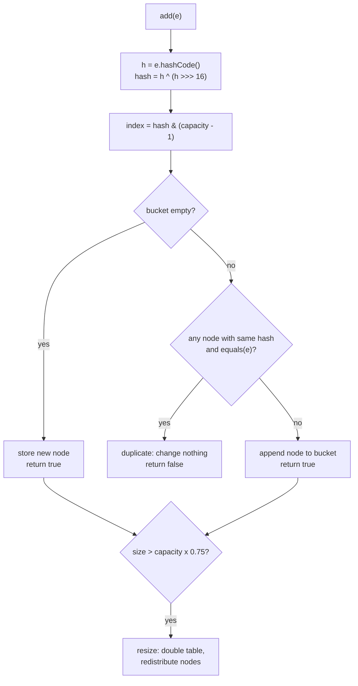
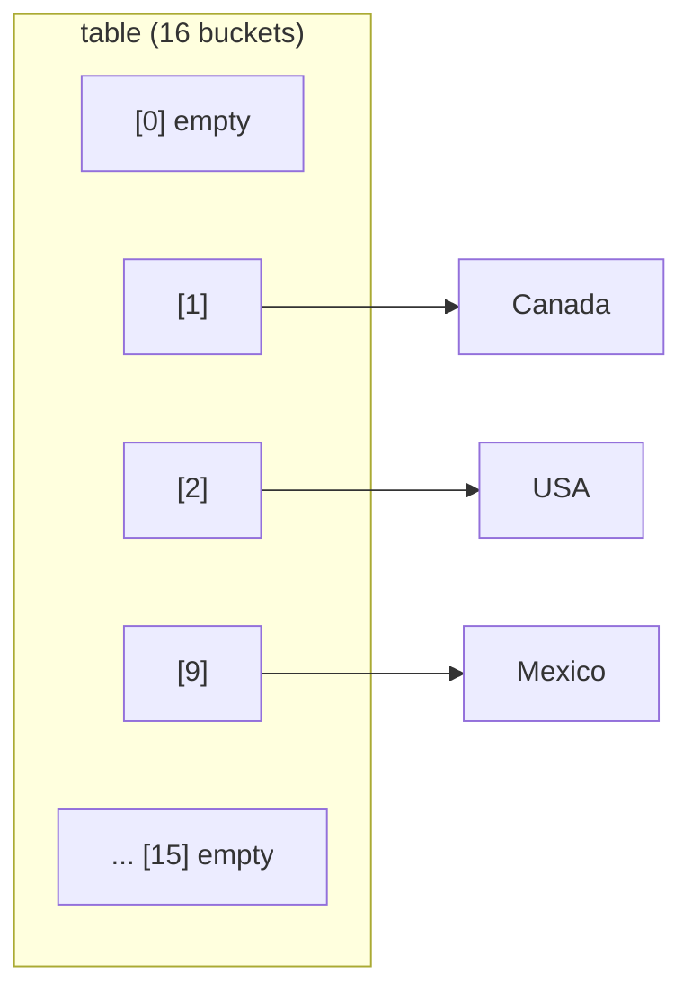
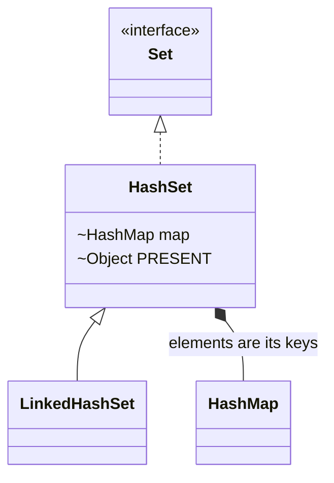

## In One Line
`HashSet` is a `Set` built on a hash table (in fact on a `HashMap`): it keeps each element **at most once**, answers `add` / `contains` / `remove` in **O(1) on average**, allows one `null`, and makes **no promise about order**.

## Mental Model
Picture a **post-office sorting wall** of numbered pigeonholes.

- To file a letter, the clerk runs the addressee's name through a formula and gets a box number. That formula is `hashCode()`, and the box is a **bucket**.
- To check whether a letter is already filed, the clerk does not scan the whole wall. They compute the box number, open **that one box**, and compare the few letters inside one by one. That comparison is `equals()`.
- Two different names can land in the same box (a **collision**). That is fine: they sit together and `equals()` tells them apart.
- Reading the wall from box 0 to box 15 gives "box order", which has nothing to do with when the letters arrived. That is why a `HashSet` prints in an order that looks random.
- When the wall is 75% full, the post office builds a wall **twice as big** and refiles everything (**resize**). Box numbers change, so the reading order can change too.
- If someone changes the name on a letter *after* it was filed (a mutable element), the formula now points to a different box and nobody can find the letter again.

## Concept
### The `Set` contract
- A `Set` holds **no duplicates**. "Duplicate" means `a.equals(b)` (for hash-based sets, together with equal `hashCode()`s).
- `add(e)` returns `true` if the set changed and `false` if `e` was already there. This return value is a free duplicate detector.
- `Set` adds **no new instance methods** to `Collection` — no `get(index)`, no `indexOf`. You can only add, remove, test membership and iterate. (It does add the static factories `Set.of` and `Set.copyOf`.)
- Main implementations: `HashSet` (hash table, no order), `LinkedHashSet` (hash table + linked list, insertion order), `TreeSet` (red-black tree, sorted), `EnumSet` (bit vector for enums), and the concurrent `ConcurrentHashMap.newKeySet()`, `CopyOnWriteArraySet`, `ConcurrentSkipListSet`.

### A HashSet is a HashMap in disguise
Open the JDK 21 source and you find this (simplified):
```java
public class HashSet<E> extends AbstractSet<E> implements Set<E>, Cloneable, java.io.Serializable {
    transient HashMap<E, Object> map;
    static final Object PRESENT = new Object();   // dummy value shared by all keys

    public boolean add(E e)          { return map.put(e, PRESENT) == null; }
    public boolean contains(Object o) { return map.containsKey(o); }
    public boolean remove(Object o)  { return map.remove(o) == PRESENT; }
}
```
Every element is stored as a **key** of an internal `HashMap`; the value is always the same dummy object `PRESENT`. So everything you learn about `HashMap` keys applies directly to `HashSet` elements. `map.put` returns the previous value — `null` means "the key was new", which is exactly when `add` should return `true`.

### What happens inside `add(e)`
1. Call `e.hashCode()` (a `null` element gets hash `0`).
2. **Spread** the bits: `hash = h ^ (h >>> 16)`. This mixes the high 16 bits into the low bits, because only the low bits are used to pick a bucket.
3. **Pick the bucket**: `index = hash & (capacity - 1)`. Capacity is always a power of two, so this is a fast version of `hash % capacity`.
4. If the bucket is empty, store a new node there → `add` returns `true`.
5. Otherwise walk the nodes in that bucket. For each one, compare the stored hash first (cheap), then `==`, then `equals()`. If a match is found, the element is a duplicate → `add` returns `false` and nothing changes.
6. No match → append a node to the bucket (Java 8+ appends at the tail). If a bucket grows to 8 nodes and the table has at least 64 buckets, that bucket becomes a small red-black tree.
7. If `size` now exceeds `capacity × loadFactor`, **resize**: double the table and redistribute all nodes.

`contains` and `remove` use steps 1–5 in the same way. The deep details (treeification, how resize splits buckets, why Java 7 could loop forever) are in [HashMap Internals](lesson:b04-collections-internals/01-hashmap-internals).

### Why the example prints `[Canada, USA, Mexico]`
Iteration walks the table **from bucket 0 upwards**. Running the formula above for a table of 16 buckets:

| Element | `hashCode()` | after spreading | bucket (`& 15`) |
|---|---|---|---|
| `"USA"` | 84323 | 84322 | **2** |
| `"Canada"` | 2011108078 | 2011129137 | **1** |
| `"Mexico"` | -1993568043 | -1993598471 | **9** |

Bucket 1, then 2, then 9 → `Canada, USA, Mexico`. Not insertion order, not alphabetical order — **bucket order**.

`String.hashCode()` is defined by a fixed formula (`s[0]*31^(n-1) + ... + s[n-1]`), so this order is the same on every run of the same JDK, which is why the recorded output is stable. But the order is **not part of the contract**: it depends on the capacity, the insertion history (who got to a shared bucket first) and the JDK version. For objects that use the default identity `hashCode()`, it can even change between runs.

### The equals/hashCode contract
A hash set works only if elements obey this rule: **if `a.equals(b)` then `a.hashCode() == b.hashCode()`**.
- Override `equals` but not `hashCode` → two "equal" objects usually get different identity hash codes, land in different buckets, and `equals` is never even called. The set happily stores both — duplicates.
- Override `hashCode` but not `equals` → the objects share a bucket, but the default `equals` is `==`, so they still count as different.
- The reverse is not required: two unequal objects may share a hash code (a collision). That only costs speed.

Records, `String`, the wrapper classes and enums already get this right. See [equals and hashCode](lesson:b01-fundamentals/06-object-class-equals-hashcode) for writing your own.

### Capacity, load factor and resizing
| Setting | Default | Meaning |
|---|---|---|
| Initial capacity | 16 buckets | Rounded up to a power of two. The table is created lazily on the first `add`. |
| Load factor | 0.75 | Resize when `size > capacity × 0.75` (12 for 16 buckets). |
| Growth | ×2 | 16 → 32 → 64 … Every element is redistributed. |

Constructors: `HashSet()`, `HashSet(int initialCapacity)`, `HashSet(int initialCapacity, float loadFactor)`, `HashSet(Collection c)` (sized so the whole collection fits without a resize, minimum 16 buckets), and since **Java 19** the factory `HashSet.newHashSet(int expectedSize)`, which does the load-factor maths for you.

> [!WARNING] `new HashSet<>(100)` does **not** mean "room for 100". It creates 128 buckets, which resize after 96 elements. `HashSet.newHashSet(100)` creates 256 buckets so 100 elements fit without a resize.

### Complexity
| Operation | Average | Worst case |
|---|---|---|
| `add`, `remove`, `contains` | O(1) | O(log n) when a bucket has been turned into a tree (Java 8+, `Comparable` elements); O(n) before Java 8 |
| `size`, `isEmpty` | O(1) | O(1) |
| Iteration | O(n + capacity) | — the empty buckets are visited too |

### HashSet vs LinkedHashSet vs TreeSet
| | `HashSet` | `LinkedHashSet` | `TreeSet` |
|---|---|---|---|
| Backed by | `HashMap` | `LinkedHashMap` | `TreeMap` (red-black tree) |
| Iteration order | None promised (bucket order) | **Insertion order** | **Sorted** (natural or `Comparator`) |
| Duplicates decided by | `hashCode` + `equals` | `hashCode` + `equals` | `compareTo` / `compare` |
| `null` | One allowed | One allowed | Not with natural ordering (NPE) |
| add / contains / remove | O(1) | O(1), slightly slower | O(log n) |
| Memory | Low | Higher (two extra links per entry) | Highest (tree node per entry) |
| Since | 1.2 | 1.4 | 1.2 |

`LinkedHashSet` has no lesson of its own: it is simply a `HashSet` whose internal map is a `LinkedHashMap`, so it remembers insertion order. Everything in [LinkedHashMap](lesson:a03-collections/15-linkedhashmap) about insertion order applies to it. Since Java 21 it is also a `SequencedSet` (`getFirst()`, `getLast()`, `reversed()`, `addFirst()`, `addLast()`).

### Set algebra
| Maths | Java (mutates the receiver) |
|---|---|
| A ∪ B (union) | `a.addAll(b)` |
| A ∩ B (intersection) | `a.retainAll(b)` |
| A − B (difference) | `a.removeAll(b)` |
| B ⊆ A (subset) | `a.containsAll(b)` |

Each returns `true` if the set changed (or, for `containsAll`, whether all are present). Copy first if you need to keep the original.

### Immutable and thread-safe sets
- `Set.of(...)` (Java 9): unmodifiable, **rejects `null`** (NPE) and **duplicate arguments** (`IllegalArgumentException: duplicate element`). Even `contains(null)` throws NPE. Its iteration order is deliberately **randomised per JVM run**, so nobody can depend on it.
- `Set.copyOf(coll)` (Java 10): unmodifiable copy; duplicates in the source are silently collapsed.
- `Collections.unmodifiableSet(s)`: a read-only **view** — changes to `s` show through.
- `HashSet` is **not thread-safe**. Options: `ConcurrentHashMap.newKeySet()` (best general choice, no `null`), `Collections.synchronizedSet(new HashSet<>())` (every call locks; you must lock manually while iterating), `CopyOnWriteArraySet` (tiny, read-mostly sets).

### Typical uses
- **Remove duplicates**: `new HashSet<>(list)`, or `new LinkedHashSet<>(list)` to keep the first-seen order.
- **Find the first duplicate**: `if (!seen.add(x)) return x;`
- **Fast membership tests**: `allowedRoles.contains(role)` instead of scanning a list (O(1) vs O(n)).
- **Visited sets** in graph search (BFS/DFS).

## Diagram

`hashCode()` chooses the bucket; `equals()` decides "duplicate or not" inside that bucket.


The example's three countries after insertion. Iteration reads bucket 0 → 15, so it prints Canada, USA, Mexico.


A `HashSet` delegates everything to a `HashMap`; `LinkedHashSet` just swaps in a `LinkedHashMap`.

## Code
@example Collections/Sets/HashSetExample.java

`add` tells you whether the element was new, and one `null` is allowed:
```java
Set<String> set = new HashSet<>();
System.out.println(set.add("USA"));     // added
System.out.println(set.add("USA"));     // duplicate, set unchanged
System.out.println(set.add(null));      // one null is allowed
System.out.println(set.add(null));
System.out.println(set + " size=" + set.size());
```
```output
true
false
true
false
[null, USA] size=2
```

The same four countries in the three general-purpose sets:
```java
List<String> input = List.of("Mexico", "USA", "Canada", "Brazil");
System.out.println("HashSet       " + new HashSet<>(input));
System.out.println("LinkedHashSet " + new LinkedHashSet<>(input));
System.out.println("TreeSet       " + new TreeSet<>(input));
```
```output
HashSet       [Canada, USA, Brazil, Mexico]
LinkedHashSet [Mexico, USA, Canada, Brazil]
TreeSet       [Brazil, Canada, Mexico, USA]
```

Set algebra (copied into `TreeSet`s so the printed order is sorted):
```java
Set<Integer> a = Set.of(1, 2, 3, 4), b = Set.of(3, 4, 5);
Set<Integer> union = new TreeSet<>(a);        union.addAll(b);
Set<Integer> intersection = new TreeSet<>(a); intersection.retainAll(b);
Set<Integer> difference = new TreeSet<>(a);   difference.removeAll(b);
System.out.println(union + " " + intersection + " " + difference);
System.out.println(a.containsAll(Set.of(1, 2)));
```
```output
[1, 2, 3, 4, 5] [3, 4] [1, 2]
true
```

## Walkthrough
- `import java.util.HashSet;` — `HashSet` lives in `java.util` with the rest of the Collections Framework.
- `HashSet<String> countries = new HashSet<>();` — creates an empty set of `String`. The `<>` (diamond, Java 7) lets the compiler infer `<String>` from the left side. No bucket array exists yet; it is allocated (16 buckets) on the first `add`.
- `countries.add("USA"); ... add("Canada"); ... add("Mexico");` — each call hashes the string, picks a bucket (2, 1 and 9, see the table in Concept) and stores it. Each returns `true`, which the example ignores.
- `System.out.println("Countries: " + countries);` — string concatenation calls `countries.toString()`, inherited from `AbstractCollection`. It iterates the set and joins the elements as `[a, b, c]`. Iteration goes bucket by bucket, so the line is **`Countries: [Canada, USA, Mexico]`** — not the insertion order `USA, Canada, Mexico`.
- `if (countries.contains("Canada"))` — hashes `"Canada"`, goes straight to bucket 1 and confirms with `String.equals`. O(1), no scanning. Prints `Canada is in the set.`
- `for (String country : countries)` — the enhanced for loop asks the set for an `Iterator` and calls `hasNext()`/`next()` for you (see [Iterating Sets](lesson:a03-collections/13-iterating-sets)). Same bucket order: `Canada`, `USA`, `Mexico`.
- `countries.remove("Mexico");` — hashes, finds bucket 9, unlinks the node, returns `true` (ignored). The remaining order is unchanged: **`[Canada, USA]`**.
- The recorded output is identical on every run (there is no `.varies` file) because `String.hashCode()` is a fixed formula. It would still be wrong to *rely* on that order.

## Traps
> [!NOTE] The example's `// Output:` comments match the real JDK 21 output, but they read as if the order were guaranteed. It is only the current bucket order. Add a few more elements (triggering a resize) or run on another JDK and it may differ. If you need an order, choose `LinkedHashSet` or `TreeSet`.

> [!NOTE] The example declares `HashSet<String> countries`. Prefer `Set<String> countries = new HashSet<>();` — code against the interface so you can later switch to `LinkedHashSet` or `TreeSet` by changing one word.

- **`equals` without `hashCode`** — the classic bug. The set keeps "duplicates" because they land in different buckets (see Quiz).
- **Mutating an element after adding it.** If a field used by `hashCode()` changes, the element sits in the wrong bucket: `contains` returns `false`, `remove` fails, and you can even add it a second time. Use immutable elements (`String`, `Integer`, records with final fields).
- **Arrays as elements.** Arrays use identity `equals`/`hashCode`, so two `new int[]{1, 2}` are two different elements. Use `List.of(1, 2)` instead.
- **`remove(Object)` and `contains(Object)` are not type-checked.** `Set<String> s; s.remove(42)` compiles and silently returns `false`. So does `s.contains('A')` (a `Character`, not a `String`).
- **Removing inside a for-each loop** — `for (String c : countries) if (...) countries.remove(c);` throws `ConcurrentModificationException`. Use `iterator.remove()` or `countries.removeIf(...)` (see [Fail-Fast Iterators](lesson:a03-collections/22-fail-fast-iterators)).
- **`Set.of` surprises** — `Set.of("a", "a")` throws `IllegalArgumentException`, `Set.of("a").contains(null)` throws `NullPointerException`, and `Set.of("a").add("b")` throws `UnsupportedOperationException`.
- **Sizing** — `new HashSet<>(n)` is a bucket count, not a capacity for `n` elements. Use `HashSet.newHashSet(n)` (Java 19+).
- **Sharing across threads** — `HashSet` has no locking. Concurrent `add`s can lose elements. Use `ConcurrentHashMap.newKeySet()`.

## Tips & Tricks
- **"Hash = Hurry (no order), Linked = Line (arrival order), Tree = sorTed."** Pick the set by the order you need.
- **`add()` returning `false` is your duplicate detector** — no separate `contains` check needed: `if (!seen.add(x)) { /* duplicate */ }`.
- **"hashCode finds the box, equals finds the item."** Equal objects must land in the same box, so they must have equal hash codes.
- **Immutable elements only.** If you must mutate, remove it first, change it, then add it again.
- **Dedupe one-liners:** `new HashSet<>(list)` (any order), `new LinkedHashSet<>(list)` (keep first-seen order), `new TreeSet<>(list)` (sorted), `list.stream().distinct().toList()` (keeps order, returns a list).
- **Membership tests belong in a Set.** `list.contains(x)` inside a loop is O(n²) overall; build a `HashSet` once and it becomes O(n).
- To show a `HashSet` sorted, don't sort the set — copy it: `new TreeSet<>(set)`.

## Interview Q&A
### [Basic] What is a HashSet and how does it prevent duplicates?
`HashSet` is the general-purpose `Set` implementation in `java.util`. It stores unique elements in a hash table, allows one `null`, gives O(1) average `add`/`contains`/`remove`, and does not keep any order. Internally it is backed by a `HashMap`: each element is stored as a map key with a dummy value (`PRESENT`). `add(e)` calls `map.put(e, PRESENT)`; because map keys are unique, a second equal element just replaces the dummy value and `put` returns the old value, so `add` returns `false` and the set does not change. Uniqueness is decided by `hashCode()` (which bucket) and `equals()` (which element in the bucket).

**Follow-up:** *What does `add` return for a duplicate?* — `false`, and the original element stays in the set (it is not replaced).

### [Basic] What is the difference between HashSet, LinkedHashSet and TreeSet?
All three are `Set`s, so none allows duplicates. `HashSet` uses a hash table and has no defined order — fastest, O(1). `LinkedHashSet` extends `HashSet` and also keeps a doubly linked list of entries, so it iterates in **insertion order**, still O(1) but with a little more memory. `TreeSet` stores elements in a red-black tree, so it iterates in **sorted order** (natural ordering or a `Comparator`), with O(log n) operations and extra methods like `first()`, `floor()` and `headSet()`. `HashSet`/`LinkedHashSet` allow one `null`; `TreeSet` with natural ordering does not. `TreeSet` decides duplicates with `compareTo`, the others with `equals`/`hashCode`.

**Follow-up:** *Which one would you use to remove duplicates from a list but keep the original order?* — `new LinkedHashSet<>(list)`.

### [Basic] Does HashSet maintain insertion order? Why does the output sometimes look ordered?
No. It iterates in **bucket order**, which depends on each element's hash code, the table size and the insertion history. Small `Integer`s often *look* sorted because `Integer.hashCode()` is the value itself, so 1, 2, 3 land in buckets 1, 2, 3. With strings like `"USA"`, `"Canada"`, `"Mexico"` the order is `[Canada, USA, Mexico]`. The order can change after a resize and between JDK versions. If you need order, use `LinkedHashSet` (insertion) or `TreeSet` (sorted).

**Follow-up:** *Is `HashSet`'s order at least the same on every run?* — For elements with deterministic hash codes (String, Integer) and the same JDK, usually yes; for objects using the identity hash code it can differ run to run, and `Set.of` randomises its order on purpose.

### [Intermediate] How does HashSet work internally?
A `HashSet` holds a `private transient HashMap<E,Object> map` and a shared dummy value `PRESENT`. `add(e)` → `map.put(e, PRESENT) == null`; `contains(o)` → `map.containsKey(o)`; `remove(o)` → `map.remove(o) == PRESENT`; iteration → `map.keySet().iterator()`. So adding follows `HashMap.put`: compute `hashCode()`, spread it (`h ^ (h >>> 16)`), pick bucket `hash & (n - 1)`, compare with nodes in that bucket using hash then `equals`, append if not found, resize when size exceeds 75% of capacity, and (Java 8+) convert a bucket with 8+ nodes into a red-black tree once the table has 64+ buckets. `LinkedHashSet` uses a package-private `HashSet` constructor that creates a `LinkedHashMap` instead.

**Follow-up:** *Why a dummy object and not `null` as the value?* — `map.put` returns the previous value; with `null` values, `add` and `remove` could not tell "was absent" from "was present with value null".

### [Intermediate] What happens if you override equals() but not hashCode() for objects you put in a HashSet?
Two logically equal objects will almost always have different identity hash codes, so they go to different buckets. `HashSet` only calls `equals` on elements in the same bucket, so it never discovers that they are equal and stores both — you get duplicates, and `contains(new Point(1, 2))` returns `false` even though an equal point is in the set. This breaks the contract "equal objects must have equal hash codes". Fix: always override both, using the same fields (`Objects.hash(x, y)`), or use a `record`, which generates both.

**Follow-up:** *And overriding hashCode() but not equals()?* — Equal-looking objects share a bucket, but the inherited `equals` is `==`, so they are still treated as different — duplicates again.

### [Intermediate] What happens if an element is modified after it is added to a HashSet?
If the change affects `hashCode()`, the element stays in the bucket computed from its **old** hash. Lookups now compute the **new** hash and search the wrong bucket, so `contains(element)` returns `false`, `remove(element)` fails, and `add(element)` inserts it a second time. The set is corrupted until you rebuild it. That is why elements (and map keys) should be immutable, or at least the fields used in `equals`/`hashCode` must never change while the object is in the set.

**Follow-up:** *How do you safely change such an element?* — Remove it, modify it, add it back — or better, replace it with a new immutable object.

### [Intermediate] What are initial capacity and load factor? When does a HashSet resize?
Capacity is the number of buckets (default 16, always a power of two). The load factor (default 0.75) is how full the table may get: when `size > capacity × loadFactor` (12 for the default table), the table doubles and every element is redistributed. A lower load factor means fewer collisions but more memory; a higher one saves memory but makes buckets longer. If you know the size in advance, pre-size to avoid repeated resizes — but note `new HashSet<>(100)` gives 128 buckets that resize at 96 elements; `HashSet.newHashSet(100)` (Java 19) computes the right capacity (256).

**Follow-up:** *Why is capacity always a power of two?* — So the bucket index can be computed with a fast bit mask, `hash & (n - 1)`, instead of a modulo; it also lets a resize split each bucket into "stays at i" or "moves to i + oldCapacity".

### [Advanced] What is the time complexity of HashSet operations, and what is the worst case?
`add`, `remove` and `contains` are O(1) on average, assuming a decent hash function spreads elements across buckets. In the worst case, many elements collide in one bucket. Before Java 8 that bucket was a linked list, so operations degraded to O(n). Since Java 8, a bucket that reaches 8 nodes (with a table of at least 64 buckets) becomes a red-black tree, so the worst case is O(log n) when the elements are `Comparable`. Iteration is O(n + capacity) because empty buckets are visited too — a set that once held a million elements and was then cleared still iterates slowly; create a new one instead.

**Follow-up:** *Why did Java 8 add tree bins?* — To limit the damage of poor hash functions and of hash-flooding attacks (e.g. crafted HTTP parameters that all collide).

### [Advanced] How do you make a HashSet thread-safe?
`HashSet` has no synchronisation; concurrent writes can lose elements or corrupt the table. Options: (1) `ConcurrentHashMap.newKeySet()` — a concurrent set backed by `ConcurrentHashMap`, fine-grained locking, weakly consistent iterators that never throw `ConcurrentModificationException`, no `null` elements; the usual best choice. (2) `Collections.synchronizedSet(new HashSet<>())` — every method locks one mutex; you must wrap iteration in `synchronized (set) { ... }` yourself. (3) `CopyOnWriteArraySet` — copies an array on every write; good only for small, read-mostly sets such as listener lists. For sorted concurrent sets use `ConcurrentSkipListSet`.

**Follow-up:** *Does `Collections.synchronizedSet` make iteration safe?* — No. Individual calls are atomic, but a loop is many calls; you must hold the set's lock for the whole loop.

### [Intermediate] What is the difference between `Set.of(...)`, `Collections.unmodifiableSet(...)` and a HashSet?
`HashSet` is mutable and allows one `null`. `Set.of` (Java 9) creates a truly **unmodifiable** set: mutators throw `UnsupportedOperationException`, `null` elements throw NPE (even `contains(null)` throws), duplicate arguments throw `IllegalArgumentException`, and iteration order is randomised per JVM run. `Set.copyOf` is similar but silently drops duplicates from the source. `Collections.unmodifiableSet(s)` is only a **read-only view**: you cannot change it through the view, but changes made to `s` are visible through it.

**Follow-up:** *When would you use `Set.of`?* — For constants and small fixed lookups, e.g. `private static final Set<String> ADMIN_ROLES = Set.of("ADMIN", "ROOT");`.

## Quiz
### What does this print?
```java
class Point {                       // equals WITHOUT hashCode
    final int x, y;
    Point(int x, int y) { this.x = x; this.y = y; }
    @Override public boolean equals(Object o) {
        return o instanceof Point p && p.x == x && p.y == y;
    }
}
Set<Point> points = new HashSet<>();
points.add(new Point(1, 2));
points.add(new Point(1, 2));
System.out.println(points.size());
```
- [ ] 1
- [x] 2
- [ ] Compile error: Point must implement hashCode
- [ ] Runtime exception
> Without `hashCode()` the two points use different identity hash codes, so they go to different buckets and `equals` is never compared — the set keeps both. It compiles fine: `hashCode()` is inherited from `Object`. Answer 1 is what you would get only after overriding `hashCode()` consistently with `equals()`.

### What does this print?
```java
Set<String> s = new HashSet<>();
System.out.print(s.add("a"));
System.out.print(" " + s.add("a"));
System.out.print(" " + s.remove("b"));
System.out.println(" " + s.size());
```
- [ ] true true false 2
- [x] true false false 1
- [ ] true false true 1
- [ ] true IllegalArgumentException
> The first `add` changes the set (`true`); the second finds a duplicate and returns `false` without throwing (only `Set.of` throws on duplicates). Removing an absent element returns `false`. One element remains.

### What does this print?
```java
class Tag {
    String name;
    Tag(String name) { this.name = name; }
    @Override public boolean equals(Object o) { return o instanceof Tag t && t.name.equals(name); }
    @Override public int hashCode() { return name.hashCode(); }
}
Set<Tag> tags = new HashSet<>();
Tag t = new Tag("java");
tags.add(t);
t.name = "kotlin";
System.out.println(tags.contains(t) + " " + tags.size());
```
- [ ] true 1
- [x] false 1
- [ ] false 0
- [ ] true 2
> The element was filed under the hash of `"java"`. After the mutation, `contains(t)` computes the hash of `"kotlin"`, looks in a different bucket and finds nothing — even though it is the very same object. The element is still in the set (size 1), just unreachable. Never mutate the hash fields of a set element.

### Why does the original example print `[Canada, USA, Mexico]` even though "USA" was added first?
- [ ] HashSet sorts elements by length
- [ ] HashSet stores elements in reverse insertion order
- [x] Iteration follows bucket order: Canada hashes to bucket 1, USA to 2, Mexico to 9
- [ ] The order is random and changes on every run
> A `HashSet` iterates bucket 0 → 15. The spread hash codes put Canada in bucket 1, USA in 2 and Mexico in 9. It is not random: `String.hashCode()` is deterministic, so the same JDK prints the same order every time — but that order is not guaranteed by the API.

### Which statement about `Set.of("a", "b")` is true?
- [ ] It iterates in insertion order, like `LinkedHashSet`
- [ ] `Set.of("a", "a")` returns a set of size 1
- [x] `Set.of("a", "b").contains(null)` throws `NullPointerException`
- [ ] It is a modifiable `HashSet`
> Immutable collections from `Set.of` reject `null` everywhere, even in queries. Duplicate arguments throw `IllegalArgumentException` (it does not silently dedupe — `Set.copyOf` does). The iteration order is randomised per JVM run, and any mutator throws `UnsupportedOperationException`.

### Spot the bug
```java
Set<String> countries = new HashSet<>(List.of("USA", "Canada", "Mexico"));
for (String c : countries) {
    if (c.startsWith("C")) {
        countries.remove(c);
    }
}
```
- [ ] `startsWith` cannot be used on set elements
- [x] Removing through the set while a for-each loop iterates it throws `ConcurrentModificationException`; use `countries.removeIf(c -> c.startsWith("C"))`
- [ ] `remove` needs an index, not an element
- [ ] Nothing — HashSet supports removal during iteration
> The for-each loop uses a fail-fast iterator. `Canada` is the first element in bucket order; `countries.remove(c)` changes the set behind the iterator's back, so the next `next()` throws `ConcurrentModificationException` (the removal itself already happened). Had the condition matched only `Mexico`, the *last* element, the loop would have ended without an exception — the check is best-effort, which makes this bug even sneakier. Remove through the iterator (`it.remove()`) or use `removeIf`.

### How many buckets does `new HashSet<>(100)` create, and when does it first resize?
- [ ] 100 buckets, resizes at 101 elements
- [ ] 100 buckets, resizes at 75 elements
- [x] 128 buckets, resizes when the 97th element is added
- [ ] 256 buckets, never resizes below 192 elements
> The capacity is rounded up to a power of two (128). With load factor 0.75 the threshold is 96, so the 97th element triggers a resize to 256. `HashSet.newHashSet(100)` (Java 19) starts at 256 to avoid that.

## Takeaways
- `HashSet` = unique elements in a hash table; O(1) average `add`/`contains`/`remove`; one `null` allowed; no order guarantee.
- Internally it is a `HashMap` whose keys are the elements and whose values are a dummy `PRESENT` object; `add` returns `false` for a duplicate.
- `hashCode()` picks the bucket (`(h ^ h>>>16) & (n-1)`), `equals()` confirms the match — always override both, consistently, and keep elements immutable.
- Iteration order is bucket order: stable for the same JDK and history, but never guaranteed; use `LinkedHashSet` for insertion order and `TreeSet` for sorted order.
- Default 16 buckets, load factor 0.75, doubles when full; pre-size with `HashSet.newHashSet(n)` (Java 19+), not `new HashSet<>(n)`.
- Not thread-safe: use `ConcurrentHashMap.newKeySet()`; `Set.of` is immutable, null-hostile and randomly ordered.
