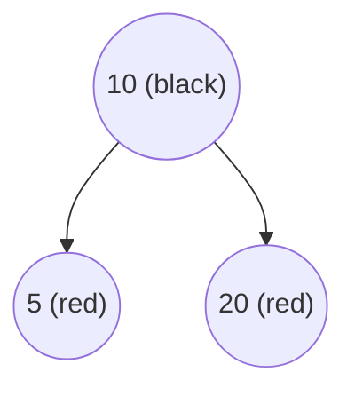
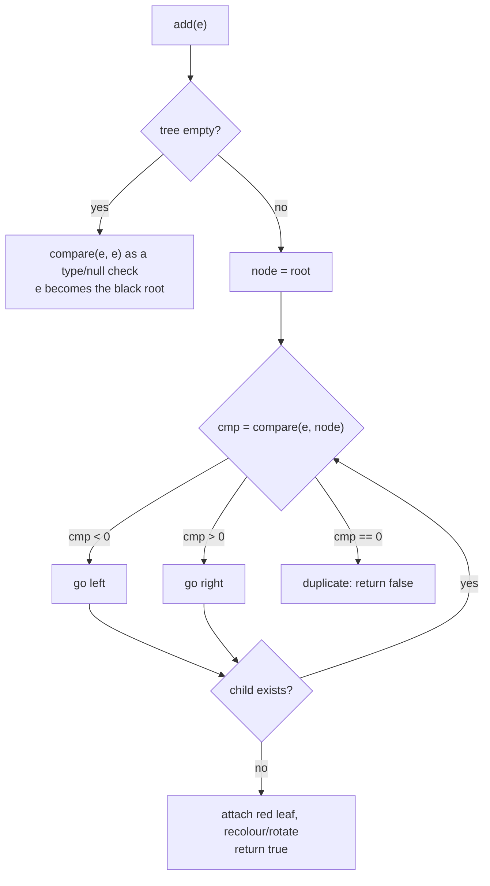
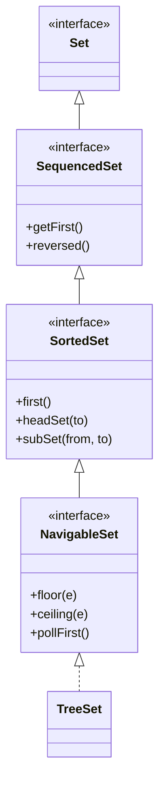

## In One Line
`TreeSet` is a **sorted** `Set`: it keeps its elements in ascending order (natural ordering or a `Comparator` you supply) inside a self-balancing red-black tree, so `add` / `remove` / `contains` cost **O(log n)** and you get extras like `first()`, `last()` and range views.

## Mental Model
Think of a **librarian shelving books alphabetically**.

- A new book is never just dropped at the end. The librarian compares its title with a book in the middle of the shelf, goes left or right, compares again, and slots it into the one correct place. That is a **binary search down the tree** using `compareTo()` (or your `Comparator`).
- If the comparison says "same position" (`compareTo` returns 0), the librarian says "we already have this one" and does not shelve it — **even if it is a different edition**. A `TreeSet` decides duplicates by *comparison*, not by `equals()`.
- Reading the shelf left to right always gives sorted order — that is iteration. The leftmost book is `first()`, the rightmost `last()`.
- The librarian also keeps the shelf **balanced** (the red-black rules), so finding a place never takes more than about 2·log₂(n) comparisons, even if books arrive already sorted.

## Concept
### Where TreeSet fits
`TreeSet<E>` implements `NavigableSet<E>`, which extends `SortedSet<E>`, which extends `Set<E>`. Since **Java 21**, `SortedSet` also extends `SequencedSet` (the new "has a first and a last element" interface). `TreeSet` has been in Java since 1.2; the `NavigableSet` methods arrived in Java 6.

Just like `HashSet` wraps a `HashMap`, a `TreeSet` wraps a map: `private transient NavigableMap<E,Object> m` — a `TreeMap` — and stores each element as a key with a dummy value `PRESENT`. Everything about [TreeMap](lesson:a03-collections/16-treemap) keys applies to `TreeSet` elements.

### How the order is decided
A `TreeSet` needs to compare any two elements. It uses one of two sources:

| Source | How | Example |
|---|---|---|
| **Natural ordering** | The element class implements `Comparable<T>` and its `compareTo` | `Integer` (numeric), `String` (lexicographic by UTF-16 code: `"Z"` < `"a"`), `LocalDate` (chronological), enums (declaration order) |
| **A `Comparator`** | Passed to the constructor; overrides natural ordering | `Comparator.reverseOrder()`, `String.CASE_INSENSITIVE_ORDER`, `Comparator.comparing(Employee::salary)` |

Constructors:
| Constructor | Ordering |
|---|---|
| `TreeSet()` | natural |
| `TreeSet(Comparator<? super E> c)` | `c` |
| `TreeSet(Collection<? extends E> c)` | **natural** (ignores any comparator the source had) |
| `TreeSet(SortedSet<E> s)` | **same comparator as `s`** |

`comparator()` returns the `Comparator` in use, or `null` for natural ordering. See [Comparable vs Comparator](lesson:b01-fundamentals/09-comparable-vs-comparator) for writing them.

### What happens inside `add(e)`
1. If the tree is empty, `e` becomes the root. It is still compared with itself (`compare(e, e)`), so a `null` or a non-comparable element fails right here.
2. Otherwise start at the root: `cmp = compare(e, node)`. `cmp < 0` → go left, `cmp > 0` → go right, **`cmp == 0` → duplicate, return `false`**.
3. When you fall off the tree, attach `e` as a red leaf.
4. **Rebalance**: recolour nodes and, if needed, rotate, so the red-black rules hold again. Return `true`.

`contains` and `remove` do the same walk. There is **no hashing and no `equals()`** anywhere.

### Red-black tree in 30 seconds
A red-black tree is a binary search tree where every node is red or black and:
1. The root is black.
2. A red node never has a red child.
3. Every path from a node down to an empty leaf passes the same number of black nodes.

Together these guarantee the tree height is at most `2·log₂(n+1)`, so operations stay O(log n) even for sorted input — a plain binary search tree would degrade into a linked list (O(n)). Java uses red-black trees rather than AVL trees because they need fewer rotations on insert/delete (at most 2 for insert, 3 for delete), at the cost of being slightly less strictly balanced.

### Duplicates are decided by `compareTo`, not `equals`
This is the single most important `TreeSet` fact for interviews:
- With `String.CASE_INSENSITIVE_ORDER`, `"java"` and `"JAVA"` compare as 0 → only the first is kept.
- With `Comparator.comparing(String::length)`, `"kiwi"` and `"pear"` compare as 0 → `"pear"` is silently dropped.
- `new BigDecimal("1.0")` and `new BigDecimal("1.00")` are **not** `equals` (different scale) but `compareTo` returns 0 → a `HashSet` keeps both, a `TreeSet` keeps one.

The `Set` contract is written in terms of `equals`, so the Javadoc asks that your ordering be **consistent with equals** (`compare(a, b) == 0` exactly when `a.equals(b)`). If it is not, the `TreeSet` still works, but it behaves differently from other sets. Fix a too-coarse comparator by adding tie-breakers: `comparing(String::length).thenComparing(Comparator.naturalOrder())`.

### Nulls and non-comparable elements
- **`null` with natural ordering → `NullPointerException`**, on `add`, `contains`, `remove`, `floor`… Since Java 7 even the first `add` into an empty set is checked. A null-tolerant comparator such as `Comparator.nullsFirst(Comparator.naturalOrder())` makes `null` legal.
- **Element does not implement `Comparable` and no comparator → `ClassCastException`** on the first `add` (the message says it "cannot be cast to class java.lang.Comparable").
- Elements must be **mutually comparable**: mixing `Integer` and `String` in a raw `TreeSet` throws `ClassCastException`.

### SortedSet methods (and the Java 21 additions)
| Method | Returns | Empty set |
|---|---|---|
| `first()` / `last()` | lowest / highest element | throws `NoSuchElementException` |
| `headSet(to)` | view of elements **`< to`** | — |
| `tailSet(from)` | view of elements **`>= from`** | — |
| `subSet(from, to)` | view of **`from <= e < to`** (half-open) | — |
| `comparator()` | the comparator or `null` | — |
| `getFirst()`, `getLast()`, `removeFirst()`, `removeLast()`, `reversed()` | **Java 21** `SequencedCollection` methods | `getFirst` throws `NoSuchElementException` |
| `addFirst(e)`, `addLast(e)` | **throw `UnsupportedOperationException`** — a sorted set decides positions itself | — |

The `NavigableSet` methods (`lower`, `floor`, `ceiling`, `higher`, `pollFirst`, `pollLast`, `descendingSet`, inclusive/exclusive ranges) are covered in [NavigableSet](lesson:a03-collections/12-navigableset).

### Complexity and memory
| Operation | Cost |
|---|---|
| `add`, `remove`, `contains` | O(log n) |
| `first`, `last`, `floor`, `ceiling`… | O(log n) |
| Full iteration | O(n) (in-order walk) |
| `size()` | O(1) |

Each element costs a tree node holding key, value, left, right, parent and colour — noticeably more memory than a `HashSet` entry. For a million `Integer`s, `HashSet` lookups are faster; choose `TreeSet` when you need **order or range/nearest queries**, not for plain membership tests.

### Descending order — three ways
- `new TreeSet<>(Comparator.reverseOrder())` — the set itself is sorted high → low.
- `set.descendingSet()` — a live reversed **view** of an ascending set.
- `set.reversed()` — Java 21, same idea via `SequencedSet`.

### Thread safety
`TreeSet` is not synchronised. Use `ConcurrentSkipListSet` (a concurrent `NavigableSet` based on a skip list) or wrap it with `Collections.synchronizedSortedSet` / `synchronizedNavigableSet` (Java 8) and lock manually while iterating.

### Typical uses
- Sorted unique values: distinct tags, sorted word lists, leaderboards.
- Keeping the **top k** items: add, and `pollFirst()` whenever the size exceeds k.
- Range queries ("all orders between 100 and 200") and nearest-value lookups (see NavigableSet).

## Diagram

The example's tree after `add(10)`, `add(5)`, `add(20)`: 5 < 10 goes left, 20 > 10 goes right. An in-order walk (left, node, right) yields 5, 10, 20 — the printed order.


Only `compare` is used. `equals()` and `hashCode()` play no part.


`TreeSet` inherits every capability down the chain; `SequencedSet` was inserted above `SortedSet` in Java 21.

## Code
@example Collections/Sets/TreeSetExample.java

Unsorted input, duplicates and custom orderings:
```java
TreeSet<Integer> scores = new TreeSet<>(List.of(42, 7, 99, 7, 15));
System.out.println(scores);                       // sorted, duplicate 7 dropped
TreeSet<String> names = new TreeSet<>(Comparator.reverseOrder());
names.addAll(List.of("bob", "Amy", "carl"));
System.out.println(names);                        // reverse natural order
TreeSet<String> ci = new TreeSet<>(String.CASE_INSENSITIVE_ORDER);
System.out.println(ci.add("java") + " " + ci.add("JAVA") + " " + ci);
```
```output
[7, 15, 42, 99]
[carl, bob, Amy]
true false [java]
```

Range views and Java 21 sequenced methods:
```java
TreeSet<Integer> t = new TreeSet<>(List.of(10, 5, 20, 15, 1));
System.out.println(t.headSet(10));      // < 10
System.out.println(t.tailSet(10));      // >= 10
System.out.println(t.subSet(5, 20));    // >= 5 and < 20
System.out.println(t.descendingSet());
System.out.println(t.getFirst() + " " + t.getLast() + " " + t.reversed());  // Java 21
```
```output
[1, 5]
[10, 15, 20]
[5, 10, 15]
[20, 15, 10, 5, 1]
1 20 [20, 15, 10, 5, 1]
```

Keeping only the top 3 values seen so far:
```java
TreeSet<Integer> top3 = new TreeSet<>();
for (int x : new int[]{5, 1, 9, 3, 7, 8}) {
    top3.add(x);
    if (top3.size() > 3) top3.pollFirst();   // drop the smallest
}
System.out.println(top3);
```
```output
[7, 8, 9]
```

## Walkthrough
- `import java.util.TreeSet;` — `TreeSet` is in `java.util`.
- `TreeSet<Integer> numbers = new TreeSet<>();` — an empty set using **natural ordering** of `Integer` (numeric), because no `Comparator` is given. `numbers.comparator()` would return `null`.
- `numbers.add(10); numbers.add(5); numbers.add(20);` — each `int` is autoboxed to an `Integer`. `10` becomes the root; `5` compares less, goes left; `20` compares greater, goes right (first diagram). No rotation is needed.
- `"Numbers: " + numbers` — `toString()` walks the tree in order, so it prints **`Numbers: [5, 10, 20]`**, not the insertion order 10, 5, 20. This is the whole point of the example.
- `numbers.first()` / `numbers.last()` — from `SortedSet`; they return the leftmost (5) and rightmost (20) nodes in O(log n). On an empty set they would throw `NoSuchElementException`.
- `for (int number : numbers)` — the for-each loop uses the set's iterator, which visits nodes in ascending order; each `Integer` is auto-unboxed into the `int` loop variable. (A `TreeSet` with natural ordering cannot contain `null`, so unboxing is safe here.) Prints 5, 10, 20 on separate lines.
- `numbers.remove(10);` — calls `Set.remove(Object)`: `10` is autoboxed to `Integer.valueOf(10)` and that **value** is removed. Result: **`Numbers after removal: [5, 20]`**. Compare with a `List<Integer>`, where `remove(10)` would mean "remove the element at index 10" (see Traps).
- Every `// Output:` comment in the file matches the recorded output.

## Traps
- **Duplicates by comparison.** A comparator that compares only part of the object (length, age, salary) silently drops distinct elements that tie. Add `thenComparing(...)` tie-breakers.
- **`null` elements** → `NullPointerException` with natural ordering, even in `contains(null)`.
- **No `Comparable`, no `Comparator`** → `ClassCastException` on the very first `add`, not at compile time. (`TreeSet<Employee>` compiles fine.)
- **`remove(10)` on a `TreeSet<Integer>` removes the value 10; on a `List<Integer>` it removes index 10.** `List` has an overload `remove(int index)` that wins over autoboxing. Use `list.remove(Integer.valueOf(10))` for lists.
- **`first()`/`last()` throw on an empty set**, but `pollFirst()`/`pollLast()` return `null`. Check `isEmpty()` or use the poll/`floor` style methods.
- **Constructor chosen by static type.** `new TreeSet<>(sortedSet)` keeps its comparator; the same object passed through a `Collection` variable calls `TreeSet(Collection)` and falls back to natural ordering (see Q&A).
- **Mutating an element** that affects its ordering corrupts the tree, just as mutating a `HashSet` element breaks hashing.
- **`addFirst`/`addLast` (Java 21)** throw `UnsupportedOperationException` on a `TreeSet`.
- **Uppercase sorts before lowercase** with natural `String` order (`"Apple"` < `"apple"` < `"banana"`), because comparison is by UTF-16 code. Use `String.CASE_INSENSITIVE_ORDER` or a `Collator` for human-friendly order.

## Tips & Tricks
- **"Tree = sorTed; compare, not equals."** The moment you pick a `TreeSet`, `compareTo` becomes your definition of "same".
- **Comparator recipe:** `Comparator.comparing(Emp::dept).thenComparing(Emp::name).thenComparing(Emp::id)` — always end with something unique so no two different elements tie.
- **Sort a `HashSet` for display:** `new TreeSet<>(hashSet)` — one line, sorted, deduplicated.
- **Descending?** `new TreeSet<>(Comparator.reverseOrder())` for a permanently reversed set, `descendingSet()` for a quick reversed view.
- **"Empty set: first() throws, pollFirst() nulls."** Pick the one that matches how you want to handle "nothing there".
- Use `TreeSet` when you need **order or nearest/range queries**; use `HashSet` when you only need "is it there?".
- Remember the complexity pair: **Hash O(1), Tree O(log n)**.

## Interview Q&A
### [Basic] What is a TreeSet and how is it different from a HashSet?
`TreeSet` is a `NavigableSet` implementation that keeps its elements sorted, either by their natural ordering (`Comparable`) or by a `Comparator` given to the constructor. It is backed by a `TreeMap`, i.e. a red-black tree, so `add`, `remove` and `contains` are O(log n). `HashSet` is backed by a `HashMap`, has O(1) average operations but no order. Other differences: `TreeSet` decides duplicates with `compareTo`/`compare` while `HashSet` uses `hashCode`/`equals`; `TreeSet` does not accept `null` with natural ordering while `HashSet` accepts one `null`; and `TreeSet` offers `first()`, `last()`, `headSet()`, `tailSet()`, `floor()`, `ceiling()` and friends.

**Follow-up:** *When would you still pick TreeSet over the faster HashSet?* — When you need sorted iteration, min/max, or range and nearest-element queries.

### [Basic] How does a TreeSet keep its elements sorted?
It stores them in a red-black tree, a self-balancing binary search tree. Every insertion starts at the root and compares the new element with each node: smaller goes left, larger goes right, equal (compare returns 0) is rejected as a duplicate. The new node is attached as a leaf and the tree is recoloured/rotated to stay balanced. Because every left subtree holds smaller elements and every right subtree larger ones, an in-order traversal (left, node, right) visits the elements in sorted order — that is what the iterator does.

**Follow-up:** *What if elements arrive already sorted?* — A plain BST would become a linked list (O(n) per operation); the red-black rotations keep the height at most 2·log₂(n+1).

### [Intermediate] How does TreeSet decide that two elements are duplicates?
Only through the comparison: if `compare(a, b)` (or `a.compareTo(b)`) returns 0, `b` is treated as a duplicate of `a` and is not added. `equals()` and `hashCode()` are never called. So with a comparator on `String::length`, `"kiwi"` and `"pear"` are duplicates; with `String.CASE_INSENSITIVE_ORDER`, `"java"` and `"JAVA"` are duplicates; and `BigDecimal("1.0")` and `BigDecimal("1.00")` are duplicates in a `TreeSet` although they are not `equals`. The Javadoc therefore recommends an ordering **consistent with equals**, otherwise the set "obeys the general contract of `Set`" only loosely.

**Follow-up:** *How do you fix a comparator that drops elements?* — Add tie-breakers with `thenComparing(...)` until only truly equal elements compare as 0.

### [Intermediate] Can a TreeSet contain null?
Not with natural ordering: `add(null)` throws `NullPointerException` because the set has to call `compareTo` on it — and since Java 7 this happens even for the first element of an empty set (Java 6 accepted it and then failed later). Queries like `contains(null)` also throw. If you really need `null`, supply a comparator that handles it, e.g. `new TreeSet<>(Comparator.nullsFirst(Comparator.naturalOrder()))`, which sorts `null` before everything else.

**Follow-up:** *And HashSet?* — Allows exactly one `null` (it hashes to bucket 0).

### [Intermediate] What happens if you add objects that do not implement Comparable to a TreeSet?
It compiles, because `TreeSet<E>` has no bound on `E`. At runtime the first `add` throws `ClassCastException` ("cannot be cast to class java.lang.Comparable"), because the tree casts the element to `Comparable` to compare it — even with itself when the set is empty. Fix: implement `Comparable<Employee>` in the class, or pass a `Comparator` to the constructor: `new TreeSet<>(Comparator.comparing(Employee::getName))`.

**Follow-up:** *Why doesn't the compiler catch this?* — The API allows a `Comparator` to be supplied instead, so it cannot require `E extends Comparable`.

### [Intermediate] What is the time complexity of TreeSet operations, and why a red-black tree rather than an AVL tree?
`add`, `remove`, `contains`, `first`, `last`, `floor`, `ceiling`, `lower`, `higher` are all O(log n); iteration is O(n) overall; `size()` is O(1). The red-black tree keeps height ≤ 2·log₂(n+1). An AVL tree is more strictly balanced (faster lookups by a constant factor) but needs more rotations when inserting and deleting. Red-black trees need at most two rotations per insert and three per delete, which makes them a good general-purpose choice when reads and writes are mixed — the same reason C++ `std::map` and Linux kernel schedulers use them.

**Follow-up:** *What is the memory cost?* — One node per element with key, value, left, right, parent and a colour flag — more than a `HashSet` node.

### [Advanced] Explain `new TreeSet<>(sortedSet)` vs `new TreeSet<>(collection)`.
There are two constructors and overload resolution picks one **at compile time** using the static type of the argument. `TreeSet(SortedSet<E> s)` copies `s`'s comparator and builds the tree in linear time from the already-sorted input. `TreeSet(Collection<? extends E> c)` uses **natural ordering** regardless of what `c` is. So:
```java
SortedSet<Integer> desc = new TreeSet<>(Comparator.reverseOrder());
desc.addAll(List.of(1, 2, 3));
Collection<Integer> asCollection = desc;
System.out.println(new TreeSet<>(desc) + " " + new TreeSet<>(asCollection));
```
```output
[3, 2, 1] [1, 2, 3]
```
Same object, different constructor, different order.

**Follow-up:** *How do you copy while keeping an explicit order?* — Create the set with the comparator first, then `addAll`: `TreeSet<Integer> copy = new TreeSet<>(cmp); copy.addAll(source);`.

### [Advanced] What did Java 21 change for TreeSet?
JEP 431 (Sequenced Collections) made `SortedSet` extend the new `SequencedSet` interface. `TreeSet` therefore gained `getFirst()`, `getLast()`, `removeFirst()`, `removeLast()` and `reversed()` (a reverse-ordered view, like `descendingSet()`). `addFirst()` and `addLast()` are also inherited but throw `UnsupportedOperationException`, because in a sorted set the position of an element is decided by the comparator, not by the caller.

**Follow-up:** *Difference between `first()` and `getFirst()`?* — None in behaviour for `TreeSet` (both throw `NoSuchElementException` when empty); `getFirst()` is the uniform name shared with `List`, `Deque` and `LinkedHashSet`.

### [Advanced] How would you keep a thread-safe sorted set?
Use `ConcurrentSkipListSet`: a lock-free, sorted `NavigableSet` backed by a skip list, with O(log n) expected operations and weakly consistent iterators that never throw `ConcurrentModificationException`. It does not allow `null`. Alternatively, wrap a `TreeSet` with `Collections.synchronizedNavigableSet(...)`; that serialises every call on one lock, and you must hold the lock yourself while iterating.

**Follow-up:** *What is a skip list?* — A sorted linked list with extra "express lane" levels chosen randomly; searching skips ahead on higher levels, giving O(log n) expected time, and it is easier to make lock-free than a balanced tree.

## Quiz
### What does this print?
```java
TreeSet<String> words = new TreeSet<>(List.of("banana", "Apple", "cherry", "apple"));
System.out.println(words);
```
- [ ] [Apple, banana, cherry]
- [x] [Apple, apple, banana, cherry]
- [ ] [apple, Apple, banana, cherry]
- [ ] [banana, Apple, cherry, apple]
> Natural `String` ordering compares UTF-16 codes, and uppercase letters (65–90) come before lowercase (97–122). `"Apple"` and `"apple"` are different strings (`compareTo` ≠ 0), so both stay — they would collapse into one only with `String.CASE_INSENSITIVE_ORDER`. Insertion order is irrelevant in a `TreeSet`.

### What does this print?
```java
TreeSet<String> byLength = new TreeSet<>(Comparator.comparing(String::length));
byLength.addAll(List.of("kiwi", "pear", "fig", "banana"));
System.out.println(byLength);
```
- [ ] [fig, kiwi, pear, banana]
- [x] [fig, kiwi, banana]
- [ ] [fig, pear, banana]
- [ ] [banana, kiwi, pear, fig]
> The comparator only looks at length. `"pear"` has the same length as `"kiwi"`, so `compare` returns 0 and `"pear"` is rejected as a duplicate — the first one inserted wins. Adding `.thenComparing(Comparator.naturalOrder())` would keep all four.

### What does this print?
```java
Set<BigDecimal> hash = new HashSet<>();
Set<BigDecimal> tree = new TreeSet<>();
for (String s : List.of("1.0", "1.00")) {
    hash.add(new BigDecimal(s));
    tree.add(new BigDecimal(s));
}
System.out.println(hash.size() + " " + tree.size());
```
- [ ] 1 1
- [x] 2 1
- [ ] 2 2
- [ ] 1 2
> `BigDecimal.equals` compares value **and** scale, so 1.0 and 1.00 are different for the `HashSet`. `compareTo` compares only the numeric value and returns 0, so the `TreeSet` treats them as duplicates. This is the textbook "compareTo inconsistent with equals" case.

### After these lines, what are `set` and `list`?
```java
TreeSet<Integer> set = new TreeSet<>(List.of(5, 10, 20));
List<Integer> list = new ArrayList<>(List.of(5, 10, 20));
set.remove(10);
list.remove(10);
```
- [ ] set = [5, 20], list = [5, 20]
- [ ] set = [5, 10, 20], list = [5, 20]
- [x] set = [5, 20], and `list.remove(10)` throws `IndexOutOfBoundsException`
- [ ] Both throw `IndexOutOfBoundsException`
> `Set` only has `remove(Object)`, so `10` is autoboxed and the value 10 is removed. `List` also has `remove(int index)`, which is an exact match for an `int` argument and wins over autoboxing — index 10 does not exist in a 3-element list. Use `list.remove(Integer.valueOf(10))`.

### Spot the bug
```java
class Employee { String name; Employee(String n) { name = n; } }

Set<Employee> staff = new TreeSet<>();
staff.add(new Employee("Ann"));
```
- [ ] Compile error: Employee must implement Comparable
- [x] `ClassCastException` at runtime on the first `add`, because `Employee` is not `Comparable` and no `Comparator` was given
- [ ] It works; the set orders by `hashCode()`
- [ ] `NullPointerException`, because the tree is empty
> The code compiles: `TreeSet<E>` has no `Comparable` bound. The first `add` compares the element with itself and fails to cast it to `Comparable`. Implement `Comparable<Employee>` or use `new TreeSet<>(Comparator.comparing(e -> e.name))`.

### On an empty `TreeSet<Integer>`, what do `pollFirst()` and `first()` do?
- [ ] Both return null
- [ ] Both throw `NoSuchElementException`
- [x] `pollFirst()` returns null; `first()` throws `NoSuchElementException`
- [ ] `pollFirst()` throws; `first()` returns null
> `first()`/`last()` come from `SortedSet` (Java 1.2) and throw on an empty set. The `NavigableSet` methods from Java 6 (`pollFirst`, `pollLast`, `floor`, `ceiling`, …) return `null` to mean "none".

### Which call throws `UnsupportedOperationException` on a `TreeSet` in Java 21?
- [ ] `getFirst()`
- [ ] `reversed()`
- [x] `addFirst(0)`
- [ ] `removeLast()`
> `TreeSet` inherits the `SequencedCollection` methods, but it cannot honour "put this at the front" — position is decided by the ordering — so `addFirst`/`addLast` throw. The others work: `getFirst` returns the smallest element, `reversed` gives a descending view, `removeLast` removes the largest.

## Takeaways
- `TreeSet` = sorted `NavigableSet` backed by a `TreeMap` (red-black tree); `add`/`remove`/`contains` are O(log n).
- Order comes from natural ordering (`Comparable`) or a `Comparator` passed to the constructor; iteration is always ascending by that order.
- Duplicates are decided by `compareTo`/`compare` returning 0 — not by `equals` — so keep comparators consistent with equals and add tie-breakers.
- No `null` with natural ordering (NPE), and non-`Comparable` elements without a comparator fail with `ClassCastException` on the first `add`.
- `first()`/`last()` throw on an empty set; `pollFirst()`/`pollLast()` return null; `headSet(to)` is exclusive, `tailSet(from)` inclusive, `subSet(from, to)` half-open.
- Java 21 adds `getFirst`/`getLast`/`reversed` via `SequencedSet`; `addFirst`/`addLast` throw. Use `ConcurrentSkipListSet` for a concurrent sorted set.
