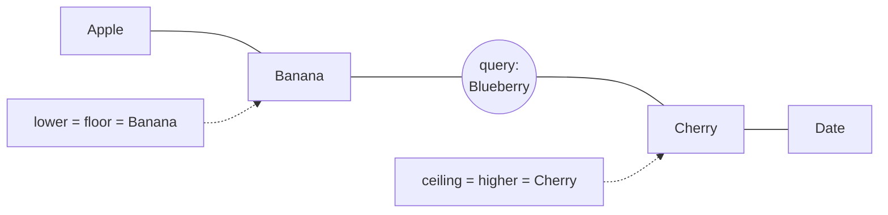
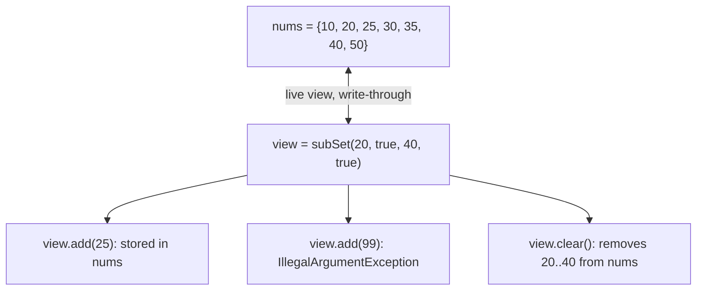

## In One Line
`NavigableSet` (Java 6) extends `SortedSet` with **closest-match searches** — `lower` (<), `floor` (≤), `ceiling` (≥), `higher` (>) — plus `pollFirst`/`pollLast`, a descending view and range views with inclusive/exclusive bounds; `TreeSet` is its everyday implementation.

## Mental Model
Think of the **floors of a building** where only some floors have a lift stop (the elements of the set). You are standing somewhere — maybe on a stop, maybe between stops (the query value).

- **floor(x)** — the stop you are standing on, or the nearest one **below** you. (You can stand *on* the floor.)
- **ceiling(x)** — the stop you are standing on, or the nearest one **above** you. (The ceiling can be right at your level too.)
- **lower(x)** — strictly below, even if you are standing on a stop.
- **higher(x)** — strictly above.
- If there is no stop in that direction (you are below the ground floor and ask for `floor`), the answer is "none" → `null`.

`pollFirst()` is "take the lowest stop out of service", `descendingSet()` is "look at the building upside down", and `subSet(20, 40)` is "only the stops between floors 20 and 40" — a window onto the same building, not a copy.

## Concept
### The interface family
| Interface | Since | Adds |
|---|---|---|
| `SortedSet<E>` | 1.2 | `first()`, `last()`, `headSet(to)`, `tailSet(from)`, `subSet(from, to)`, `comparator()` |
| `NavigableSet<E>` | 6 | `lower`, `floor`, `ceiling`, `higher`, `pollFirst`, `pollLast`, `descendingSet`, `descendingIterator`, and `headSet`/`tailSet`/`subSet` **with inclusive flags** |
| `SequencedSet<E>` | 21 | (above `SortedSet`) `getFirst`, `getLast`, `removeFirst`, `removeLast`, `reversed` |

Implementations: **`TreeSet`** (red-black tree) and **`ConcurrentSkipListSet`** (thread-safe skip list). You also get `NavigableSet`s as views: `treeMap.navigableKeySet()`, `treeMap.descendingKeySet()`, `set.descendingSet()`, and the range views below.

The example declares `NavigableSet<String> words = new TreeSet<>();` — the variable's type is the interface, so exactly the `NavigableSet` (and inherited `SortedSet`, `Set`, `Collection`) methods are available through it.

### The four closest-match methods
| Method | Returns the … element | Symbol | Set {Apple, Banana, Cherry, Date}, query `"Banana"` | query `"Blueberry"` (absent) |
|---|---|---|---|---|
| `lower(e)` | greatest element **strictly less** than `e` | `<` | Apple | Banana |
| `floor(e)` | greatest element **less than or equal** to `e` | `≤` | **Banana** | Banana |
| `ceiling(e)` | least element **greater than or equal** to `e` | `≥` | **Banana** | Cherry |
| `higher(e)` | least element **strictly greater** than `e` | `>` | Cherry | Cherry |

- When `e` is **in** the set, `floor` and `ceiling` return `e` itself; `lower` and `higher` skip over it.
- When `e` is **not** in the set, `floor == lower` and `ceiling == higher`.
- When there is nothing on that side, they return **`null`** (never throw). So these methods are unusable for telling "no answer" apart from a stored `null` — one more reason sorted sets do not hold `null`.
- A `null` **argument** throws `NullPointerException` with natural ordering.
- All four are **O(log n)**: one walk down the red-black tree.

### first/last vs poll vs Java 21 names
| Method | Removes? | Empty set |
|---|---|---|
| `first()` / `last()` (SortedSet) | no | throws `NoSuchElementException` |
| `getFirst()` / `getLast()` (Java 21) | no | throws `NoSuchElementException` |
| `pollFirst()` / `pollLast()` (NavigableSet) | **yes** | returns `null` |
| `removeFirst()` / `removeLast()` (Java 21) | yes | throws `NoSuchElementException` |

`pollFirst()` makes a `NavigableSet` usable as a sorted work-queue without duplicates (like a `PriorityQueue` that ignores repeats).

### Range views: inclusive and exclusive
| Call | Elements | Default bounds |
|---|---|---|
| `headSet(to)` | `< to` | exclusive upper |
| `headSet(to, inclusive)` | `< to` or `≤ to` | you choose |
| `tailSet(from)` | `≥ from` | inclusive lower |
| `tailSet(from, inclusive)` | `> from` or `≥ from` | you choose |
| `subSet(from, to)` | `from ≤ e < to` | half-open `[from, to)` |
| `subSet(from, fromIncl, to, toIncl)` | any combination | you choose |

The one-argument/two-argument forms come from `SortedSet` and always mean **"lower bound included, upper bound excluded"** — the same convention as `String.substring`, `List.subList` and `for (i = a; i < b; i++)`.

Range views are **live views backed by the original set**, not copies:
- Changes to the set show up in the view, and changes made through the view go into the set.
- Adding an element **outside the view's range** through the view throws `IllegalArgumentException: key out of range`.
- `view.clear()` removes that whole range from the original set.
- Creating a view is O(1). Beware: `size()` of a `TreeSet` range view has to **count** its elements (O(k)), unlike the O(1) `size()` of the full set.

### Descending views
`descendingSet()` returns a live view with the **reverse ordering**. Every navigation method is reversed with it: in the descending view, `higher(30)` means "next one after 30 **in descending order**", i.e. the next *smaller* number. `descendingIterator()` walks the original set from last to first without creating a view. `descendingSet().descendingSet()` gives back an ascending view.

### Typical uses
- **Nearest value**: compare `floor(x)` and `ceiling(x)`, pick the closer one (bus stops, price points, available seat numbers).
- **Prefix search / autocomplete**: `subSet(prefix, true, prefix + Character.MAX_VALUE, true)` returns all strings starting with `prefix`.
- **Sliding-window problems**: keep the last k values in a `TreeSet` and ask `ceiling(x - t)` — "is any value within t of x?" (LeetCode "Contains Duplicate III").
- **Next free slot / ID**: `ceiling(requested)` in a set of free slots.
- **Range counting**: `subSet(a, true, b, true).size()`.

### Thread safety
`TreeSet` is not thread-safe. `ConcurrentSkipListSet` implements `NavigableSet` with lock-free operations and weakly consistent iterators; `Collections.synchronizedNavigableSet` and `Collections.unmodifiableNavigableSet` (both Java 8) wrap an existing set.

## Diagram

For a value that is not in the set, `floor`/`lower` pick the neighbour on the left and `ceiling`/`higher` the neighbour on the right. Had the query been `"Banana"` itself, `floor` and `ceiling` would return `Banana`, while `lower` and `higher` would still skip to Apple and Cherry.


A range view is a window onto the same tree, limited to its bounds.

## Code
@example Collections/Sets/NavigableSetExample.java

All four closest-match methods, for a key that exists, one that falls between elements, and two outside the range:
```java
NavigableSet<String> words = new TreeSet<>(List.of("Apple", "Banana", "Cherry", "Date"));
for (String q : List.of("Banana", "Blueberry", "Aardvark", "Zebra")) {
    System.out.printf("%-9s lower=%-6s floor=%-6s ceiling=%-6s higher=%s%n",
        q, words.lower(q), words.floor(q), words.ceiling(q), words.higher(q));
}
```
```output
Banana    lower=Apple  floor=Banana ceiling=Banana higher=Cherry
Blueberry lower=Banana floor=Banana ceiling=Cherry higher=Cherry
Aardvark  lower=null   floor=null   ceiling=Apple  higher=Apple
Zebra     lower=Date   floor=Date   ceiling=null   higher=null
```

Range views with default and explicit bounds:
```java
NavigableSet<Integer> nums = new TreeSet<>(List.of(10, 20, 30, 40, 50));
System.out.println(nums.headSet(30) + " " + nums.headSet(30, true));
System.out.println(nums.tailSet(30) + " " + nums.tailSet(30, false));
System.out.println(nums.subSet(20, 40) + " " + nums.subSet(20, false, 40, true));
```
```output
[10, 20] [10, 20, 30]
[30, 40, 50] [40, 50]
[20, 30] [30, 40]
```

Views write through, and they guard their range (continuing with `nums`):
```java
NavigableSet<Integer> view = nums.subSet(20, true, 40, true);
view.add(25);                      // lands in nums too
nums.add(35);                      // visible through the view
System.out.println(nums + " " + view);
try { view.add(99); } catch (IllegalArgumentException e) { System.out.println(e.getMessage()); }
view.clear();                      // removes 20..40 from nums
System.out.println(nums);
```
```output
[10, 20, 25, 30, 35, 40, 50] [20, 25, 30, 35, 40]
key out of range
[10, 50]
```

`pollFirst`/`pollLast` remove as they read, and return `null` once the set is empty:
```java
NavigableSet<Integer> q = new TreeSet<>(List.of(3, 1, 2));
System.out.println(q.pollFirst() + " " + q.pollLast() + " " + q + " " + q.pollFirst() + " " + q.pollFirst());
```
```output
1 3 [2] 2 null
```

Prefix search and nearest value:
```java
NavigableSet<String> dict = new TreeSet<>(List.of("car", "card", "care", "cart", "cat", "dog"));
String prefix = "car";
System.out.println(dict.subSet(prefix, true, prefix + Character.MAX_VALUE, true));

NavigableSet<Integer> stops = new TreeSet<>(List.of(0, 12, 25, 40));
int pos = 21;
Integer below = stops.floor(pos), above = stops.ceiling(pos);
int nearest = (above == null || (below != null && pos - below <= above - pos)) ? below : above;
System.out.println(below + " " + above + " -> " + nearest);
```
```output
[car, card, care, cart]
12 25 -> 25
```

## Walkthrough
- `import java.util.NavigableSet; import java.util.TreeSet;` — the interface and its implementation.
- `NavigableSet<String> words = new TreeSet<>();` — the object is a `TreeSet` (natural `String` order); the reference is typed as the interface, which is good practice and exposes all the navigation methods.
- `words.add("Apple")` … `add("Date")` — four strings, inserted already in alphabetical order. The red-black tree rebalances as they arrive, so it does not become a chain.
- `"Words: " + words` — in-order iteration → **`Words: [Apple, Banana, Cherry, Date]`**.
- `words.first()` / `words.last()` — lowest and highest elements: `Apple`, `Date`. (These two are `SortedSet` methods; see Traps.)
- `words.lower("Banana")` — greatest element strictly less than `"Banana"` → **`Apple`**.
- `words.higher("Banana")` — least element strictly greater than `"Banana"` → **`Cherry`**. Note that `"Banana"` itself is excluded by both strict methods; `floor("Banana")` and `ceiling("Banana")` would have returned `Banana`.
- `for (String word : words)` — ascending iteration: Apple, Banana, Cherry, Date.
- `words.remove("Date");` — O(log n) removal of the largest element → **`Words after removal: [Apple, Banana, Cherry]`**. `words.pollLast()` would have done the same without naming the element.
- Every `// Output:` comment matches the recorded output.

## Traps
> [!ERRATA] The comment `// Accessing elements with methods specific to NavigableSet` sits above `first()` and `last()`, but those two are **`SortedSet`** methods (Java 1.2), available on any sorted set. Only `lower()` and `higher()` in that block are specific to `NavigableSet` (Java 6).

- **`floor`/`ceiling` include the key, `lower`/`higher` do not.** Mixing them up gives off-by-one bugs at exact matches.
- **They return `null`, not an exception.** `int f = set.floor(5);` auto-unboxes the result, so when nothing is ≤ 5 it throws `NullPointerException`. Store the result in an `Integer` and check for `null`.
- **`first()`/`last()` throw on an empty set; `pollFirst()`/`pollLast()` return `null`** — and `pollFirst()` also removes the element.
- **Default range bounds are half-open.** `headSet(30)` excludes 30, `tailSet(30)` includes 30, `subSet(20, 40)` includes 20 but not 40. Use the boolean overloads when you mean something else.
- **Views are live.** Modifying a view modifies the set; adding outside a view's range throws `IllegalArgumentException`. Copy with `new TreeSet<>(view)` if you need an independent snapshot.
- **Descending views reverse the meaning of every method**: `descendingSet().higher(30)` returns the next *smaller* element.
- **A `null` argument** to any navigation method throws `NullPointerException` under natural ordering.
- **`subSet(from, to)` with `from > to`** throws `IllegalArgumentException: fromKey > toKey`.

## Tips & Tricks
- **"You can stand on the floor and touch the ceiling."** `floor` (≤) and `ceiling` (≥) include the key; `lower` (<) and `higher` (>) are strict.
- **Order on a number line: lower ≤ floor ≤ key ≤ ceiling ≤ higher.**
- **"L-F-C-H = <, ≤, ≥, >"** — the methods in the same order as the symbols.
- **Default ranges are `[from, to)`**, like `substring` and `subList`: "start in, end out".
- **Nearest value = min distance of `floor(x)` and `ceiling(x)`**, with null checks for both ends.
- **Prefix query trick:** `subSet(p, true, p + Character.MAX_VALUE, true)` — every string starting with `p` sorts between `p` and `p` followed by the largest `char`.
- Need a sorted queue without duplicates? `TreeSet` + `pollFirst()`.
- Declare as `NavigableSet<T>` when you use navigation methods, `SortedSet<T>` or `Set<T>` when you don't — the type then documents what you rely on.

## Interview Q&A
### [Basic] What is NavigableSet and how does it differ from SortedSet?
`NavigableSet` is a sub-interface of `SortedSet`, added in Java 6. `SortedSet` gives a sorted view with `first()`, `last()`, `headSet(to)`, `tailSet(from)` and `subSet(from, to)` (fixed half-open bounds). `NavigableSet` adds closest-match queries (`lower`, `floor`, `ceiling`, `higher`), removing reads (`pollFirst`, `pollLast`), reverse traversal (`descendingSet`, `descendingIterator`) and range views where you choose inclusive or exclusive bounds. `TreeSet` and `ConcurrentSkipListSet` implement it.

**Follow-up:** *Is there a NavigableSet that is not a TreeSet?* — `ConcurrentSkipListSet`, and views such as `TreeMap.navigableKeySet()` or `set.descendingSet()`.

### [Basic] Explain lower, floor, ceiling and higher.
All four search for the nearest element relative to a given value, in O(log n). `lower(x)` returns the greatest element strictly less than `x`; `floor(x)` the greatest element less than or equal to `x`; `ceiling(x)` the least element greater than or equal to `x`; `higher(x)` the least element strictly greater than `x`. If `x` is in the set, `floor` and `ceiling` return `x`; if it is not, `floor` equals `lower` and `ceiling` equals `higher`. If there is no such element, they return `null`. With `{Apple, Banana, Cherry, Date}`: `lower("Banana")` is Apple, `floor("Banana")` is Banana, `ceiling("Blueberry")` is Cherry, `higher("Date")` is `null`.

**Follow-up:** *Why return null instead of throwing?* — "No neighbour" is a normal outcome of a search, and `null` cannot be a real element of a naturally ordered sorted set, so it is an unambiguous signal.

### [Intermediate] What is the difference between first(), pollFirst(), getFirst() and removeFirst()?
`first()` (SortedSet) returns the smallest element without removing it and throws `NoSuchElementException` if the set is empty. `pollFirst()` (NavigableSet) returns **and removes** the smallest element, or returns `null` when empty. Java 21's `getFirst()` behaves like `first()` and `removeFirst()` removes like `pollFirst()` but throws on empty. Choose throw-versions when emptiness is a bug, null-versions when emptiness is normal (for example draining a queue with `while ((x = set.pollFirst()) != null)`).

**Follow-up:** *What is the complexity of pollFirst on a TreeSet?* — O(log n): find the leftmost node and delete it with rebalancing.

### [Intermediate] Are headSet, tailSet and subSet copies? What are the bounds?
They are **live views** backed by the original set: changes in either are visible in the other, and adding an out-of-range element through a view throws `IllegalArgumentException` ("key out of range"). The `SortedSet` forms use half-open bounds — `headSet(to)` is `< to`, `tailSet(from)` is `≥ from`, `subSet(from, to)` is `from ≤ e < to`. The `NavigableSet` overloads take booleans, e.g. `subSet(20, false, 40, true)` means `20 < e ≤ 40`. Creating a view is O(1); its `size()` is computed by counting (O(k)).

**Follow-up:** *How do you get an independent copy?* — `new TreeSet<>(set.subSet(a, b))`.

### [Intermediate] How does descendingSet() behave?
It returns a live view of the same elements in reverse order, with a reversed comparator. All navigation methods follow the reversed order: on the descending view of `{10, 20, 30, 40}`, `first()` is 40, `higher(30)` is 20 (the next element *in descending order*), and `floor(25)` is 30. Writes through the view affect the original set. `descendingIterator()` gives just a reverse iterator without a view object.

**Follow-up:** *What is the Java 21 equivalent?* — `reversed()` from `SequencedSet`, which returns a reverse-ordered view of the set.

### [Advanced] How would you find the element closest to a given value?
Use `floor` and `ceiling` and compare distances, handling the `null` ends:
```java
Integer below = set.floor(x), above = set.ceiling(x);
if (below == null) return above;
if (above == null) return below;
return (x - below <= above - x) ? below : above;
```
Both calls are O(log n), so the whole query is O(log n), compared with O(n) for scanning a list. This is how you would snap a price to the nearest allowed price point, pick the nearest bus stop, or find the nearest free seat.

**Follow-up:** *What if the set is huge and read-mostly?* — A sorted array with `Arrays.binarySearch` uses less memory; `TreeSet` wins when you also insert and delete.

### [Advanced] Solve: are there two indices i and j with |i − j| ≤ k and |nums[i] − nums[j]| ≤ t?
Keep a sliding window of the last k values in a `TreeSet`. For each new value `x`, ask for the smallest value in the window that is ≥ `x − t` (`ceiling`). If it exists and is ≤ `x + t`, the answer is yes. Then add `x` and evict the value that left the window. Using `long` avoids overflow in `x ± t`.
```java
static boolean containsNearbyAlmostDuplicate(int[] nums, int k, int t) {
    TreeSet<Long> window = new TreeSet<>();
    for (int i = 0; i < nums.length; i++) {
        Long ceil = window.ceiling((long) nums[i] - t);   // smallest value >= nums[i] - t
        if (ceil != null && ceil <= (long) nums[i] + t) return true;
        window.add((long) nums[i]);
        if (i >= k) window.remove((long) nums[i - k]);
    }
    return false;
}
// {1, 5, 9, 1, 5, 9}, k=2, t=3 -> false
// {1, 2, 3, 1},       k=3, t=0 -> true
```
Time O(n log k), space O(k).

**Follow-up:** *Why is a set enough when values can repeat?* — If a value repeats inside the window, the check already returns `true` before the duplicate would be added.

### [Advanced] Which thread-safe NavigableSet does the JDK offer, and how does it differ from TreeSet?
`ConcurrentSkipListSet` (Java 6). It is backed by a `ConcurrentSkipListMap`, a skip list rather than a red-black tree: a sorted linked list with randomly assigned "express" levels, giving O(log n) expected time for all operations. It is lock-free (CAS-based), its iterators are weakly consistent (they never throw `ConcurrentModificationException`), it rejects `null`, and — unlike `TreeSet` — its `size()` is O(n) because it has to traverse the elements.

**Follow-up:** *Why not just `Collections.synchronizedNavigableSet(new TreeSet<>())`?* — It serialises every call on one lock and still requires manual locking for iteration; the skip list scales much better under contention.

### [Intermediate] How can a TreeSet support autocomplete?
All words with a given prefix are contiguous in sorted order, starting at the prefix itself. So `set.subSet(prefix, true, prefix + Character.MAX_VALUE, true)` returns exactly the words starting with `prefix` — for `"car"` in `{car, card, care, cart, cat, dog}` it returns `[car, card, care, cart]`. Alternatively iterate `tailSet(prefix, true)` and stop at the first word that does not start with the prefix, which also lets you take only the first N suggestions.

**Follow-up:** *When would you prefer a trie?* — For very large dictionaries with heavy prefix traffic, a trie answers in O(prefix length) and shares prefixes in memory.

## Quiz
### What does this print?
```java
NavigableSet<Integer> s = new TreeSet<>(List.of(10, 20, 30));
System.out.println(s.lower(20) + " " + s.floor(20) + " " + s.ceiling(25) + " " + s.higher(30));
```
- [ ] 10 10 30 null
- [x] 10 20 30 null
- [ ] 20 20 20 30
- [ ] 10 20 30 NoSuchElementException
> `lower(20)` is strictly less → 10. `floor(20)` may equal → 20. `ceiling(25)` is the least element ≥ 25 → 30. Nothing is strictly greater than 30, so `higher(30)` returns `null` — navigation methods never throw for "not found".

### What does this print?
```java
NavigableSet<Integer> s = new TreeSet<>(List.of(10, 20, 30, 40));
NavigableSet<Integer> desc = s.descendingSet();
System.out.println(desc.first() + " " + desc.higher(30) + " " + desc.floor(25));
```
- [ ] 10 40 20
- [x] 40 20 30
- [ ] 40 40 20
- [ ] 10 20 30
> The descending view reverses the ordering, and every method follows it. `first()` is 40. "Higher" means "later in descending order" → 20. "Floor" means "at or before 25 in descending order", i.e. the smallest number ≥ 25 → 30.

### What happens here?
```java
NavigableSet<Integer> s = new TreeSet<>(List.of(10, 20, 30));
int f = s.floor(5);
System.out.println(f);
```
- [ ] Prints 0
- [ ] Prints 10
- [x] Throws `NullPointerException`
- [ ] Throws `NoSuchElementException`
> No element is ≤ 5, so `floor` returns `null`. Assigning it to an `int` auto-unboxes `null` → `NullPointerException`. Use `Integer f = s.floor(5); if (f != null) ...`. It is not `NoSuchElementException`, because `floor` itself returned normally.

### What does this print?
```java
NavigableSet<String> w = new TreeSet<>(List.of("Apple", "Banana", "Cherry", "Date"));
System.out.println(w.headSet("Cherry") + " " + w.tailSet("Cherry"));
```
- [ ] [Apple, Banana, Cherry] [Date]
- [x] [Apple, Banana] [Cherry, Date]
- [ ] [Apple, Banana] [Date]
- [ ] [Apple, Banana, Cherry] [Cherry, Date]
> The one-argument forms use half-open bounds: `headSet(to)` excludes `to`, `tailSet(from)` includes `from`. So "Cherry" appears exactly once, in the tail. Use `headSet("Cherry", true)` to include it in the head.

### Given `NavigableSet<Integer> view = nums.subSet(20, true, 40, true);`, what does `view.add(99)` do?
- [ ] Adds 99 to the view only
- [ ] Adds 99 to `nums` but it is hidden from the view
- [x] Throws `IllegalArgumentException: key out of range`
- [ ] Returns false
> A range view refuses elements outside its bounds. In-range additions such as `view.add(25)` succeed and go straight into `nums`, because the view is backed by the same tree.

### Which of these methods is NOT declared by NavigableSet (but inherited from SortedSet)?
- [x] `first()`
- [ ] `floor(e)`
- [ ] `pollFirst()`
- [ ] `descendingSet()`
> `first()` and `last()` have existed on `SortedSet` since Java 1.2. `floor`, `pollFirst` and `descendingSet` were introduced by `NavigableSet` in Java 6 — which is why the original example's comment calling `first()`/`last()` "specific to NavigableSet" is inaccurate.

## Takeaways
- `NavigableSet` (Java 6) = `SortedSet` + closest-match search + poll + descending view + inclusive/exclusive ranges; `TreeSet` and `ConcurrentSkipListSet` implement it.
- `lower` (<), `floor` (≤), `ceiling` (≥), `higher` (>) run in O(log n) and return `null` when nothing matches — never unbox the result straight into a primitive.
- `first()`/`last()` throw on empty; `pollFirst()`/`pollLast()` remove and return `null` on empty; Java 21 adds `getFirst`/`removeFirst`/`reversed`.
- `headSet(to)` excludes `to`, `tailSet(from)` includes `from`, `subSet(a, b)` is `[a, b)`; the boolean overloads let you choose.
- Range and descending views are live and write-through; adding outside a view's range throws `IllegalArgumentException`.
- Classic uses: nearest value via floor/ceiling, prefix search via subSet, sliding-window "almost duplicate" checks via ceiling.
