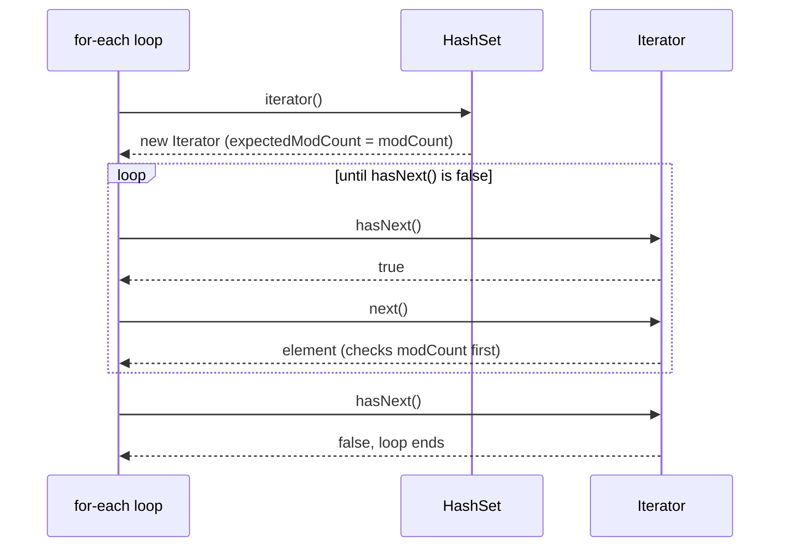
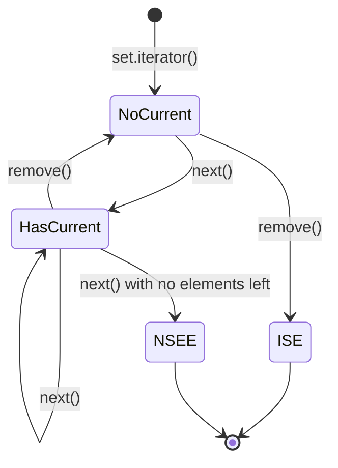

## In One Line
A `Set` has no indexes, so you walk it with its **`Iterator`** — directly, or hidden inside for-each, `forEach` and streams; the order you see is whatever the implementation defines, and the only safe way to remove while walking is **`Iterator.remove()`** (or `removeIf`).

## Mental Model
Think of a **museum tour with a guide**.

- The museum is the set; the guide is the `Iterator`. You cannot say "show me exhibit number 3" — the museum has no numbers. You can only follow the guide.
- `hasNext()` is asking the guide "is there another exhibit?"; `next()` is "walk to it and show it to me". Ask for one more after the last exhibit and the guide says "there is nothing left" (`NoSuchElementException`).
- `remove()` is "take the exhibit we are looking at off display". Only the guide may do this, only once per exhibit, and only after showing one (`IllegalStateException` otherwise).
- If a museum worker moves exhibits **behind the guide's back** (`set.remove(...)` during the tour), the guide notices that the floor plan has changed and cancels the tour (`ConcurrentModificationException`).
- Which route the guide takes depends on the museum: a `HashSet` museum is laid out by bucket number, a `LinkedHashSet` museum in the order exhibits arrived, a `TreeSet` museum in sorted order.
- A guide is single-use: when the tour ends, you need a **new guide** (`set.iterator()` again) for a second tour.

## Concept
### Why sets need iterators
`Collection` extends `Iterable`, whose one abstract method is `Iterator<T> iterator()`. A `List` can also be walked by index (`get(i)`), but a `Set` has no positions, so the `Iterator` is the **only** built-in way to visit its elements. Every other style — for-each, `forEach`, streams, `toString()`, `addAll` — uses an iterator (or its cousin, the `Spliterator`) under the hood.

### The Iterator contract
| Method | Does | Fails with |
|---|---|---|
| `boolean hasNext()` | Is there another element? No side effects — call it as often as you like. | — |
| `E next()` | Moves forward and returns the next element. | `NoSuchElementException` when there is none |
| `void remove()` | Removes the element returned by the **last `next()`**, from the underlying set. Optional operation. | `IllegalStateException` if `next()` was not called, or `remove()` was already called for that element; `UnsupportedOperationException` if the set does not support it |
| `void forEachRemaining(Consumer)` | (Java 8) Runs the action for every remaining element. | — |

Sets get a plain `Iterator` only. `ListIterator` (with `previous()`, `add()`, `set()`, indexes) exists only for lists — see [ListIterator](lesson:a03-collections/04-list-iterator).

### Five ways to walk a set
| Way | Since | Can remove while walking? | Notes |
|---|---|---|---|
| `for (E e : set)` | 5 | No (CME) | Clean default for reading |
| `Iterator<E> it = set.iterator(); while (it.hasNext())` | 1.2 | **Yes, `it.remove()`** | Use when you remove conditionally |
| `set.forEach(e -> ...)` | 8 | No | Lambda; cannot `break`, cannot throw checked exceptions easily |
| `set.stream()...` | 8 | No (build a new collection instead) | Filtering, mapping, sorting, collecting |
| `new ArrayList<>(set)` / `set.toArray(...)` | — | Works on the copy | When you really need indexes or random access |

And for conditional removal, skip the loop entirely: **`set.removeIf(predicate)`** (Java 8).

### The for-each loop is syntactic sugar
The compiler turns
```java
for (String a : animals) { System.out.println(a); }
```
into
```java
for (Iterator<String> i = animals.iterator(); i.hasNext(); ) {
    String a = i.next();
    System.out.println(a);
}
```
The iterator variable is hidden, which is exactly why you **cannot** call `remove()` on it inside a for-each loop — and why calling `animals.remove(a)` instead breaks the loop.

### Iteration order depends on the implementation
| Set | Order of iteration |
|---|---|
| `HashSet` | Bucket order — unspecified; stable for the same JDK and insertion history, may change after a resize |
| `LinkedHashSet` | Insertion order (re-adding an existing element does not move it) |
| `TreeSet` / `ConcurrentSkipListSet` | Sorted order; `descendingIterator()` for reverse |
| `EnumSet` | Enum declaration order |
| `Set.of(...)` / `Set.copyOf` | Deliberately **randomised per JVM run** |
| `CopyOnWriteArraySet` | Insertion order |
| `ConcurrentHashMap.newKeySet()` | Bucket order, unspecified |

Why the two example `HashSet`s print what they print — each element's bucket in a 16-bucket table (`(h ^ h >>> 16) & 15`):

| Example | Element → bucket | Iteration |
|---|---|---|
| Sets/SetIteratorExample | Dog → 13, Cat → 7, Elephant → 7 | bucket 7 holds Cat then Elephant (Cat arrived first), then bucket 13 → **Cat, Elephant, Dog** |
| Iterators/SetIteratorExample | Apple → 2, Cherry → 4, Date → 14, Elderberry → 14, Banana → 15 | **Apple, Cherry, Date, Elderberry, Banana** |

Cat and Elephant **collide** in bucket 7; inside a bucket, nodes are kept in arrival order. The HashSet mechanics are explained in [HashSet](lesson:a03-collections/10-hashset).

### Removing while iterating
Every `HashSet`/`TreeSet`/`LinkedHashSet` keeps a counter, `modCount`, that increases on every **structural** change (add or remove). A new iterator copies it into `expectedModCount`. Each `next()` compares the two; if they differ, someone changed the set behind the iterator's back and it throws `ConcurrentModificationException` (**fail-fast**). `Iterator.remove()` removes the element *and* updates `expectedModCount`, so the iterator stays valid.

| Approach | Result |
|---|---|
| `set.remove(x)` or `set.add(x)` inside for-each | `ConcurrentModificationException` on the next `next()` (the change itself has already happened) |
| `it.remove()` inside an explicit iterator loop | Correct |
| `set.removeIf(e -> ...)` | Correct, shortest (Java 8) |
| Collect to-be-removed items, then `set.removeAll(toRemove)` | Correct, two passes |

The check is **best-effort**: if the change happens while the iterator is on the last element, `hasNext()` simply returns `false` and no exception is thrown. Never rely on either outcome. The full story is in [Fail-Fast Iterators](lesson:a03-collections/22-fail-fast-iterators).

### Concurrent sets iterate differently
- `ConcurrentHashMap.newKeySet()` and `ConcurrentSkipListSet` have **weakly consistent** iterators: they never throw `ConcurrentModificationException`, reflect some or all changes made during the walk, and support `remove()`.
- `CopyOnWriteArraySet` iterates over a **snapshot** taken when the iterator was created: changes during the walk are not seen, and `iterator.remove()` throws `UnsupportedOperationException`.

More in [Fail-Safe Iterators](lesson:a03-collections/23-fail-safe-iterators).

### Cost of iteration
- `HashSet`: O(n + capacity) — the iterator also steps over empty buckets. A set that grew to a million elements and was then mostly cleared still walks a huge table.
- `LinkedHashSet`: O(n) — it follows the linked list, independent of capacity.
- `TreeSet`: O(n) total — each `next()` finds the in-order successor, amortised O(1).

## Diagram

A for-each loop is just `iterator()` followed by repeated `hasNext()`/`next()` calls.


`remove()` is legal only right after a `next()`; calling it twice in a row, or before any `next()`, throws `IllegalStateException` (ISE). Calling `next()` past the end throws `NoSuchElementException` (NSEE).

## Code
@example Collections/Sets/SetIteratorExample.java

@example Collections/Iterators/SetIteratorExample.java

Five ways to walk the same set:
```java
Set<String> animals = new HashSet<>(List.of("Dog", "Cat", "Elephant"));

for (String a : animals) System.out.print(a + " ");               // 1. for-each
System.out.println();

Iterator<String> it = animals.iterator();                          // 2. explicit Iterator
while (it.hasNext()) System.out.print(it.next() + " ");
System.out.println();

animals.forEach(a -> System.out.print(a + " "));                   // 3. forEach (Java 8)
System.out.println();

System.out.println(animals.stream()                                // 4. stream (Java 8)
        .sorted()
        .collect(Collectors.joining(", ")));

List<String> copy = new ArrayList<>(animals);                      // 5. copy for index access
System.out.println(copy.get(0));
```
```output
Cat Elephant Dog 
Cat Elephant Dog 
Cat Elephant Dog 
Cat, Dog, Elephant
Cat
```

Safe and unsafe removal:
```java
Set<String> s = new HashSet<>(List.of("Dog", "Cat", "Elephant"));
for (Iterator<String> i = s.iterator(); i.hasNext(); ) {
    if (i.next().length() > 3) i.remove();          // safe: remove through the iterator
}
System.out.println(s);

Set<String> s2 = new HashSet<>(List.of("Dog", "Cat", "Elephant"));
System.out.println(s2.removeIf(a -> a.startsWith("C")) + " " + s2);   // Java 8

Set<String> s3 = new HashSet<>(List.of("Dog", "Cat", "Elephant"));
try {
    for (String a : s3) {
        if (a.equals("Cat")) s3.remove(a);          // modifies the set behind the iterator
    }
} catch (ConcurrentModificationException e) {
    System.out.println("CME, but the set is now " + s3);
}
```
```output
[Cat, Dog]
true [Elephant, Dog]
CME, but the set is now [Elephant, Dog]
```

Same input, different sets, different orders:
```java
List<String> input = List.of("Dog", "Cat", "Elephant", "Ant");
System.out.println("HashSet       " + new HashSet<>(input));
System.out.println("LinkedHashSet " + new LinkedHashSet<>(input));
TreeSet<String> tree = new TreeSet<>(input);
System.out.println("TreeSet       " + tree);
Iterator<String> down = tree.descendingIterator();
StringBuilder sb = new StringBuilder();
while (down.hasNext()) sb.append(down.next()).append(' ');
System.out.println("descending    " + sb.toString().trim());
System.out.println("reversed()    " + new LinkedHashSet<>(input).reversed());   // Java 21
```
```output
HashSet       [Ant, Cat, Elephant, Dog]
LinkedHashSet [Dog, Cat, Elephant, Ant]
TreeSet       [Ant, Cat, Dog, Elephant]
descending    Elephant Dog Cat Ant
reversed()    [Ant, Elephant, Cat, Dog]
```

Concurrent sets do not throw:
```java
Set<String> cs = ConcurrentHashMap.newKeySet();
cs.addAll(List.of("Dog", "Cat", "Elephant"));
for (String a : cs) if (a.equals("Cat")) cs.remove(a);        // no exception
System.out.println(cs);
Set<String> cow = new CopyOnWriteArraySet<>(List.of("Dog", "Cat"));
for (String a : cow) cow.add(a + "!");                          // iterates a snapshot
System.out.println(cow);
```
```output
[Elephant, Dog]
[Dog, Cat, Dog!, Cat!]
```

## Walkthrough
**Collections/Sets/SetIteratorExample.java**
- `import java.util.HashSet; import java.util.Iterator;` — the set and the iterator interface.
- `HashSet<String> animals = new HashSet<>();` then `add("Dog")`, `add("Cat")`, `add("Elephant")` — Dog goes to bucket 13; Cat and Elephant both hash to bucket 7, so Elephant is chained behind Cat.
- `Iterator<String> iterator = animals.iterator();` — asks the set for a fresh iterator positioned *before* the first element. Nothing has been read yet.
- `while (iterator.hasNext()) { System.out.println(iterator.next()); }` — the classic loop: check, then advance-and-read. It walks bucket 7 (Cat, Elephant) then bucket 13 (Dog), printing **Cat, Elephant, Dog** — the order in the `// Output:` comment, which matches the real output.
- `iterator = animals.iterator();` — the first iterator is exhausted (`hasNext()` would stay `false` forever), so the code gets a **new** one. Iterators cannot be rewound.
- `String animal = iterator.next(); if (animal.equals("Cat")) { iterator.remove(); }` — reads each element and, for `"Cat"`, removes it **through the iterator**. This is the correct way to remove during iteration: the iterator updates its `expectedModCount`, so the following `next()` calls do not throw.
- `"Animals after removal: " + animals` — prints **`[Elephant, Dog]`**: Cat is gone and the remaining elements keep their bucket order.

**Collections/Iterators/SetIteratorExample.java**
- `Set<String> set = new HashSet<>();` — this version declares the variable as the `Set` interface (good practice), and imports `java.util.Set` for it.
- Five fruits are added; their buckets are Apple 2, Banana 15, Cherry 4, Date 14, Elderberry 14.
- `Iterator<String> iterator = set.iterator();` then the `hasNext()`/`next()` loop prints `"Element: " + iterator.next()` for each one, in bucket order: **Apple, Cherry, Date, Elderberry, Banana**. Date and Elderberry share bucket 14 and appear in insertion order. The `// Output:` comment matches the real run.
- Neither output file has a `.varies` marker: `String.hashCode()` is deterministic, so the bucket order is identical on every run of the same JDK — but it is still not an order you may rely on.

## Traps
> [!NOTE] In `Sets/SetIteratorExample.java`, the loop that removes `"Cat"` demonstrates `iterator.remove()` correctly, but in real code removing **one known element** needs no loop: `animals.remove("Cat")` is O(1). Use `iterator.remove()` or `removeIf` when the condition is a predicate (e.g. "all names longer than 3"). Also, `animal.equals("Cat")` would throw `NullPointerException` if the set held a `null`; `"Cat".equals(animal)` is null-safe.

- **Calling `set.remove()`/`set.add()` inside a for-each loop** → `ConcurrentModificationException`. The modification has already been applied when the exception is thrown.
- **Calling `next()` twice per loop iteration** (e.g. once to test, once to print) skips elements and eventually throws `NoSuchElementException`. Store `next()` in a variable.
- **`remove()` before `next()` or twice in a row** → `IllegalStateException`.
- **Reusing an exhausted iterator** — it will not restart. Call `iterator()` again.
- **Expecting `HashSet` order** — it is bucket order. Sort a copy or use `LinkedHashSet`/`TreeSet`.
- **Expecting `Set.of` order to be stable** — it changes between JVM runs by design.
- **`forEach` with a lambda cannot `break` or `return` out of the loop** — use a for-each loop or a stream with `anyMatch`/`findFirst` when you need to stop early.
- **Iterating a `Collections.synchronizedSet` without holding its lock** — each call is synchronised, the loop as a whole is not. Wrap it in `synchronized (set) { ... }`.
- **`CopyOnWriteArraySet` iterators do not support `remove()`** (`UnsupportedOperationException`); remove through the set instead.

## Tips & Tricks
- **"Read with for-each, remove with Iterator, filter with removeIf."**
- **One `next()` per loop body** — assign it: `String a = it.next();`.
- **"next, then remove, once"** — the only legal rhythm for `Iterator.remove()`.
- Need the "first" element of a set? `set.iterator().next()` (throws on empty), or for ordered sets `getFirst()` (Java 21) / `first()`.
- Need indexes or random access? Copy once: `List<String> list = new ArrayList<>(set);`.
- Need sorted output from a `HashSet`? `set.stream().sorted().toList()` or `new TreeSet<>(set)`.
- Need reverse order? `treeSet.descendingIterator()`, or `reversed()` on any `SequencedSet` (Java 21).
- Converting to an array: `set.toArray(String[]::new)` (Java 11) or `set.toArray(new String[0])`.

## Interview Q&A
### [Basic] How can you iterate over a Set in Java?
Five common ways: (1) the enhanced for loop `for (String s : set)`; (2) an explicit `Iterator` with `hasNext()`/`next()`, which also allows `remove()`; (3) `set.forEach(s -> ...)` with a lambda (Java 8); (4) `set.stream()` for filtering, mapping and collecting (Java 8); (5) copying to a list or array when you need index access. There is no `get(index)` on a set and no `ListIterator`. For conditional removal the cleanest option is `set.removeIf(predicate)`.

**Follow-up:** *Which of these can remove elements safely during the walk?* — Only the explicit `Iterator` (via `it.remove()`); or use `removeIf` instead of a loop.

### [Basic] Why does a Set not have a get(index) method? How do you get the "first" element?
A `Set` models a mathematical set — a group of unique elements with no positions — so the interface defines no indexes. `HashSet` does not even have a stable order to index into. To get *some* element use `set.iterator().next()`. For ordered sets there are proper methods: `first()`/`last()` on a `TreeSet`, and since Java 21 `getFirst()`/`getLast()` on any `SequencedSet` (`LinkedHashSet`, `TreeSet`). If you need positional access, copy to a `List`.

**Follow-up:** *Is "first" meaningful for a HashSet?* — Only as "whichever element the iterator returns first", which depends on buckets and can change after a resize.

### [Intermediate] How do you remove elements from a Set while iterating over it?
Use the iterator's own `remove()`:
```java
for (Iterator<String> it = set.iterator(); it.hasNext(); ) {
    if (it.next().length() > 3) it.remove();
}
```
or, since Java 8, `set.removeIf(s -> s.length() > 3)`, which does the same internally. Calling `set.remove(x)` inside a for-each loop changes the set's `modCount` behind the hidden iterator, so the next `next()` throws `ConcurrentModificationException`.

**Follow-up:** *Why does `it.remove()` not trigger the exception?* — It removes the element and then resynchronises the iterator's `expectedModCount` with the set's `modCount`.

### [Intermediate] What is ConcurrentModificationException and is it guaranteed to be thrown?
It is thrown by **fail-fast** iterators when they detect that the collection was structurally modified (element added or removed) by anything other than the iterator itself since the iterator was created. Detection works by comparing the collection's `modCount` with the iterator's `expectedModCount` on each `next()`. It is **not guaranteed**: the Javadoc calls it best-effort. For example, removing through the set while the iterator is on the *last* element makes `hasNext()` return `false`, and the loop ends silently. It is also thrown in single-threaded code — it has nothing to do with threads as such.

**Follow-up:** *Does replacing a value count as a structural modification?* — Not for maps (`put` on an existing key) — only adding or removing mappings/elements does.

### [Intermediate] What order does iteration follow for HashSet, LinkedHashSet and TreeSet?
`HashSet` iterates in bucket order: element hash codes (spread and masked by table size) decide the buckets, and elements in the same bucket follow arrival order. It is unspecified and may change after a resize. `LinkedHashSet` follows insertion order via its internal linked list. `TreeSet` follows sorted order (natural or `Comparator`) and can go backwards with `descendingIterator()`. `Set.of` deliberately randomises its order per JVM run so code cannot depend on it.

**Follow-up:** *Why did the example print Cat before Elephant although they share a bucket?* — Cat was added first and nodes in a bucket are appended at the tail (Java 8+).

### [Intermediate] What is the difference between Iterator and ListIterator?
`Iterator` works on any `Collection` and only moves forward: `hasNext()`, `next()`, `remove()`, `forEachRemaining()`. `ListIterator` exists only for `List`s: it can move both ways (`hasPrevious()`, `previous()`), knows positions (`nextIndex()`, `previousIndex()`), and can modify the list in place (`set(e)`, `add(e)`). Sets get only `Iterator`, because they have neither positions nor a meaningful "insert here".

**Follow-up:** *And Enumeration?* — The legacy (Java 1.0) interface of `Vector`/`Hashtable`, with `hasMoreElements()`/`nextElement()` and no `remove()`; `Iterator` replaced it.

### [Advanced] How does the enhanced for loop work with a Set?
The loop works on any `Iterable`. The compiler rewrites `for (T x : set) body` into `for (Iterator<T> i = set.iterator(); i.hasNext(); ) { T x = i.next(); body }`. So it has exactly the iterator's behaviour: its order, its fail-fast checks, and it throws `NullPointerException` if `set` itself is `null`. Since the iterator variable is hidden, you cannot call `remove()` on it. (For arrays the compiler generates an indexed loop instead.)

**Follow-up:** *Can your own class be used in a for-each loop?* — Yes, if it implements `Iterable<T>` and returns an `Iterator<T>` from `iterator()`.

### [Advanced] How do iterators of concurrent sets differ from HashSet's?
`HashSet`, `TreeSet` and `LinkedHashSet` iterators are fail-fast. `ConcurrentHashMap.newKeySet()` and `ConcurrentSkipListSet` iterators are **weakly consistent**: they traverse elements as they existed at some point, may or may not reflect later changes, never throw `ConcurrentModificationException`, and support `remove()`. `CopyOnWriteArraySet` iterators are **snapshot** iterators: they walk the array that existed when the iterator was created, never see later changes, never throw CME, and do not support `remove()`. Choose weakly consistent sets for high write concurrency and copy-on-write sets for tiny, read-mostly sets such as listener lists.

**Follow-up:** *Is "fail-safe" an official Java term?* — No; the Javadoc says "weakly consistent" or "snapshot". "Fail-safe" is interview shorthand for "does not throw CME".

### [Advanced] Why can iterating a HashSet be slow even when it has few elements?
The iterator walks the bucket array and skips empty buckets, so iteration costs O(n + capacity). The table never shrinks: if a set once held a million elements and then most were removed, it keeps its large table, and every iteration steps through all those empty buckets. `LinkedHashSet` avoids this because it follows its linked list (O(n)). Fix: copy into a new set (`new HashSet<>(old)`) to get a right-sized table, or use `LinkedHashSet` when iteration speed matters.

**Follow-up:** *Does `clear()` shrink the table?* — No, it only nulls out the buckets; the capacity stays the same.

## Quiz
### What happens here?
```java
Iterator<String> x = new HashSet<>(List.of("a")).iterator();
x.remove();
```
- [ ] The element "a" is removed
- [ ] Nothing happens
- [x] `IllegalStateException`
- [ ] `NoSuchElementException`
> `remove()` removes the element returned by the last `next()`. No `next()` has been called, so there is no current element — `IllegalStateException`. `NoSuchElementException` is what `next()` throws when there are no elements left.

### What does this print?
```java
Set<String> pets = new LinkedHashSet<>(List.of("Dog", "Cat", "Elephant"));
Iterator<String> p = pets.iterator();
while (p.hasNext()) {
    System.out.println(p.next() + " has " + p.next().length() + " letters");
}
```
- [ ] Dog has 3 letters / Cat has 3 letters / Elephant has 8 letters
- [x] Dog has 3 letters, then `NoSuchElementException`
- [ ] Dog has 3 letters / Elephant has 8 letters
- [ ] Compile error
> Each loop body calls `next()` twice: the first iteration prints "Dog" with the length of "Cat" (3). The second iteration reads "Elephant" and then calls `next()` again with nothing left → `NoSuchElementException`. Store the element once: `String pet = p.next();`.

### What does this print?
```java
Set<String> linked = new LinkedHashSet<>();
linked.add("Dog"); linked.add("Cat"); linked.add("Elephant"); linked.add("Dog");
System.out.println(linked);
```
- [ ] [Cat, Elephant, Dog]
- [ ] [Cat, Dog, Elephant]
- [x] [Dog, Cat, Elephant]
- [ ] [Cat, Elephant, Dog, Dog]
> `LinkedHashSet` iterates in insertion order. Re-adding "Dog" is a duplicate, so `add` returns `false` and "Dog" keeps its original first position. `[Cat, Elephant, Dog]` is the `HashSet` (bucket) order; `[Cat, Dog, Elephant]` would be `TreeSet`.

### What happens on the second `remove()`?
```java
Set<Integer> nums = new TreeSet<>(List.of(1, 2, 3));
Iterator<Integer> n = nums.iterator();
n.next();
n.remove();
n.remove();
```
- [ ] Removes 2 as well
- [x] `IllegalStateException`; the set is [2, 3]
- [ ] `ConcurrentModificationException`
- [ ] Nothing; the second call is ignored
> `remove()` may be called only once per `next()`. The first call removed 1; the second has no current element → `IllegalStateException`. It is not a CME, because the only modification was made through the iterator itself.

### Spot the bug
```java
Set<String> names = new HashSet<>(List.of("Ann", "Bob", "Cid"));
for (String n : names) {
    if (n.startsWith("A")) names.remove(n);
}
```
- [ ] `startsWith` is not allowed inside a loop
- [ ] Sets cannot be iterated with for-each
- [x] `names.remove(n)` modifies the set behind the loop's hidden iterator; use `names.removeIf(n -> n.startsWith("A"))`
- [ ] The loop should call `names.iterator().remove()`
> The for-each loop's iterator is fail-fast; removing through the set can make the next `next()` throw `ConcurrentModificationException`. `names.iterator().remove()` is wrong too: it creates a brand-new iterator that has not called `next()`, so it throws `IllegalStateException`. Use an explicit iterator with `it.remove()` or `removeIf`.

### Which statement about iterating `Set.of("A", "B", "C")` is true?
- [ ] It always iterates A, B, C
- [ ] It always iterates in bucket order, like HashSet
- [x] The order may differ between runs of the program
- [ ] It cannot be iterated because it is immutable
> The immutable sets from `Set.of` mix a per-JVM random salt into their element placement, so the iteration order can change from one run to the next. This is intentional, to stop code from depending on an unspecified order. Immutable sets can be iterated normally; only mutation is forbidden.

## Takeaways
- Sets have no indexes; every traversal (for-each, `forEach`, streams, `toString`) goes through `iterator()`.
- `hasNext()` checks, `next()` advances (throws `NoSuchElementException` at the end), `remove()` removes the last returned element — once per `next()`, else `IllegalStateException`.
- The for-each loop is compiled to an `Iterator` loop; calling `set.remove`/`set.add` inside it causes a fail-fast `ConcurrentModificationException` (best-effort, not guaranteed).
- Remove safely with `iterator.remove()` or `set.removeIf(predicate)` (Java 8).
- Order: `HashSet` = bucket order (unspecified), `LinkedHashSet` = insertion, `TreeSet` = sorted (plus `descendingIterator`), `Set.of` = random per run.
- Concurrent sets never throw CME: `ConcurrentHashMap.newKeySet()` is weakly consistent, `CopyOnWriteArraySet` iterates a snapshot and does not support `iterator.remove()`.
