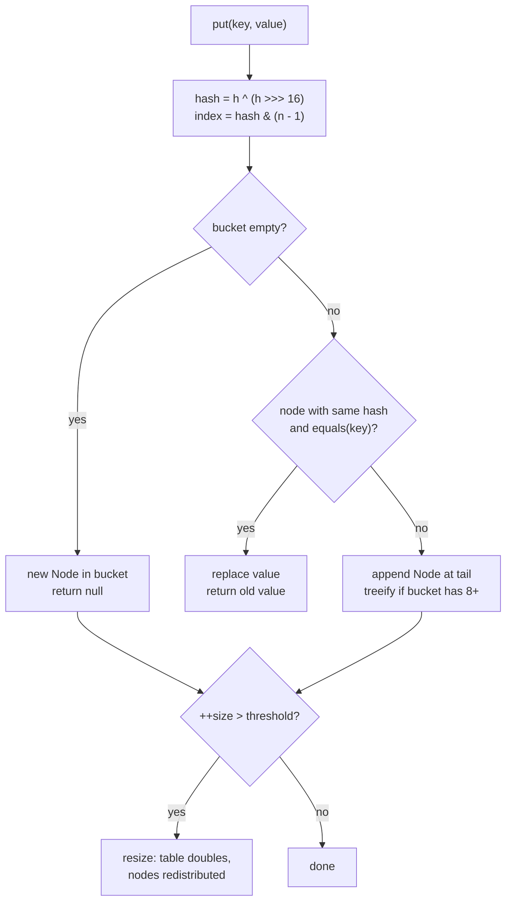
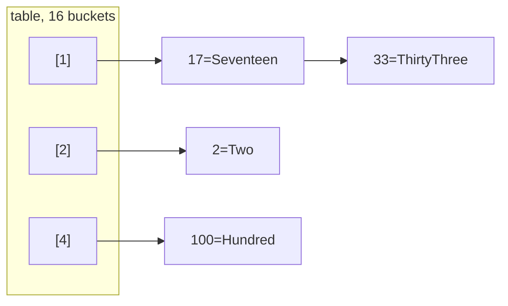

## In One Line
`HashMap` stores **key → value** pairs in a hash table: the key's `hashCode()` picks a bucket and `equals()` finds the exact key, so `put` / `get` / `remove` are **O(1) on average**; it allows one `null` key and any number of `null` values, and it promises **no order**.

## Mental Model
Think of a **school locker bank**.

- Each student (the **key**) is assigned a locker number by a formula applied to their name — that is `hashCode()` turned into a bucket index. Their belongings (the **value**) go inside.
- To fetch Priya's things you do not open every locker: you compute her locker number and open **that one** (O(1)).
- Two students can be assigned the same locker (a **collision**). Inside, every item carries a name tag — the stored key — and you check the tags with `equals()` to find the right owner.
- Putting something in a locker that already has your name tag **replaces** your old belongings (`put` on an existing key returns the old value).
- When the lockers are 75% full, the school builds a bank **twice as big** and reassigns everyone (**resize**). Locker numbers change, so walking the lockers left to right gives a different order afterwards.
- If a student **changes their name** after getting a locker (a mutable key), the formula now points somewhere else — their stuff is still in the old locker, but nobody can find it.

## Concept
### A Map is not a Collection
`Map<K,V>` is its own root interface: it maps **unique keys** to values (one value per key). It does not extend `Collection` or `Iterable`; you iterate a map through its three **views**: `keySet()`, `values()` and `entrySet()`. `HashMap` is the general-purpose implementation (Java 1.2), extending `AbstractMap` and implementing `Map`, `Cloneable` and `Serializable`.

### The core API
| Method | Returns | Notes |
|---|---|---|
| `put(k, v)` | previous value or `null` | Inserts or **replaces** |
| `get(k)` | value or `null` | `null` also for keys mapped to `null` |
| `getOrDefault(k, d)` (8) | value or `d` | `d` only if the key is **absent** |
| `containsKey(k)` | boolean | O(1) |
| `containsValue(v)` | boolean | **O(n)** — scans every entry |
| `remove(k)` | removed value or `null` | `remove(k, v)` (8) removes only if mapped to `v` |
| `size()`, `isEmpty()`, `clear()`, `putAll(m)` | | |
| `keySet()`, `values()`, `entrySet()` | live views | removal through a view removes from the map |
| `putIfAbsent(k, v)` (8) | existing value or `null` | Also replaces a `null` value |
| `computeIfAbsent(k, fn)` (8) | current value | Computes and stores only if absent — perfect for `Map<K, List<V>>` |
| `computeIfPresent(k, fn)` / `compute(k, fn)` (8) | new value | Returning `null` **removes** the key |
| `merge(k, v, fn)` (8) | new value | Absent → store `v`; present → `fn(old, v)`; `null` result removes — perfect for counting |
| `forEach((k, v) -> ...)`, `replaceAll((k, v) -> ...)` (8) | | |
| `replace(k, v)`, `replace(k, old, new)` (8) | | Only if the key is present |

### How HashMap works — the essentials
Internally a `HashMap` is an array of buckets, `Node<K,V>[] table`, where each `Node` holds `hash`, `key`, `value` and `next`.

1. **Hash the key.** `hash = h ^ (h >>> 16)` where `h = key.hashCode()`. The XOR folds the high bits into the low bits, because only the low bits choose the bucket. A `null` key gets hash 0 (so it always lives in bucket 0).
2. **Pick the bucket.** `index = hash & (n - 1)`, where `n` is the table length — always a power of two, so this mask equals `hash % n` but is faster.
3. **put:** if the bucket is empty, store a new node. Otherwise walk its nodes comparing the stored hash, then `==`, then `equals()`. Match → **replace the value** (the original key object is kept) and return the old value. No match → append a new node at the tail (Java 8+).
4. **get:** same walk; return the value of the matching node or `null`.
5. **Collisions** make a bucket a linked list. Since **Java 8**, a bucket with **8** nodes is converted to a red-black tree (if the table has at least **64** buckets; otherwise the table is resized instead), and turned back into a list when it shrinks to **6**. Worst-case lookup is then O(log n) instead of O(n).
6. **Resize.** When `size > capacity × loadFactor` (defaults 16 × 0.75 = **12**), the table **doubles** and every node moves to its new bucket — each node either stays at index `i` or moves to `i + oldCapacity`.
7. **Lazy table.** `new HashMap<>()` allocates no array; the 16-bucket table is created on the first `put`.

That is enough to answer most interview questions and to explain every output in this lesson. The full deep dive — the resize split, tree bins, the Java 7 infinite-loop bug, `tableSizeFor` — is in [HashMap Internals](lesson:b04-collections-internals/01-hashmap-internals).

### Why the example prints `{1=One, 2=Two, 3=Three}`
`Integer.hashCode()` returns the value itself. For 1, 2 and 3, spreading changes nothing and `& 15` leaves them in buckets **1, 2 and 3**. Iteration walks buckets from 0 upwards, so the map *looks* sorted — a coincidence. Keys 100, 17, 33 and 2 land in buckets 4, 1, 1 and 2, giving `{17=…, 33=…, 2=…, 100=…}`: neither sorted nor in insertion order (see Code).

### Keys: equals, hashCode and immutability
The contract: **equal keys must have equal hash codes**. If a key class overrides `equals` but not `hashCode`, two equal keys land in different buckets and `get` misses. Keys should also be **immutable**: if a field used by `hashCode` changes after `put`, the entry is stranded in its old bucket. `String`, the wrappers, enums and records are ideal keys. See [equals and hashCode](lesson:b01-fundamentals/06-object-class-equals-hashcode).

### null semantics
- One `null` key (bucket 0) and any number of `null` values are allowed.
- Therefore `get(k) == null` means **either** "absent" **or** "mapped to null". Use `containsKey` when it matters.
- `getOrDefault(k, d)` returns `d` only when the key is absent — a key mapped to `null` still returns `null`.
- `putIfAbsent` and `computeIfAbsent` treat a key mapped to `null` as absent.
- `ConcurrentHashMap`, `Hashtable`, `TreeMap` (natural ordering, for keys) and `Map.of` do **not** allow `null`.

### Capacity and load factor
| Setting | Default | Notes |
|---|---|---|
| Initial capacity | 16 | Rounded up to a power of two; allocated on first `put` |
| Load factor | 0.75 | Trade-off: lower = fewer collisions, more memory |
| Threshold | 12 | `capacity × loadFactor`; the 13th entry triggers a resize to 32 |
| Maximum capacity | 2^30 | |

Constructors: `HashMap()`, `HashMap(int initialCapacity)`, `HashMap(int, float loadFactor)`, `HashMap(Map m)`. Since **Java 19**, `HashMap.newHashMap(int expectedSize)` sizes the table so that many entries fit without resizing. `new HashMap<>(100)` gives 128 buckets that resize after 96 entries; `HashMap.newHashMap(100)` gives 256.

### Views and iteration
`keySet()`, `values()` and `entrySet()` are **live views**, not copies:
- Removing through a view (`map.keySet().remove(k)`, `map.values().removeIf(...)`, `iterator.remove()`) removes the mapping.
- Adding through `keySet()` is not supported (`UnsupportedOperationException`) — there would be no value.
- `entry.setValue(v)` during iteration updates the map.
- The best way to read all pairs is `entrySet()` (one lookup per entry) or `forEach((k, v) -> ...)`. `for (k : keySet()) map.get(k)` hashes every key a second time. More in [Iterating Maps](lesson:a03-collections/21-iterating-maps).
- Iterators are **fail-fast**: adding or removing keys through the map during iteration throws `ConcurrentModificationException`. Replacing the value of an **existing** key with `put` is not structural and is allowed.

### Complexity
| Operation | Average | Worst |
|---|---|---|
| `put`, `get`, `remove`, `containsKey` | O(1) | O(log n) with tree bins (Java 8+), O(n) before |
| `containsValue` | O(n) | O(n) |
| Iteration | O(n + capacity) | |
| Resize | O(n), amortised O(1) per `put` | |

### Thread safety
`HashMap` is **not synchronised**. Concurrent writes can lose updates, leave `size` wrong, or corrupt buckets; in Java 7 and earlier a concurrent resize could even create a cycle and make `get` loop forever. Use `ConcurrentHashMap` (fine-grained locking, no `null`s — see [ConcurrentHashMap](lesson:b03-concurrency/03-concurrenthashmap)) or, for low contention, `Collections.synchronizedMap(new HashMap<>())`.

### HashMap and its relatives
| | `HashMap` | `LinkedHashMap` | `TreeMap` | `Hashtable` | `ConcurrentHashMap` |
|---|---|---|---|---|---|
| Order | None | Insertion (or access) | Sorted by key | None | None |
| `get`/`put` | O(1) | O(1) | O(log n) | O(1) | O(1) |
| `null` key / values | 1 / yes | 1 / yes | no* / yes | no / no | no / no |
| Thread-safe | No | No | No | Yes (one lock) | Yes (fine-grained) |
| Since | 1.2 | 1.4 | 1.2 | 1.0 (legacy) | 5 |

\* `TreeMap` allows a `null` key only with a comparator that handles it. See [LinkedHashMap](lesson:a03-collections/15-linkedhashmap), [TreeMap](lesson:a03-collections/16-treemap) and [Hashtable](lesson:a03-collections/20-hashtable).

### Immutable maps
`Map.of(k1, v1, …)` (up to 10 pairs), `Map.ofEntries(Map.entry(k, v), …)` (Java 9) and `Map.copyOf(map)` (Java 10) create unmodifiable maps: no `null` keys or values, duplicate keys in `Map.of` throw `IllegalArgumentException`, and iteration order is randomised per JVM run. See [Immutable Collections](lesson:b05-modern-java/02-var-and-immutable-collections).

## Diagram

`hashCode()` narrows the search to one bucket; `equals()` decides "same key → replace" or "new key → append".


Keys 100, 17, 33, 2 inserted in that order: 17 and 33 collide in bucket 1 and are chained in arrival order. Iteration reads bucket by bucket, so the map prints 17, 33, 2, 100.

## Code
@example Collections/Maps/HashMapExample.java

The "sorted" look of the original is a coincidence. Different keys:
```java
Map<Integer, String> m = new HashMap<>();
m.put(100, "Hundred");
m.put(17, "Seventeen");
m.put(33, "ThirtyThree");
m.put(2, "Two");
System.out.println(m);
```
```output
{17=Seventeen, 33=ThirtyThree, 2=Two, 100=Hundred}
```

The order of the *same* two entries changes after a resize:
```java
Map<Integer, String> m = new HashMap<>();   // 16 buckets, resizes when size > 12
m.put(17, "a");                             // 17 & 15 = 1 -> bucket 1
m.put(1, "b");                              // 1 & 15 = 1 -> bucket 1, after 17
System.out.println(m);
for (int i = 100; i < 111; i++) m.put(i, "x");   // 13 entries -> table doubles to 32
m.keySet().removeIf(k -> k >= 100);              // back to the same two entries
System.out.println(m);                            // 17 -> bucket 17, 1 -> bucket 1
```
```output
{17=a, 1=b}
{1=b, 17=a}
```

Return values and `null` handling:
```java
Map<String, Integer> ages = new HashMap<>();
System.out.println(ages.put("Ann", 30));           // no previous value
System.out.println(ages.put("Ann", 31));           // returns the replaced value
ages.put(null, 0);                                  // one null key is allowed
ages.put("Cid", null);                              // null values are allowed
System.out.println(ages);
System.out.println(ages.get("Cid") + " " + ages.get("Zed"));          // both null!
System.out.println(ages.containsKey("Cid") + " " + ages.containsKey("Zed"));
System.out.println(ages.getOrDefault("Zed", -1) + " " + ages.getOrDefault("Cid", -1));
```
```output
null
30
{Ann=31, null=0, Cid=null}
null null
true false
-1 null
```

The Java 8 methods that replace most `if (map.containsKey(...))` code:
```java
String text = "the cat and the hat and the bat";
Map<String, Integer> freq = new HashMap<>();
for (String w : text.split(" ")) freq.merge(w, 1, Integer::sum);
System.out.println(freq);

Map<Integer, List<String>> byLength = new HashMap<>();
for (String w : List.of("kiwi", "fig", "pear", "plum", "apple"))
    byLength.computeIfAbsent(w.length(), k -> new ArrayList<>()).add(w);
System.out.println(byLength);

Map<String, Integer> stock = new HashMap<>(Map.of("apple", 2));
stock.computeIfPresent("apple", (k, v) -> v - 2 == 0 ? null : v - 2);  // null -> removed
stock.compute("kiwi", (k, v) -> v == null ? 1 : v + 1);
stock.compute("kiwi", (k, v) -> v == null ? 1 : v + 1);
System.out.println(stock);
```
```output
{the=3, bat=1, and=2, cat=1, hat=1}
{3=[fig], 4=[kiwi, pear, plum], 5=[apple]}
{kiwi=2}
```

Iterating the right way, and removing through a view:
```java
Map<Integer, String> map = new HashMap<>(Map.of(1, "One", 2, "Two", 3, "Three"));
for (Map.Entry<Integer, String> e : map.entrySet()) {
    System.out.println(e.getKey() + " -> " + e.getValue());
}
map.forEach((k, v) -> System.out.print(k + "=" + v + " "));
System.out.println();
map.entrySet().removeIf(e -> e.getValue().startsWith("T"));
System.out.println(map);
```
```output
1 -> One
2 -> Two
3 -> Three
1=One 2=Two 3=Three 
{1=One}
```

## Walkthrough
- `import java.util.HashMap;` — `HashMap` is in `java.util`.
- `HashMap<Integer, String> map = new HashMap<>();` — an empty map from `Integer` keys to `String` values. `<>` infers the type arguments. No bucket array exists yet; the first `put` allocates 16 buckets with a resize threshold of 12.
- `map.put(1, "One"); map.put(2, "Two"); map.put(3, "Three");` — each `int` key is autoboxed to `Integer`. `Integer.hashCode()` is the value, so the entries go to buckets 1, 2 and 3. Each `put` returns `null` (no previous value), which the example ignores.
- `"HashMap: " + map` — `AbstractMap.toString()` prints `{key=value, ...}` by iterating the entry set in bucket order → **`HashMap: {1=One, 2=Two, 3=Three}`**. It looks like insertion or sorted order only because small `Integer` keys map to buckets with the same number.
- `map.get(2)` — hashes `2`, goes straight to bucket 2, confirms with `equals`, returns `"Two"`. If the key were absent, it would return `null`.
- `for (Integer key : map.keySet())` — iterates the live key view in bucket order: 1, 2, 3.
- `map.get(key)` inside that loop — a **second** hash lookup per key to fetch the value (see Traps). The output lines are `Key: 1, Value: One` … `Key: 3, Value: Three`.
- `map.remove(3);` — `remove(Object key)`: the `3` is autoboxed, the entry in bucket 3 is unlinked, and `"Three"` is returned (ignored). → **`HashMap after removal: {1=One, 2=Two}`**.
- The output is stable across runs (no `.varies` file) because `Integer` hash codes are deterministic.

## Traps
> [!ERRATA] The example iterates with `for (Integer key : map.keySet()) { ... map.get(key) ... }`. That works, but it hashes and looks up every key **twice** (once while iterating, once in `get`). The idiomatic form reads each pair directly: `for (Map.Entry<Integer, String> e : map.entrySet()) System.out.println("Key: " + e.getKey() + ", Value: " + e.getValue());` or `map.forEach((k, v) -> ...)`. It prints the same lines.

> [!WARNING] The comments show `{1=One, 2=Two, 3=Three}` as if `HashMap` kept insertion or sorted order. It keeps neither: the output looks ordered only because `Integer.hashCode()` of 1, 2, 3 is 1, 2, 3 — the bucket numbers. Insert 100, 17, 33, 2 and the order is 17, 33, 2, 100. Use `LinkedHashMap` for insertion order and `TreeMap` for sorted keys.

> [!NOTE] Declaring `HashMap<Integer, String> map` works, but `Map<Integer, String> map = new HashMap<>();` is the usual style: code against the interface so the implementation can change.

- **`get()` returning `null` is ambiguous** — absent key or `null` value. Use `containsKey` or `getOrDefault` (which itself returns `null` for a key mapped to `null`).
- **Keys without a proper `hashCode()`/`equals()`** → lookups with an equal-but-different key object return `null`.
- **Mutable keys** — changing a key after `put` strands the entry (see Quiz). Never use a mutable `List` or a bean with setters as a key.
- **Modifying the map while iterating it** (adding/removing keys) → `ConcurrentModificationException`. Use `entrySet().removeIf(...)` or `iterator.remove()`.
- **`containsValue` is O(n)** — if you need reverse lookups, keep a second map.
- **`new HashMap<>(n)` is not "room for n"** — use `HashMap.newHashMap(n)` (Java 19+).
- **Relying on iteration order** in tests or output — it can change with capacity, insertion history or JDK version.
- **`Map.of` rejects `null`s and duplicate keys**, and its order changes from run to run.
- **Sharing a `HashMap` between threads** without synchronisation — use `ConcurrentHashMap`.

## Tips & Tricks
- **"hashCode picks the locker, equals checks the name tag."**
- **Iterate `entrySet()`, not `keySet()` + `get()`.** Or `forEach((k, v) -> ...)`.
- **Counting:** `map.merge(key, 1, Integer::sum)`. **Grouping:** `map.computeIfAbsent(key, k -> new ArrayList<>()).add(item)`. **Default:** `map.getOrDefault(key, 0)`.
- **"null in, remove out"** — returning `null` from `compute`, `computeIfPresent` or `merge` deletes the key.
- **Good keys are immutable:** `String`, `Integer`, enums, records.
- **Remember the numbers 16 / 0.75 / 12 / 8 / 64** — capacity, load factor, first threshold, treeify threshold, minimum table size for trees.
- **`put` returns the old value** — handy to detect overwrites: `if (map.put(k, v) != null) { /* replaced */ }`.
- Need order? **Linked = arrival, Tree = sorted.** Need threads? **ConcurrentHashMap.**

## Interview Q&A
### [Basic] What is a HashMap and what are its main characteristics?
`HashMap<K,V>` is the general-purpose `Map` implementation in `java.util`. It stores key-value pairs in a hash table, keys are unique (a second `put` with an equal key replaces the value), it gives O(1) average `put`/`get`/`remove`, allows one `null` key and multiple `null` values, does not guarantee any iteration order, and is not synchronised. Keys must implement `equals()` and `hashCode()` consistently.

**Follow-up:** *What does `put` return?* — The previous value for that key, or `null` if there was none (or if the previous value was `null`).

### [Basic] How does HashMap work internally, in short?
It keeps an array of buckets. On `put(k, v)` it computes `k.hashCode()`, spreads it (`h ^ (h >>> 16)`), and picks the bucket `hash & (n - 1)`. If the bucket is empty it stores a new node; otherwise it walks the nodes comparing hash and `equals()` — a match replaces the value, no match appends a node. `get` follows the same path and returns the matching value. When the number of entries exceeds capacity × load factor (16 × 0.75 = 12 by default), the table doubles and entries are redistributed. Since Java 8, a bucket with 8 or more nodes becomes a red-black tree (if the table has at least 64 buckets).

**Follow-up:** *Why is the table size a power of two?* — So the index can be computed with a bit mask instead of `%`, and so a resize can split each bucket into "same index" or "index + old capacity" by testing one bit.

### [Basic] What is the difference between HashMap and Hashtable?
`Hashtable` is the legacy (Java 1.0) class: every method is `synchronized`, it rejects `null` keys and values, it extends the obsolete `Dictionary`, and it offers `Enumeration`s. `HashMap` (Java 1.2) is unsynchronised and therefore faster in single-threaded code, allows one `null` key and `null` values, and has fail-fast iterators. For thread safety today you use `ConcurrentHashMap`, not `Hashtable`.

**Follow-up:** *Why not `Hashtable` for concurrency?* — One lock for the whole table serialises all access; `ConcurrentHashMap` locks per bucket and reads without locking.

### [Intermediate] What happens when two keys have the same hashCode?
That is a **collision**. Both keys go to the same bucket. `HashMap` stores the full hash in each node and, when searching, compares the hash first and then calls `equals()`. If the keys are equal, the second `put` replaces the value; if not, both entries live in the bucket as a linked list (tail insertion since Java 8). Lookups in that bucket cost O(k) for k entries, and since Java 8 a bucket of 8+ entries becomes a red-black tree, making it O(log k). Collisions only cost performance, never correctness — as long as `equals` is correct.

**Follow-up:** *And if two keys are `equals` but have different hash codes?* — That breaks the contract: they probably end up in different buckets, so the map can hold both and `get` may miss.

### [Intermediate] Why must you override hashCode() whenever you override equals() for a map key?
`HashMap` uses `hashCode()` first to choose the bucket and only calls `equals()` on keys in that bucket. The default `hashCode()` is identity-based, so two logically equal key objects would get different buckets, and `map.get(new Key(1))` would return `null` even though an equal key is in the map. The contract "equal objects → equal hash codes" guarantees they meet in the same bucket where `equals` can match them.

**Follow-up:** *Is a constant `hashCode()` (e.g. `return 1;`) legal?* — Legal but terrible: every key collides, so the map degenerates to one bucket — O(n) lists, or O(log n) trees for `Comparable` keys.

### [Intermediate] Can a HashMap contain null keys and values? What is the catch with get()?
Yes: one `null` key (hash 0, stored in bucket 0) and any number of `null` values. The catch: `get(k)` returns `null` both when `k` is absent and when `k` is mapped to `null`. Use `containsKey(k)` to distinguish, and remember that `getOrDefault(k, d)` returns `d` only for an **absent** key, while `putIfAbsent` and `computeIfAbsent` treat a `null` value as absent. `ConcurrentHashMap` bans `null` precisely to avoid this ambiguity in concurrent code.

**Follow-up:** *Which maps reject null keys?* — `Hashtable`, `ConcurrentHashMap`, `Map.of`/`Map.copyOf`, and `TreeMap` with natural ordering.

### [Intermediate] Why is HashMap's iteration order unpredictable, and why does `{1=One, 2=Two, 3=Three}` look sorted?
Iteration walks the bucket array from index 0 upwards, and each bucket's chain in arrival order. Bucket indexes come from the keys' hash codes and the current capacity, so the order has no relation to insertion or sorting, and it can change after a resize (entries move to new buckets) or across JDK versions. Small `Integer` keys look sorted because `Integer.hashCode()` is the number itself, so 1, 2, 3 land in buckets 1, 2, 3. With keys 100, 17, 33, 2 the order becomes 17, 33, 2, 100.

**Follow-up:** *Which map keeps insertion order?* — `LinkedHashMap`; `TreeMap` keeps keys sorted.

### [Intermediate] What are initial capacity and load factor, and when does HashMap resize?
Capacity is the number of buckets (default 16, always a power of two). The load factor (default 0.75) sets the resize threshold `capacity × loadFactor` (12 by default). When `size` exceeds it — on the 13th entry — the table doubles to 32 and all entries are redistributed, which is O(n) but amortised O(1) per `put`. 0.75 is a compromise between memory (empty buckets) and collision length. If you know the final size, pre-size: `HashMap.newHashMap(expected)` (Java 19) — `new HashMap<>(100)` gives 128 buckets that still resize at 96 entries.

**Follow-up:** *Does a HashMap ever shrink?* — No. Removing entries never reduces the table; copy into a new map if you need to reclaim it.

### [Intermediate] What is the best way to iterate over a HashMap?
Use `entrySet()`, which gives the key and value of each entry with no extra lookups:
```java
for (Map.Entry<K, V> e : map.entrySet()) { use(e.getKey(), e.getValue()); }
map.forEach((k, v) -> use(k, v));          // Java 8
```
Iterating `keySet()` and calling `get(key)` does a second hash lookup per entry. Use `values()` when you need only values. To remove while iterating, use `iterator.remove()` or `map.entrySet().removeIf(e -> ...)`; modifying the map directly throws `ConcurrentModificationException`.

**Follow-up:** *Can you change values while iterating?* — Yes: `entry.setValue(v)`, `replaceAll`, or `put` on an existing key are not structural modifications.

### [Advanced] What changed in HashMap in Java 8?
(1) **Tree bins**: a bucket with 8+ entries is converted to a red-black tree when the table has at least 64 buckets, reducing the worst case from O(n) to O(log n) and blunting hash-flooding attacks. (2) **Tail insertion** instead of head insertion, which preserves chain order during resize and removed the Java 7 infinite-loop bug under concurrent resizing (the map is still not thread-safe). (3) A simpler hash spreading function, `h ^ (h >>> 16)`, instead of Java 7's multiple shifts. (4) Resize splits each bucket into a "low" and "high" list using one bit, without recomputing hashes. (5) New default methods on `Map`: `getOrDefault`, `putIfAbsent`, `compute*`, `merge`, `forEach`, `replaceAll`. Later: `HashMap.newHashMap(int)` in Java 19.

**Follow-up:** *Why not always use trees?* — Tree nodes are about twice the size of list nodes and slower for small buckets; with a good hash function buckets rarely exceed 8 (the probability is about 0.00000006).

### [Advanced] Is HashMap thread-safe? What can go wrong and what should you use instead?
No. Two threads calling `put` can overwrite each other's nodes (lost updates), `size` can be wrong, and a reader can see a half-built structure. In Java 7 and earlier, two threads resizing at once could link a bucket into a cycle, making later `get` calls spin forever. Use `ConcurrentHashMap`: lock-free reads, CAS/per-bucket locking for writes, atomic `compute`/`merge`, weakly consistent iterators, no `null` keys or values. `Collections.synchronizedMap(map)` works for low contention but locks the whole map and requires manual locking around iteration.

**Follow-up:** *Is `if (!map.containsKey(k)) map.put(k, v)` safe on a ConcurrentHashMap?* — No, check-then-act is not atomic; use `putIfAbsent` or `computeIfAbsent`.

### [Advanced] Why should HashMap keys be immutable? What happens if a key is mutated?
The bucket of an entry is fixed by the key's hash at insertion time. If you mutate the key so that its `hashCode()` changes, the entry stays in the old bucket: `get(sameKeyObject)` computes the new hash and looks in the wrong bucket, and `get(anEqualCopyOfTheOldKey)` finds the right bucket but `equals` now fails. The entry is unreachable but still occupies memory — a leak — and `put` with the mutated key creates a second entry. Immutable keys (`String`, wrappers, records with immutable fields) make this impossible, and they can also cache their hash code, as `String` does.

**Follow-up:** *Why is String such a good key?* — It is immutable, has a well-distributed `hashCode()`, and caches the hash after the first computation.

## Quiz
### What does this print?
```java
Map<String, Integer> m = new HashMap<>();
System.out.println(m.put("a", 1) + " " + m.put("a", 2) + " " + m.get("a"));
```
- [ ] 1 2 2
- [x] null 1 2
- [ ] null null 2
- [ ] true false 2
> `put` returns the **previous** value: `null` the first time (the key was new), then `1` (the value being replaced). Afterwards the key maps to 2. Unlike `Set.add`, `Map.put` does not return a boolean.

### What does this print?
```java
Map<String, Integer> m = new HashMap<>();
m.put("k", null);
System.out.println(m.getOrDefault("k", 5) + " " + m.putIfAbsent("k", 7) + " " + m.get("k"));
```
- [ ] 5 null 7
- [ ] null null null
- [x] null null 7
- [ ] 5 7 7
> `getOrDefault` returns the default only when the key is **absent**; "k" is present with value `null`, so it returns `null`. `putIfAbsent`, however, treats a `null` value as absent: it stores 7 and returns the old value, `null`. Hence `get` gives 7.

### What does this print?
```java
Map<List<String>, String> m = new HashMap<>();
List<String> key = new ArrayList<>(List.of("a"));
m.put(key, "value");
key.add("b");
System.out.println(m.get(key) + " " + m.get(List.of("a")) + " " + m.size());
```
- [ ] value value 1
- [ ] value null 1
- [x] null null 1
- [ ] null value 1
> `get(key)` hashes `[a, b]` and searches the wrong bucket. `get(List.of("a"))` finds the right bucket (the stored hash is for `[a]`) but `equals` compares with the mutated key `[a, b]` and fails. The entry is still there (size 1) but unreachable. Mutable keys break hash maps.

### Spot the bug
```java
Map<String, Integer> scores = new HashMap<>(Map.of("a", 1, "b", 2, "c", 3));
for (String k : scores.keySet()) {
    if (scores.get(k) < 2) scores.remove(k);
}
```
- [ ] `get` cannot be called inside the loop
- [x] Removing through the map while iterating its key set throws `ConcurrentModificationException`; use `scores.entrySet().removeIf(e -> e.getValue() < 2)`
- [ ] `keySet()` returns a copy, so the removal is silently lost
- [ ] `remove` needs both key and value
> `keySet()` is a live view with a fail-fast iterator. `scores.remove(k)` is a structural change the iterator did not make, so the next `next()` throws (here the removal of "a" still happens first). `removeIf` on a view — or an explicit `iterator.remove()` — is the safe way.

### Does this throw `ConcurrentModificationException`?
```java
Map<String, Integer> m = new HashMap<>(Map.of("x", 1, "y", 2));
for (String k : m.keySet()) m.put(k, m.get(k) * 10);
System.out.println(m);
```
- [x] No — it prints {x=10, y=20}
- [ ] Yes — any `put` during iteration throws
- [ ] No — but the map is unchanged
- [ ] Yes — but only for the second key
> Only **structural** modifications (adding or removing keys) increase `modCount`. `put` on an existing key just replaces the value, so the iterator is unaffected. (`m.replaceAll((k, v) -> v * 10)` is the tidier way to write it.)

### What does this print?
```java
Map<Character, Integer> counts = new HashMap<>();
for (char c : "banana".toCharArray()) counts.merge(c, 1, Integer::sum);
System.out.println(counts);
```
- [ ] {b=1, a=3, n=2}
- [x] {a=3, b=1, n=2}
- [ ] {a=1, b=1, n=1}
- [ ] {b=1, a=1, n=1, a=1, n=1, a=1}
> `merge` stores 1 for a new key and otherwise combines with `Integer::sum`, so the counts are a=3, b=1, n=2. The printed order is bucket order: `Character.hashCode()` is the char code (a=97, b=98, n=110), and `& 15` gives buckets 1, 2 and 14 — not the first-seen order b, a, n.

### With default settings, which `put` triggers the first resize?
- [ ] The 1st (the table is created)
- [ ] The 12th
- [x] The 13th
- [ ] The 17th
> The default table has 16 buckets and load factor 0.75, so the threshold is 12. A resize happens when the size **exceeds** the threshold, i.e. when the 13th entry is added; the table grows to 32. (Internally the very first `put` also calls `resize()`, but only to allocate the initial 16-bucket table — nothing is redistributed.)

## Takeaways
- `HashMap` = key → value hash table; O(1) average `put`/`get`/`remove`; one `null` key, many `null` values; no order; not thread-safe.
- Mechanism: `hash = h ^ (h >>> 16)`, bucket = `hash & (n - 1)`, match by hash then `equals`; collisions chain, and since Java 8 chains of 8+ become red-black trees (table ≥ 64).
- Defaults 16 buckets / 0.75 load factor → first resize on the 13th entry, table doubles; pre-size with `HashMap.newHashMap(n)` (Java 19+).
- `put` returns the old value; `get` returns `null` for absent *and* `null`-valued keys — use `containsKey`/`getOrDefault`.
- Keys need consistent `equals`/`hashCode` and must be immutable, or entries become unreachable.
- Iterate with `entrySet()`/`forEach`, remove with `removeIf`/`iterator.remove()`; use `merge` for counting and `computeIfAbsent` for grouping.
- Order looks sorted for small `Integer` keys only by coincidence; use `LinkedHashMap` for insertion order, `TreeMap` for sorted keys, `ConcurrentHashMap` for threads.
