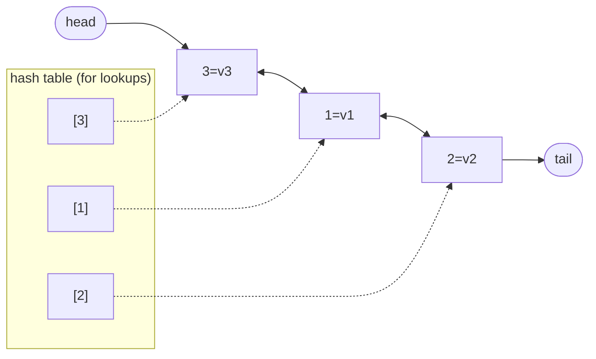
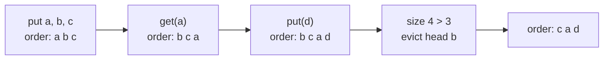
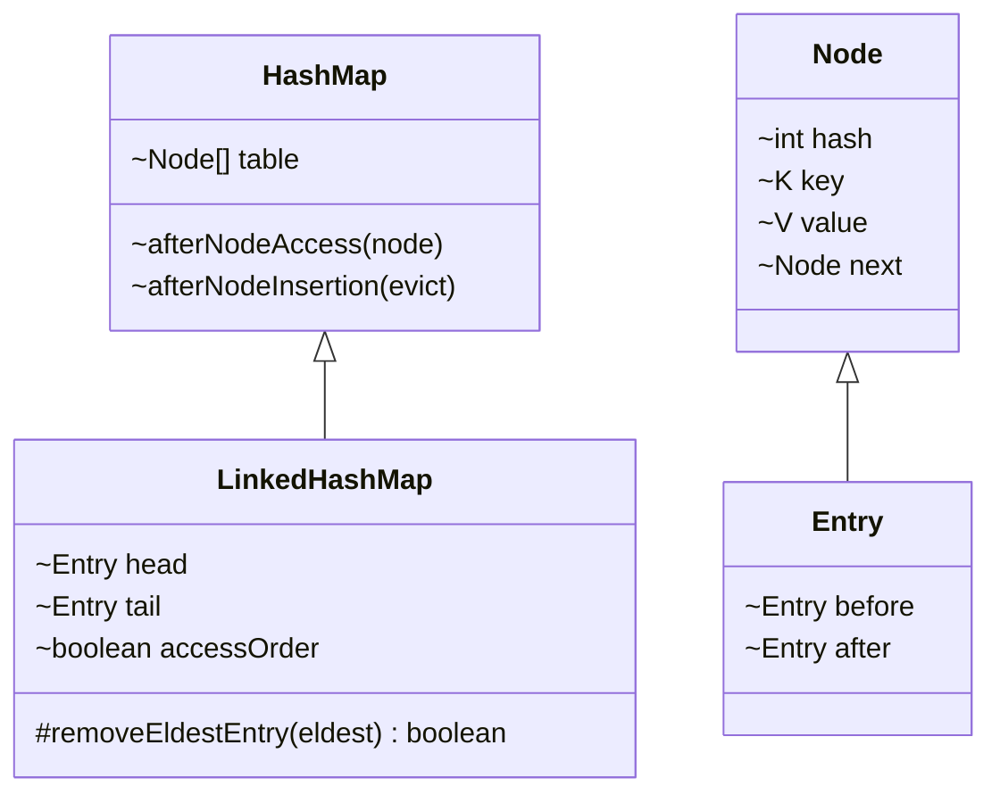

## In One Line
`LinkedHashMap` is a `HashMap` that also threads every entry onto a **doubly linked list**, so it iterates in **insertion order** (or, if you ask, **access order** — the basis of an LRU cache) while keeping O(1) `put` / `get` / `remove`.

## Mental Model
Think of a **hotel** with a key rack and a guest register.

- The **key rack** (one hook per room number) is the `HashMap` part: given a guest's name you find their room instantly.
- The **guest register** at the front desk is the linked list: every new guest's name is written **at the bottom**, in the order they checked in. To list all guests, the receptionist reads the register top to bottom — a predictable order — instead of walking the rack hook by hook.
- A returning guest who is already checked in (a `put` on an existing key) just gets their details updated; their line in the register **does not move**.
- In **access-order mode**, the register becomes a "recently seen" list: every time a guest comes to the desk (`get`, `put`), their name is crossed out and rewritten at the bottom. The name at the **top** is the guest not seen for the longest time — the one an LRU cache evicts when the hotel is full.

## Concept
### HashMap + a linked list
`public class LinkedHashMap<K,V> extends HashMap<K,V> implements SequencedMap<K,V>` (Java 1.4; `SequencedMap` since Java 21).

- Its entries, `LinkedHashMap.Entry`, extend `HashMap.Node` with two extra references: **`before`** and **`after`**.
- The map keeps `head` (eldest) and `tail` (youngest) pointers, plus a `final boolean accessOrder`.
- Lookups use the inherited hash table (bucket array). Iteration, `toString()` and the views follow the **linked list** from `head` to `tail`.
- `HashMap` provides hooks — `afterNodeInsertion`, `afterNodeAccess`, `afterNodeRemoval` — that `LinkedHashMap` overrides to link, move and unlink entries. That is the whole trick.

### Insertion order rules
| Operation | Effect on the order |
|---|---|
| `put(newKey, v)` | appended at the tail |
| `put(existingKey, v)` | value replaced, **position unchanged** |
| `remove(k)` then `put(k, v)` | appended at the tail (it is a new entry) |
| `putLast(k, v)` / `putFirst(k, v)` (Java 21) | inserts at, or **moves an existing key to**, the end / the front |

### Why the original example cannot show the difference
The example uses keys `1, 2, 3` inserted in ascending order. A plain `HashMap` prints those in exactly the same order (small `Integer`s sit in buckets 1, 2, 3 — see [HashMap](lesson:a03-collections/14-hashmap)). Insert `3, 1, 2` instead and the difference appears: `HashMap` → `{1, 2, 3}`, `LinkedHashMap` → `{3, 1, 2}` (see Code).

### Access-order mode
The three-argument constructor `LinkedHashMap(int initialCapacity, float loadFactor, boolean accessOrder)` with `accessOrder = true` orders entries from **least recently accessed** (head) to **most recently accessed** (tail).
- Counts as an access (moves the entry to the tail): `get`, `getOrDefault`, `put`, `putIfAbsent`, `compute`, `computeIfAbsent`, `computeIfPresent`, `merge`, and `replace` when it actually replaces.
- Does **not** count: `containsKey`, `containsValue`, iterating the map or its views.
- Consequence: in an access-ordered map, **`get()` is a structural modification**. Calling `get` while iterating `keySet()` throws `ConcurrentModificationException`. Iterate `entrySet()` instead.

### removeEldestEntry — the LRU hook
```java
protected boolean removeEldestEntry(Map.Entry<K,V> eldest)   // default: return false
```
After every insertion of a **new** mapping (`put`, `putIfAbsent`, `computeIfAbsent`, `merge`, `putAll` …) `LinkedHashMap` calls this method with the head entry. If you return `true`, that eldest entry is removed. Combine it with access order and you have a complete **LRU (least recently used) cache** in a dozen lines (see Code). With insertion order instead, the same hook gives a FIFO cache. The full design discussion is in [LRU Cache with LinkedHashMap](lesson:b04-collections-internals/04-lru-cache-with-linkedhashmap).

### Java 21: SequencedMap
`LinkedHashMap` now implements `SequencedMap`, which adds:
| Method | Does |
|---|---|
| `firstEntry()`, `lastEntry()` | read the eldest / youngest entry (an **unmodifiable snapshot**: `setValue` throws `UnsupportedOperationException`) |
| `pollFirstEntry()`, `pollLastEntry()` | remove and return it (`null` if empty) |
| `putFirst(k, v)`, `putLast(k, v)` | insert at, or move an existing key to, the front / end |
| `reversed()` | a reverse-ordered **view** |
| `sequencedKeySet()`, `sequencedValues()`, `sequencedEntrySet()` | views that are themselves sequenced (so they also have `reversed()`) |

Java 19 also added the factory `LinkedHashMap.newLinkedHashMap(int expectedSize)`.

### Cost compared with HashMap
| | `HashMap` | `LinkedHashMap` |
|---|---|---|
| `get` / `put` / `remove` | O(1) | O(1), slightly slower (links to update) |
| Memory per entry | node: hash, key, value, next | + `before`, `after` references |
| Iteration | O(n + capacity) — visits empty buckets | **O(n)** — follows the list |
| Iteration order | bucket order (unspecified) | insertion or access order |
| `null` key / values | one / yes | one / yes |

So `LinkedHashMap` is often *faster* to iterate than `HashMap`, especially for a large, sparsely filled table.

### LinkedHashSet
`LinkedHashSet` is the set version: a `HashSet` whose internal map is a `LinkedHashMap`. It iterates in insertion order and, since Java 21, implements `SequencedSet` (`getFirst`, `getLast`, `reversed`, `addFirst`, `addLast`). It has no access-order mode.

### When to use it
- **Predictable output** — JSON building, reports, logs and tests that compare printed maps.
- **Keep the input order while grouping or de-duplicating** — `Collectors.groupingBy(key, LinkedHashMap::new, downstream)`, `Collectors.toMap(..., LinkedHashMap::new)`.
- **Store a sort result** — sort entries by value, collect into a `LinkedHashMap` to keep that order.
- **LRU / FIFO caches** with `removeEldestEntry`.

### Thread safety
Not synchronised. Wrap with `Collections.synchronizedMap(...)` (and hold its lock while iterating — in access-order mode even `get` mutates the list, so every access must be synchronised). The JDK has no concurrent linked hash map: `ConcurrentHashMap` has no order and `ConcurrentSkipListMap` is sorted. For a production concurrent LRU cache, use a library such as Caffeine.

`LinkedHashMap.equals()` follows the `Map` contract: two maps with the same mappings are equal **regardless of order**.

## Diagram

Keys inserted 3, 1, 2. Buckets (dotted) serve `get`; the before/after links (solid) remember arrival order, and iteration follows them from head to tail.


An access-ordered `LinkedHashMap` with capacity 3: `get` moves an entry to the tail, and `removeEldestEntry` evicts the head, the least recently used entry.


`LinkedHashMap` reuses all of `HashMap`; its `Entry` adds the two links, and it overrides the `afterNode...` hooks to maintain them.

## Code
@example Collections/Maps/LinkedHashMapExample.java

Keys inserted out of order show what `LinkedHashMap` adds:
```java
Map<Integer, String> hash = new HashMap<>(), linked = new LinkedHashMap<>();
for (int k : new int[]{3, 1, 2}) { hash.put(k, "v" + k); linked.put(k, "v" + k); }
System.out.println("HashMap       " + hash);
System.out.println("LinkedHashMap " + linked);
```
```output
HashMap       {1=v1, 2=v2, 3=v3}
LinkedHashMap {3=v3, 1=v1, 2=v2}
```

Re-putting an existing key keeps its position; removing and re-adding does not:
```java
Map<String, Integer> m = new LinkedHashMap<>();
m.put("Mango", 5); m.put("Apple", 5); m.put("Kiwi", 4);
m.put("Apple", 99);                      // existing key: value replaced, position kept
System.out.println(m);
m.remove("Apple");
m.put("Apple", 1);                       // removed and re-added: goes to the end
System.out.println(m);
```
```output
{Mango=5, Apple=99, Kiwi=4}
{Mango=5, Kiwi=4, Apple=1}
```

Access order:
```java
LinkedHashMap<String, Integer> access = new LinkedHashMap<>(16, 0.75f, true);
access.put("A", 1); access.put("B", 2); access.put("C", 3);
access.get("A");                          // A becomes most recently used
System.out.println(access);
access.put("B", 20);                      // updating counts as access
System.out.println(access);
access.containsKey("C");                  // does NOT count as access
System.out.println(access);
```
```output
{B=2, C=3, A=1}
{C=3, A=1, B=20}
{C=3, A=1, B=20}
```

A complete LRU cache:
```java
class LruCache<K, V> extends LinkedHashMap<K, V> {
    private final int capacity;
    LruCache(int capacity) {
        super(16, 0.75f, true);              // true = access order
        this.capacity = capacity;
    }
    @Override
    protected boolean removeEldestEntry(Map.Entry<K, V> eldest) {
        return size() > capacity;            // evict the least recently used
    }
}

LruCache<String, String> cache = new LruCache<>(3);
cache.put("a", "1"); cache.put("b", "2"); cache.put("c", "3");
cache.get("a");                           // order now b, c, a
cache.put("d", "4");                      // size 4 > 3 -> evict eldest (b)
System.out.println(cache);
```
```output
{c=3, a=1, d=4}
```

Java 21 `SequencedMap` methods:
```java
LinkedHashMap<String, Integer> seq = new LinkedHashMap<>();
seq.put("B", 2); seq.put("C", 3);
seq.putFirst("A", 1);
seq.putLast("Z", 26);
System.out.println(seq);
System.out.println(seq.firstEntry() + " " + seq.lastEntry() + " " + seq.reversed());
seq.putLast("A", 100);                    // existing key moves to the end
System.out.println(seq + " " + seq.pollFirstEntry() + " " + seq);
```
```output
{A=1, B=2, C=3, Z=26}
A=1 Z=26 {Z=26, C=3, B=2, A=1}
{B=2, C=3, Z=26, A=100} B=2 {C=3, Z=26, A=100}
```

Keeping a computed order with collectors:
```java
Map<String, Integer> prices = Map.of("tea", 30, "coffee", 50, "juice", 40);
Map<String, Integer> byPrice = prices.entrySet().stream()
    .sorted(Map.Entry.comparingByValue())
    .collect(Collectors.toMap(Map.Entry::getKey, Map.Entry::getValue,
                              (a, b) -> a, LinkedHashMap::new));
System.out.println(byPrice);
Map<Integer, List<String>> groups = Stream.of("kiwi", "fig", "apple", "pear")
    .collect(Collectors.groupingBy(String::length, LinkedHashMap::new, Collectors.toList()));
System.out.println(groups);
```
```output
{tea=30, juice=40, coffee=50}
{4=[kiwi, pear], 3=[fig], 5=[apple]}
```

## Walkthrough
- `import java.util.LinkedHashMap;` — in `java.util`, like `HashMap`.
- `LinkedHashMap<Integer, String> map = new LinkedHashMap<>();` — the no-argument constructor: 16 buckets, load factor 0.75, **insertion order** (`accessOrder = false`).
- `map.put(1, "One"); map.put(2, "Two"); map.put(3, "Three");` — each entry goes into its hash bucket **and** is appended to the tail of the linked list: head → 1 → 2 → 3 ← tail.
- `"LinkedHashMap: " + map` — `toString()` follows the list → **`LinkedHashMap: {1=One, 2=Two, 3=Three}`**, i.e. insertion order.
- `map.get(2)` — an O(1) hash lookup, exactly as in `HashMap` → `Two`. In insertion-order mode it does not change the order.
- `for (Integer key : map.keySet())` + `map.get(key)` — walks the keys in list order (1, 2, 3) and looks up each value again. Works here, but see the errata below.
- `map.remove(3);` — removes the entry from its bucket and unlinks it from the list (the tail pointer moves back to 2) → **`LinkedHashMap after removal: {1=One, 2=Two}`**.
- All `// Output:` comments match the recorded output.

## Traps
> [!ERRATA] The example cannot demonstrate what makes `LinkedHashMap` different: keys `1, 2, 3` inserted in ascending order print in exactly the same order from a plain `HashMap`, because small `Integer` keys occupy buckets 1, 2, 3. Replace `HashMap` with `LinkedHashMap` in the HashMap example and nothing changes. Insert keys out of order (e.g. `3, 1, 2`, or strings) to actually see insertion order being preserved.

> [!ERRATA] Iterating with `keySet()` and calling `map.get(key)` does a second lookup per key; use `entrySet()` or `forEach((k, v) -> ...)`. For a `LinkedHashMap` it is worse than wasteful: if the map were created in **access-order** mode, each `get` inside the loop would reorder the list and the loop would throw `ConcurrentModificationException`.

- **Re-inserting an existing key does not move it** in insertion-order mode. Remove it first, or use `putLast` (Java 21).
- **In access-order mode, `get` mutates the map** — it is a structural modification for iterators, and it makes even reads unsafe without synchronisation in multi-threaded code.
- **`containsKey` does not count as an access**, so an LRU cache that checks with `containsKey` and never calls `get` will evict the wrong entries.
- **`removeEldestEntry` is only called after inserting a new mapping** — not after `get` or after replacing a value — and it removes at most one entry per call.
- **`firstEntry()`/`lastEntry()` return immutable snapshots**: `setValue` throws `UnsupportedOperationException`. Use `put` to change the value.
- **Order does not affect `equals`**: `{1=x, 2=y}` equals `{2=y, 1=x}`.
- **The three-argument constructor is the only way to get access order** — there is no setter.

## Tips & Tricks
- **"Linked = Line"**: entries stand in line in arrival order.
- **LRU cache recipe = "access order `true` + `removeEldestEntry` returns `size() > capacity`".** Interviewers love this one.
- **Access mode: "touch it, it moves to the back; the front gets evicted."**
- Want sorted-by-value output? Sort the entries and collect into `LinkedHashMap::new` — a `HashMap` would scramble the result again.
- Use `groupingBy(..., LinkedHashMap::new, ...)` and `toMap(..., LinkedHashMap::new)` to keep first-seen order from streams.
- Iteration-heavy workloads over a large, mostly empty map: `LinkedHashMap` iterates in O(n) instead of O(capacity).
- `LinkedHashSet` = the set flavour; `new LinkedHashSet<>(list)` removes duplicates and keeps order.

## Interview Q&A
### [Basic] What is LinkedHashMap and how does it differ from HashMap?
`LinkedHashMap` extends `HashMap` and additionally links all entries in a doubly linked list. It therefore has a predictable iteration order — **insertion order** by default, or **access order** if constructed with `accessOrder = true` — while keeping O(1) `get`/`put`/`remove`. `HashMap` iterates in bucket order, which is unspecified and may change after a resize. The costs of `LinkedHashMap` are two extra references per entry and slightly slower writes; its iteration is O(n) instead of O(n + capacity).

**Follow-up:** *Does it allow null?* — Yes, like `HashMap`: one `null` key and any number of `null` values.

### [Basic] If you put a key that already exists, does its position change?
Not in the default insertion-order mode: the value is replaced but the entry keeps its original place. To move a key to the end you either remove and re-insert it, or (Java 21) call `putLast(key, value)`. In **access-order** mode, however, `put` on an existing key counts as an access and moves the entry to the end.

**Follow-up:** *And in a LinkedHashSet?* — Adding an existing element returns `false` and leaves it where it was.

### [Intermediate] How does LinkedHashMap maintain its order internally?
Each entry is a `LinkedHashMap.Entry`, which extends `HashMap.Node` (hash, key, value, next) with `before` and `after` references. The map holds `head` and `tail` pointers. `HashMap` declares empty hook methods — `afterNodeInsertion`, `afterNodeAccess`, `afterNodeRemoval` — and calls them from `putVal` and `removeNode`; `LinkedHashMap` overrides the hooks (and overrides `get`/`getOrDefault` to call `afterNodeAccess`): new nodes are linked at the tail, removed nodes are unlinked, and in access-order mode accessed nodes are moved to the tail. Lookups still go through the bucket array; iteration follows the list.

**Follow-up:** *Why is iteration faster than HashMap's?* — It visits only the n entries via the list, while `HashMap` must scan every bucket, including empty ones.

### [Intermediate] What is access-order mode?
With `new LinkedHashMap<>(initialCapacity, loadFactor, true)`, the list is ordered by recency of access instead of insertion: every `get`, `getOrDefault`, `put`, `putIfAbsent`, `compute*`, `merge` or successful `replace` on an entry moves it to the tail. The head is then always the **least recently used** entry. `containsKey` and iterating over views do not count as accesses.

**Follow-up:** *What is it used for?* — LRU caches, together with `removeEldestEntry`.

### [Intermediate] How do you implement an LRU cache with LinkedHashMap?
Subclass it with access order enabled and override `removeEldestEntry`:
```java
class LruCache<K, V> extends LinkedHashMap<K, V> {
    private final int capacity;
    LruCache(int capacity) { super(16, 0.75f, true); this.capacity = capacity; }
    @Override protected boolean removeEldestEntry(Map.Entry<K, V> eldest) {
        return size() > capacity;
    }
}
```
Every `get`/`put` moves the entry to the tail; after each insertion of a new key, the map asks `removeEldestEntry(head)` and removes the head when the size exceeds the capacity. All operations stay O(1). With capacity 3: put a, b, c; get a; put d → `{c=3, a=1, d=4}` — b was least recently used.

**Follow-up:** *How would you build it without LinkedHashMap?* — A `HashMap<K, Node>` plus your own doubly linked list: move a node to the tail on access, remove from the head on overflow — exactly what `LinkedHashMap` does internally.

### [Intermediate] HashMap vs LinkedHashMap vs TreeMap — when do you choose which?
`HashMap` when order does not matter — it is the fastest and leanest. `LinkedHashMap` when you need insertion order (predictable output, preserving input order, storing a sorted result) or access order (LRU caches), at O(1) cost. `TreeMap` when you need keys **sorted** or need range/nearest-key queries (`floorKey`, `headMap`), at O(log n) cost and without `null` keys under natural ordering.

**Follow-up:** *Which one to store entries sorted by value?* — Sort the entries with a stream and collect into a `LinkedHashMap`; a `TreeMap` can only sort by key.

### [Advanced] Why does iterating the keySet of an access-ordered LinkedHashMap and calling get() throw ConcurrentModificationException?
In access-order mode, `get` moves the entry to the tail of the linked list, which increments `modCount` — for the map it is a structural modification. The key-set iterator was created with the old `modCount`, so its next `next()` detects the mismatch and throws. Iterate `entrySet()` (reading `getValue()` does not count as an access), or `forEach((k, v) -> ...)`.

**Follow-up:** *Does the same code work with an insertion-ordered LinkedHashMap?* — Yes; there `get` does not reorder anything.

### [Advanced] What did Java 21 add to LinkedHashMap?
With JEP 431, `LinkedHashMap` implements `SequencedMap`: `firstEntry()`/`lastEntry()` (unmodifiable snapshots), `pollFirstEntry()`/`pollLastEntry()`, `putFirst()`/`putLast()` (which can also move an existing key to either end), `reversed()` (a reverse-ordered view), and `sequencedKeySet()`/`sequencedValues()`/`sequencedEntrySet()`. Before Java 21, getting the last entry of a `LinkedHashMap` required iterating the whole map. (Java 19 had already added `LinkedHashMap.newLinkedHashMap(int)`.)

**Follow-up:** *Does TreeMap support putFirst?* — It inherits it via `SortedMap extends SequencedMap` but throws `UnsupportedOperationException`, because a sorted map decides positions by key.

### [Advanced] Is LinkedHashMap thread-safe? How would you make a thread-safe LRU cache?
No. And in access-order mode even `get` modifies the internal list, so concurrent reads alone can corrupt it. Options: wrap it with `Collections.synchronizedMap(new LruCache<>(n))` so every call — including `get` — takes one lock (simple, correct, but a contention point), or use a purpose-built concurrent cache library such as Caffeine, which records accesses in concurrent buffers and uses a smarter eviction policy (Window TinyLFU) instead of one global lock. `ConcurrentHashMap` alone has no ordering, so it cannot evict the least recently used entry by itself.

**Follow-up:** *Why not a ReadWriteLock with get under the read lock?* — Because `get` writes to the linked list in access-order mode; it needs the write lock, which removes the benefit.

## Quiz
### What does this print?
```java
Map<String, Integer> m = new LinkedHashMap<>();
m.put("x", 1); m.put("y", 2); m.put("z", 3);
m.put("x", 10);
m.get("y");
System.out.println(m);
```
- [x] {x=10, y=2, z=3}
- [ ] {y=2, z=3, x=10}
- [ ] {z=3, x=10, y=2}
- [ ] {x=1, y=2, z=3, x=10}
> The default mode is insertion order: replacing x's value keeps x in first place, and `get` does not reorder anything. `{y=2, z=3, x=10}` would need remove-and-re-put (or `putLast`); `{z=3, x=10, y=2}` is what access order would give.

### What does this print?
```java
LinkedHashMap<Integer, String> m = new LinkedHashMap<>(16, 0.75f, true);
m.put(1, "a"); m.put(2, "b"); m.put(3, "c");
m.get(2);
m.get(1);
System.out.println(m.keySet());
```
- [ ] [1, 2, 3]
- [x] [3, 2, 1]
- [ ] [2, 1, 3]
- [ ] [1, 2]
> With `accessOrder = true`, each `get` moves the entry to the tail. After `get(2)` the order is 3, 1, 2; after `get(1)` it is 3, 2, 1. Key 3 is now the least recently used.

### With `LruCache` of capacity 3 (access order + `removeEldestEntry` returning `size() > 3`), what remains?
```java
cache.put("a", "1"); cache.put("b", "2"); cache.put("c", "3");
cache.get("a");
cache.put("d", "4");
```
- [ ] {b=2, c=3, d=4}
- [x] {c=3, a=1, d=4}
- [ ] {a=1, b=2, c=3}
- [ ] {a=1, c=3, d=4}
> `get("a")` makes the order b, c, a. Adding d makes the size 4, so the head — b, the least recently used — is evicted, leaving c, a, d in that order. Without the `get`, a would have been evicted instead.

### Spot the bug
```java
LinkedHashMap<String, Integer> lru = new LinkedHashMap<>(16, 0.75f, true);
lru.put("x", 1); lru.put("y", 2);
for (String k : lru.keySet()) {
    System.out.println(k + "=" + lru.get(k));
}
```
- [ ] `keySet()` is not supported on an access-ordered map
- [x] In access-order mode `get` moves the entry and bumps `modCount`, so the loop throws `ConcurrentModificationException` after printing `x=1`
- [ ] It prints the keys in reverse order
- [ ] Nothing — reading never modifies a map
> Access-ordered maps treat `get` as a structural change. Iterate `lru.entrySet()` (or `lru.forEach(...)`) to read keys and values without accessing entries.

### Which call does NOT move an entry in an access-ordered LinkedHashMap?
- [ ] `get(key)`
- [ ] `put(existingKey, value)`
- [x] `containsKey(key)`
- [ ] `merge(key, 1, Integer::sum)`
> The Javadoc lists `put`, `putIfAbsent`, `get`, `getOrDefault`, `compute*` and `merge` (plus `replace` when it replaces) as accesses. `containsKey` only tests membership and leaves the order alone — a common bug in hand-written LRU caches.

### Why does the original example print exactly the same output as the HashMap example?
- [ ] LinkedHashMap sorts integer keys
- [x] Keys 1, 2, 3 were inserted in ascending order, and HashMap happens to iterate small Integer keys in that same order
- [ ] LinkedHashMap is just an alias for HashMap
- [ ] Both maps always use insertion order
> `LinkedHashMap` keeps insertion order (1, 2, 3). `HashMap` keeps bucket order, and `Integer` keys 1, 2, 3 land in buckets 1, 2, 3. The two orders coincide only because of the chosen keys — insert 3, 1, 2 and they differ.

### In Java 21, what does `seq.putLast("A", 100)` do if "A" is already the first key of a LinkedHashMap?
- [ ] Throws `IllegalStateException`
- [ ] Replaces the value but keeps "A" first
- [x] Replaces the value and moves "A" to the end
- [ ] Adds a second "A" entry at the end
> `putLast` guarantees that afterwards the mapping is the **last** one in encounter order, so an existing key is relocated. Plain `put` on an existing key would keep its position (in insertion-order mode). Keys stay unique either way.

## Takeaways
- `LinkedHashMap` = `HashMap` + doubly linked list of entries (`before`/`after`); O(1) operations, predictable iteration.
- Default = insertion order; re-putting an existing key keeps its position; remove + put (or Java 21 `putLast`) moves it to the end.
- `new LinkedHashMap<>(cap, 0.75f, true)` = access order: `get`/`put`/`merge`… move the entry to the tail; `containsKey` does not.
- LRU cache = access order + `removeEldestEntry` returning `size() > capacity`.
- In access-order mode `get` is a structural change: iterate `entrySet()`, never `keySet()` + `get()`, and synchronise every access in multi-threaded code.
- Java 21 `SequencedMap`: `firstEntry`, `lastEntry`, `pollFirstEntry`, `putFirst`, `putLast`, `reversed`; `LinkedHashSet` is the set equivalent.
- Iteration is O(n) (vs O(n + capacity) for `HashMap`); memory cost is two extra references per entry.
