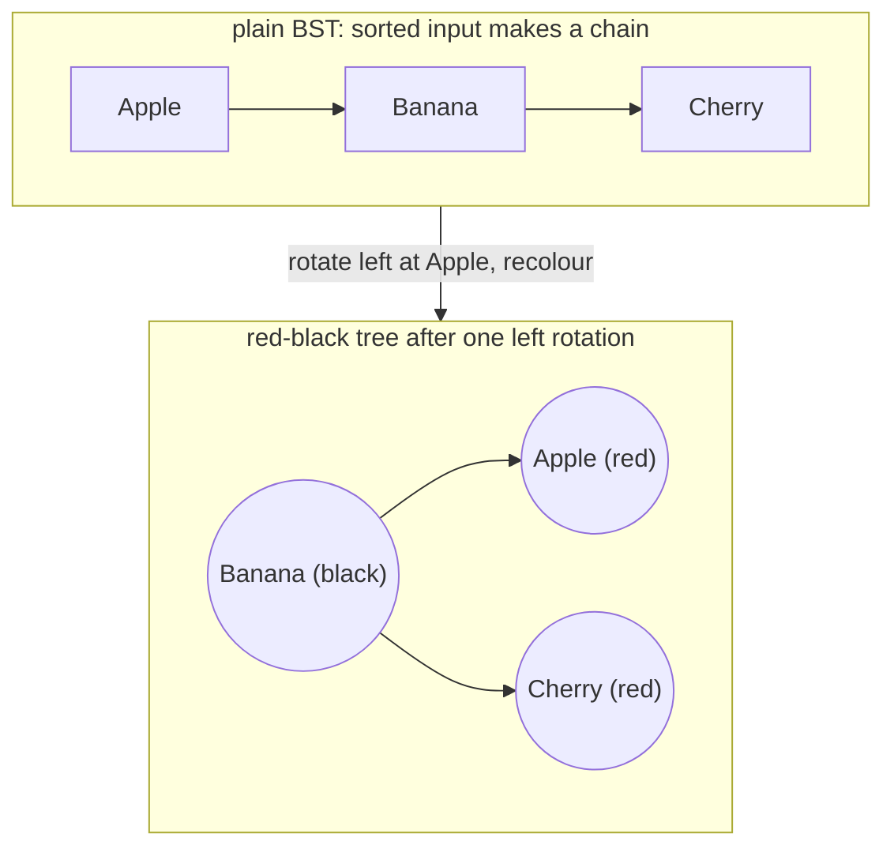
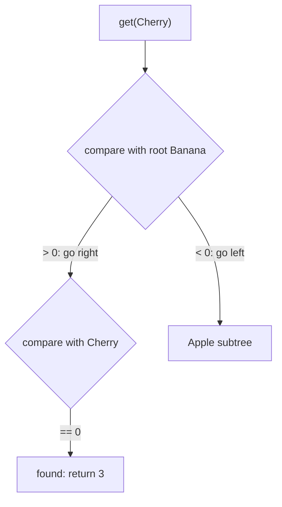
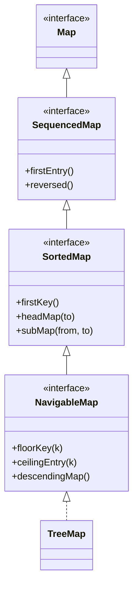

## In One Line
`TreeMap` is a `Map` that keeps its **keys sorted** (natural ordering or a `Comparator`) in a red-black tree, giving **O(log n)** `get` / `put` / `remove` plus ordered views and navigation such as `firstKey()`, `headMap()` and `floorKey()`; because keys are compared, `null` keys are not allowed under natural ordering.

## Mental Model
Think of a **phone book**.

- Entries are always in alphabetical order of the name (the **key**); each name maps to a number (the **value**).
- To find a name you do not read from page 1: you open the middle, decide "earlier or later", and halve the search each time — about log₂(n) steps. That is walking down the tree with `compareTo`.
- A new subscriber is printed in the one correct position, never at the end.
- If a name is already listed (comparison says "same"), the new number **overwrites** the old one — the name printed in the book stays as it was.
- Asking "the first name after *Kumar*" or "all names from *M* to *P*" is natural in a phone book and impossible in a pile of loose cards (a `HashMap`). Those are the navigation and range methods.

## Concept
### Where TreeMap fits
`public class TreeMap<K,V> extends AbstractMap<K,V> implements NavigableMap<K,V>, Cloneable, Serializable` — since Java 1.2.

| Interface | Since | Adds |
|---|---|---|
| `SortedMap` | 1.2 | `firstKey()`, `lastKey()`, `headMap(to)`, `tailMap(from)`, `subMap(from, to)`, `comparator()`; views in key order |
| `NavigableMap` | 6 | `floorKey`, `ceilingEntry`, `pollFirstEntry`, `descendingMap`, inclusive/exclusive ranges … — see [NavigableMap](lesson:a03-collections/17-navigablemap) |
| `SequencedMap` | 21 | (above `SortedMap`) `firstEntry`, `lastEntry`, `pollFirstEntry`, `reversed`, `putFirst`/`putLast` |

`TreeSet` is literally a `TreeMap` with dummy values (see [TreeSet](lesson:a03-collections/11-treeset)).

### How it works
The map is a **red-black tree** of `TreeMap.Entry` nodes, each holding `key`, `value`, `left`, `right`, `parent` and a `color` flag.
- **get(k)**: start at the root; `cmp = compare(k, node.key)`; `< 0` go left, `> 0` go right, `== 0` found. At most about 2·log₂(n) steps.
- **put(k, v)**: the same walk. If a node compares equal, **replace its value** (the stored key object is kept) and return the old value. Otherwise attach a new red leaf and rebalance with recolouring and rotations.
- **remove(k)**: find, unlink (replacing with the in-order successor if the node has two children), rebalance.
- **No hashing and no `equals()`** — only `compareTo`/`compare`.

The red-black rules (root black; no red node has a red child; every root-to-leaf path has the same number of black nodes) keep the tree height at most `2·log₂(n+1)`. That matters even for the original example: its keys arrive already sorted (`Apple`, `Banana`, `Cherry`). A plain binary search tree would degenerate into a right-leaning chain; the red-black tree performs one rotation and makes `Banana` the root (see Diagram).

### How keys are ordered
| Constructor | Ordering |
|---|---|
| `TreeMap()` | natural ordering — keys must implement `Comparable` |
| `TreeMap(Comparator<? super K> c)` | the comparator |
| `TreeMap(Map<? extends K, ? extends V> m)` | **natural** ordering, even if `m` is sorted differently |
| `TreeMap(SortedMap<K, ? extends V> m)` | **the same comparator as `m`** (and a linear-time build) |

Natural `String` order compares UTF-16 codes, so **uppercase comes before lowercase**: `{Banana, Date, apple, cherry}`. Common comparators: `Comparator.reverseOrder()`, `String.CASE_INSENSITIVE_ORDER`, `Comparator.comparing(Emp::dept).thenComparing(Emp::name)`. See [Comparable vs Comparator](lesson:b01-fundamentals/09-comparable-vs-comparator).

### Keys are "equal" when they compare as 0
- With `String.CASE_INSENSITIVE_ORDER`, `put("APPLE", 2)` after `put("apple", 1)` **replaces the value of `"apple"`** and returns 1; the map keeps the key `"apple"`. `get("ApPlE")` also finds it.
- With a comparator on `age` only, two different employees aged 30 are the **same key** — the second `put` overwrites the first one's value.
- With a comparator on `String::length`, `get("six")` returns the value stored under `"one"`.

A `TreeMap` is still a valid `Map` only if the ordering is **consistent with equals**; otherwise it "obeys the general contract of `Map`" loosely. Add tie-breakers (`thenComparing`) until only truly equal keys compare as 0.

### null keys and values
- `put(null, v)`, `get(null)`, `containsKey(null)` throw **`NullPointerException`** under natural ordering (even on an empty map).
- `null` **values** are fine.
- A comparator that handles `null`, such as `Comparator.nullsFirst(Comparator.naturalOrder())`, makes a `null` key legal.

### Key type problems
A key class that is not `Comparable`, used without a comparator, compiles fine but throws **`ClassCastException`** on the first `put`. Keys must also be **mutually comparable** and must not be mutated in a way that changes their order while in the map.

### SortedMap methods and views
| Method | Returns | Empty map |
|---|---|---|
| `firstKey()`, `lastKey()` | smallest / largest key | throws `NoSuchElementException` |
| `firstEntry()`, `lastEntry()` | smallest / largest entry (**read-only snapshot**) | `null` |
| `headMap(to)` | view of keys **`< to`** | — |
| `tailMap(from)` | view of keys **`>= from`** | — |
| `subMap(from, to)` | view of keys in **`[from, to)`** | — |
| `keySet()`, `values()`, `entrySet()` | views in ascending key order | — |

Range views are **live**: changes flow both ways, and putting a key outside the view's range throws `IllegalArgumentException: key out of range`. Entries obtained **while iterating `entrySet()`** support `setValue`; the snapshot entries from `firstEntry()`, `floorEntry()` and similar throw `UnsupportedOperationException` on `setValue`.

Java 21 adds `reversed()`, `pollFirstEntry()`, `pollLastEntry()` via `SequencedMap`; `putFirst`/`putLast` throw `UnsupportedOperationException` because the comparator decides positions.

### Complexity
| Operation | Cost |
|---|---|
| `get`, `put`, `remove`, `containsKey` | O(log n) |
| `firstKey`, `lastKey`, `floorKey`, `ceilingKey` … | O(log n) |
| `containsValue` | O(n) |
| Full iteration | O(n) |
| `for (k : keySet()) get(k)` | **O(n log n)** — versus O(n) with `entrySet()` |

### HashMap vs LinkedHashMap vs TreeMap
| | `HashMap` | `LinkedHashMap` | `TreeMap` |
|---|---|---|---|
| Structure | hash table | hash table + linked list | red-black tree |
| Iteration order | none | insertion / access | **sorted by key** |
| `get`/`put` | O(1) | O(1) | **O(log n)** |
| Key requirements | `equals` + `hashCode` | `equals` + `hashCode` | `Comparable` or `Comparator` |
| `null` key | one | one | no (natural ordering) |
| Extras | — | LRU via access order | first/last, ranges, floor/ceiling |

### Thread safety
Not synchronised. Use `ConcurrentSkipListMap` (a concurrent `NavigableMap`, lock-free skip list, weakly consistent iterators, no `null` keys or values) or wrap with `Collections.synchronizedSortedMap` / `synchronizedNavigableMap` and lock manually while iterating.

### Typical uses
- Output that must be **sorted by key**: reports, leaderboards by name, character/word frequencies in alphabetical order.
- **Sorting any map by key** in one line: `new TreeMap<>(hashMap)`.
- **Range queries**: all orders between two timestamps (`subMap`), all names from A to M (`headMap("N")`).
- **"Nearest key" lookups**: tax slabs, price bands, time series (`floorEntry`) — see NavigableMap.

## Diagram

The example inserts keys in sorted order. Without rebalancing, lookups would walk a chain; the red-black tree keeps the height logarithmic.


A lookup is a binary search down the tree using `compareTo` — no `hashCode()`, no `equals()`.


`TreeMap` implements the whole chain; `SequencedMap` was slotted in above `SortedMap` in Java 21.

## Code
@example Collections/Maps/TreeMapExample.java

Insert keys out of order to actually see the sorting (and the uppercase-first rule):
```java
Map<String, Integer> hash = new HashMap<>(), tree = new TreeMap<>();
for (String k : List.of("Cherry", "Apple", "Banana")) { hash.put(k, k.length()); tree.put(k, k.length()); }
System.out.println("HashMap " + hash + "  TreeMap " + tree);
TreeMap<String, Integer> fruits = new TreeMap<>();
fruits.put("cherry", 3); fruits.put("Banana", 2); fruits.put("apple", 1); fruits.put("Date", 4);
System.out.println(fruits);            // uppercase sorts before lowercase
```
```output
HashMap {Apple=5, Cherry=6, Banana=6}  TreeMap {Apple=5, Banana=6, Cherry=6}
{Banana=2, Date=4, apple=1, cherry=3}
```

Custom orderings — and "same key" means "compares as 0":
```java
TreeMap<Integer, String> desc = new TreeMap<>(Comparator.reverseOrder());
desc.put(1, "one"); desc.put(3, "three"); desc.put(2, "two");
System.out.println(desc + " firstKey=" + desc.firstKey());

TreeMap<String, Integer> ci = new TreeMap<>(String.CASE_INSENSITIVE_ORDER);
ci.put("apple", 1);
System.out.println(ci.put("APPLE", 2));          // same key by comparison -> replaced
System.out.println(ci + " " + ci.get("ApPlE"));   // original key "apple" is kept
```
```output
{3=three, 2=two, 1=one} firstKey=3
1
{apple=2} 2
```

`SortedMap` methods and views:
```java
TreeMap<Integer, String> m = new TreeMap<>(Map.of(10, "a", 20, "b", 30, "c", 40, "d"));
System.out.println(m.firstKey() + " " + m.lastKey() + " " + m.firstEntry() + " " + m.lastEntry());
System.out.println(m.headMap(30) + " " + m.tailMap(30) + " " + m.subMap(20, 40));
System.out.println(m.keySet() + " " + m.values());
```
```output
10 40 10=a 40=d
{10=a, 20=b} {30=c, 40=d} {20=b, 30=c}
[10, 20, 30, 40] [a, b, c, d]
```

Sorting a map by key, and a sorted frequency table:
```java
Map<String, Integer> unsorted = new HashMap<>(Map.of("pear", 3, "apple", 1, "mango", 2));
System.out.println(new TreeMap<>(unsorted));        // sort any map by key

TreeMap<Character, Integer> freq = new TreeMap<>();
for (char c : "mississippi".toCharArray()) freq.merge(c, 1, Integer::sum);
System.out.println(freq);
```
```output
{apple=1, mango=2, pear=3}
{i=4, m=1, p=2, s=4}
```

Views are live and guard their range:
```java
TreeMap<Integer, String> t = new TreeMap<>(Map.of(10, "a", 20, "b", 30, "c"));
SortedMap<Integer, String> head = t.headMap(25);
t.put(15, "x");
System.out.println(head);
try { head.put(99, "y"); } catch (Exception e) { System.out.println(e.getClass().getName() + ": " + e.getMessage()); }
```
```output
{10=a, 15=x, 20=b}
java.lang.IllegalArgumentException: key out of range
```

## Walkthrough
- `import java.util.TreeMap;` — in `java.util`.
- `TreeMap<String, Integer> map = new TreeMap<>();` — no comparator, so keys use `String`'s natural ordering (`compareTo`, lexicographic by UTF-16 code). `map.comparator()` would return `null`.
- `map.put("Apple", 1); put("Banana", 2); put("Cherry", 3);` — the keys arrive already sorted. Apple becomes the root, Banana its right child, Cherry would make a right-leaning chain, so the tree rotates: **Banana becomes the black root** with Apple and Cherry as red children (first diagram). Each `put` returns `null` (new key).
- `"TreeMap: " + map` — `toString()` iterates the entries in key order → **`TreeMap: {Apple=1, Banana=2, Cherry=3}`**.
- `map.get("Banana")` — compares with the root, which is Banana itself → found after one comparison → `2`.
- `for (String key : map.keySet())` — ascending key order; each `map.get(key)` walks the tree again (O(log n) each). Prints `Key: Apple, Value: 1` … `Key: Cherry, Value: 3`.
- `map.remove("Cherry");` — finds and unlinks the node, rebalances if needed, returns `3` (ignored) → **`TreeMap after removal: {Apple=1, Banana=2}`**.

## Traps
> [!ERRATA] The last output comment is truncated: it says `// Output: TreeMap after removal: {Apple=1, Banana=2` with the closing brace missing. The real output is `TreeMap after removal: {Apple=1, Banana=2}`.

> [!ERRATA] `for (String key : map.keySet()) { ... map.get(key) ... }` searches the tree again for every key, so the loop is O(n log n). Iterating `map.entrySet()` (or `map.forEach((k, v) -> ...)`) visits the same pairs in the same order in O(n).

> [!NOTE] The keys `Apple`, `Banana`, `Cherry` are inserted already in sorted order, so the example never shows `TreeMap` actually sorting anything — a `LinkedHashMap` would print the same. Insert them as `Cherry, Apple, Banana` to see the difference (see Code).

- **`null` key** → `NullPointerException` (natural ordering) on `put`, `get`, `containsKey`.
- **Non-`Comparable` key without a comparator** → `ClassCastException` at the first `put`, not at compile time.
- **Comparator ties overwrite entries**: a comparator on one field makes different objects the same key.
- **Case-sensitive order surprises**: `"Zebra"` sorts before `"apple"`. Use `String.CASE_INSENSITIVE_ORDER` or a `Collator` for dictionary order — but remember case-insensitive comparison also merges `"apple"`/`"APPLE"` into one key.
- **`new TreeMap<>(map)` ignores the source's comparator** unless the static type is `SortedMap` (then it is kept). Same object, different constructor, different order.
- **`firstKey()`/`lastKey()` throw on an empty map; `firstEntry()`/`lastEntry()` return `null`.**
- **Snapshot entries** (`firstEntry()`, `floorEntry()` …) cannot `setValue`; use `put`.
- **Views are live and bounded** — `headMap(25).put(99, …)` throws `IllegalArgumentException`.
- **Mutating a key's ordering fields** while it is in the map corrupts the tree.
- **`putFirst`/`putLast` (Java 21)** throw `UnsupportedOperationException`.
- **A `TreeMap` cannot sort by value** — sort the entry stream and collect into a `LinkedHashMap`.

## Tips & Tricks
- **"Tree = sorTed keys, compare not equals, log n."**
- **Sort any map by key:** `new TreeMap<>(map)`; reverse: `new TreeMap<>(Comparator.reverseOrder())` then `putAll(map)`.
- **Sort by value:** `map.entrySet().stream().sorted(Map.Entry.comparingByValue()).collect(toMap(..., LinkedHashMap::new))`.
- **"Keys throw, entries null"**: on an empty map `firstKey()` throws, `firstEntry()` returns `null`.
- **Ranges are `[from, to)`** by default: `headMap(to)` excludes `to`, `tailMap(from)` includes `from`.
- **Iterate `entrySet()`** — with a tree, `keySet()` + `get()` is O(n log n).
- Use `TreeMap` when you need **order, first/last or range/nearest queries**; otherwise `HashMap` is faster.
- For a concurrent sorted map, reach for **`ConcurrentSkipListMap`**.

## Interview Q&A
### [Basic] What is a TreeMap and how is it different from a HashMap?
`TreeMap` is a `NavigableMap` implementation that keeps its keys sorted, by natural ordering or by a `Comparator` given at construction. It is a red-black tree, so `get`, `put`, `remove` and `containsKey` are O(log n), and iteration is in ascending key order. `HashMap` is a hash table with O(1) average operations and no ordering. `TreeMap` identifies keys with `compareTo`/`compare`, `HashMap` with `hashCode`/`equals`. `TreeMap` rejects `null` keys under natural ordering (`HashMap` allows one), and it offers sorted-map extras: `firstKey`, `lastKey`, `headMap`, `tailMap`, `subMap`, `floorKey`, `ceilingEntry`, `descendingMap`.

**Follow-up:** *Which would you use for a dictionary app that shows words alphabetically?* — `TreeMap` (or sort once if the data never changes).

### [Basic] Can a TreeMap have null keys or null values?
Values: yes, any number. Keys: not with natural ordering — `put(null, v)` throws `NullPointerException` because the map must call `compareTo` on the key; `get(null)` and `containsKey(null)` throw too. With a comparator that handles `null`, e.g. `new TreeMap<>(Comparator.nullsFirst(Comparator.naturalOrder()))`, a `null` key is allowed and sorts first.

**Follow-up:** *Which other maps reject null keys?* — `Hashtable`, `ConcurrentHashMap`, `ConcurrentSkipListMap`, and the immutable `Map.of` maps.

### [Intermediate] How does TreeMap sort its keys? What if the key class does not implement Comparable?
Without a comparator, `TreeMap` casts each key to `Comparable` and uses `compareTo`; with one, it uses `comparator.compare`. Every `put` walks down the tree comparing the new key with existing keys and inserts it in its sorted position, so iteration is always ordered. If the key class is not `Comparable` and no comparator is given, the code compiles but the first `put` throws `ClassCastException` — even into an empty map, because the key is compared with itself as a type check. Fix it by implementing `Comparable<K>` or passing a `Comparator`.

**Follow-up:** *Can you change the ordering later?* — No, the comparator is fixed at construction; build a new `TreeMap` with a different comparator and `putAll`.

### [Intermediate] What data structure is behind TreeMap, and what are its time complexities?
A red-black tree: a self-balancing binary search tree where each node is red or black, the root is black, red nodes have no red children, and every path from a node to its leaves has the same number of black nodes. These rules keep the height ≤ 2·log₂(n+1). So `get`, `put`, `remove`, `containsKey`, `firstKey`, `lastKey`, `floorKey` and friends are O(log n); `containsValue` is O(n) because values are not ordered; a full iteration is O(n). Insertions need at most two rotations and deletions at most three.

**Follow-up:** *Why not keep a sorted ArrayList and binary-search it?* — Lookups would be O(log n) too, but inserts and deletes would be O(n) because elements must be shifted.

### [Intermediate] How does TreeMap decide that two keys are the same?
Only by comparison: if `compare(k1, k2) == 0`, they are the same key and `put` replaces the value (keeping the originally stored key object). `equals()` and `hashCode()` are never used. So with `String.CASE_INSENSITIVE_ORDER`, `put("APPLE", 2)` overwrites the value of `"apple"`; with a comparator on age alone, two different 30-year-old employees collide and the second overwrites the first. That is why the ordering should be consistent with equals, typically by adding tie-breakers with `thenComparing`.

**Follow-up:** *What do you get back from `get("ApPlE")` in the case-insensitive map?* — The value stored under `"apple"`, since the comparator says the keys are equal.

### [Intermediate] How do you sort a HashMap by keys? By values?
By keys: `new TreeMap<>(hashMap)` — or with a custom order, `TreeMap<K,V> t = new TreeMap<>(cmp); t.putAll(hashMap);`. By values, a `TreeMap` cannot help because it only orders keys; sort the entries and keep the order in a `LinkedHashMap`:
```java
Map<String, Integer> byValue = map.entrySet().stream()
    .sorted(Map.Entry.comparingByValue())
    .collect(Collectors.toMap(Map.Entry::getKey, Map.Entry::getValue,
                              (a, b) -> a, LinkedHashMap::new));
```
For descending values use `Map.Entry.<String, Integer>comparingByValue().reversed()`.

**Follow-up:** *Why not a TreeMap with a comparator that looks up values?* — The comparator would compare keys by their values, so two keys with equal values would be treated as the same key and one would be lost; and values can change after insertion, breaking the tree.

### [Advanced] What does "consistent with equals" mean, and why does it matter for TreeMap?
An ordering is consistent with equals when `compare(a, b) == 0` exactly when `a.equals(b)`. The `Map` interface is specified in terms of `equals`, but `TreeMap` uses only the comparator. If they disagree, the `TreeMap` behaves differently from a `HashMap` holding the same keys: `BigDecimal("1.0")` and `BigDecimal("1.00")` are two keys in a `HashMap` but one key in a `TreeMap`; a case-insensitive comparator merges keys that are not `equals`. The map still works, but it no longer strictly obeys the `Map` contract, which can surprise code that mixes map types or compares maps.

**Follow-up:** *Give a JDK class whose natural ordering is inconsistent with equals.* — `BigDecimal` (scale is ignored by `compareTo` but not by `equals`).

### [Advanced] Are headMap, tailMap and subMap copies? What are their bounds?
They are **live views** of the same tree. `headMap(to)` holds keys `< to`, `tailMap(from)` keys `>= from`, `subMap(from, to)` keys in `[from, to)`. Changes in the backing map show in the view and vice versa; `put` of a key outside the view's range throws `IllegalArgumentException: key out of range`. `NavigableMap` adds overloads with inclusive/exclusive flags (`headMap(to, true)`). Creating a view is O(1); iterating it is O(log n + k).

**Follow-up:** *How do you get an independent copy?* — `new TreeMap<>(map.subMap(a, b))`.

### [Advanced] When would you choose TreeMap over HashMap despite O(log n)?
When order is part of the requirement: sorted iteration (reports, deterministic output), smallest/largest key (`firstKey`, `lastKey`, `pollFirstEntry`), range queries (`subMap` over timestamps or IDs), and nearest-key lookups (`floorEntry` for tax slabs, rate tables, versioned data, time series). Also when keys have a good ordering but a poor hash function. For plain lookups by exact key, `HashMap` is faster and uses less memory.

**Follow-up:** *What if you need that in a concurrent setting?* — `ConcurrentSkipListMap`, which offers the same `NavigableMap` API with lock-free concurrent access.

### [Advanced] What is the difference between TreeMap and ConcurrentSkipListMap?
Both implement `NavigableMap` and keep keys sorted with O(log n) operations. `TreeMap` is a red-black tree, not thread-safe, with fail-fast iterators; it allows `null` values. `ConcurrentSkipListMap` is a skip list — layered linked lists with randomly chosen "express lanes" — updated with CAS, safe for concurrent use, with weakly consistent iterators; it rejects `null` keys and values and its `size()` is O(n). Use `TreeMap` single-threaded, `ConcurrentSkipListMap` when multiple threads read and write a sorted map.

**Follow-up:** *Why a skip list rather than a concurrent red-black tree?* — Rebalancing rotations touch many nodes and are hard to do lock-free; skip-list insertions are local link changes that CAS handles well.

## Quiz
### What does this print?
```java
TreeMap<String, Integer> fruits = new TreeMap<>();
fruits.put("cherry", 3); fruits.put("Banana", 2); fruits.put("apple", 1); fruits.put("Date", 4);
System.out.println(fruits);
```
- [ ] {apple=1, Banana=2, cherry=3, Date=4}
- [x] {Banana=2, Date=4, apple=1, cherry=3}
- [ ] {cherry=3, Banana=2, apple=1, Date=4}
- [ ] {Date=4, cherry=3, Banana=2, apple=1}
> Natural `String` ordering compares character codes, and every uppercase letter (A–Z = 65–90) is smaller than every lowercase letter (a–z = 97–122). So `Banana` and `Date` come first. The "dictionary" order in the first option needs `String.CASE_INSENSITIVE_ORDER`; the third is insertion order.

### What does this print?
```java
record Emp(String name, int age) {}
TreeMap<Emp, String> roles = new TreeMap<>(Comparator.comparingInt(Emp::age));
roles.put(new Emp("Ann", 30), "dev");
roles.put(new Emp("Bob", 30), "qa");
roles.put(new Emp("Cid", 25), "pm");
System.out.println(roles.size() + " " + roles.values());
```
- [ ] 3 [pm, dev, qa]
- [x] 2 [pm, qa]
- [ ] 2 [pm, dev]
- [ ] 3 [dev, qa, pm]
> The comparator only looks at age, so Bob (30) compares equal to Ann (30): the second `put` replaces the **value** "dev" with "qa" but keeps Ann's key object. Cid (25) sorts first. Records have proper `equals`, but `TreeMap` never calls it.

### What happens?
```java
TreeMap<String, Integer> t = new TreeMap<>();
t.put("x", null);
t.put(null, 1);
```
- [ ] Both succeed; the map is {null=1, x=null}
- [x] The first succeeds; the second throws `NullPointerException`
- [ ] The first throws; `TreeMap` forbids null values
- [ ] Both throw `NullPointerException`
> `null` values are allowed; `null` keys are not under natural ordering, because the map must call `compareTo` on the key. A `HashMap` would accept both.

### What does this print?
```java
TreeMap<String, Integer> byLen = new TreeMap<>(Comparator.comparingInt(String::length));
byLen.put("one", 1); byLen.put("two", 2); byLen.put("three", 3);
System.out.println(byLen + " " + byLen.get("six"));
```
- [ ] {one=1, two=2, three=3} null
- [x] {one=2, three=3} 2
- [ ] {two=2, three=3} null
- [ ] {one=1, three=3} 1
> "two" has the same length as "one", so it is the same key: the value becomes 2 and the key stays "one". `get("six")` also has length 3, compares equal to "one", and returns 2 — even though "six" was never put. The comparator *is* the definition of key equality.

### Spot the bug
```java
record Emp(String name, int age) {}
Map<Emp, String> m = new TreeMap<>();
m.put(new Emp("Ann", 30), "dev");
```
- [ ] Compile error: records cannot be map keys
- [x] `ClassCastException` on the first `put`: `Emp` is not `Comparable` and no comparator was supplied
- [ ] It works; records are ordered by their first component
- [ ] `NullPointerException`, because the map is empty
> Records give you `equals`, `hashCode` and `toString`, but not `compareTo`. A `TreeMap` without a comparator needs `Comparable` keys, and it checks even the first key. Use `new TreeMap<>(Comparator.comparing(Emp::name))` or make `Emp implements Comparable<Emp>`.

### On an empty `TreeMap`, what do `firstEntry()` and `firstKey()` do?
- [ ] Both return null
- [x] `firstEntry()` returns null; `firstKey()` throws `NoSuchElementException`
- [ ] `firstEntry()` throws; `firstKey()` returns null
- [ ] Both throw `NoSuchElementException`
> `firstKey()`/`lastKey()` come from `SortedMap` (Java 1.2) and throw on an empty map. The entry methods from `NavigableMap` (Java 6) — `firstEntry`, `floorEntry`, `pollFirstEntry`, … — return `null` for "none".

### What does this print?
```java
SortedMap<Integer, String> desc = new TreeMap<>(Comparator.reverseOrder());
desc.put(1, "a"); desc.put(2, "b");
Map<Integer, String> asMap = desc;
System.out.println(new TreeMap<>(desc) + " " + new TreeMap<>(asMap));
```
- [ ] {2=b, 1=a} {2=b, 1=a}
- [x] {2=b, 1=a} {1=a, 2=b}
- [ ] {1=a, 2=b} {1=a, 2=b}
- [ ] {1=a, 2=b} {2=b, 1=a}
> The constructor is chosen at compile time from the argument's static type. `TreeMap(SortedMap)` keeps the source's reverse comparator; `TreeMap(Map)` always uses natural ordering, even though it receives the very same object.

## Takeaways
- `TreeMap` = `NavigableMap` backed by a red-black tree; keys always sorted; `get`/`put`/`remove` O(log n); `containsValue` O(n).
- Order comes from natural ordering (`Comparable`) or a constructor `Comparator`; natural `String` order puts uppercase before lowercase.
- Keys are "the same" when `compare` returns 0 — `equals`/`hashCode` are never used — so keep comparators consistent with equals.
- No `null` keys under natural ordering (NPE); `null` values are fine; non-`Comparable` keys without a comparator throw `ClassCastException` on the first `put`.
- `firstKey()`/`lastKey()` throw on empty, `firstEntry()`/`lastEntry()` return `null` and are read-only snapshots; `headMap(to)` excludes `to`, `tailMap(from)` includes `from`, views are live.
- Iterate `entrySet()` (O(n)), not `keySet()` + `get()` (O(n log n)); `new TreeMap<>(map)` sorts any map by key; sorting by value needs a stream + `LinkedHashMap`.
- Not thread-safe: use `ConcurrentSkipListMap` for a concurrent sorted map.
