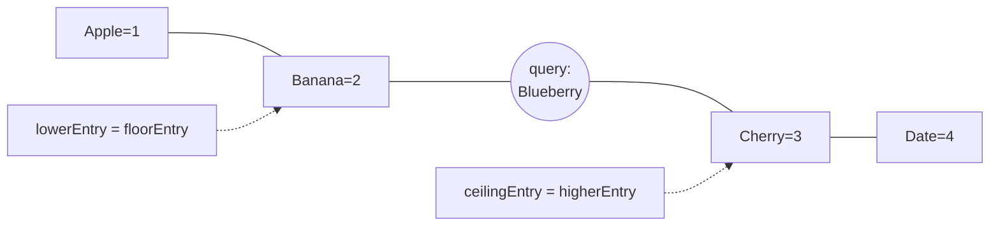
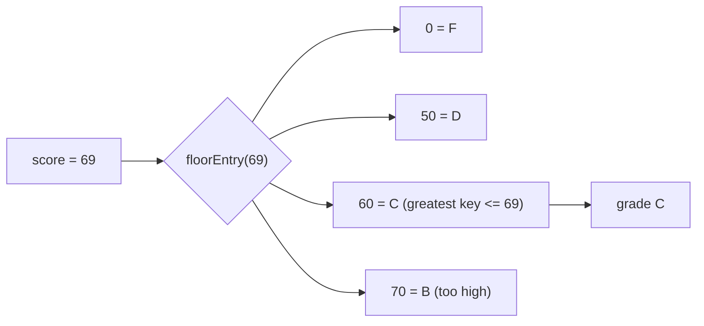
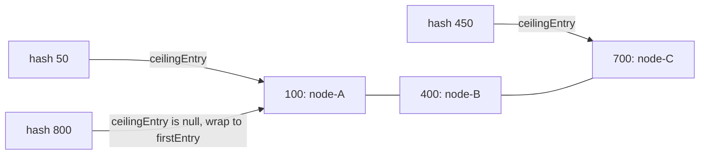

## In One Line
`NavigableMap` (Java 6) extends `SortedMap` with **closest-key lookups** — `lowerEntry`/`floorEntry`/`ceilingEntry`/`higherEntry` and their `…Key` twins — plus `firstEntry`/`lastEntry`, `pollFirstEntry`/`pollLastEntry`, a descending view and range views with inclusive/exclusive bounds; `TreeMap` and `ConcurrentSkipListMap` implement it.

## Mental Model
Think of a **railway timetable** sorted by departure time (the keys), where each time maps to a train (the value).

- You rarely ask about an exact time. You ask: "What was the **last train at or before 9:45**?" — `floorEntry(9:45)`. "What is the **next train at or after 9:45**?" — `ceilingEntry(9:45)`. "Strictly before / strictly after?" — `lowerEntry` / `higherEntry`.
- If there is no train in that direction (asking for a train before the first departure), the answer is "none" → `null`.
- `firstEntry()` is the first train of the day, `pollFirstEntry()` is "this train has left — cross it off".
- `subMap(9:00, 12:00)` is "the morning page" of the same timetable (a live window, not a photocopy), and `descendingMap()` is reading the timetable from the bottom up.

## Concept
### The interface family
| Interface | Since | Key methods |
|---|---|---|
| `SortedMap<K,V>` | 1.2 | `firstKey`, `lastKey`, `headMap(to)`, `tailMap(from)`, `subMap(from, to)`, `comparator` |
| `NavigableMap<K,V>` | 6 | closest-match, first/last/poll entries, descending views, ranges with inclusive flags |
| `SequencedMap<K,V>` | 21 | above `SortedMap`: `firstEntry`, `lastEntry`, `pollFirstEntry`, `pollLastEntry`, `reversed`, `putFirst`/`putLast` |

Implementations: **`TreeMap`** (red-black tree, see [TreeMap](lesson:a03-collections/16-treemap)) and **`ConcurrentSkipListMap`** (thread-safe skip list). Views such as `descendingMap()`, `headMap(to, incl)`, `subMap(...)` are themselves `NavigableMap`s. The key-set counterpart is [NavigableSet](lesson:a03-collections/12-navigableset) — `navigableKeySet()` returns one.

### The eight closest-match methods
| Entry method | Key method | Finds the … key | Symbol | Query `"Banana"` (present) | Query `"Blueberry"` (absent) |
|---|---|---|---|---|---|
| `lowerEntry(k)` | `lowerKey(k)` | greatest key **strictly less** | `<` | Apple=1 | Banana=2 |
| `floorEntry(k)` | `floorKey(k)` | greatest key **≤** | `≤` | **Banana=2** | Banana=2 |
| `ceilingEntry(k)` | `ceilingKey(k)` | least key **≥** | `≥` | **Banana=2** | Cherry=3 |
| `higherEntry(k)` | `higherKey(k)` | least key **strictly greater** | `>` | Cherry=3 | Cherry=3 |

(Map = `{Apple=1, Banana=2, Cherry=3, Date=4}`.)
- All are **O(log n)** in a `TreeMap`.
- They return **`null`** when no key qualifies — never an exception. Unboxing that `null` into an `int` throws `NullPointerException`.
- A `null` argument throws `NullPointerException` under natural ordering.
- Use the `…Key` version when you only need the key, the `…Entry` version when you need the value as well (one search instead of two).

### Entries are read-only snapshots
`firstEntry()`, `lastEntry()`, `pollFirstEntry()`, `pollLastEntry()`, `lowerEntry()`, `floorEntry()`, `ceilingEntry()` and `higherEntry()` return an immutable **snapshot** (`AbstractMap.SimpleImmutableEntry`): the key and value as they were at the time of the call. `entry.setValue(...)` throws `UnsupportedOperationException`. To update, call `map.put(entry.getKey(), newValue)`. (Entries obtained while iterating `entrySet()` are live and *do* support `setValue`.)

### first/last in all their flavours
| Call | Removes? | Empty map |
|---|---|---|
| `firstKey()` / `lastKey()` (SortedMap) | no | throws `NoSuchElementException` |
| `firstEntry()` / `lastEntry()` | no | `null` |
| `pollFirstEntry()` / `pollLastEntry()` | **yes** | `null` |

`pollFirstEntry()` turns a `NavigableMap` into a priority queue keyed by something meaningful (timestamps, priorities) — `while ((e = map.pollFirstEntry()) != null) process(e);`.

### Views
| View | Contents | Notes |
|---|---|---|
| `headMap(to)` / `headMap(to, inclusive)` | keys `< to` / `≤ to` | default excludes `to` |
| `tailMap(from)` / `tailMap(from, inclusive)` | keys `≥ from` / `> from` | default includes `from` |
| `subMap(from, to)` / `subMap(from, fi, to, ti)` | keys in `[from, to)` / your choice | |
| `descendingMap()` | same entries, reversed order | every method reverses its meaning |
| `navigableKeySet()` / `descendingKeySet()` | keys as a `NavigableSet` | live |

All views are **live and write-through**: changes in either direction are visible, and putting a key outside a view's range throws `IllegalArgumentException: key out of range`. In a descending view, "ceiling" means "the next key at or after this one **going downwards**", and `headMap(k)` holds the keys **larger** than `k`.

### Classic interview patterns
| Problem | NavigableMap move |
|---|---|
| Grade / tax slab / discount band lookup | `floorEntry(score).getValue()` — the band whose lower bound is ≤ score |
| Time series: value "as of" time t | `floorEntry(t)` — latest reading at or before t |
| Consistent hashing ring | `ceilingEntry(hash)`, wrap around to `firstEntry()` when `null` |
| Booking / interval overlap check | `floorEntry(start)` (previous booking still running?) and `ceilingKey(start)` (next booking starts before `end`?) |
| Events in a time window | `subMap(from, true, to, true)` |
| Leaderboards, scheduling | `pollFirstEntry()`, `lastEntry()`, `descendingMap()` |

### Complexity (TreeMap)
Navigation, `first/last/poll` entries: **O(log n)**. Creating a view: O(1). Iterating a view of k entries: O(log n + k). `size()` of a range view counts its entries: O(k).

### Thread safety
`TreeMap` is not thread-safe. `ConcurrentSkipListMap` is the concurrent `NavigableMap`: lock-free (CAS-based), O(log n) expected, weakly consistent iterators, no `null` keys or values, O(n) `size()`. Wrappers: `Collections.synchronizedNavigableMap` and `Collections.unmodifiableNavigableMap` (Java 8).

## Diagram

Keys sit on a sorted line. For an absent key, `floor`/`lower` pick the left neighbour and `ceiling`/`higher` the right one. For a present key, `floor` and `ceiling` return the key itself.


A slab table stores only the lower bound of each band; `floorEntry` picks the band a value falls into in O(log n), with no `if/else` chain.


Consistent hashing: a key belongs to the first node clockwise from its hash; `ceilingEntry` finds it and `firstEntry` closes the ring.

## Code
@example Collections/Maps/NavigableMapExample.java

All the closest-match methods for a present key, an absent key and both ends:
```java
NavigableMap<String, Integer> map = new TreeMap<>(Map.of("Apple", 1, "Banana", 2, "Cherry", 3, "Date", 4));
for (String q : List.of("Banana", "Blueberry", "Aardvark", "Zebra")) {
    System.out.printf("%-9s lower=%-8s floor=%-8s ceiling=%-8s higher=%s%n", q,
        map.lowerEntry(q), map.floorEntry(q), map.ceilingEntry(q), map.higherEntry(q));
}
System.out.println(map.lowerKey("Banana") + " " + map.ceilingKey("Blueberry") + " " + map.higherKey("Date"));
```
```output
Banana    lower=Apple=1  floor=Banana=2 ceiling=Banana=2 higher=Cherry=3
Blueberry lower=Banana=2 floor=Banana=2 ceiling=Cherry=3 higher=Cherry=3
Aardvark  lower=null     floor=null     ceiling=Apple=1  higher=Apple=1
Zebra     lower=Date=4   floor=Date=4   ceiling=null     higher=null
Apple Cherry null
```

Range and descending views:
```java
NavigableMap<Integer, String> m = new TreeMap<>(Map.of(10, "a", 20, "b", 30, "c", 40, "d"));
System.out.println(m.headMap(30) + " " + m.headMap(30, true));
System.out.println(m.tailMap(20, false) + " " + m.subMap(10, false, 40, true));
System.out.println(m.descendingMap() + " " + m.navigableKeySet() + " " + m.descendingKeySet());
```
```output
{10=a, 20=b} {10=a, 20=b, 30=c}
{30=c, 40=d} {20=b, 30=c, 40=d}
{40=d, 30=c, 20=b, 10=a} [10, 20, 30, 40] [40, 30, 20, 10]
```

Draining in key order, and snapshot entries:
```java
NavigableMap<Integer, String> tasks = new TreeMap<>(Map.of(3, "deploy", 1, "build", 2, "test"));
Map.Entry<Integer, String> e;
while ((e = tasks.pollFirstEntry()) != null) System.out.print(e.getValue() + " ");
System.out.println("| left: " + tasks);

NavigableMap<String, Integer> fruit = new TreeMap<>(Map.of("Apple", 1));
try { fruit.firstEntry().setValue(100); }
catch (UnsupportedOperationException ex) { System.out.println("snapshot entry: " + ex.getClass().getSimpleName()); }
fruit.put(fruit.firstKey(), 100);
System.out.println(fruit);
```
```output
build test deploy | left: {}
snapshot entry: UnsupportedOperationException
{Apple=100}
```

Slab lookup, "as of" lookup and a consistent-hashing ring:
```java
NavigableMap<Integer, String> grades = new TreeMap<>();
grades.put(0, "F"); grades.put(50, "D"); grades.put(60, "C"); grades.put(70, "B"); grades.put(85, "A");
for (int score : new int[]{42, 50, 69, 70, 99})
    System.out.print(score + "->" + grades.floorEntry(score).getValue() + " ");
System.out.println();

NavigableMap<Integer, Double> price = new TreeMap<>(Map.of(900, 101.5, 930, 102.0, 1000, 99.8));
System.out.println(price.floorEntry(945).getValue() + " " + price.floorEntry(859));
System.out.println(price.subMap(900, true, 1000, false));

NavigableMap<Integer, String> ring = new TreeMap<>(Map.of(100, "node-A", 400, "node-B", 700, "node-C"));
for (int hash : new int[]{50, 100, 450, 800}) {
    Map.Entry<Integer, String> owner = ring.ceilingEntry(hash);
    if (owner == null) owner = ring.firstEntry();            // wrap around the ring
    System.out.print(hash + "->" + owner.getValue() + " ");
}
System.out.println();
```
```output
42->F 50->D 69->C 70->B 99->A 
102.0 null
{900=101.5, 930=102.0}
50->node-A 100->node-A 450->node-C 800->node-A 
```

Non-overlapping bookings (half-open intervals `[start, end)`):
```java
class Calendar {
    private final NavigableMap<Integer, Integer> bookings = new TreeMap<>();   // start -> end
    boolean book(int start, int end) {
        Map.Entry<Integer, Integer> before = bookings.floorEntry(start);
        Integer nextStart = bookings.ceilingKey(start);
        if (before != null && before.getValue() > start) return false;       // overlaps previous
        if (nextStart != null && nextStart < end) return false;              // overlaps next
        bookings.put(start, end);
        return true;
    }
}
Calendar cal = new Calendar();
System.out.println(cal.book(10, 20) + " " + cal.book(15, 25) + " " + cal.book(20, 30) + " " + cal.book(5, 11) + " " + cal.book(0, 10));
```
```output
true false true false true
```

## Walkthrough
- `import java.util.NavigableMap; import java.util.TreeMap;` — the interface and its implementation.
- `NavigableMap<String, Integer> map = new TreeMap<>();` — a `TreeMap` with natural `String` ordering, referenced through the `NavigableMap` interface, which exposes all navigation methods.
- `map.put("Apple", 1)` … `put("Date", 4)` — four entries, stored in the red-black tree in key order.
- `"NavigableMap: " + map` — in-order iteration → **`NavigableMap: {Apple=1, Banana=2, Cherry=3, Date=4}`**.
- `map.firstEntry()` / `map.lastEntry()` — the entries with the smallest and largest keys. They are snapshot entries whose `toString()` is `key=value`, hence **`First entry: Apple=1`** and **`Last entry: Date=4`**. On an empty map they would return `null` (whereas `firstKey()` would throw).
- `map.lowerEntry("Banana")` — greatest key strictly less than `"Banana"` → **`Apple=1`**.
- `map.higherEntry("Banana")` — least key strictly greater than `"Banana"` → **`Cherry=3`**. `floorEntry("Banana")`/`ceilingEntry("Banana")` would both have returned `Banana=2`.
- `for (String key : map.keySet())` + `map.get(key)` — ascending keys, with a second O(log n) search per key; prints `Key: Apple, Value: 1` … `Key: Date, Value: 4`.
- `map.remove("Date");` — removes the largest key → **`NavigableMap after removal: {Apple=1, Banana=2, Cherry=3}`**. `map.pollLastEntry()` would have removed it without naming the key, and returned `Date=4`.
- All `// Output:` comments match the recorded output (one has a missing space after `Output:`, which is harmless).

## Traps
> [!ERRATA] The loop `for (String key : map.keySet()) { ... map.get(key) ... }` searches the tree again for every key — O(n log n) instead of O(n). Iterate `map.entrySet()` (or `map.forEach((k, v) -> ...)`) to get each key and value in one pass, in the same order.

- **`floor`/`ceiling` include the key; `lower`/`higher` do not.** Mixing them up causes off-by-one bugs at exact boundaries (a score of exactly 70 must be a B, so use `floorEntry`, not `lowerEntry`).
- **`null` means "none".** `grades.floorEntry(-5).getValue()` throws `NullPointerException`; `int k = map.floorKey(5);` throws when there is no smaller key. Check for `null` or add a sentinel key (like `0 = F`).
- **Snapshot entries**: `setValue` on `firstEntry()`, `floorEntry()` etc. throws `UnsupportedOperationException` — use `put`.
- **`firstKey()` throws on an empty map; `firstEntry()` returns `null`.**
- **Default range bounds are half-open**: `headMap(to)` excludes `to`, `tailMap(from)` includes `from`, `subMap(a, b)` is `[a, b)`.
- **Views are live**: writing through a view changes the map; writing outside its range throws `IllegalArgumentException`.
- **Descending views flip everything**: `descendingMap().ceilingKey(25)` returns the next *smaller* key.
- **Consistent hashing without the wrap-around**: `ceilingEntry(hash)` is `null` past the last node — fall back to `firstEntry()`.
- **`null` keys** → `NullPointerException` under natural ordering, including as arguments to navigation methods.

## Tips & Tricks
- **Order on a number line: lower < floor ≤ key ≤ ceiling < higher** — "you can stand on the floor and touch the ceiling".
- **"Entry for key+value, Key for key only"** — `floorEntry` saves a second lookup when you need the value.
- **Slab tables store lower bounds** and use `floorEntry`: `0=F, 50=D, 60=C, 70=B, 85=A`. Add a key for the lowest possible value so `floorEntry` never returns `null`.
- **"Keys throw, entries null"** — `firstKey()` throws on empty, `firstEntry()`/`pollFirstEntry()` return `null`.
- **Snapshot entries are read-only** — update with `map.put(e.getKey(), v)`.
- **Ring = `ceilingEntry` + wrap to `firstEntry`.**
- **Interval overlap = check `floorEntry(start)` and `ceilingKey(start)`** — the only two bookings that can clash.
- Declare as `NavigableMap<K,V>` when the code relies on navigation methods; it documents intent and allows swapping in `ConcurrentSkipListMap`.

## Interview Q&A
### [Basic] What is NavigableMap and how does it differ from SortedMap?
`NavigableMap` is a sub-interface of `SortedMap` added in Java 6. `SortedMap` offers sorted iteration, `firstKey`/`lastKey`, and range views with fixed half-open bounds. `NavigableMap` adds closest-match lookups (`lowerEntry`, `floorEntry`, `ceilingEntry`, `higherEntry` and the `…Key` variants), `firstEntry`/`lastEntry`/`pollFirstEntry`/`pollLastEntry`, descending views (`descendingMap`, `descendingKeySet`), `navigableKeySet`, and range views with inclusive/exclusive flags. `TreeMap` and `ConcurrentSkipListMap` implement it.

**Follow-up:** *Which interface did Java 21 put above SortedMap?* — `SequencedMap`, which also gives `LinkedHashMap` methods like `firstEntry()` and `reversed()`.

### [Basic] Explain floorKey, lowerKey, ceilingKey and higherKey.
They find the nearest key to a given value in O(log n). `floorKey(k)` is the greatest key ≤ `k`; `lowerKey(k)` the greatest key strictly < `k`; `ceilingKey(k)` the least key ≥ `k`; `higherKey(k)` the least key strictly > `k`. If `k` is present, floor and ceiling return it; if not, floor equals lower and ceiling equals higher. Each returns `null` when no key qualifies. With keys `{10, 20, 30}`: `floorKey(25)` = 20, `ceilingKey(25)` = 30, `lowerKey(10)` = null, `higherKey(20)` = 30.

**Follow-up:** *Why also have the `…Entry` versions?* — To get the value in the same O(log n) search instead of calling `get` afterwards.

### [Intermediate] Why can't you call setValue() on the entry returned by firstEntry() or floorEntry()?
Those methods return an immutable snapshot (`AbstractMap.SimpleImmutableEntry`) of the mapping at the moment of the call, not the tree node itself. Handing out live nodes would let callers modify the map through an entry whose position might already have changed or been removed; a snapshot is safe to keep, return, or share between threads (which matters for `ConcurrentSkipListMap`). `setValue` therefore throws `UnsupportedOperationException`; update with `map.put(entry.getKey(), newValue)`. Entries seen while iterating `entrySet()` are live and support `setValue`.

**Follow-up:** *Is the snapshot updated if the map changes later?* — No, it keeps the old key and value.

### [Intermediate] How do headMap, tailMap and subMap work in a NavigableMap?
They return live views of a key range. The `SortedMap` versions use half-open bounds: `headMap(to)` = keys `< to`, `tailMap(from)` = keys `≥ from`, `subMap(from, to)` = `[from, to)`. The `NavigableMap` overloads take booleans: `headMap(to, true)` includes `to`, `tailMap(from, false)` excludes `from`, `subMap(from, fromIncl, to, toIncl)` lets you pick both. The views are write-through, reject out-of-range `put`s with `IllegalArgumentException`, and are themselves `NavigableMap`s, so you can navigate inside a range.

**Follow-up:** *How do you count events between two timestamps?* — `map.subMap(from, true, to, true).size()` — O(log n + k).

### [Intermediate] What does descendingMap() return and how do its methods behave?
A live view of the same map with the reverse ordering. Iteration goes from the largest key down, `firstKey()` is the largest key, and every navigation method follows the reversed order: on the descending view of `{10, 20, 30, 40}`, `ceilingKey(25)` is 20 (the next key at or after 25 going down) and `headMap(20)` is `{40=d, 30=c}` (the keys "before" 20 in descending order). Writes through the view change the original map. `descendingMap().descendingMap()` gives an ascending view again.

**Follow-up:** *Java 21 equivalent?* — `reversed()` from `SequencedMap`.

### [Advanced] Implement a grade or tax-slab lookup without an if/else chain.
Store the **lower bound** of each band as the key and use `floorEntry`:
```java
NavigableMap<Integer, String> grades = new TreeMap<>();
grades.put(0, "F"); grades.put(50, "D"); grades.put(60, "C"); grades.put(70, "B"); grades.put(85, "A");
String grade = grades.floorEntry(score).getValue();   // 69 -> C, 70 -> B
```
`floorEntry` returns the band with the greatest lower bound ≤ score in O(log n). Adding a band is one `put`; the rules become data (they could come from a database or config). Include a key for the minimum possible value so `floorEntry` never returns `null`, or check for it. Progressive tax works the same way, iterating `headMap(income)` to sum each slab.

**Follow-up:** *What if bands have upper bounds and gaps?* — Store `start -> (end, value)` and check `end` after `floorEntry`, as in the booking example.

### [Advanced] How would you implement consistent hashing with a TreeMap?
Place each server on a ring by hashing its name (usually many virtual nodes per server) and store `hash -> server` in a `TreeMap<Integer, String>`. A key belongs to the first server clockwise from the key's hash: `ring.ceilingEntry(hash(key))`, and if that is `null` (past the last node) wrap around to `ring.firstEntry()`. Adding or removing a server only moves the keys between it and its predecessor, instead of rehashing everything as `hash % n` would. Lookups are O(log n); for concurrent membership changes use `ConcurrentSkipListMap`.

**Follow-up:** *Why virtual nodes?* — With few real nodes the arcs are uneven; many virtual points per server spread load more evenly.

### [Advanced] How do you check whether a new booking overlaps existing ones?
Keep bookings as `start -> end` in a `TreeMap` of non-overlapping half-open intervals `[start, end)`. Only two existing bookings can clash with a new `[s, e)`: the one starting at or before `s` (`floorEntry(s)`) — it overlaps if its end is `> s` — and the next one starting at or after `s` (`ceilingKey(s)`) — it overlaps if it starts `< e`. If neither clashes, `put(s, e)`. Each booking costs O(log n) instead of scanning all bookings. For `[10,20)`, then `[15,25)` → false, `[20,30)` → true (touching is fine), `[5,11)` → false, `[0,10)` → true.

**Follow-up:** *What would you use if multiple threads book at once?* — Synchronise `book` (the check and the put must be atomic), or use a `ConcurrentSkipListMap` plus a lock around the check-then-act.

### [Advanced] TreeMap vs ConcurrentSkipListMap — when do you use which?
Both are sorted `NavigableMap`s with O(log n) operations. `TreeMap` (red-black tree) is for single-threaded use: faster constant factors, fail-fast iterators, allows `null` values, O(1) `size()`. `ConcurrentSkipListMap` (skip list, CAS-based, lock-free) is for concurrent access: weakly consistent iterators that never throw `ConcurrentModificationException`, atomic `putIfAbsent`/`compute`/`merge`, no `null` keys or values, O(n) `size()`. It is the sorted counterpart of `ConcurrentHashMap`.

**Follow-up:** *Why is ConcurrentSkipListMap's size() O(n)?* — Maintaining an exact shared counter would be a contention hot spot, so it counts the nodes when asked (and the result may already be stale under concurrent updates).

## Quiz
### What does this print?
```java
NavigableMap<Integer, String> m = new TreeMap<>(Map.of(10, "a", 20, "b", 30, "c"));
System.out.println(m.floorKey(25) + " " + m.ceilingKey(25) + " " + m.lowerKey(10) + " " + m.higherEntry(20));
```
- [ ] 20 30 10 30=c
- [x] 20 30 null 30=c
- [ ] 30 20 null 30
- [ ] 20 30 null c
> `floorKey(25)` is the greatest key ≤ 25 (20); `ceilingKey(25)` the least key ≥ 25 (30). `lowerKey(10)` must be strictly less than 10 — there is none, so `null`, not an exception and not 10. `higherEntry(20)` returns an entry, printed as `key=value`.

### What does this print?
```java
NavigableMap<Integer, String> m = new TreeMap<>(Map.of(10, "a", 20, "b", 30, "c", 40, "d"));
NavigableMap<Integer, String> d = m.descendingMap();
System.out.println(d.firstKey() + " " + d.ceilingKey(25) + " " + d.headMap(20));
```
- [ ] 10 30 {10=a}
- [x] 40 20 {40=d, 30=c}
- [ ] 40 30 {10=a}
- [ ] 10 20 {40=d, 30=c}
> In the descending view the order is 40, 30, 20, 10. `firstKey()` is 40. "Ceiling" = first key at or after 25 in *this* order → 20. `headMap(20)` = keys before 20 in this order, exclusive → 40 and 30.

### With `grades = {0=F, 50=D, 60=C, 70=B, 85=A}`, what do `grades.floorEntry(69).getValue()` and `grades.ceilingEntry(69).getValue()` return?
- [x] C and B
- [ ] D and C
- [ ] C and C
- [ ] B and A
> The greatest key ≤ 69 is 60 → "C" (the correct grade, since 60 is the lower bound of the C band). The least key ≥ 69 is 70 → "B". Slab tables store lower bounds, so `floorEntry` is the right call; `ceilingEntry` would give the next band up.

### What does this print?
```java
NavigableMap<String, Integer> m = new TreeMap<>(Map.of("b", 2, "a", 1, "c", 3));
System.out.println(m.pollFirstEntry() + " " + m.pollLastEntry() + " " + m);
```
- [ ] b=2 c=3 {a=1}
- [ ] a=1 c=3 {a=1, b=2, c=3}
- [x] a=1 c=3 {b=2}
- [ ] a c {b=2}
> The map is sorted: a, b, c. `pollFirstEntry()` removes and returns `a=1`, `pollLastEntry()` removes and returns `c=3`; the arguments are evaluated left to right, so by the time the map is printed only `b=2` remains. Insertion order (b, a, c) is irrelevant.

### What happens?
```java
NavigableMap<String, Integer> fruit = new TreeMap<>(Map.of("Apple", 1));
fruit.firstEntry().setValue(100);
```
- [ ] Apple's value becomes 100
- [ ] Nothing — the change is silently ignored
- [x] `UnsupportedOperationException`
- [ ] `IllegalStateException`
> `firstEntry()` returns an immutable snapshot (`AbstractMap.SimpleImmutableEntry`), not the live tree node. Update with `fruit.put(fruit.firstKey(), 100)`. Entries from iterating `entrySet()` would accept `setValue`.

### What happens?
```java
NavigableMap<Integer, Integer> m = new TreeMap<>(Map.of(10, 1));
int k = m.floorKey(5);
System.out.println(k);
```
- [ ] Prints 10
- [ ] Prints 0
- [ ] Throws `NoSuchElementException`
- [x] Throws `NullPointerException`
> No key is ≤ 5, so `floorKey` returns `null`, and auto-unboxing `null` into the `int k` throws `NullPointerException`. Navigation methods never throw `NoSuchElementException` themselves — only `firstKey()`/`lastKey()` do.

### Given `view = nums.subMap(20, true, 40, true)` on a `TreeMap` with keys 10–50, what does `view.put(99, "x")` do?
- [ ] Adds 99 to `nums` only
- [ ] Adds 99 to the view only
- [x] Throws `IllegalArgumentException: key out of range`
- [ ] Returns null and does nothing
> Range views are write-through but bounded: a key inside [20, 40] would be added to `nums` as well, while a key outside the range is rejected.

## Takeaways
- `NavigableMap` (Java 6) = `SortedMap` + closest-key lookups + first/last/poll entries + descending views + inclusive/exclusive ranges; implemented by `TreeMap` and `ConcurrentSkipListMap`.
- `lower` (<), `floor` (≤), `ceiling` (≥), `higher` (>) — as `…Entry` or `…Key` — run in O(log n) and return `null` when nothing qualifies; never unbox the result blindly.
- Entry-returning methods (`firstEntry`, `floorEntry`, `pollFirstEntry`, …) give immutable snapshots; update with `put`.
- `firstKey()` throws on empty; `firstEntry()`/`pollFirstEntry()` return `null`; `pollFirstEntry()` drains a map in key order.
- Views (`headMap`, `tailMap`, `subMap`, `descendingMap`, `navigableKeySet`) are live, write-through and range-checked; defaults are `[from, to)`.
- Interview patterns: slab/grade lookup with `floorEntry`, "as of" time-series with `floorEntry`, consistent hashing with `ceilingEntry` + wrap, booking overlap with `floorEntry` + `ceilingKey`.
- Iterate with `entrySet()`, not `keySet()` + `get()`; use `ConcurrentSkipListMap` for concurrent access.
