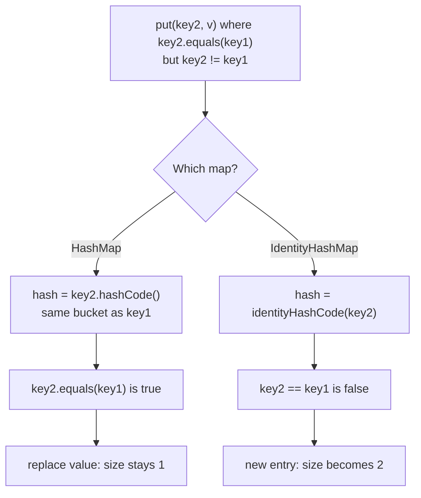
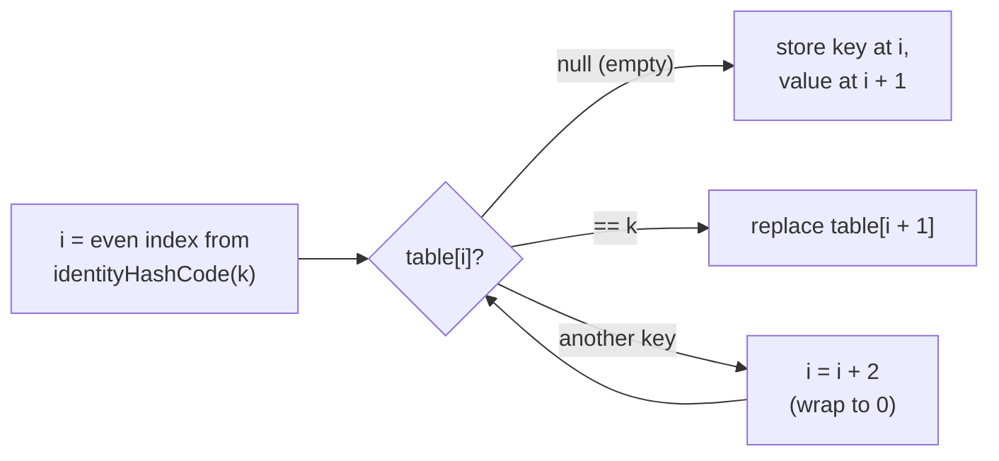

## In One Line
`IdentityHashMap` is a `Map` that treats two keys as the same **only if they are the very same object** (`k1 == k2`), ignoring `equals()` and `hashCode()` — so two equal-looking but separate objects become two separate keys.

## Mental Model
Think of two ways to run a **cloakroom**.

- A **HashMap cloakroom** matches coats by *description*: "black coat, size M". If two guests hand in identical black coats, the attendant thinks it is the same coat and hangs the second one on the first one's hook, replacing it. Any guest who describes "black coat, size M" gets it back.
- An **IdentityHashMap cloakroom** ties a tag to *that exact physical coat*. Two identical coats get two hooks. Describing the coat does not help — you must show the exact tag for that coat.

In the code:
- The **coat** is the key object, e.g. `new Integer(1)`.
- The **description** is `equals()`/`hashCode()` — both `new Integer(1)` objects have the same description.
- The **tag** is the object reference itself — `key1` and `key2` are different tags.
- Handing in two identical coats is `map.put(key1, ...)` then `map.put(key2, ...)`: a `HashMap` keeps one entry, an `IdentityHashMap` keeps two.
- Asking by description is `map.get(1)` — the `IdentityHashMap` answers `null`, because the autoboxed `1` is a third object.

## Concept
### Why it exists
Every normal `Map` must follow the `Map` contract: keys are compared with `equals()`. `IdentityHashMap` **breaks that contract on purpose**. Its own Javadoc warns: *"This class is not a general-purpose Map implementation!"* It is for the rare cases where you need to know **"have I seen this exact object?"**, not "have I seen an equal object?".

Typical uses:
- **Topology-preserving object-graph work** — serialization, deep copy, cycle detection. When you walk an object graph you must remember which *objects* you already visited. Two different nodes that happen to be `equal` must still both be copied; an `equals`-based map would merge them and a cycle-detector would stop too early.
- **Per-object metadata or proxies** — e.g. a debugger or framework attaching extra data to objects it does not own, whose `equals`/`hashCode` may be overridden, expensive, buggy or mutable.
- **Keys whose `hashCode()` changes** — a mutable key (like a `List`) is lost in a `HashMap` once it changes, but its identity never changes.
- The JDK itself uses it: `java.lang.ApplicationShutdownHooks` stores registered shutdown-hook threads in an `IdentityHashMap<Thread, Thread>`.

### HashMap vs IdentityHashMap
| | `HashMap` | `IdentityHashMap` |
|---|---|---|
| Key equality | `k1.equals(k2)` | `k1 == k2` |
| Hash source | `key.hashCode()` | `System.identityHashCode(key)` |
| Value equality (`containsValue`, `remove(k, v)`, `replace(k, old, new)`) | `equals()` | `==` (for `remove`/`replace` only since JDK 20) |
| Collision strategy | Separate chaining (linked bins, tree bins since Java 8) | **Linear probing** in one flat array |
| Internal storage | `Node[]` of key/value/hash/next objects | One `Object[]`: keys at even indexes, values at odd indexes |
| Default sizing | 16 buckets, load factor 0.75 | Expected max size 21 → capacity 32 → array of 64, load factor 2/3 |
| `null` key / values | One `null` key, `null` values | Same (the `null` key is stored as a private sentinel object) |
| Ordering | None | None (depends on identity hash codes, can change after resize) |
| Thread-safe | No | No |
| Iterators | Fail-fast | Fail-fast |
| Since | 1.2 | 1.4 |

### `System.identityHashCode()` — the hash it uses
`System.identityHashCode(obj)` returns the hash code that `Object.hashCode()` would return **even if the class overrides `hashCode()`**. So `new Integer(1).hashCode()` is `1` for every such object, but their identity hash codes differ.

Facts worth knowing:
- It is **stable** for the object's lifetime. In HotSpot it is generated on first request and stored in the object header, so it survives the garbage collector moving the object.
- It is **not the memory address** (a common myth) and it is **not unique** — two live objects may share one. That is why the map still compares with `==` after hashing.
- `System.identityHashCode(null)` is `0`.

### How it works inside
`IdentityHashMap` is a simple **linear-probe** hash table (per its `@implNote`):

1. One array `Object[] table` holds `[key0, value0, key1, value1, ...]` — keys at even slots, values at the odd slot right after. This gives better CPU-cache locality than separate node objects.
2. `put(k, v)`: compute an **even** index from `System.identityHashCode(k)`. If that slot holds the same reference, replace the value. If it holds another key, step to `i + 2` (wrapping to 0 at the end) and try again. The first empty (`null`) slot is where the new key goes.
3. `get(k)` probes the same way and stops at the first `null` slot (meaning "not present").
4. It resizes (doubles) when the map would become more than **2/3 full** — linear probing needs empty slots to stay fast.
5. `remove` does not leave "tombstones": it shifts the following colliding entries back into the hole (Knuth's Algorithm R), so lookups still stop correctly at `null`.
6. A `null` key is stored as a private sentinel object `NULL_KEY`, because a real `null` slot means "empty".

The constructor `new IdentityHashMap<>(expectedMaxSize)` takes the **expected maximum number of mappings**, not a capacity; the exact relationship to the table size is unspecified. Pass it when you know you will track many objects (e.g. a large graph) to avoid repeated resizing.

### Identity applies to values and views too
- `containsValue(v)` checks `==`, not `equals`.
- `keySet()`, `values()` and `entrySet()` have reference-equality semantics (`keySet().contains(x)` means "is this exact object a key").
- `remove(key, value)` and `replace(key, oldValue, newValue)` use `==` on the value **since JDK 20**. In JDK 8–19 they were inherited from `Map`'s default methods and compared values with `equals()` — an inconsistency fixed in JDK 20 (bug JDK-8178355). On JDK 17 an equal-but-different value would be removed; on JDK 21 it is not.

### The autoboxing and string-literal trap
Whether two "equal" keys are the *same object* depends on how they were created:

| Expression | Same object each time? | Why |
|---|---|---|
| `Integer i = 100;` (autoboxing) | Yes | `Integer.valueOf` caches -128..127 |
| `Integer i = 1000;` | No (by default) | Outside the cache, a new object each time |
| `new Integer(1)` | No, never | `new` always allocates (and is deprecated) |
| `"One"` (literal) | Yes | Literals are interned in the string pool |
| `new String("One")`, `split()`, concatenation at runtime | No | New objects on the heap |
| Enum constants | Yes | Each constant is a singleton |

So an `IdentityHashMap<String, Integer>` word counter built from `split()` never merges counts, while one fed literals does.

### When to use and when to avoid
Use it when **identity is the real question**: visited sets during graph traversal, serialization/deep copy, attaching data to foreign objects, keys with mutable or untrustworthy `equals`/`hashCode`.

Avoid it for **value-like keys** that callers will look up by an equal copy: `String`, boxed numbers, records, `LocalDate`, IDs. For enum keys, `IdentityHashMap` works (enums compare by identity anyway) but `EnumMap` is faster and ordered.

Need an identity-based `Set`? There is no `IdentityHashSet`; use:
```java
Set<Object> visited = Collections.newSetFromMap(new IdentityHashMap<>());
```

Related lessons: [HashMap](lesson:a03-collections/14-hashmap) (the `equals`-based default), [equals and hashCode](lesson:b01-fundamentals/06-object-class-equals-hashcode) (the contract this class ignores), [Wrapper classes](lesson:a02-core/15-wrapper-classes) (the `Integer` cache) and [WeakHashMap](lesson:a03-collections/19-weakhashmap) (another special-purpose map).

## Diagram

The only difference is the question asked about the key: *equal?* (HashMap) or *same object?* (IdentityHashMap).


Linear probing in the flat `[k, v, k, v, ...]` array: keep stepping two slots until you find the same reference or an empty slot.

## Code
@example Collections/Maps/IdentityHashMapExample.java

Looking the key up by value instead of by reference (the same setup as the example, plus a few checks):
```java
@SuppressWarnings("removal")   // new Integer(int) is deprecated for removal since Java 16
public static void main(String[] args) {
    IdentityHashMap<Integer, String> map = new IdentityHashMap<>();
    Integer key1 = new Integer(1);
    Integer key2 = new Integer(1);
    map.put(key1, "One");
    map.put(key2, "One");

    System.out.println("key1.equals(key2): " + key1.equals(key2));
    System.out.println("key1 == key2:      " + (key1 == key2));
    System.out.println("map.get(1):        " + map.get(1));          // 1 autoboxes to the cached Integer.valueOf(1)
    System.out.println("containsKey(1):    " + map.containsKey(1));
    System.out.println("containsValue(\"One\"): " + map.containsValue("One"));  // "One" literals are interned: same object
    System.out.println("HashMap would hold: " + new HashMap<>(map));
}
```
```output
key1.equals(key2): true
key1 == key2:      false
map.get(1):        null
containsKey(1):    false
containsValue("One"): true
HashMap would hold: {1=One}
```

The modern way to get two equal-but-distinct keys, side by side with `HashMap`:
```java
String a = new String("key");
String b = new String("key");          // equal to a, but a different object

Map<String, Integer> hash = new HashMap<>();
Map<String, Integer> identity = new IdentityHashMap<>();
hash.put(a, 1);     hash.put(b, 2);
identity.put(a, 1); identity.put(b, 2);

System.out.println("a.equals(b) = " + a.equals(b) + ", a == b = " + (a == b));
System.out.println("HashMap size         = " + hash.size() + "  -> " + hash);
System.out.println("IdentityHashMap size = " + identity.size());
System.out.println("identity.get(a) = " + identity.get(a) + ", identity.get(b) = " + identity.get(b));
System.out.println("identity.get(\"key\") = " + identity.get("key"));   // the literal is a third object
```
```output
a.equals(b) = true, a == b = false
HashMap size         = 1  -> {key=2}
IdentityHashMap size = 2
identity.get(a) = 1, identity.get(b) = 2
identity.get("key") = null
```

Why identity helps with mutable keys:
```java
List<String> key = new ArrayList<>(List.of("a"));

Map<List<String>, String> hashMap = new HashMap<>();
Map<List<String>, String> identityMap = new IdentityHashMap<>();
hashMap.put(key, "value");
identityMap.put(key, "value");

key.add("b");   // mutate the key after insertion: its hashCode() changes

System.out.println("HashMap.get(key)         = " + hashMap.get(key));
System.out.println("IdentityHashMap.get(key) = " + identityMap.get(key));
```
```output
HashMap.get(key)         = null
IdentityHashMap.get(key) = value
```

An identity `Set` for "visited" tracking (records have value-based `equals`):
```java
record Point(int x, int y) {}

Point p1 = new Point(1, 2);
Point p2 = new Point(1, 2);   // equal record, different object

Set<Point> byEquals = new HashSet<>();
byEquals.add(p1);
byEquals.add(p2);

Set<Point> byIdentity = Collections.newSetFromMap(new IdentityHashMap<>());
byIdentity.add(p1);
byIdentity.add(p2);

System.out.println("HashSet size      = " + byEquals.size());
System.out.println("identity set size = " + byIdentity.size());
```
```output
HashSet size      = 1
identity set size = 2
```

Values are compared by identity too (JDK 21 run):
```java
IdentityHashMap<String, String> m = new IdentityHashMap<>();
String k = "k";
m.put(k, new String("v"));                 // value is a distinct object equal to "v"

System.out.println(m.containsValue("v"));  // values are compared with == too
System.out.println(m.remove(k, "v"));      // JDK 20+: == on the value as well
System.out.println(m.replace(k, "v", "w"));
System.out.println(m);

m.put(null, "null key is allowed");
System.out.println(m.get(null));
```
```output
false
false
false
{k=v}
null key is allowed
```

## Walkthrough
- `import java.util.IdentityHashMap;` — the class lives in `java.util` next to `HashMap`; it extends `AbstractMap` and implements `Map`, `Cloneable` and `Serializable`.
- `IdentityHashMap<Integer, String> map = new IdentityHashMap<>();` — the no-arg constructor sizes the map for an expected maximum of **21** mappings (internally a 64-slot array = 32 key/value pairs). `<>` is the diamond: the compiler infers `<Integer, String>`.
- `Integer key1 = new Integer(1);` and `Integer key2 = new Integer(1);` — `new` **always** creates a fresh object, so `key1.equals(key2)` is `true` but `key1 == key2` is `false`. This is exactly the situation where `HashMap` and `IdentityHashMap` disagree. (This constructor is deprecated — see Traps.)
- `map.put(key1, "One"); map.put(key2, "One");` — the second `put` probes from `key2`'s identity hash, finds no slot holding the *same reference*, and adds a **second entry**. A `HashMap` would have replaced the first entry instead and kept size 1.
- `System.out.println("IdentityHashMap: " + map);` — string concatenation calls `map.toString()` (inherited from `AbstractMap`), which iterates the entries and prints `key=value`. Both keys print as `1`, so you see **`{1=One, 1=One}`** — a map that looks like it has a duplicate key. The order of the two entries depends on identity hash codes and is unspecified, but because both entries print identically the line is the same on every run.
- `map.get(key1)` / `map.get(key2)` — each lookup passes the exact reference that was stored, so both find their own entry and print `One`. Note that both values are the *same* `String` object: the literal `"One"` is interned, so both `put` calls stored one pooled object.
- `for (Integer key : map.keySet())` — the key-set view contains **both** key objects. Inside the loop `map.get(key)` uses the exact reference taken from the key set, so it always finds a value. Output: two identical lines `Key: 1, Value: One`.
- `map.remove(key1);` — removes only the mapping whose key is **that exact object**. `key2`'s entry stays, so the final line is **`IdentityHashMap after removal: {1=One}`**. With a `HashMap`, `remove(key1)` would have emptied the map (there was only one entry).
- All `// Output:` comments in the file match the real output recorded on JDK 21.

What the example does not show (the extra snippets above do): `map.get(1)` returns `null` because the autoboxed `1` is the cached `Integer.valueOf(1)` — a third object that was never used as a key.

## Traps
> [!ERRATA] `new Integer(1)` is **deprecated** (since Java 9) and **marked for removal** (since Java 16, JEP 390). On JDK 21 `javac` prints `warning: [removal] Integer(int) in Integer has been deprecated and marked for removal`, and a future JDK may reject it. The example needs two equal-but-distinct keys, so the modern fix is `new String("one")` twice (the `String` constructor is not deprecated) or instances of your own class. Do **not** switch to `Integer.valueOf(1)` or autoboxing — both return the same cached object, and the map would end up with one entry.

> [!ERRATA] Minor bad practice: the loop iterates `keySet()` and then calls `map.get(key)`, which does a second hash lookup for every key. It works correctly here, but iterating `entrySet()` gives key and value in one step: `for (Map.Entry<Integer, String> e : map.entrySet())`.

- **Looking up by an equal copy returns `null`.** `map.get(1)`, `map.get(Integer.valueOf(1))` or `map.containsKey(1)` all miss the entries stored with `new Integer(1)`.
- **Behaviour silently depends on caching.** `map.put(100, "a"); map.put(100, "b");` gives **one** entry (cached `Integer`), but the same code with `1000` gives **two**. String literals are interned (same object); `new String`, `split()`, `substring()` and runtime concatenation produce new objects.
- **It breaks the `Map` contract.** Code that receives it as a plain `Map` will assume `equals` semantics. Comparing an `IdentityHashMap` with a normal `Map` via `equals()` may even violate symmetry — the Javadoc says so explicitly. Keep its use local and obvious.
- **Confusing `toString()`.** `{1=One, 1=One}` in a log looks like a corrupted map; it is correct.
- **Values are compared by identity too** — `containsValue("x")` can be `false` even when some value `equals("x")`. `remove(k, v)` / `replace(k, old, new)` changed from `equals` to `==` in JDK 20, so the same code can behave differently on JDK 17 and JDK 21.
- **Not thread-safe.** Wrap with `Collections.synchronizedMap(new IdentityHashMap<>(...))` or confine it to one thread. Its iterators are fail-fast.
- **`identityHashCode` is not an address and not unique.** Never use it as an object ID.

> [!WARNING] Using `IdentityHashMap` to "fix" duplicate keys is almost always wrong. If two equal keys should be different, the real bug is usually in the key class's `equals`/`hashCode`.

## Tips & Tricks
- **Mnemonic: "HashMap asks *are you equal?*; IdentityHashMap asks *are you the same one?*"** Twins are equal; only you are *you*.
- **Three facts to say in one breath:** `==` instead of `equals`, `System.identityHashCode` instead of `hashCode`, linear probing in one flat array.
- **Know the one killer use case:** "topology-preserving graph transformations — serialization, deep copy, cycle detection". That is the Javadoc's own phrase.
- **Identity set idiom:** `Collections.newSetFromMap(new IdentityHashMap<>())`.
- **Enum keys?** Use `EnumMap` — faster and ordered. `IdentityHashMap` works but gives no benefit.
- **Big graphs?** Pass the expected number of objects: `new IdentityHashMap<>(expectedNodes)` avoids repeated resizes.
- To create equal-but-distinct test keys, use `new String("x")`, not deprecated wrapper constructors.

## Interview Q&A
### [Basic] What is IdentityHashMap and how is it different from HashMap?
`IdentityHashMap` is a `Map` implementation that compares keys by **reference** (`k1 == k2`) and hashes them with `System.identityHashCode()`, instead of `equals()` and `hashCode()`. So two different objects that are `equal` are **two keys**. `HashMap` follows the `Map` contract and would treat them as one key.

Other differences: it uses linear probing in a single `Object[]` (keys and values interleaved) instead of chained buckets, has a load factor of 2/3, is sized by "expected maximum size", and compares values by identity too. Like `HashMap` it allows `null` keys and values, is unordered, unsynchronized and has fail-fast iterators.

**Follow-up:** *Is it a general-purpose map?* — No. The Javadoc says it intentionally violates the `Map` contract and is meant only for the rare cases where reference equality is required.

### [Basic] Why does the example print `{1=One, 1=One}` and then `{1=One}` after `remove(key1)`?
`new Integer(1)` creates two separate objects. They are `equal`, but `key1 != key2`, so `IdentityHashMap` stores two entries, and both keys print as `1`. `remove(key1)` removes only the entry whose key is that exact object, leaving `key2`'s entry. In a `HashMap` the second `put` would have replaced the first, giving `{1=One}` straight away and an empty map after the removal.

**Follow-up:** *What would `map.get(1)` return?* — `null`. The literal `1` autoboxes to the cached `Integer.valueOf(1)`, a third object that is not a key.

### [Intermediate] When would you actually use IdentityHashMap in real code?
When the question is "have I seen **this object**", not "have I seen an equal object":
- **Object-graph traversal** — serialization, deep copy, `equals`/`toString` of cyclic structures, dependency graphs. A visited map `original -> copy` must not merge two distinct nodes that happen to be equal, and must handle cycles.
- **Attaching metadata or proxies** to objects you do not control, whose `equals`/`hashCode` may be overridden, slow, buggy, or change over time.
- **Mutable keys** — identity never changes, so the entry is never lost.

The JDK uses it for shutdown hooks (`ApplicationShutdownHooks`).
```java
Map<Object, Object> copies = new IdentityHashMap<>();   // original -> its deep copy
```
**Follow-up:** *How do you get an identity Set?* — `Collections.newSetFromMap(new IdentityHashMap<>())`; there is no `IdentityHashSet` class.

### [Intermediate] Why does `put(100, "a"); put(100, "b")` give one entry but the same with `1000` gives two?
Autoboxing calls `Integer.valueOf()`, which returns **cached** instances for -128..127 (the upper bound can be raised with `-XX:AutoBoxCacheMax`). Both `100`s are the same object, so the second `put` replaces the value. `1000` is outside the cache, so each boxing creates a new object and `IdentityHashMap` sees two keys. Consequently `get(1000)` returns `null` — the lookup boxes a *third* object.

**Follow-up:** *Does the same happen with strings?* — Yes: literals are interned (same object), but `new String`, `split`, `substring` and runtime concatenation produce new objects. A word counter built on `IdentityHashMap` and `split()` never merges counts.

### [Intermediate] How is IdentityHashMap implemented internally?
It is a **linear-probe** hash table:
- A single `Object[] table` stores keys at even indexes and their values at the next odd index — better memory locality than node objects.
- The start index comes from `System.identityHashCode(key)`, forced to be even. On a collision it steps `i + 2`, wrapping around, until it finds the same reference (hit) or a `null` slot (miss / insertion point).
- It doubles the table when it would be more than 2/3 full, because probing needs free slots.
- `remove` shifts later colliding entries back into the gap (Knuth's Algorithm R) instead of leaving tombstones.
- `null` keys are stored as a private `NULL_KEY` sentinel.

**Follow-up:** *How does that differ from HashMap?* — `HashMap` uses separate chaining: each bucket holds a linked list of nodes that becomes a red-black tree beyond 8 entries (Java 8+). Default capacity 16, load factor 0.75.

### [Advanced] Is `System.identityHashCode()` the memory address of the object?
No. It is the value `Object.hashCode()` would return if not overridden. HotSpot generates it (by default with a thread-local pseudo-random generator) the first time it is requested and stores it in the object header, so it stays the same even when the GC moves the object. It is not guaranteed unique — two objects can share one — which is why `IdentityHashMap` still checks `==` after hashing. `identityHashCode(null)` is `0`.

**Follow-up:** *Can you use it as a unique object ID?* — No; collisions are possible. Use an explicit counter or an `IdentityHashMap<Object, Long>` that assigns IDs.

### [Advanced] In what ways does IdentityHashMap violate the Map contract, and why does that matter?
The `Map` contract requires key (and value) comparisons with `equals()`. `IdentityHashMap` uses `==` for keys, for `containsValue`, for its views (`keySet().contains`, entry equality), and since JDK 20 for `remove(key, value)` and `replace(key, oldValue, newValue)`. As a result:
- Code that receives it as a plain `Map` can misbehave: `containsKey("id")` fails for an equal string.
- `equals()` between an `IdentityHashMap` and a `HashMap` may not be symmetric, and `equals`/`hashCode` consistency across the two kinds is not guaranteed (the Javadoc warns about both). Among `IdentityHashMap` instances the contract does hold.

**Follow-up:** *What changed in JDK 20?* — Before JDK 20, `remove(k, v)` and `replace(k, old, new)` were inherited default methods that compared values with `equals()`, inconsistent with the rest of the class. JDK 20 overrode them to use `==`.

### [Intermediate] Is IdentityHashMap thread-safe? Does it allow null?
It is **not** thread-safe; if several threads use it and at least one modifies it, you must synchronize externally, e.g. `Collections.synchronizedMap(new IdentityHashMap<>())`, and still lock manually while iterating. Its iterators are fail-fast. It allows one `null` key (stored as a sentinel) and any number of `null` values.

**Follow-up:** *Is there a concurrent identity map in the JDK?* — No. Options are external locking, confining the map to one thread, or a `ConcurrentHashMap` keyed by a wrapper whose `equals`/`hashCode` use `==`/`identityHashCode`.

### [Advanced] How would you write cycle-safe deep copy or cycle detection with it?
Keep an identity map from each original object to its copy. Before copying a node, check the map: if the exact node was already copied, reuse that copy (this preserves shared references and stops infinite recursion on cycles).
```java
Node copy(Node n, Map<Node, Node> done) {
    if (n == null) return null;
    Node existing = done.get(n);
    if (existing != null) return existing;      // same object seen before
    Node c = new Node(n.value);
    done.put(n, c);                              // register BEFORE recursing (cycles)
    c.next = copy(n.next, done);
    return c;
}
// usage: copy(head, new IdentityHashMap<>())
```
An `equals`-based `HashMap` would be wrong: two distinct nodes with equal values would share one copy, and a `Node.hashCode()` that walks `next` would loop forever on a cycle.

**Follow-up:** *Why register before recursing?* — So that a cycle back to `n` finds `n`'s copy in the map instead of recursing forever.

## Quiz
### What does this print?
```java
Map<Integer, String> m = new IdentityHashMap<>();
m.put(100, "a");
m.put(100, "b");
m.put(1000, "c");
m.put(1000, "d");
System.out.println(m.size());
System.out.println(m.get(100) + " " + m.get(1000));
```
- [ ] 2, then `b d`
- [x] 3, then `b null`
- [ ] 4, then `a c`
- [ ] 4, then `null null`
> Autoboxing uses `Integer.valueOf`, which caches -128..127. Both `100`s are the same object → one entry, value replaced by `"b"`. Each `1000` is a new object → two entries; and `get(1000)` boxes a *third* object, so it returns `null`. "2 / b d" is what a `HashMap` would give.

### What does this print?
```java
String a = new String("key");
String b = new String("key");
Map<String, Integer> hash = new HashMap<>();
Map<String, Integer> identity = new IdentityHashMap<>();
hash.put(a, 1);     hash.put(b, 2);
identity.put(a, 1); identity.put(b, 2);
System.out.println(hash.size() + " " + identity.size() + " " + identity.get("key"));
```
- [ ] 2 2 2
- [ ] 1 1 2
- [x] 1 2 null
- [ ] 1 2 1
> `HashMap` uses `equals`: `a` and `b` are equal, so one entry. `IdentityHashMap` uses `==`: two entries. The literal `"key"` is a third (interned) object, so the identity lookup finds nothing — it does not "find the first match".

### Which pair of operations does IdentityHashMap use to locate and match a key?
- [ ] `key.hashCode()` and `key.equals(other)`
- [x] `System.identityHashCode(key)` and `key == other`
- [ ] `key.hashCode()` and `key == other`
- [ ] `System.identityHashCode(key)` and `key.equals(other)`
> Both halves must be identity-based, otherwise the map would be inconsistent: equal-but-distinct keys would land in different slots (or the same slot) at random. `hashCode`/`equals` is the `HashMap` pair.

### Spot the bug: why are the word counts never merged?
```java
Map<String, Integer> counts = new IdentityHashMap<>();
for (String word : "to be or not to be".split(" ")) {
    counts.merge(word, 1, Integer::sum);
}
System.out.println(counts.size() + " " + counts.get("to"));   // prints: 6 null
```
- [ ] `merge` is not supported by `IdentityHashMap`
- [ ] `split` returns the words in a random order
- [x] `split` creates a new `String` object for every word, so each word is a separate identity key
- [ ] `Integer::sum` overflows
> `split` returns six new `String` objects; two `"to"`s are equal but not `==`, so each gets its own entry, and the literal `"to"` in `get` is yet another object → `null`. Counting words needs `equals` semantics: use `HashMap`.

### What does this print?
```java
List<String> key = new ArrayList<>(List.of("a"));
Map<List<String>, String> hashMap = new HashMap<>();
Map<List<String>, String> identityMap = new IdentityHashMap<>();
hashMap.put(key, "value");
identityMap.put(key, "value");
key.add("b");
System.out.println(hashMap.get(key) + " " + identityMap.get(key));
```
- [ ] value value
- [x] null value
- [ ] value null
- [ ] null null
> Adding `"b"` changes the list's `hashCode()`, so `HashMap` looks in the wrong bucket and misses the entry. `IdentityHashMap` hashes by identity, which never changes, so it still finds it. (Mutating a key inside a `HashMap` is a bug; this shows why identity is immune.)

### How does IdentityHashMap resolve hash collisions?
- [ ] A linked list per bucket that turns into a red-black tree
- [x] Linear probing: step to the next key slot in a single flat array
- [ ] A second hash function (double hashing)
- [ ] It throws an exception on collision
> Keys sit at even indexes and values at the following odd index of one `Object[]`; on a collision it tries `i + 2`, wrapping around. The linked-list-then-tree scheme is `HashMap`'s separate chaining.

### After `map.put(new Integer(1), "One"); map.put(new Integer(1), "One");` on an IdentityHashMap, what does `map.containsValue("One")` return?
- [x] `true`
- [ ] `false`, because values are compared with `==`
- [ ] It throws, because there are duplicate keys
> Values *are* compared with `==` — but both `"One"` literals refer to the same interned string, and so does the `"One"` passed to `containsValue`. So `==` holds. With `new String("One")` as the stored value, the answer would be `false`.

## Takeaways
- `IdentityHashMap` compares keys (and values) with `==` and hashes with `System.identityHashCode()`, deliberately breaking the `Map` contract's `equals` rule.
- Two equal-but-distinct objects are two keys; a lookup with an equal copy (`get(1)`, a literal, a boxed value) returns `null`.
- Internally: linear probing in one flat `Object[]` with keys at even and values at odd indexes, load factor 2/3, default expected size 21; allows `null`, unordered, not thread-safe, fail-fast iterators.
- Use it for topology-preserving object-graph work (serialization, deep copy, cycle detection), per-object metadata, and mutable keys; get an identity set with `Collections.newSetFromMap(new IdentityHashMap<>())`.
- Beware caching: autoboxed -128..127 and string literals are shared objects; `new`, `split()` and concatenation create new ones.
- `new Integer(int)` is deprecated for removal (Java 16); use `new String(...)` or your own class to make distinct equal keys.
- Since JDK 20, `remove(key, value)` and `replace(key, old, new)` also compare values by identity.
