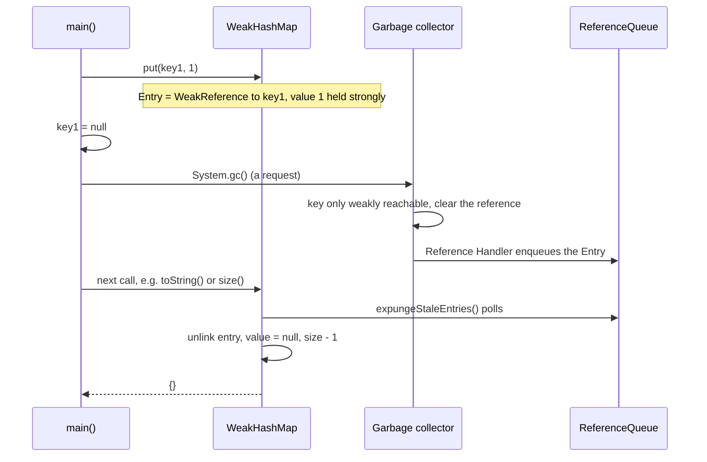
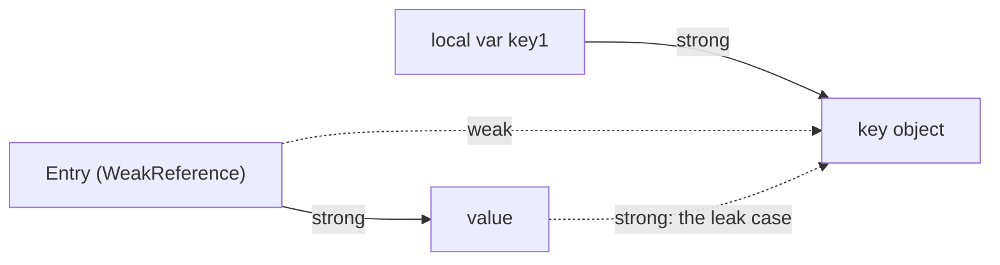

## In One Line
`WeakHashMap` holds its **keys through weak references**: an entry lives only while something *outside* the map still strongly references the key — once the key becomes unreachable, the garbage collector clears it and the map drops the entry by itself.

## Mental Model
Imagine putting **sticky notes on other people's suitcases** in a shared storeroom.

- The **suitcase** is the key object. You do not own it — its owner does.
- The **owner holding the suitcase's handle** is a strong reference, like the local variable `key1`.
- Your **sticky note** is the value (`1`, `2`) — it only makes sense while the suitcase exists.
- The **cleaning crew** is the garbage collector. Once no owner holds a suitcase, the crew throws it away — and your note goes with it. You never have to remember to clean up your notes.

Two twists that match the code exactly:
- The crew does not report back instantly. The note is physically taken off your list the **next time you look at the list** (the next map operation).
- If your note is **tied to the suitcase with a string** (the value references its key), the crew thinks someone is still holding the suitcase, and nothing is ever thrown away — a memory leak.

## Concept
### Reference strengths in one table
Java has four reference strengths (`java.lang.ref`). The garbage collector treats them differently:

| Kind | Created by | When the GC may clear it | Typical use |
|---|---|---|---|
| **Strong** | Normal assignment `Object o = new Object()` | Never, while reachable | Everything |
| **Soft** | `new SoftReference<>(o)` | Only when memory runs low (before `OutOfMemoryError`) | Memory-sensitive caches |
| **Weak** | `new WeakReference<>(o)` | At the next GC once no strong/soft path exists | `WeakHashMap` keys, canonical maps, listener registries |
| **Phantom** | `new PhantomReference<>(o, queue)` | After the object is finalized/unreachable; `get()` is always `null` | Post-mortem cleanup (`Cleaner`) |

A `WeakHashMap` is simply a hash map whose entries are `WeakReference`s to their keys. The deep dive on reference types is in [Reference types](lesson:b02-jvm/04-reference-types).

### How an entry disappears (step by step)
1. Each entry is a private class `Entry<K,V> extends WeakReference<Object>`: the **key is the referent** (held weakly), while `value`, `hash` and `next` are ordinary **strong** fields. Every entry is registered with the map's private `ReferenceQueue`.
2. Your code drops the last strong reference to the key (`key1 = null`, or the owning object goes away).
3. At the next garbage collection the GC sees the key is only weakly reachable, **clears** the weak reference (`entry.get()` now returns `null`) and the key object is reclaimed.
4. The JVM's *Reference Handler* thread puts the cleared entry on the map's `ReferenceQueue`.
5. The **next time you call** almost any map method — `get`, `put`, `size`, `isEmpty`, `containsKey`, `remove`, `putAll`, starting an iteration — the map runs a private method `expungeStaleEntries()`. It polls the queue, unlinks each stale entry from its bucket, nulls its value and decrements `size`.

Key consequences:
- **Removal is lazy.** There is no background thread inside the map; cleanup piggybacks on your next call.
- **Iterators skip cleared keys** even before they are expunged (and hold a strong reference to the next key so it cannot vanish between `hasNext()` and `next()`). That is why `toString()` can print `{}` while `size()` still says 2 for a moment — see the snippet in Code.
- **The GC behaves like an invisible thread removing entries.** `size()` can shrink, `isEmpty()` can flip from `false` to `true`, and `get()` can return a value now and `null` later, without your code calling any mutator.

### Structure and API
| Property | `WeakHashMap` |
|---|---|
| Key comparison | `equals()` / `hashCode()` — **not** identity |
| Keys | Weakly referenced |
| Values | **Strongly** referenced |
| `null` key / values | Allowed. The `null` key is stored as a private static sentinel, which is always reachable, so a `null`-key entry is never removed |
| Buckets | Array of chained entries (power-of-two size), default capacity 16, load factor 0.75. No tree bins (unlike `HashMap` since Java 8) |
| Hash spreading | Its own supplemental hash (the classic pre-Java-8 `HashMap` formula) |
| Iteration order | Unspecified; in practice from the last bucket down to the first |
| Thread-safe | No — wrap with `Collections.synchronizedMap(...)` |
| Iterators | Fail-fast |
| Since | 1.2 (`newWeakHashMap(int)` factory since Java 19) |

Constructors: `WeakHashMap()`, `WeakHashMap(int initialCapacity)`, `WeakHashMap(int initialCapacity, float loadFactor)`, `WeakHashMap(Map m)`. Java 19 added `WeakHashMap.newWeakHashMap(int numMappings)`, which sizes the table so that *numMappings* entries fit without resizing (the same factories were added to `HashMap` and `LinkedHashMap`).

### What keeps a key alive (so its entry never goes away)
A key is removed only when **no strong path** reaches it. Common hidden strong paths:

| Hidden strong reference | Example |
|---|---|
| A variable, field or collection you forgot about | a list of "active sessions" that still holds the key |
| **The value refers to its key** (directly or through other entries) | `map.put(k, new Meta(k))` — the map holds the value strongly, the value holds the key |
| **Interned string literals** | `map.put("Apple", 1)` — the literal is held by the string pool/constant pool |
| **Cached boxed values** | `map.put(100, ...)` — `Integer.valueOf(100)` lives in the `Integer` cache forever |
| Enum constants, `Class` objects of loaded classes, `Boolean.TRUE` | effectively permanent objects |
| The `null` key | stored as a permanent sentinel |

So `WeakHashMap` is intended for keys with **identity-like lifetimes**: objects created and owned by some other part of the program.

### Good uses and bad uses
**Good:** attaching extra data to objects you do not control, so the data dies with the object — a "side table".
- Metadata per `Thread`, per `ClassLoader`, per UI component, per session object.
- Canonicalising maps (object → its canonical instance), as long as the value does not strongly reference the key (wrap values in `WeakReference` if needed, as the Javadoc suggests).

**Bad:** a general-purpose cache.
- Entries vanish when the **key** becomes unreachable, not when memory gets tight. With `String` or boxed keys created on the fly, entries disappear almost immediately — or never, if the keys are literals.
- For memory-sensitive caches use soft references or, better, a real cache library (Caffeine's `maximumSize`, `expireAfterWrite`, `weakKeys()`/`softValues()`). For a simple bounded cache, `LinkedHashMap` with `removeEldestEntry` (see [LRU cache](lesson:b04-collections-internals/04-lru-cache-with-linkedhashmap)).

> [!NOTE] Caffeine's and Guava's `weakKeys()` compare keys by **identity** (`==`), because comparing a recreatable equal key against a weakly held one is confusing. `WeakHashMap` compares with `equals()`; its Javadoc calls this out as potentially "confusing" for keys like `String`.

### Related JDK mechanisms
- `ThreadLocal` stores its values in a per-thread `ThreadLocalMap` whose entries are `WeakReference<ThreadLocal<?>>` keys with **strong values** — the same design and the same leak risk (always call `remove()` in thread pools).
- `ClassValue` attaches lazily computed data to `Class` objects without leaking class loaders.
- `java.lang.ref.Cleaner` (Java 9) is the modern replacement for finalization, built on phantom references.

### `System.gc()` is a request, not a command
The Javadoc says calling `System.gc()` "suggests" that the JVM run the collector. The JVM may ignore it: `-XX:+DisableExplicitGC` turns it into a no-op, and the experimental Epsilon GC never reclaims anything. Code — and especially tests — must never depend on GC timing. In tests, loop "`System.gc()` + short sleep" until a condition holds or a timeout expires.

Also note: **reachability is not scope.** Once a local variable will never be read again, the JIT may already treat its object as unreachable, even before the variable goes out of scope; `Reference.reachabilityFence(obj)` (Java 9) keeps an object reachable up to a point. The example sets `key1 = null` to make the intent explicit in interpreted code.

## Diagram

The GC only clears the weak reference; the map removes the entry lazily on your next call.


While any strong arrow reaches the key, the entry stays. If the value points back to its key, the map itself keeps the key alive forever.

## Code
@example Collections/Maps/WeakHashMapExample.java

The recorded output shows `{}` after GC, but only because the JVM honoured `System.gc()`. The same program run with explicit GC disabled, or with the no-op Epsilon collector:
```text
java -XX:+DisableExplicitGC WeakHashMapExample.java
java -XX:+UnlockExperimentalVMOptions -XX:+UseEpsilonGC WeakHashMapExample.java
```
```output
WeakHashMap: {Banana=2, Apple=1}
Value for key 'Apple': 1
WeakHashMap after GC: {Banana=2, Apple=1}
```
(Both commands print exactly this; with the default G1, Serial or ZGC collectors the last line is `{}`.)

Which keys survive a GC?
```java
Map<Object, String> map = new WeakHashMap<>();

String literal = "Literal";               // interned: the class's constant pool keeps it alive
Integer small = 100;                      // Integer.valueOf(100): the Integer cache keeps it alive
Object plain = new Object();              // only our local variable refers to it
String built = new String("Built");       // a fresh heap object

map.put(literal, "literal");
map.put(small, "cached Integer");
map.put(plain, "plain object");
map.put(built, "new String");
map.put(null, "null key");

literal = null; small = null; plain = null; built = null;   // drop OUR strong references
System.gc();
Thread.sleep(200);

System.out.println("size after GC = " + map.size());
System.out.println("survivors     = " + new TreeSet<>(map.values()));
```
```output
size after GC = 3
survivors     = [cached Integer, literal, null key]
```

The classic leak — a value that references its own key:
```java
static class Key {}
record Meta(Key owner, String info) {}     // the value holds a strong reference to its key

Map<Key, String> good = new WeakHashMap<>();
Map<Key, Meta> leaky = new WeakHashMap<>();

for (int i = 0; i < 1_000; i++) {
    Key k1 = new Key();
    good.put(k1, "info " + i);
    Key k2 = new Key();
    leaky.put(k2, new Meta(k2, "info " + i));   // value -> key: the key stays reachable
}
System.gc();
Thread.sleep(200);

System.out.println("good.size()  = " + good.size());
System.out.println("leaky.size() = " + leaky.size());
```
```output
good.size()  = 0
leaky.size() = 1000
```

Removal is lazy — without the example's `sleep`, `size()` can lag behind what iteration shows:
```java
WeakHashMap<String, Integer> map = new WeakHashMap<>();
String key1 = new String("Apple");
String key2 = new String("Banana");
map.put(key1, 1);
map.put(key2, 2);
key1 = null; key2 = null;
System.gc();
// no sleep
int s = map.size();
String str = map.toString();
System.out.println("size=" + s + " toString=" + str + " size again=" + map.size());
```
Two real runs of the same program:
```output
size=2 toString={} size again=2
size=0 toString={} size again=0
```
The GC has already cleared the keys, so iteration skips them (`{}`), but `size()` only drops once the Reference Handler thread has put the entries on the map's queue — a race with our thread. This snippet's output varies between runs.

A weak reference on its own:
```java
Object strong = new Object();
WeakReference<Object> weak = new WeakReference<>(strong);

System.gc();
System.out.println("while strongly reachable: " + (weak.get() != null));

strong = null;               // now only the weak reference points to it
System.gc();
System.out.println("after dropping the strong ref: " + weak.get());
```
```output
while strongly reachable: true
after dropping the strong ref: null
```

## Walkthrough
- `import java.util.WeakHashMap;` — lives in `java.util`, extends `AbstractMap`, implements `Map`. (Unlike `HashMap` it is not `Cloneable` or `Serializable`.)
- `WeakHashMap<String, Integer> map = new WeakHashMap<>();` — default capacity 16, load factor 0.75.
- `String key1 = new String("Apple");` — **this `new` is essential.** It creates a fresh heap object that only `key1` references. If the code used the literal `"Apple"`, the key would be the interned string, which stays strongly reachable, and the entry would never disappear (the Traps section shows this).
- `map.put(key1, 1); map.put(key2, 2);` — each put creates an `Entry` that weakly references the key and strongly references the autoboxed value.
- `System.out.println("WeakHashMap: " + map);` → **`{Banana=2, Apple=1}`**. Order is unspecified. In practice `WeakHashMap` walks its buckets from the last to the first: with its hash function `"Banana"` lands in bucket 12 and `"Apple"` in bucket 8, so Banana prints first. A `HashMap` with the same two keys prints `{Apple=1, Banana=2}` (buckets 2 and 15, walked upwards).
- `map.get("Apple")` → **`1`**. The literal `"Apple"` is a different object from `key1`, but `WeakHashMap` compares keys with `equals()`, so it finds the entry. (An `IdentityHashMap` would return `null` here.)
- `key1 = null; key2 = null;` — removes the only strong references to the two key objects. Nothing is collected yet; the keys are merely *eligible*.
- `System.gc();` — asks the JVM to run a full collection. With the default G1 collector on JDK 21 it does: the two `String` keys are only weakly reachable, so their weak references are cleared and the objects reclaimed.
- `Thread.sleep(1000)` inside `try/catch (InterruptedException e)` — gives the Reference Handler thread time to enqueue the cleared entries so the map's bookkeeping (`size`) is up to date. `sleep` is a checked-exception method, hence the `try/catch`.
- `System.out.println("WeakHashMap after GC: " + map);` → **`{}`**. `toString()` starts an iteration; the iterator's constructor calls `isEmpty()` → `size()` → `expungeStaleEntries()`, and any not-yet-expunged entry with a cleared key is skipped anyway.
- Every `// Output:` comment matches the recorded JDK 21 run, but the last one holds only because the GC honoured `System.gc()` — see Traps.

## Traps
> [!ERRATA] The comment `// Garbage collect the keys` above `key1 = null; key2 = null;` is misleading: assigning `null` collects nothing. It only removes the strong references so the keys become *eligible*; collection happens later, when (and if) the GC runs.

> [!ERRATA] `// Output: WeakHashMap after GC: {}` is not guaranteed. `System.gc()` is only a hint: with `-XX:+DisableExplicitGC` or the Epsilon GC the same program prints `WeakHashMap after GC: {Banana=2, Apple=1}` (real runs in Code). Never make program logic depend on when the GC runs.

> [!ERRATA] Minor bad practice: `catch (InterruptedException e) { e.printStackTrace(); }` swallows the interrupt. The idiomatic handling is to restore the flag — `Thread.currentThread().interrupt();` — or declare `throws InterruptedException` on `main`.

- **Literal and cached keys are never removed.** `"Apple"` literals, `Integer` -128..127, `Boolean`, enum constants and the `null` key are permanently reachable.
- **Values referencing keys leak.** The map holds values strongly; if a value (or a chain of values) refers back to its key, the key can never become weakly reachable. Wrap such values in `WeakReference` or restructure.
- **It is not a cache.** Entries disappear when keys die, not when memory is low — too early for recreatable keys, never for permanent ones.
- **Keys are compared with `equals()`, not `==`.** With recreatable keys like `String`, `get("Apple")` can succeed now and fail later even though an equal key exists in your hand — the original key object was collected.
- **`size()` is a snapshot.** It can be larger than what iteration shows, and it can shrink between two calls without any code touching the map.
- **Even concurrent *reads* are unsafe.** `get()` and `size()` call `expungeStaleEntries()`, which modifies the table. Wrap the map with `Collections.synchronizedMap(...)` if more than one thread uses it; the JDK has no concurrent weak map (use Caffeine/Guava for that).
- **Don't confuse it with weak *values*.** `WeakHashMap` only weakens keys. For weak values, store `WeakReference<V>` as the value and handle `get() == null`.

> [!WARNING] Tests like the example are inherently fragile. If you must test GC-dependent behaviour, retry `System.gc()` in a loop with a timeout, or assert on a `ReferenceQueue` rather than sleeping a fixed time.

## Tips & Tricks
- **Mnemonic: "Weak Keys, Strong Values."** The map lets go of the key, never of the value — so the value must not hold on to the key.
- **"The entry lives exactly as long as someone else holds the key."** If nobody else holds it, the map will not keep it for you.
- **"Lazy cleanup."** The GC clears, the Reference Handler enqueues, your next map call expunges.
- **Litmus test before using it:** "Is the key an object whose lifetime is owned by someone else, and does my value never point back to it?" If not, you want a different structure.
- **Caching?** Reach for Caffeine (`maximumSize`, `expireAfterWrite`, `softValues`) or an LRU `LinkedHashMap`, not `WeakHashMap`.
- **Pre-size in Java 19+:** `WeakHashMap.newWeakHashMap(expectedEntries)`.
- **Interview phrase:** "Keys are held via `WeakReference`s registered on a `ReferenceQueue`; stale entries are expunged lazily on the next operation."

## Interview Q&A
### [Basic] What is a WeakHashMap and how is it different from HashMap?
`WeakHashMap` is a hash-table `Map` whose **keys are held by weak references**. If the only remaining references to a key are weak (such as the map's own), the garbage collector may reclaim the key, and the map then removes that entry automatically. A `HashMap` holds keys strongly, so an entry stays until you remove it — even if nothing else uses the key, which is a classic memory leak.

Otherwise they are similar: `equals`/`hashCode` key comparison, `null` key and values allowed, not synchronized, fail-fast iterators, unordered. Differences in detail: values are still strong, there are no tree bins, and entries can vanish at any time as if another thread removed them.

**Follow-up:** *Are the values weak too?* — No. Only keys are weak; values are strong, which is why a value that references its key causes a leak.

### [Basic] What are strong, soft, weak and phantom references?
- **Strong** — a normal reference; the object is never collected while strongly reachable.
- **Soft** (`SoftReference`) — cleared only when the JVM is short of memory, guaranteed before an `OutOfMemoryError`; suited to memory-sensitive caches.
- **Weak** (`WeakReference`) — cleared at the next GC once no strong or soft path exists; used by `WeakHashMap`, `ThreadLocalMap`, listener registries.
- **Phantom** (`PhantomReference`) — `get()` always returns `null`; enqueued after the object becomes unreachable, used for cleanup actions (the basis of `java.lang.ref.Cleaner`).

Soft, weak and phantom references can be registered with a `ReferenceQueue` to learn when they are cleared.

**Follow-up:** *Which one for an image cache?* — Soft references (or better, a bounded cache library), because weak ones would be cleared at the very next GC.

### [Intermediate] How exactly does WeakHashMap remove an entry after its key is collected?
Each entry extends `WeakReference<Object>` with the key as its referent and is registered on the map's private `ReferenceQueue`. When the key becomes weakly reachable, the GC clears the reference and the Reference Handler thread enqueues the entry. The map has no thread of its own: on the **next call** to methods such as `get`, `put`, `size`, `remove` or iteration, it runs `expungeStaleEntries()`, which polls the queue, unlinks each stale entry from its bucket, nulls its value and decrements the size. Iterators additionally skip entries whose key has already been cleared.

**Follow-up:** *What happens if you never touch the map again?* — The stale entries (and their values) stay in memory until the next access or until the map itself becomes unreachable.

### [Intermediate] Why did my WeakHashMap entries never disappear?
Something still holds the key strongly. Typical causes:
- The key is an interned **string literal** or a **cached boxed value** (`Integer` -128..127) or an enum constant.
- The **value references the key**, directly or through other entries.
- Another collection, field, listener list or `ThreadLocal` still references the key.
- The key is `null` (stored as a permanent sentinel).
- The GC simply has not run — `System.gc()` is only a hint and may be disabled.

**Follow-up:** *How do you fix the value-references-key case?* — Wrap the value in a `WeakReference` (and handle `null` on `get`), or store only the data you need without a back-reference to the key.

### [Intermediate] Is WeakHashMap a good choice for a cache?
Usually not. It evicts entries when the **key** becomes unreachable, which has nothing to do with memory pressure or how useful the entry is. With keys created on the fly (strings, boxed numbers), entries vanish almost immediately; with literal or long-lived keys, they never vanish. A cache needs size limits, expiry or memory-sensitive eviction: use Caffeine/Guava (`maximumSize`, `expireAfterWrite`, `softValues`) or an LRU `LinkedHashMap` with `removeEldestEntry`. `WeakHashMap` is right for **side tables** — data that must live exactly as long as some object owned elsewhere.

**Follow-up:** *Then when is it the right tool?* — Metadata attached to objects whose lifecycle you do not control, e.g. per-`ClassLoader` or per-component data, so it disappears when they do.

### [Advanced] Why does the example create keys with `new String("Apple")`? What if it used `"Apple"`?
A string literal is **interned**: the JVM keeps it in the string pool, and the class's constant pool refers to it, so it stays strongly reachable as long as the class is loaded. With `String key1 = "Apple";`, setting `key1 = null` would not make the key collectable and the entry would survive the GC. `new String("Apple")` creates a separate heap object that only `key1` references, so dropping `key1` really makes it weakly reachable. Running the example with a literal `"Apple"` and `new String("Banana")` prints `after GC: {Apple=1}`.

**Follow-up:** *Why does `map.get("Apple")` still work before the GC?* — Keys are compared with `equals()`, and the literal equals the stored `new String("Apple")`.

### [Advanced] Is it safe for several threads to only read a WeakHashMap?
No. "Reads" are not read-only: `get()`, `size()`, `containsKey()` and iteration call `expungeStaleEntries()`, which unlinks entries and changes `size` — a structural modification that can race with other threads. The class is documented as not synchronized; use `Collections.synchronizedMap(new WeakHashMap<>())` (and synchronize manually around iteration), or a concurrent cache library with weak keys.

**Follow-up:** *Does GC-driven removal throw ConcurrentModificationException in an iterator?* — No. Expunging does not bump `modCount`, and the iterator skips cleared keys; only your own structural modifications during iteration trigger CME.

### [Advanced] Does WeakHashMap compare keys by identity? How does that interact with weak keys?
No — it uses `equals()` and `hashCode()`, like `HashMap`. That works fine for keys whose `equals` is identity-based (most "owned" objects), but it is confusing for recreatable keys like `String`: a lookup with an equal key succeeds while the original key object is alive and fails after it is collected, even though you are still holding an equal string. The Javadoc explicitly warns about this. Caffeine's and Guava's `weakKeys()` sidestep the confusion by switching to identity comparison.

**Follow-up:** *What JDK class uses the same weak-key idea internally?* — `ThreadLocal`'s `ThreadLocalMap`: keys are weak references to `ThreadLocal` objects, values are strong. Stale values linger until later accesses clean them up, which is why you should call `ThreadLocal.remove()` in pooled threads.

### [Intermediate] Does calling `System.gc()` guarantee the entries are removed?
No. `System.gc()` only **suggests** a collection. JVMs may ignore it (`-XX:+DisableExplicitGC`, Epsilon GC), and with that flag the example prints the full map after "GC". Even when the GC runs, the entry is expunged lazily on the next map access, and `size()` can lag until the Reference Handler thread has enqueued the entry. Production code must never rely on GC timing.

**Follow-up:** *How would you test weak-reference behaviour reliably?* — Loop `System.gc()` with short sleeps until `ref.get() == null` or a timeout, or wait on a `ReferenceQueue` with `remove(timeout)`.

## Quiz
### What does this print (default JVM settings, G1 GC)?
```java
Map<Object, String> map = new WeakHashMap<>();
String literal = "Literal";
Integer small = 100;
Object plain = new Object();
String built = new String("Built");
map.put(literal, "literal");
map.put(small, "cached Integer");
map.put(plain, "plain object");
map.put(built, "new String");
map.put(null, "null key");
literal = null; small = null; plain = null; built = null;
System.gc();
Thread.sleep(200);
System.out.println("size after GC = " + map.size());
```
- [ ] size after GC = 0
- [ ] size after GC = 1
- [x] size after GC = 3
- [ ] size after GC = 5
> The interned literal (string pool), the cached `Integer` 100 (`Integer` cache) and the `null` key (a permanent sentinel) are still strongly reachable, so those three entries stay. Only the plain `Object` and the `new String` are collected. "0" assumes every key is collectable just because our variables were nulled.

### What does this print?
```java
static class Key {}
record Meta(Key owner, String info) {}

Map<Key, Meta> leaky = new WeakHashMap<>();
for (int i = 0; i < 1_000; i++) {
    Key k = new Key();
    leaky.put(k, new Meta(k, "info " + i));
}
System.gc();
Thread.sleep(200);
System.out.println(leaky.size());
```
- [ ] 0
- [x] 1000
- [ ] Some number between 0 and 1000 that varies
- [ ] It throws `ConcurrentModificationException`
> The map holds each `Meta` value strongly, and each `Meta` holds its key strongly, so no key ever becomes weakly reachable. Nothing is removed: a memory leak. With plain values that do not reference the key, the size would drop to 0.

### When is a stale entry actually unlinked from the WeakHashMap's table?
- [ ] Immediately, by the garbage collector itself
- [ ] By a background cleaner thread that each WeakHashMap starts
- [x] Lazily, during the next map operation, which polls the map's `ReferenceQueue`
- [ ] Only when you call `System.gc()`
> The GC only clears the weak reference; the Reference Handler thread enqueues it; the map's own `expungeStaleEntries()` removes it when you next call `get`, `put`, `size`, iteration, etc. `WeakHashMap` has no thread of its own.

### Which part of an entry does WeakHashMap hold weakly?
- [x] Only the key
- [ ] Only the value
- [ ] Both key and value
- [ ] Neither; it relies on `finalize()`
> Each entry is a `WeakReference` to the key; the value is a normal strong field. That is why values must not point back to their keys.

### Spot the bug: this "cache" never shrinks.
```java
Map<String, byte[]> thumbnails = new WeakHashMap<>();

void load(String name) {
    thumbnails.put("thumb-" + name.length(), new byte[1_000_000]);   // key built at runtime?
}
void preload() {
    thumbnails.put("logo", new byte[1_000_000]);
    thumbnails.put("banner", new byte[1_000_000]);
}
```
- [ ] `WeakHashMap` cannot store arrays as values
- [x] `"logo"` and `"banner"` are string literals, so those keys are interned and never collected
- [ ] `byte[]` values are weak, so they disappear immediately
- [ ] `put` must be synchronized
> Literal keys are strongly held by the string pool, so their entries are permanent. (The runtime-built `"thumb-..."` keys have the opposite problem: nothing else holds them, so they vanish at the next GC.) `WeakHashMap` is the wrong tool for a cache — use a size- or memory-bounded cache.

### The original example is run with `java -XX:+DisableExplicitGC WeakHashMapExample.java`. What is the last line?
- [ ] `WeakHashMap after GC: {}`
- [x] `WeakHashMap after GC: {Banana=2, Apple=1}`
- [ ] `WeakHashMap after GC: {Apple=1}`
- [ ] The program throws `IllegalStateException`
> The flag turns `System.gc()` into a no-op, and a one-second sleep in a tiny program does not trigger a collection on its own, so the keys are never cleared (verified run). `{}` is only what happens when the JVM honours the GC request.

### What does `map.get("Apple")` return in the original example, before the GC?
- [ ] `null`, because `"Apple"` is a different object from `key1`
- [x] `1`, because keys are compared with `equals()`
- [ ] It throws, because weak keys cannot be looked up
> `WeakHashMap` uses `equals`/`hashCode` like `HashMap`; the literal `"Apple"` equals the stored `new String("Apple")`. Returning `null` for a different-but-equal object is `IdentityHashMap` behaviour.

## Takeaways
- `WeakHashMap` holds **keys weakly and values strongly**; an entry lives only while something outside the map strongly references its key.
- Removal is lazy: the GC clears the weak reference, the Reference Handler enqueues it, and the map expunges it on its next operation — so `size()` is only a snapshot.
- Keys are compared with `equals()`/`hashCode()` (not identity); `null` key/values are allowed; it is not thread-safe even for reads, because reads expunge.
- Entries never disappear if the key is an interned literal, a cached boxed value, an enum, the `null` key, or referenced by its own value.
- Use it for side tables of metadata tied to objects owned elsewhere — not as a cache (use Caffeine/soft references/LRU `LinkedHashMap` for that).
- `System.gc()` is only a hint (`-XX:+DisableExplicitGC` makes it a no-op); never let correctness depend on GC timing.
- Strong > soft (cleared under memory pressure) > weak (cleared at next GC) > phantom (post-mortem cleanup).
