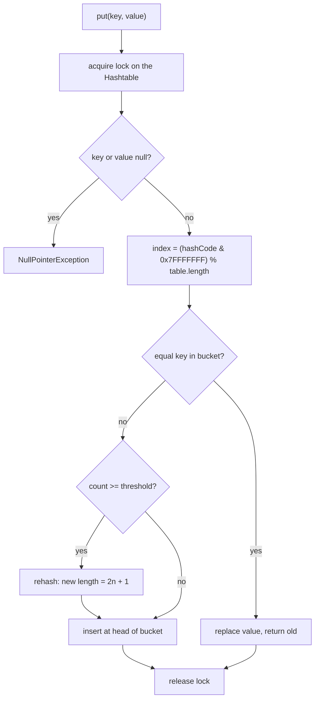
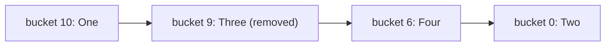

## In One Line
`Hashtable` is Java 1.0's original hash-based key/value store: every public method is `synchronized`, it rejects `null` keys and values, it offers legacy `Enumeration`s, and today it is replaced by `HashMap` (single thread) or `ConcurrentHashMap` (many threads).

## Mental Model
Picture an old **bank vault with a single key and one clerk**. Every customer — whether they want to deposit (`put`), look something up (`get`) or just ask how many boxes there are (`size`) — must queue for the one clerk. Nobody ever sees a half-finished transaction, but the queue is long, and the clerk only guarantees **one request at a time**: if you need "check my balance, then withdraw" as one step, another customer can sneak in between your two requests.

In the code:
- The **single clerk** is the `Hashtable` object's monitor lock: every public method is `synchronized` on `this`.
- **One request at a time** = each `put`, `get`, `remove` is atomic on its own.
- **"Check, then withdraw"** = compound actions like `put(k, get(k) + 1)` — two separate locked calls, so updates can be lost.
- The vault's **old paper ledger** is `Enumeration` (`keys()`, `elements()`); the modern teller screen is the `Map` views (`keySet()`, `entrySet()`), which Hashtable gained in Java 1.2.

## Concept
### A bit of history
- **JDK 1.0 (1996):** `Hashtable` and `Vector` were the only general collections. `Hashtable` extends the abstract class `Dictionary`, whose own Javadoc now says *"This class is obsolete. New implementations should implement the Map interface."*
- **JDK 1.2 (1998):** the Collections Framework arrived. `Hashtable` was **retrofitted** to implement `Map`, so it has both the old API (`keys()`, `elements()`, `contains()`) and the new one (`keySet()`, `entrySet()`, `values()`, `containsValue()`).
- **Java 5:** generics (`Hashtable<K,V>`) and `ConcurrentHashMap` arrived; **Java 8** added synchronized overrides of the new default methods (`getOrDefault`, `forEach`, `putIfAbsent`, `compute*`, `merge`, `replaceAll`...).
- The Javadoc itself recommends: *use `HashMap` if you do not need thread safety, `ConcurrentHashMap` if you need a highly concurrent map.*

### Hashtable vs HashMap vs ConcurrentHashMap
| | `Hashtable` | `HashMap` | `Collections.synchronizedMap(new HashMap<>())` | `ConcurrentHashMap` |
|---|---|---|---|---|
| Thread-safe | Yes: every method `synchronized` on the table | No | Yes: every method locks one mutex | Yes: lock-free reads, fine-grained locks on writes |
| Concurrency | One thread at a time, even for reads | — | One thread at a time | Many readers and writers in parallel |
| `null` key | **No** (`NullPointerException`) | One allowed | One allowed | No |
| `null` values | **No** | Allowed | Allowed | No |
| Iteration | `Enumeration` (not fail-fast) + fail-fast `Iterator`s | Fail-fast `Iterator` | Fail-fast; you must lock manually while iterating | Weakly consistent, never throws CME |
| Atomic compound ops | `putIfAbsent`, `compute`, `merge` are synchronized | Not atomic | Synchronized | Atomic per key |
| Superclass | `Dictionary` (obsolete) | `AbstractMap` | wrapper | `AbstractMap` |
| Default capacity / load factor | 11 / 0.75 | 16 / 0.75 | 16 / 0.75 | 16 / 0.75 |
| Index calculation | `(hash & 0x7FFFFFFF) % length` | `(n - 1) & spread(hash)` | same as `HashMap` | power-of-two with spread hash |
| Growth | `2n + 1` (11 → 23 → 47 → 95) | Doubles | Doubles | Doubles |
| Tree bins for collisions | No | Yes (Java 8+, beyond 8 per bucket) | Yes | Yes |
| Since | 1.0 | 1.2 | 1.2 | 1.5 |

### How it works inside
- An array `Entry<?,?>[] table` of **buckets**; each bucket is a singly linked list of `Entry` objects (`hash`, `key`, `value`, `next`). This is *separate chaining*.
- **Index** = `(key.hashCode() & 0x7FFFFFFF) % table.length`. The `& 0x7FFFFFFF` clears the sign bit so a negative hash code cannot give a negative index. Hashtable uses the raw `hashCode()` (no bit spreading like `HashMap`), and odd table sizes with `%` to spread keys.
- **New entries go to the head** of their bucket's list.
- **Resize ("rehash")**: when the entry count reaches `threshold = capacity × loadFactor`, the next insertion first grows the table to `2 × old + 1` and relinks every entry. Default: 11 buckets, threshold 8 — the 9th `put` grows the table to 23 (verified by reflection: 11 → 23 → 47 → 95).
- **Iteration** (`Enumeration` and the view iterators) walks the buckets **from the last index down to 0**. That is why the example prints `One, Four, Two`.
- Constructors: `Hashtable()`, `Hashtable(int initialCapacity)`, `Hashtable(int initialCapacity, float loadFactor)`, `Hashtable(Map m)` (capacity `max(2 × m.size(), 11)`).

### Why `null` is forbidden
- **Implementation:** `put` explicitly throws `NullPointerException` for a `null` value, and every lookup calls `key.hashCode()`, which throws for a `null` key. Even `get(null)` and `containsKey(null)` throw.
- **Design:** for a map shared between threads, `get(k) == null` must mean exactly "absent". If `null` values were allowed, you would need `containsKey(k)` + `get(k)` — two calls that another thread can interleave. `ConcurrentHashMap` bans `null` for the same reason.

### Thread-safe does not mean "your logic is thread-safe"
Each method is atomic, but a sequence of calls is not:
```java
if (!table.containsKey(k)) table.put(k, v);   // check-then-act: race
table.put(k, table.get(k) + 1);               // read-modify-write: lost updates
```
Fix: use the single atomic methods (`putIfAbsent`, `merge`, `compute`), or hold the table's lock yourself: `synchronized (table) { ... }`. For real concurrency, use `ConcurrentHashMap`, whose `merge`/`compute` are atomic per key without blocking the whole map.

Iterating is also a multi-step operation: to iterate safely while other threads write, wrap the entire loop in `synchronized (table) { ... }`. The view collections (`keySet()`, `entrySet()`, `values()`) are synchronized wrappers that lock on the table, so this works.

### `Enumeration` vs `Iterator`
| | `Enumeration<E>` (1.0) | `Iterator<E>` (1.2) |
|---|---|---|
| Methods | `hasMoreElements()`, `nextElement()`, `asIterator()` (Java 9) | `hasNext()`, `next()`, `remove()`, `forEachRemaining()` |
| Remove while iterating | Not possible | `iterator.remove()` |
| On concurrent modification | **Not fail-fast** — results are *undefined* | Fail-fast: `ConcurrentModificationException` |
| Obtained from | `keys()`, `elements()`, `Vector.elements()`, `Collections.enumeration(c)` | `keySet().iterator()`, `entrySet().iterator()`, ... |
| Use in new code | Only for legacy APIs | Yes |

Bridge helpers: `enumeration.asIterator()` (Java 9), `Collections.list(enumeration)` → `ArrayList`, `Collections.enumeration(collection)` for APIs that demand an `Enumeration`.

### Where you still meet Hashtable
- `java.util.Properties extends Hashtable<Object,Object>` — a textbook "inheritance instead of composition" mistake: you can `put` non-`String` values into it. Since Java 9 it keeps its data in an internal `ConcurrentHashMap` but still *is-a* `Hashtable`.
- Old APIs: `javax.naming.InitialContext(Hashtable<?,?> environment)`, `javax.swing.UIDefaults extends Hashtable`.
- Legacy code and interview questions — "HashMap vs Hashtable" is one of the most asked Java questions.

## Diagram

Every call goes through the same single lock; nulls are rejected; buckets are chosen with modulo, and growth is `2n + 1`.


Enumerations and iterators walk the 11 buckets from index 10 down to 0, which is why the example prints One, Four, Two.

## Code
@example Collections/HashTables/HashtableExample.java

Where the example's keys land (11 buckets), compared with a `HashMap`:
```java
for (String k : List.of("One", "Two", "Three", "Four")) {
    int h = k.hashCode();
    System.out.printf("%-5s hashCode=%-9d bucket=(h & 0x7FFFFFFF) %% 11 = %d%n", k, h, (h & 0x7FFFFFFF) % 11);
}
Map<String, Integer> hashtable = new Hashtable<>();
Map<String, Integer> hashMap = new HashMap<>();
for (String k : List.of("One", "Two", "Three", "Four")) {
    hashtable.put(k, k.length());
    hashMap.put(k, k.length());
}
System.out.println("Hashtable: " + hashtable);
System.out.println("HashMap:   " + hashMap);
```
```output
One   hashCode=79430     bucket=(h & 0x7FFFFFFF) % 11 = 10
Two   hashCode=84524     bucket=(h & 0x7FFFFFFF) % 11 = 0
Three hashCode=80786814  bucket=(h & 0x7FFFFFFF) % 11 = 9
Four  hashCode=2195782   bucket=(h & 0x7FFFFFFF) % 11 = 6
Hashtable: {One=3, Three=5, Four=4, Two=3}
HashMap:   {One=3, Four=4, Two=3, Three=5}
```

`null` handling:
```java
Map<String, Integer> hashMap = new HashMap<>();
hashMap.put(null, 0);
hashMap.put("k", null);
System.out.println("HashMap accepts nulls: " + hashMap);

Hashtable<String, Integer> table = new Hashtable<>();
try {
    table.put(null, 0);
} catch (NullPointerException e) {
    System.out.println("Hashtable null key   -> NullPointerException");
}
try {
    table.put("k", null);
} catch (NullPointerException e) {
    System.out.println("Hashtable null value -> NullPointerException");
}
try {
    table.get(null);
} catch (NullPointerException e) {
    System.out.println("Hashtable get(null)  -> NullPointerException");
}
System.out.println("hashMap.get(\"missing\") = " + hashMap.get("missing") + ", hashMap.get(\"k\") = " + hashMap.get("k"));
```
```output
HashMap accepts nulls: {null=0, k=null}
Hashtable null key   -> NullPointerException
Hashtable null value -> NullPointerException
Hashtable get(null)  -> NullPointerException
hashMap.get("missing") = null, hashMap.get("k") = null
```
The last line shows the ambiguity Hashtable avoids: in a `HashMap`, `null` can mean "absent" or "mapped to null".

`Enumeration` is not fail-fast, the view `Iterator` is:
```java
Hashtable<String, Integer> table = new Hashtable<>();
table.put("One", 1);
table.put("Two", 2);
table.put("Four", 4);

// Legacy Enumeration: NOT fail-fast
Enumeration<String> keys = table.keys();
while (keys.hasMoreElements()) {
    String k = keys.nextElement();
    if (k.equals("One")) table.put("Five", 5);   // structural change mid-enumeration
    System.out.println("enumerated " + k);
}

// Collection-view Iterator: fail-fast
try {
    for (String k : table.keySet()) {
        if (k.equals("One")) table.put("Six", 6);
        System.out.println("iterated " + k);
    }
} catch (ConcurrentModificationException e) {
    System.out.println("keySet iterator -> ConcurrentModificationException");
}
System.out.println(table);
```
```output
enumerated One
enumerated Four
enumerated Five
enumerated Two
iterated One
keySet iterator -> ConcurrentModificationException
{One=1, Four=4, Six=6, Five=5, Two=2}
```
The enumeration silently picked up `Five` because it happened to land in a bucket not yet visited — the Javadoc calls such results *undefined*.

Synchronized methods do not make compound actions atomic (4 threads × 100,000 increments):
```java
Hashtable<String, Integer> racy = new Hashtable<>();
Hashtable<String, Integer> atomic = new Hashtable<>();
racy.put("hits", 0);
atomic.put("hits", 0);

List<Thread> threads = new ArrayList<>();
for (int t = 0; t < 4; t++) {
    threads.add(new Thread(() -> {
        for (int i = 0; i < 100_000; i++) {
            racy.put("hits", racy.get("hits") + 1);     // get + put: two separate locked calls
            atomic.merge("hits", 1, Integer::sum);      // one locked call
        }
    }));
}
threads.forEach(Thread::start);
for (Thread th : threads) th.join();

System.out.println("expected = " + 4 * 100_000);
System.out.println("get+put  = " + racy.get("hits"));
System.out.println("merge    = " + atomic.get("hits"));
```
One real run (the `get+put` number changes every run — 175627, 221307, 230839 and 328975 in four runs — while `merge` is always 400000):
```output
expected = 400000
get+put  = 221307
merge    = 400000
```

Legacy methods and modern bridges:
```java
Hashtable<String, Integer> table = new Hashtable<>(Map.of("One", 1, "Two", 2, "Four", 4));

table.keys().asIterator().forEachRemaining(k -> System.out.print(k + " "));   // Java 9+
System.out.println();
ArrayList<Integer> values = Collections.list(table.elements());               // Enumeration -> ArrayList
System.out.println(values);
table.forEach((k, v) -> System.out.print(k + "=" + v + " "));                 // Java 8+, synchronized
System.out.println();
```
```output
One Four Two 
[1, 4, 2]
Two=2 Four=4 One=1 
```
Note the last line: `Hashtable.forEach` walks buckets from index 0 **upwards**, while enumerations and iterators walk from the top **down** — two orders from the same table, one more reason never to rely on hash-table order.

## Walkthrough
- **Imports**: `Enumeration` (legacy cursor), `Hashtable`, `Iterator` (modern cursor), `Map.Entry` (a key/value pair, imported as the nested type `Entry`), `Set` (the type returned by `entrySet()`).
- `Hashtable<String, Integer> hashtable = new Hashtable<>();` — 11 buckets, load factor 0.75, so it holds 8 entries before its first rehash.
- `hashtable.put("One", 1);` … `put("Four", 4);` — each call locks the table, rejects nulls, computes `(hashCode & 0x7FFFFFFF) % 11` and inserts at the head of that bucket. `1`, `2`, ... are autoboxed to `Integer`. The buckets are 10 (`One`), 0 (`Two`), 9 (`Three`) and 6 (`Four`).
- `Integer value = hashtable.get("Two");` → prints **`Value associated with key 'Two': 2`**. The result is `Integer`, not `int`: `get` returns `null` for a missing key, and unboxing that `null` into an `int` would throw `NullPointerException`.
- `hashtable.remove("Three");` — unlinks the `Three` entry from bucket 9 and returns its old value (ignored here).
- `System.out.println("\nIterating over keys using Enumeration:");` — the `\n` prints a blank line first; the `// Output:` comment leaves that blank line out.
- `Enumeration<String> keys = hashtable.keys();` + `while (keys.hasMoreElements())` + `keys.nextElement()` — the Java 1.0 way to loop over keys. For each key the loop calls `hashtable.get(key)` to fetch the value. The walk goes from bucket 10 down to 0: **`One`, `Four`, `Two`**.
- `Set<Entry<String, Integer>> entrySet = hashtable.entrySet();` — the Java 1.2 `Map` view: a live, synchronized set of key/value pairs backed by the table.
- `Iterator<Entry<String, Integer>> iterator = entrySet.iterator();` + `while (iterator.hasNext())` + `iterator.next()` — the modern cursor; each `Entry` gives `getKey()` and `getValue()` without a second lookup. Same bucket walk, same order: **`One`, `Four`, `Two`**. (This iterator is fail-fast and supports `iterator.remove()`; the enumeration is neither.)
- The recorded output matches every `// Output:` comment. The order is deterministic here because `String.hashCode()` is fixed and the table size is known — but it is still an implementation detail, not a guarantee.

## Traps
> [!ERRATA] Minor bad practice in the Enumeration loop: `hashtable.get(key)` for every key does a **second lookup** and takes the lock a second time per element. The entry-set loop that follows is the better pattern (one pass, key and value together). In multi-threaded code, a keys-then-get loop can also see a key whose mapping was removed in between, so `get` returns `null`.

> [!NOTE] The example teaches a legacy class on purpose. In new code, prefer `HashMap` (or `ConcurrentHashMap` when threads share the map) and `Iterator`/for-each over `Enumeration`.

- **`null` anywhere throws.** `put(null, v)`, `put(k, null)`, `get(null)`, `containsKey(null)` and `contains(null)` all throw `NullPointerException`. Migrating from `HashMap` to `Hashtable` (or `ConcurrentHashMap`) breaks code that stored `null`s.
- **Synchronized ≠ atomic logic.** `if (!t.containsKey(k)) t.put(k, v)` and `t.put(k, t.get(k) + 1)` race. Use `putIfAbsent`/`merge`/`compute`, or `synchronized (t) { ... }`.
- **Iteration is not protected by the per-method locks.** Another thread can modify the table between two `next()` calls → `ConcurrentModificationException` from iterators, undefined results from enumerations. Lock the table for the whole loop.
- **`contains(value)` checks values, not keys.** It is the legacy twin of `containsValue`; `containsKey` checks keys. A classic interview trick.
- **Order is an implementation detail** — and even inside one `Hashtable`, `forEach` and iterators walk in opposite directions.
- **`Properties` is a `Hashtable<Object,Object>`**: `props.put("port", 8080)` compiles, but `getProperty("port")` then returns `null` because the value is not a `String`. Use `setProperty`.
- **Performance**: every read takes the lock, so under contention threads serialize. It is not "slow" single-threaded (uncontended locks are cheap), but it never scales.

> [!WARNING] Swapping `Hashtable` for `Collections.synchronizedMap(new HashMap<>())` does not buy concurrency — it is the same single-lock design. The scalable replacement is `ConcurrentHashMap`.

## Tips & Tricks
- **Mnemonic for "HashMap vs Hashtable": "S-N-L-E"** — **S**ynchronized (Hashtable yes), **N**ulls (Hashtable none), **L**egacy (Hashtable 1.0, extends `Dictionary`), **E**numeration (Hashtable has it, plus fail-fast iterators).
- The lowercase **t** in `Hashtable` is a naming leftover from Java 1.0; `HashMap`, `HashSet`, `ConcurrentHashMap` all came later with proper camel case.
- **"Thread-safe methods, thread-unsafe sequences."** Any time you see two calls on the same key, ask if another thread can get between them.
- **Rule of thumb:** single thread → `HashMap`; many threads → `ConcurrentHashMap`; legacy API demands it → `Hashtable` (or `Properties`).
- **Growth sizes 11 → 23 → 47 → 95**: "double plus one". `HashMap`: 16 → 32 → 64 ("just double").
- Need an `Enumeration` for an old API? `Collections.enumeration(list)`. Got one and want modern code? `enumeration.asIterator()` or `Collections.list(enumeration)`.

## Interview Q&A
### [Basic] What are the differences between HashMap and Hashtable?
| | `Hashtable` | `HashMap` |
|---|---|---|
| Synchronization | Every public method `synchronized` | None |
| `null` | No null key or value | One null key, any null values |
| Legacy | JDK 1.0, extends `Dictionary`, retrofitted to `Map` in 1.2 | JDK 1.2, extends `AbstractMap` |
| Iteration | `Enumeration` (not fail-fast) and fail-fast iterators | Fail-fast iterators |
| Internals | 11 buckets, `%` indexing, grows `2n + 1`, no tree bins | 16 buckets, power-of-two masking, doubles, tree bins since Java 8 |
| Performance | Lock on every call | Faster, no locking |

Conclusion: use `HashMap` for single-threaded code and `ConcurrentHashMap` for shared maps; `Hashtable` is kept only for backward compatibility.

**Follow-up:** *Can you make a HashMap synchronized?* — `Collections.synchronizedMap(new HashMap<>())`, which has the same single-lock behaviour as `Hashtable` (and still allows `null`). For scalability, use `ConcurrentHashMap` instead.

### [Basic] Why does Hashtable not allow null keys or values?
Two reasons. **Implementation:** it calls `key.hashCode()` and `key.equals()` directly, so a `null` key throws `NullPointerException`, and `put` explicitly rejects `null` values. **Design:** in a map shared by threads, `get(k)` returning `null` should mean exactly "no mapping". If `null` values were allowed you would need `containsKey` plus `get` to tell "absent" from "mapped to null", and another thread could change the map between the two calls. `ConcurrentHashMap` forbids `null` for the same reason.

**Follow-up:** *Does HashMap allow null?* — Yes: one `null` key (stored in bucket 0) and any number of `null` values; `getOrDefault` and `containsKey` help distinguish the cases.

### [Intermediate] Hashtable is synchronized. Is code that uses it automatically thread-safe?
No. Each **single** method call is atomic, but sequences are not. `if (!t.containsKey(k)) t.put(k, v)` (check-then-act) and `t.put(k, t.get(k) + 1)` (read-modify-write) can interleave with other threads. In a run with 4 threads doing 100,000 `get`+`put` increments each, the counter ended between 175,627 and 328,975 instead of 400,000, while `merge(k, 1, Integer::sum)` always gave 400,000. Iteration is also a sequence of calls: you must hold `synchronized (table)` around the whole loop.

**Follow-up:** *How do you fix the counter?* — `table.merge(k, 1, Integer::sum)` (atomic because `Hashtable.merge` is synchronized), or better a `ConcurrentHashMap<String, LongAdder>` / `ConcurrentHashMap.merge` for scalable concurrency.

### [Intermediate] Compare Hashtable, Collections.synchronizedMap and ConcurrentHashMap.
- **`Hashtable`** — one lock (the table itself) around every method; no nulls; legacy API.
- **`Collections.synchronizedMap(map)`** — a wrapper that locks one mutex (the wrapper by default) around every method of any `Map`; allows whatever the wrapped map allows (so nulls with `HashMap`); ordering of the wrapped map is kept (`TreeMap`, `LinkedHashMap`).
- **`ConcurrentHashMap`** — reads are lock-free (volatile reads), writes lock only the affected bin (Java 8+; segments before that); atomic `compute`/`merge`/`putIfAbsent` per key; weakly consistent iterators that never throw `ConcurrentModificationException`; no nulls.

For both single-lock options you must lock manually while iterating; with `ConcurrentHashMap` you do not.

**Follow-up:** *Why did ConcurrentHashMap drop segments in Java 8?* — CAS on empty bins plus `synchronized` on the first node of a bin gives finer granularity and less memory than 16 fixed `ReentrantLock` segments. (Details: [ConcurrentHashMap](lesson:b03-concurrency/03-concurrenthashmap).)

### [Intermediate] What is the difference between Enumeration and Iterator?
`Enumeration` (JDK 1.0) has `hasMoreElements()` and `nextElement()` only; it cannot remove elements and it is **not fail-fast** — if the collection changes during enumeration the result is undefined. `Iterator` (JDK 1.2) has shorter names (`hasNext`, `next`), supports `remove()` (and `forEachRemaining` since Java 8), and the iterators of standard collections are **fail-fast**, throwing `ConcurrentModificationException` when the collection is structurally modified outside the iterator. `Hashtable` offers both: `keys()`/`elements()` return enumerations; `keySet()`/`values()`/`entrySet()` iterators are fail-fast.

**Follow-up:** *How do you convert between them?* — `enumeration.asIterator()` (Java 9) and `Collections.list(enumeration)`; the other way, `Collections.enumeration(collection)`.

### [Advanced] Describe Hashtable's internal structure. Why capacity 11 and growth 2n + 1?
An array of buckets, each a linked list of `Entry(hash, key, value, next)` (separate chaining). The bucket index is `(hashCode & 0x7FFFFFFF) % table.length` — the mask removes the sign bit so the index is never negative. Because it uses the raw `hashCode()` with modulo, an **odd (ideally prime) table size** spreads keys better than a power of two, which would only look at the low bits. Default capacity 11 and load factor 0.75 give a threshold of 8; the insertion that finds `count >= threshold` first rehashes to `2n + 1` (11 → 23 → 47 → 95), keeping the size odd. There are no tree bins, so many colliding keys degrade to O(n) per lookup. `HashMap` instead uses power-of-two tables, a bit-spreading step (`h ^ (h >>> 16)`), masking with `n - 1` (cheaper than `%`) and red-black trees for crowded buckets.

**Follow-up:** *Is `Hashtable` slow because of the modulo?* — Mostly not; the real cost under concurrency is the single lock. Uncontended locking is cheap on modern JVMs.

### [Advanced] Why does the example print One, Four, Two and not the insertion order?
Hash tables do not keep insertion order. With 11 buckets, `One` → bucket 10, `Four` → 6, `Two` → 0 (`Three` was in 9 and was removed). Hashtable's enumerator and iterators scan the bucket array **from the highest index to the lowest**, giving `One, Four, Two`. A `HashMap` with the same keys prints a different order, and even `Hashtable.forEach` scans from index 0 upwards (`Two, Four, One`). If you need order, use `LinkedHashMap` (insertion/access order) or `TreeMap` (sorted).

**Follow-up:** *Can the order change without code changes?* — Yes: after a rehash (more entries) or on a different JDK implementation. Never rely on it.

### [Basic] Where would you still see Hashtable today?
In legacy code; in `java.util.Properties` (which extends `Hashtable<Object,Object>`); in old APIs such as JNDI's `new InitialContext(Hashtable<?,?> env)` and Swing's `UIDefaults`. New code should use `HashMap` or `ConcurrentHashMap`. The Javadoc of `Hashtable` itself says so.

**Follow-up:** *What is wrong with `Properties extends Hashtable`?* — It is inheritance where composition was needed: callers can `put` non-`String` keys and values, which `getProperty` then ignores. Since Java 9, `Properties` stores its data in an internal `ConcurrentHashMap`, but the public `Hashtable` type remains for compatibility.

### [Intermediate] What does `hashtable.contains(x)` check?
Values, not keys. `contains(Object value)` is the legacy name, identical to `containsValue(value)`; for keys use `containsKey`. It is O(n) because it scans every bucket, and it throws `NullPointerException` for `null`.

**Follow-up:** *Which is faster, containsKey or containsValue?* — `containsKey` is O(1) on average (one bucket); `containsValue` is O(n).

## Quiz
### What happens here?
```java
Hashtable<String, Integer> table = new Hashtable<>();
table.put("k", null);
```
- [ ] The key `k` is stored with value `null`
- [ ] Compile error
- [x] `NullPointerException` at runtime
- [ ] The call is ignored
> `Hashtable.put` explicitly throws `NullPointerException` for a `null` value (and `key.hashCode()` throws for a `null` key). It compiles because generics cannot express "non-null". A `HashMap` would store it.

### In the original example, why is the order `One, Four, Two`?
- [ ] Hashtable keeps insertion order
- [ ] Keys are sorted in reverse alphabetical order
- [x] Keys sit in buckets 10, 6 and 0, and Hashtable iterates from the highest bucket down
- [ ] It is random on every run
> `(hashCode & 0x7FFFFFFF) % 11` puts `One` in 10, `Four` in 6, `Two` in 0, and Hashtable's enumerator walks the array from the end. Insertion order would be One, Two, Four; the output is deterministic for these keys, not random — but still an implementation detail.

### Spot the bug: the page counter loses hits under load.
```java
static final Hashtable<String, Integer> hits = new Hashtable<>();

static void record(String page) {   // called from many threads
    Integer old = hits.get(page);
    hits.put(page, old == null ? 1 : old + 1);
}
```
- [ ] `Hashtable` is not thread-safe at all
- [x] `get` and `put` are each atomic, but the pair is not — two threads can read the same `old` value
- [ ] `Integer` overflows after 127
- [ ] `hits` must be `volatile`
> Two threads can both read `old = 5` and both write `6`. Fix: `hits.merge(page, 1, Integer::sum)` (one synchronized call) or a `ConcurrentHashMap`. Hashtable *is* thread-safe per call, which is exactly why this bug is easy to miss.

### Which loop throws ConcurrentModificationException when the table is modified inside it?
```java
// A
Enumeration<String> e = table.keys();
while (e.hasMoreElements()) { String k = e.nextElement(); if (k.equals("One")) table.put("Five", 5); }
// B
for (String k : table.keySet()) { if (k.equals("One")) table.put("Six", 6); }
```
- [ ] A only
- [x] B only
- [ ] Both
- [ ] Neither
> The keySet iterator is fail-fast: it compares `modCount` and throws on the next `next()`. The legacy `Enumeration` has no such check — it keeps going with undefined results (in the verified run it even returned the newly added `Five`).

### What does this print?
```java
Hashtable<String, Integer> t = new Hashtable<>();
t.put("One", 1);
t.put("Two", 2);
System.out.println(t.contains(2) + " " + t.contains("Two"));
```
- [ ] true true
- [x] true false
- [ ] false true
- [ ] Compile error: contains is not a Map method
> The legacy `contains(Object)` checks **values** (same as `containsValue`). `2` is a value → `true`; `"Two"` is a key, not a value → `false`. It compiles because `Hashtable` still has its pre-1.2 methods.

### What are Hashtable's default capacity and growth rule?
- [ ] 16 buckets, doubles on resize
- [x] 11 buckets, grows to 2n + 1
- [ ] 10 buckets, grows by 50%
- [ ] 16 buckets, grows to 2n + 1
> Hashtable starts with 11 buckets (load factor 0.75, threshold 8) and rehashes to `2n + 1`: 11 → 23 → 47 → 95. "16, doubles" is `HashMap`; "10, +50%" describes `ArrayList`'s growth (with default capacity 10).

### A new multi-threaded service needs a shared map with high read and write traffic. What should you use?
- [ ] `Hashtable`, because it is synchronized
- [ ] `Collections.synchronizedMap(new HashMap<>())`
- [x] `ConcurrentHashMap`
- [ ] `HashMap` with `volatile` on the field
> `Hashtable` and `synchronizedMap` both serialize every access behind one lock. `ConcurrentHashMap` has lock-free reads, per-bin write locking and atomic `compute`/`merge`. A `volatile` field only makes the *reference* visible; the `HashMap` inside is still unsafe.

## Takeaways
- `Hashtable` (JDK 1.0, extends the obsolete `Dictionary`, retrofitted to `Map` in 1.2) synchronizes every public method on the table itself.
- It forbids `null` keys and values (`NullPointerException`), so `get(k) == null` always means "absent".
- Per-method synchronization does not make compound actions (`get` then `put`, check-then-act) or iteration thread-safe; use `merge`/`compute`/`putIfAbsent` or `synchronized (table)`.
- Internals: 11 buckets, load factor 0.75, index `(hash & 0x7FFFFFFF) % length`, growth `2n + 1`, chaining without tree bins; iteration walks buckets from the top index down.
- `keys()`/`elements()` return `Enumeration`s, which are not fail-fast; the `keySet()`/`entrySet()`/`values()` iterators are fail-fast. `contains(v)` checks values.
- Prefer `HashMap` for single-threaded code and `ConcurrentHashMap` for shared maps; `Hashtable` survives in legacy APIs and in `Properties`.
