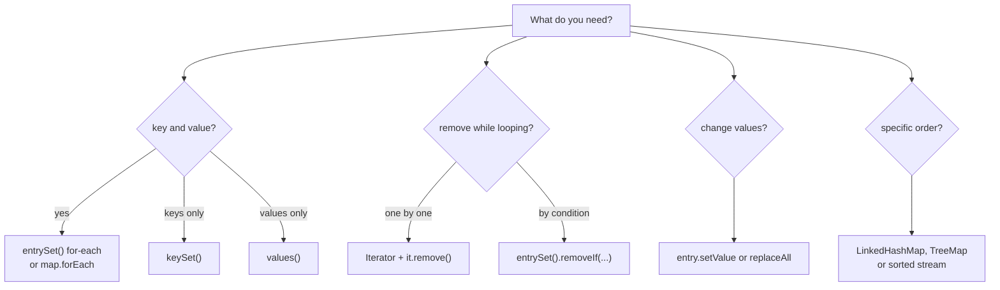
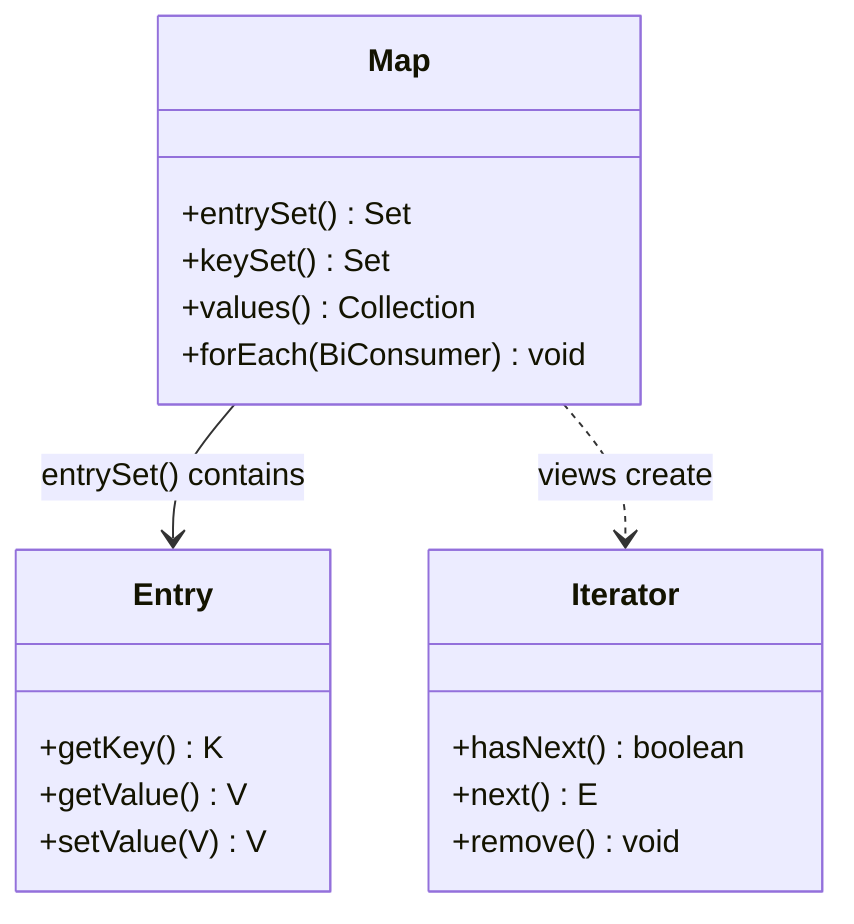

## In One Line
A `Map` is not `Iterable`, so you iterate one of its three **views** — `entrySet()` (key + value), `keySet()` or `values()` — with for-each, an explicit `Iterator` (the only safe way to remove while looping), `Map.forEach`, or a stream.

## Mental Model
Think of a **hotel with a front-desk register**. You cannot "walk through the hotel" as a whole; you walk through one of its lists:
- the **guest register** — each line has *room number and guest name* → `entrySet()`;
- the **list of room numbers** → `keySet()`;
- the **list of guests** → `values()`.

These lists are not photocopies; they are **windows onto the live register**. Cross a line out on the room-number list and the guest is checked out of the hotel (`keySet().remove(k)` removes the mapping).

And the rule of the desk: while a clerk is reading down the register with their finger (**an iterator**), nobody else may add or tear out lines — if they do, the clerk notices at the next line and stops with an error (`ConcurrentModificationException`). The clerk *may* cross out the line under their own finger (`iterator.remove()`) or correct a name on it (`entry.setValue(...)`).

## Concept
### Why a Map needs views
`Map` does **not** extend `Collection` or `Iterable` — a map is a set of *pairs*, not a group of single elements, so `for (x : map)` does not compile. Instead `Map` offers three **collection views**:

| View | Type | Contains | Supports |
|---|---|---|---|
| `entrySet()` | `Set<Map.Entry<K,V>>` | One `Map.Entry` per mapping | `remove`, `removeIf`, `retainAll`, `clear`, iterator `remove`, `entry.setValue` |
| `keySet()` | `Set<K>` | The keys | `remove`, `removeIf`, `retainAll`, `clear`, iterator `remove` |
| `values()` | `Collection<V>` (not a `Set` — values can repeat) | The values | `remove`, `removeIf`, `retainAll`, `clear`, iterator `remove` |

Views are **backed by the map**: they are created once, cost nothing to obtain, reflect later changes to the map, and removing through them removes from the map. They do **not** support `add`/`addAll` (`UnsupportedOperationException`) — a key alone does not say which value to store.

`Map.Entry<K,V>` is the pair type: `getKey()`, `getValue()`, `setValue(v)` (writes through to the map for `HashMap`, `TreeMap` and `LinkedHashMap` iteration entries). Since Java 8 it also has the comparators `Map.Entry.comparingByKey()` and `comparingByValue()`; since Java 9 `Map.entry(k, v)` creates an immutable pair.

### All the ways to iterate
| # | Technique | Use it when | Since |
|---|---|---|---|
| 1 | `for (Map.Entry<K,V> e : map.entrySet())` | You need key **and** value — the default choice | 1.5 |
| 2 | `for (K k : map.keySet())` | You need keys only | 1.5 |
| 3 | `for (V v : map.values())` | You need values only | 1.5 |
| 4 | `Iterator<Map.Entry<K,V>> it = map.entrySet().iterator()` | You must **remove** entries while looping (`it.remove()`) | 1.2 |
| 5 | `map.forEach((k, v) -> ...)` | Short read-only actions; no `Entry` objects needed | 8 |
| 6 | `map.entrySet().stream()...` | Filtering, sorting, grouping, collecting | 8 |
| 7 | `map.entrySet().removeIf(...)`, `map.replaceAll(...)` | Bulk removal / bulk value update without writing a loop | 8 |
| — | `for (var e : map.entrySet())` | Same as #1 with less typing | 10 |
| — | `map.reversed()`, `firstEntry()`, `lastEntry()` on `LinkedHashMap`/`TreeMap` | Reverse or end-first iteration of an ordered map | 21 (`SequencedMap`) |

### entrySet vs keySet + get
```java
for (String k : map.keySet()) {
    Integer v = map.get(k);         // a second lookup for every key
}
for (Map.Entry<String, Integer> e : map.entrySet()) {
    Integer v = e.getValue();       // already in hand
}
```
With `keySet()` + `get()`, every element costs an extra lookup: O(1) extra per key for a `HashMap` (hashing plus `equals`), but **O(log n)** extra per key for a `TreeMap` — O(n log n) in total instead of O(n). Use `entrySet()` (or `forEach`) whenever you need both.

### Modifying a map while iterating
| Action inside a loop over a `HashMap` | Result |
|---|---|
| `iterator.remove()` | Safe — the iterator updates its own bookkeeping |
| `entry.setValue(v)` | Safe — not a structural change |
| `map.put(existingKey, v)` | Safe — replacing a value is not structural |
| `map.remove(k)` or `map.put(newKey, v)` | Structural → `ConcurrentModificationException` on the next `next()` (best-effort) |
| Any structural change inside `map.forEach(...)` | `ConcurrentModificationException` |
| `map.entrySet().removeIf(pred)` / `keySet().removeIf` / `values().removeIf` | Safe bulk removal, no loop needed |
| `map.replaceAll((k, v) -> ...)` | Safe bulk value update |

"Structural" means adding or removing a mapping (and rehashing). The mechanism (`modCount` vs `expectedModCount`) is covered in [Fail-fast iterators](lesson:a03-collections/22-fail-fast-iterators). Concurrent maps behave differently — see [Fail-safe iterators](lesson:a03-collections/23-fail-safe-iterators).

`iterator.remove()` rules: call it **at most once per `next()`**, and only after `next()` — otherwise `IllegalStateException`. Immutable maps (`Map.of`, `Collections.unmodifiableMap`) throw `UnsupportedOperationException`.

### Iteration order
| Map | Iteration order |
|---|---|
| `HashMap`, `Hashtable`, `WeakHashMap`, `IdentityHashMap` | Unspecified — bucket order; can change as the map grows |
| `LinkedHashMap` | Insertion order (or access order with `new LinkedHashMap<>(16, 0.75f, true)`) |
| `TreeMap` / `ConcurrentSkipListMap` | Sorted by key (natural order or `Comparator`) |
| `EnumMap` | Enum declaration order |
| `Map.of(...)` / `Map.copyOf` (Java 9+) | Unspecified and **deliberately randomised per JVM run** |

A `HashMap` sometimes *looks* ordered: `Integer.hashCode()` is the value itself, so small integer keys land in buckets 1, 2, 3... and come out ascending; and a few `String` keys may happen to come out in insertion order. Both are coincidences of the bucket layout, not guarantees.

Need a specific order? Choose the map (`LinkedHashMap`, `TreeMap`), or sort while iterating: `map.entrySet().stream().sorted(Map.Entry.comparingByValue())`.

### Performance notes
- Iterating a `HashMap` visits every **bucket** as well as every entry: O(capacity + size). A map created with a huge initial capacity but few entries iterates slowly. `LinkedHashMap` iterates its linked list: O(size).
- `forEach` on `HashMap` avoids creating an iterator object and is usually a little faster; for most code, readability decides.
- Streams add overhead for trivial loops but shine when you filter/sort/collect.

## Diagram

Pick the view by what you need; pick `Iterator.remove`/`removeIf` for removal; never call `map.remove` inside a for-each.


The views are windows onto the same map; their iterators hand out `Map.Entry` objects (or keys, or values).

## Code
@example Collections/Maps/MapIteratorExample.java
@example Collections/Iterators/MapIteratorExample.java

Seven ways to iterate, on one map (a `LinkedHashMap` so the order is predictable):
```java
Map<String, Integer> map = new LinkedHashMap<>();   // LinkedHashMap: predictable order for the demo
map.put("One", 1);
map.put("Two", 2);
map.put("Three", 3);

// 1. entrySet() + for-each: key and value together (the default choice)
for (Map.Entry<String, Integer> e : map.entrySet())
    System.out.print(e.getKey() + "=" + e.getValue() + " ");
System.out.println("  <- entrySet");

// 2. keySet() when you only need keys
for (String k : map.keySet()) System.out.print(k + " ");
System.out.println("  <- keySet");

// 3. values() when you only need values
int sum = 0;
for (int v : map.values()) sum += v;
System.out.println(sum + "  <- values");

// 4. Map.forEach(BiConsumer) - Java 8
map.forEach((k, v) -> System.out.print(k + ":" + v + " "));
System.out.println("  <- forEach");

// 5. Explicit Iterator - needed to remove while iterating
Iterator<Map.Entry<String, Integer>> it = map.entrySet().iterator();
while (it.hasNext()) {
    if (it.next().getValue() % 2 == 0) it.remove();
}
System.out.println(map + "  <- after iterator.remove()");

// 6. Streams - filter / sort / collect
String big = map.entrySet().stream()
        .filter(e -> e.getValue() > 1)
        .map(Map.Entry::getKey)
        .reduce("", String::concat);
System.out.println(big + "  <- stream");

// 7. var (Java 10) keeps the loop short
for (var e : map.entrySet()) e.setValue(e.getValue() * 10);   // setValue writes through
System.out.println(map + "  <- after setValue");
```
```output
One=1 Two=2 Three=3   <- entrySet
One Two Three   <- keySet
6  <- values
One:1 Two:2 Three:3   <- forEach
{One=1, Three=3}  <- after iterator.remove()
Three  <- stream
{One=10, Three=30}  <- after setValue
```

What is safe to change during iteration of a `HashMap`:
```java
static Map<String, Integer> fresh() {
    Map<String, Integer> m = new HashMap<>();
    m.put("One", 1); m.put("Two", 2); m.put("Three", 3); m.put("Four", 4);
    return m;
}

Map<String, Integer> a = fresh();
try {
    for (String k : a.keySet()) {
        if (k.equals("One")) a.remove(k);          // structural change through the MAP
    }
} catch (ConcurrentModificationException e) {
    System.out.println("map.remove inside for-each -> " + e.getClass().getSimpleName());
}

Map<String, Integer> b = fresh();
for (Map.Entry<String, Integer> e : b.entrySet()) {
    b.put(e.getKey(), e.getValue() * 100);          // existing key: NOT structural
}
System.out.println("put on existing keys: " + b);

Map<String, Integer> c = fresh();
try {
    c.forEach((k, v) -> { if (k.equals("One")) c.put("Five", 5); });
} catch (ConcurrentModificationException e) {
    System.out.println("adding a key inside forEach -> " + e.getClass().getSimpleName());
}

Map<String, Integer> d = fresh();
d.entrySet().removeIf(e -> e.getValue() % 2 == 0);   // Java 8: safe bulk removal
System.out.println("entrySet().removeIf: " + d);

Map<String, Integer> f = fresh();
f.values().removeIf(v -> v > 2);
f.replaceAll((k, v) -> v * -1);
System.out.println("values().removeIf + replaceAll: " + f);

Map<String, Integer> immutable = Map.of("A", 1);
try {
    Iterator<String> it = immutable.keySet().iterator();
    it.next();
    it.remove();
} catch (UnsupportedOperationException e) {
    System.out.println("remove on Map.of iterator -> " + e.getClass().getSimpleName());
}
```
```output
map.remove inside for-each -> ConcurrentModificationException
put on existing keys: {One=100, Four=400, Two=200, Three=300}
adding a key inside forEach -> ConcurrentModificationException
entrySet().removeIf: {One=1, Three=3}
values().removeIf + replaceAll: {One=-1, Two=-2}
remove on Map.of iterator -> UnsupportedOperationException
```

Why the examples' output *looks* ordered — and when it stops looking ordered:
```java
static int bucket(Object k) { int h = k.hashCode(); return (h ^ (h >>> 16)) & 15; }   // HashMap's index for 16 buckets

for (String k : List.of("One", "Two", "Three", "Four"))
    System.out.print(k + "->bucket " + bucket(k) + "  ");
System.out.println();

Map<String, Integer> three = new HashMap<>();
three.put("One", 1); three.put("Two", 2); three.put("Three", 3);
System.out.println("HashMap, 3 keys: " + three);
three.put("Four", 4);
System.out.println("HashMap, 4 keys: " + three);

Map<Integer, String> ints = new HashMap<>();
for (int k : new int[]{5, 17, 1, 33, 3}) ints.put(k, "v" + k);
System.out.println("HashMap<Integer>: " + ints.keySet());

System.out.println("TreeMap:       " + new TreeMap<>(three));
Map<String, Integer> linked = new LinkedHashMap<>();
linked.put("One", 1); linked.put("Two", 2); linked.put("Three", 3); linked.put("Four", 4);
System.out.println("LinkedHashMap: " + linked);
```
```output
One->bucket 7  Two->bucket 13  Three->bucket 14  Four->bucket 7  
HashMap, 3 keys: {One=1, Two=2, Three=3}
HashMap, 4 keys: {One=1, Four=4, Two=2, Three=3}
HashMap<Integer>: [17, 1, 33, 3, 5]
TreeMap:       {Four=4, One=1, Three=3, Two=2}
LinkedHashMap: {One=1, Two=2, Three=3, Four=4}
```

`Map.of` order changes from one JVM run to the next (five real runs of `System.out.println(Map.of("One", 1, "Two", 2, "Three", 3, "Four", 4, "Five", 5).keySet());`):
```output
[Four, One, Five, Three, Two]
[One, Four, Two, Three, Five]
[One, Four, Two, Three, Five]
[Five, Three, Two, Four, One]
[Two, Three, Five, One, Four]
```

Ordered and sorted iteration, including Java 21's `SequencedMap`:
```java
LinkedHashMap<String, Integer> scores = new LinkedHashMap<>();
scores.put("Asha", 72);
scores.put("Ravi", 91);
scores.put("Meera", 85);

// Java 21: LinkedHashMap and TreeMap are SequencedMaps
System.out.println("first:    " + scores.firstEntry());
System.out.println("last:     " + scores.lastEntry());
System.out.println("reversed: " + scores.reversed());
for (var e : scores.reversed().entrySet()) System.out.print(e.getKey() + " ");
System.out.println();

// Sorted by value, highest first, without changing the map
String ranking = scores.entrySet().stream()
        .sorted(Map.Entry.<String, Integer>comparingByValue().reversed())
        .map(e -> e.getKey() + "(" + e.getValue() + ")")
        .collect(Collectors.joining(", "));
System.out.println("ranking:  " + ranking);

// Sorted by key: copy into a TreeMap
System.out.println("by key:   " + new TreeMap<>(scores));
```
```output
first:    Asha=72
last:     Meera=85
reversed: {Meera=85, Ravi=91, Asha=72}
Meera Ravi Asha 
ranking:  Ravi(91), Meera(85), Asha(72)
by key:   {Asha=72, Meera=85, Ravi=91}
```

## Walkthrough
**Example 1 — `Collections/Maps/MapIteratorExample.java`** (iterate, then remove during iteration)
- `import java.util.HashMap; import java.util.Iterator; import java.util.Map;` — `Map` is needed for the nested type `Map.Entry`.
- `HashMap<String, Integer> map = new HashMap<>();` then `put("One", 1)`, `put("Two", 2)`, `put("Three", 3)` — three mappings in a 16-bucket table. (Declaring the variable as `Map<String, Integer>` would be the more flexible style; the second example does that.)
- `Iterator<Map.Entry<String, Integer>> iterator = map.entrySet().iterator();` — `entrySet()` returns the live view of all mappings; `.iterator()` returns a cursor positioned *before* the first entry. The generic type spells out that each element is a `Map.Entry<String, Integer>`.
- `while (iterator.hasNext())` + `Map.Entry<String, Integer> entry = iterator.next();` — the classic iterator loop: `hasNext()` asks "is there another?", `next()` moves forward and returns it. `entry.getKey()` / `entry.getValue()` read the pair without a second lookup.
- Output: `Key: One, Value: 1`, `Key: Two, Value: 2`, `Key: Three, Value: 3`. This matches insertion order only because the keys happen to hash to buckets 7, 13 and 14 — see the bucket snippet above; add `"Four"` and it lands in bucket 7 right after `"One"`.
- `iterator = map.entrySet().iterator();` — a **new** iterator is needed: the first one is exhausted, and iterators cannot be rewound.
- `if (entry.getKey().equals("Two")) { iterator.remove(); }` — removes the entry most recently returned by `next()` from the **underlying map**. This is the one safe way to remove inside an explicit loop: the iterator removes the node and re-syncs its `expectedModCount`, so the next `next()` does not throw. Calling `map.remove("Two")` here instead would make the following `next()` throw `ConcurrentModificationException`.
- `System.out.println("Map after removal: " + map);` → **`{One=1, Three=3}`**.
- In modern code this whole removal loop is one line: `map.entrySet().removeIf(e -> e.getKey().equals("Two"));` — or simply `map.remove("Two")`, since the key is known.

**Example 2 — `Collections/Iterators/MapIteratorExample.java`** (the same idea spelled out step by step)
- Imports `Map.Entry` directly, so the code can write `Entry<Integer, String>` instead of `Map.Entry<Integer, String>`, and imports `Set` for the view's type.
- `Map<Integer, String> map = new HashMap<>();` — programmed to the `Map` interface (good practice). `map.put(1, "One")` … `map.put(5, "Five")` — the `int` keys are autoboxed to `Integer`.
- `Set<Entry<Integer, String>> entrySet = map.entrySet();` — "obtain a set of entries": a **view**, not a copy. Creating it costs nothing, and it would reflect later changes.
- `Iterator<Entry<Integer, String>> iterator = entrySet.iterator();` — "obtain an Iterator" from the view.
- The `while` loop prints `Key: 1, Value: One` … `Key: 5, Value: Five`. They come out **ascending** because `Integer.hashCode()` returns the value itself: keys 1..5 sit in buckets 1..5 and the iterator walks the buckets in index order. With keys 5, 17, 1, 33, 3 the same `HashMap` iterates as `[17, 1, 33, 3, 5]` (17, 1 and 33 all share bucket 1).

Both files' `// Output:` comments match the recorded JDK 21 output.

## Traps
> [!WARNING] Neither example has a wrong comment, but both `// Output:` blocks list the entries in insertion/ascending order, which is easy to misread as "HashMap keeps order". It does not: the order is the bucket layout. Adding one key (`"Four"`) or using different integers (`17`, `33`) changes it — see the snippets in Code.

- **`map.remove(k)` inside a for-each loop** throws `ConcurrentModificationException` (on the *next* `next()`). Use `iterator.remove()` or `removeIf`.
- **It does not always throw**, which hides the bug: removing the key that happens to be iterated **last** ends the loop before the check runs. In a `HashMap` iterating `[One, Four, Two, Three]`, `if (k.equals("Three")) map.remove(k)` completes silently — change the data and it crashes.
- **`iterator.remove()` twice, or before `next()`** → `IllegalStateException`.
- **`map.put` of a new key or anything structural inside `map.forEach(...)`** → `ConcurrentModificationException`. Replacing values of existing keys is fine.
- **Views reject `add`**: `map.keySet().add("x")` → `UnsupportedOperationException`.
- **Immutable entries**: entries from `Map.entry(...)`, `Map.of(...)`, and `TreeMap.firstEntry()`/`lastEntry()`/`floorEntry()`... are snapshots — `setValue` throws `UnsupportedOperationException`. Only entries handed out by a mutable map's own `entrySet()` iterator write through.
- **Holding on to `Map.Entry` objects** after the map changes is undefined for many maps; copy key and value out if you need them later.
- **`keySet()` + `get()`** doubles the work (and is O(n log n) for `TreeMap`).
- **Null keys**: `entry.getKey().equals("Two")` throws `NullPointerException` if the map contains a `null` key; `"Two".equals(entry.getKey())` or `Objects.equals` is null-safe.
- **Sharing across threads**: a plain `HashMap` iterated while another thread writes can throw CME, loop wrongly or miss entries. `Collections.synchronizedMap` requires `synchronized (map) { for (...) }` around the whole loop; `ConcurrentHashMap` iterators are weakly consistent and never throw.

## Tips & Tricks
- **Mnemonic "E-K-V": Entry for both, Key for keys, Values for values.** Default to `entrySet()`.
- **"Remove with the Iterator, never with the Map"** while looping — or skip the loop with `removeIf`.
- **"Replace is not remove."** `put(existingKey, v)`, `setValue` and `replaceAll` change values, not structure: no CME.
- **Order? Ask the map, not the loop.** Insertion order → `LinkedHashMap`; sorted → `TreeMap`; one-off sort → `entrySet().stream().sorted(Map.Entry.comparingByValue())`.
- **Java 21:** `linkedHashMap.reversed()` gives a reverse-order view; `firstEntry()`/`lastEntry()`/`pollFirstEntry()` work on any `SequencedMap`.
- **Readable one-liners:** `map.forEach((k, v) -> System.out.println(k + "=" + v));` for printing; `map.replaceAll((k, v) -> v * 2)` for bulk updates; `map.merge(k, 1, Integer::sum)` for counting instead of get-then-put.
- Program to the interface: `Map<K, V> map = new HashMap<>();` (Example 2 does it; Example 1 does not).

## Interview Q&A
### [Basic] What are the different ways to iterate over a HashMap?
1. `for (Map.Entry<K,V> e : map.entrySet())` — key and value together; the usual choice.
2. `for (K k : map.keySet())` — keys only (add `map.get(k)` only if you really must).
3. `for (V v : map.values())` — values only.
4. An explicit `Iterator` over any view — required when you remove during iteration (`it.remove()`).
5. `map.forEach((k, v) -> ...)` — Java 8, concise for read-only actions.
6. Streams: `map.entrySet().stream().filter(...).map(...).collect(...)` — for transformations.
7. Bulk operations that replace loops: `entrySet().removeIf`, `replaceAll`, `compute`/`merge`.

**Follow-up:** *Why can't you write `for (var x : map)`?* — `Map` does not implement `Iterable`; it is a collection of pairs, so you choose which view to iterate.

### [Basic] Why doesn't Map extend Collection or Iterable?
A `Collection` is a group of single elements with `add(E)`; a map is a set of key→value **mappings** with `put(K, V)`. Forcing one into the other gives awkward semantics (what would `add` of a single element mean? what is "the element" — key, value or pair?). The designers kept them separate and exposed three views instead — `keySet()`, `values()`, `entrySet()` — each of which *is* a `Collection` and therefore iterable.

**Follow-up:** *Why is `values()` a `Collection` and not a `Set`?* — Values may repeat; only keys (and therefore entries) are unique.

### [Intermediate] Which is faster: iterating entrySet or keySet with get()? Why?
`entrySet()`. Each `Map.Entry` already holds the value, so the loop is one pass. `keySet()` + `get(k)` performs an extra lookup per key: for `HashMap` a hash computation and `equals` checks (O(1) but not free), for `TreeMap` an O(log n) tree search, making the total O(n log n) instead of O(n). `map.forEach` is equally good and avoids even the entry iterator.

**Follow-up:** *When is keySet the right choice?* — When you only need keys (e.g. `new ArrayList<>(map.keySet())`, checking membership, or `keySet().removeIf(...)`).

### [Intermediate] How do you remove entries from a map while iterating over it?
Use the iterator's `remove()`:
```java
Iterator<Map.Entry<String, Integer>> it = map.entrySet().iterator();
while (it.hasNext()) {
    if (it.next().getValue() < 0) it.remove();
}
```
or, since Java 8, a single call: `map.entrySet().removeIf(e -> e.getValue() < 0)` (also `keySet().removeIf`, `values().removeIf`). Calling `map.remove(k)` inside a for-each loop modifies the map behind the iterator's back, and the next `next()` throws `ConcurrentModificationException`.

**Follow-up:** *What happens if you call `it.remove()` twice in a row?* — `IllegalStateException`: `remove()` is allowed once per `next()`.

### [Intermediate] Does `map.put(key, value)` inside a loop over the same map always throw ConcurrentModificationException?
No. Only **structural** modifications — adding or removing a mapping — change `modCount`. Updating the value of an existing key (`put(existingKey, v)`, `entry.setValue(v)`, `replaceAll`) is not structural, so the loop continues normally. Putting a **new** key is structural and makes the next `next()` throw (for `HashMap` also because it may trigger a resize). And even a structural change may go unnoticed if it happens on the last element — CME is "best-effort", meant for detecting bugs, not for control flow.

**Follow-up:** *Why is replacing a value not structural?* — The iterator's position depends only on which nodes exist and where they are; changing a node's value field does not move or add nodes.

### [Intermediate] What is the iteration order of HashMap, LinkedHashMap, TreeMap and Map.of?
- `HashMap`: unspecified — it walks the bucket array, so the order depends on hash codes and capacity and can change after a resize.
- `LinkedHashMap`: insertion order by default; access order if constructed with `accessOrder = true` (used for LRU caches).
- `TreeMap`: ascending key order by natural ordering or the supplied `Comparator`.
- `Map.of`/`Map.copyOf` (Java 9+): unspecified and intentionally randomised per JVM run (a salt chosen at startup) so nobody depends on it.

**Follow-up:** *Why do small Integer keys in a HashMap come out sorted?* — `Integer.hashCode()` is the value itself, so 1..n land in buckets 1..n and are visited in index order. Keys like 17 and 33 (same bucket as 1 in a 16-slot table) break the illusion.

### [Advanced] Are keySet(), values() and entrySet() copies of the map's data?
No, they are **views** backed by the map. They are cheap (often cached in a field), reflect every later change to the map, and removal through them — `remove`, `removeIf`, `retainAll`, `clear`, iterator `remove` — removes mappings from the map. They do not support `add`/`addAll` (`UnsupportedOperationException`). If you need an independent snapshot, copy: `new ArrayList<>(map.values())`, `new HashSet<>(map.keySet())`, `Map.copyOf(map)`.

**Follow-up:** *Does `entry.setValue` change the map?* — For entries returned by a mutable map's entry-set iterator (`HashMap`, `LinkedHashMap`, `TreeMap`), yes. Entries from `Map.entry(...)`, `Map.of` or `TreeMap.firstEntry()` are immutable snapshots and throw `UnsupportedOperationException`.

### [Advanced] How do you iterate a map sorted by its values?
Sort a stream of entries; the map itself is untouched:
```java
map.entrySet().stream()
   .sorted(Map.Entry.<String, Integer>comparingByValue().reversed())
   .forEach(e -> System.out.println(e.getKey() + " " + e.getValue()));
```
To keep the sorted order in a map, collect into a `LinkedHashMap`:
```java
Map<String, Integer> byValue = map.entrySet().stream()
    .sorted(Map.Entry.comparingByValue())
    .collect(Collectors.toMap(Map.Entry::getKey, Map.Entry::getValue,
                              (a, b) -> a, LinkedHashMap::new));
```
Sorting by **key** is simpler: `new TreeMap<>(map)`.

**Follow-up:** *Why is the explicit type witness `<String, Integer>` needed before `.reversed()`?* — `comparingByValue()` is generic; chaining `.reversed()` removes the target type the compiler would otherwise infer from `sorted(...)`, so it cannot infer `K` and `V` without help.

### [Advanced] How do you iterate a map safely when other threads modify it?
- **`HashMap`** — you cannot; iteration during concurrent writes can throw CME, skip entries or worse. Confine it to one thread or protect every access with one lock.
- **`Collections.synchronizedMap(map)`** — each method is synchronized, but iteration is a sequence of calls, so wrap the whole loop: `synchronized (syncMap) { for (var e : syncMap.entrySet()) ... }`. The Javadoc makes this mandatory.
- **`ConcurrentHashMap`** — iterate freely: its iterators are *weakly consistent* — they never throw CME, see each entry at most once, and may or may not reflect updates made during the loop. It also offers parallel bulk operations (`forEach(parallelismThreshold, ...)`, `search`, `reduce`).

**Follow-up:** *Does locking a synchronizedMap while iterating hurt?* — Yes, it blocks all other threads for the whole loop; that is why `ConcurrentHashMap` is preferred for shared maps.

## Quiz
### What does this print?
```java
Map<Integer, String> ints = new HashMap<>();
for (int k : new int[]{5, 17, 1, 33, 3}) ints.put(k, "v" + k);
System.out.println(ints.keySet());
```
- [ ] [5, 17, 1, 33, 3]
- [ ] [1, 3, 5, 17, 33]
- [x] [17, 1, 33, 3, 5]
- [ ] The order changes on every run
> `Integer.hashCode()` is the value; in a 16-bucket table 17, 1 and 33 all land in bucket 1 (chained in insertion order: 17, 1, 33), 3 in bucket 3 and 5 in bucket 5. The iterator walks buckets 0..15. Insertion order would need `LinkedHashMap`; sorted order would need `TreeMap`. It is deterministic for a given JDK, just not something to rely on.

### Spot the bug.
```java
Map<String, Integer> stock = new HashMap<>(Map.of("pen", 0, "ink", 5, "pad", 0));
for (String item : stock.keySet()) {
    if (stock.get(item) == 0) stock.remove(item);
}
```
- [ ] `keySet()` returns a copy, so nothing is removed
- [x] `stock.remove(item)` changes the map behind the for-each iterator, which can throw `ConcurrentModificationException`
- [ ] `stock.get(item) == 0` compares references and is always false
- [ ] `Map.of` makes `stock` immutable
> The for-each loop uses the key set's iterator; removing through the map is a structural change it did not make, so its next `next()` throws. Fix: `stock.values().removeIf(q -> q == 0)` or an explicit `Iterator` with `it.remove()`. (`get(item) == 0` unboxes the `Integer`, so it is a numeric comparison; `new HashMap<>(Map.of(...))` is a mutable copy.)

### Does this code throw ConcurrentModificationException?
```java
Map<String, Integer> b = new HashMap<>(Map.of("One", 1, "Two", 2));
for (Map.Entry<String, Integer> e : b.entrySet()) {
    b.put(e.getKey(), e.getValue() * 100);
}
System.out.println(b.size());
```
- [ ] Yes, any `put` during iteration throws
- [x] No, it prints 2 — replacing the value of an existing key is not a structural change
- [ ] No, but the map ends up with 4 entries
> `put` for an existing key only overwrites the value field; `modCount` does not change, so the iterator is happy. Adding a *new* key would be structural and would throw.

### What does this print?
```java
Map<String, Integer> map = new HashMap<>();
map.put("One", 1); map.put("Two", 2); map.put("Three", 3); map.put("Four", 4);
// iteration order of this map is [One, Four, Two, Three]
for (String k : map.keySet()) {
    if (k.equals("Three")) map.remove(k);
}
System.out.println(map);
```
- [ ] It throws ConcurrentModificationException
- [x] {One=1, Four=4, Two=2}
- [ ] {One=1, Four=4, Two=2, Three=3}
> `"Three"` is the last key visited. After removing it, `hasNext()` returns `false` and the loop ends before `next()` could check `modCount`, so no exception. The code is still buggy — remove any other key and it throws. CME is best-effort.

### Which is the best way to read every key and value of a TreeMap with a million entries?
- [ ] `for (K k : map.keySet()) use(k, map.get(k));`
- [x] `for (Map.Entry<K, V> e : map.entrySet()) use(e.getKey(), e.getValue());`
- [ ] Copy it into a `HashMap` first, then iterate
- [ ] Convert `map.values()` to an array
> `keySet()` + `get()` adds an O(log n) tree search per key → O(n log n). `entrySet()` walks the tree once, O(n), with the value already in each entry. Copying into a `HashMap` costs more and loses the sorted order; `values()` alone loses the keys.

### What happens here?
```java
Map<String, Integer> map = new HashMap<>(Map.of("a", 1, "b", 2));
Iterator<String> it = map.keySet().iterator();
it.next();
it.remove();
it.remove();
```
- [ ] Both `a` and `b` are removed
- [ ] The second `remove()` is ignored
- [x] The second `remove()` throws `IllegalStateException`
- [ ] `keySet()` iterators do not support `remove()`
> `remove()` deletes the element returned by the last `next()` and may be called only once per `next()`. Key-set iterators of mutable maps do support `remove()` (and it removes the whole mapping).

### What is guaranteed about the iteration order of `Map.of("One", 1, "Two", 2, "Three", 3)`?
- [ ] Insertion order
- [ ] Sorted by key
- [x] Nothing — and it deliberately varies between JVM runs
- [ ] Same as `HashMap` with the same keys
> Immutable `Map.of`/`Map.copyOf` maps use a per-JVM random salt, so the order can differ from run to run (five real runs gave four different orders). Use `LinkedHashMap` or `TreeMap` when order matters.

## Takeaways
- A `Map` is not `Iterable`; iterate a view: `entrySet()` (key + value, the default), `keySet()` or `values()`, or use `map.forEach((k, v) -> ...)`.
- Views are live and backed by the map: removing through them removes mappings; they do not support `add`.
- `keySet()` + `get()` costs an extra lookup per key (O(n log n) total for `TreeMap`); prefer `entrySet()`.
- Remove during iteration only with `iterator.remove()` (once per `next()`) or with `removeIf`; `map.remove`/new-key `put` inside a for-each throws `ConcurrentModificationException` (best-effort, not guaranteed).
- Changing values (`setValue`, `put` on an existing key, `replaceAll`) is not structural and is safe during iteration.
- `HashMap` order is the bucket layout (small `Integer` keys only *look* sorted); use `LinkedHashMap` for insertion order, `TreeMap` for sorted keys, a sorted stream for value order; `Map.of` order is randomised per run.
- Java 21 `SequencedMap` (`LinkedHashMap`, `TreeMap`) adds `reversed()`, `firstEntry()`, `lastEntry()` and `pollFirstEntry()`.
