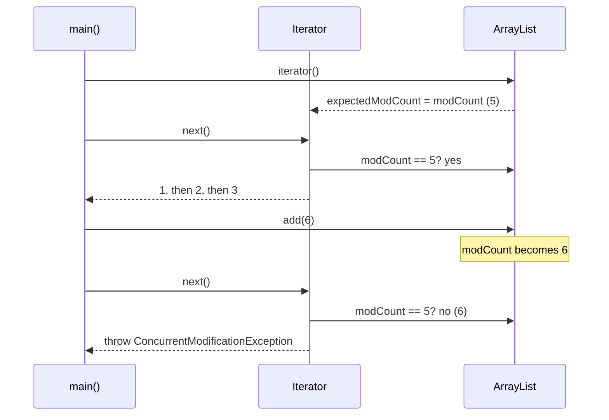
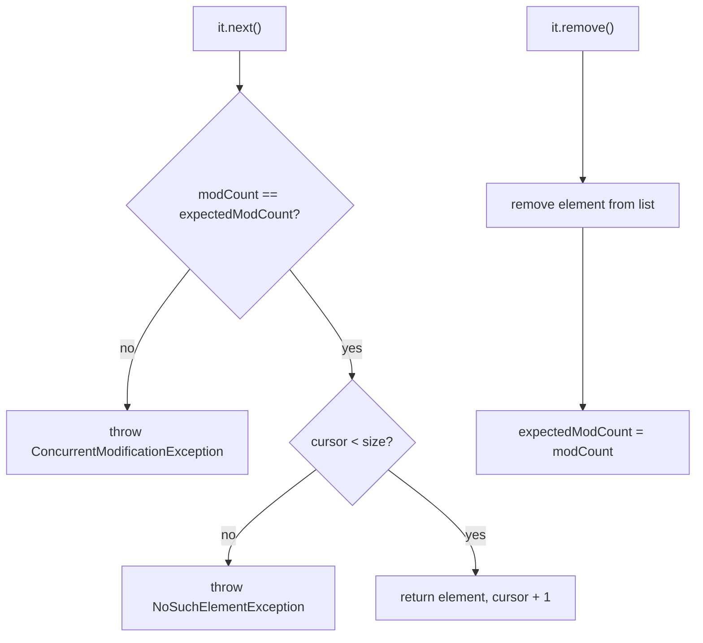
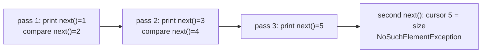

## In One Line
A **fail-fast** iterator throws `ConcurrentModificationException` as soon as it notices that its collection was **structurally modified** by anything other than the iterator itself — it stops loudly at the bug instead of silently returning wrong results.

## Mental Model
A **stock-taker counting boxes on a warehouse shelf**. The shelf has a small **change counter** that ticks every time someone adds or removes a box. When the stock-taker starts, they write the counter's value on their clipboard. Before picking up each next box, they compare the clipboard with the counter:
- Same number → carry on.
- Different number → someone rearranged the shelf behind their back; any count they finish would be wrong, so they **stop and raise the alarm**.

Details that map exactly to Java:
- The **shelf counter** is the collection's `modCount` field; the **clipboard** is the iterator's `expectedModCount`.
- The check happens when they **pick up the next box** — `next()` — not when they merely glance to see if there are boxes left (`hasNext()`).
- If the stock-taker removes a box **themselves** (`iterator.remove()`), they update the clipboard too, so no alarm.
- **Relabelling a box** (`list.set(i, x)`, `map.put(existingKey, v)`) does not tick the counter — nothing moved.
- The alarm is **best-effort**: if a second worker in another aisle (another thread) changes the shelf, the stock-taker may not notice in time.

## Concept
### What "structural modification" means
A structural modification changes the **size or internal layout** of the collection: `add`, `remove`, `clear`, `addAll`, `removeIf`, `retainAll`, a `HashMap` `put` of a **new** key, a resize/rehash. Changing an element in place is **not** structural: `List.set`, `Map.put` for an existing key, `Map.Entry.setValue`, `replaceAll` on a map. Fail-fast iterators only react to structural changes.

### How it works: `modCount` vs `expectedModCount`
1. The collection keeps a counter — `protected transient int modCount` in `AbstractList` (inherited by `ArrayList`, `Vector`, `LinkedList`...), and its own `modCount` field in `HashMap`, `TreeMap`, `IdentityHashMap`, `WeakHashMap`, `Hashtable`... Every structural change increments it.
2. When you call `iterator()`, the iterator copies it: `int expectedModCount = modCount;`
3. On each `next()` (and `remove()`), the iterator runs `checkForComodification()`:
   ```java
   if (modCount != expectedModCount) throw new ConcurrentModificationException();
   ```
4. `iterator.remove()` changes the collection **and** resets `expectedModCount = modCount`, so it is the one legal way to remove while iterating.

`ArrayList`'s iterator (JDK 21) in short:
```java
public boolean hasNext() { return cursor != size; }       // no modCount check
public E next() {
    checkForComodification();                              // modCount check
    int i = cursor;
    if (i >= size) throw new NoSuchElementException();     // ran past the end
    ...
    cursor = i + 1;
    return (E) elementData[lastRet = i];
}
```
Two consequences to remember: the exception comes from the **next `next()` after** the modification (not from `add`/`remove` itself), and `hasNext()` does not check, which enables the "silent skip" trap below.

### The for-each loop hides an iterator
```java
for (String n : names) { ... }
// compiles to:
for (Iterator<String> it = names.iterator(); it.hasNext(); ) {
    String n = it.next();
    ...
}
```
So `names.remove(n)` inside a for-each is a modification behind the hidden iterator's back — and you cannot call `it.remove()` because you have no `it`. That is the #1 source of `ConcurrentModificationException`.

### It usually has nothing to do with threads
Despite the name, most `ConcurrentModificationException`s happen in **single-threaded** code: "concurrent" means "during iteration", not "from another thread". Across threads, fail-fast is even weaker: `modCount` is a plain `int` with no synchronisation, so another thread's change may not be visible in time, and the iteration can fail in other ways or not at all. The Javadoc is explicit: fail-fast behaviour *"cannot be guaranteed"*, is *"best-effort"*, and *"should be used only to detect bugs"*.

### Where the check also happens
- `ArrayList.forEach`, `HashMap.forEach`, `Iterator.forEachRemaining`, `removeIf`, `replaceAll`, `sort` — bulk operations check `modCount` and throw if the action modifies the collection.
- **Views**: `subList` checks the parent's `modCount` — change the parent, then touch the sublist → CME. `keySet()`/`values()`/`entrySet()` iterators are fail-fast.
- **Spliterators and streams** of `ArrayList`, `HashMap` etc. are *late-binding* and fail-fast: modifying the source inside a stream pipeline throws.

### Which iterators are fail-fast?
| Fail-fast | Not fail-fast |
|---|---|
| `ArrayList`, `LinkedList`, `Vector` (its `iterator()`), `ArrayDeque`, `PriorityQueue` | `CopyOnWriteArrayList`, `CopyOnWriteArraySet` (snapshot) |
| `HashMap`, `LinkedHashMap`, `TreeMap`, `IdentityHashMap`, `WeakHashMap`, `Hashtable` views | `ConcurrentHashMap`, `ConcurrentSkipListMap/Set`, `ConcurrentLinkedQueue`, blocking queues (weakly consistent) |
| `HashSet`, `LinkedHashSet`, `TreeSet` | `Vector.elements()`, `Hashtable.keys()/elements()` (legacy `Enumeration`, undefined results) |
| Collection views (`keySet()`, `values()`, `entrySet()`, `subList`) of the above | `EnumMap`, `EnumSet` (weakly consistent, see note) |

> [!NOTE] `EnumMap` and `EnumSet` iterators are *weakly consistent*: they never throw `ConcurrentModificationException`. Immutable collections (`List.of`, `Map.of`) cannot be modified at all, so the question never arises. The non-fail-fast side is covered in [Fail-safe iterators](lesson:a03-collections/23-fail-safe-iterators).

### Safe ways to change a collection during iteration
| Goal | Safe technique |
|---|---|
| Remove some elements | `iterator.remove()` or, simpler, `collection.removeIf(predicate)` (Java 8) |
| Remove from a map | `map.entrySet().removeIf(...)`, `map.values().removeIf(...)`, or entry-set `Iterator.remove()` |
| Add or replace in a `List` while walking it | `ListIterator.add(e)` / `ListIterator.set(e)` |
| Replace values | `list.set(i, x)`, `list.replaceAll(...)`, `map.replaceAll(...)`, `entry.setValue(...)` — not structural |
| Add many elements | Collect them in a separate list, `addAll` after the loop |
| Remove by index | Loop **backwards** by index (`for (int i = size - 1; i >= 0; i--)`) |
| Build a filtered result | `stream().filter(...).toList()` — create a new collection |
| Modify while others read concurrently | Use a concurrent collection (`CopyOnWriteArrayList`, `ConcurrentHashMap`) |

### Why fail fast at all?
Without the check, an iterator over a changed `ArrayList` could skip elements, return an element twice, return stale data or throw an `ArrayIndexOutOfBoundsException` far from the real cause. **Failing fast** turns an arbitrary, non-deterministic bug into an immediate exception at the loop that caused it. It is the same principle as validating arguments at the top of a method.

## Diagram

The exception is thrown by the **next `next()` after** the modification, not by `add` itself.


`next()` runs two different checks with two different exceptions; `iterator.remove()` is legal because it re-syncs the counter.


The original example calls `next()` twice per pass: it prints 1, 3, 5, compares 2 and 4 with 3, never calls `list.add(6)`, and dies with `NoSuchElementException`.

## Code
@example Collections/Iterators/FailFastIteratorExample.java

What the example actually does — the same loop with each `next()` call printed:
```java
List<Integer> list = new ArrayList<>(List.of(1, 2, 3, 4, 5));
Iterator<Integer> iterator = list.iterator();
while (iterator.hasNext()) {
    Integer printed = iterator.next();        // 1st next(): the element that gets printed
    System.out.println("printed  " + printed);
    Integer compared = iterator.next();       // 2nd next(): the element compared with 3
    System.out.println("compared " + compared + " (== 3? " + (compared == 3) + ")");
}
```
```output
printed  1
compared 2 (== 3? false)
printed  3
compared 4 (== 3? false)
printed  5
Exception in thread "main" java.util.NoSuchElementException
	at java.base/java.util.ArrayList$Itr.next(ArrayList.java:1052)
	at Trace.main(Trace.java:10)
```

The corrected example, which really demonstrates fail-fast behaviour (one `next()` per pass):
```java
import java.util.ArrayList;
import java.util.Iterator;
import java.util.List;

public class FailFastFixed {
    public static void main(String[] args) {
        List<Integer> list = new ArrayList<>(List.of(1, 2, 3, 4, 5));
        Iterator<Integer> iterator = list.iterator();

        System.out.println("Traversing the list:");
        while (iterator.hasNext()) {
            Integer element = iterator.next();        // call next() exactly ONCE per iteration
            System.out.println("Element: " + element);
            if (element == 3) {
                list.add(6);                          // structural change behind the iterator's back
            }
        }
    }
}
```
```output
Traversing the list:
Element: 1
Element: 2
Element: 3
Exception in thread "main" java.util.ConcurrentModificationException
	at java.base/java.util.ArrayList$Itr.checkForComodification(ArrayList.java:1095)
	at java.base/java.util.ArrayList$Itr.next(ArrayList.java:1049)
	at FailFastFixed.main(FailFastFixed.java:12)
```
The stack trace points at line 12 — the `iterator.next()` **after** the `add`, as the sequence diagram shows.

The usual suspects:
```java
// 1. Classic for-each + list.remove -> CME
List<String> names = new ArrayList<>(List.of("Ann", "Bob", "Cid", "Dan"));
try {
    for (String n : names) {
        if (n.startsWith("A")) names.remove(n);
    }
} catch (ConcurrentModificationException e) {
    System.out.println("remove first element in for-each -> CME");
}

// 2. Removing the SECOND-TO-LAST element: no exception, but the last element is skipped!
List<String> names2 = new ArrayList<>(List.of("Ann", "Bob", "Cid", "Dan"));
List<String> seen = new ArrayList<>();
for (String n : names2) {
    seen.add(n);
    if (n.equals("Cid")) names2.remove(n);
}
System.out.println("no CME, but visited " + seen + " -> list " + names2);

// 3. set() is not structural -> no CME
List<String> names3 = new ArrayList<>(List.of("Ann", "Bob"));
for (String n : names3) names3.set(names3.indexOf(n), n.toUpperCase());
System.out.println("set() during for-each: " + names3);

// 4. ArrayList.forEach + add -> CME
List<Integer> nums = new ArrayList<>(List.of(1, 2, 3));
try {
    nums.forEach(x -> { if (x == 1) nums.add(99); });
} catch (ConcurrentModificationException e) {
    System.out.println("add inside forEach -> CME, list is now " + nums);
}

// 5. HashSet and HashMap are fail-fast too
Set<Integer> set = new HashSet<>(Set.of(1, 2, 3));
try {
    for (Integer x : set) set.add(x + 10);
} catch (ConcurrentModificationException e) {
    System.out.println("HashSet add in for-each -> CME");
}
```
```output
remove first element in for-each -> CME
no CME, but visited [Ann, Bob, Cid] -> list [Ann, Bob, Dan]
set() during for-each: [ANN, BOB]
add inside forEach -> CME, list is now [1, 2, 3, 99]
HashSet add in for-each -> CME
```
Case 2 is the nastiest: after removing `Cid` the size drops to 3, the cursor is already 3, `hasNext()` (`cursor != size`) returns `false`, and the loop ends **silently without ever visiting `Dan`**. Case 4 shows the change is *not* rolled back — the exception only reports it.

Seven safe alternatives:
```java
// 1. Iterator.remove()
List<Integer> a = new ArrayList<>(List.of(1, 2, 3, 4, 5, 6));
for (Iterator<Integer> it = a.iterator(); it.hasNext(); ) {
    if (it.next() % 2 == 0) it.remove();
}
System.out.println("Iterator.remove: " + a);

// 2. removeIf (Java 8)
List<Integer> b = new ArrayList<>(List.of(1, 2, 3, 4, 5, 6));
b.removeIf(x -> x % 2 == 0);
System.out.println("removeIf:        " + b);

// 3. ListIterator can add and set while iterating
List<Integer> c = new ArrayList<>(List.of(1, 2, 3, 4, 5));
for (ListIterator<Integer> it = c.listIterator(); it.hasNext(); ) {
    int x = it.next();
    if (x == 3) it.add(6);              // inserted after 3, not visited by this loop
    else it.set(x * 10);
}
System.out.println("ListIterator:    " + c);

// 4. Collect first, change after the loop
List<Integer> d = new ArrayList<>(List.of(1, 2, 3, 4, 5));
List<Integer> toAdd = new ArrayList<>();
for (int x : d) if (x == 3) toAdd.add(6);
d.addAll(toAdd);
System.out.println("collect, then add: " + d);

// 5. Index loop, backwards, when removing by index
List<Integer> e = new ArrayList<>(List.of(1, 2, 3, 4, 5, 6));
for (int i = e.size() - 1; i >= 0; i--) if (e.get(i) % 2 == 0) e.remove(i);
System.out.println("backwards index: " + e);

// 6. Build a new list with a stream
List<Integer> f = Stream.of(1, 2, 3, 4, 5, 6).filter(x -> x % 2 != 0).collect(Collectors.toList());
System.out.println("stream filter:   " + f);

// 7. Iterate over a copy
List<Integer> g = new ArrayList<>(List.of(1, 2, 3));
for (int x : new ArrayList<>(g)) g.add(x * 10);
System.out.println("iterate a copy:  " + g);
```
```output
Iterator.remove: [1, 3, 5]
removeIf:        [1, 3, 5]
ListIterator:    [10, 20, 3, 6, 40, 50]
collect, then add: [1, 2, 3, 4, 5, 6]
backwards index: [1, 3, 5]
stream filter:   [1, 3, 5]
iterate a copy:  [1, 2, 3, 10, 20, 30]
```

Views are fail-fast too, and `hasNext()` does not check:
```java
List<Integer> list = new ArrayList<>(List.of(1, 2, 3, 4, 5));
List<Integer> firstThree = list.subList(0, 3);
System.out.println(firstThree);
list.add(6);                                   // structural change to the PARENT list
try {
    System.out.println(firstThree);
} catch (ConcurrentModificationException e) {
    System.out.println("subList after parent changed -> CME");
}
Iterator<Integer> it = list.iterator();
list.add(7);
System.out.println("hasNext() still answers: " + it.hasNext());
try { it.next(); } catch (ConcurrentModificationException e) { System.out.println("next() -> CME"); }
```
```output
[1, 2, 3]
subList after parent changed -> CME
hasNext() still answers: true
next() -> CME
```

## Walkthrough
- **Imports**: `ArrayList` (the collection), `Iterator` (the cursor), `List` (the interface the variable is declared with).
- `List<Integer> list = new ArrayList<>();` + `list.add(1)` … `list.add(5)` — five autoboxed `Integer`s; `size` is 5 and `modCount` is 5 (one tick per `add`).
- `Iterator<Integer> iterator = list.iterator();` — creates `ArrayList.Itr` with `cursor = 0`, `lastRet = -1` and `expectedModCount = 5`.
- `System.out.println("Traversing the list:");` — printed first.
- **The loop calls `next()` twice per pass**, which is the real bug:

| Pass | `hasNext()` (`cursor != size`) | 1st `next()` → printed | 2nd `next()` → compared with 3 | `list.add(6)`? |
|---|---|---|---|---|
| 1 | 0 ≠ 5 → true | 1 | 2 | no |
| 2 | 2 ≠ 5 → true | 3 | 4 | no |
| 3 | 4 ≠ 5 → true | 5 | cursor 5 ≥ size 5 → **`NoSuchElementException`** | never reached |

- So the output is `Element: 1`, `Element: 3`, `Element: 5`, then `java.util.NoSuchElementException` thrown from `ArrayList$Itr.next` (line 1052 in the JDK 21 source) called at line 25 of the example (`if (iterator.next() == 3)`).
- `iterator.next() == 3` compares an `Integer` with an `int` literal, so the `Integer` is **unboxed** and the comparison is numeric (correct). Comparing two `Integer` objects with `==` would compare references.
- `list.add(6)` **never executes**, because the value 3 is always consumed by the *printing* `next()`, never by the comparing one. The list is never modified, `modCount` stays 5, and no `ConcurrentModificationException` can happen.
- The `// Output:` comment at the bottom does match this behaviour (it even shows the `NoSuchElementException`), but it contradicts the comment inside the loop and the class name. The recorded JDK 21 output is the same except for the JDK-internal line number.
- The corrected version in Code (one `next()` per pass) prints `Element: 1, 2, 3`, adds 6 after printing 3, and the **next** `next()` throws `ConcurrentModificationException` from `checkForComodification`.

## Traps
> [!ERRATA] The comment `// Modify the list while iterating (this will cause ConcurrentModificationException)` is wrong for this code. Because the loop calls `iterator.next()` **twice** per pass (once to print, once to compare), it prints only 1, 3, 5, compares 2 and 4 with 3, never reaches `list.add(6)`, and fails with **`NoSuchElementException`**, not `ConcurrentModificationException`. The example named "FailFast" never demonstrates fail-fast behaviour. Fix: store one `next()` per pass in a variable — `Integer element = iterator.next();` — then print and compare `element` (see the corrected program in Code, which does throw `ConcurrentModificationException`).

> [!ERRATA] The stack trace in the comment says `ArrayList.java:970`; on JDK 21 the same line is `ArrayList.java:1052`. JDK-internal line numbers change between versions — never treat them as part of the expected output.

- **Calling `next()` more than once per `hasNext()`** skips elements and eventually throws `NoSuchElementException`. One `hasNext()` → one `next()`.
- **`list.remove(x)` / `map.remove(k)` inside for-each** → CME on the next `next()`. Use `removeIf` or `Iterator.remove()`.
- **The silent skip**: removing the second-to-last element of an `ArrayList` in a for-each ends the loop without an exception and without visiting the last element. Absence of CME does not mean the code is correct.
- **`list.remove(int)` vs `list.remove(Object)`**: for a `List<Integer>`, `list.remove(3)` removes the element at **index 3**; `list.remove(Integer.valueOf(3))` removes the value 3.
- **The modification is not undone.** In the `forEach` case the list really contains `99` after the exception.
- **`hasNext()` does not check** — the exception comes from `next()` (or `remove()`).
- **Stale `subList` views** throw CME after the parent is structurally changed.
- **Threads**: fail-fast is not a thread-safety mechanism. Unsynchronised concurrent modification can go undetected or corrupt the collection. `Collections.synchronizedList` is still fail-fast — you must `synchronized (list) { ... }` around the whole iteration.
- **`iterator.remove()` rules**: once per `next()`, never before the first `next()` → otherwise `IllegalStateException`. Immutable lists throw `UnsupportedOperationException`.

> [!WARNING] Never catch `ConcurrentModificationException` to "fix" a loop. It signals a bug; restructure the code (removeIf, iterator.remove, a copy, or a concurrent collection).

## Tips & Tricks
- **Mnemonic: "Counter on the shelf, copy on the clipboard."** `modCount` vs `expectedModCount`; mismatch at `next()` → CME.
- **"Remove with the Iterator, not with the Collection."** Better still: **`removeIf`** — no loop, no bug.
- **"One hasNext, one next."** Store `next()` in a variable before using it more than once.
- **"Structure, not content."** Adding/removing trips the alarm; `set`/`setValue`/`put` on an existing key does not.
- **"Concurrent" ≠ "threads".** Most CMEs come from single-threaded loops. Say this in interviews — it shows you know the mechanism.
- **Debugging a CME:** look at the stack trace line that calls `next()` — the culprit is a structural change *between* that call and the previous `next()`, often in a method called from the loop body.
- **Reading a collection from many threads while writing?** Use `CopyOnWriteArrayList` (read-mostly) or `ConcurrentHashMap` — covered in [Fail-safe iterators](lesson:a03-collections/23-fail-safe-iterators).

## Interview Q&A
### [Basic] What is a fail-fast iterator?
An iterator that throws `ConcurrentModificationException` as soon as it detects that the underlying collection was structurally modified after the iterator was created, by any means other than the iterator's own `remove()` (or `ListIterator.add/set`). The iterators of `ArrayList`, `LinkedList`, `HashMap`, `HashSet`, `TreeMap` and most other `java.util` collections are fail-fast. The purpose is to fail immediately at the buggy loop rather than risk arbitrary, non-deterministic behaviour later.

**Follow-up:** *Give an example that throws it.* — `for (String s : list) if (s.isEmpty()) list.remove(s);` — removing through the list behind the for-each loop's hidden iterator.

### [Intermediate] How does a fail-fast iterator detect modification internally?
The collection has a `modCount` field incremented on every structural change (add, remove, clear, resize). When the iterator is created it copies it into `expectedModCount`. Every `next()` (and `remove()`) calls `checkForComodification()`, which throws `ConcurrentModificationException` if `modCount != expectedModCount`. The iterator's own `remove()` modifies the collection and then sets `expectedModCount = modCount`, which is why it is allowed. `hasNext()` in `ArrayList` just checks `cursor != size` and does not look at `modCount`.

**Follow-up:** *Why is `modCount` `transient`?* — It is bookkeeping for live iterators, not part of the collection's logical state, so it is not serialized.

### [Basic] How do you remove elements from a list while iterating without an exception?
- `list.removeIf(x -> condition)` — the simplest (Java 8).
- An explicit `Iterator` and `it.remove()` after `it.next()`.
- An index loop going **backwards**: `for (int i = list.size() - 1; i >= 0; i--) if (...) list.remove(i);`
- Build a new list with a stream filter, or collect the elements to remove and call `removeAll` after the loop.
- For concurrent access, use `CopyOnWriteArrayList`, whose iterators never throw.

**Follow-up:** *Why does a forward index loop with `remove(i)` go wrong?* — After removing index `i`, the next element shifts into `i`, and `i++` skips it. Going backwards (or not incrementing after a removal) avoids that.

### [Intermediate] Is ConcurrentModificationException only thrown in multi-threaded programs?
No — most of the time it is single-threaded: modifying a collection inside a for-each or `forEach` over that same collection. "Concurrent" means "while an iteration is in progress". In multi-threaded code it is actually *less* reliable: `modCount` is not volatile and not synchronized, so another thread's modification may not be seen in time, and the program may instead skip elements, read stale data or corrupt the structure. That is why the Javadoc says fail-fast behaviour is best-effort and must only be used to detect bugs.

**Follow-up:** *So how do you iterate safely while other threads modify?* — Lock around the whole iteration (`synchronized (list)` for a synchronized wrapper) or use a concurrent collection with snapshot/weakly consistent iterators.

### [Intermediate] Which modifications do NOT trigger ConcurrentModificationException?
Non-structural ones: `List.set(i, x)`, `List.replaceAll`, `Map.put` of an **existing** key, `Map.Entry.setValue`, `Map.replaceAll`, and changing the *state* of an element object (e.g. `person.setAge(30)`). Also modifications made **through the iterator itself** — `Iterator.remove()`, `ListIterator.add()`, `ListIterator.set()`. And, by accident, a removal that makes `hasNext()` return `false` (removing the second-to-last `ArrayList` element) — which hides the bug and skips the last element.

**Follow-up:** *Why is mutating an element that is a HashSet member still dangerous?* — It does not throw CME, but if the change affects `hashCode()`, the element sits in the wrong bucket and `contains`/`remove` stop finding it.

### [Advanced] Explain why removing the second-to-last element in a for-each loop does not throw.
`ArrayList.Itr.hasNext()` is `return cursor != size;` and only `next()` checks `modCount`. With `[Ann, Bob, Cid, Dan]`, after `next()` returns `Cid` the cursor is 3. Removing `Cid` makes `size` 3. `hasNext()` now returns `3 != 3` → `false`, the loop ends, and `next()` — the only place that would detect the modification — is never called again. The result: no exception, and `Dan` is never visited. A different position throws; this position silently produces wrong results.

**Follow-up:** *Does the same happen with a HashMap?* — The analogous case is removing the entry that is iterated **last**: `HashIterator.hasNext()` is `next != null`, so the loop ends without a check.

### [Advanced] What does the course example actually demonstrate, and how would you fix it?
It calls `iterator.next()` twice per loop pass — once inside `println` and once in the `if`. So it prints 1, 3, 5, compares 2 and 4 with 3 (never equal), never calls `list.add(6)`, and on the third pass the second `next()` runs past the end: `NoSuchElementException`. It never shows fail-fast behaviour. The fix is one `next()` per pass stored in a variable; then the program prints 1, 2, 3, adds 6, and the next `next()` throws `ConcurrentModificationException` from `checkForComodification`.

**Follow-up:** *What is the difference between NoSuchElementException and ConcurrentModificationException here?* — `NoSuchElementException` means "you asked for more elements than exist" (a misuse of `next()`); CME means "the collection changed under the iterator".

### [Advanced] Is a Collections.synchronizedList iterator safe from ConcurrentModificationException?
No. Each method of the wrapper is synchronized, but iteration is a *sequence* of `hasNext()`/`next()` calls on the underlying list's fail-fast iterator. Another thread can add between two calls and the iterator throws CME (or misbehaves). The Javadoc requires manual locking:
```java
List<String> list = Collections.synchronizedList(new ArrayList<>());
synchronized (list) {
    for (String s : list) process(s);
}
```
`Vector` behaves the same way. For lock-free iteration use `CopyOnWriteArrayList`.

**Follow-up:** *Why not just catch the exception and retry?* — CME is best-effort; you may never get it and silently read inconsistent data instead.

### [Intermediate] Which collections have fail-fast iterators and which do not?
Fail-fast: the general-purpose `java.util` collections — `ArrayList`, `LinkedList`, `Vector`, `ArrayDeque`, `PriorityQueue`, `HashMap`, `LinkedHashMap`, `TreeMap`, `HashSet`, `LinkedHashSet`, `TreeSet`, `IdentityHashMap`, `WeakHashMap`, and `Hashtable`'s collection views. Not fail-fast: `java.util.concurrent` collections — `CopyOnWriteArrayList`/`Set` (snapshot iterators) and `ConcurrentHashMap`, `ConcurrentSkipListMap`, `ConcurrentLinkedQueue`, blocking queues (weakly consistent iterators) — plus `EnumMap`/`EnumSet` (weakly consistent) and the legacy `Enumeration`s of `Vector`/`Hashtable` (undefined behaviour on modification).

**Follow-up:** *What is the usual name for the non-throwing kind?* — "Fail-safe" in interviews; the JDK documentation calls them *snapshot* or *weakly consistent* iterators.

## Quiz
### What does the original FailFastIteratorExample print before it crashes?
- [ ] Element: 1, Element: 2, Element: 3, then ConcurrentModificationException
- [x] Element: 1, Element: 3, Element: 5, then NoSuchElementException
- [ ] Element: 1 through Element: 6, no exception
- [ ] Element: 1, Element: 3, then ConcurrentModificationException
> `next()` is called twice per pass: the first value is printed (1, 3, 5), the second is compared with 3 (2, 4). On the third pass the second `next()` runs past the end → `NoSuchElementException`. `list.add(6)` never runs, so no CME. The first option is what the *corrected* program prints.

### What does this print?
```java
List<String> names = new ArrayList<>(List.of("Ann", "Bob", "Cid", "Dan"));
List<String> seen = new ArrayList<>();
for (String n : names) {
    seen.add(n);
    if (n.equals("Cid")) names.remove(n);
}
System.out.println(seen + " " + names);
```
- [ ] It throws ConcurrentModificationException
- [ ] [Ann, Bob, Cid, Dan] [Ann, Bob, Dan]
- [x] [Ann, Bob, Cid] [Ann, Bob, Dan]
- [ ] [Ann, Bob, Cid, Dan] [Ann, Bob, Cid, Dan]
> After removing `Cid` the size is 3 and the cursor is 3, so `hasNext()` returns `false` and the loop ends — no `next()`, no check, no exception, and `Dan` is never visited. Removing any other element would throw.

### Which operation inside a for-each over an ArrayList does NOT cause ConcurrentModificationException?
- [ ] `list.add(x)`
- [ ] `list.remove(0)`
- [x] `list.set(0, x)`
- [ ] `list.clear()`
> `set` replaces an element without changing the size or layout, so `modCount` is not incremented. `add`, `remove` and `clear` are structural.

### Spot the bug.
```java
void removeBlanks(List<String> lines) {
    for (String line : lines) {
        if (line.isBlank()) {
            lines.remove(line);
        }
    }
}
```
- [ ] `isBlank()` does not exist
- [x] It removes through the list while the for-each's hidden iterator is active, which throws ConcurrentModificationException (or silently skips elements)
- [ ] `remove(Object)` removes by index
- [ ] The method must return the list
> The for-each uses an iterator; `lines.remove(line)` changes `modCount` behind it. Fix: `lines.removeIf(String::isBlank);`. (`isBlank()` exists since Java 11; for a `List<String>`, `remove(line)` is `remove(Object)`.)

### What does this print?
```java
List<Integer> c = new ArrayList<>(List.of(1, 2, 3, 4, 5));
for (ListIterator<Integer> it = c.listIterator(); it.hasNext(); ) {
    int x = it.next();
    if (x == 3) it.add(6);
    else it.set(x * 10);
}
System.out.println(c);
```
- [ ] It throws ConcurrentModificationException
- [ ] [10, 20, 30, 6, 40, 50]
- [x] [10, 20, 3, 6, 40, 50]
- [ ] [10, 20, 3, 40, 50, 6]
> `ListIterator.add` and `set` modify the list *through the iterator*, so no exception. `6` is inserted right after `3` (before the cursor, so it is not visited), and `3` itself is not multiplied because the `else` branch did not run for it.

### Two threads share an ArrayList; one iterates while the other adds. What is guaranteed?
- [ ] The iterating thread always gets ConcurrentModificationException
- [ ] The adding thread always gets ConcurrentModificationException
- [x] Nothing — fail-fast detection is best-effort and may not happen
- [ ] The iterator automatically sees the new element
> `modCount` is an unsynchronised `int`, so the iterating thread may not see the change in time; it may throw CME, miss elements, or read inconsistent data. Fail-fast iterators are for detecting bugs, not for thread safety — use locking or a concurrent collection.

### What happens?
```java
List<Integer> list = new ArrayList<>(List.of(1, 2, 3, 4, 5));
List<Integer> firstThree = list.subList(0, 3);
list.add(6);
System.out.println(firstThree);
```
- [ ] [1, 2, 3]
- [ ] [1, 2, 3, 6]
- [x] ConcurrentModificationException
> A `subList` is a view that remembers the parent's `modCount`. After a structural change to the parent, any use of the sublist (here `toString()`) throws. Create the sublist after the change, or copy it: `new ArrayList<>(list.subList(0, 3))`.

## Takeaways
- A fail-fast iterator throws `ConcurrentModificationException` when the collection is structurally modified (add/remove/clear/resize) by anything other than the iterator during iteration.
- Mechanism: the collection's `modCount` is copied into the iterator's `expectedModCount`; `next()` compares them; `iterator.remove()` re-syncs them.
- The exception comes from the next `next()` after the change; `hasNext()` does not check, so removing the second-to-last `ArrayList` element silently skips the last one.
- Most CMEs are single-threaded (modifying inside for-each or `forEach`); across threads detection is best-effort and not a safety mechanism.
- Safe patterns: `removeIf`, `Iterator.remove()`, `ListIterator.add/set`, backwards index loops, collecting changes for after the loop, iterating a copy, or a concurrent collection.
- Non-structural changes (`set`, `setValue`, `put` on an existing key, `replaceAll`) never trigger CME.
- The course example never throws CME: it calls `next()` twice per pass, prints 1, 3, 5 and fails with `NoSuchElementException`; one `next()` per pass fixes it.
