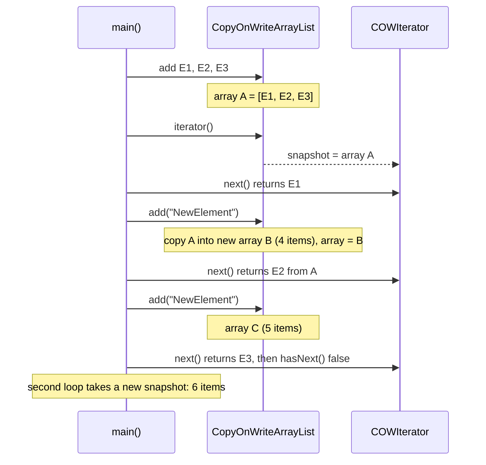
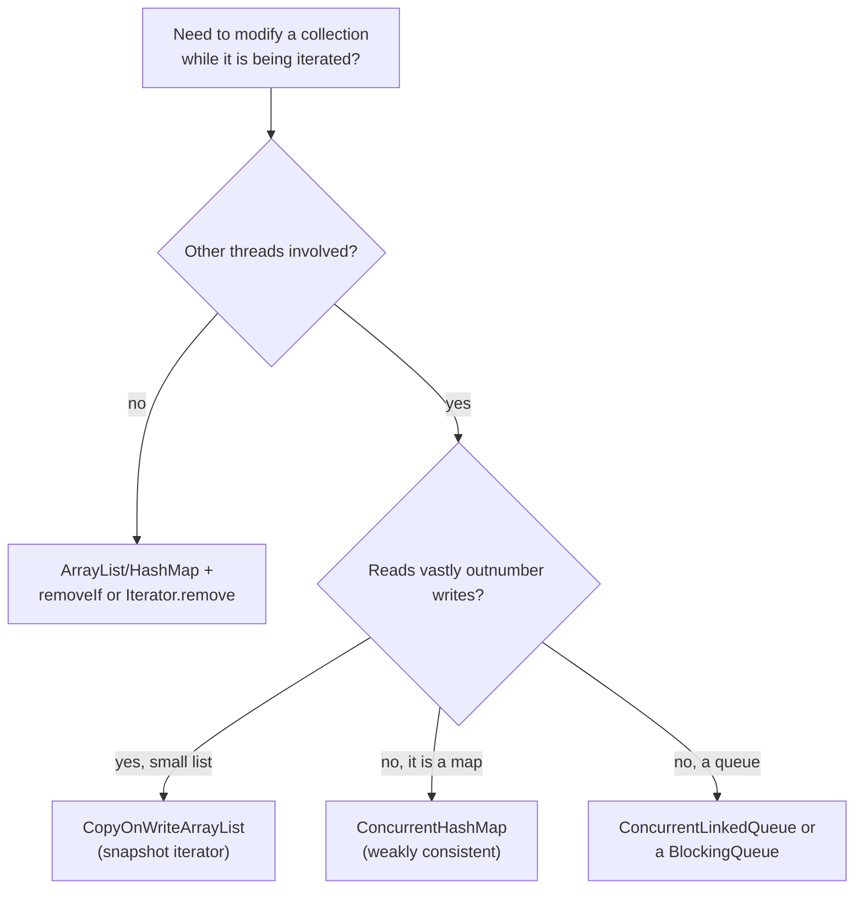

## In One Line
A **"fail-safe"** iterator never throws `ConcurrentModificationException`: it either walks a **frozen snapshot** of the collection (`CopyOnWriteArrayList`) or walks the **live** structure with *weakly consistent* rules (`ConcurrentHashMap`), so the collection can be modified — even by other threads — while you iterate.

## Mental Model
Two ways to read a **restaurant menu while the chef keeps changing it**:

1. **The printed menu (snapshot).** When you sit down, the waiter hands you a *printed copy* of today's menu. The chef can add or remove dishes on the kitchen board all evening; your printed copy never changes, you read it top to bottom without surprises — but it may be **out of date**, and you cannot cross dishes off it to change the kitchen board. That is `CopyOnWriteArrayList`: every change prints a new menu; your iterator keeps the one you got.
2. **The live chalkboard (weakly consistent).** You read the chalkboard on the wall while the chef writes on it. You never get an error; each dish you read was really there; you never read the same dish twice. But a dish added *below* where you are reading may show up, one added *above* will not, and one erased before you reach it is gone. That is `ConcurrentHashMap` and the other concurrent collections.

In the code:
- The **printed copy** is the `Object[] snapshot` that `CopyOnWriteArrayList.iterator()` captures.
- The **chef** is `failSafeList.add("NewElement")` — it writes a new array (a new menu) every time.
- **Reading your copy** is the `while (iterator.hasNext())` loop — it sees exactly `Element1..3`.
- **The next guest** who asks for a menu (the second `for` loop) gets the new copy with all six items.

## Concept
### "Fail-safe" is interview vocabulary, not JDK vocabulary
Interviewers contrast **fail-fast** (throws CME) with **fail-safe** (does not). The JDK documentation never says "fail-safe"; it describes two different mechanisms:

| JDK term | Collections | How it works | Sees changes made during iteration? |
|---|---|---|---|
| **Snapshot** iterator | `CopyOnWriteArrayList`, `CopyOnWriteArraySet` | Iterates the array that existed when `iterator()` was called | **Never** |
| **Weakly consistent** iterator | `ConcurrentHashMap`, `ConcurrentSkipListMap`/`Set`, `ConcurrentLinkedQueue`/`Deque`, `LinkedBlockingQueue`, `ArrayBlockingQueue`, `PriorityBlockingQueue`, ... (also `EnumMap`, `EnumSet`) | Walks the live structure | **Maybe** — no guarantee either way |

The common claim "fail-safe iterators work on a clone of the collection" is only true for the copy-on-write classes. A `ConcurrentHashMap` iterator makes no copy.

The `java.util.concurrent` package documentation defines weakly consistent iterators precisely:
- they may proceed concurrently with other operations;
- they will **never** throw `ConcurrentModificationException`;
- they are guaranteed to traverse elements as they existed upon construction **exactly once**, and **may (but are not guaranteed to)** reflect any modifications subsequent to construction.

### How `CopyOnWriteArrayList` works
- All data lives in one field: `private transient volatile Object[] array;`.
- **Reads** (`get`, `size`, `contains`, `iterator`) just read the current array — no locking at all. `volatile` guarantees a reader sees a fully built array.
- **Every write** (`add`, `set`, `remove`, `clear`...) takes an internal lock, **copies the whole array** (`Arrays.copyOf`), changes the copy, and publishes it by assigning the `volatile` field. (JDK 8 used a `ReentrantLock`; current JDKs use a `synchronized` block on an internal lock object.) Writes are therefore O(n) in time and allocate a new array every time.
- `iterator()` returns a `COWIterator` holding a reference to the array **at that moment** — the snapshot. Because arrays are never modified after publication, the snapshot can never change underneath it, so there is nothing to detect and no `modCount` at all.
- The snapshot iterator's `remove()`, `set()` and `add()` throw `UnsupportedOperationException`: there is no sensible way to change the *old* array. Modify through the list instead (`list.remove(x)`, `removeIf`) — that is allowed during iteration.
- Extras: `addIfAbsent(e)`, `addAllAbsent(c)` (atomic check-then-add); `CopyOnWriteArraySet` is a set built on top of it (so `add` is O(n)). Since Java 21 it is a `SequencedCollection` (`getFirst()`, `reversed()`...).

### How `ConcurrentHashMap`'s iterator works (weakly consistent)
It walks the **live** bin array. Bins it has already passed are not revisited; bins ahead are read when it gets there. So during iteration:
- an entry **removed** before the iterator reaches it is not returned;
- an entry **added** to a bin the iterator has already passed is not returned; one added ahead of it may be;
- an entry is never returned twice, and the iterator never throws CME.
- Its iterators **do** support `remove()` (it calls `map.remove(key)`).
- If the table is resized mid-iteration, the iterator follows forwarding nodes to the new table and still visits each original entry once.

`ConcurrentSkipListMap` and `ConcurrentLinkedQueue` follow the same contract; exactly which late additions are seen depends on the data structure (see the snippet in Code: the skip-list iterator already holds the next node, so an insertion *just behind* it is missed while one further ahead is seen).

### Fail-fast vs fail-safe
| | Fail-fast | Fail-safe (snapshot) | Fail-safe (weakly consistent) |
|---|---|---|---|
| Examples | `ArrayList`, `HashMap`, `HashSet`, `TreeMap` | `CopyOnWriteArrayList`, `CopyOnWriteArraySet` | `ConcurrentHashMap`, `ConcurrentSkipListMap`, `ConcurrentLinkedQueue`, blocking queues |
| Modification during iteration | `ConcurrentModificationException` (best-effort) | Allowed | Allowed |
| Works on | Live collection | Copy (snapshot array) | Live collection |
| Sees concurrent changes | — (throws) | Never | Maybe |
| `iterator.remove()` | Supported | `UnsupportedOperationException` | Supported |
| Extra memory | None | A new array per write | None |
| Thread-safe collection | No | Yes | Yes |
| Package | `java.util` | `java.util.concurrent` | `java.util.concurrent` |

### When to use which
- **`CopyOnWriteArrayList`**: *read-mostly*, small-to-medium lists iterated far more often than changed — event-listener lists (the classic), observer registries, configuration or routing tables that change rarely. Readers never block and never see a half-updated list.
- **Avoid it for write-heavy data**: each `add` copies the array, so adding n elements one by one is O(n²) and churns garbage. A `for` loop that adds in every iteration (like the example) is fine for three elements, terrible for a million.
- **`ConcurrentHashMap`**: shared maps with frequent reads and writes; iterate freely, but treat what you see as a moving picture (sizes and contents are estimates while writers are active).
- **`ConcurrentLinkedQueue` / blocking queues**: producer–consumer; iterate only for monitoring/debugging.
- **Single-threaded code that just wants to modify while looping**: you do not need a concurrent collection — use `removeIf`, `Iterator.remove()` or a copy (see [Fail-fast iterators](lesson:a03-collections/22-fail-fast-iterators)).

The concurrent collections in depth: [ConcurrentHashMap](lesson:b03-concurrency/03-concurrenthashmap) and [BlockingQueue and concurrent collections](lesson:b03-concurrency/04-blockingqueue-and-concurrent-collections).

## Diagram

Every write builds a new array; the running iterator keeps reading the array it started with.


Pick the collection by thread use and read/write ratio; "fail-safe" iteration comes with the concurrent collection.

## Code
@example Collections/Iterators/FailSafeIteratorExample.java

Snapshot semantics in detail:
```java
// 1. Snapshot: the iterator never sees later changes
List<String> list = new CopyOnWriteArrayList<>(List.of("A", "B", "C"));
Iterator<String> it = list.iterator();        // snapshot taken HERE
list.add("D");
list.remove("A");
list.clear();
StringBuilder seen = new StringBuilder();
while (it.hasNext()) seen.append(it.next());
System.out.println("iterator saw " + seen + ", list is now " + list);

// 2. The snapshot iterator cannot modify
List<String> list2 = new CopyOnWriteArrayList<>(List.of("A", "B"));
Iterator<String> it2 = list2.iterator();
it2.next();
try {
    it2.remove();
} catch (UnsupportedOperationException e) {
    System.out.println("COW iterator.remove() -> UnsupportedOperationException");
}

// 3. ...but removing through the list (or removeIf) is fine
for (String s : list2) {
    if (s.equals("A")) list2.remove(s);
}
System.out.println("list.remove inside for-each: " + list2);

List<Integer> nums = new CopyOnWriteArrayList<>(List.of(1, 2, 3, 4));
nums.removeIf(n -> n % 2 == 0);
System.out.println("removeIf: " + nums);

// 4. The same loop on ArrayList
List<String> plain = new ArrayList<>(List.of("Element1", "Element2", "Element3"));
try {
    for (String s : plain) plain.add("NewElement");
} catch (ConcurrentModificationException e) {
    System.out.println("ArrayList version -> ConcurrentModificationException after "
            + (plain.size() - 3) + " add");
}
```
```output
iterator saw ABC, list is now []
COW iterator.remove() -> UnsupportedOperationException
list.remove inside for-each: [B]
removeIf: [1, 3]
ArrayList version -> ConcurrentModificationException after 1 add
```

Weakly consistent: `ConcurrentHashMap` walks the live table:
```java
Map<Integer, String> chm = new ConcurrentHashMap<>();
for (int i = 1; i <= 4; i++) chm.put(i, "v" + i);

List<Integer> seen = new ArrayList<>();
for (Integer k : chm.keySet()) {
    seen.add(k);
    if (k == 2) {
        chm.remove(4);          // not yet visited: removed before the iterator gets there
        chm.put(0, "v0");       // bin 0 was already passed: not visited
        chm.put(10, "v10");     // bin 10 lies ahead: visited
    }
}
System.out.println("visited " + seen + ", map now " + chm);

// Weakly consistent iterators DO support remove()
Iterator<Integer> it = chm.keySet().iterator();
while (it.hasNext()) if (it.next() % 2 == 0) it.remove();
System.out.println("after iterator.remove(): " + chm);
```
```output
visited [1, 2, 3, 10], map now {0=v0, 1=v1, 2=v2, 3=v3, 10=v10}
after iterator.remove(): {1=v1, 3=v3}
```
Small `Integer` keys sit in the bin equal to their value, so this run is repeatable — but the *contract* only says new entries "may or may not" be seen.

Three concurrent collections, the same "add while iterating" loop, three different views:
```java
Queue<Integer> q = new ConcurrentLinkedQueue<>(List.of(1, 2, 3));
List<Integer> seenQ = new ArrayList<>();
for (Integer x : q) { seenQ.add(x); if (x == 1) q.add(4); }
System.out.println("ConcurrentLinkedQueue visited " + seenQ);

NavigableMap<String, Integer> skip = new ConcurrentSkipListMap<>(Map.of("a", 1, "c", 3, "e", 5));
List<String> seenS = new ArrayList<>();
for (String k : skip.keySet()) {
    seenS.add(k);
    if (k.equals("a")) { skip.put("b", 2); skip.put("d", 4); }
}
System.out.println("ConcurrentSkipListMap visited " + seenS + ", map " + skip.keySet());

List<Integer> cow = new CopyOnWriteArrayList<>(List.of(1, 2, 3));
List<Integer> seenC = new ArrayList<>();
for (Integer x : cow) { seenC.add(x); if (x == 1) cow.add(4); }
System.out.println("CopyOnWriteArrayList visited " + seenC + ", list " + cow);
```
```output
ConcurrentLinkedQueue visited [1, 2, 3, 4]
ConcurrentSkipListMap visited [a, c, d, e], map [a, b, c, d, e]
CopyOnWriteArrayList visited [1, 2, 3], list [1, 2, 3, 4]
```
The queue saw the element appended at its tail; the skip list saw `d` (ahead) but not `b` (its iterator had already fetched `c` as the next node when it returned `a`); the copy-on-write list saw nothing new. All three are correct.

A typical real use — a listener registry that listeners can leave while an event is being delivered:
```java
class EventBus {
    private final List<Consumer<String>> listeners = new CopyOnWriteArrayList<>();

    void subscribe(Consumer<String> l)   { listeners.add(l); }
    void unsubscribe(Consumer<String> l) { listeners.remove(l); }

    void publish(String event) {
        for (Consumer<String> l : listeners) {   // snapshot: safe even if a listener unsubscribes itself
            l.accept(event);
        }
    }
}
```

## Walkthrough
- **Imports**: `Iterator`, `List`, and `java.util.concurrent.CopyOnWriteArrayList` — the concurrent collections live in `java.util.concurrent`, not `java.util`.
- `List<String> failSafeList = new CopyOnWriteArrayList<>();` — declared as `List`, so the rest of the code is ordinary `List` code; only the implementation choice makes it "fail-safe". Internally the list starts as an empty array.
- `failSafeList.add("Element1")` … `add("Element3")` — each `add` locks, copies the current array into a one-longer array, stores the element and publishes the new array: `[E1]` → `[E1, E2]` → `[E1, E2, E3]`.
- `Iterator<String> iterator = failSafeList.iterator();` — captures a reference to the current 3-element array: the **snapshot**.
- `while (iterator.hasNext())` → `String element = iterator.next();` → `System.out.println("Current Element: " + element);` — `hasNext()` is simply `cursor < snapshot.length`, so the loop runs exactly **three** times, printing `Element1`, `Element2`, `Element3`. Unlike the fail-fast lesson's example, `next()` is called once per pass (correct).
- `failSafeList.add("NewElement");` — runs once per pass. Each call builds a new, longer array (4, then 5, then 6 elements) and publishes it; the iterator keeps reading its old 3-element array, so there is no exception, no skipped element and no endless loop. With an `ArrayList` the for-each version throws `ConcurrentModificationException` after the first `add` (see Code); an index loop `for (int i = 0; i < list.size(); i++) list.add(...)` on an `ArrayList` would never terminate, because `size()` grows with every pass.
- `System.out.println("\nFinal list after modification:");` — the `\n` prints an empty line first (the `// Output:` comment leaves it out).
- `for (String element : failSafeList)` — a for-each loop asks for a **new** iterator, which snapshots the **current** 6-element array: `Element1`, `Element2`, `Element3`, `NewElement` ×3.
- The recorded output matches all `// Output:` comments.

## Traps
> [!ERRATA] Terminology: the comment calls `CopyOnWriteArrayList` "a fail-safe collection". "Fail-safe" is informal interview vocabulary that the JDK never uses, and it describes the **iterator**, not the collection. The Javadoc says `CopyOnWriteArrayList` has a *snapshot* iterator; `ConcurrentHashMap` and the other concurrent collections have *weakly consistent* iterators. Saying "fail-safe iterators iterate over a copy" is only true for the copy-on-write classes.

- **Stale reads are by design.** A snapshot iterator can show elements that were already removed and miss ones already added. If you need the latest state at every step, a snapshot is the wrong tool.
- **`iterator.remove()`, `set()`, `add()` on a COW iterator** → `UnsupportedOperationException`. Remove through the list or with `removeIf`.
- **Write cost**: every `add`/`set`/`remove` copies the whole array (O(n) time, a new array for the GC). Bulk-add with `addAll` (one copy) instead of looping `add`. Never use it for large, write-heavy lists.
- **Weakly consistent ≠ snapshot.** A `ConcurrentHashMap` iteration may or may not include concurrent changes; `size()` and `isEmpty()` are only estimates while other threads write.
- **No atomicity across calls.** `if (!list.contains(x)) list.add(x)` still races on a `CopyOnWriteArrayList`; use `addIfAbsent(x)`. For maps use `putIfAbsent`/`compute`/`merge`.
- **"Fail-safe" does not make element objects thread-safe.** The collection's structure is safe; mutable objects stored in it still need their own synchronization.
- **`Collections.synchronizedList` is not fail-safe** — its iterator is the fail-fast `ArrayList` one; you must lock around iteration.
- **`null`**: `ConcurrentHashMap` and `ConcurrentSkipListMap` reject `null` keys and values; `CopyOnWriteArrayList` accepts `null`.

> [!WARNING] Switching an `ArrayList` to `CopyOnWriteArrayList` just to silence a `ConcurrentModificationException` in single-threaded code hides a design problem and makes every write O(n). Use `removeIf`/`Iterator.remove()` instead.

## Tips & Tricks
- **Mnemonic: "Copy-On-Write = Photo; Concurrent = Live window."** The COW iterator looks at a photo taken when it started; concurrent-map iterators look through a live window that may or may not show the latest change.
- **Say the right words in interviews:** "fail-safe is informal; the JDK distinguishes *snapshot* iterators (CopyOnWrite*) from *weakly consistent* iterators (ConcurrentHashMap and friends)". This instantly signals depth.
- **Three weakly consistent guarantees:** no CME, each element at most once, elements present at creation (and not removed) are seen — later changes *maybe*.
- **COW sweet spot:** "many readers, rare writers, small list" — listeners, observers, config.
- **Remember what the COW iterator cannot do:** no `remove`, no `set`, no `add` — it is reading a photo.
- **Package hint:** fail-fast collections live in `java.util`; fail-safe ones live in `java.util.concurrent`.

## Interview Q&A
### [Basic] What is a fail-safe iterator? How is it different from a fail-fast one?
A fail-safe iterator does not throw `ConcurrentModificationException` if the collection is modified during iteration. A fail-fast iterator (`ArrayList`, `HashMap`) detects structural modification via `modCount` and throws. Fail-safe iterators come with the concurrent collections: `CopyOnWriteArrayList` iterates a snapshot copy of its array; `ConcurrentHashMap`, `ConcurrentLinkedQueue` and friends iterate the live structure with weakly consistent guarantees.

| Fail-fast | Fail-safe |
|---|---|
| Throws CME (best-effort) | Never throws CME |
| Live collection | Snapshot or live (weakly consistent) |
| `java.util` collections | `java.util.concurrent` collections |
| No extra memory | Snapshot costs a copy per write |
| `remove()` supported | COW: `UnsupportedOperationException`; CHM: supported |

**Follow-up:** *Is "fail-safe" an official term?* — No. The Javadoc uses "snapshot" (copy-on-write) and "weakly consistent" (other concurrent collections).

### [Intermediate] How does CopyOnWriteArrayList work internally?
It stores elements in a single `volatile Object[] array`. Reads use the current array without locking. Every mutation locks an internal lock, copies the array (`Arrays.copyOf`), applies the change to the copy and publishes the new array with a volatile write — the old array is never modified. `iterator()` simply keeps a reference to the array at that moment, so the iterator sees an immutable snapshot: no `modCount`, no CME, but also no updates. Reads and iteration are therefore very fast and wait-free, while writes are O(n) and allocate.

**Follow-up:** *Why doesn't its iterator support `remove()`?* — The iterator reads an old, immutable array; removing from it would either do nothing visible or require mapping back to a list that may have changed completely. So `remove`, `set` and `add` on the iterator throw `UnsupportedOperationException`.

### [Intermediate] What does "weakly consistent" mean for ConcurrentHashMap iterators?
Its iterators walk the live table and guarantee three things: they never throw `ConcurrentModificationException`; they return each element at most once; and they return elements that existed when the iterator was created (unless removed before being reached). Whether they reflect insertions or removals made during the iteration is not specified — it depends on whether the change happens in a part of the table the iterator has already passed. They also support `remove()`. The same contract applies to `ConcurrentSkipListMap`, `ConcurrentLinkedQueue` and the blocking queues.

**Follow-up:** *Is `ConcurrentHashMap.size()` exact during iteration?* — Not while other threads are writing; it is a best estimate (use `mappingCount()` for large maps). Treat it as monitoring data.

### [Intermediate] When would you use CopyOnWriteArrayList, and when not?
Use it when reads and iteration vastly outnumber writes and the list is small to medium: listener/observer lists (a listener may unsubscribe itself while events are being dispatched), plugin registries, rarely changing configuration. Readers never block and always see a consistent list. Avoid it when writes are frequent or the list is large: every write copies the whole array, so n appends cost O(n²) time and lots of garbage. For write-heavy concurrent use consider `ConcurrentLinkedQueue`, a `BlockingQueue`, `ConcurrentHashMap`, or a `synchronizedList` with explicit locking.

**Follow-up:** *How do you add many elements efficiently?* — `addAll(collection)` copies once; `addIfAbsent`/`addAllAbsent` give atomic check-then-add.

### [Basic] What does the course example print and why doesn't it loop forever or throw?
It prints `Current Element: Element1..3` and then the final list `Element1, Element2, Element3, NewElement, NewElement, NewElement`. The iterator was created over the 3-element array; each `add` inside the loop creates a new array, but the iterator keeps walking its snapshot, so it stops after three elements — no exception, no infinite loop. The second loop gets a new snapshot with all six elements. With an `ArrayList`, the same for-each loop throws `ConcurrentModificationException` after the first `add`.

**Follow-up:** *What if the loop were an index loop `for (int i = 0; i < list.size(); i++)`?* — `size()` reads the current array each time, so it would keep growing and never terminate — for both `ArrayList` and `CopyOnWriteArrayList`. Only the iterator is a snapshot.

### [Advanced] Is it true that "fail-safe iterators work on a clone of the collection"?
Only partly. It is true for `CopyOnWriteArrayList` and `CopyOnWriteArraySet`, whose iterators hold the array as it was when they were created (and even that is not a "clone" made by the iterator — the list itself never modifies a published array). It is false for `ConcurrentHashMap`, `ConcurrentSkipListMap`, `ConcurrentLinkedQueue` and the blocking queues: their iterators traverse the live structure and may see changes made after they were created. They avoid CME by design (lock-free traversal rules, no `modCount` check), not by copying.

**Follow-up:** *Give a case where a ConcurrentHashMap iterator sees a change and one where it does not.* — A key inserted into a bin the iterator has not reached yet is typically returned; one inserted into a bin already passed is not. The contract only promises "may reflect".

### [Advanced] What are the costs and risks of fail-safe iteration?
- **Memory/time** (copy-on-write): a full array copy per write; garbage for the GC.
- **Staleness**: snapshot iterators may process elements that were already removed (e.g. deliver an event to a listener that just unsubscribed) and miss new ones.
- **Non-determinism** (weakly consistent): results depend on timing; you cannot reason about "the" contents during concurrent writes.
- **No atomic multi-step logic**: the collection is thread-safe per operation, but check-then-act sequences still race; use `addIfAbsent`, `putIfAbsent`, `compute`, `merge`.
- **Hidden design problems**: using a concurrent collection to silence CME in single-threaded code.

**Follow-up:** *How would you avoid delivering an event to a listener that just unsubscribed?* — Check a per-listener "active" flag inside the loop, or accept at-most-one late delivery as part of the design (most event systems do).

### [Advanced] Which iterators never throw ConcurrentModificationException besides the concurrent collections?
Iterators of immutable collections (`List.of`, `Map.of`, `Collections.unmodifiableList` over an unchanged list) — nothing can modify them; `EnumMap`/`EnumSet` iterators, which are documented as weakly consistent; and the legacy `Enumeration`s of `Vector` and `Hashtable`, which are not fail-fast but give *undefined* results when the collection changes — that is not "safe", just unchecked.

**Follow-up:** *Is a `Collections.unmodifiableList(arrayList)` iterator fail-safe?* — No. It is a view: if the underlying `ArrayList` is modified during iteration, the view's iterator (the `ArrayList` one) still throws CME.

## Quiz
### What does this print?
```java
List<String> list = new CopyOnWriteArrayList<>(List.of("A", "B", "C"));
Iterator<String> it = list.iterator();
list.add("D");
list.remove("A");
list.clear();
StringBuilder seen = new StringBuilder();
while (it.hasNext()) seen.append(it.next());
System.out.println("iterator saw " + seen + ", list is now " + list);
```
- [ ] iterator saw , list is now []
- [ ] iterator saw BCD, list is now []
- [x] iterator saw ABC, list is now []
- [ ] ConcurrentModificationException
> The iterator captured the `[A, B, C]` array when it was created. `add`, `remove` and `clear` each publish a *new* array; the iterator never looks at them. The list itself ends up empty. Seeing `BCD` would require a live view.

### What happens when you call `remove()` on a CopyOnWriteArrayList iterator?
- [ ] The element is removed from the list
- [ ] The element is removed from the snapshot only
- [x] `UnsupportedOperationException`
- [ ] `ConcurrentModificationException`
> The snapshot iterator is read-only: `remove`, `set` and `add` always throw `UnsupportedOperationException`. Remove through the list (`list.remove(x)`) or with `list.removeIf(...)` — both are allowed during iteration.

### How many times does the loop body run?
```java
List<Integer> cow = new CopyOnWriteArrayList<>(List.of(1, 2, 3));
int passes = 0;
for (Integer x : cow) {
    passes++;
    cow.add(x * 10);
}
System.out.println(passes + " " + cow.size());
```
- [x] 3 6
- [ ] 6 6
- [ ] It never ends
- [ ] It throws ConcurrentModificationException
> The for-each iterator walks the 3-element snapshot, so 3 passes; each pass adds one element, so the list ends with 6. It would never end only with an index loop re-reading `size()`; it would throw with an `ArrayList`.

### Which statement about ConcurrentHashMap's iterators is correct?
- [ ] They iterate over a snapshot copy of the map
- [ ] They throw ConcurrentModificationException on concurrent writes
- [x] They are weakly consistent: no CME, each element at most once, later changes may or may not be seen
- [ ] They do not support `remove()`
> `ConcurrentHashMap` iterators traverse the live table (no copy). They never throw CME, never return an element twice, and may or may not reflect changes made after creation. They do support `remove()`. "Snapshot" describes `CopyOnWriteArrayList`.

### Spot the problem.
```java
// Collects every log line produced by 50 worker threads, millions per hour
private final List<String> logLines = new CopyOnWriteArrayList<>();

void log(String line) {
    logLines.add(line);
}
```
- [ ] `CopyOnWriteArrayList` is not thread-safe
- [x] Every `add` copies the whole array, so a write-heavy, ever-growing list becomes O(n) per add and floods the GC
- [ ] `add` can throw ConcurrentModificationException
- [ ] Strings cannot be stored in a `CopyOnWriteArrayList`
> It is thread-safe, but copy-on-write is designed for read-mostly data. With millions of appends each copying a growing array, cost explodes. Use a `ConcurrentLinkedQueue`, a `BlockingQueue` feeding a writer thread, or a logging framework.

### Which pair correctly matches collection to iterator type?
- [ ] `CopyOnWriteArrayList` → weakly consistent; `ConcurrentHashMap` → snapshot
- [x] `CopyOnWriteArrayList` → snapshot; `ConcurrentHashMap` → weakly consistent
- [ ] Both → fail-fast
- [ ] Both → snapshot
> Copy-on-write collections iterate the array captured at creation (snapshot). `ConcurrentHashMap`, `ConcurrentSkipListMap`, `ConcurrentLinkedQueue` and blocking queues iterate live with weakly consistent guarantees. "Fail-fast" belongs to `ArrayList`/`HashMap` etc.

### In the original example, why does the first loop print only three elements even though the list grows to six?
- [ ] `hasNext()` checks `modCount` and stops early
- [x] The iterator reads the 3-element array captured when `iterator()` was called; each `add` publishes a new array it never sees
- [ ] `add` inside a loop is ignored until the loop finishes
- [ ] `CopyOnWriteArrayList` limits iterators to the initial capacity
> The adds really happen immediately (the second loop sees all six), but into new arrays. The running iterator's `hasNext()` is `cursor < snapshot.length`, and the snapshot has length 3. There is no `modCount` in `CopyOnWriteArrayList` at all.

## Takeaways
- "Fail-safe" (interview term) = iterators that never throw `ConcurrentModificationException`; the JDK calls them *snapshot* (copy-on-write) or *weakly consistent* (other concurrent collections).
- `CopyOnWriteArrayList` keeps a `volatile` array; every write copies it under a lock; `iterator()` captures the current array, so iteration sees a frozen, possibly stale snapshot.
- Snapshot iterators do not support `remove`/`set`/`add` (`UnsupportedOperationException`); modify through the list or with `removeIf` instead.
- `ConcurrentHashMap`, `ConcurrentSkipListMap`, `ConcurrentLinkedQueue` and blocking queues iterate live: no CME, each element at most once, later changes may or may not appear; their iterators support `remove()`.
- Copy-on-write fits read-mostly, small collections (listener lists, config); writes are O(n), so avoid it for write-heavy or large data.
- In the course example the loop runs exactly three times while three `NewElement`s are added; the second loop takes a new snapshot and prints all six.
- Don't switch to a concurrent collection to silence CME in single-threaded code — use `removeIf`/`Iterator.remove()`.
