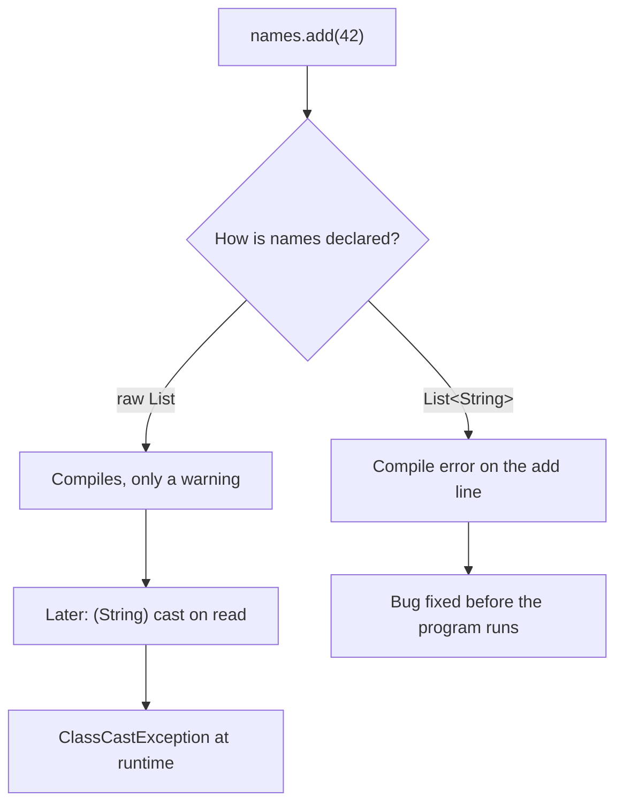
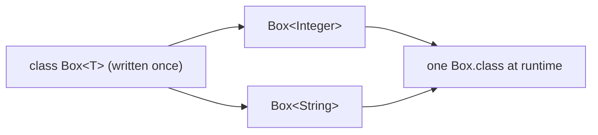

## In One Line
Generics let you write a class or method **once** with a *type parameter* (`Box<T>`) and let the compiler plug in the real type at each use (`Box<Integer>`, `Box<String>`), so type mistakes become **compile errors** instead of runtime crashes, and casts disappear.

## Mental Model
Think of **storage jars in a kitchen**.

- A **plain jar** (a class that stores `Object`) accepts anything. When you take something out you must *guess* what it is. Guess wrong and the recipe fails at dinner time — that is a `ClassCastException` at runtime.
- A **labelled jar** (`Box<String>`) has a label that is checked **at the door**: the compiler refuses to let you put a number into the "String" jar, and when you take something out you already know it is a `String`, so there is nothing to guess (no cast).
- The **jar design is the same for every label**. You write `class Box<T>` once; `T` is the blank label, and `Box<Integer>` / `Box<String>` just fill it in.
- The label lives **on the outside only**. Inside the warehouse (the JVM at runtime) all jars are plain jars again — this is *type erasure*, covered in [Type Erasure](lesson:a04-generics/07-type-erasure). The safety comes from the compiler checking every label before the program ever runs.

## Concept
### The problem: life before Java 5
Before generics, every collection stored plain `Object`. The compiler could not know what was inside, so it accepted anything and you cast on the way out:

```java
import java.util.ArrayList;
import java.util.List;

public class RawList {
    public static void main(String[] args) {
        List names = new ArrayList();      // raw type: every element is just an Object
        names.add("Asha");
        names.add(42);                     // compiles - nothing stops a wrong type
        for (Object o : names) {
            String s = (String) o;         // manual cast on every read
            System.out.println(s.toUpperCase());
        }
    }
}
```
```output
ASHA
Exception in thread "main" java.lang.ClassCastException: class java.lang.Integer cannot be cast to class java.lang.String (java.lang.Integer and java.lang.String are in module java.base of loader 'bootstrap')
	at RawList.main(RawList.java:10)
```
Three pains in one program:
1. **Casts everywhere** — noisy and easy to get wrong.
2. **No compile-time check** — `names.add(42)` is accepted.
3. **The crash happens far from the bug.** The mistake is on line 8 (`add(42)`), but the program dies on line 10 (the cast), possibly in a different class, written by a different person, weeks later.

### The fix: tell the compiler the element type
```java
List<String> names = new ArrayList<>();
names.add("Asha");
names.add(42);                     // rejected by the compiler
for (String s : names) {           // no cast needed
    System.out.println(s.toUpperCase());
}
```
```output
TypedList.java:8: error: incompatible types: int cannot be converted to String
        names.add(42);                     // rejected by the compiler
                  ^
```
The bug is now reported **on the exact line that causes it**, before the program can run.

### What generics give you
| Benefit | What it means | Example |
|---|---|---|
| **Compile-time type safety** | Wrong types are rejected when you compile, not discovered when you run | `names.add(42)` does not compile |
| **No casts** | The compiler knows the type, so reads are already typed | `String s = names.get(0);` |
| **Reusable, generic code** | One class/method works for every type, with full type checking | `Box<T>`, `Collections.sort(List<T>)` |
| **Self-documenting APIs** | The type says what goes in and comes out | `Map<String, List<Order>> ordersByCustomer` |

> [!NOTE] Generics do **not** make code faster. The casts you no longer write are still there in the bytecode — the compiler inserts them for you (see [Type Erasure](lesson:a04-generics/07-type-erasure)). And because type arguments must be objects, `Box<Integer>` stores a boxed `Integer`, not a raw `int`. The win is **correctness and readability**, not speed.

### The guarantee
If your whole program compiles **without unchecked warnings**, the casts the compiler inserts can never fail — no `ClassCastException` can come from generic code. Raw types and `@SuppressWarnings("unchecked")` are the only ways to break that promise, which is why the warnings matter.

### Object-based box vs generic box
The course example's `Box<T>` is the generic version of a class you could write with `Object`:

```java
static class ObjBox {                 // the pre-Java-5 way: store Object
    private Object content;
    ObjBox(Object content) { this.content = content; }
    Object getContent() { return content; }
}
static class Box<T> {                 // the generic way
    private T content;
    Box(T content) { this.content = content; }
    T getContent() { return content; }
}

ObjBox ob = new ObjBox("Hello");
String s1 = (String) ob.getContent();   // cast required
System.out.println(s1.length());

Box<String> gb = new Box<>("Hello");
String s2 = gb.getContent();            // no cast
System.out.println(s2.length());

ObjBox wrong = new ObjBox(123);
String s3 = (String) wrong.getContent(); // compiles, fails at runtime
System.out.println(s3);
```
```output
5
5
Exception in thread "main" java.lang.ClassCastException: class java.lang.Integer cannot be cast to class java.lang.String (java.lang.Integer and java.lang.String are in module java.base of loader 'bootstrap')
	at ObjectBox.main(ObjectBox.java:22)
```
Both boxes are equally reusable. Only the generic one is **type-safe**: `Box<String> b = new Box<>(123)` would not even compile.

### Vocabulary you must use correctly in interviews
| Term | In code | Meaning |
|---|---|---|
| Generic type | `class Box<T>` | A class or interface declared with type parameters |
| Type parameter (type variable) | `T` in `class Box<T>` | The placeholder, like a method *parameter* |
| Type argument | `Integer` in `Box<Integer>` | The real type plugged in, like a method *argument* |
| Parameterized type | `Box<Integer>` | A generic type with its arguments filled in |
| Raw type | `Box` (no `<...>`) | The generic type used without arguments — generics switched off |
| Diamond operator | `new Box<>(123)` | Java 7+: let the compiler infer the arguments |
| Generic method | `static <T> void printArray(T[] a)` | A method with its own type parameter |
| Bounded type parameter | `<T extends Number>` | `T` must be `Number` or a subtype |
| Wildcard | `List<?>`, `List<? extends Number>` | "Some unknown type" in a use site |

Memory hook: it is exactly like methods. In `void f(int x)` the `x` is a parameter; in `f(5)` the `5` is an argument. In `class Box<T>` the `T` is a type parameter; in `Box<Integer>` the `Integer` is a type argument.

### Naming conventions for type parameters
By convention a type parameter is a **single uppercase letter**, so it never looks like a real class name:

| Letter | Stands for | JDK example |
|---|---|---|
| `T` | Type | `Optional<T>`, `Comparable<T>` |
| `E` | Element (collections) | `List<E>`, `Set<E>` |
| `K`, `V` | Key, Value | `Map<K, V>` |
| `R` | Result / return type | `Function<T, R>` |
| `N` | Number | `NumberBox<N extends Number>` |
| `S`, `U`, `V` | 2nd, 3rd, 4th types | `Pair<T, U>`, `BiFunction<T, U, R>` |

### Rules you need from day one
- **Type arguments must be reference types.** `Box<int>` does not compile:
  ```output
  PrimBox.java:4: error: unexpected type
          Box<int> b = new Box<>(5);
              ^
    required: reference
    found:    int
  ```
  Use the wrapper (`Box<Integer>`); autoboxing turns `123` into `Integer.valueOf(123)` for you. See [Wrapper Classes](lesson:a02-core/15-wrapper-classes).
- **Generic types are invariant.** `Box<Integer>` is *not* a `Box<Number>`, even though `Integer` is a `Number` (`incompatible types: Box<Integer> cannot be converted to Box<Number>`). Wildcards solve this — see [Wildcards](lesson:a04-generics/05-wildcards).
- **Generics are a compile-time feature.** At runtime `Box<Integer>` and `Box<String>` are the same `Box` class, so you cannot write `new T()`, `T.class` or `obj instanceof Box<Integer>`. See [Type Erasure](lesson:a04-generics/07-type-erasure).
- **Raw types exist only for backward compatibility** with pre-2004 code. Never use them in new code.

### A short history
| Version | What changed |
|---|---|
| Java 5 (2004) | Generics added (JSR 14), based on the "Generic Java" research by Odersky, Wadler, Bracha and Stoutamire. Implemented with **type erasure** so old bytecode and old libraries keep working unchanged. The whole Collections Framework was retro-fitted (`List` became `List<E>`). |
| Java 7 | Diamond operator: `new ArrayList<>()` instead of `new ArrayList<String>()`. |
| Java 8 | Much better target-type inference (needed for lambdas and streams). |
| Java 9 | Diamond allowed with anonymous classes. |
| Java 10 | `var` for local variables. |
| Java 16 | Records (final) — and records can be generic: `record Pair<T, U>(T first, U second) {}`. |
| Future | Project Valhalla is working on value classes and, later, generics over primitives such as `List<int>`. None of this is in Java 21. |

### Where you already use generics
`List<E>`, `Set<E>`, `Map<K, V>` ([Collections Overview](lesson:a03-collections/00-collections-overview)), `Optional<T>`, `Comparable<T>`, `Comparator<T>`, `Function<T, R>`, `Stream<T>`, `Class<T>`, `ThreadLocal<T>`, `CompletableFuture<T>`. Reading their signatures fluently is a large part of "knowing Java".

### When not to make something generic
Make a type generic when it **stores, passes through or returns** values whose type the *caller* decides (containers, results, callbacks, algorithms). A class that only ever works with `String`s gains nothing from `<T>` except noise.

## Diagram

The same mistake is caught at two very different moments: far away at runtime without generics, on the exact line at compile time with them.


One source template, many compile-time "views". The compiler checks each view, then erases them all to a single runtime class.

## Code
@example Generics/GenericsExample.java

The example never calls `setContent`. Here it is in action — the setter is typed too, so only an `Integer` can go into `integerBox`:
```java
Box<Integer> integerBox = new Box<>(123);
integerBox.setContent(integerBox.getContent() + 1);   // unbox, add, box again
System.out.println(integerBox.getContent());

Box<String> stringBox = new Box<>("Hello, Generics");
stringBox.setContent(stringBox.getContent().toUpperCase());
System.out.println(stringBox.getContent());
// stringBox.setContent(42);  -> compile error: int cannot be converted to String
```
```output
124
HELLO, GENERICS
```

## Walkthrough
- `package Generics;` — the class lives in package `Generics` (folder `Generics/`). Its full name is `Generics.GenericsExample`. The capital letter breaks the naming convention — see Traps.
- `class Box<T> { ... }` — a **package-private** top-level class declared in the same file as the public class (legal: a file may contain many top-level classes but at most one `public` one, whose name must match the file). `<T>` is the **type parameter section**: it declares a placeholder type named `T` that can be used anywhere inside `Box`'s instance members.
- `private T content;` — a field whose type is "whatever `T` is for this box". Private, so it is only reachable through the getter and setter (encapsulation).
- `public Box(T content) { this.content = content; }` — the constructor. Note its name is plain `Box`, **not** `Box<T>`. `this.content` is the field, `content` is the parameter.
- `public T getContent()` — returns a `T`. For a `Box<Integer>` the caller receives an `Integer`, for a `Box<String>` a `String` — with no cast in the calling code.
- `public void setContent(T content)` — accepts only a `T`. Unused in `main`; the extra snippet above shows it.
- `Box<Integer> integerBox = new Box<>(123);`
  - The left side fixes the **type argument**: `T = Integer`.
  - `new Box<>(...)` is the **diamond operator** (Java 7+): the compiler infers `Integer` from the left side, so you do not repeat it. See [Type Inference](lesson:a04-generics/06-type-inference).
  - `123` is an `int`; it is **autoboxed** to `Integer.valueOf(123)` because `T` can only be a reference type.
- `System.out.println("Integer Box content: " + integerBox.getContent());` — `getContent()` returns an `Integer`; string concatenation calls its `toString()`, giving `Integer Box content: 123`.
- `Box<String> stringBox = new Box<>("Hello, Generics");` — the very same class, now with `T = String`. Prints `String Box content: Hello, Generics`.
- **The output comments are correct** — both `// Output:` lines match the real output exactly.
- **Under the hood:** the compiler checks every use against the type argument, then erases `T` to `Object` and turns `integerBox.getContent()` into `(Integer) integerBox.getContent()` in the bytecode. That hidden cast is why the check has to happen at compile time.

**How to run it.** On JDK 21, `java GenericsExample.java` (single-file source launch) fails:
```output
error: can't find main(String[]) method in class: Generics.Box
```
In source-file mode the launcher runs the **first** top-level class in the file, which is `Box`, not `GenericsExample`. Compile and run by class name instead (this is how the recorded output was produced):
```text
javac -d out Generics/GenericsExample.java
java -cp out Generics.GenericsExample
```
Running it from an IDE also works, because the IDE picks the class with `main`.

## Traps
> [!ERRATA] `package Generics;` uses a capital letter. The Java convention is **all-lowercase package names** (`package generics;`), so that `generics.Box` can never be confused with a nested class `Box` inside a class called `Generics`. This applies to every example in this module. The code still compiles and runs — it is a style error, not a bug.

> [!WARNING] Putting a helper class (`Box`) **before** the public class in the same file breaks `java GenericsExample.java` on JDK 21 ("can't find main(String[]) method in class: Generics.Box"). Either put the class with `main` first, give each top-level class its own file, or compile with `javac` first.

- **Raw types silently switch the checks off.** Assigning a raw `Box` to a `Box<Integer>` only produces a warning — and the crash happens later, on a line that looks perfectly safe:
  ```java
  Box raw = new Box<>("hello");      // raw type: generics switched off
  Box<Integer> ints = raw;           // only an unchecked warning
  System.out.println("assigned fine");
  Integer n = ints.getContent();     // hidden cast fails here
  ```
  ```output
  assigned fine
  Exception in thread "main" java.lang.ClassCastException: class java.lang.String cannot be cast to class java.lang.Integer (java.lang.String and java.lang.Integer are in module java.base of loader 'bootstrap')
  	at RawBox.main(RawBox.java:12)
  ```
- **A raw parameter can corrupt a typed list.** A method `static void addToRaw(List list) { list.add("x"); }` accepts a `List<Integer>` and pushes a `String` into it. The list prints happily as `[1, 2, x]`; the `ClassCastException` only appears when someone later reads the element as an `Integer`. `List<Object>` would have been rejected at compile time (`List<Integer> cannot be converted to List<Object>`).
- **`==` on boxed values.** A `Box<Integer>` holds `Integer` objects, so `a.getContent() == b.getContent()` compares **references**. It happens to be `true` for values from -128 to 127 (the `Integer` cache) and usually `false` above that. Use `equals`.
- **Primitives are not allowed** as type arguments: `Box<int>` → *unexpected type, required: reference, found: int*.
- **Generics are invariant:** `Box<Number> nb = new Box<Integer>(1);` does not compile.
- **Ignoring "unchecked" warnings.** The note *"uses unchecked or unsafe operations"* is the compiler telling you its type-safety guarantee no longer holds. Recompile with `-Xlint:unchecked` to see where.

## Tips & Tricks
- **Mnemonic — "Checked at the door, erased in the warehouse."** The compiler checks every label; the JVM only ever sees plain boxes.
- **Letters:** **T**ype, **E**lement, **K**ey/**V**alue, **R**esult, **N**umber; then S, U, V for extra types.
- **Parameter vs argument:** "**P**arameter is the **P**laceholder (`T`), **A**rgument is the **A**ctual type (`Integer`)."
- **Every cast is a smell.** If you find yourself writing `(String) x.get()`, ask whether a type parameter could make the cast unnecessary.
- **Never write a raw type** in new code. If you do not know the type, use `List<?>`, not `List`.
- **Treat unchecked warnings as errors** (`javac -Xlint:unchecked -Werror` or the IDE equivalent). If you must suppress one, put `@SuppressWarnings("unchecked")` on the smallest possible scope and add a comment saying why it is safe.
- **Declare with the interface, create with the class:** `List<String> names = new ArrayList<>();`.

## Interview Q&A
### [Basic] What are generics and why were they added to Java?
Generics let classes, interfaces and methods take **types as parameters**, e.g. `List<String>` or `Box<T>`. They were added in Java 5 to fix the problems of `Object`-based collections: the compiler could not check what went in, every read needed a cast, and wrong types only surfaced as `ClassCastException` at runtime, often far from the real bug. With generics the compiler checks types at compile time, casts disappear from source code, and one class or algorithm can be reused safely for any type.

**Follow-up:** *Do generics exist at runtime?* — Mostly no. They are implemented by type erasure: the compiler checks types, then removes the type arguments and inserts casts. `List<String>` and `List<Integer>` are the same class at runtime.

### [Basic] What is the difference between a type parameter and a type argument?
A **type parameter** is the placeholder declared by the generic type or method — `T` in `class Box<T>`. A **type argument** is the actual type supplied when you use it — `Integer` in `Box<Integer>`. The result, `Box<Integer>`, is called a **parameterized type**. It mirrors method parameters (`int x` in the declaration) and arguments (`5` in the call).

**Follow-up:** *What is a raw type?* — The generic type used with no type arguments at all, like `Box` or `List`. It exists only for compatibility with pre-Java-5 code.

### [Basic] Can you use primitive types like `int` as type arguments?
No. Type arguments must be reference types, so you write `List<Integer>`, not `List<int>`. The reason is erasure: a type parameter is erased to `Object` (or its bound), and a primitive is not an `Object`. Autoboxing hides most of the pain: `list.add(5)` becomes `list.add(Integer.valueOf(5))`. The cost is memory and boxing overhead, which is why the JDK offers `IntStream`, `int[]` and specialised functional interfaces such as `IntPredicate`.

**Follow-up:** *Will Java ever support `List<int>`?* — Project Valhalla is working towards it (value classes, then specialised generics), but it is not part of Java 21.

### [Intermediate] What is a raw type and why is using one dangerous?
A raw type is a generic type without type arguments, such as `List` instead of `List<String>`. Using it switches off generic type checking for that expression: the compiler only emits an "unchecked" warning. You can then insert an `Integer` into what is really a `List<String>`, and the failure appears later as a `ClassCastException` on an innocent-looking line that reads the element. Raw types exist only so that code written before Java 5 still compiles. In new code, use a proper type argument, or `List<?>` if the element type is truly unknown.

**Follow-up:** *What is the difference between `List`, `List<Object>` and `List<?>`?* — `List` is raw (no checking). `List<Object>` is a list that may hold anything, but it does **not** accept a `List<String>` argument (invariance). `List<?>` accepts any list but you cannot add to it (except `null`), so it stays safe.

### [Intermediate] Do generics improve performance?
No. They are a compile-time safety feature. After type erasure the bytecode is essentially what you would have written by hand with `Object` and casts — the compiler inserts the `checkcast` instructions for you. If anything, generics over numbers cost a little extra because values must be boxed (`Integer` instead of `int`). The benefit is fewer bugs and cleaner code.

**Follow-up:** *So what does the JVM know about generics?* — The class file keeps generic signatures as metadata (the `Signature` attribute), which reflection can read, but the JVM does not use them to check anything at runtime.

### [Intermediate] Is `List<Integer>` a subtype of `List<Number>`?
No. Generic types are **invariant**: there is no subtype relationship between `List<Integer>` and `List<Number>`, even though `Integer` extends `Number`. If it were allowed, you could do `List<Number> nums = ints; nums.add(3.14);` and put a `Double` into a list of integers. To accept "a list of any kind of number" you use a wildcard: `List<? extends Number>`.

**Follow-up:** *But `Integer[]` is a subtype of `Number[]` — why the difference?* — Arrays are covariant and check each store at runtime (`ArrayStoreException`). Generics are erased, so they cannot check at runtime and must be strict at compile time instead.

### [Intermediate] What naming conventions are used for type parameters?
Single uppercase letters: `T` for a type, `E` for a collection element, `K` and `V` for map keys and values, `R` for a result, `N` for a number, and `S`, `U`, `V` for additional types. Single letters make it obvious that a name is a type variable and not a real class. Longer names such as `TKey` are legal but uncommon in Java.

**Follow-up:** *Can a type parameter have the same name as a real class, like `<String>`?* — Yes, legally, and it then *shadows* `java.lang.String` inside that scope — a classic confusing interview puzzle. Never do it.

### [Advanced] How does Java implement generics, and how is that different from C++ or C#?
Java uses **type erasure**. The compiler type-checks generic code, then replaces each type parameter with its bound (`Object` if unbounded), inserts casts where values come out, and generates bridge methods where needed. There is one class file per generic class, and old pre-generics code can call new generic code and vice versa. C++ templates are the opposite: the compiler generates a separate copy of the code for each instantiation (`vector<int>`, `vector<string>`). C# uses **reified** generics: the runtime knows the type arguments, so `List<int>` exists without boxing and `typeof(T)` works. Java chose erasure in 2004 for **migration compatibility** — the huge existing ecosystem kept working without recompilation.

**Follow-up:** *What can't you do because of erasure?* — `new T()`, `new T[n]`, `T.class`, `instanceof List<String>`, generic exception classes, and overloading methods whose parameters erase to the same type.

### [Advanced] What exactly is the type-safety guarantee of generics?
If an entire program compiles without unchecked warnings, then every compiler-inserted cast is guaranteed to succeed, so generic code can never cause a `ClassCastException`. Unchecked warnings come from raw types, unchecked casts like `(T) obj` or `(List<String>) obj`, and generic varargs. Each one is a place where the compiler could not prove safety, so the guarantee is only as strong as your handling of those warnings.

**Follow-up:** *When is `@SuppressWarnings("unchecked")` acceptable?* — Only when you have proved the operation is safe (for example casting a freshly created `Object[]` inside a class that never lets it escape), on the smallest possible scope, with a comment explaining why.

## Quiz
### What is the main benefit of generics?
- [ ] Faster execution, because casts are removed at runtime
- [x] Type errors are caught at compile time and casts disappear from source code
- [ ] They allow primitive types such as `int` in collections
- [ ] They let the JVM check element types at runtime
> Generics move type checking to the compiler. They are not faster (the compiler still inserts casts in bytecode), primitives are still not allowed, and the JVM does not check type arguments at runtime because of erasure.

### What does this print?
```java
List names = new ArrayList();
names.add("Asha");
names.add(42);
for (Object o : names) {
    String s = (String) o;
    System.out.println(s.toUpperCase());
}
```
- [ ] Compile error on `names.add(42)`
- [ ] `ASHA` then `42`
- [x] `ASHA`, then a `ClassCastException`
- [ ] A `ClassCastException` before anything is printed
> A raw `List` accepts anything, so it compiles (with an unchecked warning). The first element is a `String` and prints as `ASHA`. The second is an `Integer`, and the cast `(String) o` fails with `ClassCastException`. It is not a compile error because raw types switch off generic checking.

### In `Box<Integer> b = new Box<>(5);`, what is `Integer`?
- [ ] The type parameter
- [x] The type argument
- [ ] The raw type
- [ ] A wildcard
> `T` (in `class Box<T>`) is the type parameter — the placeholder. `Integer` is the type argument — the actual type plugged in. `Box<Integer>` as a whole is the parameterized type; `Box` alone would be the raw type.

### What happens with this code?
```java
Box<String> b = new Box<>("42");
Integer n = (Integer) b.getContent();
```
- [ ] It compiles and throws `ClassCastException` at runtime
- [ ] It compiles and `n` is 42
- [x] It does not compile: `String cannot be converted to Integer`
- [ ] It compiles with an unchecked warning
> Because `b` is a `Box<String>`, the compiler knows `getContent()` returns `String`, and a cast from `String` to `Integer` is impossible — compile error. With a raw or `Object`-based box, the same mistake would only fail at runtime.

### What does this print?
```java
Box<Integer> a = new Box<>(10);
Box<Integer> b = new Box<>(10);
Box<Integer> c = new Box<>(1000);
Box<Integer> d = new Box<>(1000);
System.out.println(a.getContent() == b.getContent());
System.out.println(c.getContent() == d.getContent());
System.out.println(c.getContent().equals(d.getContent()));
```
- [ ] true, true, true
- [x] true, false, true
- [ ] false, false, true
- [ ] Compile error: cannot compare `Integer` with `==`
> Type arguments are objects, so the boxes hold `Integer` references. `==` compares references: autoboxing uses `Integer.valueOf`, which caches -128..127, so both `10`s are the same object (`true`) but the two `1000`s are different objects (`false`). `equals` compares values (`true`).

### What does this print?
```java
Box<Integer> box = new Box<>(123);
box.setContent(box.getContent() + 1);
System.out.println("Box: " + box.getContent() + 1);
```
- [ ] Box: 125
- [x] Box: 1241
- [ ] Box: 124
- [ ] Compile error: cannot add to a `T`
> `box.getContent() + 1` is numeric (`Integer` unboxes to 124), so the box now holds 124. In the `println`, evaluation is left to right: `"Box: " + 124` is the string `"Box: 124"`, then `+ 1` appends `"1"`. It compiles because inside `main` the type is `Integer`, not an unknown `T`.

### Which line does NOT compile?
- [ ] `Box<Integer> a = new Box<>(123);`
- [x] `Box<int> b = new Box<>(123);`
- [ ] `Box<String> c = new Box<>("x");`
- [ ] `Box<Object> d = new Box<>(123);`
> Type arguments must be reference types — `Box<int>` gives *unexpected type, required: reference, found: int*. `Box<Object>` is fine: `123` is boxed to an `Integer`, which is an `Object`.

## Takeaways
- Generics add type parameters to classes, interfaces and methods (`Box<T>`) so one piece of code works for many types with full compile-time checking.
- Before Java 5, collections held `Object`: every read needed a cast and wrong types failed at runtime with `ClassCastException`, far from the real bug.
- Vocabulary: `T` is a type parameter, `Integer` in `Box<Integer>` is a type argument, `Box<Integer>` is a parameterized type, plain `Box` is a raw type, `<>` is the diamond.
- Type arguments must be reference types (`Box<Integer>`, never `Box<int>`); autoboxing converts the values.
- Generic types are invariant: `Box<Integer>` is not a `Box<Number>`; wildcards (`? extends Number`) handle that.
- Generics are compile-time only (type erasure): no runtime speed-up, the compiler inserts the casts, and code without unchecked warnings can never fail those casts.
- Never use raw types in new code; treat unchecked warnings as errors.
